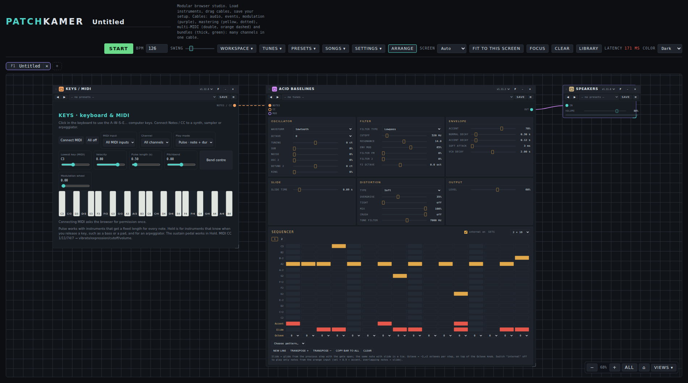

# Patchkamer

*Nederlandse versie: [README_NL.md](README_NL.md)*

**Patchkamer is a modular music studio in your browser.** Place devices on a floor, connect them with cables, press Start and make music. Synths, sequencers, effects and outputs are small plug-in files that follow an open contract, so people and AI agents can build new ones.



## What you can do

- **Patch like a modular studio.** Drag devices onto the floor and connect them with cables: **audio**, **events** (notes), **modulation** and **bundles** (many channels in one cable).
- **Play and sequence.** A clock with tempo and swing drives the devices. Play live with the on-screen keyboard, your computer keys or a MIDI keyboard, or let a built-in step sequencer play for you.
- **Keep your sounds.** Save the full setting of any device as a **tune** (devices that make sound) or a **preset** (effects, mixers and so on). Organise them in libraries and folders and share them as packs.
- **Save and share your work.** Save a workspace as a file or in your browser, or export it as a **song** that carries all device code, a title, an author and a license, so anyone can open it.
- **Load devices from anywhere.** From a folder on your computer, from GitHub or from a web address.
- **Make it yours.** Dutch and English interface (follows your browser), dark, light and retro looks, a focus view, zoom and an audio quality setting (sample rate, latency, oversampling).
- **Private by design.** Plain HTML, CSS and JavaScript files, no build step. No install, no account, nothing uploaded.

## Quick start

1. Open Patchkamer online at <https://unboxednl.github.io/patchkamer/> (Chrome or Edge, also on an Android phone). It always runs the latest version from this repository. Prefer to run it yourself? Download this repository (**Code → Download ZIP**, or `git clone https://github.com/unboxednl/patchkamer`) and open `patchkamer/patchkamer.html`.
2. Offline, for the smoothest start, run `python3 -m http.server 8080` in the repository folder and open `http://localhost:8080/patchkamer/patchkamer.html`.
3. In the library window, under **Sources**, type `github.com/unboxednl/patchkamer` and click **Add**. Place **Keys / MIDI**, **Acid Baselines** and **Speakers**, connect them with cables, press **Start** and play.

The [user manual](docs/USER-MANUAL_EN.md) walks you through it step by step, with screenshots.

## Devices

Devices come in kinds. Every kind has its own README in its folder and its own user manual.

| Kind | What it is for | Devices | README | Manual |
|---|---|---|---|---|
| **Synths** | Make sound from notes | Acid Baselines, Acid Stepper, Basic Mono, Biotope, Bowed Ensemble, Celestial Mechanics, Chord Poly, Cinematic Synth, Cross Mod Mono, Dissonant Cluster, Drone Synth, Duofone, Formant Singer, Foundry, Four-Operator FM, Grain Cloud, Karplus String, Ladder Mono, Layered Landscape, Low Bass, Mist, Paradox, Patch Mono, Patchbay Synth, Poly Chorus, Stage Keys, Sub Line, Supersaw Swarm, Triple Osc Poly | [devices/synths](devices/synths/README.md) | [Synths](docs/synths/USER-MANUAL_EN.md) |
| **Samplers** | Play your own sounds: pads and slices from loaded audio | Samplebank, Loop Slicer | [devices/samplers](devices/samplers/README.md) | [Samplers](docs/samplers/USER-MANUAL_EN.md) |
| **Sequencers** | Play notes and chords on other devices | Chord Sequencer, Clip Arranger, Euclidean Rhythms, Pattern Playlist, Pattern Tracker, Scale Arpeggiator, Step Sequencer, Wanderer | [devices/sequencers](devices/sequencers/README.md) | [Sequencers](docs/sequencers/USER-MANUAL_EN.md) |
| **Drums** | Drum sounds and rhythm | Drum Machine, Drum Kit, Groovebox 12, Pulse Drums, Latin Percussion, Click Synth | [devices/drums](devices/drums/README.md) | [Drums](docs/drums/USER-MANUAL_EN.md) |
| **Effects** | Shape the sound: modulation, distortion, space, filters, rhythm, voice, whole chains | Chorus, Effect Chain, Filter, Flanger, Frequency Shifter, Grit, Phaser, Pump, Resonator, Room, Tremolo, Vocoder | [devices/effects](devices/effects/README.md) | [Effects](docs/effects/USER-MANUAL_EN.md) |
| **Mastering** | Finish a mix: tone, dynamics, saturation, width, loudness and checking, for many styles and situations | Balance EQ, Multiband Balance, Bus Compressor, Patina, Stereo Space, Master Chain, Mix Check, Master Director, Listening Output | [devices/mastering](devices/mastering/README.md) | [Mastering](docs/mastering/USER-MANUAL_EN.md) |
| **Mixer** | Bring in, mix, keep the level steady, play out | Mixer, Leveler, Speakers, Audio Input, Audio Capture, Audio Output | [devices/mixer](devices/mixer/README.md) | [Mixer](docs/mixer/USER-MANUAL_EN.md) |
| **Modulators** | Move the controls of other devices | Drift, Follower, LFO, Macro, Multi-Segment Envelope, Swell | [devices/modulators](devices/modulators/README.md) | [Modulators](docs/modulators/USER-MANUAL_EN.md) |
| **Tools** | Play, record, measure and take notes | Control Surface, Keys / MIDI, Metronome, MIDI Hub, Multitrack, Notes, Pad Controller, Recorder, Scope | [devices/tools](devices/tools/README.md) | [Tools](docs/tools/USER-MANUAL_EN.md) |

## Ready-made sounds and settings

| | What it is | README | Manual |
|---|---|---|---|
| **Tunes** | Complete sounds for devices that make sound (the synths, the samplers and the drum devices), in packs per style | [tunes](tunes/README.md) | [Tunes](docs/tunes/USER-MANUAL_EN.md) |
| **Presets** | Starting settings for devices without a sound of their own: a pack for most effects, the modulators, the sequencers, the mastering devices, the Metronome, the Leveler, Audio Input, Audio Capture and Audio Output. The Effect Chain packs are complete chains of four to eight effects, each built for one application | [presets](presets/README.md) | [Presets](docs/presets/USER-MANUAL_EN.md) |
| **Skins** | The look of a single device, as a separate file with one or more appearances that switch by themselves on card width and screen size | [skins](skins/README.md) | (manual follows) |

## Build your own devices, with or without AI

A device is a single `.patchkamer-device.js` file. The **contract** says exactly what a device must do. It is complete and self-contained, in English and Dutch, so a person or an AI agent can build a device from it alone. A **validator** checks the result:

```
node contract/validate-instrument.mjs devices/synths/Duofone/duofone.patchkamer-device.js
```

Point your AI agent at [AGENTS.md](AGENTS.md). It tells the agent what to read, where to put the files and what to check. The current contract is **v1.14**. Every version is tagged (`contract/vX.Y`).

## What is in this repository

| Folder | Contents | License |
|---|---|---|
| `patchkamer/` | The host: the studio itself, as plain HTML, CSS and JavaScript files | AGPL-3.0-or-later |
| `contract/` | The device contract (English and Dutch) and the validator | MIT |
| `devices/` | The included devices, in a folder per kind and a folder per device | AGPL-3.0-or-later |
| `app/` | The desktop app (Electron): the host in its own window, with the bundled library; builds a portable Windows exe | AGPL-3.0-or-later |
| `tunes/` | Sounds for devices that make sound | CC0-1.0 |
| `presets/` | Settings for devices without a sound of their own | CC0-1.0 |
| `skins/` | Skins: the look of a single device, as a separate file (contract, validator and library) | CC0-1.0 (library), MIT (contract) |
| `songs/` | Included songs | CC-BY-4.0 |
| `docs/` | The user manual, the manuals per kind of device, their screenshots and the scripts that make them | AGPL-3.0 (the root license) |

See [LICENSING.md](LICENSING.md) for the reasons behind each choice.

## Documentation

- [User manual](docs/USER-MANUAL_EN.md) ([Nederlands](docs/USER-MANUAL_NL.md)): the studio, the library, patching, workspaces, settings and shortcuts
- Manuals per kind of device and for sounds: [synths](docs/synths/USER-MANUAL_EN.md), [samplers](docs/samplers/USER-MANUAL_EN.md), [sequencers](docs/sequencers/USER-MANUAL_EN.md), [drums](docs/drums/USER-MANUAL_EN.md), [effects](docs/effects/USER-MANUAL_EN.md), [mastering](docs/mastering/USER-MANUAL_EN.md), [mixer](docs/mixer/USER-MANUAL_EN.md), [modulators](docs/modulators/USER-MANUAL_EN.md), [tools](docs/tools/USER-MANUAL_EN.md), [tunes](docs/tunes/USER-MANUAL_EN.md) and [presets](docs/presets/USER-MANUAL_EN.md) (all in Dutch too: replace `_EN` by `_NL`)
- [Device contract](contract/PATCHKAMER-CONTRACT_EN.md) ([Nederlands](contract/PATCHKAMER-CONTRACT_NL.md))
- [AGENTS.md](AGENTS.md): instructions for AI agents that build devices

## License

Each folder has its own license, listed above and in [LICENSING.md](LICENSING.md). The `LICENSE` file in the root (AGPL-3.0) covers everything not stated otherwise. Copyright 2026 Freek van Gool.

Third-party part: the Recorder device makes MP3 files with [lamejs](https://github.com/zhuker/lamejs) 1.2.1 (LGPL-3.0, [license text](LICENSES/LGPL-3.0-only.txt)), included unchanged as a separate piece of text in `devices/tools/Recorder/recorder.patchkamer-device.js`. The rest of that file is AGPL-3.0-or-later. See [LICENSING.md](LICENSING.md).
