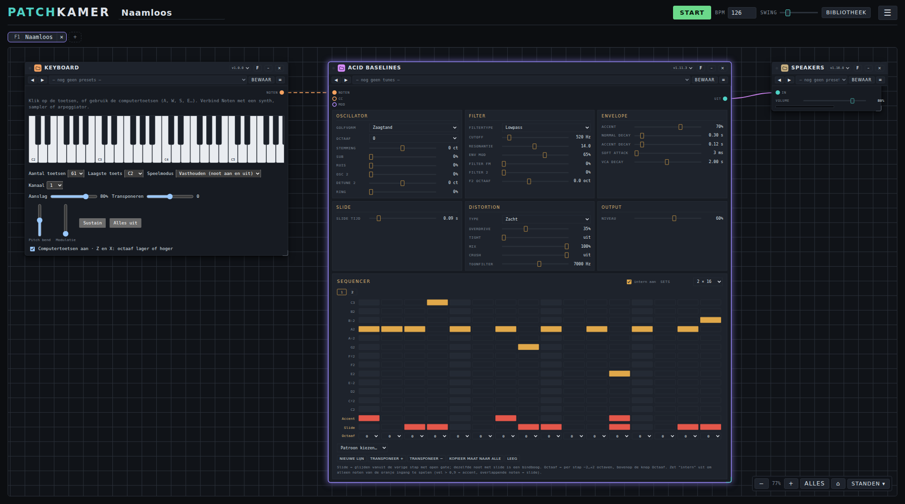

# Patchkamer

*English version: [README.md](README.md)*

**Patchkamer is een modulaire muziekstudio in je browser.** Zet apparaten op een vloer, verbind ze met kabels, druk op Start en maak muziek. Synths, sequencers, effecten en uitgangen zijn kleine insteekbestanden die een open contract volgen, zodat mensen en AI-agents nieuwe kunnen bouwen.



## Wat je ermee kunt

- **Patchen als in een modulaire studio.** Sleep apparaten op de vloer en verbind ze met kabels: **audio**, **gebeurtenissen** (noten), **sturing** (modulatie) en **bundels** (veel kanalen in één kabel).
- **Spelen en sequencen.** Een klok met tempo en swing stuurt de apparaten aan. Speel live met het schermtoetsenbord, je computertoetsen of een MIDI-keyboard, of laat een ingebouwde stapsequencer voor je spelen.
- **Bewaar je klanken.** Leg de volledige instelling van elk apparaat vast als **tune** (apparaten die geluid maken) of **preset** (effecten, mixers enzovoort). Ordenen kan in bibliotheken en mappen, en je deelt ze als pakket.
- **Bewaar en deel je werk.** Bewaar een werkruimte als bestand of in je browser, of exporteer hem als **song** met alle apparaatcode, een titel, een maker en een licentie, zodat iedereen hem kan openen.
- **Apparaten laden van overal.** Uit een map op je computer, van GitHub of van een webadres.
- **Maak het van jou.** Nederlandse en Engelse interface (volgt je browser), donkere, lichte en retro uitstraling, een focusweergave, zoom en een instelling voor audiokwaliteit (sample rate, latency, oversampling).
- **Privé door ontwerp.** Eén HTML-bestand. Geen installatie, geen account, niets wordt geüpload.

## Snel starten

1. Haal deze repository binnen (**Code → Download ZIP**, of `git clone https://github.com/unboxednl/patchkamer`).
2. Open `patchkamer/patchkamer.html` in Chrome of Edge. Voor de soepelste start draai je `python3 -m http.server 8080` in de map van de repository en open je `http://localhost:8080/patchkamer/patchkamer.html`.
3. Typ in het bibliotheekvenster onder **Bronnen** `github.com/unboxednl/patchkamer` en klik op **Toevoegen**. Plaats **Keys / MIDI**, **Acid Baselines** en **Speakers**, verbind ze met kabels, druk op **Start** en speel.

De [gebruikershandleiding](docs/USER-MANUAL_NL.md) leidt je er stap voor stap doorheen, met screenshots.

## Meegeleverde apparaten

| Apparaat | Wat het is | Map |
|---|---|---|
| **Duofone** | Een synth in analoge stijl met twee onafhankelijke toonhoogten, een gedeeld filter en een gedeelde VCA, ringmodulatie, hard sync en sample & hold | `devices/synths/Duofone/` |
| **Acid Baselines** | Een bassynth met een sequencer van 16 stappen (accent, slide, octaaf per stap) en 16 klassieke patronen in acid-stijl | `devices/synths/AcidBaselines/` |
| **Keys / MIDI** | Een keyboard en Web MIDI-brug die noten naar andere apparaten stuurt | `devices/tools/Keys/` |
| **Speakers** | De uitgang: volume, een begrenzer en een uitsteekmeter | `devices/mixer/Speakers/` |

De map `tunes/` bevat **Duofone Styles** (60 tunes in 12 stijlen) en **Acid Baselines Classics** (40 tunes in 8 stijlen).

## Bouw je eigen apparaten, met of zonder AI

Een apparaat is één `.patchkamer-device.js`-bestand. Het **contract** zegt precies wat een apparaat moet doen. Het is volledig en zelfstandig, in het Nederlands en het Engels, zodat een mens of een AI-agent er alleen op basis daarvan een apparaat mee kan bouwen. Een **validator** controleert het resultaat:

```
node contract/validate-instrument.mjs devices/synths/Duofone/duofone.patchkamer-device.js
```

Wijs je AI-agent naar [AGENTS.md](AGENTS.md). Daar staat wat hij moet lezen, waar hij de bestanden neerzet en wat hij moet controleren. Het huidige contract is **v1.11**. Elke versie heeft een tag (`contract/vX.Y`).

## Wat er in deze repository staat

| Map | Inhoud | Licentie |
|---|---|---|
| `patchkamer/` | De host: de studio zelf, als één HTML-pagina | AGPL-3.0-or-later |
| `contract/` | Het contract voor apparaten (Nederlands en Engels) en de validator | MIT |
| `devices/` | De meegeleverde apparaten, één map per apparaat | AGPL-3.0-or-later |
| `tunes/` | Klanken voor apparaten die geluid maken | CC0-1.0 |
| `presets/` | Instellingen voor apparaten zonder eigen geluid | CC0-1.0 |
| `songs/` | Meegeleverde songs | CC-BY-4.0 |
| `docs/` | De gebruikershandleiding, de screenshots en het script dat ze maakt | AGPL-3.0 (de root-licentie) |

In [LICENSING.md](LICENSING.md) staat waarom elke keuze is gemaakt.

## Documentatie

- [Gebruikershandleiding](docs/USER-MANUAL_NL.md) ([English](docs/USER-MANUAL_EN.md))
- [Contract voor apparaten](contract/PATCHKAMER-CONTRACT_NL.md) ([English](contract/PATCHKAMER-CONTRACT_EN.md))
- [AGENTS.md](AGENTS.md): instructies voor AI-agents die apparaten bouwen

## Licentie

Elke map heeft een eigen licentie, hierboven en in [LICENSING.md](LICENSING.md) vermeld. Het `LICENSE`-bestand in de root (AGPL-3.0) geldt voor alles wat niet anders is aangegeven. Copyright 2026 Freek van Gool.
