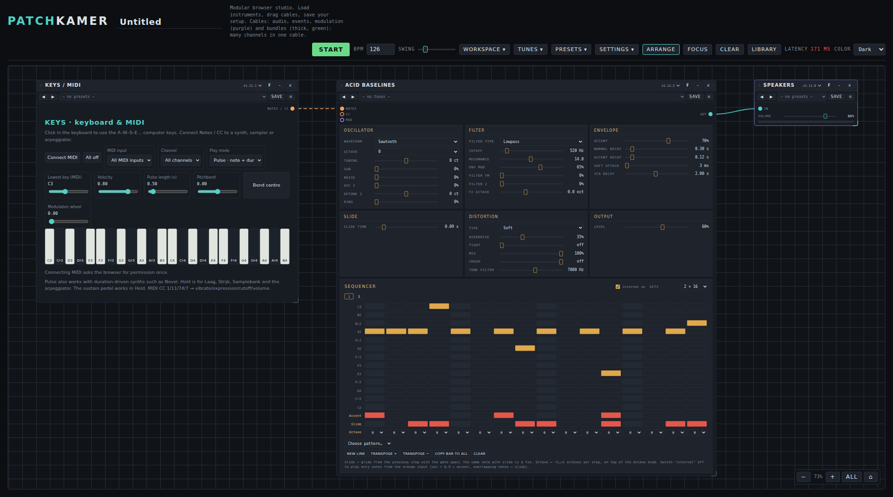
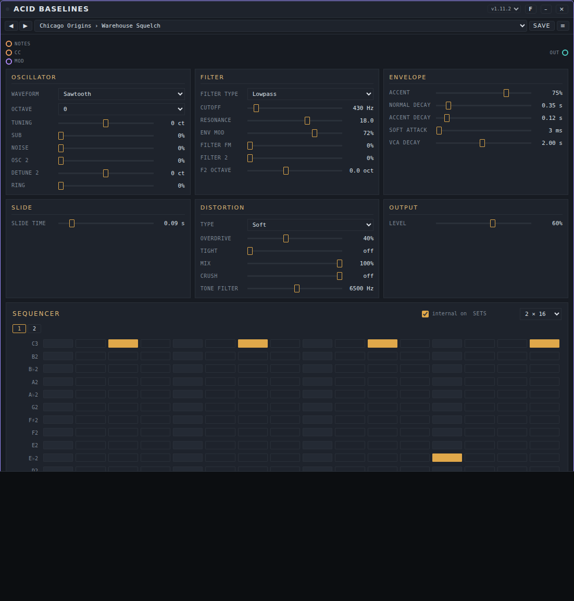
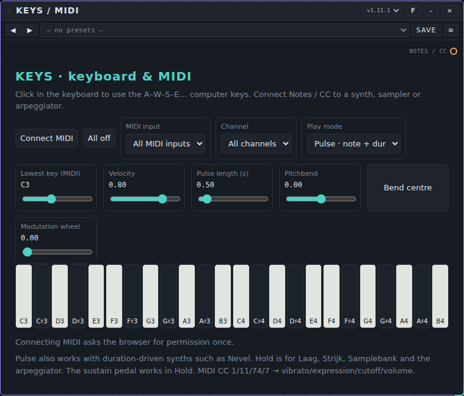
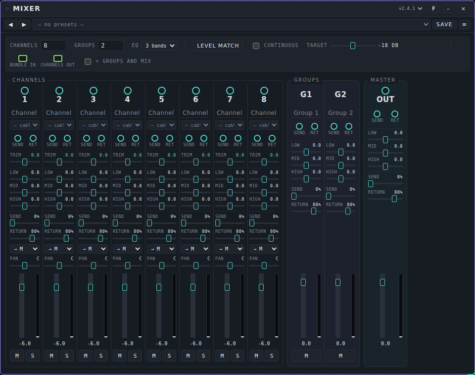
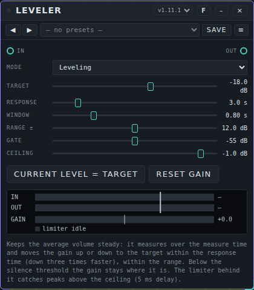
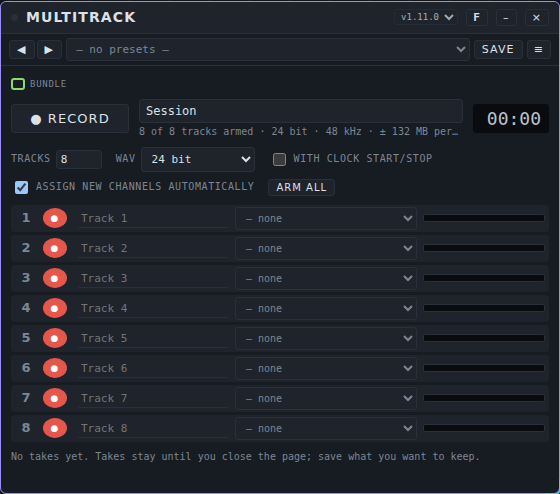
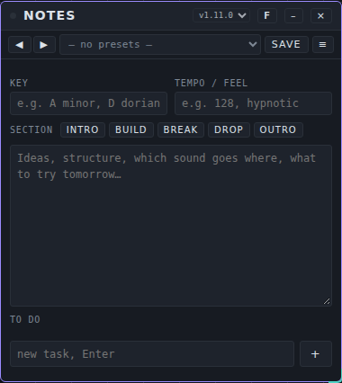
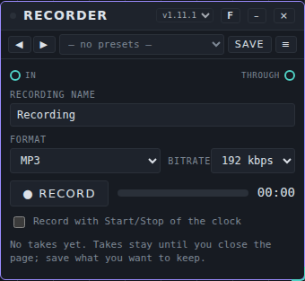
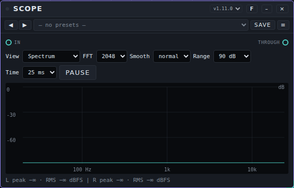

# Patchkamer user manual

*Nederlandse versie: [USER-MANUAL_NL.md](USER-MANUAL_NL.md)*

Patchkamer is a modular music studio that runs in your browser. You place devices (synths, sequencers, effects, outputs) on a floor, connect them with cables, press Start and make music. This manual is for people who want to use it. If you want to build devices, see [Make your own devices](#12-make-your-own-devices).



## Contents

1. [What you need](#1-what-you-need)
2. [Open Patchkamer](#2-open-patchkamer)
3. [A tour of the studio](#3-a-tour-of-the-studio)
4. [Load a library](#4-load-a-library)
5. [Your first patch](#5-your-first-patch)
6. [Play and sequence](#6-play-and-sequence)
7. [Tunes and presets](#7-tunes-and-presets)
8. [Save, open and share](#8-save-open-and-share)
9. [Find your way around the floor](#9-find-your-way-around-the-floor)
10. [Settings](#10-settings)
11. [Keyboard shortcuts](#11-keyboard-shortcuts)
12. [Make your own devices](#12-make-your-own-devices)
13. [Troubleshooting](#13-troubleshooting)
14. [Licenses](#14-licenses)

## 1. What you need

- A computer with a modern browser. **Chrome or Edge** gives the best experience: they can remember a folder on your computer and have Web MIDI for a MIDI keyboard. Other modern browsers work for the basics.
- Headphones or speakers.
- Optional: a MIDI keyboard.

There is nothing to install, no account and no upload. Everything runs on your own computer. Patchkamer only goes online when you tell it to load devices from GitHub or from a web address.

## 2. Open Patchkamer

Patchkamer is one HTML file.

1. Download this repository: on GitHub choose **Code → Download ZIP** and unpack it, or run `git clone https://github.com/unboxednl/patchkamer`.
2. Open `patchkamer/patchkamer.html` in your browser.

For the smoothest start, serve the folder from your own computer instead of double-clicking the file. In a terminal, in the folder you unpacked:

```
python3 -m http.server 8080
```

Then open `http://localhost:8080/patchkamer/patchkamer.html`. Over `localhost` Chrome and Edge give you the proper folder picker (section 4).

Patchkamer follows the language of your browser: Dutch or English. You can change that in Settings (section 10).

## 3. A tour of the studio


| Part | What it does |
|---|---|
| **Start** | Starts and stops the clock. Devices with a sequencer play along. |
| **BPM**, **Swing** | Tempo (40–200) and swing of the clock. |
| **Workspace** | Save, open and export your setup (section 8). |
| **Tunes**, **Presets** | The libraries of sounds and settings (section 7). |
| **Settings** | Language, audio quality, display and more (section 10). |
| **Arrange** | Puts your devices neatly in order, from left to right. |
| **Focus** | Shows the devices you flagged with **F** next to each other (section 9). |
| **Clear** | Empties the floor (click twice to confirm). |
| **Library** | Shows or hides the library window. |
| **Latency** | The delay between a sound being calculated and you hearing it, as reported by your browser. |
| **Color** | Dark, light or retro (section 10). |
| The name at the top | The name of your workspace. Click it to rename. |

The big area is the **floor**. Your devices live there. The window on the left is the **library**, the list of devices you can place. Bottom right you find the zoom controls.

## 4. Load a library

Patchkamer comes without devices of its own. A **library** is a collection of devices. This repository contains one in the `devices` folder. In the library window, under **Sources**, you add one or more sources. There are three kinds:

| Source | How |
|---|---|
| **GitHub** | Type `github.com/unboxednl/patchkamer` in the address field and click **Add**. The devices and the tune packs load straight from GitHub. This is the easiest way to start. |
| **Folder** | Click **Choose local folder…** and pick the folder with devices (for example the `devices` folder of this repository). |
| **Web address** | Paste the address of a single `.patchkamer-device.js` file, or of a `patchkamer.json` list, and click **Add**. |


A device is a file that ends in `.patchkamer-device.js`. Sources are remembered, so next time they load by themselves.

**Choosing a folder.** On `localhost` or over https, Chrome and Edge remember the folder and Patchkamer sees new devices when you come back to the window. In other cases the browser takes a one-time snapshot of the folder and its prompt says something like "Upload 7 files". Nothing is uploaded, and the number counts every file in the folder, not only devices. Patchkamer reads only the files that end in `.patchkamer-device.js` and then shows the real number of devices. With a snapshot, **Scan** asks you to pick the folder again to see new files.

**Categories.** Devices are grouped by category. Click a category name to fold it. The **Layout** button opens a panel where you can add, rename and delete your own categories and save or load the layout.


## 5. Your first patch

You will make a keyboard play a bass synth through your speakers.

1. In the library, click **Place** on **Keys / MIDI**, on **Acid Baselines** and on **Speakers**. Each device lands in the middle of your view. Anything in the way moves aside. You can also drag a device from the library onto the floor.
2. Click **Arrange** to put them in a tidy row.
3. Connect them with cables. Press on a port (the little circle on a card) and drag to a matching port on another card, then release:
   - from **Notes / CC** on Keys to **Notes** on Acid Baselines;
   - from **Out** on Acid Baselines to **In** on Speakers.
4. Click **Arrange** again, so the cables flow from left to right.
5. Press **Start**. The sequencer in Acid Baselines starts playing. Click the piano keys on Keys, or press the keys **A W S E D F T G Y H U J K O L P** on your computer keyboard.


**Cables.** The color of a cable tells what it carries: **audio** (teal), **events** such as notes (orange), **modulation** (purple) and **bundles** (thick, green: many channels in one cable). A cable only connects ports of the same kind. Press **Esc** while dragging to cancel. Click a cable to remove it.

**Volume.** Use the slider on Speakers. It has a limiter, but keep the volume modest at first.

## 6. Play and sequence

### Acid Baselines

A bass synth with a built-in 16-step sequencer.



- **Six sections** group the controls in the order the sound travels through the device. Double-click a slider to go back to its starting value. Click the number to type a value.
  - **Oscillator:** waveform, octave and tuning, plus **Sub** (a square wave an octave down), **Noise**, **Osc 2** with its own **Detune 2**, and **Ring** (ring modulation of the two oscillators).
  - **Filter:** the filter type (lowpass, bandpass or highpass), cutoff, resonance, envelope amount and **Filter FM**, plus **Filter 2**, a second bandpass filter in parallel, with its own octave offset (**F2 octave**).
  - **Envelope:** accent, normal and accent decay, soft attack and VCA decay.
  - **Slide:** the glide time.
  - **Distortion:** the **Type** (soft, hard, fold or asym), **Overdrive**, **Tight** (filters the bass out before the distortion so it stays punchy), **Mix** (distorted against clean) and **Crush** (bit depth), plus the tone filter.
  - **Output:** the level.

  Everything on top of the original controls (sub, noise, Osc 2, Ring, Filter 2, filter type, distortion type, Tight, Mix and Crush) is off by default, so existing sounds and tunes stay as they were. Combine a lot of resonance, filter FM and distortion for extreme sounds. A built-in guard restarts the filters if they run away, so the sound does not stay silent.
- **Sequencer.** Click a square to place a note on that step; click again to remove it. The rows run from C2 to C3. Below the notes you find the **Accent** row (a louder, snappier note), the **Slide** row (glide from the previous step) and an **Octave** choice per step.
- **Sets.** Choose 1, 2, 4, 8 or 16 sets of 16 steps. The numbered buttons switch which set you edit.
- **Choose pattern…** puts one of 16 classic acid-style patterns in the set you are editing.
- **New line** makes a random line. **Transpose +/−** moves it up or down, **Copy bar to all** copies the set to all sets and **Clear** empties it.
- Switch **internal** off to play only the notes that arrive from another device, for example from Keys. A note with velocity above 0.9 counts as an accent.

### Keys / MIDI

A keyboard that makes no sound itself. It sends notes to other devices.



- Click the piano keys, use the computer keys, or press **Connect MIDI** to use a MIDI keyboard. The browser asks permission once.
- **Play mode:** *Pulse* sends a note with a fixed length (**Pulse length**). *Hold* keeps the note as long as you hold the key.
- **Lowest key** sets the first note of the on-screen keyboard. **Velocity**, **Pitchbend** and **Modulation wheel** add expression. **All off** silences stuck notes.

### Duofone

An analog-style synth with two independent pitches, a shared filter and VCA, with ring modulation, hard sync and sample & hold. Connect Keys to its **Keyboard / notes** port and its **Stereo** out to Speakers.

### Mixer

A mixing desk with 1 to 32 channels and 0 to 8 groups, and a master with a limiter. Connect the sound-making devices to the channel inputs (**1**, **2**, …) and the **Out** port of the master to Speakers.



- **Channels** and **Groups** set how many there are. The ports on the card appear and disappear with them. Every channel has its input, a **send** port and a **ret** (return) port. Type in the name field to name a channel.
- Per channel: **Trim**, a 3- or 5-band **EQ** (choose under **EQ**), **Send**, **Return**, the group it goes to (**→ M** is the master), **Pan**, a fader with a level meter, and **M** (mute) and **S** (solo). Groups and the master have an EQ, send/return and a fader too, and a limiter sits behind the master. Double-click a slider to go back to its starting value.
- **Level match** measures for 4 seconds and sets the trim of every channel so all sources arrive at the **Target** level. **Continuous** keeps them there slowly (at most 3 dB per second).
- **Bundles.** A green bundle cable (for example the separate outputs of a drum machine) goes into **bundle in**; choose per channel which bundle channel arrives there, under the name field. **Channels out** sends all channels, after mixing, as one bundle, for example to a recorder. **+ groups and mix** adds the groups and the total mix to it.
- A Mixer has **presets** (it makes no sound of its own). A preset keeps the settings but not the source choices of the channels.

### Leveler

Keeps the average volume of a source steady. Place it between an instrument and the Mixer, or on the mix before Speakers. It helps with sources that slowly get louder and softer, for example through a modulator.



- **Mode:** *Leveling* or *Pass through* (the sound goes through unchanged).
- **Target** is the level it aims for. **Response** is how fast the volume moves up or down (down is three times faster). **Window** is the time over which it measures. **Range ±** is the most it may turn the volume up or down. Below the **Gate** level the volume stays where it is, so reverb tails and pauses are not blown up. **Ceiling** is the limit of the limiter behind it, which catches peaks.
- The meter shows **IN**, **OUT** and **GAIN**, with a lamp for the limiter. **Current level = target** sets the target to what comes in now. **Reset gain** sets the correction back to 0.
- A Leveler has **presets**. Without AudioWorklet in your browser it passes the sound through unchanged and tells you so.

### Multitrack

A multitrack recorder for up to 16 tracks, sample-aligned. It records a bundle, for example the **Channels out** of the Mixer: connect the green bundle cable to the **Bundle** port.



- **● Record** and **■ Stop** control the recording. **with clock start/stop** makes it follow Start and Stop of the clock.
- **Tracks** sets how many tracks there are. Choose per track which bundle channel it records, or **— none**. **assign new channels automatically** fills new bundle channels in on empty tracks. **Arm all** arms every track.
- Choose the file format under **WAV**: 16 bit, 24 bit or 32 bit float.
- Takes stay in memory until you close the page. **Save all (.zip)** saves a take as one zip file; **Per track** saves single tracks.
- A Multitrack has **presets** (not the source of each track).

### Notes

A notepad on the floor for ideas, key, structure and what you still want to do. It makes no sound and has no ports. The text is saved with the workspace.



- **Key** and **Tempo / feel** are short fields. **Section** has buttons (**Intro**, **Build**, **Break**, **Drop**, **Outro**) that add a heading to the text.
- Write in the large text field. Under **To do**, type a task and press **Enter**; tick it off when it is done and remove it with the cross.
- The line at the bottom shows when you last changed the notes. A Notes card has **presets**.

### Recorder

Records what comes in, for example the mix, and passes it on unchanged. Place it between the Mixer and Speakers.



- Give the recording a name, then press **● Record** and **■ Stop**. **Record with Start/Stop of the clock** makes it follow the clock.
- Every take appears in the list with **▶** to listen and **Save**. Takes stay in memory until you close the page; Save gives an audio file (webm/opus or mp4, depending on your browser).
- A Recorder has **presets**.

### Scope

A transparent pass-through that shows the sound: the audio goes from **In** to **Through** unchanged.



- **View** chooses what you see: **Spectrum**, **Waveform L/R**, **Spectrogram**, **Stereo image** or **Peak / RMS**. The line of numbers shows peak and RMS in dBFS, and CLIP when the signal goes over the limit.
- **FFT** (1024 to 8192) sets the detail of the spectrum, **Smooth** how calm it moves, **Range** how many dB you see and **Time** the length of the waveform (5 to 50 ms). **Pause** freezes the picture.
- A Scope has **presets**.

## 7. Tunes and presets

A **tune** is a complete setting of one device that makes sound: all knobs, patterns and choices. A **preset** is the same for a device without a sound of its own, such as an effect or a mixer. Neither contains cables.

On every card you see a bar with ◀ ▶ buttons and a list. Pick a tune or preset from the list, or step through them with the arrows. **Save** stores the current setting in a library, with your name as author and a license (CC-BY-4.0 or all rights reserved). A tune whose name is in *italics* has been changed since you loaded it.


The **Tunes** and **Presets** menus manage your libraries: create a new one, put tunes in folders, import a pack (`.patchkamer-tunes.json` or `.patchkamer-presets.json`) and export one to share. Packs in a library you load from GitHub or a folder appear automatically. This repository includes **Duofone Styles** (60 tunes in 12 styles) and **Acid Baselines Classics** (40 tunes in 8 styles).

## 8. Save, open and share


Your **workspace** is the whole setup: devices and their settings and patterns, cables, tempo and name.

- **Save as file** downloads your workspace as a file. **Open file…** loads one again.
- Tick **Include the code of all external instruments** if you want a file that opens even without access to the sources the devices came from.
- **In this browser** keeps a copy in your browser, so you can pick it up later on the same computer.
- **Export as song…** makes a shareable file (`.patchkamer-song.json`) that holds all device code, a title, the author and a license. Someone else can open it without any library.
- **New empty workspace** starts again.

## 9. Find your way around the floor

- **Move around:** drag the floor to pan. **Ctrl + scroll** zooms between 10% and 250%. The buttons bottom right zoom out, zoom in, fit everything (**All**) and go back to the start (⌂).
- **Cards:** drag a card by its title bar. Drag an edge or corner to resize it, and double-click an edge for the default size. **–** turns a card into a small icon and **⤢** restores it. **×** removes it. The version list lets you switch to another version of a device.
- **Arrange** orders your devices from left to right: sources, instruments, effects, mixer, output. **Ctrl+Z** undoes it.
- **Focus view:** press **F** on a card's title bar to flag it, then click **Focus**. The flagged devices show next to each other, stacked or in a grid, without moving them on the floor. **Back to canvas** returns.


## 10. Settings


- **Language:** automatic (your browser), Nederlands or English. Patchkamer reloads and keeps your workspace.
- **Audio:** pick **Low**, **Normal** or **High** quality, or set **sample rate**, **latency** and **oversampling** yourself. Higher quality asks more of your computer. A change reloads Patchkamer and keeps your workspace. If you hear crackles, choose a larger latency buffer (*Balanced* or *Stable*).
- **Display:** the style of the cables, their opacity, the scale of the whole interface, slider or rotary knobs for the host controls, and the text size of menus and library.
- **Color** (top right): dark, light or retro.


- **Browser storage:** Patchkamer remembers your settings, library layout, sources, workspace and your own tunes and presets in your browser. **Clear browser storage…** wipes all of that and starts fresh. Files on your computer and on GitHub stay as they are.

## 11. Keyboard shortcuts

| Keys | What it does |
|---|---|
| **Space** | Start or stop |
| **Alt+F** | Open or close the focus view |
| **Alt+B** | Show or hide the library |
| **+** / **−** / **0** | Zoom in / zoom out / reset zoom |
| **Ctrl + scroll** | Zoom the floor |
| **Delete** | Remove the selected device |
| **Ctrl+Z** | Undo Arrange |
| **Esc** | Cancel a cable you are dragging, or close a panel |
| Double-click a slider | Back to its starting value |
| Click the number next to a slider | Type a value, then press Enter |
| **A W S E D F T G Y H U J K O L P** | Play notes on Keys (when the keyboard has focus) |

The letter keys A–P belong to Keys, which is why the host shortcuts use Alt.

## 12. Make your own devices

A device is one `.patchkamer-device.js` file that follows the **contract**: a complete, self-contained description of what a device must do. The contract exists in English ([PATCHKAMER-CONTRACT_EN.md](../contract/PATCHKAMER-CONTRACT_EN.md)) and Dutch ([PATCHKAMER-CONTRACT_NL.md](../contract/PATCHKAMER-CONTRACT_NL.md)). A validator checks your device:

```
node contract/validate-instrument.mjs devices/synths/Duofone/duofone.patchkamer-device.js
```

Patchkamer is made to be built by AI agents as well as by people. Point your agent at [AGENTS.md](../AGENTS.md): it explains what to read, where to put things and what to check. Under **Settings → Contract & setup** you also find a template you can copy.

## 13. Troubleshooting

**I hear nothing.**
- Press **Start**, or click anywhere in Patchkamer. Browsers pause audio until you interact with the page, and after sleep or when you change the audio output. Patchkamer shows "The sound is off" when that happens and resumes by itself on your next click or key press.
- Check the cables: audio must run from the sound-making device to **Speakers**. Notes must run from Keys (or a sequencer) to the instrument.
- Check the volume on Speakers and on your computer.

**The library is empty or my new device is missing.**
- Add a source (section 4).
- With a folder that Patchkamer cannot remember, click **Scan** and choose the folder again. Only files that end in `.patchkamer-device.js` count.

**My MIDI keyboard is not found.** Use Chrome or Edge, click **Connect MIDI** on Keys and allow access. Pick the keyboard under **MIDI input**.

**Crackles or dropouts.** Open Settings → Audio and choose *Balanced* or *Stable* latency, or lower the quality to *Low*.

**The folder prompt says "Upload 7 files".** See section 4: nothing is uploaded and the number counts all files in the folder.

**Everything looks wrong or stuck.** Settings → **Clear browser storage…** starts Patchkamer fresh.

## 14. Licenses

Each folder has its own license: the host and the devices are AGPL-3.0-or-later, the contract is MIT, tunes and presets are CC0-1.0 and the songs are CC-BY-4.0. See [LICENSING.md](../LICENSING.md).
