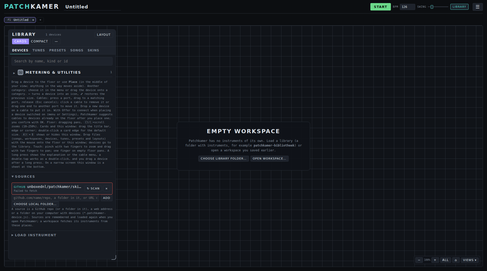
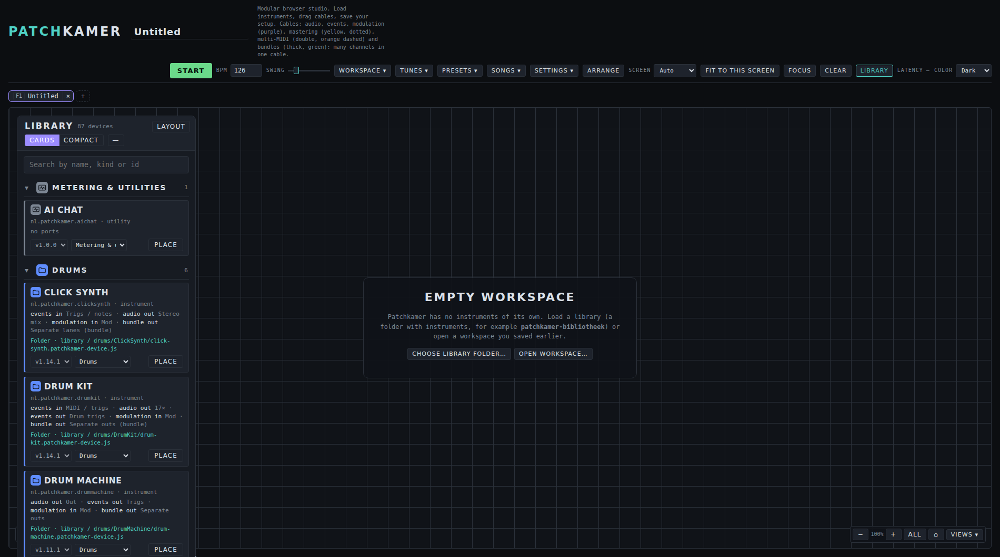
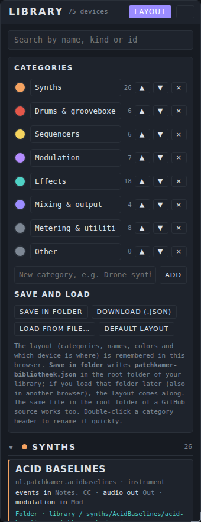
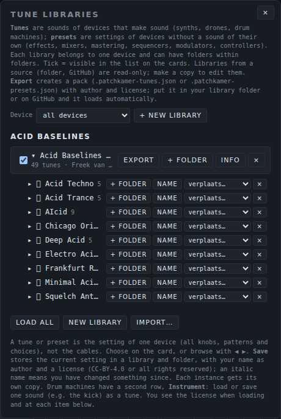
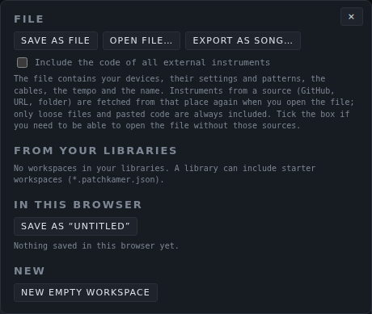
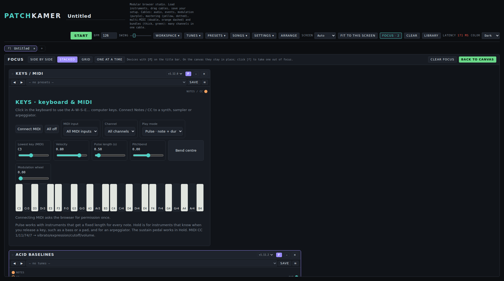
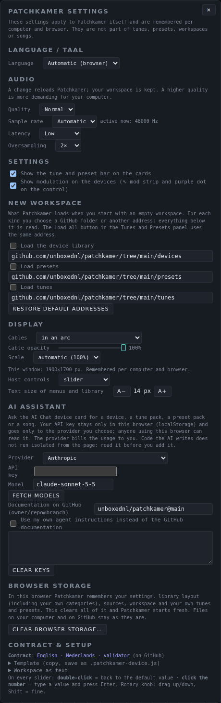
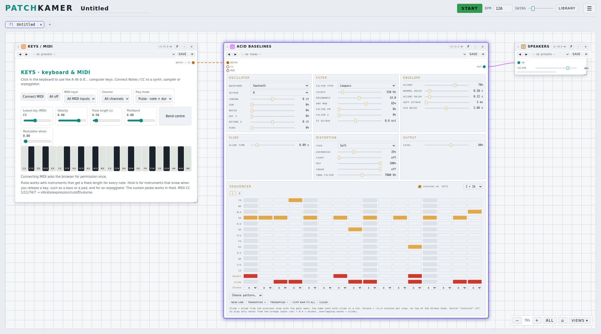
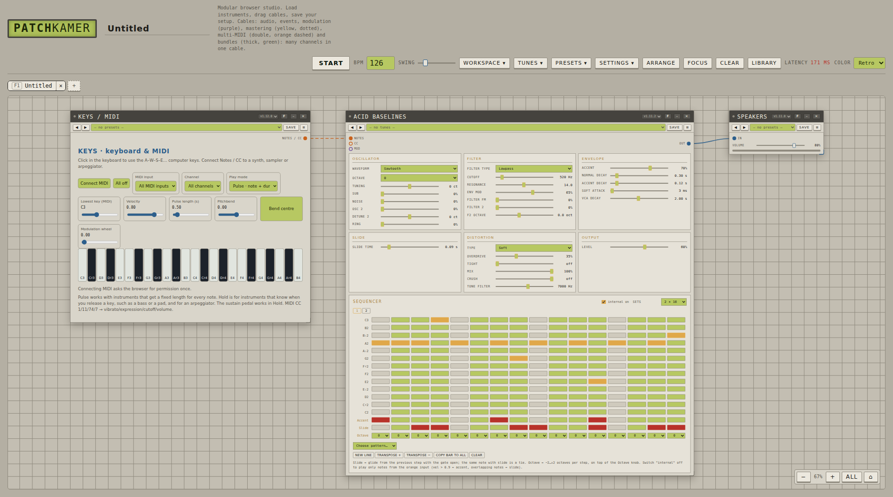

# Patchkamer user manual

*Nederlandse versie: [USER-MANUAL_NL.md](USER-MANUAL_NL.md)*

Patchkamer is a modular music studio that runs in your browser. You place devices (synths, sequencers, effects, outputs) on a floor, connect them with cables, press Start and make music. This manual is for people who want to use it. If you want to build devices, see [Make your own devices](#12-make-your-own-devices).


## Contents

1. [What you need](#1-what-you-need)
2. [Open Patchkamer](#2-open-patchkamer)
3. [A tour of the studio](#3-a-tour-of-the-studio)
4. [Load a library](#4-load-a-library)
5. [Your first patch](#5-your-first-patch)
6. [The devices](#6-the-devices)
7. [Tunes and presets](#7-tunes-and-presets)
8. [Save, open and share](#8-save-open-and-share)
9. [Find your way around the floor](#9-find-your-way-around-the-floor)
10. [Settings](#10-settings)
11. [Keyboard shortcuts](#11-keyboard-shortcuts)
12. [Make your own devices](#12-make-your-own-devices)
13. [Troubleshooting](#13-troubleshooting)
14. [Licenses](#14-licenses)

## 1. What you need

- A computer with a modern browser. **Chrome or Edge** gives the best experience: they can remember a folder on your computer and have Web MIDI for a MIDI keyboard. Other modern browsers work for the basics.
- Headphones or speakers.
- Optional: a MIDI keyboard.

There is nothing to install, no account and no upload. Everything runs on your own computer. Patchkamer only goes online when you tell it to load devices from GitHub or from a web address.

## 2. Open Patchkamer

Patchkamer is a plain web page (`patchkamer.html` with its stylesheets and scripts, no install or build). The quickest way is to open it online at <https://unboxednl.github.io/patchkamer/>. It always runs the latest version from this repository, works in Chrome and Edge (also on an Android phone), and still runs entirely in your own browser: nothing is uploaded. Because it is served over https, Web MIDI and audio input work there too.

To run your own copy instead:

1. Download this repository: on GitHub choose **Code → Download ZIP** and unpack it, or run `git clone https://github.com/unboxednl/patchkamer`.
2. Open `patchkamer/patchkamer.html` in your browser.

For the smoothest start, serve the folder from your own computer instead of double-clicking the file. In a terminal, in the folder you unpacked:

```
python3 -m http.server 8080
```

Then open `http://localhost:8080/patchkamer/patchkamer.html`. Over `localhost` Chrome and Edge give you the proper folder picker (section 4).

Patchkamer follows the language of your browser: Dutch or English. You can change that in Settings (section 10).

### As an app on your phone or computer

You do not have to install anything, but you can keep Patchkamer as an app icon. Open <https://unboxednl.github.io/patchkamer/> and choose:

- **Android (Chrome):** menu ⋮ → **Install app** or **Add to home screen**. Patchkamer then opens without an address bar, full screen.
- **Computer (Chrome or Edge):** the install icon in the address bar, or menu → **Install Patchkamer**.
- **iPhone and iPad (Safari):** the Share button → **Add to Home Screen**.

The icon (a patch cable between two jacks) also shows as the tab icon in the browser. The app needs an internet connection to start; your work stays saved in your browser.

## 3. A tour of the studio



| Part | What it does |
|---|---|
| **Start** | Starts and stops the clock. Devices with a sequencer play along. |
| **BPM**, **Swing** | Tempo (40–200) and swing of the clock. |
| **Library** | Shows or hides the library window with the tabs **Devices**, **Tunes**, **Presets**, **Songs** and **Skins** ([the library tabs](#the-library-tabs)). |
| The name at the top | The name of your workspace. Click it to rename. |
| **☰** | The menu with everything else, in four groups (the four rows below). The menu closes after a choice. |
| ☰ → **File** | **Workspace** (save, open and export your setup, section 8), **Arrange** (puts your devices neatly in order, from left to right) and **Clear** (empties the floor; click twice to confirm). |
| ☰ → **Library** | **Tunes**, **Presets**, **Songs** and **Skins** open the library window on that tab (sections 7 and 8). |
| ☰ → **View** | **Screen** and **Fit to this screen** (section 9), **Color** (dark, light or retro, section 10), **Focus** (shows the devices you flagged with **F** next to each other, section 9) and **Browse** (Focus with all devices, one at a time). |
| ☰ → **Other** | **Settings** (language, audio quality, display and more, section 10), **Latency** (shown small: the delay between a sound being calculated and you hearing it, as reported by your browser) and the switch **Offer to connect when placing a device**. |
| **F1**, **F2**… tabs | The bar under the top bar holds your workspaces. Click a tab or press **F1** to **F10** to switch; **+** adds one and **×** closes one (section 8). |

The big area is the **floor**. Your devices live there. The window on the left is the **library**, with the devices you can place. Bottom right you find the zoom controls.

### The library tabs

The library window shows one kind of content at a time. Five tabs at the top switch between them:

- **Devices:** the devices you can place, with the search field, categories, **Layout** and the **Sources** for loading and scanning (section 4);
- **Tunes** and **Presets:** your tune and preset libraries, with **Load all**, **New library** and **Import…** (section 7);
- **Songs:** the demos, your recent songs, **Open file…** and **Export as song…**, with a search field (section 8);
- **Skins:** the skin libraries, with **Import…**, **Load all** and the designer (section 7).

On a wide screen they are tabs. On a narrow screen (under 700 pixels, the bottom sheet), and when the window is too narrow for all the tabs, it is a dropdown list. Your last chosen tab is remembered. The **Tunes**, **Presets**, **Songs** and **Skins** buttons in the ☰ menu, the button next to the tune list on a card and dropping a tune, preset or skin file open the window on the right tab. **Settings** stays a panel of its own through the ☰ menu.

## 4. Load a library

Patchkamer comes without devices of its own. A **library** is a collection of devices. This repository contains one in the `devices` folder. In the library window (the **Devices** tab), under **Sources**, you add one or more sources. There are three kinds:

| Source | How |
|---|---|
| **GitHub** | Type `github.com/unboxednl/patchkamer` in the address field and click **Add**. The devices and the tune packs load straight from GitHub. This is the easiest way to start. |
| **Folder** | Click **Choose local folder…** and pick the folder with devices (for example the `devices` folder of this repository). |
| **Web address** | Paste the address of a single `.patchkamer-device.js` file, or of a `patchkamer.json` list, and click **Add**. |



A device is a file that ends in `.patchkamer-device.js`. Sources are remembered, so next time they load by themselves.

**Scan.** The **Scan** button next to a source reads it again. Patchkamer then tells you how many changes it found, split into new and changed devices and new and changed tune and preset packs, for example "3 changes found · 1 new, 1 changed, 1 new packs". The library redraws at once, and the new and changed devices carry a small **new** or **changed** badge for a couple of minutes. The first scan of a source counts everything as new and shows no badges.

**Updating.** A scan also loads the changed code of devices that are already on the floor: such a device is rebuilt with its settings, cables and size, and the message says how many were updated.

**New version of Patchkamer.** At startup (over http or https) Patchkamer compares `patchkamer.html` and its stylesheets and scripts with the version on GitHub (`main`). If it differs, a notice appears at the bottom right with **View on GitHub**, **Later** and **Do not tell me again for this version**. A file opened through `file://` cannot read itself and gets no notice.

**It can also happen by itself.** Under **Settings → New workspace** Patchkamer can load the device library, the presets and the tunes from GitHub whenever you start with an empty workspace. You can change the addresses there (section 10). Each one becomes a source of its own in the list, with a **Scan** button.

**Choosing a folder.** On `localhost` or over https, Chrome and Edge remember the folder and Patchkamer sees new devices when you come back to the window. In other cases the browser takes a one-time snapshot of the folder and its prompt says something like "Upload 7 files". Nothing is uploaded, and the number counts every file in the folder, not only devices. Patchkamer reads only the files that end in `.patchkamer-device.js` and then shows the real number of devices. With a snapshot, **Scan** asks you to pick the folder again to see new files.

**Categories.** Devices are grouped by category. At startup every category is folded; click a category name to unfold it (searching unfolds the matches by itself). The **Layout** button opens a panel where you can add, rename and delete your own categories and save or load the layout.

**Folders as categories.** If a source has no layout file (`patchkamer-bibliotheek.json`), the first folder a device sits in is its category (`synths/…` becomes the category Synths). If there is a file and it does not know a folder (the file lists the known folders under `folders`; a folder named like a category belongs to that category), that folder is added as an extra category. A device that the file assigns to a category stays there. If everything in a source sits in one shared top folder, that folder does not count.



### Category icons

Every category has an icon. It shows next to the category name in the library, on every device in that category (cards and compact rows), on a device's title bar, and in a device's compact and minimized states, where the icon replaces the initials. The icon uses the category color. You pick another icon in the **Layout** panel: click the icon left of the category name and choose one from the grid, paste an address of an image (only from the same source as the library) or choose **Choose file…** for your own image (png, svg, webp or jpg, at most 200 kB). **Default** brings back the original icon. Your choice is saved in the layout, so it is also in `patchkamer-bibliotheek.json` (field `icon`).

### Put an icon in a library folder

Put a file `icon.svg`, `icon.png`, `icon.webp` or `icon.jpg` (searched in that order, case does not matter) in the folder that counts as a category, for example `devices/synths/`. That icon then becomes the icon of the category and of all devices in it. It works for a local folder, a GitHub source and a web address; **Scan** picks up a changed icon. An `icon.*` in any other folder does nothing for the category (in the folder of a single device it is that device's icon, see below). What wins: first your own choice under **Layout** (and the field `icon` in the layout file), then the file in the folder, then the built-in icon. The image is shown as it is (not recolored) and only as an image, so scripts in an svg never run. Files larger than 200 kB or that are not an image are skipped. A square, transparent image (svg, or at least 64 pixels) looks best. An `icon.*` in the folder of a single device is, however, an icon for that device: see below.

### An icon of your own for a device

Besides the category, a single **device** can have an icon of its own. Patchkamer looks in this order (the first one that exists wins):

1. the `icon` of the **skin** that is active on that card (on that card only);
2. an `icon.svg`, `icon.png`, `icon.webp` or `icon.jpg` in the **device's folder** in your device library, next to the `.patchkamer-device.js`, for example `devices/synths/Duofone/icon.svg` (only for a local folder and a GitHub source; for a web address Patchkamer does not look for device folders);
3. an `icon.*` in `skins/library/<device-id>/`, for example `skins/library/nl.patchkamer.duofone/icon.svg`, if that source is loaded. This also gives a device you do not have in your own library an icon;
4. the icon of the **category** (see above), in the category color;
5. the neutral default icon.

An icon of its own appears in the same places as the category icon: in the library (cards and compact rows), on the title bar, in the minimized state, in the simplified card when zoomed out and in the tab bar of Focus "One at a time". It is shown as it is (not recolored) and only as an image, so scripts in an svg never run. The same limits apply as for category icons: at most 200 kB, an image only, only from the same source as the library. A device without an icon of its own looks exactly as before. The category keeps its own icon next to the category name. **Scan** picks up a changed icon. If you choose **Default** under Skin on the card again, the icon goes back to point 2, 3 or 4.


## 5. Your first patch

You will make a keyboard play a bass synth through your speakers.

1. In the library, click **Place** on **Keys / MIDI**, on **Acid Baselines** and on **Speakers**. Each device lands in the middle of your view. Anything in the way moves aside. You can also drag a device from the library onto the floor.
2. Click **Arrange** to put them in a tidy row.
3. Connect them with cables. Press on a port (the little circle on a card) and drag to a matching port on another card, then release:
   - from **Notes / CC** on Keys to **Notes** on Acid Baselines;
   - from **Out** on Acid Baselines to **In** on Speakers.
4. Click **Arrange** again, so the cables flow from left to right.
5. Press **Start**. The sequencer in Acid Baselines starts playing. Click the piano keys on Keys, or press the keys **A W S E D F T G Y H U J K O L P** on your computer keyboard.


**Cables.** The color of a cable tells what it carries: **audio** (teal), **events** such as notes (orange), **modulation** (purple), **mastering** (a yellow, dotted wave, between the triangle ports of the Master Director and the mastering devices), **multi-MIDI** (a double dashed orange cable with all tracks of a sequencer, for the MIDI Hub) and **bundles** (thick, green: many channels in one cable). A cable only connects ports of the same kind. Press **Esc** while dragging to cancel. Click a cable to remove it.

**Move a cable.** Drag a cable by one end to another matching port. The end nearest to where you grab comes loose and the other end stays where it is. Let go on a matching port to hang the cable there. Let go anywhere else, or press **Esc**, and the cable goes back where it was. The old cable stays connected until you let go, so the sound keeps playing.

**Put a device on a cable.** Drag a device from the library, or a device that has no cables yet, onto a cable. The cable lights up, and when you let go it splits: the device sits between the two ends. This works for devices that have both an input and an output of that kind of cable (audio or notes), such as the effects. If a cable does not light up, the device does not fit in it.

### Cable color

A cable takes the color of the category of the device it comes from: a cable from a synth has the color of the Synths category. You tell the type of cable by its line style (audio solid, events dashed, control wavy, bundles thick and double). The color is made a little lighter or darker where needed, so it stays clearly visible on the floor of every color scheme. Under **Settings → Display**, **Cable color** lets you choose **by category** (the default) or **by type** (the colors from before: audio, events, control, mastering and bundles each have their own). A color you gave a cable yourself always wins. A cable from a device in **Other** keeps the color of its type.

### Cable text on hover

Point at a cable with the mouse and a small text shows the names of the connected devices, separated by a dash: `Chord Poly - Pump`. If a device has more ports of that type, the port is added: `Chord Sequencer (Track A) - Chord Poly`. For multi-MIDI, bundles and mastering the type follows in brackets. On a touchscreen, press and hold a cable: you get the same text as a message, next to the color menu.

### Offer to connect when placing

Patchkamer can suggest cables after you place a device, so you do not have to drag every cable yourself. The switch **Offer to connect when placing a device** is in the ☰ menu (group **Other**) and in **Settings**; the two switches belong together. Without a choice of your own it is **on for a touch screen** (phone, tablet) and **off for a computer with a mouse**; a narrow window on a computer does not count as mobile. As soon as you set the switch yourself, your browser remembers that choice.

When it is on, every device that **you place yourself** (dragging, **Place**, or a tap on a compact library row) opens a window **Connect to devices on the canvas**, if there is anything to connect. Opening a song or workspace, **Arrange**, Ctrl+Z and switching tabs never ask. If you drop the device on a cable, that comes first and no window appears.

The example: you place **Speakers** on an empty canvas. Nothing happens. Then you place a synth: the window shows the group **Audio** with the Speakers (compact, one line) already ticked. Then you place a sequencer: now there is a group **Events (MIDI)** with the synth ticked. The window groups the suggestions by cable kind (audio, events, modulation and the other kinds) and you can tick in all groups at once. One click on **OK** makes everything that is ticked; **Skip** (or Esc) does nothing. **Don't ask again** switches the setting off.

Patchkamer only suggests cables that fit the order sources, instruments, effects, mixer, output. For each device and each kind at most one obvious suggestion is ticked (the next device in the chain that has a free input); the rest is in the list but unticked. If you place an **effect**, you can also put it into an existing audio cable: the group **Insert into an existing cable** shows a line "Between A and B" per cable. That line excludes the ordinary audio suggestions for that effect, and you can pick at most one cable.

**Sequencers with tracks.** If a sequencer has several output ports (one port per track, like the Clip Arranger), Patchkamer picks the lowest free port for each target device and shows whether that target is a drum machine (**drums**) or a melodic device (**melodic**). A device does not itself record what type a track has: the choice follows the device you connect. With the **Output** and **Input** lists you pick another free port. If all ports are in use, the suggestion stays off with the reason "all ports in use".

**Not too many.** If there are more than **7** possibilities (all groups together, including unticked ones), no window appears and you connect yourself.

**Undo.** One **Ctrl+Z** after **OK** removes all cables of that one go; for an inserted effect the original cable comes back.

**Volume.** Use the slider on Speakers. It has a limiter, but keep the volume modest at first.

## 6. The devices

Devices come in kinds. Every kind has its own README and its own user manual, with a section per device: what it is for, the controls, the ports, an example patch, and the presets or tunes that come with it. A patch usually runs from left to right: **tools** and **drums** send notes, **synths** make the sound, **effects** shape it, the **mixer** combines it and **Speakers** plays it. The **Arrange** button puts your devices in that order.

| Kind | What it is for | Devices | Manual |
|---|---|---|---|
| **Synths** | Make sound from notes | Acid Baselines, Acid Stepper, Basic Mono, Biotope, Bowed Ensemble, Celestial Mechanics, Chord Poly, Cinematic Synth, Cross Mod Mono, Dissonant Cluster, Drone Synth, Duofone, Formant Singer, Foundry, Four-Operator FM, Grain Cloud, Karplus String, Ladder Mono, Layered Landscape, Low Bass, Mist, Paradox, Patch Mono, Patchbay Synth, Poly Chorus, Stage Keys, Sub Line, Supersaw Swarm, Triple Osc Poly | [Synths manual](synths/USER-MANUAL_EN.md) · [README](../devices/synths/README.md) |
| **Samplers** | Play your own sounds: pads and slices from loaded audio | Samplebank, Loop Slicer | [Samplers manual](samplers/USER-MANUAL_EN.md) · [README](../devices/samplers/README.md) |
| **Sequencers** | Play notes and chords on other devices | Chord Sequencer, Clip Arranger, Euclidean Rhythms, Pattern Playlist, Pattern Tracker, Scale Arpeggiator, Step Sequencer, Wanderer | [Sequencers manual](sequencers/USER-MANUAL_EN.md) · [README](../devices/sequencers/README.md) |
| **Drums** | Drum sounds and rhythm | Drum Machine, Drum Kit, Groovebox 12, Pulse Drums, Latin Percussion, Click Synth | [Drums manual](drums/USER-MANUAL_EN.md) · [README](../devices/drums/README.md) |
| **Effects** | Shape the sound: modulation, distortion, space, filters, rhythm, voice, chains | Chorus, Effect Chain, Filter, Flanger, Frequency Shifter, Grit, Phaser, Pump, Resonator, Room, Tremolo, Vocoder | [Effects manual](effects/USER-MANUAL_EN.md) · [README](../devices/effects/README.md) |
| **Mastering** | Finish a mix: tone, dynamics, saturation, width, loudness and checking | Balance EQ, Multiband Balance, Bus Compressor, Patina, Stereo Space, Master Chain, Mix Check, Master Director, Listening Output | [Mastering manual](mastering/USER-MANUAL_EN.md) · [README](../devices/mastering/README.md) |
| **Mixer** | Bring in, mix, keep the level steady, play out | Mixer, Leveler, Speakers, Audio Input, Audio Output | [Mixer manual](mixer/USER-MANUAL_EN.md) · [README](../devices/mixer/README.md) |
| **Modulators** | Move the controls of other devices | Drift, Follower, LFO, Macro, Multi-Segment Envelope, Swell | [Modulators manual](modulators/USER-MANUAL_EN.md) · [README](../devices/modulators/README.md) |
| **Tools** | Play, record, measure and take notes | Control Surface, Keys / MIDI, Metronome, MIDI Hub, Multitrack, Notes, Pad Controller, Recorder, Scope | [Tools manual](tools/USER-MANUAL_EN.md) · [README](../devices/tools/README.md) |

**AI Chat (built in).** Besides the kinds above, the library has one device that comes with Patchkamer itself: **AI Chat**, under *Metering & utilities*. Place it, and ask in your own words for a device, a tune pack, a preset pack or a song. It needs a provider, an API key and a model under **Settings → AI assistant**; the provider bills the usage to you. The AI reads the documentation of this repository on GitHub by itself (the AGENTS.md files, the contract, the style guides) and hands you everything as a **proposal**: **Add** puts a device in the library and on the floor, or a tune or preset pack in your libraries, and **Open** opens a song in a new workspace tab. Nothing is added without your click. Read the code of a device before you add it: a device is not isolated from the page, and the check on the card only warns about network, storage and eval. The conversation stays when you switch workspace; **New chat** starts again. Not tested with real providers or keys: the flow with all three provider formats was tested with simulated answers. The AI cannot listen: tell it what you hear.

Their ready-made sounds and settings have their own manuals: [Tunes](tunes/USER-MANUAL_EN.md) for devices that make sound and [Presets](presets/USER-MANUAL_EN.md) for the rest (also section 7).

### Copying and pasting patterns

A device that can share a pattern or clip gets two buttons in its card bar: **Copy** and **Paste**. You only see them on devices that can do this (for example the Step Sequencer and the Clip Arranger today). They let you take a pattern from one device to another, or to another track.

- **Copy** puts the pattern the device is showing on the clipboard: in Patchkamer's memory and as text on the system clipboard. That also lets you paste it in another browser tab or on another computer (this needs a secure context: `localhost` or https; where the browser does not allow the system clipboard, only the memory works).
- **Paste** puts the pattern from the clipboard into the device. If the system clipboard holds no Patchkamer clip, Paste uses what you last copied in Patchkamer.
- **Shortcuts:** select a device and press **Ctrl+C** or **Ctrl+V** (**Cmd** on a Mac). **Ctrl+Shift+V** pastes right away. In a text field, or while a window is open, the keys do their usual job.
- **Like for like only.** Notes go to notes and drums go to drums. If the kind does not fit, nothing changes and a message says why (the **Paste** button is greyed out then; hover it or tap it for the explanation). A keys or drone track in the Clip Arranger takes notes, a drum track takes drums; Patchkamer never changes the type of a track by itself.
- **The target keeps its length.** Patchkamer fits the pattern to the device: a short pattern is repeated when it divides evenly (otherwise silence follows), a pattern that is too long is cut off, notes go to the target's grid, a mono device keeps the loudest note at each moment, and notes outside the range are moved in by octaves. Drum lanes are matched by instrument and name, not by order; a lane that fits nowhere is left out. The message says what was adjusted.
- **While it plays,** Patchkamer pastes at the start of the next bar (the message has a **Cancel** button). **Shift-click** on Paste or **Ctrl+Shift+V** pastes right away; with the clock stopped it also pastes right away.
- **Undo.** After pasting, the message shows an **Undo** button for about fifteen seconds. **Ctrl+Z** does the same in that time.

On a phone the buttons work with a tap; you do not need shortcuts there. The buttons live in the card bar, so they are out of reach while the card is minimized to an icon.

## 7. Tunes and presets

A **tune** is a complete setting of one device that makes sound: all knobs, patterns and choices. A **preset** is the same for a device without a sound of its own, such as an effect or a mixer. Neither contains cables.

On every card you see a bar with ◀ ▶ buttons and a list. Pick a tune or preset from the list, or step through them with the arrows. **Save** stores the current setting in a library, with your name as author and a license (CC-BY-4.0 or all rights reserved). A tune whose name is in *italics* has been changed since you loaded it.



The **Load all** button at the top of the Tunes and Presets tabs loads every tune pack, or every preset pack, from the address you set under **Settings → New workspace** (by default the `tunes` and `presets` folders of this repository on GitHub). Everything below that folder is read.

The **Tunes** and **Presets** tabs of the library manage your libraries: create a new one, put tunes in folders, import a pack (`.patchkamer-tunes.json` or `.patchkamer-presets.json`) and export one to share. Packs in a library you load from GitHub or a folder appear automatically. The packs that come with this repository are listed in the [tunes manual](tunes/USER-MANUAL_EN.md) and the [presets manual](presets/USER-MANUAL_EN.md).

For the whole story, with the list of included packs and how to make your own, see the [presets manual](presets/USER-MANUAL_EN.md) and the [tunes manual](tunes/USER-MANUAL_EN.md).

### Skins

A **skin** only changes the **looks** of one device, never its sound, settings or behaviour. It is a separate file (`.patchkamer-skin.json`) with one or more **appearances**, for example a compact and a wide one. Skins are a third kind of library material next to tunes and presets.

**Where do you find skins?** In the `skins/library` folder of this repository on GitHub, with a folder per device (`skins/library/<device-id>/`). Under **Settings → New workspace** there is **Load skins** with that address; the **Load all** button on the Skins tab loads them too. A GitHub, web or local folder that contains `skins/library/<device-id>/*.patchkamer-skin.json` is added as a source like any library; a local folder with devices and skins works as well. A skin for a device you do not have is kept but not offered anywhere.

**Loading.** Open the **Skins** tab of the library (or **Skins** in the ☰ menu) for the **Skin libraries**: per device the skins with name, author, version, license and appearances. With **Import…** you choose a file; you can also **drop** it onto the floor or the library window (without confirmation, after devices and tunes and before songs and workspaces). An imported skin stays in your browser until you remove it with **×**; skins from a source are read-only and go away with that source. An invalid file is refused with a message that names the file; the rest keeps loading. A skin with an unknown major version of the skin format, or with CSS that loads from outside (`@import`, a `url(` to a web address), is refused.

**Choosing on the card.** As soon as a device has at least one skin, the card's bar shows two lists: **Skin** (**Default** is the device's own look) and **Appearance**. With **Auto** Patchkamer picks the appearance itself from the **width of the card** and the **screen size** (phone, compact or wide); the list shows which one is active. If you choose an appearance yourself, Auto stays off for that device until you go back to **Auto**. The choice applies immediately. With **Default** everything is gone and the device looks exactly as before. If the bars on the cards are switched off (Settings), choose from the Skins tab with **Apply** and **Choose**.

**Saving.** The choice per device is stored in the workspace and in the song, together with the skins used (at most 20), so a song keeps its looks without the library. When you open one, those skins quietly enter your register (a newer version wins). Workspaces and songs without skins load as always. Skins never touch the sound: the device's settings are the same with and without a skin.

**Design choices (skins contract 0.3).** Besides CSS, a skin can contain **design choices** that work on every device, set as the skin's default and overridable per appearance:

- **Port mode.** *Default* (as now), *Always visible* (the ports in a fixed bar at the top), *On hover or cable* (the ports are hidden; they appear when you put the mouse on the thin strip at the top of the device or drag a cable over the device) and *Strip* (a visible strip; the ports open when you put the mouse on the device). On a touch screen you open and close the strip with a tap, and dragging a cable over the device opens it too; with the keyboard use Enter or space. Cables stay correct: a hidden port hangs its cable on the strip. A device with ports in its own screen keeps the mode *Default* and says so.
- **Colours.** *Workspace* (the colours of the workspace) or *Custom colours*: background, surface, text, muted text, accent and lines, on that card only. A missing colour falls back to the workspace colour; low contrast between text and background gives a note, not a refusal.
- **Haptics.** A short vibration on **clicks** (buttons and pads), **turning** (the rotary knob) and **sliding** (one pulse per step, at most 25 per second), each off, light, medium or strong. This only works in a browser that can vibrate (mostly Android; not iOS Safari), not with a reduced-motion preference and not while the page is in the background.
- **Knobs.** Style (*Workspace*, *Rotary* or *Slider*) and size (S, M or L) of the knobs a device builds through the host. A device's own controls are left alone, so this works on the devices that use the host knob; the Skins tab shows how many there are on your floor.
- **Controls.** A list of *rules* that decides how a control looks: for *all controls*, a *role* (for example knobs or faders), a *group* (for example the filter) or a single control. Each rule sets the **face** (rotary knob, horizontal or vertical slider), the **size** (XS to XL), the **length** and **thickness** of a slider, the shape of the **thumb**, the **colour**, and whether the **value** is always shown, shown on hover or never. The last matching rule wins. A skin can only restyle controls: it never hides one and never sets a value, so sound, settings and presets do not change. This works on controls a device has made recognisable (see the contract, v1.15); the Skins tab shows how many controls on the first card of a device are restyled. Double-click (default value), typing a value, Shift for fine steps and the keyboard work in every face. In the designer this is under **Controls**: you see which controls the device reports, add rules, move them up or down and see the result immediately.

**Designing your own.** On the Skins tab pick a device under **New design** and click **Design**, or click **Design a copy** on an existing skin. Give the skin a name (and an author), choose port mode, colour scheme, haptics, knobs and controls, and add a **Compact** (card up to 360 px) or **Full** appearance if needed, which can differ from Standard per choice. The **preview is live on a card** of that device; **Close** restores the card's previous skin. The **colour picker** has a colour area (saturation and brightness), a hue bar, a hex field, sample colours, a list of recently used colours and a contrast note; with the keyboard use the arrow keys (Shift = bigger step), and on a touch screen every target is at least 44 px. **Save** keeps the skin as your own skin in your browser (id `<device>.<name>`); **Export** gives a `.patchkamer-skin.json` file to share. Without an author the skin can be saved, but not shared properly. A copy of a skin with CSS keeps that CSS and its images.

**Making a skin?** See [skins/AGENTS.md](https://github.com/unboxednl/patchkamer/blob/main/skins/AGENTS.md) (for people working with an AI agent) and the skins contract ([Nederlands](https://github.com/unboxednl/patchkamer/blob/main/skins/contract/SKINS-CONTRACT_NL.md), [English](https://github.com/unboxednl/patchkamer/blob/main/skins/contract/SKINS-CONTRACT_EN.md)).

## 8. Save, open and share



Your **workspace** is the whole setup: devices and their settings and patterns, cables, tempo and name.

- **Save as file** downloads your workspace as a file. **Open file…** loads one again.
- Tick **Include the code of all external instruments** if you want a file that opens even without access to the sources the devices came from.
- **In this browser** keeps a copy in your browser, so you can pick it up later on the same computer.
- **Export as song…** makes a shareable file (`.patchkamer-song.json`) that holds all device code, a title, the author and a license. Someone else can open it without any library.
- **New empty workspace** starts again.

**Songs.** The **Songs** tab of the library (or **Songs** in the ☰ menu) opens a song in a **new workspace tab** and arranges the devices afterwards (**Ctrl+Z** undoes it). It lists the **demo songs** from the `songs` folder of this repository on GitHub, your **recent songs** (the last twelve, also files you opened) and **Open file…**. If a song needs devices that are not in your library yet, Patchkamer first loads the device library from **Settings → New workspace**. Up to ten workspaces can be open, so close one first when they are all in use.

**More than one workspace.** The tab bar under the top bar holds up to ten workspaces. Click a tab, or press **F1** to **F10**, to switch. **+** adds a new empty workspace; **×** closes one (Patchkamer asks first if it holds devices, and the last one cannot be closed: use **Clear**). Every workspace has its own devices, cables, tempo and name, and everything in this section works on the workspace you are in. When you switch, the clock stops and you start it again yourself. A new workspace loads what you chose under **Settings → New workspace**. Patchkamer keeps your workspaces in your browser and opens them again the next time.


### Dropping files onto the canvas

With a mouse you can drop files from your file manager onto the **floor** or the **library window**; a frame saying "Drop to load" appears. Patchkamer recognises the kind from the content and loads it without asking:

- a **song** (`.patchkamer-song.json`) or a **workspace file** opens in a **new workspace tab**; your current workspace stays as it is. As with the **Songs** tab, the devices are arranged afterwards;
- a **device** (`.patchkamer-device.js`) goes into the **library**, not onto the floor. If the same version is already loaded it is replaced. Place it afterwards as usual;
- a **tune pack** or **preset pack** (`.patchkamer-tunes.json`, `.patchkamer-presets.json`) goes into your tune or preset libraries, like **Import**;
- a **skin** (`.patchkamer-skin.json`) goes into your skin library, like **Import** on the Skins tab;
- a **library layout** (`patchkamer-bibliotheek.json`) is applied.

If you drop several files at once (at most 50, each up to 50 MB), devices go first, then tunes and presets, skins, the layout, and finally songs and workspaces, so a song finds the devices from the same drop already in the library. You get one message with the result. Folders and unknown files are not loaded; an image or sound file is left to the device or the browser. A file you drop on a device itself (for example on a sampler's waveform) is for that device. This does not exist on a phone or tablet: use the existing buttons there (**Open file…**, **Import**, **Load instrument**).

## 9. Find your way around the floor

- **Move around:** drag the floor to pan. **Ctrl + scroll** zooms between 10% and 250%. The buttons bottom right zoom out, zoom in, fit everything (**All**) and go back to the start (⌂).
- **Cards:** drag a card by its title bar. Drag an edge or corner to resize it, and double-click an edge for the default size. **–** turns a card into a small icon and **⤢** restores it. **×** removes it. The version list lets you switch to another version of a device.
- **Arrange** orders your devices from left to right: sources, instruments, effects, mixer, output. **Ctrl+Z** undoes it.
- **Focus view:** press **F** on a card's title bar to flag it, then click **Focus**. The flagged devices show next to each other, stacked or in a grid, without moving them on the floor. **Back to canvas** returns.



### Touchscreen and phone

On every screen the top bar keeps only what you need while playing: the logo, the name of your workspace, **Start**, **BPM**, **Swing**, the **Library** button and **☰**. On a **narrow screen** (under 700 pixels) the logo is only the icon, **Start**, **BPM** and **Swing** have no text labels (long-press for the name) and the **Library** button is a ▤; on a phone **Start**, **BPM** and **Swing** sit on a second line under the name. Everything else is behind the **☰** button: a menu with large touch targets in four groups (**File**, **Library**, **View**, **Other**), the same on every screen. The menu closes after a choice, with **Esc**, with a tap outside it or with the Android back button.

- **Panning:** one finger on empty floor pans, like the mouse. A finger on a port drags a cable, a finger on a card's title bar moves the card.
- **Zooming:** pinch with two fingers to zoom and drag with two fingers to pan the floor. A cable or card you were dragging with the first finger is cancelled. Two fingers inside one device's controls (for example on pads) do nothing to the floor.
- **Long press** (half a second, without moving): on a cable it opens the colour menu (with **Detach cable**), on a port or title bar the explanation shows as a message, and on any other button with a hint (the text you see on hover with a mouse) that hint shows too. In the library it picks up a device so you can drag it to the floor.
- **Double-tap** works as a double-click: a slider's starting value, a card's default size, restoring an icon.
- On a touchscreen ports, buttons, card edges and cables are easier to hit. Releasing a cable just beside a matching port still connects it.

### Compact library and bottom sheet

- **Cards** or **Compact** (in the library bar): compact is one line per device with name, type and version. Tap a line to place it, or drag it (with a finger: long press first). The small arrow on the right expands the line with ports and choices. Search, categories and folders work in both views. Your choice is remembered; until you choose, compact is the default on a narrow or touch screen.
- On a **narrow screen** (under 700 pixels) the library is a **bottom sheet**: about 60% of the screen. Open or close it with the **Library** button at the top, with **Alt+B**, with the **×** in the sheet, or by dragging the grip down. At the top of the sheet a dropdown list chooses the kind of content (Devices, Tunes, Presets, Songs or Skins).

### Camera views

With **Views** at the bottom right you save the part of the floor you are looking at, under a name, and jump back to it later (smoothly, unless your computer asks for less motion). **Shift+1** to **Shift+9** saves a view, **1** to **9** jumps to it (not while you type in a text field). You can rename, overwrite and delete in the list. Views belong to the workspace and go along in a file or song.

### Compact layout per screen

A workspace can have a **compact layout** next to the wide one. With **Screen** (☰ → View) you choose **Auto** (compact under 1100 pixels wide), **Wide** or **Compact**; the choice applies to this browser. **Fit to this screen** makes a first compact layout: the devices in signal order in columns that fit the screen, devices without cables as icons, and then everything is brought into view. Your wide layout is kept: choose **Wide** to go back. Moving and resizing apply to the layout that is on. Both layouts are saved.

### Focus "One at a time"

In the focus view, **One at a time** shows a single device. Switch with **◀ ▶**, with the tab bar, with the arrow keys, or by swiping the tab bar (only there, so swiping never clashes with sliders inside a device). On a narrow screen this is the default, and the **Browse** button in the ☰ menu (View) opens Focus straight away with all devices of the workspace. The card itself shows its ports with names. When zoomed out (below about 55%) cards show only the title bar and ports; double-click or double-tap such a card to zoom in on it. Turn this off under **Settings** with *Simplify cards when zoomed out*.

### Working faster: an overview

The features that speed up your workflow the most, in one list:

- **Dropping files:** drag a song, device, tune pack, preset pack or layout file onto the canvas ([Dropping files onto the canvas](#dropping-files-onto-the-canvas)).
- **Offer to connect:** place a device and choose in one dialog which cables to add, including inserting an effect into an existing cable ([Offer to connect when placing](#offer-to-connect-when-placing)).
- **Camera views:** save a cut-out and jump to it with **1** to **9** ([Camera views](#camera-views)).
- **Arrange and Fit to this screen:** let the host order the devices, for the whole screen or for a small screen.
- **Focus:** work with the devices side by side or one at a time ([Focus "One at a time"](#focus-one-at-a-time)).
- **Icons and cable colors:** every category has its own icon and color, and a cable takes the color of the category it comes from ([Category icons](#category-icons), [Cable color](#cable-color)). Hover over a cable to see what it connects.
- **Compact library:** only name, type and version, with a **Compact** button ([Compact library and bottom sheet](#compact-library-and-bottom-sheet)).
- **Phone and tablet:** pinch, pan, long-press and the ☰ menu ([Touchscreen and phone](#touchscreen-and-phone)).
- **Updating:** **↻ Scan** in the library updates placed devices, and at startup Patchkamer reports a new version of itself.

## 10. Settings



- **Language:** automatic (your browser), Nederlands or English. Patchkamer reloads and keeps your workspace.
- **Audio:** pick **Low**, **Normal** or **High** quality, or set **sample rate**, **latency** and **oversampling** yourself. Higher quality asks more of your computer. A change reloads Patchkamer and keeps your workspace. If you hear crackles, choose a larger latency buffer (*Balanced* or *Stable*).
- **New workspace:** tick what Patchkamer loads when you start with an empty workspace: **Load the device library**, **Load presets**, **Load tunes**, **Load skins**. Under each tick is the address, by default the `devices`, `presets` and `tunes` folders of `github.com/unboxednl/patchkamer`. Everything below the folder is read. **Restore default addresses** puts them back. **Load skins** works the same, with the `skins/library` folder as the default; if that folder is not (yet) on GitHub you only get a short message and everything else loads as usual. The **Load all** button on the Tunes, Presets and Skins tabs uses the same addresses. Only GitHub addresses work here; a web address or local folder is added as a source in the library instead.
- **AI assistant:** choose a provider (**Anthropic**, **OpenAI** or a **custom address** for any OpenAI-compatible service, such as your own proxy, OpenRouter or a local model), paste your **API key** and choose a **model** (**Fetch models** fills the list). The key is stored only in this browser (localStorage) and goes only to the provider you chose. Under it you can change which GitHub repository the AI reads its documentation from, or tick **Use my own agent instructions** and write your own: the AI then uses those instead of the GitHub documentation. **Clear keys** removes all keys. See *AI Chat* in section 6.
- **Songs address:** under **New workspace** you also find the address of the demo songs (by default the `songs` folder on GitHub); **Restore default address** puts it back.
- **Display:** the style of the cables, their opacity, the cable color (by category or by type), the scale of the whole interface, slider or rotary knobs for the host controls, and the text size of menus and library.
- **Offer to connect:** a switch in Settings and in the ☰ menu. On a phone or tablet it is on by default, on a computer off; your own choice always wins.
- **Simplify cards when zoomed out:** below about 55% zoom, cards show only their header; double-click or double-tap zooms in. Can be switched off.
- **Links:** at the bottom are links to the GitHub repository and to this user manual, in the language of your screen, and to the contract for device builders.
- **Color** (top right): dark, light or retro.





- **Browser storage:** Patchkamer remembers your settings, library layout, sources, workspace and your own tunes and presets in your browser. **Clear browser storage…** wipes all of that and starts fresh. Files on your computer and on GitHub stay as they are.

## 11. Keyboard shortcuts

| Keys | What it does |
|---|---|
| **Space** | Start or stop |
| **F1** to **F10** | Switch to workspace 1 to 10 (tab bar) |
| **Alt+F** | Open or close the focus view |
| **Alt+B** | Show or hide the library |
| **+** / **−** / **0** | Zoom in / zoom out / reset zoom |
| **Shift+1** to **Shift+9** / **1** to **9** | Save a camera view / jump to it |
| **← →** | In the focus view "One at a time": previous or next device |
| **Ctrl + scroll** | Zoom the floor |
| **Delete** | Remove the selected device |
| **Ctrl+Z** | Undo Arrange, or (shortly after) a pattern you just pasted |
| **Ctrl+C** / **Ctrl+V** | Copy / paste the pattern of the selected device (Cmd on a Mac) |
| **Ctrl+Shift+V** | Paste right away (also while the clock runs) |
| **Esc** | Cancel a cable you are dragging, or close a panel |
| Double-click a slider | Back to its starting value |
| Click the number next to a slider | Type a value, then press Enter |
| **A W S E D F T G Y H U J K O L P** | Play notes on Keys (when the keyboard has focus) |

The letter keys A–P belong to Keys, which is why the host shortcuts use Alt.

## 12. Make your own devices

A device is one `.patchkamer-device.js` file that follows the **contract**: a complete, self-contained description of what a device must do. The contract exists in English ([PATCHKAMER-CONTRACT_EN.md](../contract/PATCHKAMER-CONTRACT_EN.md)) and Dutch ([PATCHKAMER-CONTRACT_NL.md](../contract/PATCHKAMER-CONTRACT_NL.md)). A validator checks your device:

```
node contract/validate-instrument.mjs devices/synths/Duofone/duofone.patchkamer-device.js
```

Patchkamer is made to be built by AI agents as well as by people. Point your agent at [AGENTS.md](../AGENTS.md): it explains what to read, where to put things and what to check. Under **Settings → Contract & setup** you also find a template you can copy.

## 13. Troubleshooting

**I hear nothing.**
- Press **Start**, or click anywhere in Patchkamer. Browsers pause audio until you interact with the page, and after sleep or when you change the audio output. Patchkamer shows "The sound is off" when that happens and resumes by itself on your next click or key press.
- Check the cables: audio must run from the sound-making device to **Speakers**. Notes must run from Keys (or a sequencer) to the instrument.
- Check the volume on Speakers and on your computer.

**The library is empty or my new device is missing.**
- Add a source (section 4).
- With a folder that Patchkamer cannot remember, click **Scan** and choose the folder again. Only files that end in `.patchkamer-device.js` count.

**My MIDI keyboard is not found.** Use Chrome or Edge, click **Connect MIDI** on Keys and allow access. Pick the keyboard under **MIDI input**.

**Crackles or dropouts.** Open Settings → Audio and choose *Balanced* or *Stable* latency, or lower the quality to *Low*.

**The folder prompt says "Upload 7 files".** See section 4: nothing is uploaded and the number counts all files in the folder.

**Everything looks wrong or stuck.** Settings → **Clear browser storage…** starts Patchkamer fresh.

## 14. Licenses

Each folder has its own license: the host and the devices are AGPL-3.0-or-later, the contract is MIT, tunes and presets are CC0-1.0 and the songs are CC-BY-4.0. See [LICENSING.md](../LICENSING.md).
