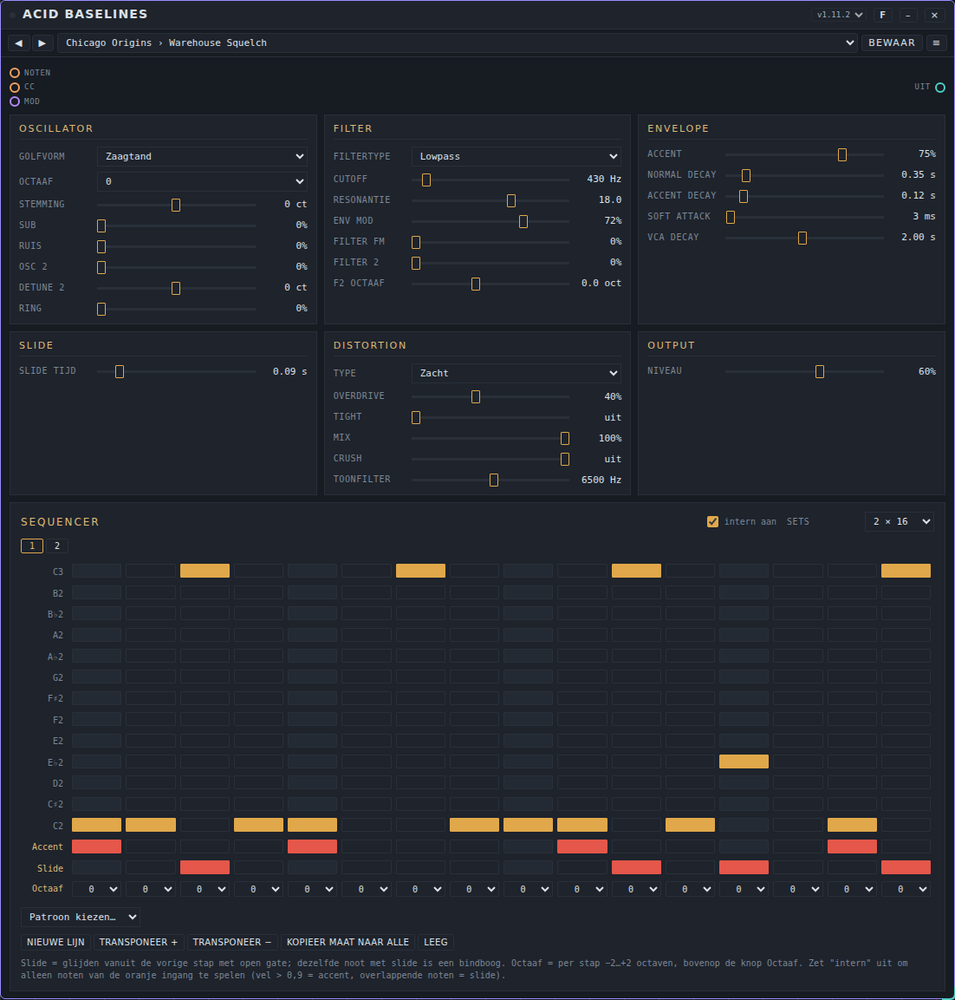
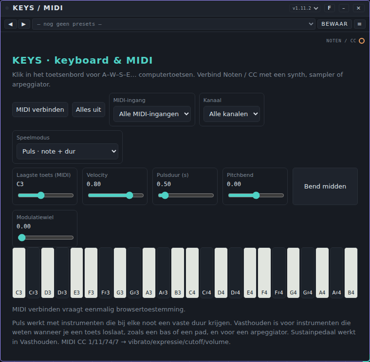
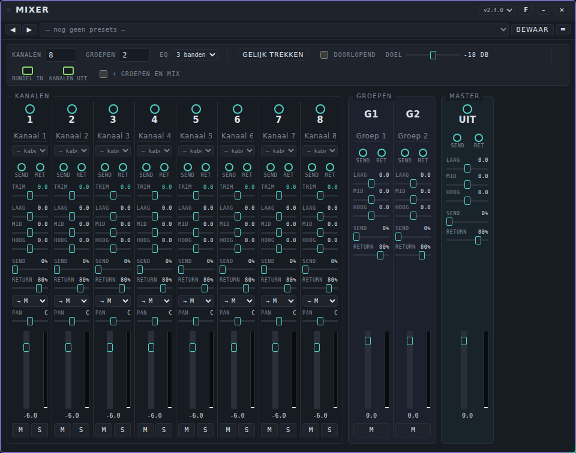
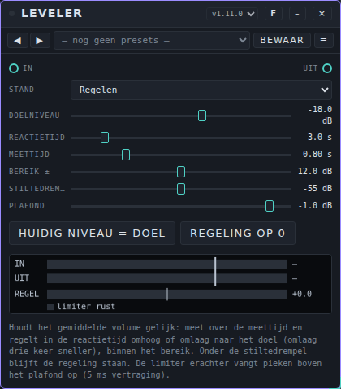

# Patchkamer gebruikershandleiding

*English version: [USER-MANUAL_EN.md](USER-MANUAL_EN.md)*

Patchkamer is een modulaire muziekstudio die in je browser draait. Je plaatst apparaten (synths, sequencers, effecten, uitgangen) op een vloer, verbindt ze met kabels, drukt op Start en maakt muziek. Deze handleiding is voor mensen die het willen gebruiken. Wil je zelf apparaten bouwen, ga dan naar [Eigen apparaten maken](#12-eigen-apparaten-maken).


## Inhoud

1. [Wat je nodig hebt](#1-wat-je-nodig-hebt)
2. [Patchkamer openen](#2-patchkamer-openen)
3. [Een rondleiding door de studio](#3-een-rondleiding-door-de-studio)
4. [Een bibliotheek laden](#4-een-bibliotheek-laden)
5. [Je eerste patch](#5-je-eerste-patch)
6. [Spelen en sequencen](#6-spelen-en-sequencen)
7. [Tunes en presets](#7-tunes-en-presets)
8. [Bewaren, openen en delen](#8-bewaren-openen-en-delen)
9. [Je weg vinden op de vloer](#9-je-weg-vinden-op-de-vloer)
10. [Instellingen](#10-instellingen)
11. [Sneltoetsen](#11-sneltoetsen)
12. [Eigen apparaten maken](#12-eigen-apparaten-maken)
13. [Problemen oplossen](#13-problemen-oplossen)
14. [Licenties](#14-licenties)

## 1. Wat je nodig hebt

- Een computer met een moderne browser. **Chrome of Edge** geeft de beste ervaring: die kunnen een map op je computer onthouden en hebben Web MIDI voor een MIDI-keyboard. Andere moderne browsers werken voor de basis.
- Een koptelefoon of speakers.
- Optioneel: een MIDI-keyboard.

Je hoeft niets te installeren, er is geen account en er wordt niets geüpload. Alles draait op je eigen computer. Patchkamer gaat alleen online als jij zegt dat het apparaten van GitHub of van een webadres moet halen.

## 2. Patchkamer openen

Patchkamer is één HTML-bestand.

1. Haal deze repository binnen: kies op GitHub **Code → Download ZIP** en pak het uit, of draai `git clone https://github.com/unboxednl/patchkamer`.
2. Open `patchkamer/patchkamer.html` in je browser.

De soepelste start krijg je als je de map vanaf je eigen computer aanbiedt in plaats van op het bestand te dubbelklikken. Doe dit in een terminal, in de map die je hebt uitgepakt:

```
python3 -m http.server 8080
```

Open daarna `http://localhost:8080/patchkamer/patchkamer.html`. Via `localhost` geven Chrome en Edge je de echte mapkiezer (onderdeel 4).

Patchkamer volgt de taal van je browser: Nederlands of Engels. Je wijzigt dat onder Instellingen (onderdeel 10).

## 3. Een rondleiding door de studio


| Onderdeel | Wat het doet |
|---|---|
| **Start** | Start en stopt de klok. Apparaten met een sequencer spelen mee. |
| **BPM**, **Swing** | Tempo (40–200) en swing van de klok. |
| **Werkruimte** | Bewaar, open en exporteer je opstelling (onderdeel 8). |
| **Tunes**, **Presets** | De bibliotheken met klanken en instellingen (onderdeel 7). |
| **Instellingen** | Taal, audiokwaliteit, weergave en meer (onderdeel 10). |
| **Herschik** | Zet je apparaten netjes op volgorde, van links naar rechts. |
| **Focus** | Toont de apparaten die je met **F** hebt gemarkeerd naast elkaar (onderdeel 9). |
| **Leeg** | Maakt de vloer leeg (klik twee keer om te bevestigen). |
| **Bibliotheek** | Toont of verbergt het bibliotheekvenster. |
| **Latency** | De vertraging tussen het berekenen van een geluid en het horen ervan, zoals je browser die meldt. |
| **Kleur** | Donker, licht of retro (onderdeel 10). |
| De naam bovenaan | De naam van je werkruimte. Klik erop om hem te wijzigen. |

Het grote vlak is de **vloer**. Daar staan je apparaten. Het venster links is de **bibliotheek**, de lijst met apparaten die je kunt plaatsen. Rechtsonder zie je de zoomknoppen.

## 4. Een bibliotheek laden

Patchkamer heeft zelf geen apparaten. Een **bibliotheek** is een verzameling apparaten. Deze repository bevat er een in de map `devices`. In het bibliotheekvenster voeg je onder **Bronnen** een of meer bronnen toe. Er zijn drie soorten:

| Bron | Hoe |
|---|---|
| **GitHub** | Typ `github.com/unboxednl/patchkamer` in het adresveld en klik op **Toevoegen**. De apparaten en de tunepakketten komen direct van GitHub. Dit is de makkelijkste start. |
| **Map** | Klik op **Lokale map kiezen…** en kies de map met apparaten (bijvoorbeeld de map `devices` van deze repository). |
| **Webadres** | Plak het adres van één `.patchkamer-device.js`-bestand, of van een lijst `patchkamer.json`, en klik op **Toevoegen**. |


Een apparaat is een bestand dat eindigt op `.patchkamer-device.js`. Bronnen worden onthouden, dus de volgende keer laden ze vanzelf.

**Een map kiezen.** Op `localhost` of via https onthouden Chrome en Edge de map en ziet Patchkamer nieuwe apparaten als je terugkomt in het venster. In andere gevallen maakt de browser een eenmalige momentopname van de map en zegt de vraag iets als "7 bestanden uploaden". Er wordt niets geüpload, en het getal telt elk bestand in de map, niet alleen apparaten. Patchkamer leest alleen de bestanden die eindigen op `.patchkamer-device.js` en toont daarna het echte aantal apparaten. Bij een momentopname vraagt **Scannen** je de map opnieuw te kiezen om nieuwe bestanden te zien.

**Categorieën.** Apparaten staan per categorie. Klik op een categorienaam om hem in te klappen. De knop **Indeling** opent een paneel waar je eigen categorieën toevoegt, hernoemt en verwijdert, en de indeling bewaart of laadt.


## 5. Je eerste patch

Je laat een keyboard een bassynth bespelen via je speakers.

1. Klik in de bibliotheek op **Plaatsen** bij **Keys / MIDI**, bij **Acid Baselines** en bij **Speakers**. Elk apparaat komt midden in je beeld. Wat in de weg staat, schuift opzij. Je kunt een apparaat ook van de bibliotheek naar de vloer slepen.
2. Klik op **Herschik** om ze netjes op een rij te zetten.
3. Verbind ze met kabels. Druk op een poort (het kleine rondje op een kaart) en sleep naar een passende poort op een andere kaart, en laat los:
   - van **Noten / CC** op Keys naar **Noten** op Acid Baselines;
   - van **Uit** op Acid Baselines naar **In** op Speakers.
4. Klik nog eens op **Herschik**, zodat de kabels van links naar rechts lopen.
5. Druk op **Start**. De sequencer in Acid Baselines gaat spelen. Klik op de pianotoetsen op Keys, of druk op de toetsen **A W S E D F T G Y H U J K O L P** van je computertoetsenbord.


**Kabels.** De kleur van een kabel laat zien wat erover gaat: **audio** (blauwgroen), **gebeurtenissen** zoals noten (oranje), **sturing** (paars) en **bundels** (dik, groen: veel kanalen in één kabel). Een kabel verbindt alleen poorten van dezelfde soort. Druk op **Esc** tijdens het slepen om te annuleren. Klik op een kabel om hem te verwijderen.

**Volume.** Gebruik de schuif op Speakers. Die heeft een begrenzer, maar zet het volume in het begin bescheiden.

## 6. Spelen en sequencen

### Acid Baselines

Een bassynth met een ingebouwde sequencer van 16 stappen.



- **Knoppen** bepalen de klank: golfvorm, octaaf, stemming, cutoff, resonantie, env mod, accent, decaytijden, soft attack, slidetijd, filter-FM, overdrive, toonfilter, VCA-decay en niveau. Dubbelklik op een schuif om terug te gaan naar de beginwaarde. Klik op het getal om een waarde te typen.
- **Sequencer.** Klik op een vakje om een noot op die stap te zetten; klik nog eens om hem weg te halen. De rijen lopen van C2 tot C3. Onder de noten vind je de rij **Accent** (een luidere, scherpere noot), de rij **Slide** (glijden vanuit de vorige stap) en een keuze **Octaaf** per stap.
- **Sets.** Kies 1, 2, 4, 8 of 16 sets van 16 stappen. Met de genummerde knoppen kies je welke set je bewerkt.
- **Patroon kiezen…** zet een van de 16 klassieke patronen in acid-stijl in de set die je bewerkt.
- **Nieuwe lijn** maakt een willekeurige lijn. **Transponeer +/−** schuift hem omhoog of omlaag, **Kopieer maat naar alle** kopieert de set naar alle sets en **Leeg** maakt hem leeg.
- Zet **intern** uit om alleen de noten te spelen die van een ander apparaat komen, bijvoorbeeld van Keys. Een noot met een velocity boven 0,9 telt als accent.

### Keys / MIDI

Een keyboard dat zelf geen geluid maakt. Het stuurt noten naar andere apparaten.



- Klik op de pianotoetsen, gebruik de computertoetsen, of druk op **MIDI verbinden** om een MIDI-keyboard te gebruiken. De browser vraagt eenmalig toestemming.
- **Speelmodus:** *Puls* stuurt een noot met een vaste lengte (**Pulsduur**). *Toets vasthouden* houdt de noot aan zolang je de toets indrukt.
- **Laagste toets** bepaalt de eerste noot van het schermtoetsenbord. **Velocity**, **Pitchbend** en **Modulatiewiel** geven expressie. **Alles uit** zet blijvende noten stil.

### Duofone

Een synth in analoge stijl met twee onafhankelijke toonhoogten, een gedeeld filter en een gedeelde VCA, met ringmodulatie, hard sync en sample & hold. Verbind Keys met de poort **Keyboard / noten** en de uitgang **Stereo** met Speakers.

### Mixer

Een mengpaneel met 1 tot 32 kanalen en 0 tot 8 groepen, en een master met een begrenzer. Verbind de apparaten die geluid maken met de kanaalingangen (**1**, **2**, …) en de poort **Uit** van de master met Speakers.



- **Kanalen** en **Groepen** bepalen hoeveel er zijn. De poorten op de kaart komen en gaan mee. Elk kanaal heeft een ingang, een poort **send** en een poort **ret** (return). Typ in het naamveld om een kanaal een naam te geven.
- Per kanaal: **Trim**, een **EQ** van 3 of 5 banden (kies onder **EQ**), **Send**, **Return**, de groep waar het heen gaat (**→ M** is de master), **Pan**, een fader met een niveaumeter, en **M** (mute) en **S** (solo). Groepen en de master hebben ook een EQ, send/return en een fader, en achter de master zit een begrenzer. Dubbelklik op een schuif om terug te gaan naar de beginwaarde.
- **Gelijk trekken** meet 4 seconden en zet de trim van elk kanaal zo dat alle bronnen op het **Doel**niveau binnenkomen. **Doorlopend** houdt ze daar langzaam op (hooguit 3 dB per seconde).
- **Bundels.** Een groene bundelkabel (bijvoorbeeld de losse uitgangen van een drumcomputer) gaat in **bundel in**; kies per kanaal onder het naamveld welk bundelkanaal daar binnenkomt. **Kanalen uit** stuurt alle kanalen, na het mixen, als één bundel door, bijvoorbeeld naar een recorder. **+ groepen en mix** voegt de groepen en de totale mix toe.
- Een Mixer heeft **presets** (hij maakt zelf geen geluid). Een preset bewaart de instellingen maar niet de bronkeuzes van de kanalen.

### Leveler

Houdt het gemiddelde volume van een bron gelijk. Zet hem tussen een instrument en de Mixer, of op de mix vóór Speakers. Dat helpt bij bronnen die langzaam harder en zachter worden, bijvoorbeeld door een modulator.



- **Stand:** *Regelen* of *Doorlaten* (het geluid gaat ongewijzigd door).
- **Doelniveau** is het niveau waar hij naartoe regelt. **Reactietijd** is hoe snel het volume omhoog of omlaag gaat (omlaag is drie keer zo snel). **Meettijd** is de tijd waarover hij meet. **Bereik ±** is hoeveel hij het volume hooguit omhoog of omlaag draait. Onder de **Stiltedrempel** blijft het volume staan, zodat galmstaarten en pauzes niet worden opgeblazen. **Plafond** is de grens van de begrenzer erachter, die pieken opvangt.
- De meter toont **IN**, **UIT** en **REGEL**, met een lampje voor de begrenzer. **Huidig niveau = doel** zet het doelniveau op wat er nu binnenkomt. **Regeling op 0** zet de correctie terug op 0.
- Een Leveler heeft **presets**. Zonder AudioWorklet in je browser laat hij het geluid ongewijzigd door en meldt dat.

## 7. Tunes en presets

Een **tune** is een volledige instelling van één apparaat dat geluid maakt: alle knoppen, patronen en keuzes. Een **preset** is hetzelfde voor een apparaat zonder eigen geluid, zoals een effect of een mixer. Geen van beide bevat kabels.

Op elke kaart zie je een balk met ◀ ▶-knoppen en een lijst. Kies een tune of preset uit de lijst, of blader met de pijlen. **Bewaar** legt de huidige instelling vast in een bibliotheek, met jouw naam als maker en een licentie (CC-BY-4.0 of alle rechten voorbehouden). Een tune met een naam in *cursief* is veranderd sinds je hem laadde.


De menu's **Tunes** en **Presets** beheren je bibliotheken: maak een nieuwe, zet tunes in mappen, importeer een pakket (`.patchkamer-tunes.json` of `.patchkamer-presets.json`) en exporteer er een om te delen. Pakketten in een bibliotheek die je van GitHub of uit een map laadt, verschijnen vanzelf. Deze repository bevat **Duofone Styles** (60 tunes in 12 stijlen) en **Acid Baselines Classics** (40 tunes in 8 stijlen).

## 8. Bewaren, openen en delen


Je **werkruimte** is de hele opstelling: apparaten met hun instellingen en patronen, kabels, tempo en naam.

- **Opslaan als bestand** downloadt je werkruimte als bestand. **Bestand openen…** laadt er een weer.
- Zet een vinkje bij **Code van alle externe instrumenten meenemen** als je een bestand wilt dat ook opent zonder toegang tot de bronnen waar de apparaten vandaan kwamen.
- **In deze browser** bewaart een kopie in je browser, zodat je later op dezelfde computer verder kunt.
- **Exporteer als song…** maakt een deelbaar bestand (`.patchkamer-song.json`) met alle apparaatcode, een titel, de maker en een licentie. Iemand anders kan het openen zonder bibliotheek.
- **Nieuwe lege werkruimte** begint opnieuw.

## 9. Je weg vinden op de vloer

- **Verplaatsen:** sleep de vloer om te schuiven. **Ctrl + scroll** zoomt tussen 10% en 250%. Met de knoppen rechtsonder zoom je uit, zoom je in, zie je alles (**Alles**) en ga je terug naar het begin (⌂).
- **Kaarten:** sleep een kaart aan de titelbalk. Sleep een rand of hoek om het formaat te wijzigen, en dubbelklik op een rand voor de standaardmaat. **–** maakt van een kaart een klein icoon en **⤢** zet hem terug. **×** verwijdert hem. Met de versielijst schakel je naar een andere versie van een apparaat.
- **Herschik** zet je apparaten op volgorde van links naar rechts: bronnen, instrumenten, effecten, mixer, uitgang. **Ctrl+Z** maakt het ongedaan.
- **Focusweergave:** druk op **F** op de titelbalk van een kaart om hem te markeren en klik dan op **Focus**. De gemarkeerde apparaten staan naast elkaar, onder elkaar of in een raster, zonder dat ze op de vloer verschuiven. **Terug naar canvas** brengt je terug.


## 10. Instellingen


- **Taal:** automatisch (je browser), Nederlands of English. Patchkamer laadt opnieuw en behoudt je werkruimte.
- **Audio:** kies kwaliteit **Laag**, **Normaal** of **Hoog**, of stel **sample rate**, **latency** en **oversampling** zelf in. Hogere kwaliteit vraagt meer van je computer. Een wijziging laadt Patchkamer opnieuw en behoudt je werkruimte. Hoor je geknetter, kies dan een grotere latencybuffer (*Gebalanceerd* of *Stabiel*).
- **Weergave:** de stijl van de kabels, hun dekking, de schaal van de hele interface, schuif of draaiknop voor de knoppen van de host, en de tekstgrootte van menu's en bibliotheek.
- **Kleur** (rechtsboven): donker, licht of retro.


- **Browsergeheugen:** Patchkamer onthoudt je instellingen, bibliotheekindeling, bronnen, werkruimte en je eigen tunes en presets in je browser. **Browsergeheugen wissen…** wist dat allemaal en begint opnieuw. Bestanden op je computer en op GitHub blijven staan.

## 11. Sneltoetsen

| Toetsen | Wat het doet |
|---|---|
| **Spatie** | Start of stop |
| **Alt+F** | Focusweergave openen of sluiten |
| **Alt+B** | Bibliotheek tonen of verbergen |
| **+** / **−** / **0** | Inzoomen / uitzoomen / zoom herstellen |
| **Ctrl + scroll** | De vloer zoomen |
| **Delete** | Het geselecteerde apparaat verwijderen |
| **Ctrl+Z** | Herschik ongedaan maken |
| **Esc** | Een kabel die je sleept annuleren, of een paneel sluiten |
| Dubbelklik op een schuif | Terug naar de beginwaarde |
| Klik op het getal naast een schuif | Een waarde typen en op Enter drukken |
| **A W S E D F T G Y H U J K O L P** | Noten spelen op Keys (als het toetsenbord focus heeft) |

De lettertoetsen A–P zijn van Keys, daarom gebruiken de sneltoetsen van de host Alt.

## 12. Eigen apparaten maken

Een apparaat is één `.patchkamer-device.js`-bestand dat het **contract** volgt: een volledige, zelfstandige beschrijving van wat een apparaat moet doen. Het contract bestaat in het Nederlands ([PATCHKAMER-CONTRACT_NL.md](../contract/PATCHKAMER-CONTRACT_NL.md)) en het Engels ([PATCHKAMER-CONTRACT_EN.md](../contract/PATCHKAMER-CONTRACT_EN.md)). Een validator controleert je apparaat:

```
node contract/validate-instrument.mjs devices/synths/Duofone/duofone.patchkamer-device.js
```

Patchkamer is gemaakt om net zo goed door AI-agents als door mensen te worden gebouwd. Wijs je agent naar [AGENTS.md](../AGENTS.md): daar staat wat hij moet lezen, waar hij dingen neerzet en wat hij moet controleren. Onder **Instellingen → Contract & opstelling** vind je ook een sjabloon dat je kunt kopiëren.

## 13. Problemen oplossen

**Ik hoor niets.**
- Druk op **Start**, of klik ergens in Patchkamer. Browsers pauzeren audio tot je met de pagina werkt, en ook na slaapstand of als je de audio-uitgang wisselt. Patchkamer meldt dan "Het geluid staat uit" en hervat zelf bij je volgende klik of toetsaanslag.
- Controleer de kabels: audio moet van het apparaat dat geluid maakt naar **Speakers** lopen. Noten moeten van Keys (of een sequencer) naar het instrument lopen.
- Controleer het volume op Speakers en op je computer.

**De bibliotheek is leeg of mijn nieuwe apparaat ontbreekt.**
- Voeg een bron toe (onderdeel 4).
- Bij een map die Patchkamer niet kan onthouden, klik je op **Scannen** en kies je de map opnieuw. Alleen bestanden die eindigen op `.patchkamer-device.js` tellen mee.

**Mijn MIDI-keyboard wordt niet gevonden.** Gebruik Chrome of Edge, klik op **MIDI verbinden** op Keys en geef toegang. Kies het keyboard onder **MIDI-ingang**.

**Geknetter of haperingen.** Open Instellingen → Audio en kies *Gebalanceerde* of *Stabiele* latency, of zet de kwaliteit op *Laag*.

**De mapvraag zegt "7 bestanden uploaden".** Zie onderdeel 4: er wordt niets geüpload en het getal telt alle bestanden in de map.

**Alles ziet er raar of vastgelopen uit.** Instellingen → **Browsergeheugen wissen…** begint Patchkamer opnieuw.

## 14. Licenties

Elke map heeft een eigen licentie: de host en de apparaten zijn AGPL-3.0-or-later, het contract is MIT, tunes en presets zijn CC0-1.0 en de songs zijn CC-BY-4.0. Zie [LICENSING.md](../LICENSING.md).
