# Patchkamer gebruikershandleiding

*English version: [USER-MANUAL_EN.md](USER-MANUAL_EN.md)*

Patchkamer is een modulaire muziekstudio die in je browser draait. Je plaatst apparaten (synths, sequencers, effecten, uitgangen) op een vloer, verbindt ze met kabels, drukt op Start en maakt muziek. Deze handleiding is voor mensen die het willen gebruiken. Wil je zelf apparaten bouwen, ga dan naar [Eigen apparaten maken](#12-eigen-apparaten-maken).

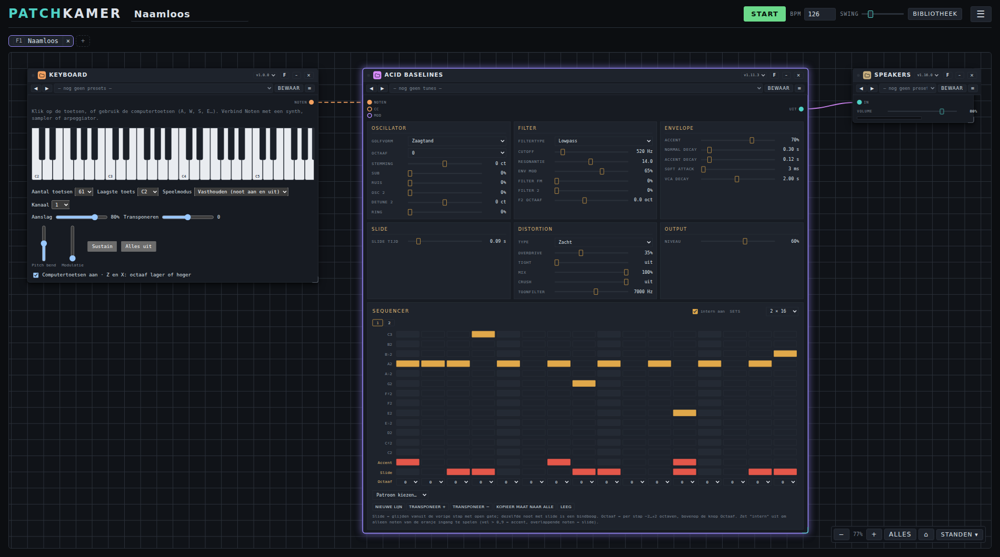

## Inhoud

1. [Wat je nodig hebt](#1-wat-je-nodig-hebt)
2. [Patchkamer openen](#2-patchkamer-openen)
3. [Een rondleiding door de studio](#3-een-rondleiding-door-de-studio)
4. [Een bibliotheek laden](#4-een-bibliotheek-laden)
5. [Je eerste patch](#5-je-eerste-patch)
6. [De apparaten](#6-de-apparaten)
7. [Tunes en presets](#7-tunes-en-presets)
8. [Bewaren, openen en delen](#8-bewaren-openen-en-delen)
9. [Je weg vinden op de vloer](#9-je-weg-vinden-op-de-vloer)
10. [Instellingen](#10-instellingen)
11. [Sneltoetsen](#11-sneltoetsen)
12. [Eigen apparaten maken](#12-eigen-apparaten-maken)
13. [Problemen oplossen](#13-problemen-oplossen)
14. [Licenties](#14-licenties)

## 1. Wat je nodig hebt

- Een computer met een moderne browser. **Chrome of Edge** geeft de beste ervaring: die kunnen een map op je computer onthouden en hebben Web MIDI voor een MIDI-keyboard. Andere moderne browsers werken voor de basis.
- Een koptelefoon of speakers.
- Optioneel: een MIDI-keyboard.

Je hoeft niets te installeren, er is geen account en er wordt niets geüpload. Alles draait op je eigen computer. Patchkamer gaat alleen online als jij zegt dat het apparaten van GitHub of van een webadres moet halen.

## 2. Patchkamer openen

Patchkamer is een gewone webpagina (`patchkamer.html` met zijn stijlbladen en scripts, zonder installatie of build). De snelste manier is het online te openen via <https://unboxednl.github.io/patchkamer/>. Dat draait altijd de nieuwste versie uit deze repository, werkt in Chrome en Edge (ook op een Android-telefoon) en draait nog steeds helemaal in je eigen browser: er wordt niets geüpload. Omdat het via https wordt aangeboden, werken Web MIDI en audio-ingang er ook.

Wil je liever je eigen kopie draaien:

1. Haal deze repository binnen: kies op GitHub **Code → Download ZIP** en pak het uit, of draai `git clone https://github.com/unboxednl/patchkamer`.
2. Open `patchkamer/patchkamer.html` in je browser.

De soepelste start krijg je als je de map vanaf je eigen computer aanbiedt in plaats van op het bestand te dubbelklikken. Doe dit in een terminal, in de map die je hebt uitgepakt:

```
python3 -m http.server 8080
```

Open daarna `http://localhost:8080/patchkamer/patchkamer.html`. Via `localhost` geven Chrome en Edge je de echte mapkiezer (onderdeel 4).

Patchkamer volgt de taal van je browser: Nederlands of Engels. Je wijzigt dat onder Instellingen (onderdeel 10).

### Als app op je telefoon of computer

Je hoeft niets te installeren, maar je kunt Patchkamer wel als app-icoon bewaren. Open <https://unboxednl.github.io/patchkamer/> en kies:

- **Android (Chrome):** menu ⋮ → **App installeren** of **Toevoegen aan startscherm**. Patchkamer opent dan zonder adresbalk, schermvullend.
- **Computer (Chrome of Edge):** het installeericoon in de adresbalk of menu → **Patchkamer installeren**.
- **iPhone en iPad (Safari):** knop Delen → **Zet op beginscherm**.

Het icoon (een patchkabel tussen twee aansluitingen) verschijnt ook als tabbladicoon in de browser. De app heeft een internetverbinding nodig om te starten; je werk blijft in je browser bewaard.

## 3. Een rondleiding door de studio

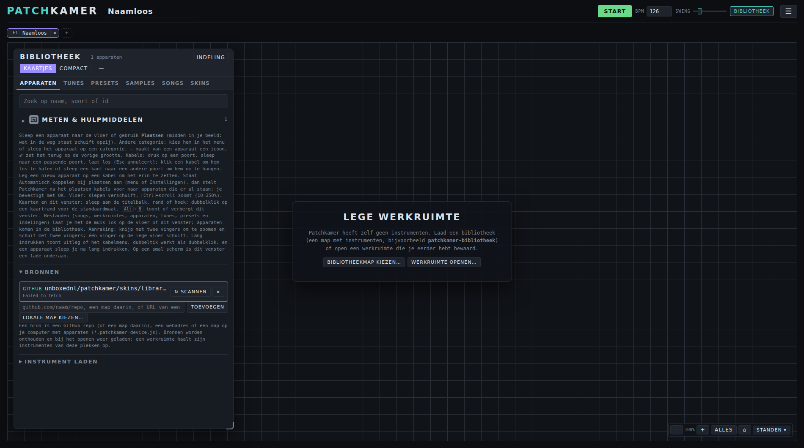

| Onderdeel | Wat het doet |
|---|---|
| **Start** | Start en stopt de klok. Apparaten met een sequencer spelen mee. |
| **BPM**, **Swing** | Tempo (40–200) en swing van de klok. |
| **Bibliotheek** | Toont of verbergt het bibliotheekvenster met de tabs **Apparaten**, **Tunes**, **Presets**, **Samples**, **Songs** en **Skins** ([de tabs van de bibliotheek](#de-tabs-van-de-bibliotheek)). |
| De naam bovenaan | De naam van je werkruimte. Klik erop om hem te wijzigen. |
| **☰** | Het menu met al het andere, in vier groepen (de vier rijen hieronder). Het menu sluit na een keuze. |
| ☰ → **Bestand** | **Werkruimte** (bewaar, open en exporteer je opstelling, onderdeel 8), **Herschik** (zet je apparaten netjes op volgorde, van links naar rechts) en **Leeg** (maakt de vloer leeg; klik twee keer om te bevestigen). |
| ☰ → **Bibliotheek** | **Tunes**, **Presets**, **Songs** en **Skins** openen het bibliotheekvenster op die tab (onderdeel 7 en 8). |
| ☰ → **Weergave** | **Scherm** en **Pas aan op dit scherm** (onderdeel 9), **Kleur** (donker, licht of retro, onderdeel 10), **Focus** (toont de apparaten die je met **F** hebt gemarkeerd naast elkaar, onderdeel 9) en **Bladeren** (Focus met alle apparaten, één tegelijk). |
| ☰ → **Overig** | **Instellingen** (taal, audiokwaliteit, weergave en meer, onderdeel 10), **Latency** (klein weergegeven: de vertraging tussen het berekenen van een geluid en het horen ervan, zoals je browser die meldt) en de schakelaar **Automatisch koppelen bij plaatsen**. |
| Tabs **F1**, **F2**… | De balk onder de bovenbalk bevat je werkruimtes. Klik op een tab of druk op **F1** t/m **F10** om te wisselen; **+** voegt er een toe en **×** sluit er een (hoofdstuk 8). |

Het grote vlak is de **vloer**. Daar staan je apparaten. Het venster links is de **bibliotheek**, met de apparaten die je kunt plaatsen. Rechtsonder zie je de zoomknoppen.

### De tabs van de bibliotheek

Het bibliotheekvenster toont één soort tegelijk. Bovenaan wissel je met zes tabs:

- **Apparaten:** de apparaten die je kunt plaatsen, met zoekveld, categorieën, **Indeling** en de **Bronnen** om te laden en te scannen (onderdeel 4);
- **Tunes** en **Presets:** je tune- en presetbibliotheken, met **Alles laden**, **Nieuwe bibliotheek** en **Importeren…** (onderdeel 7);
- **Samples:** samplepacks per stijl of per pack, met ▶ om te beluisteren en knoppen om een sample in de Loop Slicer of de Samplebank te laden (onderdeel 7);
- **Songs:** de demo's, je recente songs, **Bestand openen…** en **Exporteer als song…**, met een zoekveld (onderdeel 8);
- **Skins:** de skinbibliotheken, met **Importeren…**, **Alles laden** en de ontwerper (onderdeel 7).

Op een breed scherm zijn het tabs. Op een smal scherm (onder 700 pixels, de onderlade) en als het venster te smal is voor alle tabs, is het een keuzelijst. Je laatst gekozen tab wordt onthouden. De knoppen **Tunes**, **Presets**, **Songs** en **Skins** in het ☰-menu, de knop naast de tunelijst op een kaart en het loslaten van een tune-, preset- of skinbestand openen het venster op de juiste tab. **Instellingen** blijft een eigen paneel via het ☰-menu.

## 4. Een bibliotheek laden

Patchkamer heeft zelf geen apparaten. Een **bibliotheek** is een verzameling apparaten. Deze repository bevat er een in de map `devices`. In het bibliotheekvenster (tab **Apparaten**) voeg je onder **Bronnen** een of meer bronnen toe. Er zijn drie soorten:

| Bron | Hoe |
|---|---|
| **GitHub** | Typ `github.com/unboxednl/patchkamer` in het adresveld en klik op **Toevoegen**. De apparaten en de tunepakketten komen direct van GitHub. Dit is de makkelijkste start. |
| **Map** | Klik op **Lokale map kiezen…** en kies de map met apparaten (bijvoorbeeld de map `devices` van deze repository). |
| **Webadres** | Plak het adres van één `.patchkamer-device.js`-bestand, of van een lijst `patchkamer.json`, en klik op **Toevoegen**. |

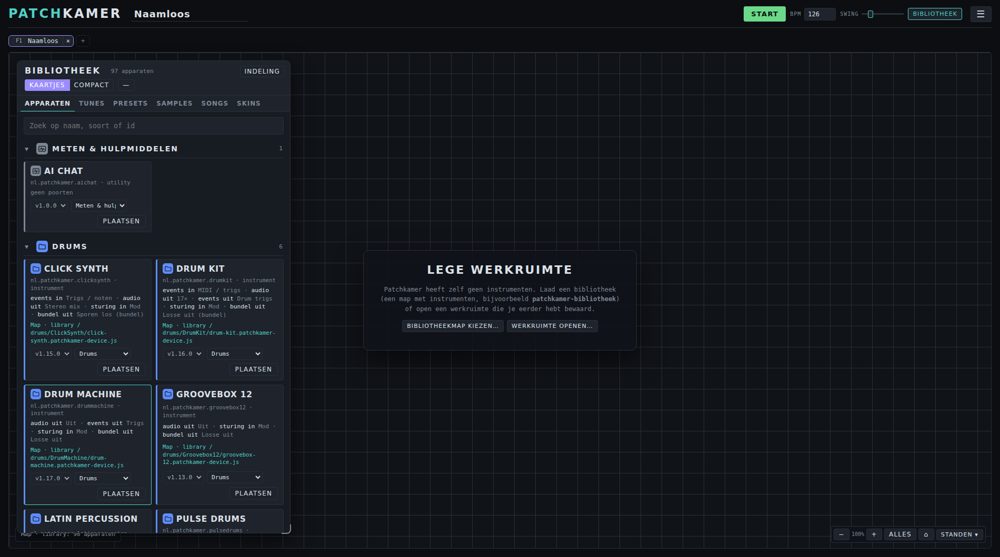

Een apparaat is een bestand dat eindigt op `.patchkamer-device.js`. Bronnen worden onthouden, dus de volgende keer laden ze vanzelf.

**Scannen.** De knop **Scannen** naast een bron leest hem opnieuw in. Patchkamer meldt dan hoeveel wijzigingen hij vond, verdeeld in nieuwe en gewijzigde apparaten en nieuwe en gewijzigde tune- en presetpacks, bijvoorbeeld "3 wijzigingen gevonden · 1 nieuw, 1 gewijzigd, 1 nieuwe packs". De bibliotheek wordt meteen opnieuw getekend, en de nieuwe en gewijzigde apparaten krijgen een paar minuten een kleine badge **nieuw** of **gewijzigd**. De eerste scan van een bron telt alles als nieuw en toont geen badges.

**Bijwerken.** Een scan laadt ook de gewijzigde code van apparaten die al op de vloer staan: zo'n apparaat wordt opnieuw gemaakt met zijn instellingen, kabels en grootte, en de melding noemt hoeveel er zijn bijgewerkt.

**Nieuwe versie van Patchkamer.** Bij het starten (via http of https) vergelijkt Patchkamer `patchkamer.html` en zijn stijlbladen en scripts met de versie op GitHub (`main`). Wijkt die af, dan verschijnt rechtsonder een melding met **Bekijk op GitHub**, **Later** en **Niet meer melden voor deze versie**. Een bestand dat je via `file://` opent, kan zichzelf niet lezen en krijgt geen melding.

**Het kan ook vanzelf.** Onder **Instellingen → Automatisch laden** kan Patchkamer de apparatenbibliotheek, de presets en de tunes van GitHub laden zodra je met een lege werkruimte begint. De adressen kun je daar wijzigen (hoofdstuk 10). Elk adres wordt een eigen bron in de lijst, met een knop **Scannen**.

**Een map kiezen.** Op `localhost` of via https onthouden Chrome en Edge de map en ziet Patchkamer nieuwe apparaten als je terugkomt in het venster. In andere gevallen maakt de browser een eenmalige momentopname van de map en zegt de vraag iets als "7 bestanden uploaden". Er wordt niets geüpload, en het getal telt elk bestand in de map, niet alleen apparaten. Patchkamer leest alleen de bestanden die eindigen op `.patchkamer-device.js` en toont daarna het echte aantal apparaten. Bij een momentopname vraagt **Scannen** je de map opnieuw te kiezen om nieuwe bestanden te zien.

**Categorieën.** Apparaten staan per categorie. Bij het starten staan alle categorieën ingeklapt; klik op een categorienaam om hem open te klappen (zoeken klapt de treffers vanzelf open). De knop **Indeling** opent een paneel waar je eigen categorieën toevoegt, hernoemt en verwijdert, en de indeling bewaart of laadt.

**Subcategorieën.** Een categorie kan onderliggende subcategorieën hebben (bijvoorbeeld Effecten met Modulatie, Dynamica en Tijd & ruimte). Ze staan ingesprongen onder hun categorie, klappen los in en uit (ook die keuze blijft staan zolang je Patchkamer open hebt) en hebben een eigen teller; de teller van de categorie telt alles eronder mee. Klapt de categorie dicht, dan verdwijnen ook zijn subcategorieën. Zoeken vindt ook apparaten in ingeklapte subcategorieën en klapt ze open. Een apparaat verplaats je naar een subcategorie door het op de subkop te slepen (met de vinger: eerst lang indrukken) of door in het keuzevak van het apparaat de subcategorie te kiezen (die staat als ↳ Naam onder zijn categorie). In **Indeling** maakt de knop ↳ van een categorie een subcategorie van de categorie erboven (één niveau diep), en ↰ maakt er weer een gewone categorie van; ▲ en ▼ verplaatsen binnen het niveau, en een categorie neemt zijn subcategorieën mee. Verwijder je een categorie met subcategorieën, dan worden die gewone categorieën. In het indelingsbestand staat een subcategorie met het veld `parent` (de `key` van de categorie erboven); een bestand zonder dat veld werkt precies als voorheen.

**Mappen als categorieën.** Staat er in een bron geen indelingsbestand (`patchkamer-bibliotheek.json`), dan is de eerste map waarin een apparaat staat zijn categorie (`synths/…` wordt de categorie Synths). Staat er wel een bestand en bevat een map die het niet kent (de bestandsindeling noemt de bekende mappen onder `folders`; een map met dezelfde naam als een categorie hoort bij die categorie), dan verschijnt die map er als extra categorie bij. Een apparaat dat in het bestand aan een categorie is toegewezen, blijft daar staan. Staat alles van een bron in één gedeelde bovenmap, dan telt die map niet mee.

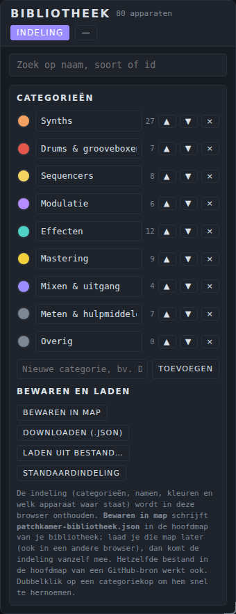

### Categorie-iconen

Elke categorie heeft een icoon. Het staat bij de categorienaam in de bibliotheek, bij elk apparaat in die categorie (kaartjes en compacte regels), op de titelbalk van een apparaat, en in de compacte en minimale stand van een apparaat, waar het icoon de initialen vervangt. Het icoon staat in de kleur van de categorie. Je kiest een ander icoon in het paneel **Indeling**: klik op het icoon links van de categorienaam en kies er een uit het rooster, plak een adres van een afbeelding (alleen van dezelfde bron als de bibliotheek) of kies **Bestand kiezen…** voor een eigen afbeelding (png, svg, webp of jpg, hoogstens 200 kB). **Standaard** zet het oorspronkelijke icoon terug. Je keuze wordt bewaard in de indeling en staat dus ook in `patchkamer-bibliotheek.json` (veld `icon`).

### Een icoon in een bibliotheekmap zetten

Zet een bestand `icon.svg`, `icon.png`, `icon.webp` of `icon.jpg` (in die volgorde gezocht, hoofdletters maken niet uit) in de map die als categorie telt, bijvoorbeeld `devices/synths/`. Dat icoon wordt dan het icoon van die categorie en van alle apparaten erin. Het werkt voor een lokale map, een GitHub-bron en een webadres; **Scannen** neemt een gewijzigd icoon over. Een `icon.*` in een andere map doet voor de categorie niets (in de map van één apparaat is het het icoon van dat apparaat, zie hieronder). Wat wint: eerst je eigen keuze onder **Indeling** (en het veld `icon` in het indelingsbestand), dan het bestand in de map, dan het ingebouwde icoon. De afbeelding wordt getoond zoals ze is (niet omgekleurd) en alleen als afbeelding, dus scripts in een svg draaien nooit. Bestanden groter dan 200 kB of die geen afbeelding zijn, worden overgeslagen. Een vierkante, transparante afbeelding (svg, of minstens 64 pixels) ziet er het mooist uit. Een `icon.*` in de map van één apparaat is wél een icoon voor dat apparaat: zie hieronder.

### Een eigen icoon voor een apparaat

Behalve de categorie kan ook één **apparaat** een eigen icoon hebben. Patchkamer zoekt in deze volgorde (de eerste die bestaat wint):

1. het `icon` van de **skin** die op die kaart actief is (alleen op die kaart);
2. een `icon.svg`, `icon.png`, `icon.webp` of `icon.jpg` in de **map van het apparaat** in je apparatenbibliotheek, dus naast het `.patchkamer-device.js`, bijvoorbeeld `devices/synths/Duofone/icon.svg` (alleen voor een lokale map en een GitHub-bron; bij een webadres zoekt Patchkamer niet naar apparaatmappen);
3. een `icon.*` in `skins/library/<apparaat-id>/`, bijvoorbeeld `skins/library/nl.patchkamer.duofone/icon.svg`, als die bron geladen is. Zo geef je ook een apparaat dat je niet zelf in je bibliotheek hebt een icoon;
4. het icoon van de **categorie** (zie hierboven), in de kleur van de categorie;
5. het neutrale standaardicoon.

Een eigen icoon staat op dezelfde plekken als het categorie-icoon: in de bibliotheek (kaartjes en compacte regels), op de titelbalk, in de minimale stand, in de vereenvoudigde kaart bij uitzoomen en in de tabbalk van Focus "Eén tegelijk". Het wordt getoond zoals het is (niet omgekleurd) en alleen als afbeelding, dus scripts in een svg draaien nooit. Dezelfde grenzen gelden als bij categorie-iconen: hoogstens 200 kB, alleen een afbeelding, alleen van dezelfde bron als de bibliotheek. Een apparaat zonder eigen icoon ziet er precies uit als voorheen. De categorie houdt haar eigen icoon bij de categorienaam. **Scannen** neemt een gewijzigd icoon over. Kies je op de kaart weer **Standaard** bij Skin, dan keert het icoon terug naar punt 2, 3 of 4.


## 5. Je eerste patch

Je laat een keyboard een bassynth bespelen via je speakers.

1. Klik in de bibliotheek op **Plaatsen** bij **Keys / MIDI**, bij **Acid Baselines** en bij **Speakers**. Elk apparaat komt midden in je beeld. Wat in de weg staat, schuift opzij: een apparaat dat links van het midden van het nieuwe ligt gaat naar links, rechts ervan naar rechts, en duidelijk erboven of eronder omhoog of omlaag. Dat geldt ook als je een apparaat zelf verslaat naar een ander: zo wissel je twee apparaten van plaats. Je kunt een apparaat ook van de bibliotheek naar de vloer slepen.
2. Klik op **Herschik** om ze netjes op een rij te zetten.
3. Verbind ze met kabels. Druk op een poort (het kleine rondje op een kaart) en sleep naar een passende poort op een andere kaart, en laat los:
   - van **Noten / CC** op Keys naar **Noten** op Acid Baselines;
   - van **Uit** op Acid Baselines naar **In** op Speakers.
4. Klik nog eens op **Herschik**, zodat de kabels van links naar rechts lopen.
5. Druk op **Start**. De sequencer in Acid Baselines gaat spelen. Klik op de pianotoetsen op Keys, of druk op de toetsen **A W S E D F T G Y H U J K O L P** van je computertoetsenbord.


**Kabels.** De kleur van een kabel laat zien wat erover gaat: **audio** (blauwgroen), **gebeurtenissen** zoals noten (oranje), **sturing** (paars), **mastering** (een gele, gestippelde golf, tussen de driehoekpoorten van de Master Director en de mastering-apparaten), **multi-MIDI** (een dubbele gestreepte oranje kabel met alle sporen van een sequencer, voor de MIDI Hub) en **bundels** (dik, groen: veel kanalen in één kabel). Een kabel verbindt alleen poorten van dezelfde soort. Druk op **Esc** tijdens het slepen om te annuleren. Klik op een kabel om hem te verwijderen.

**Een kabel omhangen.** Sleep een kabel aan één kant naar een andere passende poort. De kant die het dichtst bij je greep zit, komt los en de andere kant blijft zitten. Laat je los op een passende poort, dan hangt de kabel daar. Laat je ergens anders los, of druk je op **Esc**, dan gaat de kabel terug naar waar hij was. De oude kabel blijft aangesloten tot je loslaat, dus het geluid blijft doorspelen.

**Een apparaat op een kabel leggen.** Sleep een apparaat uit de bibliotheek, of een apparaat dat nog geen kabels heeft, op een kabel. De kabel licht op en als je loslaat splitst hij: het apparaat zit tussen de twee uiteinden. Dat werkt voor apparaten die zowel een ingang als een uitgang hebben van die soort kabel (audio of noten), zoals de effecten. Licht een kabel niet op, dan past het apparaat er niet in.

### Kabelkleur

Een kabel krijgt de kleur van de categorie van het apparaat waar hij vandaan komt: een kabel uit een synth heeft de kleur van de categorie Synths. De soort kabel zie je aan de lijnstijl (audio vast, gebeurtenissen gestreept, sturing golvend, bundels dik en dubbel). De kleur wordt zo nodig iets lichter of donkerder gemaakt zodat hij op de vloer van elke kleurstelling goed te zien is. Onder **Instellingen → Weergave** kies je bij **Kabelkleur** tussen **per categorie** (standaard) en **per soort** (de kleuren van vroeger: audio, gebeurtenissen, sturing, mastering en bundels elk een eigen kleur). Een kleur die je zelf aan een kabel gaf, wint altijd. Een kabel van een apparaat in **Overig** houdt de kleur van zijn soort.

### Kabeltekst bij hover

Wijs je met de muis een kabel aan, dan verschijnt er een kleine tekst met de namen van de gekoppelde apparaten, gescheiden door een streepje: `Chord Poly - Pump`. Heeft een apparaat meer poorten van die soort, dan staat de poort erbij: `Chord Sequencer (Spoor A) - Chord Poly`. Bij multi-MIDI, bundels en mastering staat de soort tussen haakjes erachter. Op een aanraakscherm houd je een kabel lang ingedrukt: dan krijg je dezelfde tekst als melding, naast het kleurmenu.

### Automatisch koppelen bij plaatsen

Patchkamer kan na het plaatsen kabels voorstellen, zodat je niet elke kabel zelf hoeft te slepen. De schakelaar **Automatisch koppelen bij plaatsen** staat in het menu ☰ (groep **Overig**) en onder **Instellingen**; beide schakelaars horen bij elkaar. Zonder eigen keuze staat hij **aan op een aanraakscherm** (telefoon, tablet) en **uit op een computer met muis**; een smal venster op een computer telt dus niet als mobiel. Zodra je de schakelaar zelf zet, onthoudt je browser die keuze.

Staat hij aan, dan opent na elk apparaat dat **jij zelf plaatst** (slepen, **Plaatsen** of een tik op een compacte bibliotheekregel) een venster **Koppelen met apparaten op het canvas**, als er iets te koppelen valt. Bij het openen van een song of werkruimte, bij **Herschik**, bij Ctrl+Z en bij wisselen van tabblad gebeurt dit nooit. Leg je het apparaat op een kabel, dan krijgt dat voorrang en komt het venster niet.

Het voorbeeld: je plaatst **Speakers** op een leeg canvas. Er gebeurt niets. Dan plaats je een synth: het venster toont de groep **Audio** met de Speakers (compact, één regel) al aangevinkt. Daarna plaats je een sequencer: nu staat er een groep **Gebeurtenissen (MIDI)** met de synth aangevinkt. Het venster groepeert de voorstellen per soort kabel (audio, gebeurtenissen, sturing en de overige soorten) en je kunt in alle groepen tegelijk vinken. Eén klik op **OK** maakt alles wat is aangevinkt; **Overslaan** (of Esc) doet niets. Met **Niet meer vragen** zet je de schakelaar uit.

Patchkamer stelt alleen kabels voor die kloppen met de volgorde bronnen, instrumenten, effecten, mengpaneel, uitgang. Per apparaat en per soort staat hooguit één voor de hand liggend voorstel aangevinkt (het volgende apparaat in de keten met een vrije ingang); de rest staat in de lijst maar uit. Plaats je een **effect**, dan kun je het ook in een bestaande audiokabel zetten: de groep **In een bestaande kabel zetten** toont per kabel een regel "Tussen A en B". Die regel sluit de gewone audiovoorstellen voor dat effect uit, en je kunt hooguit één kabel kiezen.

**Sequencers met sporen.** Heeft een sequencer meer uitgangspoorten (een poort per spoor, zoals de Clip Arranger), dan kiest Patchkamer de laagste vrije poort voor elk doelapparaat en toont erbij of dat doel een drumcomputer is (**drums**) of een melodisch apparaat (**melodisch**). Een apparaat legt zelf niet vast welk type een spoor heeft: de keuze volgt het apparaat dat je koppelt. Met de keuzelijsten **Uitgang** en **Ingang** kies je een andere vrije poort. Zijn alle poorten in gebruik, dan staat het voorstel uit met de reden "alle poorten in gebruik".

**Niet te veel.** Zijn er meer dan **7** mogelijkheden (alle groepen samen, ook de uitgevinkte), dan verschijnt er geen venster en koppel je zelf.

**Ongedaan maken.** Eén keer **Ctrl+Z** na **OK** haalt alle kabels van die ene keer weer weg; bij een ingevoegd effect komt de oorspronkelijke kabel terug.

**Volume.** Gebruik de schuif op Speakers. Die heeft een begrenzer, maar zet het volume in het begin bescheiden.

## 6. De apparaten

Apparaten zijn er in soorten. Elke soort heeft een eigen README en een eigen gebruikershandleiding, met per apparaat een sectie: waar het voor dient, de regelaars, de poorten, een voorbeeldpatch en de presets of tunes die erbij horen. Een patch loopt meestal van links naar rechts: **tools** en **drums** sturen noten, **synths** maken het geluid, **effecten** geven het vorm, de **mixer** voegt het samen en **Speakers** speelt het af. De knop **Herschik** zet je apparaten in die volgorde.

| Soort | Waar het voor dient | Apparaten | Handleiding |
|---|---|---|---|
| **Synths** | Geluid maken uit noten | Acid Baselines, Acid Stepper, Basic Mono, Biotope, Bowed Ensemble, Celestial Mechanics, Chord Poly, Cinematic Synth, Cross Mod Mono, Dissonant Cluster, Drone Synth, Duofone, Formant Singer, Foundry, Four-Operator FM, Grain Cloud, Karplus String, Ladder Mono, Layered Landscape, Low Bass, Mist, Paradox, Patch Mono, Patchbay Synth, Poly Chorus, Stage Keys, Sub Line, Supersaw Swarm, Triple Osc Poly | [Handleiding synths](synths/USER-MANUAL_NL.md) · [README](../devices/synths/README_NL.md) |
| **Samplers** | Eigen geluiden spelen: pads en slices uit geladen audio | Samplebank, Loop Slicer | [Handleiding samplers](samplers/USER-MANUAL_NL.md) · [README](../devices/samplers/README_NL.md) |
| **Sequencers** | Noten en akkoorden laten spelen op andere apparaten | Chord Sequencer, Clip Arranger, Euclidean Rhythms, Pattern Playlist, Pattern Tracker, Scale Arpeggiator, Step Sequencer, Wanderer | [Handleiding sequencers](sequencers/USER-MANUAL_NL.md) · [README](../devices/sequencers/README_NL.md) |
| **Drums** | Drumgeluiden en ritme | Drum Machine, Drum Kit, Groovebox 12, Pulse Drums, Latin Percussion, Click Synth | [Handleiding drums](drums/USER-MANUAL_NL.md) · [README](../devices/drums/README_NL.md) |
| **Effecten** | Het geluid vormgeven: modulatie, vervorming, ruimte, filters, ritme, stem, ketens | Chorus, Effect Chain, Filter, Flanger, Frequency Shifter, Grit, Phaser, Pump, Resonator, Room, Tremolo, Vocoder | [Handleiding effecten](effects/USER-MANUAL_NL.md) · [README](../devices/effects/README_NL.md) |
| **Mastering** | Een mix afmaken: toon, dynamiek, saturatie, breedte, volume en controle | Balance EQ, Multiband Balance, Bus Compressor, Patina, Stereo Space, Master Chain, Mix Check, Master Director, Listening Output | [Handleiding mastering](mastering/USER-MANUAL_NL.md) · [README](../devices/mastering/README_NL.md) |
| **Mixer** | Binnenhalen, mixen, het niveau gelijk houden, afspelen | Mixer, Leveler, Speakers, Audio Input, Audio Capture, Audio Output | [Handleiding mixer](mixer/USER-MANUAL_NL.md) · [README](../devices/mixer/README_NL.md) |
| **Modulatoren** | De regelaars van andere apparaten bewegen | Drift, Follower, LFO, Macro, Multi-Segment Envelope, Swell | [Handleiding modulatoren](modulators/USER-MANUAL_NL.md) · [README](../devices/modulators/README_NL.md) |
| **Tools** | Spelen, opnemen, meten en notities maken | Control Surface, Keys / MIDI, Metronome, MIDI Hub, Multitrack, Notes, Pad Controller, Recorder, Scope | [Handleiding tools](tools/USER-MANUAL_NL.md) · [README](../devices/tools/README_NL.md) |

Twee voorbeelden van een kaart in de bibliotheek: **Chord Buddy** (soort Tools: hulp bij akkoorden, ook zonder muziektheorie) en **Balance EQ** (soort Mastering: een equalizer met vijf tot twaalf banden).

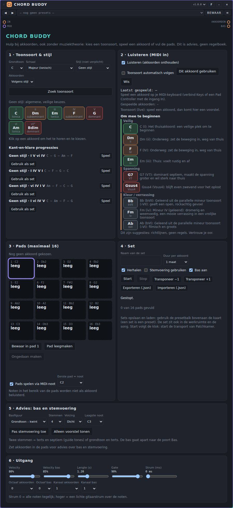

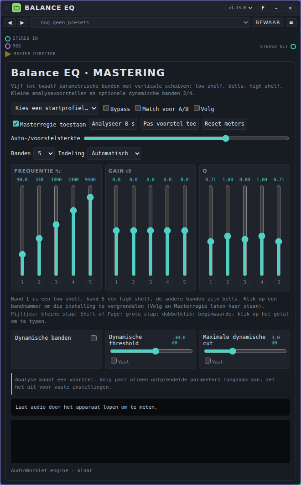

**AI-chat (ingebouwd).** Naast de soorten hierboven heeft de bibliotheek één apparaat dat bij Patchkamer zelf hoort: **AI Chat**, onder *Meten & hulpmiddelen*. Plaats het en vraag in je eigen woorden om een device, een tunepack, een presetpack of een song. Het heeft een aanbieder, een API-sleutel en een model nodig onder **Instellingen → AI-assistent**; de aanbieder rekent het gebruik aan jou aan. De AI leest de documentatie van deze repository op GitHub zelf (de AGENTS.md-bestanden, het contract, de stijlgidsen) en geeft alles als **voorstel**: **Toevoegen** zet een device in de bibliotheek en op de vloer, of een tune- of presetpack in je bibliotheken, en **Openen** opent een song in een nieuwe werkruimte-tab. Zonder jouw klik wordt niets toegevoegd. Lees de code van een device voor je het toevoegt: een device is niet afgeschermd van de pagina, en de controle op de kaart waarschuwt alleen voor netwerk, opslag en eval. Het gesprek blijft staan als je van werkruimte wisselt; **Nieuw gesprek** begint opnieuw. Niet getest met echte aanbieders of sleutels: de werking met alle drie de formaten is getest met nagebootste antwoorden. De AI kan niet luisteren: vertel wat je hoort.

Hun kant-en-klare klanken en instellingen hebben eigen handleidingen: [Tunes](tunes/USER-MANUAL_NL.md) voor apparaten die geluid maken en [Presets](presets/USER-MANUAL_NL.md) voor de rest (zie ook onderdeel 7).

### Patronen kopiëren en plakken

Een apparaat dat een patroon of clip kan delen, krijgt in de balk van zijn kaart twee knoppen: **Kopieer** en **Plak**. Je ziet ze alleen bij apparaten die dit kunnen (Step Sequencer, Clip Arranger, Pattern Tracker, Pattern Playlist, Chord Sequencer, Drum Kit, Pulse Drums, Latin Percussion, Click Synth, Drum Machine en Groovebox 12; Euclidean Rhythms en Wanderer kunnen alleen kopiëren, als momentopname). Zo neem je een patroon mee van het ene apparaat naar het andere, of naar een ander spoor.

- **Kopieer** zet het patroon dat het apparaat nu toont op het klembord: in het geheugen van Patchkamer én als tekst op het systeemklembord. Zo kun je het ook in een ander browsertabblad of op een andere computer plakken (dat vraagt een veilige context: `localhost` of https; waar de browser het systeemklembord niet toelaat, werkt alleen het geheugen).
- **Plak** zet het patroon van het klembord in het apparaat. Staat er geen patchkamer-clip op het systeemklembord, dan gebruikt Plak wat je het laatst in Patchkamer kopieerde.
- **Sneltoetsen:** selecteer een apparaat en druk op **Ctrl+C** of **Ctrl+V** (op een Mac **Cmd**). **Ctrl+Shift+V** plakt meteen. In een tekstveld of terwijl een venster open staat, doen de toetsen hun gewone werk.
- **Menu achter het icoontje:** klik op het icoontje links op de kaartbalk. Je vindt er **Kopieer apparaat**, **Plak apparaat** en de keuze van de **Skin** en de **Verschijning** (die stond eerst onder de balk met presets). Een gekopieerd apparaat neemt zijn instellingen, grootte, preset en skin mee, maar geen kabels. Je plakt het in dezelfde of in een andere werkruimte, met het menu, met rechtsklik op de lege vloer of met Ctrl+V. Het gekozen apparaat heeft een oplichtende rand.
- **Alleen gelijksoortig.** Noten gaan naar noten en drums naar drums. Past de soort niet, dan blijft alles zoals het was en zegt een melding waarom (de knop **Plak** is dan grijs; houd de aanwijzer erboven of tik erop voor de uitleg). Een toetsen- of dronespoor in de Clip Arranger neemt noten, een drumspoor neemt drums; Patchkamer verandert nooit zelf het type van een spoor.
- **Alle sporen tegelijk.** Bij Clip Arranger (de scène: de gekozen clip van elk spoor), Pattern Tracker en Pattern Playlist (alle kanalen van het patroon), Chord Sequencer (de vier sporen van de scène) en Groovebox 12 (het patroon dat je bewerkt, met zijn 12 tracks) kopieer je niet één spoor maar alle sporen in één keer: **Shift-klik** op **Kopieer**, of kies **Kopieer alle sporen** in het menu naast Plak. Groovebox 12 kent alleen die vorm, dus daar kopieert gewoon **Kopieer** alle tracks. Bij plakken wijst Patchkamer de sporen toe per soort en op volgorde: toetsensporen aan toetsensporen, drumsporen aan drumsporen (een drumspoor met één baan eerst aan een spoor met hetzelfde instrument). Sporen die nergens heen kunnen, blijven weg en de melding noemt ze met naam; sporen van het doel zonder spoor uit de clip blijven zoals ze waren. Een apparaat dat maar één spoor tegelijk neemt (Step Sequencer, Drum Kit, enzovoort) weigert zo'n clip met een melding; en een enkel spoor in Groovebox 12 plakken kan niet. Plak je in een Groovebox 12 vanuit een ander apparaat, dan schrijft Patchkamer alleen de stappen en de lengte van de tracks (de stappen en p-locks van die tracks worden eerst gewist; klank en instellingen blijven); tussen twee Groovebox 12's gaat het hele patroon mee, mét klank, p-locks en condities. Octaaf en Uitlijnen op volgorde uit het plakmenu gelden voor alle toetsen- respectievelijk drumsporen.
- **Het doel houdt zijn lengte.** Patchkamer past het patroon aan het apparaat aan: een kort patroon wordt herhaald als het een veelvoud past (anders volgt stilte), een te lang patroon wordt afgekapt, noten gaan naar het raster van het doel, een mono-apparaat houdt per moment de hardste noot, en noten buiten het bereik gaan per octaaf naar binnen. Drumbanen worden op instrument en naam uitgelijnd, niet op volgorde; een baan die nergens past, blijft weg. De melding noemt wat er is aangepast.
- **Terwijl het speelt** plakt Patchkamer aan het begin van de volgende maat (de melding heeft een knop **Annuleren**). **Shift-klik** op Plak of **Ctrl+Shift+V** plakt meteen; staat de klok stil, dan gaat het ook meteen. Wil je dat Plak altijd meteen werkt, zet dan **Instellingen → Plakken op de maatgrens** uit; die voorkeur onthoudt Patchkamer per computer en browser.
- **Plakopties.** Naast **Plak** staat een kleine pijl **▾** (of klik met de rechtermuisknop op Plak; met het toetsenbord ga je naar de pijl en druk je op Enter). Het menu geldt voor één plak en onthoudt niets. **Octaaf** verschuift de noten van de clip met −4 tot +4 octaven vóór het plakken (noten buiten 0 tot 127 vallen weg en de melding zegt hoeveel; alleen bij noten). **Uitlijnen op volgorde** zet baan 1 van de clip op baan 1 van het doel, baan 2 op baan 2, enzovoort, in plaats van op instrument; handig voor Latin Percussion en Click Synth, die met een gewone drumclip anders niets krijgen (alleen bij drums). **Pas lengte aan de clip aan** geeft het doel de lengte van de clip; dat werkt bij een apparaat dat per patroon zijn eigen lengte heeft en bij Drum Kit en Pulse Drums, waar de lengte voor alle patronen geldt en dus ook voor de andere patronen verandert (bij Pulse Drums krijgen alle kanalen dezelfde lengte, dus een polymeter vervalt; Ongedaan maken zet het terug). Bij een andere gedeelde of een vaste lengte meldt Patchkamer dat het de lengte niet kon veranderen. **Plak direct** plakt meteen, ook als de klok loopt. Na elke plak werkt **Ongedaan maken** gewoon.
- **Gelijke apparaten verliezen niets.** Plak je een clip in een apparaat van dezelfde soort als waar je hem uit kopieerde (Drum Kit naar Drum Kit, Tracker naar Tracker), dan gaan ook de eigen extra's mee, zoals effectkolommen of conditiestappen, en blijft de clip gelijk. Pattern Tracker en Pattern Playlist tellen hierbij als dezelfde soort. In een ander soort apparaat laat Patchkamer die extra's weg.
- **Ongedaan maken.** Na het plakken staat in de melding een knop **Ongedaan maken**, ongeveer vijftien seconden lang. **Ctrl+Z** doet hetzelfde in die tijd.

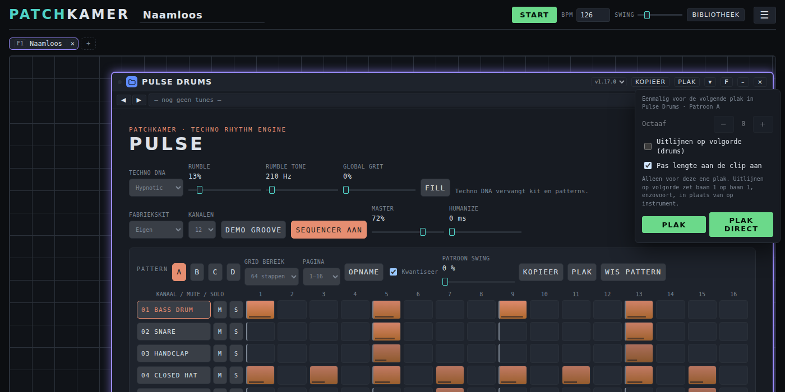

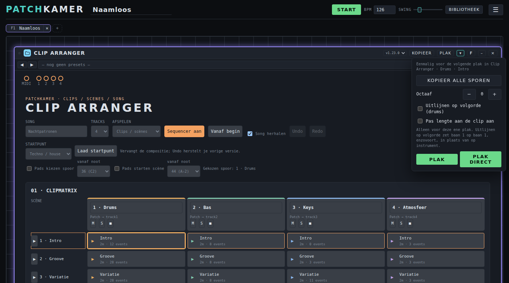

Op een telefoon werken de knoppen met een tik (ook de pijl voor de plakopties); sneltoetsen heb je daar niet nodig. De knoppen staan in de kaartbalk, dus ze zijn niet bereikbaar zolang de kaart tot een icoon is geminimaliseerd.

## 7. Tunes en presets

Een **tune** is een volledige instelling van één apparaat dat geluid maakt: alle knoppen, patronen en keuzes. Een **preset** is hetzelfde voor een apparaat zonder eigen geluid, zoals een effect of een mixer. Geen van beide bevat kabels.

Op elke kaart zie je een balk met ◀ ▶-knoppen en een lijst. Kies een tune of preset uit de lijst, of blader met de pijlen. **Bewaar** legt de huidige instelling vast in een bibliotheek, met jouw naam als maker en een licentie (CC-BY-4.0 of alle rechten voorbehouden). Een tune met een naam in *cursief* is veranderd sinds je hem laadde.

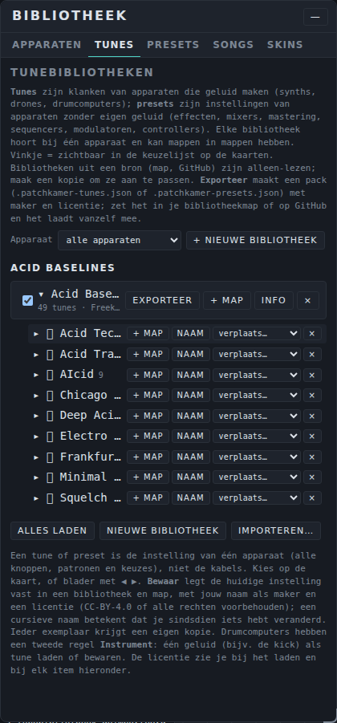

De knop **Alles laden** bovenaan de tabs Tunes en Presets laadt alle tunepacks, of alle presetpacks, van het adres dat je instelt onder **Instellingen → Automatisch laden** (standaard de mappen `tunes` en `presets` van deze repository op GitHub). Alles onder die map wordt ingelezen.

De tabs **Tunes** en **Presets** van de bibliotheek beheren je bibliotheken: maak een nieuwe, zet tunes in mappen, importeer een pakket (`.patchkamer-tunes.json` of `.patchkamer-presets.json`) en exporteer er een om te delen. Pakketten in een bibliotheek die je van GitHub of uit een map laadt, verschijnen vanzelf. De packs die bij deze repository horen, staan in de [handleiding tunes](tunes/USER-MANUAL_NL.md) en de [handleiding presets](presets/USER-MANUAL_NL.md).

**Zoeken op instrument of stijl.** Bovenaan de tabs Tunes en Presets kies je **Per apparaat** (de bibliotheken, zoals hierboven), **Per instrument** (alleen bij Tunes) of **Per stijl**. De laatste twee tonen een boom met inspringen: Gitaren → Nylon, Piano's, Koper, … of Hiphop, Jungle, Techno, …, met het aantal tunes erachter. Open een tak met de pijl, zoek bovenin op naam, apparaat of tag, en klik **Laden**: de tune komt op de geselecteerde kaart van dat apparaat, op een kaart die al op de vloer staat, of op een nieuwe. Wat nog geen tag heeft, staat onder **Zonder tag**. De tags zitten in de packs zelf (`tags`, contract v1.19), dus eigen packs en packs van anderen verschijnen vanzelf in de boom.

**Samples.** De tab **Samples** toont samplepacks (`.patchkamer-samples.json`): stukjes geluid zoals drumloops van twee maten, met het geluid zelf erin. Kies **Per stijl** (een boom met inspringen: Jungle, Breakbeat, Drum & Bass, …) of **Per pack**, zoek op naam, pack, tag of tempo, beluister een sample met **▶** (nogmaals klikken stopt) en laad hem met **→ Loop Slicer**, **→ Samplebank**, **→ Drum Listener** of **→ Stem Splitter**: het sample komt in de geselecteerde kaart van dat apparaat, in een kaart die al op de vloer staat, of in een nieuwe. Packs uit een bron (map, GitHub) laden vanzelf; **Importeren…** of een bestand loslaten voegt er een toe. Bij een sample staan tempo en aantal maten, zodat je de song op hetzelfde tempo zet. De packs die meekomen staan in de [samples-map](../samples/README_NL.md).

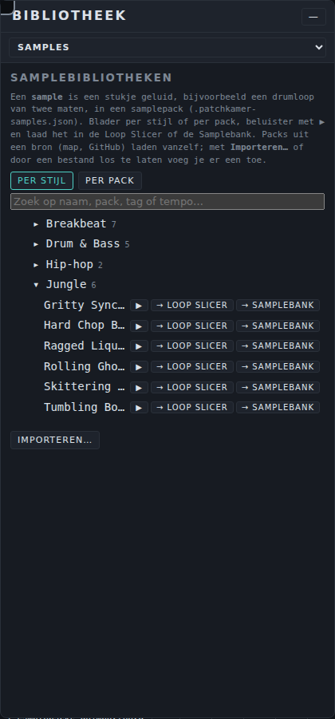

Het hele verhaal, met de lijst van de meegeleverde packs en hoe je een eigen pack maakt, staat in de [handleiding presets](presets/USER-MANUAL_NL.md) en de [handleiding tunes](tunes/USER-MANUAL_NL.md).

### Skins

Een **skin** verandert alleen het **uiterlijk** van één apparaat, nooit de klank, de instellingen of de werking. Het is een los bestand (`.patchkamer-skin.json`) met een of meer **verschijningsvormen**, bijvoorbeeld een compacte en een brede. Skins zijn een derde soort bibliotheekmateriaal naast tunes en presets.

**Waar vind je skins?** In de map `skins/library` van deze repository op GitHub, met per apparaat een map (`skins/library/<apparaat-id>/`). Onder **Instellingen → Automatisch laden** staat **Skins laden** met dat adres; de knop **Alles laden** op de tab Skins laadt ze ook. Een GitHub-, web- of lokale map die `skins/library/<apparaat-id>/*.patchkamer-skin.json` bevat, voeg je als bron toe zoals elke bibliotheek; een lokale map met apparaten én skins werkt ook. Een skin voor een apparaat dat je niet hebt, wordt wel bewaard maar nergens aangeboden.

**Laden.** Open de tab **Skins** van de bibliotheek (of **Skins** in het ☰-menu) voor de **Skinbibliotheken**: per apparaat de skins met naam, maker, versie, licentie en verschijningsvormen. Met **Importeren…** kies je een bestand; je kunt het ook op de vloer of het bibliotheekvenster **droppen** (zonder bevestiging, na de apparaten en tunes en vóór songs en werkruimtes). Een geïmporteerde skin blijft in je browser staan tot je hem met **×** verwijdert; skins uit een bron zijn alleen-lezen en verdwijnen met die bron. Een ongeldig bestand wordt geweigerd met een melding met de bestandsnaam; de rest laadt door. Een skin met een onbekende hoofdversie van het skinformaat, of met CSS die van buiten laadt (`@import`, een `url(` naar een webadres), wordt geweigerd.

**Kiezen op de kaart.** Zodra er voor een apparaat minstens één skin is, staan in de balk van de kaart twee lijsten: **Skin** (**Standaard** is het eigen uiterlijk van het apparaat) en **Verschijning**. Bij **Auto** kiest Patchkamer zelf de verschijningsvorm op de **breedte van de kaart** en de **schermgrootte** (telefoon, compact of breed); de lijst toont welke dat nu is. Kies je zelf een verschijningsvorm, dan staat Auto uit voor dat apparaat tot je terug naar **Auto** gaat. De keuze werkt direct. Bij **Standaard** is alles weg en staat het apparaat precies zoals voorheen. Zijn de balken op de kaarten uitgezet (Instellingen), dan kies je via de tab Skins met **Toepassen** en **Kies**.

**Bewaren.** De keuze per apparaat staat in de werkruimte en in de song, samen met de gebruikte skins (hoogstens 20), zodat een song zijn uiterlijk behoudt zonder de bibliotheek. Bij het openen komen die skins stil in je register (een nieuwere versie wint). Werkruimtes en songs zonder skins laden zoals altijd. Skins raken de klank nooit: de instelling van het apparaat is met en zonder skin gelijk.

**Ontwerpkeuzes (skincontract 0.8).** Een skin kan naast CSS ook **ontwerpkeuzes** bevatten die op elk apparaat werken, als standaard van de skin en per verschijningsvorm te overschrijven:

- **Poortenmodus.** *Standaard* (zoals nu), *Altijd zichtbaar* (de poorten in een vaste balk bovenaan), *Bij hover of kabel* (de poorten zijn verborgen; ze verschijnen als je met de muis op de dunne strook bovenaan het apparaat staat of met een kabel over het apparaat sleept) en *Strook* (een zichtbare strook; de poorten openen als je met de muis op het apparaat staat) en *In de titelbalk* (de poorten als kleine stipjes tussen de naam van het apparaat en de versiekeuze; de balk blijft even groot). Op een aanraakscherm open en sluit je de strook met een tik, en een kabel die je over het apparaat sleept opent hem ook; met het toetsenbord gebruik je Enter of spatie. Kabels blijven kloppen: een verborgen poort hangt de kabel aan de strook. Een apparaat met poorten in een eigen scherm houdt de modus *Standaard* en laat dat weten.
- **Kleuren.** *Werkruimte* (de kleuren van de werkruimte) of *Eigen kleuren*: achtergrond, vlak, tekst, gedempte tekst, accent en lijnen, alleen op die kaart. Een kleur die ontbreekt valt terug op de werkruimtekleur; weinig contrast tussen tekst en achtergrond geeft een melding, geen weigering.
- **Haptiek.** Een korte trilling bij **klikken** (knoppen en pads), **draaien** (de draaiknop) en **schuiven** (een puls per stap, hoogstens 25 per seconde), elk uit, licht, middel of sterk. Dit werkt alleen in een browser met trillen (meestal Android; niet in iOS Safari), niet bij een voorkeur voor minder beweging en niet als de pagina op de achtergrond staat.
- **Knoppen.** Stijl (*Werkruimte*, *Draaiknop* of *Schuifregelaar*) en grootte (S, M of L) van de knoppen die een apparaat via de host maakt. Eigen regelaars van een apparaat blijven ongemoeid, dus dit werkt op de apparaten die de hostknop gebruiken; de tab Skins laat zien hoeveel dat er op je vloer zijn.
- **Regelaars.** Een lijst *regels* die bepaalt hoe een regelaar eruitziet: voor *alle regelaars*, een *rol* (bijvoorbeeld draairegelaars of faders), een *groep* (bijvoorbeeld het filter) of één regelaar. Per regel kies je het **gezicht** (draaiknop, horizontale of verticale schuif), de **maat** (XS tot XL), de **lengte** en **dikte** van een schuif, de vorm van de **duim**, de **kleur** en of de **waarde** altijd, bij aanwijzen of nooit zichtbaar is. De laatste passende regel wint. Een skin kan regelaars alleen aanpassen: nooit verbergen en nooit een waarde zetten, en geluid, instellingen en presets veranderen er niet door. Dit werkt op regelaars die een apparaat herkenbaar heeft gemaakt (zie het contract, v1.15); de tab Skins laat zien hoeveel regelaars op de eerste kaart van een apparaat zijn aangepast. Dubbelklikken (beginwaarde), een waarde typen, Shift voor fijn en het toetsenbord werken in elk gezicht. In de ontwerper staat dit onder **Regelaars**: je ziet welke regelaars het apparaat meldt, voegt regels toe, verplaatst ze omhoog of omlaag en ziet het resultaat direct.
- **Meters.** Waar een apparaat een meter toont (zoals de balkmeters in de Mixer) kan een skin die meter anders laten zien, **op dezelfde plek** en zonder iets ernaast te zetten. Per regel (voor *alle meters*, een *groep* of één meter) kies je het **gezicht**: *Balk* (de standaard), *Ledbalk* (een rij ledjes) of *VU-meter* (een ronde schaal met een wijzer die van links naar rechts uitslaat; bij stereo twee wijzers), en de **richting** (verticaal of horizontaal, alleen voor balk en ledbalk), de **lengte** en **breedte** (bij een VU-meter alleen de lengte: de breedte van de wijzerplaat), de **reactie** (*Snel*, *VU* met 300 ms integratie of *Langzaam*), het **piekstreepje**, het **clip-lampje**, de **schaal** in dB, de **kleur** en bij een ledbalk het **aantal ledjes**. Een VU-meter heeft minstens 56 × 36 px nodig: de kaart kan daardoor iets groeien. De laatste passende regel wint. Een meter leest alleen mee: een skin kan hem nooit verbergen en verandert geen geluid, instellingen of presets. Dit werkt op apparaten die hun meters via de host laten tekenen (contract v1.18); de tab Skins laat zien hoeveel meters er op je vloer zijn aangepast. Skincontract 0.4.
- **Pads.** Pads en stapknoppen (bijvoorbeeld de stappen van een drumcomputer of de 16 trigs) kunnen een andere **vorm** krijgen (rond, vierkant, afgerond, rechthoekig 3:2), een **maat** (XS tot XL), een **eigen kleur per pad** (de kleur van het apparaat, één neutrale kleur, of uit een palet van 2 tot 16 kleuren; per pad, groep of rol overschrijfbaar) en **feedback**: neutraal in rust of al licht gekleurd, bij actief een vlak in felle kleur, een felle rand of een gloed, een **ledje** (midden, boven, onder, links of rechts), het oplichten als een stap afgaat en wat er bij een klik gebeurt (indrukken, gloed of niets). Een skin verbergt nooit een pad en verandert geen geluid, stand of patroon; het gedrag (aan, uit, huidige stap) blijft van het apparaat. Dit werkt op pads die een apparaat via de host maakt of herkenbaar heeft gemaakt (contract v1.22); het tabblad Skins toont hoeveel pads op de eerste kaart zijn aangepast. Bij stappen vermenigvuldigt de maat de huidige hoogte en begrenst de breedte van het vak de grootte. Skincontract 0.6.
- **Per pad en kleur bij gebruik (vanaf 0.8).** In de skin-editor kies je één regelaar en geef je alleen die zijn uiterlijk en gedrag. Bij een **knop of fader** stel je de **kleur in rust** en de **kleur bij gebruik** in: de kleur die de wijzer, het gevulde deel of de duim aanneemt terwijl je indrukt of sleept. Bij een **pad** kies je het **type** (*Aan/uit* blijft aan tot je weer drukt; *Pad (zonder velocity)* klinkt zolang je drukt; *Pad (met velocity)* neemt ook mee hoe hard je drukt: de druk op een aanraakscherm, met een muis de plek van de klik, boven zacht en onder hard), de **kleur in rust** (het pad is licht getint), de **kleur bij gebruik** (het pad staat aan of is ingedrukt) en het **ledje**. Het type is het enige in een skin dat verandert wat een regelaar *doet*, en werkt op pads die de host tekent; de kleuren werken op elk pad en elke stapknop. Een apparaat dat velocity niet gebruikt klinkt gelijk, en een skin verbergt nooit een pad.
- **Schermpje.** Een keuzelijst (bijvoorbeeld een instrument- of klankkeuze) kan eruitzien als het schermpje van een fysiek apparaat, in de stijlen **LCD**, **OLED**, **segmenten** en **papier**, met **< >** in plaats van een uitklaplijst, eventueel met een **[ok]** (pas bij [ok] wordt de keuze gezet), 1 tot 3 regels (de huidige keuze met de vorige en volgende), een vaste breedte en een eigen schermkleur. **Een klik op het scherm vergroot het** tot een paneel met de hele lijst, een zoekveld vanaf 12 items, grote < >, OK en Annuleren (Escape sluit, de focus keert terug, pijltjestoetsen en Enter werken). Op een breed scherm blijft dat paneel bewust klein (hoogstens 32 rem breed en 70 % van de hoogte), op een telefoon vult het bijna het hele scherm. Je kiest ook of dit geldt voor de keuzelijsten van het apparaat zelf, voor de **presets** in de kaartkop en voor de **instrumenttunes**; Bewaar, Bladeren en Onderdeel in de kaartkop blijven werken. Een skin verbergt de keuzelijst nooit en zet nooit een waarde. Skincontract 0.6.
- **Secties.** Een *sectie* is het blokje met alle regelaars van één groep (bijvoorbeeld het filter, of de keuzelijsten bovenaan). Per regel (voor *alle secties* of een *groep*) kies je een **kader** (geen, lijn, verhoogd, verdiept of zwevend), het aantal **kolommen** (automatisch of 1 tot 12; 3 kolommen geeft 3×3 bij negen regelaars), de **ruimte** (krap, normaal of ruim), of de regelaars **kaal** zijn (zonder eigen kader en met kleine binnenmarge), waar de **naam** staat (boven of onder de regelaar: de waarde bovenaan, dan de regelaar, dan de naam) en de **uitlijning**. Daarnaast kan een verschijningsvorm een **breedte** (200 tot 1600 px) hebben: die wordt toegepast als je de skin of verschijning zelf kiest, niet bij Auto, zodat een compacte verschijning het hele apparaat kleiner maakt; je kunt de maat daarna nog aanpassen. Niets wordt verplaatst of verborgen. Een groep zonder eigen blok, of met minder dan twee regelaars, wordt niet gestyled; de tab Skins meldt hoeveel secties zijn toegepast. Veel kolommen houden het apparaat kort, zodat je minder hoeft te scrollen.
- **Panelen.** Een *paneel* is een blok regelaars dat de skin zelf een naam, een kader en een volgorde geeft, bijvoorbeeld Oscillator, Filter en Uitgang naast elkaar in plaats van de indeling van het apparaat. Een paneel bevat *items*: een regelaar (id), een **groep**, een **rol** of **Alle overige**. De volgorde van de items is de volgorde in het paneel; een regelaar staat in hoogstens één paneel en de eerste passende telt; **Alle overige** pakt wat nog nergens staat, ook als die in het midden van een paneel staat. **Er wordt niets verborgen of weggelaten**: wat de skin niet noemt komt vanzelf in een restpaneel *Overige*. Per paneel kies je een **titel** (Nederlands en Engels, boven, links of verborgen voor schermlezers), de **stijl** (geen kader, lijn, verhoogd, verdiept of zwevend), de **richting** (raster, rij of kolom), het aantal **kolommen**, de **ruimte**, of de regelaars **kaal** zijn, waar de **naam** staat, de **uitlijning**, de **breedte** van het paneel (automatisch, hele rij, half of een derde) en of het **inklapbaar** is: een ingeklapt paneel is kleiner in beeld, de regelaars blijven bestaan en bestuurbaar (ook voor een controller als de MIDI Hub); de stand onthoudt de browser per apparaat en paneel, hij hoort niet bij de klank, een preset of een song. De **stroom** bepaalt hoe de panelen staan: automatisch (naast elkaar zolang ze passen), onder elkaar of naast elkaar. Een verschijningsvorm kan eigen panelen hebben (bijvoorbeeld een compacte en een brede indeling); zonder `layout` gedraagt het apparaat zich precies zoals altijd. De regelaars verhuizen alleen: geluid, instellingen, presets en songs veranderen niet, en `host.controls` ziet dezelfde regelaars met dezelfde sleutels. Een apparaat met een eigen indeling (zoals Control Surface) en een apparaat zonder herkenbare regelaars worden overgeslagen en dat staat in het tabblad Skins (regelaars zonder id, zoals in de Mixer, komen alleen in het restpaneel); het tabblad meldt verder hoeveel regelaars in panelen staan en hoeveel in de rest. In de ontwerper staat dit onder **Panelen**, onder Regelaars. Skincontract 0.7.

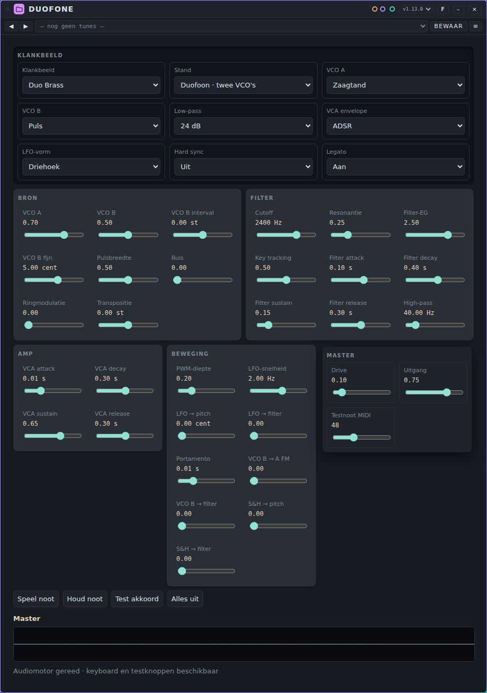

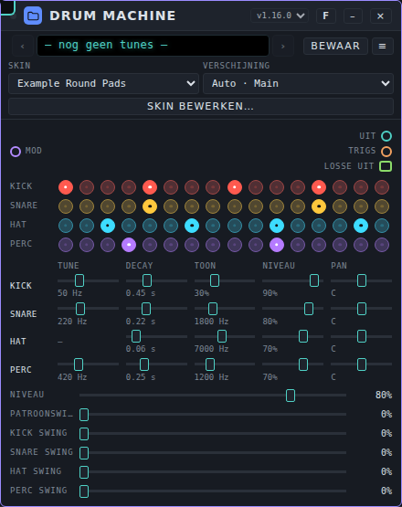

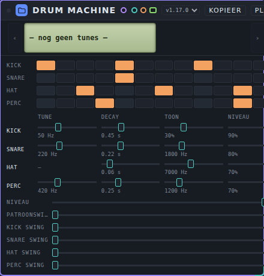

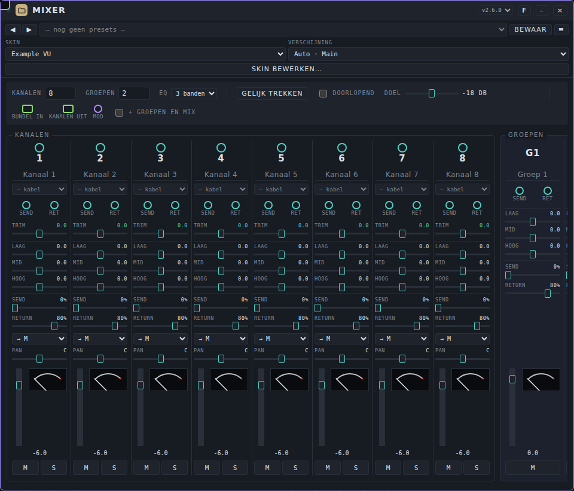

**De skin-editor.** Voor serieus ontwerpen: op de tab Skins kies je bij **Nieuw ontwerp** een apparaat en klik je op **Skin-editor**, of je klikt bij een bestaande skin op **Bewerken…** (een meegeleverde skin wordt een kopie *Mijn …*), of op de kaart op **Skin bewerken…**. De editor is een **zwevend venster**: sleep het aan de titelbalk (of met de knop ⠿ en de pijltjestoetsen), maak het groter of kleiner aan de hoek rechtsonder, en met ⤢ laat je het het scherm vullen; positie en maat worden onthouden, en op een smal scherm of telefoon vult het venster het scherm met tabbladen. Het heeft drie kolommen. Links de **structuur** (Skin → Verschijningen → per verschijning Kleuren, Poorten, Haptiek en *Indeling en regelaars* met de panelen en hun elementen; met pijltjestoetsen te bedienen, in- en uitklappen kan met de driehoekjes). Klik je in het voorbeeld op een element of paneel, dan klapt de structuur zelf open naar dat knooppunt; kies je een knooppunt, dan wordt het element in het voorbeeld gemarkeerd. Boven de structuur staan de knoppen voor **panelen**: toevoegen, omhoog, omlaag, titel wijzigen (✎ of F2) en verwijderen. In het midden de **werkplek**: links het **origineel** (het apparaat met zijn eigen uiterlijk, alle knoppen, schuiven, meters, pads en schermpjes; een gestreept kader betekent dat het element al in een paneel staat) en rechts de **nieuwe skin** als live voorbeeld. Rechts de **eigenschappen** van wat je selecteert. De controle (fouten en let-op, live) en de JSON staan achter de knop met het aantal fouten. Beide kaarten zijn *echte kaarten* die buiten je werkruimte draaien (er verandert niets aan je werkruimte of songs, en bij **Sluiten** verdwijnen ze). **Ontwerpen met slepen:** pak een regelaar, schuif, meter, pad of schermpje in het origineel en laat los op een paneel van de nieuwe skin, tussen twee elementen, of op de strook *Nieuw paneel* (die verschijnt bovenaan tijdens het slepen); sleep binnen de nieuwe skin om te herschikken of naar een ander paneel; panelen sleep je in de structuur of op het voorbeeld. Muis en aanraking (op een telefoon eerst even ingedrukt houden, of pak het handvat ⠿ in de structuur); Escape annuleert het slepen. Een paneel zonder elementen staat nog niet in het skinbestand en verschijnt als stippelvak onder de kaart. **Hoe een element eruitziet:** selecteer het en kies rechts bij *Dit element* gezicht, maat, lengte, dikte, duim, waardeweergave en kleur (regelaars), of gezicht, richting, lengte, ballistiek en meer (meters); de editor maakt zelf een regel voor alleen dit element (onder *Alle regels die gelden* zie je de regels en kun je ze verwijderen). Pads en schermpjes hebben in het skincontract één stijl voor het hele apparaat, en een paneel heeft titel, kader, richting, kolommen, ruimte, breedte en inklapbaar. **Indeling van de kaart:** bij *Indeling en regelaars* kies je panelen naast elkaar, onder elkaar of automatisch. **Kaartbreedte:** sleep aan de rechterrand of hoek van de nieuwe kaart (of gebruik de pijltjestoetsen op de greep, of het veld *Breedte*); bij een gekozen verschijning wordt dat de kaartbreedte van die verschijning, en de voorwaarden *vanaf/tot* bepalen wanneer **Auto** haar kiest. De schermklasse en de breedte (Telefoon 412, Tablet 820, Desktop 1280 of eigen) zie je direct. **Schermpje:** selecteer een schermpje en er staan pijltjes links en rechts ervan in het voorbeeld; daarmee kies je de vorige of volgende waarde, zonder geluid en zonder iets in je werkruimte te raken. In de stand **Ontwerp** selecteert een klik; in de stand **Test** bedien je de nieuwe kaart zelf (zonder geluid: hij hangt aan geen kabel). Verschijningen voeg je toe uit een vaste lijst (**Standaard**, **Compact**, **Breed**, **Telefoon**, **Touch**, **Eigen**; je kunt ze hernoemen, ordenen, dupliceren en verwijderen). Een skin kan nooit een regelaar verwijderen of verbergen, en nooit een waarde zetten: wat je niet in een paneel zet, komt in een restpaneel. **Ongedaan** en **Opnieuw** (Ctrl+Z en Ctrl+Shift+Z, minstens 100 stappen) staan in de kop; je wijzigingen worden als **concept** in je browser bewaard en bij heropenen hersteld. **Opslaan** kan met let-op maar niet met fouten; **Exporteren** geeft een bestand dat door de skin-validator komt (vul wel een maker en een Engelse omschrijving in). De **mini-ontwerper** hieronder blijft beschikbaar als eenvoudig formulier.

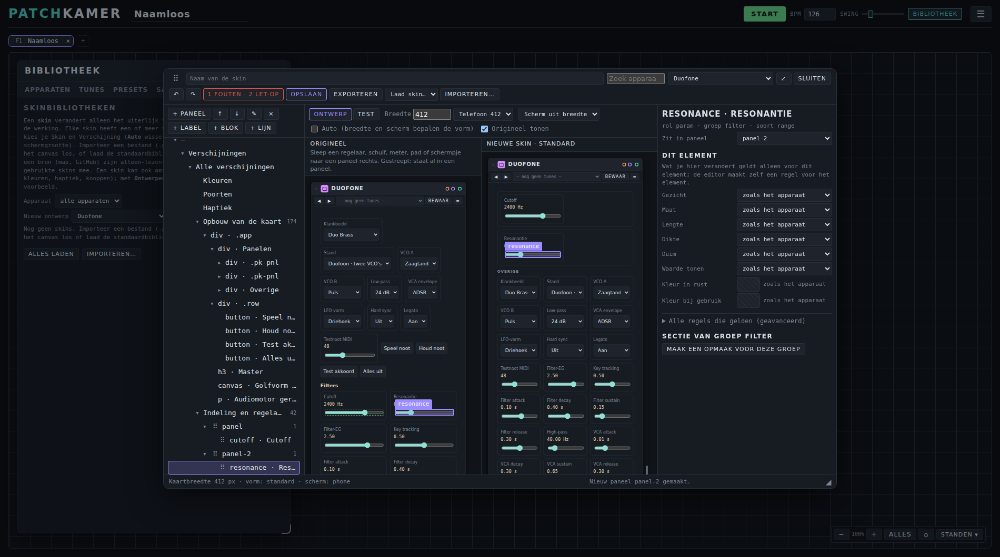

**Zelf ontwerpen.** Op de tab Skins kies je bij **Nieuw ontwerp** een apparaat en klik je op **Ontwerpen**, of je klikt bij een bestaande skin op **Kopie ontwerpen**. Je geeft de skin een naam (en een maker), kiest poortenmodus, kleurenschema, haptiek, knoppen, regelaars, panelen, meters, pads en schermpje, en voegt zo nodig een verschijningsvorm **Compact** (kaart tot 360 px) of **Full** toe die per keuze van Standard mag afwijken. Het **voorbeeld staat live op een kaart** van dat apparaat; **Sluiten** zet de vorige skin van die kaart terug. De **kleurkiezer** heeft een kleurvlak (verzadiging en helderheid), een tintbalk, een hex-veld, voorbeeldkleuren, een lijst met recent gebruikte kleuren en een contrastmelding; met het toetsenbord gebruik je de pijltjes (Shift = grotere stap), en op een aanraakscherm zijn alle doelen minstens 44 px. **Opslaan** bewaart de skin als eigen skin in je browser (id `<apparaat>.<naam>`); **Exporteren** geeft een bestand `.patchkamer-skin.json` om te delen. Zonder maker kan de skin wel worden opgeslagen, maar niet netjes worden gedeeld. Een kopie van een skin met CSS behoudt die CSS en haar afbeeldingen.

**Een skin maken?** Zie [skins/AGENTS.md](https://github.com/unboxednl/patchkamer/blob/main/skins/AGENTS.md) (voor wie met een AI-agent werkt) en het skincontract ([Nederlands](https://github.com/unboxednl/patchkamer/blob/main/skins/contract/SKINS-CONTRACT_NL.md), [English](https://github.com/unboxednl/patchkamer/blob/main/skins/contract/SKINS-CONTRACT_EN.md)).

## 8. Bewaren, openen en delen

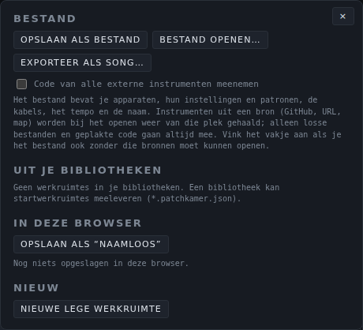

Je **werkruimte** is de hele opstelling: apparaten met hun instellingen en patronen, kabels, tempo en naam.

- **Opslaan als bestand** downloadt je werkruimte als bestand. **Bestand openen…** laadt er een weer.
- Zet een vinkje bij **Code van alle externe instrumenten meenemen** als je een bestand wilt dat ook opent zonder toegang tot de bronnen waar de apparaten vandaan kwamen.
- **In deze browser** bewaart een kopie in je browser, zodat je later op dezelfde computer verder kunt.
- **Exporteer als song…** maakt een deelbaar bestand (`.patchkamer-song.json`) met alle apparaatcode, een titel, de maker en een licentie. Iemand anders kan het openen zonder bibliotheek.
- **Nieuwe lege werkruimte** begint opnieuw.

**Songs.** De tab **Songs** van de bibliotheek (of **Songs** in het ☰-menu) opent een song in een **nieuwe werkruimte-tab** met de indeling zoals ze in de song is opgeslagen (niets wordt herschikt; wil je dat wel, gebruik dan **Herschik**). Hij toont de **demo-songs** uit de map `songs` van deze repository op GitHub (songs in een submap, zoals `hip-hop`, staan gegroepeerd onder een eigen kop met inspringen), je **recente songs** (de laatste twaalf, ook bestanden die je opende) en **Bestand openen…**. Heeft een song apparaten nodig die nog niet in je bibliotheek staan, dan laadt Patchkamer eerst de apparatenbibliotheek uit **Instellingen → Automatisch laden**. Er kunnen tien werkruimtes open zijn: sluit er eerst een als ze allemaal in gebruik zijn.

**Meer dan één werkruimte.** De tabbalk onder de bovenbalk bevat maximaal tien werkruimtes. Klik op een tab, of druk op **F1** t/m **F10**, om te wisselen. **+** voegt een nieuwe lege werkruimte toe; **×** sluit er een (Patchkamer vraagt eerst als er apparaten in staan, en de laatste kun je niet sluiten: gebruik **Leeg**). Elke werkruimte heeft eigen apparaten, kabels, tempo en naam, en alles in dit hoofdstuk werkt op de werkruimte waarin je zit. Bij het wisselen stopt de klok en start je hem zelf weer. Een nieuwe werkruimte laadt wat je koos onder **Instellingen → Automatisch laden**. Patchkamer bewaart je werkruimtes in je browser en opent ze de volgende keer weer.

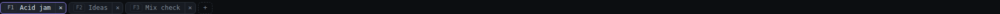

### Bestanden op het canvas droppen

Met een muis kun je bestanden uit je bestandsbeheer op de **vloer** of het **bibliotheekvenster** loslaten; er verschijnt een kader met "Laat los om te laden". Patchkamer herkent de soort aan de inhoud en laadt zonder te vragen:

- een **song** (`.patchkamer-song.json`) of een **werkruimtebestand** opent in een **nieuwe werkruimte-tab**; je huidige werkruimte blijft zoals ze is. Net als bij de tab **Songs** blijft de indeling zoals ze is opgeslagen;
- een **apparaat** (`.patchkamer-device.js`) komt in de **bibliotheek**, niet op de vloer. Is dezelfde versie al geladen, dan wordt hij vervangen. Plaats hem daarna zoals gewoonlijk;
- een **tunepack** of **presetpack** (`.patchkamer-tunes.json`, `.patchkamer-presets.json`) komt in je tune- of presetbibliotheken, zoals **Importeren**;
- een **skin** (`.patchkamer-skin.json`) komt in je skinbibliotheek, zoals **Importeren** op de tab Skins;
- een **bibliotheekindeling** (`patchkamer-bibliotheek.json`) wordt toegepast.

Laat je meerdere bestanden tegelijk los (maximaal 50, elk tot 50 MB), dan gaan eerst de apparaten, dan tunes en presets, skins, de indeling en als laatste songs en werkruimtes, zodat een song de apparaten uit dezelfde drop al in de bibliotheek vindt. Er komt één melding met het resultaat. Mappen en onbekende bestanden worden niet geladen; een afbeelding of geluidsbestand blijft aan het apparaat of de browser. Een bestand dat je op een apparaat zelf loslaat (bijvoorbeeld op de golfvorm van een sampler) is voor dat apparaat. Op een telefoon of tablet bestaat dit niet: gebruik daar de bestaande knoppen (**Bestand openen…**, **Importeren**, **Instrument laden**).

## 9. Je weg vinden op de vloer

- **Verplaatsen:** sleep de vloer om te schuiven. **Ctrl + scroll** zoomt tussen 10% en 250%. Met de knoppen rechtsonder zoom je uit, zoom je in, zie je alles (**Alles**) en ga je terug naar het begin (⌂).
- **Kaarten:** sleep een kaart aan de titelbalk. Sleep een rand of hoek om het formaat te wijzigen, en dubbelklik op een rand voor de standaardmaat. **–** maakt van een kaart een klein icoon en **⤢** zet hem terug. **×** verwijdert hem. Met de versielijst schakel je naar een andere versie van een apparaat.
- **Herschik** zet je apparaten op volgorde van links naar rechts: bronnen, instrumenten, effecten, mixer, uitgang. **Ctrl+Z** maakt het ongedaan.
- **Focusweergave:** druk op **F** op de titelbalk van een kaart om hem te markeren en klik dan op **Focus**. De gemarkeerde apparaten staan naast elkaar, onder elkaar of in een raster, zonder dat ze op de vloer verschuiven. **Terug naar canvas** brengt je terug.

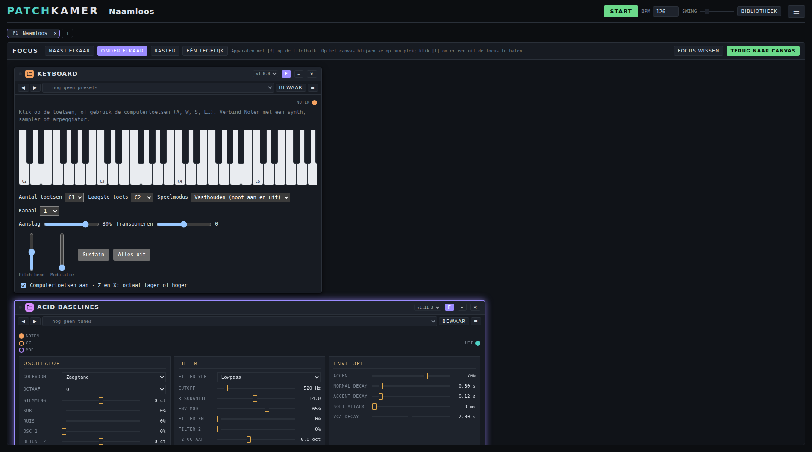

### Touchscreen en telefoon

De hoofdbalk houdt op elk scherm alleen over wat je tijdens het spelen nodig hebt: het logo, de naam van je werkruimte, **Start**, **BPM**, **Swing**, de knop **Bibliotheek** en **☰**. Op een **smal scherm** (onder 700 pixels) is het logo alleen het icoon, hebben **Start**, **BPM** en **Swing** geen tekstlabels (houd ingedrukt voor de naam) en is de knop **Bibliotheek** een ▤; op een telefoon staan **Start**, **BPM** en **Swing** op een tweede regel onder de naam. Al het andere staat achter de knop **☰**: een menu met grote tikvlakken in vier groepen (**Bestand**, **Bibliotheek**, **Weergave**, **Overig**), op elk scherm hetzelfde. Het menu sluit na een keuze, met **Esc**, met een tik ernaast of met de terugknop van Android.

- **Schuiven:** één vinger op de lege vloer schuift, net als de muis. Een vinger op een poort trekt een kabel, een vinger op de titelbalk van een kaart sleept de kaart.
- **Zoomen:** knijp met twee vingers om in of uit te zoomen en schuif met twee vingers om de vloer te verplaatsen. Een kabel of kaart die je met de eerste vinger sleepte, wordt dan afgebroken. Twee vingers in de bediening van één apparaat (bijvoorbeeld op pads) doen niets met de vloer.
- **Lang indrukken** (een halve seconde, zonder te bewegen): op een kabel opent het kleurmenu (met **Kabel los**), op een poort of titelbalk verschijnt de uitleg als melding, en op elk ander knopje met een uitleg (de tekst die je met de muis bij zweven ziet) verschijnt die uitleg ook. In de bibliotheek pak je zo een apparaat op om het naar de vloer te slepen.
- **Dubbeltik** werkt als dubbelklik: beginwaarde van een schuif, standaardmaat van een kaart, icoon terugzetten.
- Op een aanraakscherm zijn poorten, knoppen, kaartranden en kabels makkelijker te raken. Loslaten van een kabel ergens vlak naast een passende poort koppelt hem toch.

### Bibliotheek compact en onderlade

- **Kaartjes** of **Compact** (in de balk van de bibliotheek): compact is één regel per apparaat met naam, soort en versie. Tik op een regel om hem te plaatsen, of sleep hem (met de vinger: eerst lang indrukken). Het pijltje rechts klapt de regel uit met poorten en keuzes. Zoeken, categorieën en mappen werken in beide weergaven. Je keuze wordt onthouden; zolang je niet koos is het compact op een smal scherm of aanraakscherm.
- Op een **smal scherm** (onder 700 pixels) is de bibliotheek een **onderlade**: ongeveer 60% van het scherm. Open of sluit hem met de knop **Bibliotheek** bovenin, met **Alt+B**, met de **×** in de lade, of door aan de greep omlaag te slepen. Bovenin de lade kies je met de keuzelijst welke soort je ziet (Apparaten, Tunes, Presets, Songs of Skins).

### Camerastanden

Met **Standen** rechtsonder bewaar je de uitsnede van de vloer die je nu ziet, onder een naam, en spring je er later naartoe (zacht, tenzij je computer minder beweging vraagt). **Shift+1** t/m **Shift+9** bewaart een stand, **1** t/m **9** springt ernaartoe (niet terwijl je in een tekstveld typt). Hernoemen, overschrijven en verwijderen kan in de lijst. De standen horen bij de werkruimte en gaan mee in een bestand of song.

### Secties en jump points

Klik met de **rechtermuisknop** op een lege plek van de vloer. Daar vind je naast **Plak apparaat** twee keuzes.

- **Sectie maken…** tekent een gekleurd vlak met mooi afgeronde hoeken, op de plek waar je klikte. Je geeft een **naam**, de **lettergrootte** van die naam, een **kleur**, de **dekking** van het vlak (0 is volledig transparant), een **lijnstijl** (doorgetrokken, streepjes, stippen of geen lijn) en eventueel een **viewpoint** (zie onder). De naam staat groot linksboven, **half buiten het vlak**, en de lijn loopt niet door waar de naam staat. Zo lees je hem ook als je ver uitzoomt. Het vlak ligt boven het canvas en onder de apparaten.
  - **Apparaten op een sectie.** Zet je een apparaat neer met zijn midden op een sectie, dan hoort het erbij. Bedekt een apparaat een kleine sectie grotendeels, dan hoort het er ook bij. Past het niet, dan groeit de sectie mee, met wat ruimte rondom. Zet je het buiten alle secties neer, dan hoort het er niet meer bij. Een sectie kan niet kleiner worden dan zijn apparaten nodig hebben.
  - **Slepen vanuit de bibliotheek.** De sectie onder de muis licht op; laat je los, dan hoort het nieuwe apparaat erbij. Ligt het over een ander apparaat, dan schuift dat op en groeit de sectie mee zodat ze er allebei in passen. Een gekozen sectie licht op zoals een gekozen apparaat. **Herschikken** (☰ → Bestand) legt elke sectie zelf in kolommen, geeft de sectie precies de maat, en zet de secties onder wat bij geen sectie hoort.
  - **Verschuiven.** Sleep de sectie aan zijn titel of op een lege plek in het vlak: alle apparaten erop schuiven mee, alsof ze erop geplakt zitten. Het canvas zelf verschuif je daarbinnen met de rechter- of middelste muisknop (daarbuiten gewoon met de linker).
  - **Grootte.** Sleep aan een zijkant of aan een hoek, ook links en boven. Wordt de sectie zo groot dat hij over een andere sectie heen komt, of binnen 48 punten ervan, dan schuift die andere sectie (met zijn apparaten) opzij; komt die daardoor weer te dicht bij een volgende sectie, dan schuift die ook mee, enzovoort. Tijdens het slepen wordt steeds vanaf de beginstand gerekend: sleep je terug, dan staat alles weer op zijn plek. Hetzelfde gebeurt als een sectie groeit omdat je er een apparaat in zet dat niet past. Een sectie die je zelf versleept schuift niets weg.
  - **Viewpoint.** Geef een sectie een nummer van 1 tot en met 9. **Alt+nummer** brengt de sectie dan in beeld, ingezoomd tot hij met wat marge past (hoogstens 100%). Het nummer staat als bolletje voor de naam.
  - **Bewerken, minimaliseren, verwijderen.** Dubbelklik op de titel of kies **⋯** (of rechtsklik op de titel) om alles te wijzigen of de sectie te verwijderen; de apparaten blijven dan staan. Met **–** minimaliseer je de sectie tot alleen de titel. De apparaten erop verdwijnen zolang het zo staat, maar **hun kabels blijven lopen, naar de titel** (ingangen links, uitgangen rechts). Dat gebeurt niet vanzelf bij uitzoomen.
- **Jump point maken…** zet een markering op de vloer met een **naam** en een **nummer van 1 tot en met 9**. Druk op **Alt+nummer** (of klik op de markering) en het scherm springt naar dat punt, met de zoom waarop je het maakte. Sleep de markering om hem te verplaatsen; rechtsklik om hem te wijzigen of te verwijderen. De nummers delen jump points en secties: kies je een nummer dat al in gebruik is, dan neem je het over (de jump point verdwijnt, bij een sectie wordt het nummer leeg).

Secties en jump points worden met de werkruimte bewaard. Ze horen bij de brede indeling; in de compacte indeling zijn ze verborgen. Het zijn iets anders dan de camerastanden hierboven (Shift+cijfer en cijfer): die bewaar je in het menu **Views** en staan niet op de vloer.

### Compacte indeling per scherm

Een werkruimte kan naast de brede indeling een **compacte indeling** hebben. Met **Scherm** (☰ → Weergave) kies je **Auto** (compact onder 1100 pixels breed), **Breed** of **Compact**; je keuze geldt voor deze browser. **Pas aan op dit scherm** maakt een eerste compacte indeling: de apparaten in signaalvolgorde in kolommen die op het scherm passen, apparaten zonder kabels als icoon, en daarna past alles in beeld. Je brede indeling blijft bewaard: kies **Breed** om terug te gaan. Verplaatsen en vergroten werkt op de indeling die aan staat. Beide indelingen worden bewaard.

### Focus "Eén tegelijk"

In de focusweergave toont **Eén tegelijk** één apparaat tegelijk. Wissel met **◀ ▶**, met de tabbalk, met de pijltjestoetsen of door op de tabbalk te vegen (alleen daar, zodat vegen niet botst met schuiven in een apparaat). Op een smal scherm is dit de standaard, en de knop **Bladeren** in het ☰-menu (Weergave) opent Focus meteen met alle apparaten van de werkruimte. Het kaartje zelf toont zijn poorten met namen. Bij uitzoomen (onder ongeveer 55%) tonen kaarten alleen de titelbalk en poorten; dubbelklik of dubbeltik op zo'n kaart zoomt erop in. Dat zet je uit bij **Instellingen** met *Kaarten vereenvoudigen bij uitzoomen*.

### Sneller werken: overzicht

De functies die de werkwijze het meest versnellen, op een rij:

- **Bestanden droppen:** sleep een song, apparaat, tunepack, presetpack of indelingsbestand op het canvas ([Bestanden op het canvas droppen](#bestanden-op-het-canvas-droppen)).
- **Automatisch koppelen:** zet een apparaat neer en kies in één dialoog welke kabels erbij komen, ook als effect in een bestaande kabel ([Automatisch koppelen bij plaatsen](#automatisch-koppelen-bij-plaatsen)).
- **Camerastanden:** bewaar een uitsnede en spring ernaartoe met **1** tot **9** ([Camerastanden](#camerastanden)).
- **Herschik en Pas aan op dit scherm:** laat de host de apparaten ordenen, voor het hele scherm of voor een klein scherm.
- **Focus:** werk met de apparaten naast elkaar of één tegelijk ([Focus "Eén tegelijk"](#focus-eén-tegelijk)).
- **Iconen en kabelkleuren:** elke categorie heeft een eigen icoon en kleur, en een kabel krijgt de kleur van de categorie waar hij vandaan komt ([Categorie-iconen](#categorie-iconen), [Kabelkleur](#kabelkleur)). Houd de aanwijzer boven een kabel om te zien wat hij verbindt.
- **Compacte bibliotheek:** alleen naam, type en versie, met een knop **Compact** ([Bibliotheek compact en onderlade](#bibliotheek-compact-en-onderlade)).
- **Telefoon en tablet:** knijpen, schuiven, lang indrukken en het ☰-menu ([Touchscreen en telefoon](#touchscreen-en-telefoon)).
- **Bijwerken:** **↻ Scannen** in de bibliotheek werkt geplaatste apparaten bij, en bij het starten meldt Patchkamer een nieuwe versie van zichzelf.

## 10. Instellingen

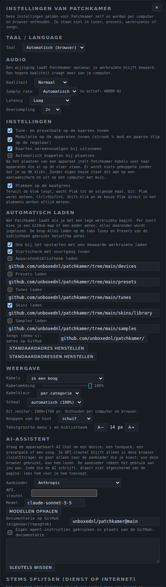

- **Taal:** automatisch (je browser), Nederlands of English. Patchkamer laadt opnieuw en behoudt je werkruimte.
- **Audio:** kies kwaliteit **Laag**, **Normaal** of **Hoog**, of stel **sample rate**, **latency** en **oversampling** zelf in. Hogere kwaliteit vraagt meer van je computer. Een wijziging laadt Patchkamer opnieuw en behoudt je werkruimte. Hoor je geknetter, kies dan een grotere latencybuffer (*Gebalanceerd* of *Stabiel*).
- **Automatisch laden:** vink aan wat Patchkamer vanzelf laadt, bij het opstarten en als je met een lege werkruimte begint: **Apparatenbibliotheek laden**, **Presets laden**, **Tunes laden**, **Skins laden** en **Samples laden** (die laatste staat standaard uit). Met **Ook bij het opstarten met een bewaarde werkruimte laden** gebeurt dat ook als je werkruimte al apparaten heeft; zo heb je altijd de nieuwste bibliotheken. Met **Startscherm met voortgang tonen** zie je tijdens het laden een scherm met het logo, de versie, een voortgangsbalk en eronder wat er nu geladen wordt. Het zweeft boven het canvas en verdwijnt vanzelf als alles klaar is; je kunt het ook wegklikken (klik erop, ×, of Esc), het laden gaat dan gewoon door. Onder elk vinkje staat het adres, standaard de mappen `devices`, `presets` en `tunes` van `github.com/unboxednl/patchkamer`. Alles onder de map wordt ingelezen. **Standaardadressen herstellen** zet ze terug. **Skins laden** werkt hetzelfde, met de map `skins/library` als standaard; staat die map (nog) niet op GitHub, dan krijg je alleen een korte melding en laadt de rest gewoon. De knop **Alles laden** op de tabs Tunes, Presets en Skins gebruikt dezelfde adressen. Alleen GitHub-adressen werken hier; een webadres of lokale map voeg je als bron toe in de bibliotheek.
- **AI-assistent:** kies een aanbieder (**Anthropic**, **OpenAI** of een **eigen adres** voor elke OpenAI-compatibele dienst, zoals je eigen proxy, OpenRouter of een lokaal model), plak je **API-sleutel** en kies een **model** (**Modellen ophalen** vult de lijst). De sleutel staat alleen in deze browser (localStorage) en gaat alleen naar de aanbieder die je koos. Daaronder kun je instellen uit welke GitHub-repository de AI zijn documentatie leest, of **Eigen agent-instructies gebruiken** aanvinken en je eigen tekst schrijven: de AI gebruikt die dan in plaats van de GitHub-documentatie. **Sleutels wissen** haalt alle sleutels weg. Zie *AI Chat* in hoofdstuk 6.
- **Stems splitsen:** het apparaat **Stem Splitter** stuurt een nummer naar een dienst op internet die het in stems splitst. Hier vul je per dienst je **sleutel**, het **model** en de **prijs per nummer** in (voor de kostenmelding); er zijn twee kant-en-klare diensten (fal.ai met Mureka of Demucs) en een **eigen dienst** met hetzelfde wachtrijprotocol. De sleutel staat alleen in deze browser (localStorage) en gaat alleen naar de dienst waar hij bij hoort; **Sleutels wissen** haalt ze weg. Een dienst gebruiken kost geld per nummer en je moet de rechten op de muziek hebben; er gaat niets weg tot je in het apparaat op **Splitsen** klikt. Zie [Stem Splitter](tools/USER-MANUAL_NL.md#stem-splitter).
- **Adres van de songs:** onder **Automatisch laden** staat ook het adres van de demo-songs (standaard de map `songs` op GitHub); **Standaardadres herstellen** zet het terug.
- **Weergave:** de stijl van de kabels, hun dekking, de kabelkleur (per categorie of per soort), de schaal van de hele interface, schuif of draaiknop voor de knoppen van de host, en de tekstgrootte van menu's en bibliotheek.
- **Automatisch koppelen:** schakelaar in Instellingen en in het ☰-menu. Op een telefoon of tablet staat hij standaard aan, op een computer uit; je eigen keuze wint altijd.
- **Kaarten vereenvoudigen bij uitzoomen:** onder zo'n 55% zoom tonen kaarten alleen hun kop; dubbelklik of dubbeltik zoomt in. Uit te zetten.
- **Versie:** onderaan Instellingen staat de versie van Patchkamer en een link naar de changelog (wat er per versie veranderde). In de desktop-app staat ook de versie van de app, de nieuwste uitgave op GitHub en een downloadlink als jouw versie ouder is.
- **Links:** onderaan staan links naar de GitHub-repository en naar deze gebruikershandleiding, in de taal van je scherm, en naar het contract voor wie apparaten bouwt.
- **Kleur** (rechtsboven): donker, licht of retro.

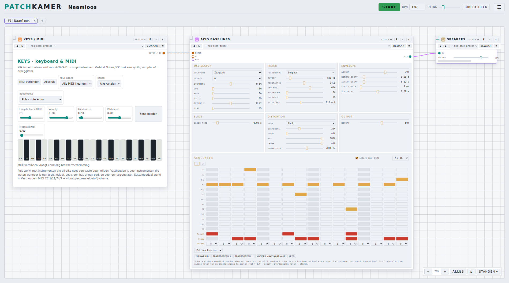

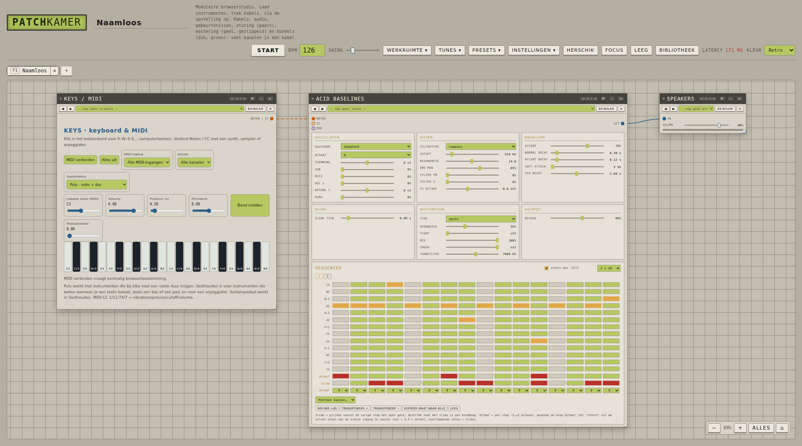

- **Browsergeheugen:** Patchkamer onthoudt je instellingen, bibliotheekindeling, bronnen, werkruimte en je eigen tunes en presets in je browser. **Browsergeheugen wissen…** wist dat allemaal en begint opnieuw. Bestanden op je computer en op GitHub blijven staan.

## 11. Sneltoetsen

| Toetsen | Wat het doet |
|---|---|
| **Spatie** | Start of stop |
| **F1** t/m **F10** | Wisselen naar werkruimte 1 t/m 10 (tabbalk) |
| **Alt+F** | Focusweergave openen of sluiten |
| **Alt+B** | Bibliotheek tonen of verbergen |
| **Alt+1** t/m **Alt+9** | Naar het jump point of de sectie met dat nummer springen |
| **+** / **−** / **0** | Inzoomen / uitzoomen / zoom herstellen |
| **Shift+1** t/m **Shift+9** / **1** t/m **9** | Camerastand bewaren / ernaartoe springen |
| **← →** | In de focusweergave "Eén tegelijk": vorig of volgend apparaat |
| **Ctrl + scroll** | De vloer zoomen |
| **Delete** | Het geselecteerde apparaat verwijderen |
| **Ctrl+Z** | Herschik ongedaan maken, of (kort daarna) een zojuist geplakt patroon |
| **Ctrl+C** / **Ctrl+V** | Het patroon van het geselecteerde apparaat kopiëren / plakken (Cmd op een Mac) |
| **Ctrl+Shift+V** | Plakken, meteen (ook als de klok loopt) |
| **Ctrl+C** / **Ctrl+V** | Een apparaat zonder patronen (bijvoorbeeld een effect of synth) zelf kopiëren / plakken, ook in een andere werkruimte |
| **Shift+Ctrl+C** | Het apparaat zelf kopiëren, ook als het patronen heeft |
| **Esc** | Een kabel die je sleept annuleren, of een paneel sluiten |
| Dubbelklik op een schuif | Terug naar de beginwaarde |
| Klik op het getal naast een schuif | Een waarde typen en op Enter drukken |
| **A W S E D F T G Y H U J K O L P** | Noten spelen op Keys (als het toetsenbord focus heeft) |

De lettertoetsen A–P zijn van Keys, daarom gebruiken de sneltoetsen van de host Alt.

## 12. Eigen apparaten maken

Een apparaat is één `.patchkamer-device.js`-bestand dat het **contract** volgt: een volledige, zelfstandige beschrijving van wat een apparaat moet doen. Het contract bestaat in het Nederlands ([PATCHKAMER-CONTRACT_NL.md](../contract/PATCHKAMER-CONTRACT_NL.md)) en het Engels ([PATCHKAMER-CONTRACT_EN.md](../contract/PATCHKAMER-CONTRACT_EN.md)). Een validator controleert je apparaat:

```
node contract/validate-instrument.mjs devices/synths/Duofone/duofone.patchkamer-device.js
```

Patchkamer is gemaakt om net zo goed door AI-agents als door mensen te worden gebouwd. Wijs je agent naar [AGENTS.md](../AGENTS.md): daar staat wat hij moet lezen, waar hij dingen neerzet en wat hij moet controleren. Onder **Instellingen → Contract & opstelling** vind je ook een sjabloon dat je kunt kopiëren.

## 13. Problemen oplossen

**Ik hoor niets.**
- Druk op **Start**, of klik ergens in Patchkamer. Browsers pauzeren audio tot je met de pagina werkt, en ook na slaapstand of als je de audio-uitgang wisselt. Patchkamer meldt dan "Het geluid staat uit" en hervat zelf bij je volgende klik of toetsaanslag.
- Controleer de kabels: audio moet van het apparaat dat geluid maakt naar **Speakers** lopen. Noten moeten van Keys (of een sequencer) naar het instrument lopen.
- Controleer het volume op Speakers en op je computer.

**De bibliotheek is leeg of mijn nieuwe apparaat ontbreekt.**
- Voeg een bron toe (onderdeel 4).
- Bij een map die Patchkamer niet kan onthouden, klik je op **Scannen** en kies je de map opnieuw. Alleen bestanden die eindigen op `.patchkamer-device.js` tellen mee.

**Mijn MIDI-keyboard wordt niet gevonden.** Gebruik Chrome of Edge, klik op **MIDI verbinden** op Keys en geef toegang. Kies het keyboard onder **MIDI-ingang**.

**Geknetter of haperingen.** Open Instellingen → Audio en kies *Gebalanceerde* of *Stabiele* latency, of zet de kwaliteit op *Laag*.

**De mapvraag zegt "7 bestanden uploaden".** Zie onderdeel 4: er wordt niets geüpload en het getal telt alle bestanden in de map.

**Alles ziet er raar of vastgelopen uit.** Instellingen → **Browsergeheugen wissen…** begint Patchkamer opnieuw.

## 14. Licenties

Elke map heeft een eigen licentie: de host en de apparaten zijn AGPL-3.0-or-later, het contract is MIT, tunes en presets zijn CC0-1.0 en de songs zijn CC-BY-4.0. Zie [LICENSING.md](../LICENSING.md).
