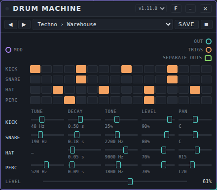
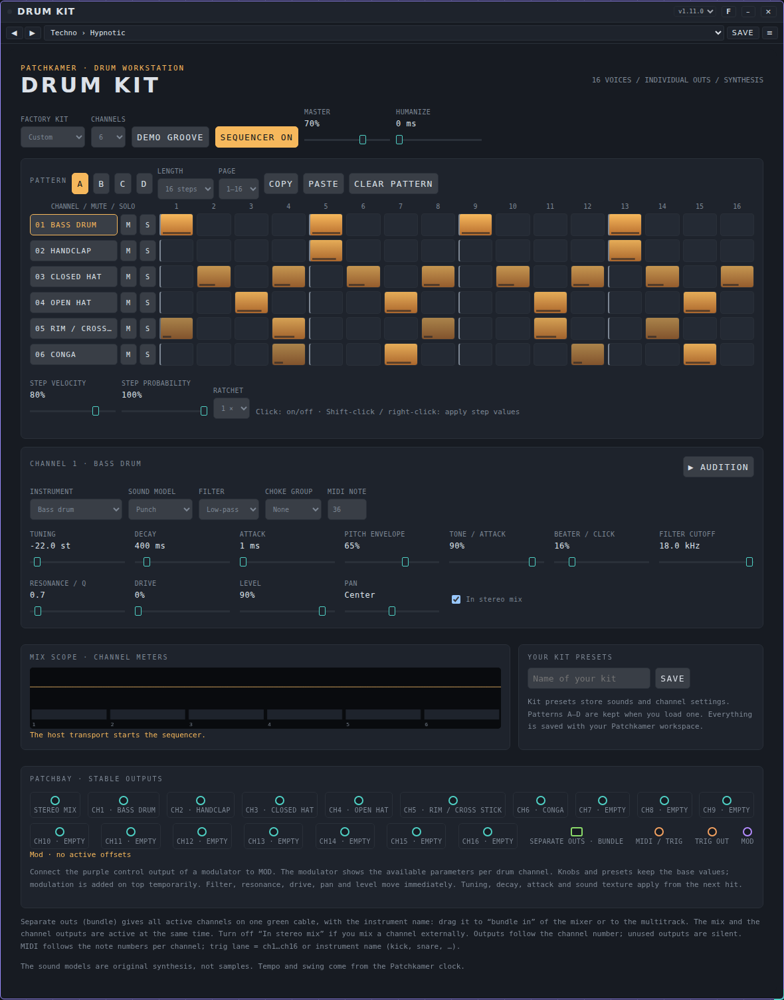
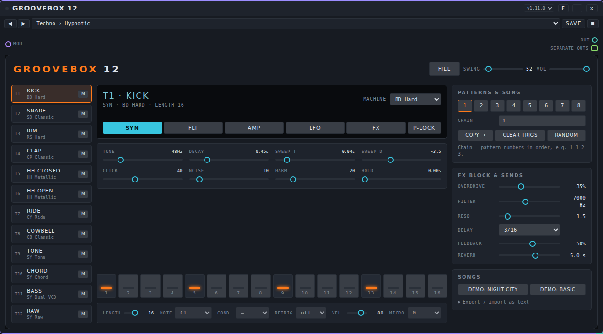
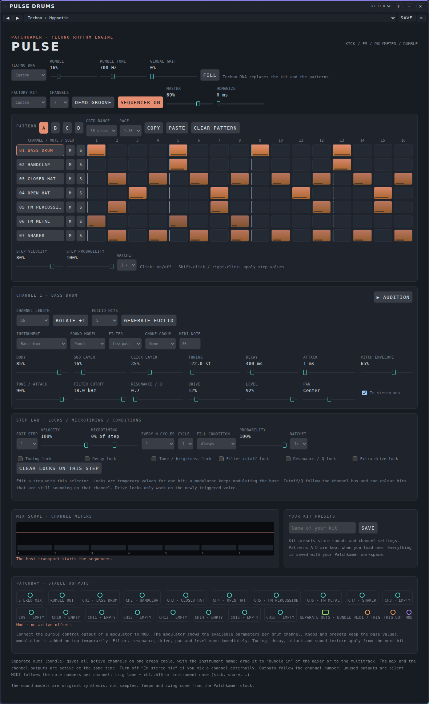
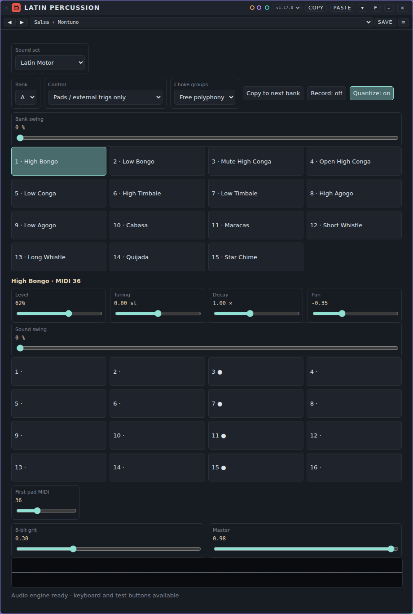
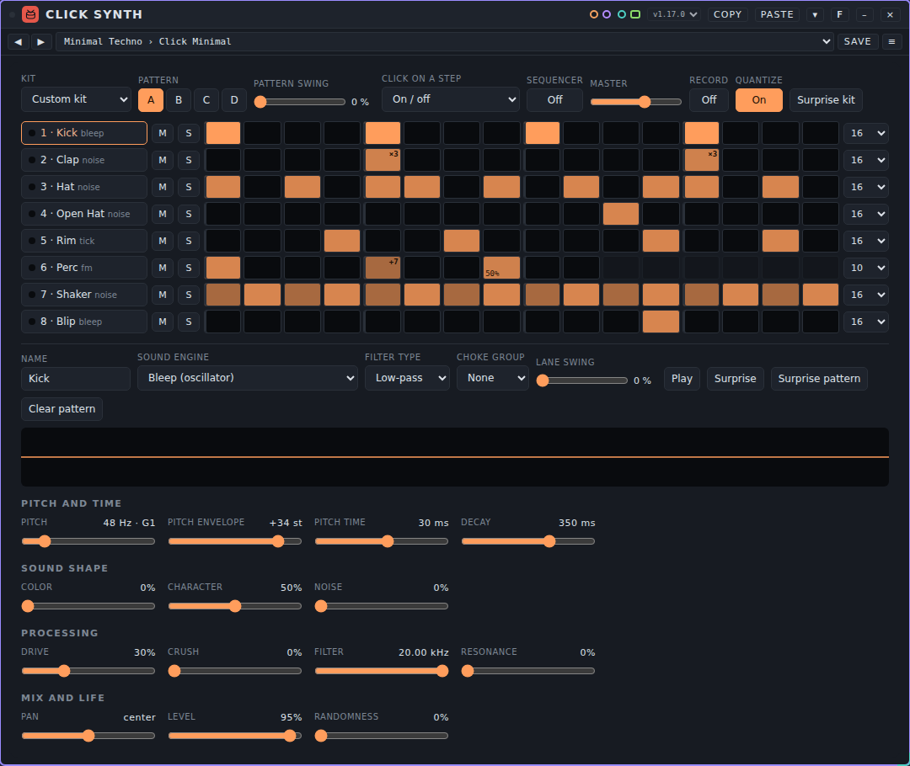
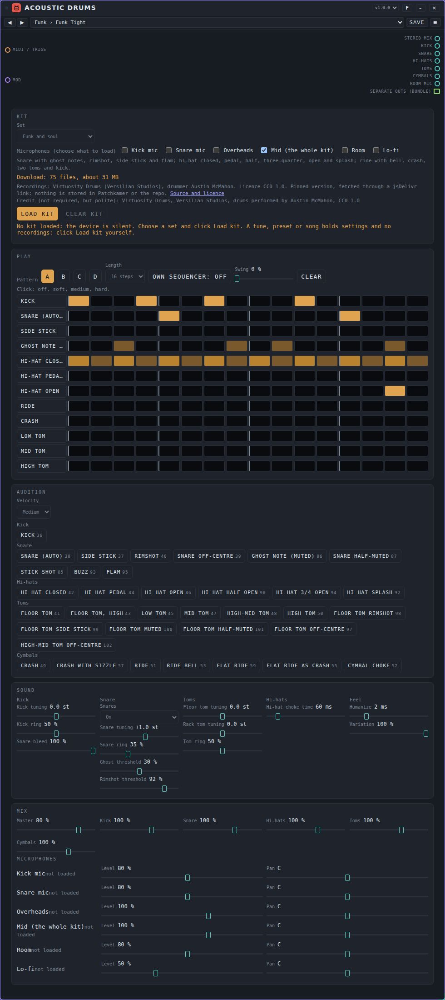

# Drums: user manual

*Nederlandse versie: [USER-MANUAL_NL.md](USER-MANUAL_NL.md)*

Drum devices make rhythm and percussion sound. This page covers the seven drum devices that come with Patchkamer: **Drum Machine**, **Drum Kit**, **Groovebox 12**, **Pulse Drums**, **Latin Percussion**, **Click Synth** and **Acoustic Drums**. For the basics (opening Patchkamer, loading a library, drawing cables) see the [main user manual](../USER-MANUAL_EN.md). The folder with the devices is described in [devices/drums](../../devices/drums/README.md).

## Contents

1. [What drum devices do](#what-drum-devices-do)
2. [Which device for which goal](#which-device-for-which-goal)
3. [Drum Machine](#drum-machine)
4. [Drum Kit](#drum-kit)
5. [Groovebox 12](#groovebox-12)
6. [Pulse Drums](#pulse-drums)
7. [Latin Percussion](#latin-percussion)
8. [Click Synth](#click-synth)
9. [Acoustic Drums](#acoustic-drums)
10. [If it does not work](#if-it-does-not-work)

## What drum devices do

A drum device has no audio input. It makes its own sound, with no samples: every drum is synthesized when it is hit. Each device has a built-in **step sequencer** that plays along with the Patchkamer clock, so press **Start** at the top to hear a pattern. Most of them can also be played from outside with notes or trigs (orange cable), and all of them have a purple **Mod** input: a modulator can move their controls while they play (see [Modulators](../modulators/USER-MANUAL_EN.md)).

A typical patch has two steps, from left to right:

1. The drum device.
2. Where the sound goes: **Speakers** directly, or first a channel of a **Mixer** (see [Mixer](../mixer/USER-MANUAL_EN.md)) and an effect.

Every device has a teal **audio out** with the whole kit mixed. Most also have a green **Separate outs** (bundle) port that gives every drum on its own: connect it to the **bundle in** of a Mixer to give each drum its own channel with its own volume and effects.

All seven devices have **tunes**. A tune is the complete setting of one device, including its patterns, so choosing a tune gives you a groove. See [Tunes](../tunes/USER-MANUAL_EN.md) for how to use and share them. The tunes are set to a similar loudness, so changing from one tune to another does not make a jump in volume.

**With your own sequencer.** Drum Kit, Pulse Drums, Click Synth and Latin Percussion accept notes from a sequencer. Their tunes switch the **device's own sequencer off** (Drum Kit and Pulse Drums: **Sequencer off**; Click Synth: the **Sequencer** button; Latin Percussion: **Control** is set to *Pads / external trigs only*). The tune's patterns stay stored: switch the own sequencer back on and you hear the tune's groove. This way you can audition with your own sequencer which kit sounds best. Drum Machine has no note input: its own pattern is its only source. Groovebox 12 plays its own pattern and also accepts live notes and trigs (note 36 to 47, see the ports under Groovebox 12), without anything having to be switched off.

**Swing and live recording.** Every drum machine with its own sequencer has **extra swing** on top of the studio swing: **Pattern swing** (Click Synth and Latin Percussion: per pattern or bank) and **Channel swing** (per channel, track or sound), each 0 to 50 % of a sixteenth; Drum Machine has swing per pattern and per group (kick, snare, hat, perc) and Groovebox 12 per pattern and per track. Only the odd sixteenths move, a ratchet moves as a whole, and with everything at 0 it sounds as before. **Pulse Drums, Drum Kit, Click Synth and Latin Percussion** can also **record live**: switch **Record** on, start the clock and play on your keyboard or pads; the hit is written as a step in the active pattern on the right channel, with **Quantize** (Pulse Drums, Click Synth, Latin Percussion; on by default) to the nearest swung step. A new hit in the same place replaces the old one. A guest instrument of Pulse Drums or Drum Kit (an instrument without a channel) does sound but is not recorded. Drum Machine and Groovebox 12 have no note input and do not record.

**The sequencer shows the sounds.** A sequencer connected to such a drum machine shows the sounds with their names, in the order of the drum machine. With **Pulse Drums** every instrument of the instrument choice that has no channel yet follows, and it sounds as a guest on a free channel (up to channel 16). When the kit, the order or the note of a channel changes (also through another tune), the sequencer's rows follow. See [Driving a drum machine](../sequencers/USER-MANUAL_EN.md#driving-a-drum-machine-the-rows-follow-the-device).

Double-click a slider to go back to its starting value. Click the number to type a value.

## Which device for which goal

| I want to… | Use |
|---|---|
| A simple drum computer with four sounds, to get a beat running at once | [Drum Machine](#drum-machine) |
| A full drum kit with up to 16 instruments, four patterns and a separate output for each drum | [Drum Kit](#drum-kit) |
| One box with 12 tracks, drum and synth sounds, effects, parameter locks and a chain of patterns | [Groovebox 12](#groovebox-12) |
| Techno with a layered kick, FM percussion, polymeter and a rumble | [Pulse Drums](#pulse-drums) |
| Latin percussion: bongos, congas, timbales, agogos, shakers and whistles | [Latin Percussion](#latin-percussion) |
| Clicks, ticks, bleeps, glitches and other small sounds, with polyrhythm | [Click Synth](#click-synth) |
| Real recorded acoustic drums for funk, soul or jazz (downloads a kit after a click) | [Acoustic Drums](#acoustic-drums) |
| Play drums from my own keyboard or pads | [Drum Kit](#drum-kit), [Pulse Drums](#pulse-drums), [Latin Percussion](#latin-percussion) or [Click Synth](#click-synth) |

## Drum Machine

### What it is for

Drum Machine is the simplest drum computer: four synthesized sounds (kick, snare, hat and perc) with 16 steps each. Every sound has its own controls for tune, decay, tone, level and pan. It has no note input: it plays the patterns you draw on the clock.

### The controls

| Control | What it does | Range (start) |
|---|---|---|
| **Step buttons** (one row per sound) | Click a square to switch a step on or off. Steps 1, 5, 9 and 13 sound louder. | 16 steps |
| **Tune** | Pitch of the sound. The hat has no tune. | Kick 30 to 90 Hz (50), snare 120 to 400 Hz (220), perc 200 to 900 Hz (420) |
| **Decay** | How long the sound rings. | Kick 0.1 to 1.2 s (0.45), snare 0.05 to 0.6 s (0.22), hat 0.02 to 0.4 s (0.06), perc 0.05 to 0.8 s (0.25) |
| **Tone** | The kick has **Tone** as the amount of click; the other sounds have the brightness. | Kick 0 to 100% (30%), snare 600 to 5000 Hz (1800), hat 3000 to 12000 Hz (7000), perc 400 to 4000 Hz (1200) |
| **Level** | Volume of the sound. | 0 to 100% (kick 90%, snare 80%, hat 70%, perc 70%) |
| **Pan** | Place in the stereo picture. | L100 to R100 (center) |
| **Level** (bottom) | Volume of the whole machine. | 0 to 100% (80%) |

### Ports

| Port | Kind | Use |
|---|---|---|
| **Mod** | modulation in (purple) | A modulator can move the controls of each sound. |
| **Out** | audio out (teal) | The four sounds mixed. Connect to **Speakers** or a **Mixer** channel. |
| **Trigs** | events out (orange) | Sends a trig for every hit, to play another device. |
| **Separate outs** | bundle out (green) | The four sounds apart, after level and pan. |

### An example

1. Place **Drum Machine** and **Speakers**. Connect **Out** to **In** on Speakers.
2. Press **Start**. The standard pattern plays at once.
3. Click the squares in the **Hat** row to make a different hat rhythm, and shorten **Decay** on the hat for a tighter sound.
4. Pull **Tune** on the kick down for a deeper kick.

### Tunes

Drum Machine has the pack **Drum Machine Styles**: 36 tunes in twelve folders (Techno, House, Trance, Drum & Bass, Dubstep, Hip-hop, Funk & disco, Electro, Pop, Rock, Jazz and Synthwave), three grooves each. The file is [`tunes/drum-machine-styles.patchkamer-tunes.json`](../../tunes/drum-machine-styles.patchkamer-tunes.json). Load the pack from a library or with the **≡** menu on the card, then pick a tune in the list.

### Tips and limits

- There is no sound until the clock runs: press **Start**.
- With four sounds you can do a lot by moving **Tune** and **Decay** while it plays, or by letting a modulator do it.

**Copy and paste.** **Copy pattern** and **Paste pattern** in the menu behind the icon work on the whole pattern (4 lanes of 16 steps). A drum machine hit is only on or off, so a clip's velocity is lost. Lanes are matched by kind (hat is a closed hi-hat); a lane in the clip that does not fit is left out and reported, and a lane with no hits in the clip becomes empty.

## Drum Kit

### What it is for

Drum Kit is a drum workstation with up to 16 channels. Every channel is one synthesized instrument (24 kinds, from bass drum to industrial metal) with a sound model, a filter with drive, level and pan, and its own step pattern. There are four patterns (A to D) of up to 64 steps, with a velocity, a probability and a ratchet (1 to 4 hits) per step. It plays along with the clock and can also be played with notes or trigs from another device.

### The controls

**At the top**

| Control | What it does |
|---|---|
| **Factory kit** | Starts from a whole kit: Deep, Punch, Rock, Pop, Jazz, Funk, Lo-fi or Industrial. After you change something it says **Custom**. |
| **Channels** | How many channels the kit has (1 to 16). |
| **Demo groove** | Puts a demonstration groove in the patterns, made for the chosen kit. |
| **Sequencer on / off** | Whether the built-in sequencer plays along with the clock. Switch it off to play only notes and trigs that arrive. |
| **Master** | Volume of the whole kit. |
| **Humanize** | A random shift in time per hit, in ms. |

**The pattern**

- **Pattern A, B, C, D** choose which of the four patterns you edit and hear.
- **Length** is 16, 32 or 64 steps; **Page** chooses which 16 steps are shown.
- **Copy**, **Paste** and **Clear pattern** work on the pattern you are editing.
- Click a square to switch a step on or off. **Shift-click** or right-click applies the values of **Step velocity**, **Step probability** and **Ratchet** to that step.
- **M** and **S** next to a channel are mute and solo.

**The channel**

Click a channel name to edit that channel. **Audition** plays it.

| Control | What it does |
|---|---|
| **Instrument** | The kind of drum (bass drum, snare, hats, toms, claps, percussion, metal and more). |
| **Sound model** | The character of the synthesis. |
| **Filter** | Low-pass, band-pass or high-pass. |
| **Choke group** | Channels in the same group cut each other off (for example open and closed hi-hat). |
| **MIDI note** | The note that plays this channel. |
| **Tuning**, **Decay**, **Attack**, **Pitch envelope** | The shape of the sound. Some controls change name or are replaced for another instrument (for example **Snare wires** or **Metallic tone**). |
| **Tone / attack**, **Beater / click** | Brightness and click of the hit. |
| **Filter cutoff**, **Resonance / Q**, **Drive** | Filter and distortion. |
| **Level**, **Pan** | Volume and place in the stereo picture. |
| **In stereo mix** | Whether this channel is part of the **Stereo mix** output. Switch it off to mix the channel outside the kit. |

**Your kit presets** saves the sounds and channel settings under a name, so you can load them later. Patterns A to D stay when you load a kit preset.

### Ports

| Port | Kind | Use |
|---|---|---|
| **Stereo mix** | audio out (teal) | All channels mixed. |
| **ch1 … ch16** | audio out (teal) | One output per channel, named after the instrument. Unused outputs are silent. |
| **Separate outs** | bundle out (green) | All active channels in one cable, to the **bundle in** of a Mixer. |
| **MIDI / trig** | events in (orange) | Notes (see **MIDI note**) or trigs. A trig lane is `ch1` … `ch16` or the instrument name (`kick`, `snare`, …). |
| **Trig out** | events out (orange) | A trig for every hit. |
| **Mod** | modulation in (purple) | A modulator shows the controls per channel. Filter, resonance, drive, pan and level move at once; tuning, decay, attack and sound texture apply from the next hit. |

### An example

1. Place **Drum Kit** and **Speakers**. Connect **Stereo mix** to **In** on Speakers.
2. Press **Start**. Use **Factory kit** to choose a kit, then change the pattern.
3. For a separate mix: switch to **Separate outs** and connect it to the bundle input of a **Mixer**. Then every drum has its own channel.

### Tunes

Drum Kit has the pack **Drum Kit Styles**: 38 tunes in twelve folders (Techno, House, Trance, Drum & Bass, Dubstep, Hip-hop, Funk & disco, Electro, Pop, Rock, Jazz and Synthwave). The file is [`tunes/drum-kit-styles.patchkamer-tunes.json`](../../tunes/drum-kit-styles.patchkamer-tunes.json).

### Tips and limits

- Without the clock a pattern does not play. The **Audition** button and notes on the input do work.
- The kick of a kit starts higher than a real bass drum: use a low **Tuning** (the tunes use values around −22 st).

**Copy and paste.** **Copy pattern** and **Paste pattern** in the menu behind the icon work on pattern A to D as drums. Velocity, probability and ratchet come along. The length is the same for all patterns and stays that of the kit: a shorter clip is repeated, a longer one cut. Paste clears the whole active pattern, also channels that are not in the clip; Undo in the message restores it.

## Groovebox 12

### What it is for

Groovebox 12 is a groovebox with 12 tracks. Every track has a sound machine (seven drum machines and four synth machines), its own length (1 to 16 steps, so you can make polymeter) and 16 steps with parameter locks, trig conditions, retrigs and micro-timing. There are 8 patterns and a chain that sets the order in which they play. Behind the tracks sit an FX block (overdrive and filter), a delay, a reverb and a compressor.

### The controls

**At the top**

| Control | What it does |
|---|---|
| **Fill** | Hold it down to play a fill: steps with the condition **FILL** play while you hold it, and steps with **!FILL** stay silent. |
| **Swing** | How late every second sixteenth note falls, 50 to 80%. |
| **Vol** | Volume of the whole box. |

**The tracks**

- The column on the left has the 12 tracks **T1** to **T12**. Click a track to edit it; **M** mutes it.
- **Machine** chooses the sound of the track: **BD Hard**, **SD Classic**, **RS Hard**, **CP Classic**, **HH Metallic**, **CY Ride** and **CB Classic** (drums) and **SY Tone**, **SY Chord**, **SY Dual VCO** and **SY Raw** (synths).
- The pages **SYN**, **FLT**, **AMP**, **LFO** and **FX** show the knobs for sound, filter, amplifier, LFO and sends. The knobs depend on the machine.
- **P-lock**: choose a step and turn a knob; the knob then only applies to that step. Double-click a knob to clear the lock.

**The steps**

- Click one of the 16 trig keys to switch a step on or off.
- **Length** sets how many steps the track plays (1 to 16).
- **Note** is the pitch of the step (for synth machines).
- **Cond.** is a trig condition (for example only every second time), **Retrig** repeats the hit within the step (off, 2, 3, 4, 6 or 8) and **Vel.** sets the velocity.
- **Micro** shifts the step a little in time.

**On the right**

| Control | What it does |
|---|---|
| **Patterns & song**: **1** to **8** | Choose the pattern you edit and hear. |
| **Chain** | Pattern numbers in order, for example `1 1 2 3`. |
| **Copy →** | Copies the pattern to the next one and switches to it. |
| **Clear trigs** | Empties the pattern: all steps, locks and conditions. |
| **Random** | Fills the pattern with random steps and velocities. |
| **FX block & sends**: **Overdrive**, **Filter**, **Reso** | A distortion and filter that every track can send into. |
| **Delay**, **Feedback**, **Reverb** | A delay (with its time as a note value) and a reverb. |
| **Songs**: **Demo: Night City**, **Demo: Basic** | Load a demonstration song. **Export / import as text** gives a song as text you can copy. |

### Ports

| Port | Kind | Use |
|---|---|---|
| **Notes / trigs** | events in (orange) | Plays a track live: note **36 to 47** (C1 to B1) is track 1 to 12, or a trig with lane `t1` to `t12` (also `kick`, `snare`, `hat`, `perc`). A muted track is silent; a synth track sounds at its default note. A sequencer shows the twelve tracks by name. |
| **Mod** | modulation in (purple) | A modulator can move controls of the tracks. |
| **Out** | audio out (teal) | The whole box. Connect to **Speakers** or a **Mixer** channel. |
| **Separate outs** | bundle out (green) | The twelve tracks apart, after level and pan, before the sends and the FX block. |
| **Trigs** | events out (orange) | Every hit the Groovebox's sequencer plays: a drum track as a trig (lane `t1` to `t12`), a synth track as a note. This lets the Groovebox drive another device. |

### An example

1. Place **Groovebox 12** and **Speakers** and connect **Out** to **In**.
2. Press **Start**. Choose a tune (see below) or click **Demo: Basic**.
3. Click track **T1**, choose the page **SYN** and turn **Tune** and **Decay** while it plays.
4. Click **P-lock**, then step 5 of a track, and turn a knob: only that step changes.

### Tunes

Groovebox 12 has the pack **Groovebox 12 Styles**: 38 tunes in twelve folders (Techno, House, Trance, Drum & Bass, Dubstep, Hip-hop, Funk & disco, Electro, Pop, Rock, Jazz and Synthwave). The file is [`tunes/groovebox-12-styles.patchkamer-tunes.json`](../../tunes/groovebox-12-styles.patchkamer-tunes.json). A tune holds the tracks, the patterns and the chain.

### Tips and limits

- The clock is that of the host: Groovebox 12 has no play button of its own. Press **Start** at the top.
- A pattern holds the 12 tracks. **Clear trigs** and **Random** work on the pattern you are editing, so copy it first with **Copy →** if you want to keep it.
- **Copy and paste.** **Copy pattern** and **Paste pattern** in the menu behind the icon work on the pattern you are editing, with all 12 tracks in one go: the drum tracks as drum tracks and the synth tracks as note tracks, each with its own length (polymeter), probability (the conditions 25%, 50% and 75%), ratchet (retrig) and micro-timing. Between two Groovebox 12s the whole pattern comes along, with sound, p-locks and all conditions. To another device (Pattern Tracker, Clip Arranger, Chord Sequencer) the tracks go by kind and in order; what does not fit is left out and reported. If you paste into Groovebox 12 from another device, the assigned tracks get the steps and the length (their steps and p-locks are cleared first), sound and settings stay; tracks without a source stay as they are. You cannot paste a single track (for example from Step Sequencer) into it. The pattern you are editing stays selected, also after **Undo**.

## Pulse Drums

### What it is for

Pulse Drums is a drum workstation for techno. It has up to 16 channels with 27 instruments (the 24 of Drum Kit plus three FM instruments), four patterns of up to 64 steps and a length of its own for each channel, so one channel can run 15 steps against 16 (polymeter), with Euclid rhythms and rotation. Compared with Drum Kit it adds FM controls, three layers for the kick (body, sub and click), a rumble bus with its own output, grit over the whole mix, and per step micro-timing, a cycle condition, a fill condition and parameter locks.

### The controls

Pulse Drums has the controls of [Drum Kit](#drum-kit) (factory kit, channels, demo groove, sequencer, master, humanize, patterns A to D, copy and paste, the channel controls, your kit presets). The extra controls are:

| Control | What it does |
|---|---|
| **Techno DNA** | Starts from a whole techno setup: Hypnotic, Hardgroove, Industrial, Deep dub or Broken. It replaces the kit and the patterns. |
| **Rumble**, **Rumble tone** | Amount and pitch of a low rumble made from the kick. It has its own output, **Rumble out**. |
| **Global grit** | A rough, crushed character over the whole mix. |
| **Fill** | Switches the fill on for the steps that have a fill condition. |
| **Channel length**, **Rotate +1** | A length of its own for this channel (polymeter), and a shift of the pattern by one step. |
| **Euclid hits**, **Generate Euclid** | Spreads a number of hits evenly over the channel length. |
| **Body**, **Sub layer**, **Click layer** | The three layers of the kick. |
| **Step lab**: **Edit step** | Pick a step and set **Velocity**, **Microtiming**, **Every N cycles** and **Cycle**, **Fill condition** (**Always**, **Fill only** or **Without fill**) and **Probability**. The lock boxes (**Tuning lock**, **Decay lock**, **Tone / brightness lock**, **Filter cutoff lock**, **Resonance / Q lock** and **Extra drive lock**) make a value count for this step only. **Clear locks on this step** removes them. |

The three FM instruments (`fmperc`, `fmmetal` and `fmhat`) have extra FM controls.

### Ports

| Port | Kind | Use |
|---|---|---|
| **Stereo mix** | audio out (teal) | All channels mixed. |
| **Rumble out** | audio out (teal) | The rumble apart. |
| **ch1 … ch16** | audio out (teal) | One output per channel. |
| **Separate outs** | bundle out (green) | All active channels in one cable. |
| **MIDI / trig** | events in (orange) | Notes or trigs, as in Drum Kit. |
| **Trig out** | events out (orange) | A trig for every hit. |
| **Mod** | modulation in (purple) | A modulator shows the controls per channel. |

### An example

1. Place **Pulse Drums** and **Speakers**. Connect **Stereo mix** to **In** on Speakers.
2. Press **Start**. Choose **Techno DNA › Hypnotic**.
3. Set the **Channel length** of one hat channel to 15 while the kick stays at 16: the hat slowly moves against the kick.
4. Turn **Rumble** up. The rumble is made from the kick; take **Rumble out** to its own **Mixer** channel if you want to treat it separately.

### Tunes

Pulse Drums has the pack **Pulse Drums Techno**: 26 tunes in eight folders (Techno, Minimal, Peak Time, Hard Techno, Dub Techno, Acid, Electro and Breaks). The file is [`tunes/pulse-drums-techno.patchkamer-tunes.json`](../../tunes/pulse-drums-techno.patchkamer-tunes.json).

### Tips and limits

- The kick starts high: the tunes use a low **Tuning** (around −22 st). Lower it yourself if a kit you make sounds thin.
- Choosing a **Techno DNA** replaces the kit and the patterns; save yours as a tune first.

**Copy and paste.** **Copy pattern** and **Paste pattern** in the menu behind the icon work on pattern A to D as drums, with polymeter (each channel's own length) and microtiming. Every, phase, fill and locks only travel to another Pulse Drums; they are lost on other devices. A polymeter clip in a device with one length is repeated until it lines up again and can become very long.

## Latin Percussion

### What it is for

Latin Percussion has fifteen synthesized latin percussion sounds: bongos, congas, timbales, agogos, cabasa, maracas, whistles, quijada and star chime. Each sound has its own level, tuning, decay and pan. You play them with the pads, with trigs or notes from outside, or with a pattern on the internal clock. There are four banks (A to D), each with a pattern of 15 × 16 steps.

### The controls

| Control | What it does |
|---|---|
| **Sound set** | Starts from a whole set of sounds and patterns: Latin Motor, Detroit Percussion, Metal Carnival or Whistle Dub. |
| **Bank** | Chooses bank A, B, C or D: the pattern that the internal clock plays. |
| **Control** | **Pads / external trigs only**, or **Own pattern on the internal clock**. |
| **Choke groups** | **Free polyphony** (every hit rings out) or **Shared groups** (for example the open and the muted conga cut each other off). |
| **Copy to next bank** | Copies the pattern of this bank to the next one. |
| **Pads 1 to 15** | Click a pad to select that sound and play it. |
| **Level**, **Tuning**, **Decay**, **Pan** | Controls of the selected sound. |
| **Step buttons 1 to 16** | The pattern of the selected sound. Click a step: rest, normal hit, accent. |
| **First pad MIDI** | The note of the first pad (36); the other pads follow upward. |
| **8-bit grit** | A crushed character over the whole output. |
| **Master** | Volume of the whole device. |

The fifteen sounds are: High Bongo, Low Bongo, Mute High Conga, Open High Conga, Low Conga, High Timbale, Low Timbale, High Agogo, Low Agogo, Cabasa, Maracas, Short Whistle, Long Whistle, Quijada and Star Chime. The trig lanes (for a trig from another device) are `hibongo`, `lobongo`, `muteconga`, `openconga`, `loconga`, `hitimbale`, `lotimbale`, `hiagogo`, `loagogo`, `cabasa`, `maracas`, `shortwhistle`, `longwhistle`, `quijada` and `starchime`, or `pad1` to `pad15`.

### Ports

| Port | Kind | Use |
|---|---|---|
| **Notes / trigs** | notes in (orange) | Notes from **Keys / MIDI** (from **First pad MIDI** up) or trigs from another device. |
| **Mod** | modulation in (purple) | A modulator can move the controls of the sounds. |
| **Stereo** | audio out (teal) | Connect to **Speakers** or a **Mixer** channel. |

### An example

1. Place **Latin Percussion** and **Speakers**. Connect **Stereo** to **In** on Speakers.
2. Press **Start** and choose **Control › Own pattern on the internal clock**.
3. Choose a tune such as **Salsa › Montuno** and switch between **Bank** A, B, C and D while it plays: B is a variation, C a sparse breakdown and D the groove with a fill.
4. For a player's feel: choose **Pads / external trigs only**, place **Keys / MIDI** and connect it to **Notes / trigs**.

### Tunes

Latin Percussion has the pack **Latin Percussion Styles**: 39 tunes in thirteen folders (Salsa, Son, Mambo, Cha-Cha-Cha, Rumba, Bossa Nova, Samba, Merengue, Bachata, Cumbia, Reggaeton, Latin Jazz and Latin Soul), three kits each. The file is [`tunes/latin-percussion-styles.patchkamer-tunes.json`](../../tunes/latin-percussion-styles.patchkamer-tunes.json). Every kit uses all four banks: A is the groove, B a variation, C a sparse breakdown and D the groove with a fill. The tunes switch the choke groups off, so several sounds of one group can hit at once.

### Tips and limits

- The patterns are 16 steps; the rhythms of the styles are written for one bar.
- The pads work as a test keyboard: click one to hear it.

**Copy and paste.** **Copy pattern** and **Paste pattern** in the menu behind the icon work on the selected bank (A to D) with 15 sounds of 16 steps. The accent is kept. The note numbers here are not General MIDI and the sounds have no kind, so lanes are matched by sound name only: almost nothing from an ordinary drum kit will fit.

## Click Synth

### What it is for

Click Synth is a percussion synth for small sounds: clicks, ticks, bleeps, zaps, wood, glass, metal and glitches. It has eight lanes, each with its own sound engine that you shape. Randomness makes every hit a little different, and every lane can have its own length (polyrhythm). A built-in sequencer plays 16 steps per lane on the clock, with four patterns (A to D) and, per step, velocity, probability, ratchet and a pitch jump.

### The controls

**At the top**

| Control | What it does |
|---|---|
| **Kit** | Starts from a whole kit: Micro Click, Wood & Glass, Bleep Lab, Insects, Glitch Works or Minimal Techno. After you change something it says **Custom kit**. |
| **Pattern A, B, C, D** | The pattern you edit and hear. **Shift-click** copies the current pattern to that one. |
| **Click on a step** | What a click on a step does: **On / off**, **Accent (hard / soft)**, **Chance (100 → 25%)**, **Ratchet (1 → 4)** or **Pitch jump**. **Shift-click** makes a step soft and right-click clears it. Below the list a short hint says what a click does in the chosen mode (with Chance, Ratchet and Pitch jump you see the value as a number in the step). A step has to be on first: choose **On / off** to switch steps on or off and then change to Chance, Ratchet or Pitch jump. |
| **Sequencer** | **On**: the built-in sequencer plays along with the clock. **Off**: play only from another device. |
| **Master** | Volume of the whole synth. |
| **Surprise kit** | A random new sound for every lane; the patterns stay. |

**The lanes**

Click a lane name to select it and hear its sound. **M** is mute and **S** is solo. The number at the end of the row is the **length** of that lane (1 to 16 steps): a lane of 7 steps against one of 16 makes a polyrhythm.

**The selected lane**

| Control | What it does |
|---|---|
| **Name** | The name of the lane. |
| **Sound engine** | **Tick** (impulse + resonator), **Bleep** (oscillator), **FM metal**, **Noise** (band filter), **Modal** (wood → glass → metal → skin), **String** (pluck), **Zap** (laser) or **Glitch** (stutter). |
| **Filter type** | Low-pass, band-pass or high-pass. |
| **Choke group** | A hit cuts off the other lanes in the same group (open and closed hi-hat). |
| **Play**, **Surprise**, **Surprise pattern**, **Clear pattern** | Play the sound, make a random sound within this engine, make a random rhythm for this lane, or empty it. |

The knobs are in four groups. **Pitch and time**: **Pitch**, **Pitch envelope**, **Pitch time**, **Decay**. **Sound shape**: **Color**, **Character**, **Noise**. **Processing**: **Drive**, **Crush**, **Filter**, **Resonance**. **Mix and life**: **Pan**, **Level**, **Randomness**. What **Color** and **Character** do depends on the engine; the card shows a hint under the lane.

### Ports

| Port | Kind | Use |
|---|---|---|
| **Trigs / notes** | events in (orange) | A trig from another device (`ch1` … `ch8`) or the notes 36 to 43, one for each lane. |
| **Mod** | modulation in (purple) | A modulator can move the controls of every lane. |
| **Stereo mix** | audio out (teal) | All lanes mixed. |
| **Separate lanes (bundle)** | bundle out (green) | Every lane apart, to the **bundle in** of a Mixer. |

### An example

1. Place **Click Synth** and **Speakers**. Connect **Stereo mix** to **In** on Speakers.
2. Press **Start**. Choose **Kit › Minimal Techno**.
3. Select the lane **Perc** and give it a length of 10 while the others stay at 16: the perc moves against the beat.
4. Choose **Click on a step › Ratchet (1 → 4)** and click a few steps to make them repeat.
5. Turn **Randomness** up on a lane for hits that are never quite the same.

### Tunes

Click Synth has the pack **Click Synth Styles**: 30 tunes in ten folders (Minimal Techno, Microhouse, Techno, Glitch, Electro, Breakbeat, Ambient, Industrial, Dub Techno and Acid), three kits each. The file is [`tunes/click-synth-styles.patchkamer-tunes.json`](../../tunes/click-synth-styles.patchkamer-tunes.json). Every kit uses all four patterns: A is the groove, B a variation, C a sparse breakdown and D the groove with a fill. A tune sets the sound of every lane.

### Tips and limits

- The sound is made in an AudioWorklet. Without one (an old browser) the card says so and stays silent.
- Randomness and the chance per step make the result differ every time; that is on purpose.

**Copy and paste.** **Copy pattern** and **Paste pattern** in the menu behind the icon work on the selected pattern (A to D) with 8 lanes, each with its own length. Probability and ratchet come along; the pitch jump per step only to another Click Synth. A clip from elsewhere sets all lanes to the clip length (at most 16 steps). Lanes are matched by name; little from an ordinary drum kit will fit.

## Acoustic Drums

### What it is for

Acoustic Drums is a sampled acoustic drum kit for funk, soul and jazz: real recordings of a played kit, not synthesis. The recordings are not inside Patchkamer. You choose a set and the microphones, see how much will be downloaded, and click **Load kit**. The files then come through a link (Virtuosity Drums by Versilian Studios, drummer Austin McMahon, licence CC0 1.0). You can cancel while it loads. A tune, preset or song holds settings and loads no recordings, so a patch that uses it needs a click on **Load kit** first; without a kit the device is silent and the card says so.

### The controls

| Control | What it does |
|---|---|
| **Set** | **Funk and soul** (about 31 MB with the mid microphone), **Funk and soul, compact** (about 15 MB) or **Jazz** (about 45 MB; also snares off, flat ride, sizzle crash and buzz). The card shows the exact number of files and megabytes before you click. |
| **Microphones** | Which microphones to load: kick mic, snare mic, overheads, mid (the whole kit), room and lo-fi. Every extra microphone adds its own download (a whole extra microphone is roughly the same size again). |
| **Load kit**, **Cancel**, **Clear kit** | Fetch the chosen files with a progress line, stop loading (the previous kit stays), or free the memory. |
| **Pattern A to D**, **Length**, **Own sequencer**, **Swing** | A small step sequencer for 12 pieces. Click a step to cycle off, soft, medium and hard. |
| **Audition** | A button for every sound with its MIDI note, at a velocity you choose. |
| **Kick**, **Snare**, **Toms**, **Hi-hats**, **Feel** | Tuning and ring (damping) per piece, **Snare bleed** (the kick with and without snare resonance, when the set has both), **Snares** on or off, **Ghost threshold** (softer hits play as ghost notes) and **Rimshot threshold** (harder hits play as rimshot; 100% turns it off), **Hi-hat choke time**, **Humanize** (0 to 10 ms) and **Variation** (small random changes in tuning and level). |
| **Mix** | Master, a level per piece and a level and pan per loaded microphone. |

Hits never repeat exactly: a round robin that does not repeat directly, a small change in tuning (about 3 cents) and level (about 0.5 dB), and a blend between neighbouring velocity layers. A closed or pedal hi-hat cuts open sounds with a short fade, and a cymbal can be grabbed with note 52 or with the same note at a very low velocity. A hi-hat pedal on CC 4 makes note 42 closed, half, three-quarter or open.

### Ports

| Port | Kind | Use |
|---|---|---|
| **MIDI / trigs** | events in (orange) | General MIDI notes (36 kick, 38 snare, 42 closed hat, 46 open hat, 49 crash, 51 ride and more, see the card text) or trigs from Drum Kit-style lanes. |
| **Mod** | modulation in (purple) | A modulator can move tuning, ring, thresholds, humanize and the mix. |
| **Stereo mix** | audio out (teal) | Everything. |
| **Kick**, **Snare**, **Hi-hats**, **Toms**, **Cymbals**, **Room mic** | audio out (teal) | The same sound apart, all active together with the mix. |
| **Separate outs (bundle)** | bundle out (green) | The five groups, to a Mixer. |

### An example

1. Place **Acoustic Drums** and **Speakers**. Connect **Stereo mix** to **In** on Speakers.
2. Choose **Funk and soul** with the mid microphone and click **Load kit**. Wait for "Loaded".
3. Choose a tune such as **Funk › Funk Tight**, turn **Own sequencer** on and press **Start**.
4. Raise **Ghost threshold** for more ghost notes, or lower **Snare ring** for a drier snare.

### Tunes

Acoustic Drums has the pack **Acoustic Drums Styles**: 40 voicings in four folders (Funk, Soul, Jazz and Studio). A tune sets the microphones, mix, tuning, ring and thresholds; it holds no patterns and no recordings. The file is [`tunes/acoustic-drums-styles.patchkamer-tunes.json`](../../tunes/acoustic-drums-styles.patchkamer-tunes.json).

### Tips and limits

- It needs a host that can fetch files (contract v1.30) and a connection. If a file fails you see the reason; the rest of the kit still plays.
- The kit takes memory: about three times the download once decoded.
- Not included: continuous snare roll, percussion and the epic microphones of the source library.

**Copy and paste.** **Copy pattern** and **Paste pattern** work on the shown pattern (A to D, up to 32 steps, 12 lanes) as drums. Probability and ratchet do not exist here.

## If it does not work

- **No sound.** Check that audio runs from the device to **Speakers** (teal cable), that you pressed **Start**, and that the volume on Speakers is up. Click anywhere in Patchkamer once: browsers pause audio until you do.
- **The pattern does not play.** The sequencers follow the clock. Press **Start**. For Drum Kit, Pulse Drums and Click Synth check that the sequencer is **on**; for Latin Percussion set **Control** to **Own pattern on the internal clock**.
- **A drum is too quiet or too loud in the mix.** Use **Level** on the drum, or connect **Separate outs** to a **Mixer** and set the volume there.
- **The kick sounds thin or high.** Lower **Tuning** on the kick channel (Drum Kit and Pulse Drums: around −22 st).
- **Crackles.** Open Settings → Audio and choose a larger latency, or a lower quality.
