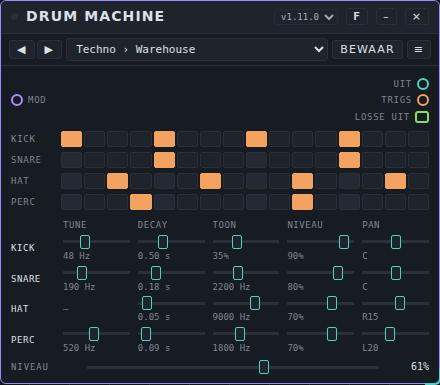
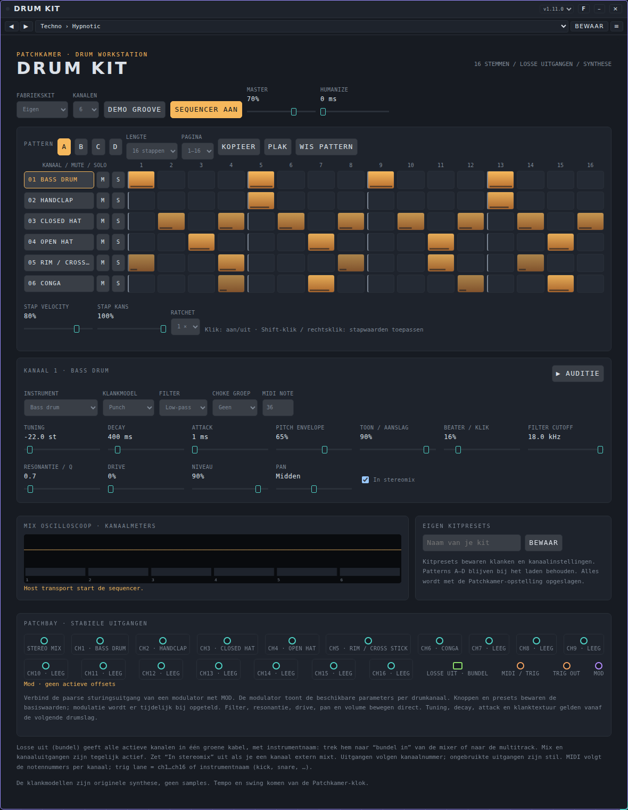
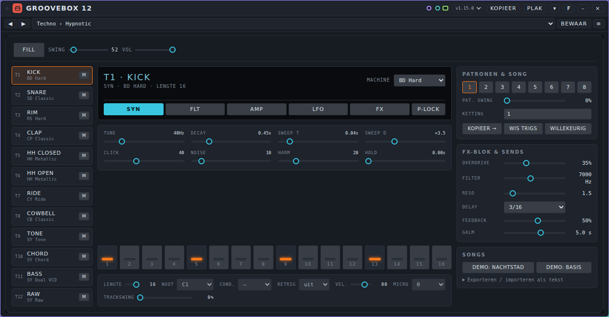
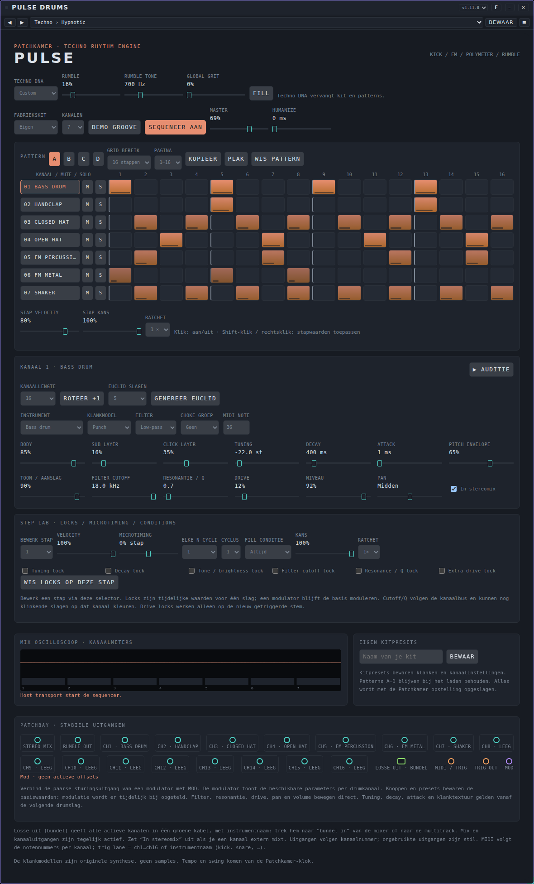
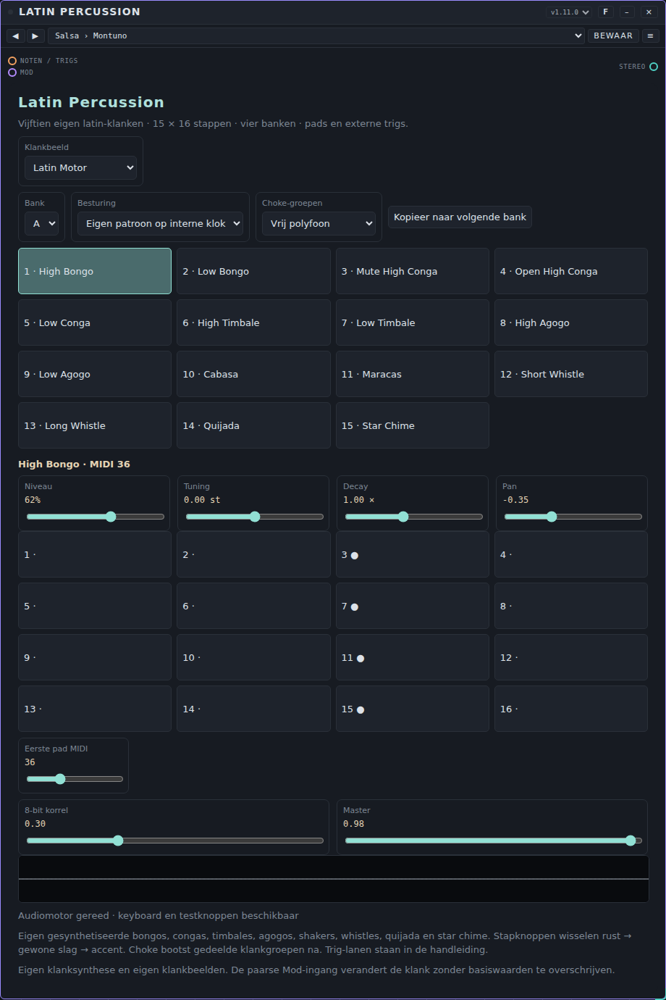
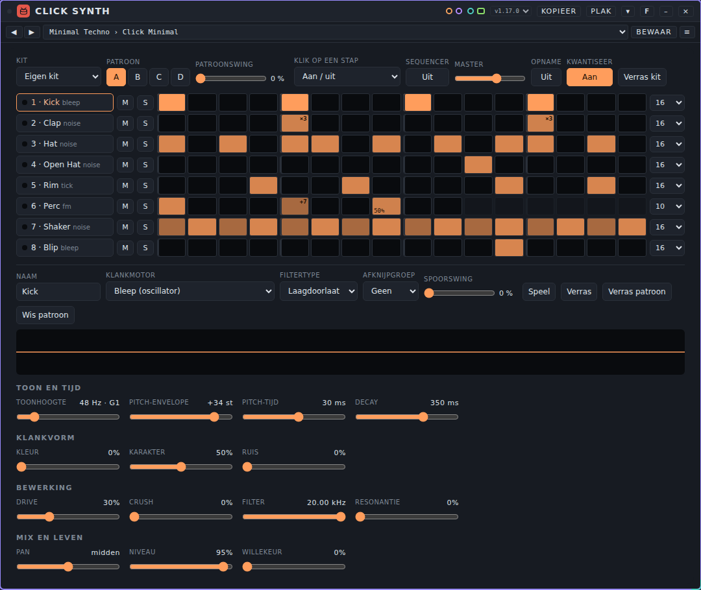
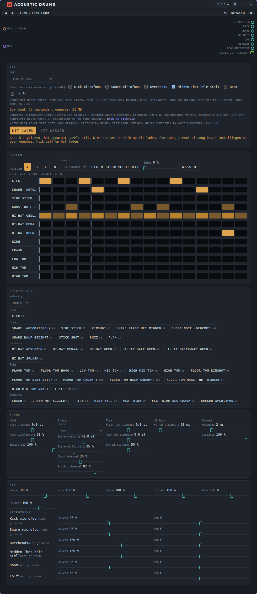

# Drums: gebruikershandleiding

*English version: [USER-MANUAL_EN.md](USER-MANUAL_EN.md)*

Drumapparaten maken ritme en percussie. Deze pagina beschrijft de zeven drumapparaten die bij Patchkamer horen: **Drum Machine**, **Drum Kit**, **Groovebox 12**, **Pulse Drums**, **Latin Percussion**, **Click Synth** en **Acoustic Drums**. De basis (Patchkamer openen, een bibliotheek laden, kabels trekken) staat in de [basishandleiding](../USER-MANUAL_NL.md). De map met de apparaten is beschreven in [devices/drums](../../devices/drums/README_NL.md).

## Inhoud

1. [Wat drumapparaten doen](#wat-drumapparaten-doen)
2. [Welk apparaat voor welk doel](#welk-apparaat-voor-welk-doel)
3. [Drum Machine](#drum-machine)
4. [Drum Kit](#drum-kit)
5. [Groovebox 12](#groovebox-12)
6. [Pulse Drums](#pulse-drums)
7. [Latin Percussion](#latin-percussion)
8. [Click Synth](#click-synth)
9. [Acoustic Drums](#acoustic-drums)
10. [Als het niet werkt](#als-het-niet-werkt)

## Wat drumapparaten doen

Een drumapparaat heeft geen audio-ingang. Het maakt zijn eigen geluid, zonder samples: elke drum wordt gesynthetiseerd op het moment dat hij wordt geraakt. Elk apparaat heeft een ingebouwde **stapsequencer** die meespeelt met de klok van Patchkamer, dus druk bovenin op **Start** om een patroon te horen. De meeste kunnen ook van buiten worden bespeeld met noten of trigs (oranje kabel), en alle hebben een paarse **Mod**-ingang: een modulator kan hun regelaars laten bewegen terwijl ze spelen (zie [Modulators](../modulators/USER-MANUAL_NL.md)).

Een gewone patch heeft twee stappen, van links naar rechts:

1. Het drumapparaat.
2. Waar het geluid heen gaat: direct naar **Speakers**, of eerst via een kanaal van een **Mixer** (zie [Mixer](../mixer/USER-MANUAL_NL.md)) en een effect.

Elk apparaat heeft een groenblauwe **audio-uitgang** met de hele kit gemengd. De meeste hebben ook een groene poort **Losse uit** (bundel) die elke drum apart geeft: sluit hem aan op de **bundel in** van een Mixer om elke drum een eigen kanaal te geven, met eigen volume en effecten.

Alle zeven apparaten hebben **tunes**. Een tune is de volledige instelling van één apparaat, inclusief de patronen, dus een tune kiezen geeft je een groove. Zie [Tunes](../tunes/USER-MANUAL_NL.md) voor hoe je ze gebruikt en deelt. De tunes staan op een vergelijkbaar volume, dus wisselen van tune geeft geen sprong in luidheid.

**Met je eigen sequencer.** Drum Kit, Pulse Drums, Click Synth en Latin Percussion nemen noten van een sequencer aan. Hun tunes zetten de **eigen sequencer van het apparaat uit** (Drum Kit en Pulse Drums: **Sequencer uit**; Click Synth: de knop **Sequencer**; Latin Percussion: **Besturing** staat op *Alleen pads / externe trigs*). De patronen van de tune blijven bewaard: zet de eigen sequencer weer aan en je hoort de groove van de tune. Zo kun je met je eigen sequencer beluisteren welke kit het best klinkt. Drum Machine heeft geen noteningang: zijn eigen patroon is zijn enige bron. Groovebox 12 speelt zijn eigen patroon en neemt daarnaast live noten en trigs aan (noot 36 t/m 47, zie de poorten bij Groovebox 12), zonder dat daarvoor iets uit hoeft.

**Swing en live inspelen.** Elke drumcomputer met een eigen sequencer heeft **extra swing** bovenop de swing van de studio: **Patroon swing** (Click Synth en Latin Percussion: per patroon of bank) en **Kanaal swing** (per kanaal, spoor of klank), elk 0 tot 50 % van een zestiende; Drum Machine heeft swing per patroon en per groep (kick, snare, hat, perc) en Groovebox 12 per patroon en per track. Alleen de oneven zestienden schuiven, een ratchet schuift als geheel mee, en met alles op 0 klinkt het als voorheen. **Pulse Drums, Drum Kit, Click Synth en Latin Percussion** kunnen bovendien **live inspelen**: zet **Opname** aan, start de klok en speel op je toetsenbord of pads; de slag komt als stap in het actieve patroon op het juiste kanaal, met **Kwantiseer** (Pulse Drums, Click Synth, Latin Percussion; standaard aan) naar het dichtstbijzijnde geswingde stap. Een nieuwe slag op dezelfde plek vervangt de oude. Een gastinstrument van Pulse Drums of Drum Kit (een instrument zonder kanaal) klinkt wel maar wordt niet opgenomen. Drum Machine en Groovebox 12 hebben geen ingang voor noten en nemen niet op.

**De sequencer toont de klanken.** Een sequencer die aan zo'n drumcomputer hangt, laat de klanken met hun namen zien, in de volgorde van de drumcomputer. Bij **Pulse Drums** volgen daarna ook alle instrumenten uit de instrumentkeuze die nog geen kanaal hebben; die klinken als gast op een vrij kanaal (kanaal 12 tot en met 16, of waar jouw kanalen ophouden). Wisselt de kit, de volgorde of de noot van een kanaal (ook door een andere tune), dan volgen de rijen van de sequencer. Zie [Een drumcomputer aansturen](../sequencers/USER-MANUAL_NL.md#een-drumcomputer-aansturen-de-rijen-volgen-het-apparaat).

Dubbelklik op een schuif om terug te gaan naar de beginwaarde. Klik op het getal om een waarde te typen.

## Welk apparaat voor welk doel

| Ik wil… | Gebruik |
|---|---|
| Een eenvoudige drumcomputer met vier geluiden, om meteen een beat te hebben | [Drum Machine](#drum-machine) |
| Een complete drumkit met tot 16 instrumenten, vier patronen en een aparte uitgang per drum | [Drum Kit](#drum-kit) |
| Eén kast met 12 tracks, drum- en synthgeluiden, effecten, parameter locks en een ketting van patronen | [Groovebox 12](#groovebox-12) |
| Techno met een gelaagde kick, FM-percussie, polymeter en een rumble | [Pulse Drums](#pulse-drums) |
| Latin percussie: bongo's, conga's, timbales, agogo's, shakers en fluitjes | [Latin Percussion](#latin-percussion) |
| Kliks, tiks, bleeps, glitches en andere kleine geluiden, met polyritme | [Click Synth](#click-synth) |
| Echte opgenomen akoestische drums voor funk, soul of jazz (laadt een kit na een klik) | [Acoustic Drums](#acoustic-drums) |
| Drums spelen vanaf mijn eigen keyboard of pads | [Drum Kit](#drum-kit), [Pulse Drums](#pulse-drums), [Latin Percussion](#latin-percussion) of [Click Synth](#click-synth) |

## Drum Machine

### Waar het voor dient

Drum Machine is de eenvoudigste drumcomputer: vier gesynthetiseerde geluiden (kick, snare, hat en perc) met elk 16 stappen. Elk geluid heeft eigen regelaars voor tune, decay, toon, niveau en pan. Er is geen noteningang: het apparaat speelt de patronen die je tekent op de klok.

### De regelaars

| Regelaar | Wat hij doet | Bereik (start) |
|---|---|---|
| **Stapknoppen** (een rij per geluid) | Klik op een vakje om een stap aan of uit te zetten. Stap 1, 5, 9 en 13 klinken harder. | 16 stappen |
| **Tune** | Toonhoogte van het geluid. De hat heeft geen tune. | Kick 30 tot 90 Hz (50), snare 120 tot 400 Hz (220), perc 200 tot 900 Hz (420) |
| **Decay** | Hoe lang het geluid doorklinkt. | Kick 0,1 tot 1,2 s (0,45), snare 0,05 tot 0,6 s (0,22), hat 0,02 tot 0,4 s (0,06), perc 0,05 tot 0,8 s (0,25) |
| **Toon** | Bij de kick is **Toon** de hoeveelheid klik; bij de andere geluiden is het de helderheid. | Kick 0 tot 100% (30%), snare 600 tot 5000 Hz (1800), hat 3000 tot 12000 Hz (7000), perc 400 tot 4000 Hz (1200) |
| **Niveau** | Volume van het geluid. | 0 tot 100% (kick 90%, snare 80%, hat 70%, perc 70%) |
| **Pan** | Plek in het stereobeeld. | L100 tot R100 (midden) |
| **Niveau** (onderaan) | Volume van de hele machine. | 0 tot 100% (80%) |

### Poorten

| Poort | Soort | Gebruik |
|---|---|---|
| **Mod** | modulatie in (paars) | Een modulator kan de regelaars van elk geluid bewegen. |
| **Uit** | audio uit (groenblauw) | De vier geluiden gemengd. Sluit aan op **Speakers** of een **Mixer**-kanaal. |
| **Trigs** | events uit (oranje) | Stuurt een trig bij elke slag, om een ander apparaat te spelen. |
| **Losse uit** | bundel uit (groen) | De vier geluiden apart, na niveau en pan. |

### Een voorbeeld

1. Plaats **Drum Machine** en **Speakers**. Verbind **Uit** met **In** op Speakers.
2. Druk op **Start**. Het standaardpatroon speelt meteen.
3. Klik op de vakjes in de rij **Hat** voor een ander hatritme, en maak **Decay** van de hat korter voor een strakker geluid.
4. Trek **Tune** van de kick omlaag voor een diepere kick.

### Tunes

Drum Machine heeft het pack **Drum Machine Styles**: 36 tunes in twaalf mappen (Techno, House, Trance, Drum & Bass, Dubstep, Hip-hop, Funk & disco, Electro, Pop, Rock, Jazz en Synthwave), elk drie grooves. Het bestand is [`tunes/drum-machine-styles.patchkamer-tunes.json`](../../tunes/drum-machine-styles.patchkamer-tunes.json). Laad het pack uit een bibliotheek of met het menu **≡** op de kaart, en kies dan een tune in de lijst.

### Tips en beperkingen

- Er is geen geluid zolang de klok niet loopt: druk op **Start**.
- Met vier geluiden kun je veel doen door **Tune** en **Decay** te bewegen terwijl het speelt, of door een modulator dat te laten doen.

**Kopiëren en plakken.** **Kopieer patroon** en **Plak patroon** in het menu achter het icoontje werken op het hele patroon (4 banen van 16 stappen). Een drumcomputer-slag is alleen aan of uit, dus de velocity van een clip gaat verloren. Banen worden op soort uitgelijnd (hat is een gesloten hi-hat); een baan van de clip die niet past, wordt weggelaten en gemeld, en een baan zonder slagen in de clip wordt leeg.

## Drum Kit

### Waar het voor dient

Drum Kit is een drumworkstation met tot 16 kanalen. Elk kanaal is één gesynthetiseerd instrument (24 soorten, van bass drum tot industrial metal) met een klankmodel, een filter met drive, niveau en pan, en een eigen stappenpatroon. Er zijn vier patronen (A tot D) van maximaal 64 stappen, met per stap een velocity, een kans en een ratchet (1 tot 4 slagen). Het apparaat speelt mee met de klok en kan ook worden bespeeld met noten of trigs van een ander apparaat.

### De regelaars

**Bovenin**

| Regelaar | Wat hij doet |
|---|---|
| **Fabriekskit** | Begint bij een hele kit: Deep, Punch, Rock, Pop, Jazz, Funk, Lo-fi of Industrial. Na een wijziging staat er **Eigen**. |
| **Kanalen** | Hoeveel kanalen de kit heeft (1 tot 16). |
| **Demo groove** | Zet een demonstratiegroove in de patronen, gemaakt voor de gekozen kit. |
| **Sequencer aan / uit** | Of de ingebouwde sequencer meespeelt met de klok. Zet hem uit om alleen binnenkomende noten en trigs te spelen. |
| **Master** | Volume van de hele kit. |
| **Humanize** | Een willekeurige tijdverschuiving per slag, in ms. |

**Het patroon**

- **Pattern A, B, C, D** kiezen welk van de vier patronen je bewerkt en hoort.
- **Lengte** is 16, 32 of 64 stappen; **Pagina** kiest welke 16 stappen te zien zijn.
- **Kopieer**, **Plak** en **Wis pattern** werken op het patroon dat je bewerkt.
- Klik op een vakje om een stap aan of uit te zetten. **Shift-klik** of rechtsklik past de waarden van **Stap velocity**, **Stap kans** en **Ratchet** toe op die stap.
- **M** en **S** naast een kanaal zijn mute en solo.

**Het kanaal**

Klik op een kanaalnaam om dat kanaal te bewerken. **Auditie** speelt het af.

| Regelaar | Wat hij doet |
|---|---|
| **Instrument** | De soort drum (bass drum, snare, hats, toms, claps, percussie, metaal en meer). |
| **Klankmodel** | Het karakter van de synthese. |
| **Filter** | Laagdoorlaat, banddoorlaat of hoogdoorlaat. |
| **Choke groep** | Kanalen in dezelfde groep kappen elkaar af (bijvoorbeeld open en dichte hihat). |
| **MIDI note** | De noot die dit kanaal speelt. |
| **Tuning**, **Decay**, **Attack**, **Pitch envelope** | De vorm van het geluid. Sommige regelaars heten anders of vervallen bij een ander instrument (bijvoorbeeld **Snaretapijt** of **Metaalklank**). |
| **Toon / aanslag**, **Beater / klik** | Helderheid en klik van de slag. |
| **Filter cutoff**, **Resonantie / Q**, **Drive** | Filter en vervorming. |
| **Niveau**, **Pan** | Volume en plek in het stereobeeld. |
| **In stereomix** | Of dit kanaal deel is van de uitgang **Stereo mix**. Zet het uit om het kanaal buiten de kit te mixen. |

**Eigen kitpresets** bewaart de klanken en kanaalinstellingen onder een naam, zodat je ze later kunt laden. Patronen A tot D blijven staan als je een kitpreset laadt.

### Poorten

| Poort | Soort | Gebruik |
|---|---|---|
| **Stereo mix** | audio uit (groenblauw) | Alle kanalen gemengd. |
| **ch1 … ch16** | audio uit (groenblauw) | Een uitgang per kanaal, genoemd naar het instrument. Ongebruikte uitgangen zijn stil. |
| **Losse uit** | bundel uit (groen) | Alle actieve kanalen in één kabel, naar de **bundel in** van een Mixer. |
| **MIDI / trig** | events in (oranje) | Noten (zie **MIDI note**) of trigs. Een trig-lane is `ch1` … `ch16` of de instrumentnaam (`kick`, `snare`, …). |
| **Trig out** | events uit (oranje) | Een trig bij elke slag. |
| **Mod** | modulatie in (paars) | Een modulator toont de regelaars per kanaal. Filter, resonantie, drive, pan en niveau bewegen direct; tuning, decay, attack en klanktextuur gelden vanaf de volgende slag. |

### Een voorbeeld

1. Plaats **Drum Kit** en **Speakers**. Verbind **Stereo mix** met **In** op Speakers.
2. Druk op **Start**. Kies met **Fabriekskit** een kit en pas daarna het patroon aan.
3. Voor een aparte mix: gebruik **Losse uit** en verbind hem met de bundelingang van een **Mixer**. Dan heeft elke drum een eigen kanaal.

### Tunes

Drum Kit heeft het pack **Drum Kit Styles**: 38 tunes in twaalf mappen (Techno, House, Trance, Drum & Bass, Dubstep, Hip-hop, Funk & disco, Electro, Pop, Rock, Jazz en Synthwave). Het bestand is [`tunes/drum-kit-styles.patchkamer-tunes.json`](../../tunes/drum-kit-styles.patchkamer-tunes.json).

### Tips en beperkingen

- Zonder klok speelt een patroon niet. De knop **Auditie** en noten op de ingang werken wel.
- De kick van een kit begint hoger dan een echte bass drum: gebruik een lage **Tuning** (de tunes gebruiken waarden rond −22 st).

**Kopiëren en plakken.** **Kopieer patroon** en **Plak patroon** in het menu achter het icoontje werken op patroon A tot D als drums. Velocity, kans en ratchet gaan mee. De lengte is voor alle patronen gelijk en blijft die van de kit: een kortere clip wordt herhaald, een langere afgekapt. Plakken wist het hele actieve patroon, ook kanalen die niet in de clip staan; Ongedaan maken in de melding herstelt het.

## Groovebox 12

### Waar het voor dient

Groovebox 12 is een groovebox met 12 tracks. Elke track heeft een klankmachine (zeven drummachines en vier synthmachines), een eigen lengte (1 tot 16 stappen, dus polymeter) en 16 stappen met parameter locks, trig-condities, retrigs en micro-timing. Er zijn 8 patronen en een ketting die bepaalt in welke volgorde ze spelen. Achter de tracks staan een FX-blok (overdrive en filter), een delay, een galm en een compressor.

### De regelaars

**Bovenin**

| Regelaar | Wat hij doet |
|---|---|
| **Fill** | Houd hem ingedrukt voor een fill: stappen met de conditie **FILL** spelen zolang je hem vasthoudt, en stappen met **!FILL** zwijgen. |
| **Swing** | Hoe laat elke tweede zestiende noot valt, 50 tot 80%. |
| **Vol** | Volume van de hele kast. |

**De tracks**

- De kolom links heeft de 12 tracks **T1** tot **T12**. Klik op een track om hem te bewerken; **M** dempt hem.
- **Machine** kiest het geluid van de track: **BD Hard**, **SD Classic**, **RS Hard**, **CP Classic**, **HH Metallic**, **CY Ride** en **CB Classic** (drums) en **SY Tone**, **SY Chord**, **SY Dual VCO** en **SY Raw** (synths).
- De pagina's **SYN**, **FLT**, **AMP**, **LFO** en **FX** tonen de knoppen voor klank, filter, versterker, LFO en sends. De knoppen hangen af van de machine.
- **P-lock**: kies een stap en draai aan een knop; de knop geldt dan alleen voor die stap. Dubbelklik op een knop om de lock te wissen.

**De stappen**

- Klik op een van de 16 trigtoetsen om een stap aan of uit te zetten.
- **Lengte** stelt in hoeveel stappen de track speelt (1 tot 16).
- **Noot** is de toonhoogte van de stap (bij synthmachines).
- **Cond.** is een trig-conditie (bijvoorbeeld alleen elke tweede keer), **Retrig** herhaalt de slag binnen de stap (uit, 2, 3, 4, 6 of 8) en **Vel.** stelt de velocity in.
- **Micro** verschuift de stap een klein beetje in tijd.

**Rechts**

| Regelaar | Wat hij doet |
|---|---|
| **Patronen & song**: **1** tot **8** | Kies het patroon dat je bewerkt en hoort. |
| **Ketting** | Patroonnummers op volgorde, bijvoorbeeld `1 1 2 3`. |
| **Kopieer →** | Kopieert het patroon naar het volgende en schakelt daar naartoe. |
| **Wis trigs** | Maakt het patroon leeg: alle stappen, locks en condities. |
| **Willekeurig** | Vult het patroon met willekeurige stappen en velocities. |
| **FX-blok & sends**: **Overdrive**, **Filter**, **Reso** | Een vervorming en filter waar elke track naartoe kan sturen. |
| **Delay**, **Feedback**, **Galm** | Een delay (met zijn tijd als nootwaarde) en een galm. |
| **Songs**: **Demo: Nachtstad**, **Demo: Basis** | Laden een demonstratiesong. **Exporteren / importeren als tekst** geeft een song als tekst die je kunt kopiëren. |

### Poorten

| Poort | Soort | Gebruik |
|---|---|---|
| **Mod** | modulatie in (paars) | Een modulator kan regelaars van de tracks bewegen. |
| **Noten / trigs** | events in (oranje) | Speelt een track live: noot **36 t/m 47** (C1 t/m B1) is track 1 t/m 12, of een trig met lane `t1` t/m `t12` (ook `kick`, `snare`, `hat`, `perc`). Een muted track klinkt niet; een synthtrack klinkt op zijn standaardnoot. Een sequencer toont de twaalf tracks met hun naam. |
| **Uit** | audio uit (groenblauw) | De hele kast. Sluit aan op **Speakers** of een **Mixer**-kanaal. |
| **Losse uit** | bundel uit (groen) | De twaalf tracks apart, na niveau en pan, vóór de sends en het FX-blok. |
| **Trigs** | events uit (oranje) | Elke slag die de sequencer van de Groovebox speelt: een drumtrack als trig (lane `t1` t/m `t12`), een synthtrack als noot. Zo stuurt de Groovebox een ander apparaat aan. |

### Een voorbeeld

1. Plaats **Groovebox 12** en **Speakers** en verbind **Uit** met **In**.
2. Druk op **Start**. Kies een tune (zie hieronder) of klik op **Demo: Basis**.
3. Klik op track **T1**, kies de pagina **SYN** en draai aan **Tune** en **Decay** terwijl het speelt.
4. Klik op **P-lock**, dan op stap 5 van een track, en draai aan een knop: alleen die stap verandert.

### Tunes

Groovebox 12 heeft het pack **Groovebox 12 Styles**: 38 tunes in twaalf mappen (Techno, House, Trance, Drum & Bass, Dubstep, Hip-hop, Funk & disco, Electro, Pop, Rock, Jazz en Synthwave). Het bestand is [`tunes/groovebox-12-styles.patchkamer-tunes.json`](../../tunes/groovebox-12-styles.patchkamer-tunes.json). Een tune bevat de tracks, de patronen en de ketting.

### Tips en beperkingen

- De klok is die van de host: Groovebox 12 heeft geen eigen afspeelknop. Druk bovenin op **Start**.
- Een patroon bevat de 12 tracks. **Wis trigs** en **Willekeurig** werken op het patroon dat je bewerkt, dus kopieer het eerst met **Kopieer →** als je het wilt bewaren.
- **Kopiëren en plakken.** **Kopieer patroon** en **Plak patroon** in het menu achter het icoontje werken op het patroon dat je bewerkt, met alle 12 tracks in één keer: de drumtracks als drumsporen en de synthtracks als notensporen, elk met zijn eigen lengte (polymeter), kans (de condities 25%, 50% en 75%), ratchet (retrig) en microtiming. Tussen twee Groovebox 12's gaat het hele patroon mee, mét klank, p-locks en alle condities. Naar een ander apparaat (Pattern Tracker, Clip Arranger, Chord Sequencer) gaan de tracks per soort en op volgorde; wat niet past, blijft weg en wordt gemeld. Plak je in Groovebox 12 vanuit een ander apparaat, dan krijgen de toegewezen tracks de stappen en de lengte (hun stappen en p-locks worden eerst gewist), klank en instellingen blijven; tracks zonder bron blijven staan. Een enkel spoor (bijvoorbeeld uit Step Sequencer) kun je er niet in plakken. Het patroon dat je bewerkt blijft gekozen, ook na **Ongedaan maken**.

## Pulse Drums

### Waar het voor dient

Pulse Drums is een drumworkstation voor techno. Het heeft tot 16 kanalen met 27 instrumenten (de 24 van Drum Kit plus drie FM-instrumenten), vier patronen van maximaal 64 stappen en een eigen lengte per kanaal, zodat een kanaal 15 stappen kan draaien tegen 16 (polymeter), met Euclid-ritmes en roteren. Ten opzichte van Drum Kit komen erbij: FM-regelaars, drie lagen voor de kick (body, sub en klik), een rumble-bus met een eigen uitgang, grit over de hele mix, en per stap micro-timing, een cyclusconditie, een fill-conditie en parameter locks.

### De regelaars

Pulse Drums heeft de regelaars van [Drum Kit](#drum-kit) (fabriekskit, kanalen, demo groove, sequencer, master, humanize, patronen A tot D, kopieer en plak, de kanaalregelaars, eigen kitpresets). De extra regelaars zijn:

| Regelaar | Wat hij doet |
|---|---|
| **Techno DNA** | Begint bij een hele techno-opstelling: Hypnotic, Hardgroove, Industrial, Deep dub of Broken. Hij vervangt de kit en de patronen. |
| **Rumble**, **Rumble tone** | Hoeveelheid en toonhoogte van een lage rumble die uit de kick wordt gemaakt. Hij heeft een eigen uitgang, **Rumble out**. |
| **Global grit** | Een ruw, verpulverd karakter over de hele mix. |
| **Fill** | Zet de fill aan voor de stappen met een fill-conditie. |
| **Kanaallengte**, **Roteer +1** | Een eigen lengte voor dit kanaal (polymeter), en een verschuiving van het patroon met één stap. |
| **Euclid slagen**, **Genereer Euclid** | Verdeelt een aantal slagen gelijkmatig over de kanaallengte. |
| **Body**, **Sub layer**, **Click layer** | De drie lagen van de kick. |
| **Step lab**: **Bewerk stap** | Kies een stap en stel **Velocity**, **Microtiming**, **Elke N cycli** en **Cyclus**, **Fill conditie** (**Altijd**, **Alleen Fill** of **Zonder Fill**) en **Kans** in. De lockvakjes (**Tuning lock**, **Decay lock**, **Toon / helderheid lock**, **Filter cutoff lock**, **Resonantie / Q lock** en **Extra drive lock**) laten een waarde alleen voor deze stap gelden. **Wis locks op deze stap** haalt ze weg. |

De drie FM-instrumenten (`fmperc`, `fmmetal` en `fmhat`) hebben extra FM-regelaars.

### Poorten

| Poort | Soort | Gebruik |
|---|---|---|
| **Stereo mix** | audio uit (groenblauw) | Alle kanalen gemengd. |
| **Rumble out** | audio uit (groenblauw) | De rumble apart. |
| **ch1 … ch16** | audio uit (groenblauw) | Een uitgang per kanaal. |
| **Losse uit** | bundel uit (groen) | Alle actieve kanalen in één kabel. |
| **MIDI / trig** | events in (oranje) | Noten of trigs, zoals bij Drum Kit. |
| **Trig out** | events uit (oranje) | Een trig bij elke slag. |
| **Mod** | modulatie in (paars) | Een modulator toont de regelaars per kanaal. |

### Een voorbeeld

1. Plaats **Pulse Drums** en **Speakers**. Verbind **Stereo mix** met **In** op Speakers.
2. Druk op **Start**. Kies **Techno DNA › Hypnotic**.
3. Zet de **Kanaallengte** van een hatkanaal op 15 terwijl de kick op 16 blijft: de hat schuift langzaam tegen de kick aan.
4. Draai **Rumble** open. De rumble wordt uit de kick gemaakt; neem **Rumble out** naar een eigen **Mixer**-kanaal als je hem apart wilt behandelen.

### Tunes

Pulse Drums heeft het pack **Pulse Drums Techno**: 26 tunes in acht mappen (Techno, Minimal, Peak Time, Hard Techno, Dub Techno, Acid, Electro en Breaks). Het bestand is [`tunes/pulse-drums-techno.patchkamer-tunes.json`](../../tunes/pulse-drums-techno.patchkamer-tunes.json).

### Tips en beperkingen

- De kick begint hoog: de tunes gebruiken een lage **Tuning** (rond −22 st). Zet hem zelf lager als een kit die je maakt dun klinkt.
- Een **Techno DNA** kiezen vervangt de kit en de patronen; bewaar die van jou eerst als tune.

**Kopiëren en plakken.** **Kopieer patroon** en **Plak patroon** in het menu achter het icoontje werken op patroon A tot D als drums, met polymeter (de eigen lengte per kanaal) en microtiming. Every, phase, fill en locks gaan alleen mee naar een ander exemplaar van Pulse Drums; naar andere apparaten gaan ze verloren. Een polymeter-clip in een apparaat met één lengte wordt herhaald tot hij weer uitkomt en kan daardoor zeer lang worden.

## Latin Percussion

### Waar het voor dient

Latin Percussion heeft vijftien gesynthetiseerde latin-percussieklanken: bongo's, conga's, timbales, agogo's, cabasa, maracas, fluitjes, quijada en star chime. Elk geluid heeft eigen niveau, tuning, decay en pan. Je speelt ze met de pads, met trigs of noten van buiten, of met een patroon op de interne klok. Er zijn vier banken (A tot D), elk met een patroon van 15 × 16 stappen.

### De regelaars

| Regelaar | Wat hij doet |
|---|---|
| **Klankbeeld** | Begint bij een hele set klanken en patronen: Latin Motor, Detroit Percussion, Metal Carnival of Whistle Dub. |
| **Bank** | Kiest bank A, B, C of D: het patroon dat de interne klok speelt. |
| **Besturing** | **Alleen pads / externe trigs**, of **Eigen patroon op interne klok**. |
| **Choke-groepen** | **Vrij polyfoon** (elke slag klinkt uit) of **Gedeelde groepen** (bijvoorbeeld de open en de gedempte conga kappen elkaar af). |
| **Kopieer naar volgende bank** | Kopieert het patroon van deze bank naar de volgende. |
| **Pads 1 tot 15** | Klik op een pad om dat geluid te kiezen en af te spelen. |
| **Niveau**, **Tuning**, **Decay**, **Pan** | Regelaars van het gekozen geluid. |
| **Stapknoppen 1 tot 16** | Het patroon van het gekozen geluid. Klik op een stap: rust, gewone slag, accent. |
| **Eerste pad MIDI** | De noot van het eerste pad (36); de andere pads volgen omhoog. |
| **8-bit korrel** | Een verpulverd karakter over de hele uitgang. |
| **Master** | Volume van het hele apparaat. |

De vijftien geluiden zijn: High Bongo, Low Bongo, Mute High Conga, Open High Conga, Low Conga, High Timbale, Low Timbale, High Agogo, Low Agogo, Cabasa, Maracas, Short Whistle, Long Whistle, Quijada en Star Chime. De trig-lanes (voor een trig van een ander apparaat) zijn `hibongo`, `lobongo`, `muteconga`, `openconga`, `loconga`, `hitimbale`, `lotimbale`, `hiagogo`, `loagogo`, `cabasa`, `maracas`, `shortwhistle`, `longwhistle`, `quijada` en `starchime`, of `pad1` tot `pad15`.

### Poorten

| Poort | Soort | Gebruik |
|---|---|---|
| **Noten / trigs** | noten in (oranje) | Noten van **Keys / MIDI** (vanaf **Eerste pad MIDI**) of trigs van een ander apparaat. |
| **Mod** | modulatie in (paars) | Een modulator kan de regelaars van de geluiden bewegen. |
| **Stereo** | audio uit (groenblauw) | Sluit aan op **Speakers** of een **Mixer**-kanaal. |

### Een voorbeeld

1. Plaats **Latin Percussion** en **Speakers**. Verbind **Stereo** met **In** op Speakers.
2. Druk op **Start** en kies **Besturing › Eigen patroon op interne klok**.
3. Kies een tune zoals **Salsa › Montuno** en wissel tijdens het spelen tussen **Bank** A, B, C en D: B is een variatie, C een sparse breakdown en D de groove met een fill.
4. Voor het gevoel van een speler: kies **Alleen pads / externe trigs**, plaats **Keys / MIDI** en verbind die met **Noten / trigs**.

### Tunes

Latin Percussion heeft het pack **Latin Percussion Styles**: 39 tunes in dertien mappen (Salsa, Son, Mambo, Cha-Cha-Cha, Rumba, Bossa Nova, Samba, Merengue, Bachata, Cumbia, Reggaeton, Latin Jazz en Latin Soul), elk drie kits. Het bestand is [`tunes/latin-percussion-styles.patchkamer-tunes.json`](../../tunes/latin-percussion-styles.patchkamer-tunes.json). Elke kit gebruikt alle vier de banken: A is de groove, B een variatie, C een sparse breakdown en D de groove met een fill. De tunes zetten de choke-groepen uit, zodat meerdere geluiden uit één groep tegelijk kunnen klinken.

### Tips en beperkingen

- De patronen zijn 16 stappen; de ritmes van de stijlen zijn geschreven voor één maat.
- De pads werken als testtoetsenbord: klik er een om hem te horen.

**Kopiëren en plakken.** **Kopieer patroon** en **Plak patroon** in het menu achter het icoontje werken op de gekozen bank (A tot D) met 15 klanken van 16 stappen. Het accent blijft. De nootnummers zijn hier geen General MIDI en de klanken hebben geen soort, dus uitlijnen gaat alleen op klanknaam: uit een gewone drumkit past bijna niets.

## Click Synth

### Waar het voor dient

Click Synth is een percussiesynth voor kleine geluiden: kliks, tiks, bleeps, zaps, hout, glas, metaal en glitches. Hij heeft acht sporen, elk met een eigen klankmotor die je boetseert. Willekeur maakt elke slag net anders, en elk spoor kan een eigen lengte hebben (polyritme). Een ingebouwde sequencer speelt 16 stappen per spoor op de klok, met vier patronen (A tot D) en per stap velocity, kans, ratchet en een toonsprong.

### De regelaars

**Bovenin**

| Regelaar | Wat hij doet |
|---|---|
| **Kit** | Begint bij een hele kit: Micro Click, Wood & Glass, Bleep Lab, Insects, Glitch Works of Minimal Techno. Na een wijziging staat er **Eigen kit**. |
| **Patroon A, B, C, D** | Het patroon dat je bewerkt en hoort. **Shift-klik** kopieert het huidige patroon daarheen. |
| **Klik op een stap** | Wat een klik op een stap doet: **Aan / uit**, **Accent (hard / zacht)**, **Kans (100 → 25%)**, **Ratchet (1 → 4)** of **Toonsprong**. **Shift-klik** zet een stap zacht en rechtsklik wist hem. Onder de keuzelijst staat een korte hint die zegt wat een klik in de gekozen stand doet (bij Kans, Ratchet en Toonsprong zie je de waarde als getal in de stap). Een stap moet eerst aan staan: kies **Aan / uit** om stappen aan of uit te zetten en wissel daarna naar Kans, Ratchet of Toonsprong. |
| **Sequencer** | **Aan**: de ingebouwde sequencer speelt mee met de klok. **Uit**: alleen spelen vanaf een ander apparaat. |
| **Master** | Volume van de hele synth. |
| **Verras kit** | Een willekeurige nieuwe klank voor elk spoor; de patronen blijven. |

**De sporen**

Klik op een spoornaam om het spoor te kiezen en de klank te horen. **M** is mute en **S** is solo. Het getal aan het eind van de rij is de **lengte** van dat spoor (1 tot 16 stappen): een spoor van 7 stappen tegen een van 16 geeft een polyritme.

**Het gekozen spoor**

| Regelaar | Wat hij doet |
|---|---|
| **Naam** | De naam van het spoor. |
| **Klankmotor** | **Tik** (impuls + resonator), **Bleep** (oscillator), **FM-metaal**, **Ruis** (bandfilter), **Modaal** (hout → glas → metaal → vel), **Snaar** (plukken), **Zap** (laser) of **Glitch** (stotter). |
| **Filtertype** | Laagdoorlaat, banddoorlaat of hoogdoorlaat. |
| **Afknijpgroep** | Een slag kapt de andere sporen in dezelfde groep af (open en dichte hihat). |
| **Speel**, **Verras**, **Verras patroon**, **Wis patroon** | De klank spelen, een willekeurige klank binnen deze motor maken, een willekeurig ritme voor dit spoor maken, of het leegmaken. |

De regelaars staan in vier groepen. **Toon en tijd**: **Toonhoogte**, **Pitch-envelope**, **Pitch-tijd**, **Decay**. **Klankvorm**: **Kleur**, **Karakter**, **Ruis**. **Bewerking**: **Drive**, **Crush**, **Filter**, **Resonantie**. **Mix en leven**: **Pan**, **Niveau**, **Willekeur**. Wat **Kleur** en **Karakter** doen hangt af van de klankmotor; de kaart toont een hint onder het spoor.

### Poorten

| Poort | Soort | Gebruik |
|---|---|---|
| **Trigs / noten** | events in (oranje) | Een trig van een ander apparaat (`ch1` … `ch8`) of de noten 36 tot 43, één per spoor. |
| **Mod** | modulatie in (paars) | Een modulator kan de regelaars van elk spoor bewegen. |
| **Stereo mix** | audio uit (groenblauw) | Alle sporen gemengd. |
| **Sporen los** | bundel uit (groen) | Elk spoor apart, naar de **bundel in** van een Mixer. |

### Een voorbeeld

1. Plaats **Click Synth** en **Speakers**. Verbind **Stereo mix** met **In** op Speakers.
2. Druk op **Start**. Kies **Kit › Minimal Techno**.
3. Kies het spoor **Perc** en geef het een lengte van 10 terwijl de rest op 16 blijft: de perc schuift tegen de beat aan.
4. Kies **Klik op een stap › Ratchet (1 → 4)** en klik een paar stappen aan om ze te laten herhalen.
5. Draai **Willekeur** open op een spoor voor slagen die nooit helemaal gelijk zijn.

### Tunes

Click Synth heeft het pack **Click Synth Styles**: 30 tunes in tien mappen (Minimal Techno, Microhouse, Techno, Glitch, Electro, Breakbeat, Ambient, Industrial, Dub Techno en Acid), elk drie kits. Het bestand is [`tunes/click-synth-styles.patchkamer-tunes.json`](../../tunes/click-synth-styles.patchkamer-tunes.json). Elke kit gebruikt alle vier de patronen: A is de groove, B een variatie, C een sparse breakdown en D de groove met een fill. Een tune bepaalt de klank van elk spoor.

### Tips en beperkingen

- De klank wordt gemaakt in een AudioWorklet. Zonder (een oude browser) meldt de kaart dat en blijft hij stil.
- Willekeur en de kans per stap zorgen dat het resultaat elke keer anders is; dat is de bedoeling.

**Kopiëren en plakken.** **Kopieer patroon** en **Plak patroon** in het menu achter het icoontje werken op het gekozen patroon (A tot D) met 8 sporen, elk met een eigen lengte. Kans en ratchet gaan mee; de toonsprong per stap alleen naar een ander exemplaar van Click Synth. Een clip van elders zet alle sporen op de cliplengte (hoogstens 16 stappen). Uitlijnen gaat op spoornaam; uit een gewone drumkit past weinig.

## Acoustic Drums

### Waar is het voor

Acoustic Drums is een gesampled akoestisch drumstel voor funk, soul en jazz: echte opnames van een gespeeld stel, geen synthese. De opnames zitten niet in Patchkamer. Je kiest een set en de microfoons, ziet hoeveel er wordt gedownload en klikt op **Kit laden**. De bestanden komen dan via een link (Virtuosity Drums van Versilian Studios, drummer Austin McMahon, licentie CC0 1.0). Je kunt annuleren tijdens het laden. Een tune, preset of song bevat instellingen en laadt geen opnames: een patch die hem gebruikt, heeft dus eerst een klik op **Kit laden** nodig. Zonder kit speelt het apparaat stil en dat staat op de kaart.

### De knoppen

| Knop | Wat hij doet |
|---|---|
| **Set** | **Funk en soul** (ongeveer 31 MB met de middenmicrofoon), **Funk en soul, compact** (ongeveer 15 MB) of **Jazz** (ongeveer 45 MB; ook snaren uit, flat ride, sizzle-crash en buzz). De kaart toont vóór de klik het exacte aantal bestanden en megabytes. |
| **Microfoons** | Welke microfoons worden geladen: kick-microfoon, snare-microfoon, overheads, midden (het hele stel), room en lo-fi. Elke extra microfoon is een eigen download (een hele extra microfoon is ongeveer even groot als de eerste). |
| **Kit laden**, **Annuleren**, **Kit wissen** | De gekozen bestanden ophalen met een voortgangsregel, het laden stoppen (de vorige kit blijft staan) of het geheugen vrijgeven. |
| **Patroon A tot D**, **Lengte**, **Eigen sequencer**, **Swing** | Een kleine stappensequencer voor 12 stukken. Klik op een stap om te wisselen tussen uit, zacht, middel en hard. |
| **Beluisteren** | Een knop voor elk geluid met zijn MIDI-noot, op een velocity die je kiest. |
| **Kick**, **Snare**, **Toms**, **Hi-hats**, **Gevoel** | Stemming en uitklinking (demping) per stuk, **Snaarbleed** (de kick met en zonder snaarresonantie, als de set beide heeft), **Snaren** aan of uit, **Ghost-drempel** (zachtere slagen klinken als ghost note) en **Rimshot-drempel** (hardere slagen klinken als rimshot; 100% zet hem uit), **Hi-hat afkaptijd**, **Humanize** (0 tot 10 ms) en **Variatie** (kleine willekeurige veranderingen in stemming en niveau). |
| **Mix** | Master, een niveau per stuk en een niveau en pan per geladen microfoon. |

Slagen herhalen nooit precies: een round robin die niet direct herhaalt, een kleine verandering in stemming (ongeveer 3 cent) en niveau (ongeveer 0,5 dB) en een overgang tussen aangrenzende velocity-lagen. Een gesloten of pedaal-hi-hat kapt open klanken af met een korte fade, en een bekken kan worden afgegrepen met noot 52 of met dezelfde noot op een heel lage velocity. Een hi-hat-pedaal op CC 4 maakt van noot 42 gesloten, half, driekwart of open.

### Poorten

| Poort | Soort | Gebruik |
|---|---|---|
| **MIDI / trigs** | events in (oranje) | General MIDI-noten (36 kick, 38 snare, 42 gesloten hat, 46 open hat, 49 crash, 51 ride en meer, zie de tekst op de kaart) of trigs van banen zoals Drum Kit. |
| **Mod** | sturing in (paars) | Een modulator kan stemming, uitklinking, drempels, humanize en de mix bewegen. |
| **Stereo mix** | audio uit (blauwgroen) | Alles. |
| **Kick**, **Snare**, **Hi-hats**, **Toms**, **Bekkens**, **Room-microfoon** | audio uit (blauwgroen) | Hetzelfde geluid apart, tegelijk actief met de mix. |
| **Losse uit (bundel)** | bundel uit (groen) | De vijf groepen, naar een Mixer. |

### Een voorbeeld

1. Plaats **Acoustic Drums** en **Speakers**. Verbind **Stereo mix** met **In** op Speakers.
2. Kies **Funk en soul** met de middenmicrofoon en klik op **Kit laden**. Wacht op "Geladen".
3. Kies een tune zoals **Funk › Funk Tight**, zet **Eigen sequencer** aan en druk op **Start**.
4. Zet de **Ghost-drempel** hoger voor meer ghost notes, of **Snare uitklinking** lager voor een drogere snare.

### Tunes

Acoustic Drums heeft het pack **Acoustic Drums Styles**: 40 voicings in vier mappen (Funk, Soul, Jazz en Studio). Een tune zet microfoons, mix, stemming, uitklinking en drempels; hij bevat geen patronen en geen opnames. Het bestand is [`tunes/acoustic-drums-styles.patchkamer-tunes.json`](../../tunes/acoustic-drums-styles.patchkamer-tunes.json).

### Tips en grenzen

- Er is een host nodig die bestanden kan ophalen (contract v1.30) en een verbinding. Mislukt een bestand, dan zie je de reden; de rest van de kit speelt gewoon.
- De kit kost geheugen: na het decoderen ongeveer drie keer de download.
- Niet inbegrepen: de doorlopende snare-roll, percussie en de epic-microfoons van de bronbibliotheek.

**Kopiëren en plakken.** **Kopieer patroon** en **Plak patroon** werken op het getoonde patroon (A tot D, tot 32 stappen, 12 banen) als drums. Kans en ratchet bestaan hier niet.

## Als het niet werkt

- **Geen geluid.** Controleer of er audio loopt van het apparaat naar **Speakers** (groenblauwe kabel), of je op **Start** hebt gedrukt en of het volume op Speakers hoog genoeg staat. Klik één keer ergens in Patchkamer: browsers houden audio tegen tot je dat doet.
- **Het patroon speelt niet.** De sequencers volgen de klok. Druk op **Start**. Controleer bij Drum Kit, Pulse Drums en Click Synth of de sequencer **aan** staat; zet bij Latin Percussion **Besturing** op **Eigen patroon op interne klok**.
- **Een drum is te zacht of te hard in de mix.** Gebruik **Niveau** van de drum, of sluit **Losse uit** aan op een **Mixer** en stel het volume daar in.
- **De kick klinkt dun of hoog.** Zet **Tuning** van het kickkanaal lager (Drum Kit en Pulse Drums: rond −22 st).
- **Gekraak.** Open Instellingen → Audio en kies een grotere latency, of een lagere kwaliteit.
