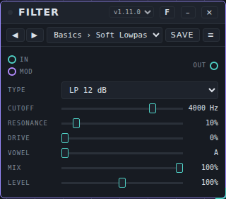
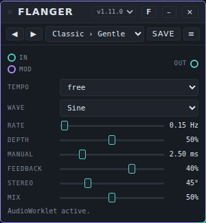
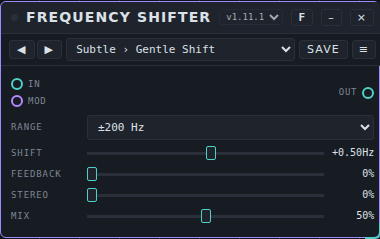
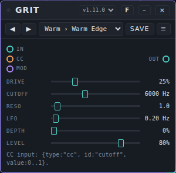
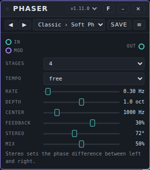
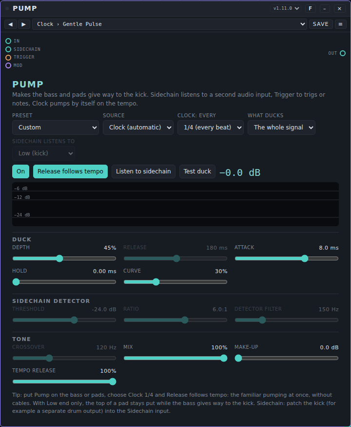
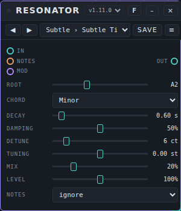
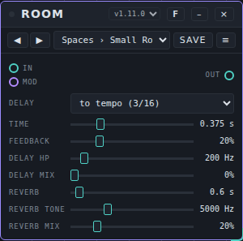
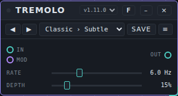
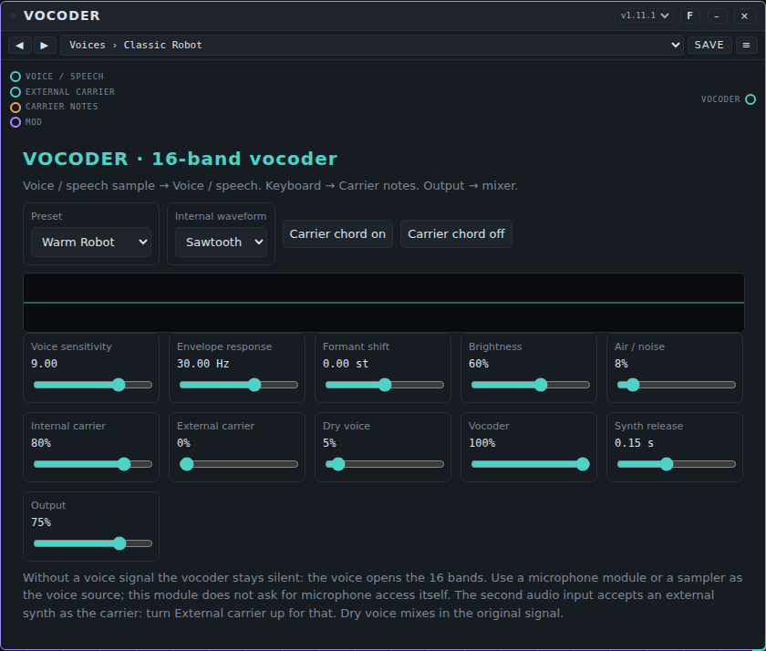

# Effects user manual

*Nederlandse versie: [USER-MANUAL_NL.md](USER-MANUAL_NL.md)*

Effects take sound in, change it and send it on. This manual describes the twelve effects in [`devices/effects/`](../../devices/effects/README.md): Chorus, Effect Chain, Filter, Flanger, Frequency Shifter, Grit, Phaser, Pump, Resonator, Room, Tremolo and Vocoder. For starting Patchkamer, loading a library and drawing cables, see the [basic manual](../USER-MANUAL_EN.md).

## Contents

1. [Which effect for which goal](#which-effect-for-which-goal)
2. [Using effects](#using-effects)
3. [The order of effects in a chain](#the-order-of-effects-in-a-chain)
4. [Chorus](#chorus)
5. [Effect Chain](#effect-chain)
6. [Filter](#filter)
7. [Flanger](#flanger)
8. [Frequency Shifter](#frequency-shifter)
9. [Grit](#grit)
10. [Phaser](#phaser)
11. [Pump](#pump)
12. [Resonator](#resonator)
13. [Room](#room)
14. [Tremolo](#tremolo)
15. [Vocoder](#vocoder)
16. [If it does not work](#if-it-does-not-work)

## Which effect for which goal

| I want to… | Use | Why |
|---|---|---|
| Thicken or widen a sound (movement) | [Chorus](#chorus), [Flanger](#flanger), [Phaser](#phaser) | Three sweeping effects with a slow movement (LFO). Chorus has an Ensemble mode with three voices. |
| Make the volume pulse | [Tremolo](#tremolo) | Rate and depth, nothing else. |
| Make a sound inharmonic or metallic | [Frequency Shifter](#frequency-shifter) | Moves all frequencies by a fixed number of Hz. This is not a change of pitch. |
| Distort and darken | [Grit](#grit) | Drive into a resonant low-pass filter, with an LFO on the cutoff. |
| Add echo and reverb | [Room](#room) | One effect with a delay and a reverb next to each other. |
| Let a sound ring on a chord | [Resonator](#resonator) | Four tuned resonators, tuned to a root note and a chord. |
| Duck bass or pads under the kick | [Pump](#pump) | Sidechain, trigger or the studio clock. |
| Shape the tone, remove or emphasize a band | [Filter](#filter) | Ten filter types, from low-pass to vowel and comb filters. |
| Make a voice talk through a synth | [Vocoder](#vocoder) | 16 bands; the voice opens them on a carrier. |
| Build a whole chain (ambient, cinematic, techno, dub, lo-fi…) | [Effect Chain](#effect-chain) | Up to 8 effects in a row from a list of 33, with ready-made chains as presets. |

## Using effects

- An effect has an audio input (**In**) and an audio output (**Out**). Put it between the sound source and the next device: for example Duofone → effect → Mixer or Speakers. For the other ways to connect a device, see the [basic manual](../USER-MANUAL_EN.md) (sections 4 and 5).
- The purple **Mod** port takes a modulator. It can move the knobs of the effect while it plays. The knob stays the base value and the modulator moves around it.
- Effects are devices **without a sound of their own**, so they have **presets**, not tunes. Choose one in the bar at the top of the card, step through them with ◀ ▶ and store your own with **Save**. See [Presets](../../presets/README.md) for the packs and how to import them: **Presets ▾** → **Import…**.
- Double-click a slider to go back to its starting value.
- A **Mix** knob blends the original (dry) and the processed (wet) sound. At 0% you only hear the original.
- Effects that sweep (Chorus, Flanger, Phaser) can run free in Hz or follow the tempo of the studio (**Tempo**); start the clock with **Start** to hear tempo-synced movement.

## The order of effects in a chain

The order matters, because every effect works on what the previous one made. A common order is:

1. **Tone cleanup** first: a filter or an equalizer that takes away what you do not need.
2. **Distortion** (Grit, or the distortion effects in Effect Chain).
3. **Movement**: Chorus, Flanger, Phaser, Tremolo.
4. **Rhythm**: Pump or a gate.
5. **Echo** and then **reverb**, so the echoes also get a room.
6. **Width** and **dynamics** (compressor, limiter) at the end.

This is a starting point, not a rule. Distortion after a reverb sounds different from distortion before it; try both. Put a **limiter** last, because a chain of many effects can get louder than its input. Effect Chain follows this order in most of its presets (see [Effect Chain](#effect-chain)).

For a few separate effects, connect them in series with cables (effect 1 **Out** to effect 2 **In**). For more than three or four, [Effect Chain](#effect-chain) does it in one card.

## Chorus

**What it is for.** Chorus doubles a sound with small, slowly moving delays. It makes a sound wider and a bit less steady. It has two types: **Chorus (2 voices)** and **Ensemble (3 voices)**, where each voice has a slow and a fast movement.

**Controls.**

- **Type:** *Ensemble (3 voices)* or *Chorus (2 voices)*.
- **Tempo:** *free* (the **Rate** knob decides) or a note length: 4 bars, 1 bar, 1/2, 1/4 or 1/8 per movement.
- **Rate** (0.03 to 8 Hz) is the speed of the movement; only used when **Tempo** is *free*.
- **Depth** is the size of the movement.
- **Delay** (3 to 30 ms) is the base delay of the voices.
- **Width** sets how far the voices are spread over left and right. At 0% every voice sits in the middle.
- **Tone** (800 to 16000 Hz) is a low-pass filter on the processed sound.
- **Mix** blends original and effect.

**Ports.** **In**, **Out**, **Mod** (six parameters: Rate, Depth, Delay, Width, Tone and Mix).

**Example.** Duofone → Chorus → Speakers. Choose the *Chorus (2 voices)* type, **Rate** 0.4 Hz, **Depth** 25%, **Delay** 14 ms, **Mix** 35%: a light doubling. For a pad choose *Ensemble (3 voices)* and a higher **Width**.

**Presets.** Pack **Chorus Basics** (12 presets) in [`presets/chorus.patchkamer-presets.json`](../../presets/chorus.patchkamer-presets.json), in the folders **Subtle** (Subtle Double, Classic Chorus, Thick Mono), **Ensemble** (String Section, Wide Pad, Dark Choir), **Movement** (Bar Shimmer, Slow Wash, Eighth Pulse), **Extreme** (Seasick, Tape Warble, Lo-fi Swarm). Load it with **Presets ▾** → **Import…** (or from a library that contains it), then choose a preset in the bar at the top of the card or step through them with ◀ ▶.

**Tips.** With **Width** at 0% every voice sits in the middle; use this when the sound must stay mono. The tone filter has a guard: if a faulty value (`NaN` or infinity) reaches the input, the filter is replaced within a fraction of a second and the sound returns.

## Effect Chain

**What it is for.** Effect Chain puts up to **8 effects** in a row in one card. Each of the 8 **slots** holds one effect that you choose from a list of **33**, with its own mix, a bypass and its own controls. Over the whole chain sit an input level, an output level, a total mix and an **analyzer**. It is built for whole chains: ambient, cinematic, techno, dub, lo-fi, glitch and more.

### Setting up the card

At the top of the card:

- **Chain** is a list of 17 built-in chains (for example *Ambient Space*, *Warm Tape*, *Techno · Rumble*; the last one is *Empty Chain*). Choosing one fills the slots. When you change anything, the name becomes *Custom chain*. These built-in chains are part of the device. The presets in the bar at the top of the card (see "Presets" below) are separate: they are complete chains for one purpose each.
- **Slots** (1 to 8) sets how many slots are visible. Hidden slots keep their effect and settings.
- **Input** and **Output** (both −12 to +12 dB) set the level into and out of the chain. **Total mix** (0 to 100%) blends the whole chain with the original sound.
- **View** chooses what the analyzer shows (see below).

Below that you see the slots from left to right (the sound runs **IN → 1 → 2 → … → OUT**). Scroll sideways to see all slots.

### Setting up a slot

Each slot is a column:

- **Effect on** / **Bypass on** is a button. With **Bypass on** the slot passes the sound through unchanged.
- **←** and **→** move the slot one place in the chain. Moving or switching an effect clears the tail of that effect (an echo or reverb that was still ringing).
- **Effect** chooses the effect. **Pass-through** leaves the slot empty. When you switch back, the effect remembers the settings it had in this slot.
- A small graph shows what the effect does: a filter curve, the shape of a reverb, the echo taps, the rhythm of a gate or the output waveform.
- **Effect mix** blends the sound before the slot (dry) and the effect (wet). Typical starting values: distortion 60 to 100%, movement 20 to 50%, echo and reverb 15 to 50%, filter or EQ 100%. Choosing **Limiter · peak** sets the slot mix to 100%.
- Under **Parameters** are the controls of the chosen effect. A list holds a choice (a room, a pattern, a note length); a slider holds a value.

### The 33 effects

**Tone and dynamics**

| Effect | What it does |
|---|---|
| Filter | Low-pass, high-pass or band-pass with **Frequency**, **Resonance** and a type choice. |
| EQ · three bands | **Low**, **Mid** and **High** (each ±12 dB) with a **Mid frequency** from 150 to 6000 Hz. |
| Compressor | **Threshold**, **Ratio**, **Attack**, **Release** and **Make-up**. |
| Limiter · peak | A sample-peak limiter with a 5 ms look-ahead. **Ceiling**, **Release** and **Input boost**. Put it last. |
| Stereo Image | Mid/side width (0 to 2×). **Mono → stereo** adds decorrelation (with **Decorrelation** as the delay time); check the result in mono as well. |

**Distortion and character**

| Effect | What it does |
|---|---|
| Warm saturation | Soft saturation with **Drive** (0 to 24 dB), **Brightness** and **Compensation**. |
| Distortion | Harder distortion with **Drive** up to 36 dB, **Brightness** and **Output**. |
| Overdrive | **Drive**, **Brightness**, **Asymmetry** and **Output**. |
| Multiband Drive | A separate **Low drive**, **Mid drive** and **High drive**. It is not a mastering crossover. |
| Digital Crush | Real bit reduction (2 to 16 bits) and sample-and-hold (400 to 48000 Hz), with **Drive**, **Glitch / jitter** and **Rate modulation**. |
| Vinyl Dust | Synthesised **Wear**, **Wow / flutter**, **Noise** and **Crackle**, with a **Speed** of 33⅓, 45 or 78 RPM. |

**Movement**

| Effect | What it does |
|---|---|
| Chorus | **Rate**, **Depth** and **Stereo width**. |
| Flanger | **Rate**, **Depth** and **Feedback** (−75% to +75%). |
| Phaser | **Rate**, **Depth** and **Mid frequency**. |
| Tremolo | **Rate** and **Depth**. |
| Auto-pan | Moves the sound between left and right with **Rate** and **Width**. |
| Auto Filter | An LFO moves a filter around the **Base frequency**: **Resonance**, **Movement** (rate), **LFO depth** (in octaves) and the **Filter type**. |
| Ring Modulator | **Carrier frequency** (0.1 to 2000 Hz) and **Depth**. |

**Rhythm** (these follow the studio clock; start the transport with **Start**)

| Effect | What it does |
|---|---|
| Pumping / Duck | Ducks the volume on the tempo, without a kick input. **Pulse** (1/16 to 1 bar), **Ducking depth** and **Recovery curve**. Set the effect mix to 100%. |
| Trance Gate | A 16-step volume pattern. **Pattern** (*Offbeat*, *Syncopated*, *Tresillo*, *Broken*), **Depth** and **Gate length**. Mix 100% for full gates. |
| Beat Stutter | Takes the last fragment of every bar and repeats it for a while. **Repeat fragment**, **Repeat per bar** and **Direction** (forward or backward). The first bar fills the buffer. |
| Tempo Delay | An echo in note values (1/16 up to 1 bar, also dotted), with **Feedback** and **Brightness**. It follows the tempo of Patchkamer. |
| Wobble Filter | A filter that moves in time with the tempo: **Filter cycle**, **Base frequency**, **Movement** (octaves) and **Resonance**. |

**Echo and space**

| Effect | What it does |
|---|---|
| Stereo delay | **Time** (0.03 to 2 s), **Feedback** and **Echo brightness**. |
| Ping-pong echo | An echo that jumps between left and right: **Time per side**, **Feedback**, **Echo brightness** and **Stereo width**. |
| Frequency Echo | Shifts the overtones by a number of Hz with every echo (not a shift in semitones): **Shift**, **Echo time**, **Feedback** and **Brightness**. |
| Reverb | A reverb with 12 rooms: *Room*, *Hall*, *Heaven*, *Studio*, *Bathroom*, *Wooden hall*, *Plate*, *Church*, *Cathedral*, *Cave*, *Tunnel* and *Frozen cloud* (the card shows the length in seconds). Also **Pre-delay** and **Reverb brightness**. The lengths are synthetic, not measured. |
| Hybrid Reverb | A parallel mix of a chosen room and an algorithmic tail (**Algorithmic share**, **Algorithmic room**, **Algorithmic tail**). |
| Shimmer Reverb | A granular octave shift (**Transposition**, **Grain size**) followed by a diffuse tail (**Room**, **Decay**). |
| Cosmos · ambient | Eight modulated delay lines with diffusion for long, dense tails: **Delay**, **Tail / feedback**, **Diffusion**, **Modulation**, **Brightness** and **Width**. |
| Granular Delay | Overlapping grains with **Transposition** (−12 to +24 st), **Grain size**, **Delay**, **Spread** and **Feedback**. |
| Freeze / Sound Cloud | Records the last moments of audio. Choose **Frozen** once sound is coming in. This is a granular time loop, not a spectral freeze. **Recording length** and **Playback speed**. |
| Harmonic Resonators | Five comb resonators tuned to a chord colour the incoming sound: **Root note (MIDI)**, **Chord** (*Open / major*, *Minor 9*, *Sus*, *Major 9*), **Decay**, **Brightness** and **Width**. |

### The Mod input

The purple **Mod** port can move the master controls (**Input**, **Output**, **Total mix**) and, for every slot that is in use, the **Effect mix** and the sliders of its effect. Each of them has a fixed name per slot position (slot 1, slot 2, …), so a modulator stays with the position, not with the effect that sits there. Choices (rooms, patterns, note lengths, freeze, chord, filter type, speed, direction) are not modulated. Modulation is not saved in a preset.

### The analyzer

**View** chooses what is shown for the output of the whole chain:

- **Spectrum · line** and **Spectrum · bars** show the frequencies from 30 Hz to 20 kHz.
- **Spectrogram** shows frequencies over time (high at the top, time to the right).
- **Waveform** shows the waveform.
- **Stereo image** shows left against right, with the correlation next to it.
- **Level meters** show peak (top) and RMS (bottom).
- **Off / less CPU** switches the analyzer and the small graphs of the slots off.

Under the picture is the **Peak** and **RMS** of the output in dBFS.

### Presets: complete chains

Pack **Effect Chain Basics** (14 presets) in [`presets/effect-chain.patchkamer-presets.json`](../../presets/effect-chain.patchkamer-presets.json), in the folders **Atmosphere** (Drifting Soundscape, Cinematic Dread, Psychedelic Trip, Dream Voice), **Studio** (Tape Slapback, Lo-Fi Tape Memory, Drum Bus Glue, Dub Chamber), **Club** (Basement Techno, Squelch Bus, Neon Nights, Trance Ascent), **Sound Design** (Glitch Lab, Industrial Warehouse). Load it with **Presets ▾** → **Import…** (or from a library that contains it), then choose a preset in the bar at the top of the card or step through them with ◀ ▶.

Each preset is a whole chain, not a single effect. They are built in the order of the section "The order of effects in a chain": tone, distortion, movement, rhythm, echo, reverb, width and a limiter. The table gives the effects in slot order, with the **Effect mix** between brackets.

| Preset | Aim | Slots in order |
|---|---|---|
| **Drifting Soundscape** (Atmosphere) | Ambient: slowly moving sound clouds without rhythm | Granular Delay (0.4) > Shimmer Reverb (0.4) > Cosmos · ambient (0.5) > Chorus (0.5) > Auto-pan (0.5) > Stereo Image (1) |
| **Cinematic Dread** (Atmosphere) | Cinematic: dark resonance, a huge room, slow movement | Warm saturation (0.4) > Harmonic Resonators (0.5) > Ring Modulator (0.2) > Frequency Echo (0.4) > Phaser (0.3) > Reverb (0.5) > Stereo Image (1) > Limiter · peak (1) |
| **Psychedelic Trip** (Atmosphere) | Psychedelic: swirling movement and echoes | Phaser (0.6) > Flanger (0.4) > Tremolo (0.4) > Frequency Echo (0.35) > Cosmos · ambient (0.35) > Auto-pan (0.5) |
| **Dream Voice** (Atmosphere) | A vocal space: smoothed voice with shine | Compressor (1) > EQ · three bands (1) > Chorus (0.2) > Ping-pong echo (0.2) > Reverb (0.25) > Shimmer Reverb (0.15) > Stereo Image (1) |
| **Tape Slapback** (Studio) | Minimal: a short, warm slapback echo for a guitar or a voice | Warm saturation (0.5) > Ping-pong echo (0.3) > Filter (1) > Reverb (0.18) |
| **Lo-Fi Tape Memory** (Studio) | Lo-fi: an old cassette feel with dust, wow and flutter | Digital Crush (0.4) > Vinyl Dust (1) > Filter (1) > Chorus (0.25) > Reverb (0.2) |
| **Drum Bus Glue** (Studio) | A drum bus: glue, thickness, a little room | Compressor (1) > Warm saturation (0.5) > Multiband Drive (0.4) > Hybrid Reverb (0.12) > Limiter · peak (1) |
| **Dub Chamber** (Studio) | Dub: tape-like saturation, rolling echoes, a bouncing room | Warm saturation (0.6) > Tempo Delay (0.45) > Ping-pong echo (0.3) > Auto Filter (0.6) > Reverb (0.25) > Compressor (1) |
| **Basement Techno** (Club) | Techno: dark and gritty, tight bass, big concrete room | Filter (1) > Warm saturation (0.6) > Pumping / Duck (1) > Tempo Delay (0.25) > Reverb (0.3) > Multiband Drive (0.5) > EQ · three bands (1) |
| **Squelch Bus** (Club) | A bus for an acid bass: screaming distortion with movement | Distortion (0.9) > Filter (1) > Wobble Filter (1) > Phaser (0.35) > Tempo Delay (0.2) > EQ · three bands (1) |
| **Neon Nights** (Club) | Synthwave: wide chorus, overdrive, dotted echoes, a glossy reverb | Chorus (0.5) > Overdrive (0.5) > Tempo Delay (0.3) > Shimmer Reverb (0.2) > Reverb (0.3) |
| **Trance Ascent** (Club) | Trance: gate, rising filter, echoes, a wide reverb | Trance Gate (0.9) > Auto Filter (0.8) > Pumping / Duck (1) > Tempo Delay (0.3) > Shimmer Reverb (0.2) > Reverb (0.3) > Stereo Image (1) |
| **Glitch Lab** (Sound Design) | Glitch and sound design: stutter, bit crushing, frequency echoes | Beat Stutter (1) > Digital Crush (0.5) > Frequency Echo (0.35) > Ping-pong echo (0.25) |
| **Industrial Warehouse** (Sound Design) | Industrial: hard distortion in an enormous room | EQ · three bands (1) > Overdrive (1) > Distortion (0.8) > Multiband Drive (0.6) > Ring Modulator (0.3) > Reverb (0.4) > Frequency Echo (0.35) > Limiter · peak (1) |

*This pack can still change; the table above lists what was in the file when this manual was written.* The settings of every slot (time, feedback, drive and so on) are in the preset itself; load it and look at the cards.

### Tips and limits

- Many effects (those with their own sound processing) run in the main thread of your browser through a ScriptProcessor, with a short extra delay. On a slow computer, use fewer of those slots.
- Rhythm effects need the clock: press **Start**.
- A chain of many effects can get louder than the input. Use **Input**, **Output**, **Total mix** and the make-up and output knobs, and close the chain with a **Limiter · peak** (all mixes at 100%, **Output** at 0 dB).
- Reverb and echo keep ringing when the clock stops.
- A guard watches the output of every slot every 50 ms. If a slot returns something that is not a number (or absurdly loud), the slot is rebuilt and the tail of that effect is lost; the sound then continues.

## Filter

**What it is for.** A filter takes frequencies away or emphasizes them. This one has ten types, a drive before the filter, a mix and an output level.

**Controls.**

- **Type:** *LP 12 dB*, *LP 24 dB* (low-pass), *HP 12 dB*, *HP 24 dB* (high-pass), *Band*, *Notch*, *Vowel*, *Ladder 24 dB (worklet)*, *Comb + (worklet)* and *Comb − (worklet)*. *Vowel* gives you the vowels A, E, I, O and U with three formants. The *Ladder* and the two comb filters need AudioWorklet; the card says so under the controls.
- **Cutoff** (20 to 20000 Hz) is where the filter works. For *Vowel* it shifts the vowels; for the comb filters it sets the pitch.
- **Resonance** emphasizes the area around the cutoff.
- **Drive** distorts before the filter.
- **Vowel** (A to U, in between the vowels blend) is only used for *Vowel*.
- **Mix** blends original and filtered sound.
- **Level** (0 to 200%) sets the output level of the filtered sound.

**Ports.** **In**, **Out**, **Mod**. The modulator moves **Cutoff** sample by sample (fast), and also **Resonance**, **Drive**, **Vowel** and **Mix**.

**Example.** Duofone → Filter → Speakers. Choose *LP 24 dB*, **Cutoff** 1200 Hz, **Resonance** 30%. Patch a modulator on **Mod** to open and close the filter.

**Presets.** Pack **Filter Basics** (14 presets) in [`presets/filter.patchkamer-presets.json`](../../presets/filter.patchkamer-presets.json), in the folders **Basics** (Soft Lowpass, Warm Lowpass, Tight Highpass, Telephone, Notch Scoop), **Movement** (Wah Stop, Vowel Choir, Talking Mouth, Comb Pipe, Hollow Comb), **Aggressive** (Ladder Squelch, Screaming Resonance, Fuzz Wall, Razor Comb). Load it with **Presets ▾** → **Import…** (or from a library that contains it), then choose a preset in the bar at the top of the card or step through them with ◀ ▶.

**Tips.** Without AudioWorklet in your browser, the three worklet types pass the sound through unchanged and the card says so. A faulty value on the input does not poison the filter any more: the ladder and comb filters limit it, the other types are watched and replaced.

## Flanger

**What it is for.** A flanger mixes a sound with a very short, moving delay. With feedback it makes a sweeping, hollow movement.

**Controls.**

- **Tempo:** *free* or a note length (8 bars up to 1/4).
- **Wave:** *Sine* or *Triangle*, the shape of the movement.
- **Rate** (0.02 to 10 Hz) is the speed; only used when **Tempo** is *free*.
- **Depth** is the size of the movement.
- **Manual** (0.2 to 12 ms) is the base delay: the place around which the sweep moves.
- **Feedback** (−97% to +97%) feeds the output back in. Negative values change the character.
- **Stereo** is the phase difference between left and right (0° to 180°).
- **Mix** blends original and effect.

**Ports.** **In**, **Out**, **Mod** (six parameters; **Manual** is fast).

**Example.** Duofone → Flanger → Speakers. **Rate** 0.15 Hz, **Depth** 70%, **Manual** 2.5 ms, **Feedback** 60%, **Mix** 50%: a slow sweep.

**Presets.** Pack **Flanger Basics** (12 presets) in [`presets/flanger.patchkamer-presets.json`](../../presets/flanger.patchkamer-presets.json), in the folders **Classic** (Gentle Flange, Jet Sweep, Slow Tide, Metal Sweep), **Subtle** (Stereo Shimmer, Soft Doubler), **Tempo** (Bar Sweep, Two-Bar Rise), **Extreme** (Metallic Scream, Laser Drop, Comb Drone, Wild Wobble). Load it with **Presets ▾** → **Import…** (or from a library that contains it), then choose a preset in the bar at the top of the card or step through them with ◀ ▶.

**Tips.** Without AudioWorklet the flanger passes the sound through unchanged and says so under the controls.

## Frequency Shifter

**What it is for.** A frequency shifter moves all frequencies by a fixed number of Hz. This is not a change of pitch: the overtones lose their relation and the result is not harmonic. Small shifts give a slow beating; large shifts give a metallic, alien sound.

**Controls.**

- **Range:** *±20 Hz (beating)*, *±200 Hz* or *±2000 Hz (inharmonic)*. This is the largest shift the **Shift** knob can reach.
- **Shift** moves the frequencies. The knob is curved: small values near the middle make small steps. The card shows the shift in Hz.
- **Feedback** (0 to 95%) feeds the result back in. It makes spiral effects.
- **Stereo** moves the right channel the other way. Above 50% the card says *right reversed*.
- **Mix** blends original and effect.

**Ports.** **In**, **Out**, **Mod** (**Shift** is fast, sample by sample).

**Example.** Duofone → Frequency Shifter → Speakers. **Range** ±20 Hz, **Shift** a small positive value, **Mix** 50%: a slow beating. With **Range** ±2000 Hz and some **Feedback** the sound becomes inharmonic.

**Presets.** Pack **Frequency Shifter Basics** (13 presets) in [`presets/frequency-shifter.patchkamer-presets.json`](../../presets/frequency-shifter.patchkamer-presets.json), in the folders **Subtle** (Gentle Shift, Slow Beat, Stereo Drift, Thick Detune), **Inharmonic** (Metal Shimmer, Bell Warp, Robot Voice, Broken Radio, Alien Down), **Feedback** (Rising Spiral, Falling Spiral, Barber Chaos, Endless Fall). Load it with **Presets ▾** → **Import…** (or from a library that contains it), then choose a preset in the bar at the top of the card or step through them with ◀ ▶.

**Tips.** Without AudioWorklet the device passes the sound through unchanged and says so. The dry signal is delayed by 63 samples, so it lines up with the processed one.

## Grit

**What it is for.** Grit distorts a sound and runs it through a resonant low-pass filter, with an LFO on the cutoff. It makes a source rougher and darker.

**Controls.**

- **Drive** is how much the input is distorted.
- **Cutoff** (100 to 16000 Hz) is the corner of the low-pass filter.
- **Reso** (0.3 to 18) is the resonance of the filter.
- **LFO** (0.02 to 8 Hz) is the speed of the movement on the cutoff.
- **Depth** is the size of that movement. At 0% the cutoff stands still.
- **Level** is the output level.

Grit has no **Mix** knob: the whole signal goes through the distortion and the filter.

**Ports.** **In**, **Out**, **CC** (an event input that sets the cutoff: `{type:"cc", id:"cutoff", value:0..1}` goes from 100 to 16000 Hz) and **Mod** (all six controls).

**Example.** A bass synth → Grit → Speakers. **Drive** 60%, **Cutoff** 1200 Hz, **Reso** 6; set **LFO** to 2 Hz and **Depth** to 30% for a wobble.

**Presets.** Pack **Grit Basics** (12 presets) in [`presets/grit.patchkamer-presets.json`](../../presets/grit.patchkamer-presets.json), in the folders **Warm** (Warm Edge, Dull Blanket, Fuzz Bass), **Motion** (Slow Sweep, Wah Pulse, Underwater, Helicopter), **Extreme** (Bright Razor, Acid Bite, Screamer, Siren, Meltdown). Load it with **Presets ▾** → **Import…** (or from a library that contains it), then choose a preset in the bar at the top of the card or step through them with ◀ ▶.

**Tips.** A small guard limits the input to +24 dB and replaces a filter that has gone off course. Grit also works without AudioWorklet; only the input guard is then missing.

## Phaser

**What it is for.** A phaser sweeps a series of notches through the sound with a slow movement. It adds a swirling, passing character.

**Controls.**

- **Stages:** 4, 6, 8 or 12. More stages give more notches.
- **Tempo:** *free* or a note length (8 bars up to 1/8).
- **Rate** (0.02 to 10 Hz); only used when **Tempo** is *free*.
- **Depth** is shown in octaves: how far the sweep moves around **Center**.
- **Center** (100 to 6000 Hz) is the middle of the sweep.
- **Feedback** (−95% to +95%) feeds the output back in; negative values have another character.
- **Stereo** is the phase difference between left and right (0° to 180°).
- **Mix** blends original and effect.

**Ports.** **In**, **Out**, **Mod** (six parameters).

**Example.** Duofone → Phaser → Speakers. **Stages** 6, **Rate** 0.25 Hz, **Depth** 70%, **Center** 800 Hz, **Feedback** 50%, **Mix** 50%.

**Presets.** Pack **Phaser Basics** (11 presets) in [`presets/phaser.patchkamer-presets.json`](../../presets/phaser.patchkamer-presets.json), in the folders **Classic** (Soft Phase, Slow Sweep, Swirl, Hollow Notch), **Tempo** (Bar Phase, Long Rise, Stereo Drift), **Extreme** (Rocket, Warp Drive, Wobble Robot, Wide Vortex). Load it with **Presets ▾** → **Import…** (or from a library that contains it), then choose a preset in the bar at the top of the card or step through them with ◀ ▶.

**Tips.** The card reminds you that **Stereo** sets the phase difference between left and right. A guard rebuilds the filter chains if a faulty value would poison the feedback; the sound is unchanged in normal use.

## Pump

**What it is for.** Pump lowers the volume of a source on the beat, so bass and pads make room for the kick. It does this in three ways: **Sidechain** listens to a second audio input (such as a kick), **Trigger** reacts to trigs or notes, and **Clock** ducks by itself on the tempo, without a cable. Do not confuse it with the **Pumping / Duck** effect in [Effect Chain](#effect-chain): that is a separate, simpler effect of that device.

**Controls.**

At the top:

- **Preset** is a list of starting settings inside the device (*Classic pump*, *Low end only*, *Kick as sidechain*, *Soft breathing*, *Gated (1/16)*, *Trigger from sequencer*, *Parallel (subtle)*). It changes to *Custom* when you change something. This is not the same list as the presets in the bar at the top of the card.
- **Source:** *Sidechain (audio)*, *Trigger (events)* or *Clock (automatic)*.
- **Clock: every:** 1/16, 1/8, 1/4 (every beat), 1/2 or whole bar. Only used for *Clock*.
- **What ducks:** *The whole signal*, *Low end only* or *High end only*.
- **Sidechain listens to:** *Low (kick)*, *Everything* or *High (hats)*. Only used for *Sidechain*.
- **On** / **Off (pass through)**, **Release follows tempo**, **Listen to sidechain** (hear what the detector hears, to set the detector filter) and **Test duck** (one duck to try the settings).
- A meter shows the gain reduction over time, with the number in dB next to the buttons.

**Duck:** **Depth** (how far the signal goes down), **Release** (20 to 1500 ms, how fast it comes back), **Attack** (0.1 to 60 ms), **Hold** (0 to 300 ms; Trigger and Clock) and **Curve** (0 = straight back, 1 = late and fast back, a tight pump).

**Sidechain detector** (only with *Sidechain*): **Threshold** (−60 to 0 dB), **Ratio** (1 to 20) and **Detector filter** (40 to 8000 Hz).

**Tone:** **Crossover** (40 to 1000 Hz, the split between low and high; only when *What ducks* is not *The whole signal*), **Mix** (parallel: the share of the ducked signal), **Make-up** (0 to 12 dB) and **Tempo release** (the share of the distance to the next beat, when **Release follows tempo** is on).

The card hides the controls that do not apply to the chosen source.

**Ports.** **In**, **Sidechain** (audio), **Out**, **Trigger** (events: trig, note) and **Mod**.

**Example.** Put Pump after a bass synth. Choose **Source** *Clock (automatic)*, **Clock: every** *1/4 (every beat)* and switch **Release follows tempo** on; start the clock: the bass ducks on every beat, without cables. For a sidechain, patch the kick (for example a separate drum output) into **Sidechain** and choose **Source** *Sidechain (audio)*.

**Presets.** Pack **Pump Basics** (13 presets) in [`presets/pump.patchkamer-presets.json`](../../presets/pump.patchkamer-presets.json), in the folders **Clock** (Gentle Pulse, Four on the Floor, Eighth Chop, Sixteenth Gate, Half Time Slam, Bar Breath), **Sidechain** (Kick Duck, Vocal Space, Hat Tickle), **Split and Mix** (Low Duck, Top Duck, Parallel Pump, Note Duck). Load it with **Presets ▾** → **Import…** (or from a library that contains it), then choose a preset in the bar at the top of the card or step through them with ◀ ▶.

**Tips.** With **What ducks** on *Low end only*, the top of a pad stays while the bass gives way to the kick. The worklet limits its inputs to +24 dB and needs AudioWorklet; without it the sound passes through unchanged and the card says so.

## Resonator

**What it is for.** The resonator turns a rhythm or noise into a ringing, tuned sound. It has a bank of four resonators that you tune to a root note and a chord.

**Controls.**

- **Root** (a note from 24 to 84, the card shows the name) and **Chord**: *Unison*, *Octaves*, *Fifths*, *Major*, *Minor*, *Sus4*, *Minor 7*, *Fourths* or *Cluster*.
- **Decay** (0.05 to 8 s) is how long the resonators ring.
- **Damping** takes the high end out of the ringing.
- **Detune** (0 to 50 cents) spreads the four resonators slightly apart.
- **Tuning** (−12 to +12 semitones) moves the whole bank.
- **Mix** blends original and effect. **Level** (0 to 200%) is the output level.
- **Notes:** *ignore* or *root follows the notes*. With the second choice, notes that arrive on the **Notes** port set the root.

**Ports.** **In**, **Notes** (events), **Out**, **Mod**.

**Example.** A drum machine → Resonator → Speakers. **Chord** *Minor*, **Decay** 0.6 s, **Mix** 20%: a tuned tint on the drums. To let a keyboard decide the pitch: patch Keys → **Notes** and choose *root follows the notes*.

**Presets.** Pack **Resonator Basics** (13 presets) in [`presets/resonator.patchkamer-presets.json`](../../presets/resonator.patchkamer-presets.json), in the folders **Subtle** (Subtle Tint, Drum Tuner, Sub Ring, Marimba Hit), **Chords** (Minor Haze, Major Shine, Sus Cloud, Jazz Seven, Open Fourths, Note Follower), **Extreme** (Metal Drone, Endless Bells, Scream Pipes). Load it with **Presets ▾** → **Import…** (or from a library that contains it), then choose a preset in the bar at the top of the card or step through them with ◀ ▶.

**Tips.** Resonator needs AudioWorklet; without it the sound passes through unchanged and the card says so. The device keeps the last played root (in `noteRoot`) when you save a preset.

## Room

**What it is for.** Room puts a delay and a reverb in one effect. The delay and the reverb both take the input; they do not feed each other.

**Controls.**

- **Delay:** *to tempo (3/16)* or *free*. In the first case the echo time is three sixteenth steps of the studio clock.
- **Time** (0.05 to 1.5 s) is the echo time, only for *free*.
- **Feedback** (0 to 92%) is how long the echoes repeat.
- **Delay HP** (40 to 2000 Hz) is a high-pass filter in the echoes, so they do not get muddy.
- **Delay mix** is how much echo you hear.
- **Reverb** (0.3 to 8 s) is the length of the reverb.
- **Reverb tone** (500 to 16000 Hz) is a low-pass filter on the reverb.
- **Reverb mix** is how much reverb you hear.

**Ports.** **In**, **Out**, **Mod** (six parameters, in two lanes: delay and reverb).

**Example.** Duofone → Room → Speakers. Keep **Delay** on *to tempo (3/16)*, **Feedback** 35%, **Delay mix** 25%, **Reverb** 3 s and **Reverb mix** 25%.

**Presets.** Pack **Room Basics** (12 presets) in [`presets/room.patchkamer-presets.json`](../../presets/room.patchkamer-presets.json), in the folders **Spaces** (Small Room, Warm Hall, Bright Plate, Cathedral), **Delays** (Dotted Echo, Slapback, Long Ping, Dub Echo), **Space FX** (Endless Wash, Dark Void, Bright Cloud, Metal Tunnel). Load it with **Presets ▾** → **Import…** (or from a library that contains it), then choose a preset in the bar at the top of the card or step through them with ◀ ▶.

**Tips.** The reverb tail is generated from noise when you change **Reverb**, so it differs a little each time. The packs keep **Feedback** below 75%. A guard lowers the feedback for a moment if the echo loop starts to grow, and rebuilds the loop if it gets a faulty value.

## Tremolo

**What it is for.** Tremolo makes the volume go up and down at a steady speed. It has two knobs.

**Controls.**

- **Rate** (0.1 to 20 Hz) is the speed.
- **Depth** (0 to 100%) is how far the volume goes down. At 100% the sound goes fully silent at the bottom of every movement.

**Ports.** **In**, **Out**, **Mod** (**Rate** and **Depth**).

**Example.** A pad → Tremolo → Speakers. **Rate** 6 Hz, **Depth** 15% is a light shimmer; **Rate** 4 Hz, **Depth** 50% a clear pulse.

**Presets.** Pack **Tremolo Basics** (13 presets) in [`presets/tremolo.patchkamer-presets.json`](../../presets/tremolo.patchkamer-presets.json), in the folders **Classic** (Subtle Shimmer, Gentle Pulse, Vintage Amp, Deep Throb), **Slow** (Slow Swell, Tidal, Deep Breath), **Rhythmic** (Slow Pump, Eighth Chop, Sixteenth Gate), **Extreme** (Helicopter, Ring Buzz, Seasick Wobble). Load it with **Presets ▾** → **Import…** (or from a library that contains it), then choose a preset in the bar at the top of the card or step through them with ◀ ▶.

**Tips.** Tremolo only changes the volume. There is no tempo setting: the rate is always in Hz.

## Vocoder

**What it is for.** The Vocoder makes a voice (or another sound) play a synth. The voice opens 16 frequency bands on a **carrier**: the built-in synth (sawtooth, pulse or triangle, played with notes), noise, or an external synth on the second audio input. The result is the classic talking synth.

**Controls.**

At the top:

- **Preset** is a list of starting settings inside the device (*Warm Robot*, *Whisper Choir*, *Hard Machine*, *Ghost Choir*, *Subtle Voice*, *External Synth*). This is not the same list as the presets in the bar at the top of the card.
- **Internal waveform:** *Sawtooth*, *Pulse* or *Triangle*.
- **Carrier chord on** plays a fixed chord (C, G, C, E♭) on the built-in synth; **Carrier chord off** stops it.
- A scope shows the waveform of the output.

Sliders: **Voice sensitivity** (how strongly the voice opens the bands), **Envelope response** (5 to 80 Hz, how fast the bands follow the voice), **Formant shift** (±12 semitones), **Brightness**, **Air / noise** (noise in the carrier), **Internal carrier**, **External carrier**, **Dry voice** (the original voice mixed in), **Vocoder** (the level of the vocoded sound), **Synth release** (0.02 to 3 s) and **Output**.

**Ports.** **Voice / speech** (audio: the voice), **External carrier** (audio: an external synth), **Carrier notes** (events: notes for the built-in synth), **Vocoder** (audio out) and **Mod**.

**Example.** Patch a sound source with speech into **Voice / speech**, a keyboard (Keys) into **Carrier notes** and **Vocoder** to the mixer. Play notes: the built-in synth speaks with the rhythm of the voice. For an external synth: patch its audio into **External carrier**, set **External carrier** to 100% and **Internal carrier** to 0%.

**Presets.** Pack **Vocoder Basics** (14 presets) in [`presets/vocoder.patchkamer-presets.json`](../../presets/vocoder.patchkamer-presets.json), in the folders **Voices** (Classic Robot, Warm Pad Voice, Soft Choir, Voice Doubler), **Textures** (Whisper, Breathy Pad, Ghost Choir, Deep Giant), **Extreme** (Steel Machine, Tiny Alien, Screamer, Gate Chatter), **External** (External Clean, External Edge). Load it with **Presets ▾** → **Import…** (or from a library that contains it), then choose a preset in the bar at the top of the card or step through them with ◀ ▶.

**Tips.** Without a signal on the voice input the vocoder stays silent. The Vocoder does not ask for microphone access itself; use another device or sample as the source. All 16 bands run on standard Web Audio nodes (no worklet). A guard replaces the bands if a faulty value (`NaN` or infinity), especially on the external carrier, would poison them.

## If it does not work

- **No sound.** Check the cables: audio from the source into **In** (for Vocoder into **Voice / speech**) and from **Out** to the Mixer or Speakers. Press **Start**, or click anywhere in Patchkamer: browsers pause audio until you interact. See also section 13 of the [basic manual](../USER-MANUAL_EN.md).
- **The effect does nothing.** Check **Mix** (at 0% you hear only the original), the slot in Effect Chain (**Bypass on**, or **Pass-through**, or **Effect mix** at 0%) and **Depth** (at 0% a sweeping effect does not move).
- **The effect passes the sound through unchanged.** Flanger, Frequency Shifter, Pump, Resonator and three filter types (ladder and the two comb filters) need AudioWorklet. If your browser has none, the card says so. Use a current Chrome or Edge.
- **Tempo-synced movement stands still.** Press **Start**: the tempo options follow the studio clock. Pump set to *Clock* and the rhythm effects in Effect Chain need it too.
- **Pump does not duck.** *Sidechain* needs a signal on the **Sidechain** port (and it must pass the **Threshold**); *Trigger* needs trigs or notes on **Trigger**; *Clock* needs the clock to run.
- **Resonator does not follow the notes.** Choose *root follows the notes* under **Notes** and patch notes into **Notes**.
- **Crackles or dropouts.** Effect Chain runs many effects in the main thread: use fewer slots, or switch the analyzer to *Off / less CPU*. See also Settings → Audio in the [basic manual](../USER-MANUAL_EN.md).
- **A knob does not move with the modulator.** The knob is the base value. Check the cable (purple) into **Mod** and that the modulator has a lane for this effect. Choices (lists) are not modulated.
