# Effects user manual

*Nederlandse versie: [USER-MANUAL_NL.md](USER-MANUAL_NL.md)*

Effects take sound in, change it and send it on. This manual describes the 23 effects in [`devices/effects/`](../../devices/effects/README.md): Bitcrusher, Chorus, Compressor, Convolution Reverb, De-esser, Delay, Distortion, Effect Chain, Filter, Flanger, Frequency Shifter, Gate, Grit, Harmonizer, Phaser, Pitch Correction, Pitch Shifter, Pump, Resonator, Reverb, Room, Tremolo and Vocoder. For starting Patchkamer, loading a library and drawing cables, see the [basic manual](../USER-MANUAL_EN.md).

## Contents

1. [Which effect for which goal](#which-effect-for-which-goal)
2. [Using effects](#using-effects)
3. [The order of effects in a chain](#the-order-of-effects-in-a-chain)
4. [Serial and parallel](#serial-and-parallel)
5. [Recipes per music style](#recipes-per-music-style)
6. [Bitcrusher](#bitcrusher)
7. [Chorus](#chorus)
8. [Compressor](#compressor)
9. [Convolution Reverb](#convolution-reverb)
10. [De-esser](#de-esser)
11. [Delay](#delay)
12. [Distortion](#distortion)
13. [Effect Chain](#effect-chain)
14. [Filter](#filter)
15. [Flanger](#flanger)
16. [Frequency Shifter](#frequency-shifter)
17. [Gate](#gate)
18. [Grit](#grit)
19. [Harmonizer](#harmonizer)
20. [Phaser](#phaser)
21. [Pitch Correction](#pitch-correction)
22. [Pitch Shifter](#pitch-shifter)
23. [Pump](#pump)
24. [Resonator](#resonator)
25. [Reverb](#reverb)
26. [Room](#room)
27. [Tremolo](#tremolo)
28. [Vocoder](#vocoder)
29. [If it does not work](#if-it-does-not-work)

## Which effect for which goal

| I want to… | Use | Why |
|---|---|---|
| Thicken or widen a sound (movement) | [Chorus](#chorus), [Flanger](#flanger), [Phaser](#phaser) | Three sweeping effects with a slow movement (LFO). Chorus has an Ensemble mode with three voices. |
| Make the volume pulse | [Tremolo](#tremolo) | Rate and depth, nothing else. |
| Make a sound inharmonic or metallic | [Frequency Shifter](#frequency-shifter) | Moves all frequencies by a fixed number of Hz. This is not a change of pitch. |
| Distort and darken | [Grit](#grit) | Drive into a resonant low-pass filter, with an LFO on the cutoff. |
| Add echo and reverb | [Room](#room) | One effect with a delay and a reverb next to each other. |
| Let a sound ring on a chord | [Resonator](#resonator) | Four tuned resonators, tuned to a root note and a chord. |
| Duck bass or pads under the kick | [Pump](#pump) | Sidechain, trigger or the studio clock. |
| Shape the tone, remove or emphasize a band | [Filter](#filter) | Ten filter types, from low-pass to vowel and comb filters. |
| Make a voice talk through a synth | [Vocoder](#vocoder) | 16 bands; the voice opens them on a carrier. |
| Build a whole chain (ambient, cinematic, techno, dub, lo-fi…) | [Effect Chain](#effect-chain) | Up to 8 effects in a row from a list of 33, with ready-made chains as presets. |
| Make a sound lo-fi, 8-bit or digitally broken | [Bitcrusher](#bitcrusher) | Lowers bit depth and sample rate; aliasing, dither and noise are choices. Also good for telephone and radio sounds. |
| Even out the loud and soft parts of a voice, bass or mix | [Compressor](#compressor) | Threshold, ratio, knee, attack and release; automatic release and make-up; peak or RMS; lookahead; parallel mix; sidechain filter; mid/side. |
| Put a sound in a specific space or device (church, cave, steel plate, spring, tube) or in your own impulse response | [Convolution Reverb](#convolution-reverb) | 15 built-in impulse responses and your own files, with trim, stretch and early/tail balance. |
| Tame harsh s sounds in a voice | [De-esser](#de-esser) | Reduces only the band where the s sits (or everything), with listening to the band; also tames bright cymbals and strings. |
| Add echoes locked to the tempo (dotted eighth, triplets, swing) or free in milliseconds | [Delay](#delay) | Sync from 1/64 to 2 bars or free time; ping-pong, filters in the loop, ducking, tape wow and reverse echoes. |
| Add warmth, crunch, fuzz or heavy distortion | [Distortion](#distortion) | Eight characters with oversampling, tone controls and a dry/wet mix for parallel saturation. |
| Remove noise, hum or spill between notes | [Gate](#gate) | A gate or soft expander with hold, hysteresis and lookahead; also ducks a track under a voice. |
| Add harmony voices to a vocal or melody | [Harmonizer](#harmonizer) | Up to four voices at fixed intervals or in a scale, following the pitch of the input or the notes on the event input. |
| Tune an out-of-tune voice or line to a scale | [Pitch Correction](#pitch-correction) | Monophonic detection, twelve note switches, retune speed from hard to slow, vibrato kept or flattened. |
| Shift the pitch of a sound up or down without changing its tempo | [Pitch Shifter](#pitch-shifter) | Three engines: percussive for drums, grain for voices and instruments, vocoder when formants matter. Also octave layers and shimmer. |
| Add a believable space to a vocal, drums, strings or a pad (hall, plate, spring, room) | [Reverb](#reverb) | Five reverb models with decay, damping, pre-delay, ducking and freeze. |

## Using effects

- An effect has an audio input (**In**) and an audio output (**Out**). Put it between the sound source and the next device: for example Duofone → effect → Mixer or Speakers. For the other ways to connect a device, see the [basic manual](../USER-MANUAL_EN.md) (sections 4 and 5).
- The purple **Mod** port takes a modulator. It can move the knobs of the effect while it plays. The knob stays the base value and the modulator moves around it.
- Effects are devices **without a sound of their own**, so they have **presets**, not tunes. Choose one in the bar at the top of the card, step through them with ◀ ▶ and store your own with **Save**. See [Presets](../../presets/README.md) for the packs and how to import them: the **Presets** tab of the library → **Import…**.
- Double-click a slider to go back to its starting value.
- A **Mix** knob blends the original (dry) and the processed (wet) sound. At 0% you only hear the original.
- Effects that sweep (Chorus, Flanger, Phaser) can run free in Hz or follow the tempo of the studio (**Tempo**); start the clock with **Start** to hear tempo-synced movement.

## The order of effects in a chain

The order matters, because every effect works on what the previous one made. A common order, from source to output:

1. **Clean up** first: a [Filter](#filter) set as a high-pass takes away rumble that the next effects would otherwise react to.
2. **Dynamics**: a [Gate](#gate) to remove noise between phrases, then a [Compressor](#compressor); a [De-esser](#de-esser) on a voice goes after the compressor, because compression makes the hiss louder.
3. **Tone**: shape the sound again with a Filter once the level is steady.
4. **Pitch**: [Pitch Shifter](#pitch-shifter), [Harmonizer](#harmonizer) or [Pitch Correction](#pitch-correction) work best on a clean, dry sound, so before the effects that smear it.
5. **Character**: [Distortion](#distortion), [Grit](#grit) or [Bitcrusher](#bitcrusher). Saturation adds weight to thin sounds; a little distortion helps an instrument cut through a busy mix.
6. **Movement**: [Chorus](#chorus), [Flanger](#flanger), [Phaser](#phaser), [Tremolo](#tremolo).
7. **Rhythm**: [Pump](#pump), or the trance gate in [Effect Chain](#effect-chain).
8. **Echo** ([Delay](#delay)), then **space** ([Reverb](#reverb), [Room](#room) or [Convolution Reverb](#convolution-reverb)), so the echoes also get a room. Time-based effects are often best on a send (see [Serial and parallel](#serial-and-parallel)).
9. **Width** and a **limiter** at the end, because a chain of many effects can get louder than its input.

This is a starting point, not a rule. Distortion after a reverb sounds different from distortion before it; try both. [Effect Chain](#effect-chain) follows this order in most of its presets.

For a few separate effects, connect them in series with cables (effect 1 **Out** to effect 2 **In**). For more than three or four, [Effect Chain](#effect-chain) does it in one card.

## Serial and parallel

- **Serial** means one effect after the other, as above: each effect processes the output of the previous one.
- **Parallel** means you blend the original (dry) sound with a heavily processed copy. That lets you process hard without losing the character of the original. In Patchkamer you do it in three ways:
  - With the **Mix** knob of the effect itself. [Compressor](#compressor) has a parallel mix for parallel compression (a strongly squeezed copy under the original); [Distortion](#distortion) has one for parallel saturation.
  - With a **send and return on the Mixer**: send a part of a channel to one effect, and bring the effect back on a return channel. One Delay or Reverb can then serve many channels. Set the effect itself to 100% wet in this case.
  - With cables: split the output of a source to two cables, one to the effect and one to a Mixer channel.
- Use parallel for reverb, delay and heavy compression or distortion; use serial for cleaning up, shaping and everything that should change the sound completely.

## Recipes per music style

These are starting points. Every effect has presets in the preset bar of its card; start there and adjust.

| Style | Idea | Effects |
|---|---|---|
| Hip-hop, 808 bass | Add mid harmonics so the bass is audible on small speakers, and duck the bass under the kick | [Distortion](#distortion) (soft or tape type, mix to taste), [Pump](#pump) or [Compressor](#compressor) with an external sidechain |
| EDM, build-ups and drops | Filter sweeps for tension, a delay on the beat, a wide space | [Filter](#filter) with a modulator on the cutoff, [Delay](#delay) synced to the beat, [Reverb](#reverb) on a send |
| Rock, drums and guitar | Drum room energy and slapback on guitar or voice | [Compressor](#compressor) in parallel on the drum bus, [Delay](#delay) with a short sync or free time (40 to 120 ms), [Reverb](#reverb) in the spring model |
| Voice | Even level, no harsh s sounds, space around it | [Gate](#gate), [Compressor](#compressor), [De-esser](#de-esser), then [Reverb](#reverb) (plate) on a send |
| Lo-fi | Crunch, narrow band, a little movement | [Bitcrusher](#bitcrusher), [Filter](#filter) as a low-pass, [Tremolo](#tremolo) or [Chorus](#chorus) |
| Ambient and cinematic | Long spaces, evolving echoes | [Reverb](#reverb) in the hall model or [Convolution Reverb](#convolution-reverb), [Delay](#delay) with a long feedback and modulation |
| Dub | Echoes that fade into the room | [Delay](#delay) with the tape time change and a low-pass in the loop, [Reverb](#reverb) |
| Harmonies and vocals | Add voices in the scale, correct the pitch | [Harmonizer](#harmonizer), [Pitch Correction](#pitch-correction) |

## Bitcrusher

**What it is for.** Bitcrusher makes a sound digitally rough in two ways: it lowers the **bit depth** (fewer volume steps, so quantisation noise) and the **sample rate** (fewer snapshots per second, so aliasing). Both are independent, and the things that usually happen in the background (anti-alias filter, dither, noise) are controls you can choose.

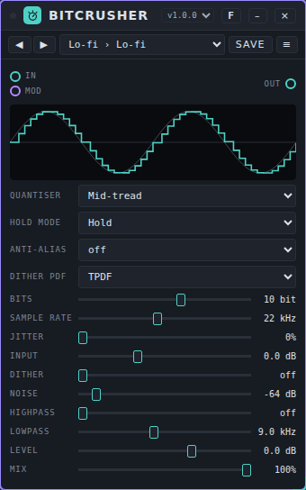

**Controls.**

- The **screen** at the top shows a calculated sine wave through your settings: the thin line is the original, the bright line is the crushed wave. A faint trace on top is the real signal, when there is one. The screen does not show dither, noise or jitter.
- **Quantiser:** *Mid-tread* (zero is a level; at 1 bit only two levels remain), *Mid-rise* (no zero level; 1 bit gives a clean square wave), *Truncate* (rounds down, like cheap converters) and *µ-law* (compands first, so quiet sounds keep finer steps).
- **Hold mode:** *Hold* keeps each sample until the next one (steps); *Linear* draws straight lines between samples, which is smoother and one hold period later than the dry sound.
- **Anti-alias:** *off* lets everything above half the sample rate fold back (the typical rough sound); *on* filters it away first (4th order, at 0.45 × the sample rate).
- **Dither PDF:** the type of dither: *RPDF*, *TPDF* (the standard) or *Shaped* (TPDF with its noise moved to the highs).
- **Bits** (1 to 16, in steps of 0.1) is the bit depth. Fractions work too: 7.5 bits has 2^7.5 levels.
- **Sample rate** (100 to 48000 Hz) is the target rate. At or above the rate of the audio engine nothing is reduced.
- **Jitter** (0 to 100%) makes the sample clock irregular (100% is ±50% of the period).
- **Input** (−12 to +24 dB) is the gain in front of the quantiser. A weaker input uses fewer steps.
- **Dither** (off, then 0 to 100%) adds the noise that makes quantisation sound smoother.
- **Noise** (off up to −20 dB, the peak level) adds white noise before the quantiser.
- **Highpass** (20 to 4000 Hz) and **Lowpass** (500 to 20000 Hz) filter after the crush. *off* at the edges.
- **Level** (−24 to +12 dB) and **Mix** (dry against wet).

**Ports.** **In**, **Out**, **Mod** (ten parameters).

**Example.** Drum machine → Bitcrusher → Mixer. For a radio or telephone voice: preset **Telephone** (*µ-law*, 8 bit, 8 kHz, **Anti-alias** on, **Highpass** 300 Hz, **Lowpass** 3.4 kHz). For classic sampler grit: preset **Vintage Sampler**.

**Presets.** Pack **Bitcrusher Basics** (25 presets) in [`presets/bitcrusher.patchkamer-presets.json`](../../presets/bitcrusher.patchkamer-presets.json), in the folders **Lo-fi** (Lo-fi, Dusty Lo-fi, Subtle Crunch, Warm Lo-fi Mix, Smooth Decimator), **Retro** (8-bit, 4-bit Arcade, Vintage Sampler, Early Sampler, Cheap Converter, Dithered Crush), **Industrial** (Industrial, Digital Shred, Glitch Jitter, Noise Floor, Sub Crusher, Shaped Hiss), **Communication** (Radio, Telephone, Walkie Talkie, AM Radio, Old Intercom) and **Drums and Bus** (Crushed Drums, Parallel Crunch, Crushed Snare). I have not listened to them.

**Tips and limits.** Measured with a 1 kHz tone at −0.9 dBFS and no sample-rate reduction: the signal-to-noise ratio is 49.9 dB at 8 bit and 98.0 dB at 16 bit (theory 49.0 and 97.2 dB), with *Mid-tread*. With a quiet tone (−40 dBFS, 8 bit) the harmonic distortion falls from −11 dB without dither to about −36 dB with TPDF dither, at the price of some noise. At a sample rate of 12 kHz a 9 kHz tone folds to 3 kHz: −6.9 dBFS with **Anti-alias** off and −27.5 dBFS with it on. Jitter costs signal quality at high frequencies: a 1 kHz tone at 24 kHz sample rate keeps 30 dB signal-to-noise at 25% jitter and 24 dB at 100%. **Noise** at 100% is −24.8 dBFS RMS. A mid-rise quantiser has a constant offset in silence; it is blocked by an 8 Hz DC blocker. Computing load in Node on this machine: 0.4% to 0.5% of the time budget of a block on average (p99 0.7%). A guard limits the input at ±16 (+24 dB), turns NaN into 0 and resets the filters if one goes wrong.

## Chorus

**What it is for.** Chorus doubles a sound with small, slowly moving delays. It makes a sound wider and a bit less steady. It has two types: **Chorus (2 voices)** and **Ensemble (3 voices)**, where each voice has a slow and a fast movement.

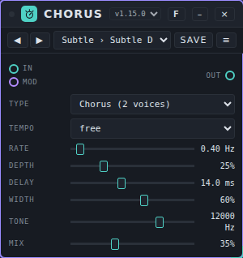

**Controls.**

- **Type:** *Ensemble (3 voices)* or *Chorus (2 voices)*.
- **Tempo:** *free* (the **Rate** knob decides) or a note length: 4 bars, 1 bar, 1/2, 1/4 or 1/8 per movement.
- **Rate** (0.03 to 8 Hz) is the speed of the movement; only used when **Tempo** is *free*.
- **Depth** is the size of the movement.
- **Delay** (3 to 30 ms) is the base delay of the voices.
- **Width** sets how far the voices are spread over left and right. At 0% every voice sits in the middle.
- **Tone** (800 to 16000 Hz) is a low-pass filter on the processed sound.
- **Mix** blends original and effect.

**Ports.** **In**, **Out**, **Mod** (six parameters: Rate, Depth, Delay, Width, Tone and Mix).

**Example.** Duofone → Chorus → Speakers. Choose the *Chorus (2 voices)* type, **Rate** 0.4 Hz, **Depth** 25%, **Delay** 14 ms, **Mix** 35%: a light doubling. For a pad choose *Ensemble (3 voices)* and a higher **Width**.

**Presets.** Pack **Chorus Basics** (12 presets) in [`presets/chorus.patchkamer-presets.json`](../../presets/chorus.patchkamer-presets.json), in the folders **Subtle** (Subtle Double, Classic Chorus, Thick Mono), **Ensemble** (String Section, Wide Pad, Dark Choir), **Movement** (Bar Shimmer, Slow Wash, Eighth Pulse), **Extreme** (Seasick, Tape Warble, Lo-fi Swarm). Load it with the **Presets** tab of the library → **Import…** (or from a library that contains it), then choose a preset in the bar at the top of the card or step through them with ◀ ▶.

**Tips.** With **Width** at 0% every voice sits in the middle; use this when the sound must stay mono. The tone filter has a guard: if a faulty value (`NaN` or infinity) reaches the input, the filter is replaced within a fraction of a second and the sound returns.

## Compressor

**What it is for.** Compressor makes the difference between soft and loud smaller. Everything above the **Threshold** is turned down: with a **Ratio** of 4:1, a signal 8 dB over the threshold comes out 2 dB over it. It is the tool for evening out a voice or bass, for gluing drums together, for catching peaks, and (with **Mix**) for parallel compression. For a pumping effect on the beat there is also [Pump](#pump); with an external sidechain the Compressor can do that too.

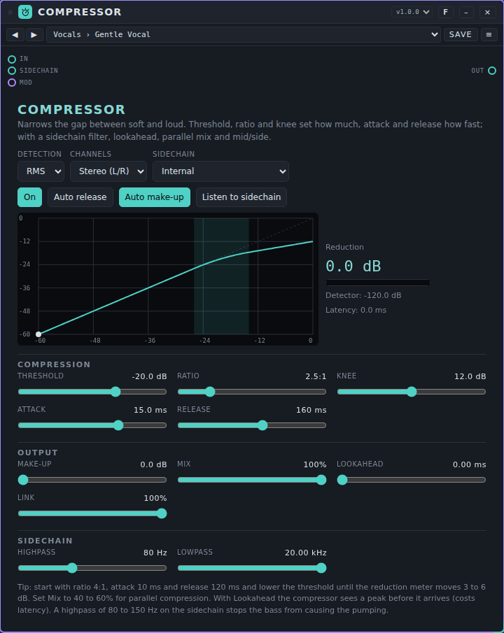

**Controls.**

At the top:

- **Detection:** *Peak* follows the top of every wave, *RMS* follows the average level over 10 ms (smoother, closer to how loud it sounds).
- **Channels:** *Stereo (L/R)* or *Mid/Side*. With *Mid/Side* the middle (what both channels share) and the sides are compressed separately, which is handy for controlling width.
- **Sidechain:** *Internal* (the detector listens to the input) or *External (Sidechain input)* (it listens to what you patch into the **Sidechain** port, for example a kick). Without a cable on that port nothing is compressed.
- **On** / **Off (pass through)**, **Auto release** (two releases at once, 30 ms and 400 ms: fast recovery after a peak, slow after sustained sound), **Auto make-up** (adds the reduction at an input of −12 dB to the make-up) and **Listen to sidechain** (hear what the detector hears, after the filters).
- The **curve** shows the input level against the output level, with the knee shaded and a dot at the live level. Next to it: the **Reduction** in dB, a meter that fills as the reduction grows, the **Detector** level and the **Latency**.

**Compression:** **Threshold** (−60 to 0 dB), **Ratio** (1:1 to ∞:1; at the far right it is infinite, a limiter), **Knee** (0 to 24 dB: 0 is hard, more gives a gentle start around the threshold), **Attack** (0.05 to 200 ms) and **Release** (5 to 2000 ms).

**Output:** **Make-up** (0 to 24 dB), **Mix** (the share of the compressed signal; below 100% it is parallel compression), **Lookahead** (0 to 10 ms) and **Link** (100%: both channels get the same reduction, so the stereo image stays put; 0%: each channel on its own).

**Sidechain:** **Highpass** (20 to 1000 Hz; 20 Hz is off) and **Lowpass** (1 to 20 kHz; 20 kHz is off) on the detector only, not on the sound. A highpass of 80 to 150 Hz stops the bass from triggering the compression.

**Ports.** **In**, **Sidechain** (audio), **Out** and **Mod** (ten parameters; Lookahead is not controllable on purpose).

**Example.** Voice → Compressor → Mixer. Choose the preset **Vocals › Gentle Vocal**, lower the **Threshold** until the reduction shows 3 to 6 dB on the loud words, and set **Make-up** (or **Auto make-up**) so that the level before and after is about equal. For a drum bus: preset **Drums › Drum Bus Glue**. For parallel compression on drums: preset **Parallel › Parallel Punch** (a hard compressed copy mixed in at 35%). For a kick pump: patch the kick into **Sidechain**, preset **Pumping › Kick Pump**.

**Presets.** Pack **Compressor Basics** (30 presets) in [`presets/compressor.patchkamer-presets.json`](../../presets/compressor.patchkamer-presets.json), in the folders **Vocals** (Gentle Vocal, Vocal Leveler, Vocal Presence, Vocal Peak Catcher, Spoken Word), **Drums** (Drum Bus Glue, Punchy Drums, Snare Snap, Tight Kick, Room Crush), **Bass** (Bass Control, Bass Sustain, Slap Tamer), **Instruments** (Guitar Even, Piano Smooth, Synth Lead Hold, Pad Level), **Mix** (Mix Bus Glue, Gentle Master, Width Control, Stereo Linked Glue), **Parallel** (Parallel Punch, Parallel Smash, Parallel Vocal Lift), **Limiter** (Soft Limiter, Peak Catcher), **Pumping** (Kick Pump, Soft Pump, Voice Ducker, Bass Breath). I have not listened to them. The thresholds assume a signal that peaks around −6 to −3 dBFS; lower the threshold if yours is quieter.

**Tips and limits.** *Attack* and *Release* are time constants of the reduction in dB: after one attack time 63% of the reduction is reached, after one release time 63% of the recovery is done (measured with a step: attack 10 ms gives 63% after 10 ms, release 100 ms after 98 ms; 10% to 90% takes about 2.2 times as long). The static curve is exact: with threshold −20 dB, ratio 4:1 and a 0 dB input the reduction is 15.0 dB (formula 15.0); with a 12 dB knee 1.1 dB at the threshold (formula 1.13). **Lookahead** delays the sound (and the dry part of **Mix**) by exactly that many ms (measured 2, 5 and 10 ms) so the compressor sees a peak before it arrives; Patchkamer does not compensate for that latency, so other tracks stay 'early' by that amount. Moving the slider shifts the pitch a tiny bit for a moment. A peak at 0 dBFS gets slightly more reduction with *Peak* than with *RMS* (13.8 against 12.8 dB for a sine). With a very short attack on low tones the reduction can follow the wave itself: use *RMS* or a longer attack. Computing load in Node on this machine: 0.5% to 0.7% of the time budget of a block on average (p99 below 1.2%). A guard limits the input and the sidechain at ±16 (+24 dB), turns NaN into 0 and resets a state that goes wrong; after bursts of NaN, Infinity, 1e9 and 1e30 the sound is exactly the same as without them. It needs AudioWorklet; without it the sound passes through unchanged and the card says so.

## Convolution Reverb

**What it is for.** Convolution Reverb puts a sound in a space or a device by multiplying it with an **impulse response** (IR): the sound a space gives to a single click. It has **15 built-in impulse responses** (church, concert hall, studio room, small booth, tiled bathroom, stairwell, cave, tunnel, steel plate, spring tank, metal tube, metal bin, gated burst, reverse swell, water tank) and you can load **your own IR** from a file. The built-in ones are **synthetic**: they are generated by the device itself from noise and decay curves, so they are approximations of a kind of space and not recordings of a specific one.

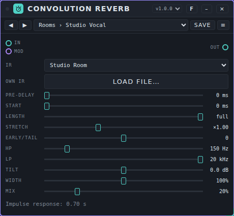

**Controls.**

- **IR:** the impulse response. **Own file** is the IR you loaded yourself.
- **Load file…** (Own IR) loads an audio file (WAV, MP3, OGG or FLAC; at most 12 s are used) as impulse response, or use → *device* on the **Samples** tab of the library. The audio is not saved in presets or in a song; a song only remembers that it uses *Own file*, so load the file again after opening it. Until then Concert Hall plays.
- **Pre-delay** (0 to 250 ms) is the time before the reverb starts.
- **Start** (0 to 1000 ms) cuts the first part off the IR; **Length** (0.05 s to full) shortens the end.
- **Stretch** (×0.5 to ×2) stretches the IR in time. This resamples it: shorter is also brighter, longer is also darker.
- **Early/tail** goes from only early reflections (-100%) through unchanged (0) to only the tail (100%), split around 80 ms.
- **HP** and **LP** filter the reverb. **Tilt** (±12 dB) makes it darker or brighter.
- **Width** (0 to 200%) is the stereo width. A mono IR gives a mono reverb.
- **Mix** is the balance between dry and reverb (equal power).

**Ports.** **In**, **Out**, **Mod** (10 parameters, in three lanes: impulse response, tone, output). The ones that change the IR (**Start**, **Length**, **Stretch**, **Early/tail**) are rebuilt a few times per second when modulated.

**Example.** Duofone → Convolution Reverb → Speakers. Choose **Church** at 30% mix for a pad, or **Steel Plate** with **Pre-delay** 15 ms for a voice. Try your own IR: load a file with **Load file…**.

**Presets.** Pack **Convolution Spaces** (30 presets) in [`presets/convolution-reverb.patchkamer-presets.json`](../../presets/convolution-reverb.patchkamer-presets.json), in the folders **Rooms**, **Halls**, **Devices** and **Creative**, with at least one preset for every built-in IR. Load it with the **Presets** tab of the library → **Import…**, then choose a preset in the bar at the top of the card.

**Tips and limits.** These are measurements of the real convolution engine in Chromium, offline; they were **not listened to**.

- Engine: two native convolvers that fade into each other (60 ms) when you change IR, Start, Length, Stretch or Early/tail, so it does not click (largest jump between two samples with three IR changes during a sine: 0.020, without changes 0.015). A change takes about 0.1 to 0.3 s to be heard while the new IR is built.
- **Latency 0 samples**: a test IR with a unit impulse puts the output peak on the same sample as the input; the dry path has no delay either.
- Every IR is normalised to the same energy, so changing IR does not change the loudness much (measured energy 1.00 for all 15).
- Reverb times per band (T20) of the built-in IRs follow their design: for example Church 5.9 s at 1 kHz and 4.8 s at 8 kHz, Concert Hall 2.4 s, Studio Room 0.37 s, Spring Tank 1.7 s at 1 kHz and 0.6 s at 8 kHz.
- Load: about 1.5% of a processor core with a 0.14 s IR, 5 to 9% with Concert Hall, about 8% with Church and about 14% with an own IR of 12 s (offline render, 20 s of stereo noise).
- A NaN, infinity or enormous value on the input is limited by a small guard before the convolution.
- Tilt, HP, LP and width were measured as set (tilt ±6 dB gives ±3.0 dB at the extremes of the spectrum, HP 200 Hz gives -10.6 dB at 100 Hz).

## De-esser

**What it is for.** De-esser tames the sharp, hissing s and t sounds (sibilants) in a voice, which a compressor makes even louder. It listens to one frequency band, the **Frequency** (3 to 10 kHz) with a **Bandwidth**, and turns down when that band gets above the **Threshold**. Because it only looks at the s sounds, the rest of the voice stays untouched. It is also useful on bright cymbals, strings and synths.

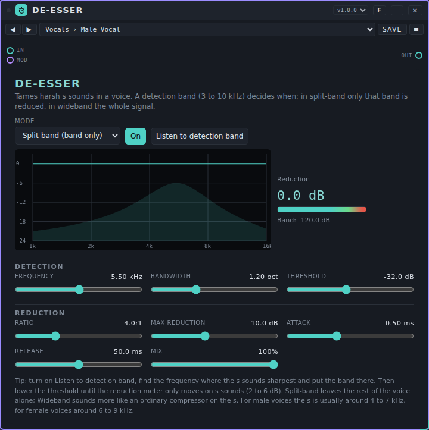

**Controls.**

At the top:

- **Mode:** *Split-band (band only)* turns down only the detection band, so the voice below it keeps its body. *Wideband (everything)* turns down the whole signal while an s sounds, like a compressor that only reacts to the s.
- **On** / **Off (pass through)** and **Listen to detection band** (hear only the band the detector hears: sweep the **Frequency** until the s sounds sharpest, then put the band there).
- The **display** shows the frequency response of the device as it is now: the shaded bell is the detection band, the line is what the device does to the sound at this moment (flat when nothing is reduced, a dip in the band while it reduces). Next to it: the **Reduction** in dB, a meter, and the **Band** level the detector reads.

**Detection:** **Frequency** (3 to 10 kHz), **Bandwidth** (0.25 to 3 octaves: small is narrow and focused, large is wide) and **Threshold** (−60 to 0 dB: the level of the band above which it turns down).

**Reduction:** **Ratio** (1:1 to ∞:1), **Max reduction** (0 to 24 dB), **Attack** (0.05 to 20 ms), **Release** (5 to 500 ms) and **Mix** (the share of the processed signal).

**Ports.** **In**, **Out** and **Mod** (eight parameters).

**Example.** Voice → De-esser → Mixer (after the compressor if you use one). Choose **Vocals › Male Vocal** or **Female Vocal**, turn on **Listen to detection band** and adjust the **Frequency** until the s sounds sharpest; turn it off and lower the **Threshold** until the reduction meter only moves on s sounds, 2 to 6 dB. For a podcast: the presets in the folder **Speech**.

**Presets.** Pack **De-esser Basics** (21 presets) in [`presets/deesser.patchkamer-presets.json`](../../presets/deesser.patchkamer-presets.json), in the folders **Vocals** (Male Vocal, Deep Male Vocal, Female Vocal, Bright Female Vocal, Gentle Vocal, Strong Vocal, Narrow Sibilant, Backing Vocals), **Speech** (Podcast Male, Podcast Female, Voice-over, Phone Interview), **Wideband** (Wideband Soft, Wideband Fast, Wideband Parallel), **Top End** (Tame Cymbals, Hi-Hat Tamer, Tame Top End, Harsh Strings, Sharp Synth, Light Parallel). I have not listened to them. Voices differ: the **Frequency** and **Threshold** of a preset are a starting point.

**Tips and limits.** Measured on the centre frequency: the reduction follows the formula within 0.1 dB (threshold −30 dB, ratio 4:1, knee 6 dB: 7.4 dB at −20 dB, 12.0 dB at −10 dB with 12 dB maximum). In *Split-band* a 1-octave band reduced by 12 dB at its centre reduces 4.6 kHz by 2.9 dB at a 6.5 kHz centre, 3 kHz by 0.7 dB and 1 kHz by 0.06 dB; a voice at 200 Hz stays exactly the same, in *Wideband* it goes down the full 12 dB. *Attack* and *Release* are time constants of the reduction in dB (attack 5 ms: 63% after 6 ms; release 100 ms: 63% after 99 ms). There is no latency. The threshold is absolute: a voice recorded much quieter or louder needs another threshold. Computing load in Node on this machine: 0.3% to 0.4% of the time budget of a block on average (p99 below 0.7%). A guard limits the input at ±16 (+24 dB), turns NaN into 0 and resets a state that goes wrong; after bursts of NaN, Infinity, 1e9 and 1e30 the sound is exactly the same as without them. It needs AudioWorklet; without it the sound passes through unchanged and the card says so.

## Delay

**What it is for.** Delay repeats a sound. It is the bigger sibling of the delay half of [Room](#room): the time can be free (in milliseconds), locked to the host clock (note values from 2 bars to 1/64, straight, dotted or triplet, or a number of sixteenths such as 3/16 or 5/16) or based on an own tempo that you tap in. Left and right can have their own time, and the repeats can ping-pong, be darkened or saturated like tape, smeared, modulated, ducked under the source, frozen or played backwards.

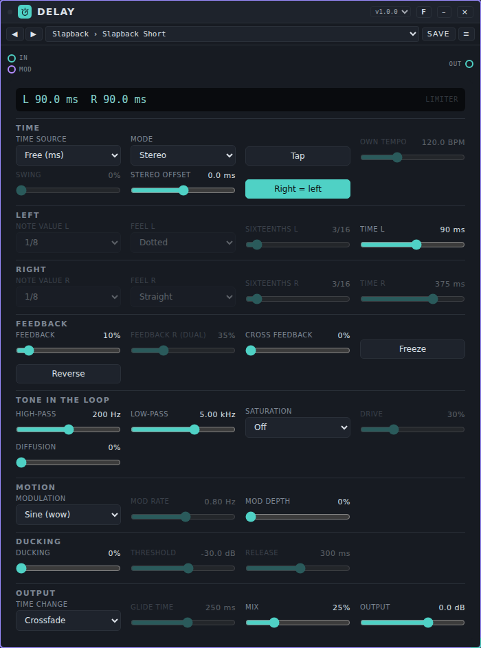

**Controls.** A screen at the top shows the current time left and right in milliseconds, with the note value and the tempo in use. *Limiter* lights up when the limiter in the feedback loop is working.

**Time:**

- **Time source:** *Host clock* (the note values follow the tempo of the studio, also while the clock is stopped and when you change the tempo), *Own tempo (tap)* (the same, with a tempo of its own) or *Free (ms)*.
- **Mode:** *Stereo* (left and right separate), *Ping-pong* (the repeats jump from left to right; the input is summed to mono), *Mono* or *Dual (own feedback)*.
- **Tap** sets **Own tempo** (30 to 300 BPM) from your taps and selects *Own tempo (tap)*. A pause of more than 2 s starts over.
- **Swing** (0 to 100%) is the share of the studio swing that is applied to the repeats. It only works with *Host clock* and only for an odd number of sixteenths (1/16, dotted 1/8, 5/16, …): the repeats then stay on the swung grid. **Stereo offset** (−100 to +100 ms) is added to the time on the right. **Right = left** lets the right side use the note value or time of the left side.

**Left** and **Right** (the right side is only used when **Right = left** is off):

- **Note value:** *2 bars*, *1 bar (1/1)*, 1/2, 1/4, 1/8, 1/16, 1/32, 1/64 or *x/16 (number of sixteenths)*. **Feel:** *Straight*, *Dotted* or *Triplet*. **Sixteenths** (1 to 32) is the number for *x/16*, for example 3 for 3/16.
- **Time L** / **Time R** (1 to 4000 ms) is the time for *Free (ms)*.

**Feedback:**

- **Feedback** (0 to 120%) is how much of each repeat goes back in. Above 100% the repeats grow until the limiter holds them at about 0 dBFS. **Feedback R (dual)** is the right side in *Dual* mode. **Cross feedback** (0 to 100%) sends the repeats to the other side (stereo and dual).
- **Freeze** holds the echo: the input leaves the loop and the feedback goes to 100%. **Reverse** plays the repeats backwards in blocks as long as the delay time.

**Tone in the loop:** **High-pass** (20 to 2000 Hz) and **Low-pass** (500 to 20000 Hz) act on every repeat, so each repeat gets darker and thinner. **Saturation** *Off*, *Tape* or *Tube* with **Drive**. **Diffusion** smears the repeats into a cloud.

**Motion:** **Modulation** *Sine (wow)*, *Tape (wow and flutter)* or *Chorus (stereo)*, with **Mod rate** (0.05 to 10 Hz) and **Mod depth** (up to 10 ms).

**Ducking:** **Ducking** lowers the repeats while the input plays (the repeats in the loop keep going); **Threshold** (−60 to −6 dB) and **Release** (50 to 1500 ms).

**Output:** **Time change** is what happens when the time or the tempo changes: *Crossfade* (a click-free 20 ms crossfade, the pitch stays) or *Tape* (the time glides, so the pitch of the repeats glides with it; **Glide time** 20 to 2000 ms). **Mix** (0 to 100%): from 50% the dry signal goes down, at 100% there is no dry signal left, which is what you want on a send. **Output** (−24 to +12 dB).

**Ports.** **In**, **Out** and **Mod** (seventeen parameters in one lane).

**Example.** A synth lead → Delay → Mixer. Choose the preset **Dotted Eighth** in the bar at the top of the card: the repeats follow the tempo of the studio. On a send: put Delay in the return, set **Mix** to 100% and send the sounds you want to repeat.

**Presets.** Pack **Delay Basics** (35 presets) in [`presets/delay.patchkamer-presets.json`](../../presets/delay.patchkamer-presets.json), in the folders **Slapback** (Slapback Short, Slapback Wide, Tape Slap, Haas Widener), **Dub** (Dub Echo, Dub Throw, Dub Ducked, Dub Long Tail), **Ping-pong** (Ping-pong Eighths, Ping-pong Quarters, Ping-pong Dotted, Ping-pong Free), **Rhythmic** (Dotted Eighth, Triplet Eighths, Swung Sixteenths, Three Against Five, Triplet Against Straight, Gated Sixteenths), **Ambient** (Ambient Wash, Bar Echo, Cloud Ping-pong, Endless Smear), **Tape** (Tape Echo, Slow Wow, Worn Tape, Tube Repeats), **Modulated** (Chorus Echo, Vibrato Repeats, Seasick) and **Creative** (Reverse Echo, Reverse Ping-pong, Runaway Feedback, Dual Offset, Stutter Thirty-seconds, Cross Weave). Load it with the **Presets** tab of the library → **Import…** (or from a library that contains it), then choose a preset in the bar at the top of the card or step through them with ◀ ▶. I have not listened to them.

**Tips and limits.** Measured offline with the real worklet code: the time is exact to within 0.09 of a sample (under 2 µs) for free times from 1 to 4000 ms and for all note values, feels and tempi from 60 to 200 BPM that I tried; 1/8 stays exact after a tempo change, with the clock running (through the tempo of the step) and with the clock stopped (through the tempo of the studio, picked up by a timer of 40 ms). A tempo change with *Crossfade* gives no jumps in a 1 kHz sine (the largest step is 1.01 times that of the pure sine, where a hard jump of the delay time gives 59 times). With *Tape* the pitch glides (300 to 200 ms with a glide time of 250 ms: 1330 Hz for a 1 kHz tone at the start, back to 1000 Hz after about a second). The decay per repeat equals 20 log(feedback) within 0.01 dB (−6.02 dB at 50%). The filters follow the digital second-order Butterworth design within 0.02 dB (checked at 21 combinations of frequency and setting). With feedback up to 120%, for 60 s and in all modes the output stays below 1.4 (+2.9 dBFS) and finite; a burst of NaN, ±Infinity, 1e9 or 1e30 at the input is limited, and the sound comes back. At most 8 s per delay line: 2 bars at 40 BPM (12 s) is halved and the screen says so. With *Crossfade* a time that you modulate continuously (Drift, LFO) gets a crossfade for every change; use *Tape* for that. Switching **Mode** mutes the repeats for 15 ms; switching **Saturation** is abrupt. **Reverse** and **Diffusion** change how the repeats sound, not when they come. CPU in Node on this machine: 0.6 to 3.4% of the time budget of a block on average, 5.4% at p99, for the heaviest setting (tube, diffusion, tape modulation, ducking and reverse) 2.8% on average. Delay needs AudioWorklet; without it the sound passes through unchanged and the card says so.

## Distortion

**What it is for.** Distortion adds harmonics by squeezing the sound through a curve. It has eight types, from a gentle warmth to fuzz and wavefolding, tone controls before and after the distortion, and a dry/wet mix so you can use it for parallel saturation. A DC blocker is always on.

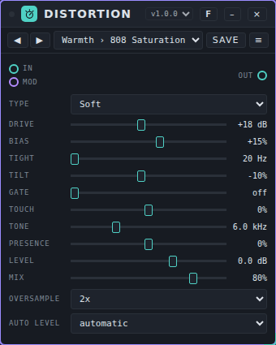

**Controls.**

- **Type:** *Soft* (smooth knee, odd harmonics), *Hard* (flat clip), *Tube* (asymmetric, adds even harmonics), *Tape* (soft clip with a small bump at 110 Hz), *Diode* (a clipper with a sharper knee; the cleanest at high drive), *Fuzz* (two stages that sputter and close with the gate), *Folder* (a wavefolder: the wave folds over at high drive) and *Rectifier* (full-wave rectification: an octave up).
- **Drive** (0 to +40 dB) is how hard the sound hits the curve. *Fuzz* starts 12 dB lower, because it is hard already.
- **Bias** (−100 to +100%) shifts the sound along the curve, so the top and bottom are treated differently. That adds even harmonics. The static offset is corrected and the DC blocker removes the rest.
- **Tight** (20 to 1000 Hz) is a high-pass filter *before* the distortion. Raise it to keep the bass from turning to mud.
- **Tilt** (−100 to +100%) is a tone control before the distortion: positive makes the highs hit the curve harder (±9 dB).
- **Gate** (off, then −80 to −30 dB) is a gate in front of the distortion, so hiss is not amplified.
- **Touch** (−100 to +100%) lets the input level change the drive (±12 dB): positive means playing harder gives more distortion, negative the other way round (compressing).
- **Tone** (500 to 20000 Hz; *off* at the top) is a low-pass filter after the distortion.
- **Presence** (−100 to +100%) is a shelf at 4 kHz after the distortion (±9 dB).
- **Level** (−24 to +12 dB) is the output level.
- **Mix** is dry against wet. Under 100% you get parallel saturation; the dry path is delayed to match the wet path.
- **Oversample:** *off*, *2x* or *4x*. It runs the distortion at a higher sample rate to reduce aliasing. The default follows the audio quality in Settings.
- **Auto level:** *automatic* brings the level back to what went in (measured on a tone at −12 dBFS), so you can compare settings fairly. *free* leaves the level as it is.

**Ports.** **In**, **Out**, **Mod** (ten parameters).

**Example.** Drum bus → Distortion → Mixer. Choose the preset **Parallel Drums**: *Hard* clip with **Drive** 70%, **Tight** 150 Hz and **Mix** 35%. For a fat bass: preset **Bass Distortion**.

**Presets.** Pack **Distortion Basics** (28 presets) in [`presets/distortion.patchkamer-presets.json`](../../presets/distortion.patchkamer-presets.json), in the folders **Warmth** (808 Saturation, Subtle Warmth, Tape-like Saturation, Tube Glow, Mix Bus Colour, Vocal Presence), **Crunch** (Crunch, Overdrive, Diode Drive, Heavy Distortion, Wall of Clip, Dynamic Edge), **Fuzz and Fold** (Fuzz, Gated Fuzz, Octave Fuzz, Folder, Wavefolder Lead, Asymmetric Fold, Rectifier Octave), **Drums and Bass** (Parallel Drums, Parallel Snare Crack, Kick Thump, Bass Distortion, Sub Enhancer) and **Lo-fi** (Lo-fi Crunch, Radio Mid, Broken Speaker, Telephone Drive). I have not listened to them.

**Tips and limits.** Measured with a 3 kHz tone at −12 dBFS and drive +20 dB (4x): the harmonics make up about 16% (*Diode*) to 28% (*Fuzz*) of the sound. *Soft*, *Hard* and *Tape* are almost pure odd harmonics; *Tube* has its second harmonic 22.6 dB below the fundamental, and *Fuzz* 54 dB. With drive at +40 dB, *Hard* aliasing is −14.5 dB (off), −23.7 dB (2x) and −38.9 dB (4x) relative to the total; at +20 dB it is −31, −45 and −57 dB. *Folder* and *Rectifier* alias the most; use 4x. The oversampling filters add a delay of 24 samples (2x) or 32 samples (4x), 0.5 and 0.67 ms at 48 kHz; the dry path follows. Computing load in Node on this machine: *Soft* 0.7% of the time budget of a block (1x) to 2.5% (4x); *Diode* 4x 10.5% on average (p99 16.5%). A guard limits the input at ±16 (+24 dB), turns NaN into 0 and resets the filters if one goes wrong.

## Effect Chain

**What it is for.** Effect Chain puts up to **8 effects** in a row in one card. Each of the 8 **slots** holds one effect that you choose from a list of **33**, with its own mix, a bypass and its own controls. Over the whole chain sit an input level, an output level, a total mix and an **analyzer**. It is built for whole chains: ambient, cinematic, techno, dub, lo-fi, glitch and more.

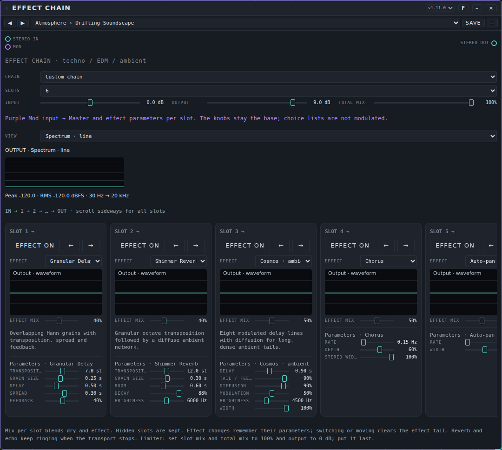

### Setting up the card

At the top of the card:

- **Chain** is a list of 17 built-in chains (for example *Ambient Space*, *Warm Tape*, *Techno · Rumble*; the last one is *Empty Chain*). Choosing one fills the slots. When you change anything, the name becomes *Custom chain*. These built-in chains are part of the device. The presets in the bar at the top of the card (see "Presets" below) are separate: they are complete chains for one purpose each.
- **Slots** (1 to 8) sets how many slots are visible. Hidden slots keep their effect and settings.
- **Input** and **Output** (both −12 to +12 dB) set the level into and out of the chain. **Total mix** (0 to 100%) blends the whole chain with the original sound.
- **View** chooses what the analyzer shows (see below).

Below that you see the slots from left to right (the sound runs **IN → 1 → 2 → … → OUT**). Scroll sideways to see all slots.

### Setting up a slot

Each slot is a column:

- **Effect on** / **Bypass on** is a button. With **Bypass on** the slot passes the sound through unchanged.
- **←** and **→** move the slot one place in the chain. Moving or switching an effect clears the tail of that effect (an echo or reverb that was still ringing).
- **Effect** chooses the effect. **Pass-through** leaves the slot empty. When you switch back, the effect remembers the settings it had in this slot.
- A small graph shows what the effect does: a filter curve, the shape of a reverb, the echo taps, the rhythm of a gate or the output waveform.
- **Effect mix** blends the sound before the slot (dry) and the effect (wet). Typical starting values: distortion 60 to 100%, movement 20 to 50%, echo and reverb 15 to 50%, filter or EQ 100%. Choosing **Limiter · peak** sets the slot mix to 100%.
- Under **Parameters** are the controls of the chosen effect. A list holds a choice (a room, a pattern, a note length); a slider holds a value.

### The 33 effects

**Tone and dynamics**

| Effect | What it does |
|---|---|
| Filter | Low-pass, high-pass or band-pass with **Frequency**, **Resonance** and a type choice. |
| EQ · three bands | **Low**, **Mid** and **High** (each ±12 dB) with a **Mid frequency** from 150 to 6000 Hz. |
| Compressor | **Threshold**, **Ratio**, **Attack**, **Release** and **Make-up**. |
| Limiter · peak | A sample-peak limiter with a 5 ms look-ahead. **Ceiling**, **Release** and **Input boost**. Put it last. |
| Stereo Image | Mid/side width (0 to 2×). **Mono → stereo** adds decorrelation (with **Decorrelation** as the delay time); check the result in mono as well. |

**Distortion and character**

| Effect | What it does |
|---|---|
| Warm saturation | Soft saturation with **Drive** (0 to 24 dB), **Brightness** and **Compensation**. |
| Distortion | Harder distortion with **Drive** up to 36 dB, **Brightness** and **Output**. |
| Overdrive | **Drive**, **Brightness**, **Asymmetry** and **Output**. |
| Multiband Drive | A separate **Low drive**, **Mid drive** and **High drive**. It is not a mastering crossover. |
| Digital Crush | Real bit reduction (2 to 16 bits) and sample-and-hold (400 to 48000 Hz), with **Drive**, **Glitch / jitter** and **Rate modulation**. |
| Vinyl Dust | Synthesised **Wear**, **Wow / flutter**, **Noise** and **Crackle**, with a **Speed** of 33⅓, 45 or 78 RPM. |

**Movement**

| Effect | What it does |
|---|---|
| Chorus | **Rate**, **Depth** and **Stereo width**. |
| Flanger | **Rate**, **Depth** and **Feedback** (−75% to +75%). |
| Phaser | **Rate**, **Depth** and **Mid frequency**. |
| Tremolo | **Rate** and **Depth**. |
| Auto-pan | Moves the sound between left and right with **Rate** and **Width**. |
| Auto Filter | An LFO moves a filter around the **Base frequency**: **Resonance**, **Movement** (rate), **LFO depth** (in octaves) and the **Filter type**. |
| Ring Modulator | **Carrier frequency** (0.1 to 2000 Hz) and **Depth**. |

**Rhythm** (these follow the studio clock; start the transport with **Start**)

| Effect | What it does |
|---|---|
| Pumping / Duck | Ducks the volume on the tempo, without a kick input. **Pulse** (1/16 to 1 bar), **Ducking depth** and **Recovery curve**. Set the effect mix to 100%. |
| Trance Gate | A 16-step volume pattern. **Pattern** (*Offbeat*, *Syncopated*, *Tresillo*, *Broken*), **Depth** and **Gate length**. Mix 100% for full gates. |
| Beat Stutter | Takes the last fragment of every bar and repeats it for a while. **Repeat fragment**, **Repeat per bar** and **Direction** (forward or backward). The first bar fills the buffer. |
| Tempo Delay | An echo in note values (1/16 up to 1 bar, also dotted), with **Feedback** and **Brightness**. It follows the tempo of Patchkamer. |
| Wobble Filter | A filter that moves in time with the tempo: **Filter cycle**, **Base frequency**, **Movement** (octaves) and **Resonance**. |

**Echo and space**

| Effect | What it does |
|---|---|
| Stereo delay | **Time** (0.03 to 2 s), **Feedback** and **Echo brightness**. |
| Ping-pong echo | An echo that jumps between left and right: **Time per side**, **Feedback**, **Echo brightness** and **Stereo width**. |
| Frequency Echo | Shifts the overtones by a number of Hz with every echo (not a shift in semitones): **Shift**, **Echo time**, **Feedback** and **Brightness**. |
| Reverb | A reverb with 12 rooms: *Room*, *Hall*, *Heaven*, *Studio*, *Bathroom*, *Wooden hall*, *Plate*, *Church*, *Cathedral*, *Cave*, *Tunnel* and *Frozen cloud* (the card shows the length in seconds). Also **Pre-delay** and **Reverb brightness**. The lengths are synthetic, not measured. |
| Hybrid Reverb | A parallel mix of a chosen room and an algorithmic tail (**Algorithmic share**, **Algorithmic room**, **Algorithmic tail**). |
| Shimmer Reverb | A granular octave shift (**Transposition**, **Grain size**) followed by a diffuse tail (**Room**, **Decay**). |
| Cosmos · ambient | Eight modulated delay lines with diffusion for long, dense tails: **Delay**, **Tail / feedback**, **Diffusion**, **Modulation**, **Brightness** and **Width**. |
| Granular Delay | Overlapping grains with **Transposition** (−12 to +24 st), **Grain size**, **Delay**, **Spread** and **Feedback**. |
| Freeze / Sound Cloud | Records the last moments of audio. Choose **Frozen** once sound is coming in. This is a granular time loop, not a spectral freeze. **Recording length** and **Playback speed**. |
| Harmonic Resonators | Five comb resonators tuned to a chord colour the incoming sound: **Root note (MIDI)**, **Chord** (*Open / major*, *Minor 9*, *Sus*, *Major 9*), **Decay**, **Brightness** and **Width**. |

### The Mod input

The purple **Mod** port can move the master controls (**Input**, **Output**, **Total mix**) and, for every slot that is in use, the **Effect mix** and the sliders of its effect. Each of them has a fixed name per slot position (slot 1, slot 2, …), so a modulator stays with the position, not with the effect that sits there. Choices (rooms, patterns, note lengths, freeze, chord, filter type, speed, direction) are not modulated. Modulation is not saved in a preset.

### The analyzer

**View** chooses what is shown for the output of the whole chain:

- **Spectrum · line** and **Spectrum · bars** show the frequencies from 30 Hz to 20 kHz.
- **Spectrogram** shows frequencies over time (high at the top, time to the right).
- **Waveform** shows the waveform.
- **Stereo image** shows left against right, with the correlation next to it.
- **Level meters** show peak (top) and RMS (bottom).
- **Off / less CPU** switches the analyzer and the small graphs of the slots off.

Under the picture is the **Peak** and **RMS** of the output in dBFS.

### Presets: complete chains

Pack **Effect Chain Basics** (14 presets) in [`presets/effect-chain.patchkamer-presets.json`](../../presets/effect-chain.patchkamer-presets.json), in the folders **Atmosphere** (Drifting Soundscape, Cinematic Dread, Psychedelic Trip, Dream Voice), **Studio** (Tape Slapback, Lo-Fi Tape Memory, Drum Bus Glue, Dub Chamber), **Club** (Basement Techno, Squelch Bus, Neon Nights, Trance Ascent), **Sound Design** (Glitch Lab, Industrial Warehouse). Load it with the **Presets** tab of the library → **Import…** (or from a library that contains it), then choose a preset in the bar at the top of the card or step through them with ◀ ▶.

Each preset is a whole chain, not a single effect. They are built in the order of the section "The order of effects in a chain": tone, distortion, movement, rhythm, echo, reverb, width and a limiter. The table gives the effects in slot order, with the **Effect mix** between brackets.

| Preset | Aim | Slots in order |
|---|---|---|
| **Drifting Soundscape** (Atmosphere) | Ambient: slowly moving sound clouds without rhythm | Granular Delay (0.4) > Shimmer Reverb (0.4) > Cosmos · ambient (0.5) > Chorus (0.5) > Auto-pan (0.5) > Stereo Image (1) |
| **Cinematic Dread** (Atmosphere) | Cinematic: dark resonance, a huge room, slow movement | Warm saturation (0.4) > Harmonic Resonators (0.5) > Ring Modulator (0.2) > Frequency Echo (0.4) > Phaser (0.3) > Reverb (0.5) > Stereo Image (1) > Limiter · peak (1) |
| **Psychedelic Trip** (Atmosphere) | Psychedelic: swirling movement and echoes | Phaser (0.6) > Flanger (0.4) > Tremolo (0.4) > Frequency Echo (0.35) > Cosmos · ambient (0.35) > Auto-pan (0.5) |
| **Dream Voice** (Atmosphere) | A vocal space: smoothed voice with shine | Compressor (1) > EQ · three bands (1) > Chorus (0.2) > Ping-pong echo (0.2) > Reverb (0.25) > Shimmer Reverb (0.15) > Stereo Image (1) |
| **Tape Slapback** (Studio) | Minimal: a short, warm slapback echo for a guitar or a voice | Warm saturation (0.5) > Ping-pong echo (0.3) > Filter (1) > Reverb (0.18) |
| **Lo-Fi Tape Memory** (Studio) | Lo-fi: an old cassette feel with dust, wow and flutter | Digital Crush (0.4) > Vinyl Dust (1) > Filter (1) > Chorus (0.25) > Reverb (0.2) |
| **Drum Bus Glue** (Studio) | A drum bus: glue, thickness, a little room | Compressor (1) > Warm saturation (0.5) > Multiband Drive (0.4) > Hybrid Reverb (0.12) > Limiter · peak (1) |
| **Dub Chamber** (Studio) | Dub: tape-like saturation, rolling echoes, a bouncing room | Warm saturation (0.6) > Tempo Delay (0.45) > Ping-pong echo (0.3) > Auto Filter (0.6) > Reverb (0.25) > Compressor (1) |
| **Basement Techno** (Club) | Techno: dark and gritty, tight bass, big concrete room | Filter (1) > Warm saturation (0.6) > Pumping / Duck (1) > Tempo Delay (0.25) > Reverb (0.3) > Multiband Drive (0.5) > EQ · three bands (1) |
| **Squelch Bus** (Club) | A bus for an acid bass: screaming distortion with movement | Distortion (0.9) > Filter (1) > Wobble Filter (1) > Phaser (0.35) > Tempo Delay (0.2) > EQ · three bands (1) |
| **Neon Nights** (Club) | Synthwave: wide chorus, overdrive, dotted echoes, a glossy reverb | Chorus (0.5) > Overdrive (0.5) > Tempo Delay (0.3) > Shimmer Reverb (0.2) > Reverb (0.3) |
| **Trance Ascent** (Club) | Trance: gate, rising filter, echoes, a wide reverb | Trance Gate (0.9) > Auto Filter (0.8) > Pumping / Duck (1) > Tempo Delay (0.3) > Shimmer Reverb (0.2) > Reverb (0.3) > Stereo Image (1) |
| **Glitch Lab** (Sound Design) | Glitch and sound design: stutter, bit crushing, frequency echoes | Beat Stutter (1) > Digital Crush (0.5) > Frequency Echo (0.35) > Ping-pong echo (0.25) |
| **Industrial Warehouse** (Sound Design) | Industrial: hard distortion in an enormous room | EQ · three bands (1) > Overdrive (1) > Distortion (0.8) > Multiband Drive (0.6) > Ring Modulator (0.3) > Reverb (0.4) > Frequency Echo (0.35) > Limiter · peak (1) |

*This pack can still change; the table above lists what was in the file when this manual was written.* The settings of every slot (time, feedback, drive and so on) are in the preset itself; load it and look at the cards.

### Tips and limits

- Many effects (those with their own sound processing) run in the main thread of your browser through a ScriptProcessor, with a short extra delay. On a slow computer, use fewer of those slots.
- Rhythm effects need the clock: press **Start**.
- A chain of many effects can get louder than the input. Use **Input**, **Output**, **Total mix** and the make-up and output knobs, and close the chain with a **Limiter · peak** (all mixes at 100%, **Output** at 0 dB).
- Reverb and echo keep ringing when the clock stops.
- A guard watches the output of every slot every 50 ms. If a slot returns something that is not a number (or absurdly loud), the slot is rebuilt and the tail of that effect is lost; the sound then continues.

## Filter

**What it is for.** A filter takes frequencies away or emphasizes them. This one has ten types, a drive before the filter, a mix and an output level.

**Controls.**

- **Type:** *LP 12 dB*, *LP 24 dB* (low-pass), *HP 12 dB*, *HP 24 dB* (high-pass), *Band*, *Notch*, *Vowel*, *Ladder 24 dB (worklet)*, *Comb + (worklet)* and *Comb − (worklet)*. *Vowel* gives you the vowels A, E, I, O and U with three formants. The *Ladder* and the two comb filters need AudioWorklet; the card says so under the controls.
- **Cutoff** (20 to 20000 Hz) is where the filter works. For *Vowel* it shifts the vowels; for the comb filters it sets the pitch.
- **Resonance** emphasizes the area around the cutoff.
- **Drive** distorts before the filter.
- **Vowel** (A to U, in between the vowels blend) is only used for *Vowel*.
- **Mix** blends original and filtered sound.
- **Level** (0 to 200%) sets the output level of the filtered sound.

**Ports.** **In**, **Out**, **Mod**. The modulator moves **Cutoff** sample by sample (fast), and also **Resonance**, **Drive**, **Vowel** and **Mix**.

**Example.** Duofone → Filter → Speakers. Choose *LP 24 dB*, **Cutoff** 1200 Hz, **Resonance** 30%. Patch a modulator on **Mod** to open and close the filter.

**Presets.** Pack **Filter Basics** (14 presets) in [`presets/filter.patchkamer-presets.json`](../../presets/filter.patchkamer-presets.json), in the folders **Basics** (Soft Lowpass, Warm Lowpass, Tight Highpass, Telephone, Notch Scoop), **Movement** (Wah Stop, Vowel Choir, Talking Mouth, Comb Pipe, Hollow Comb), **Aggressive** (Ladder Squelch, Screaming Resonance, Fuzz Wall, Razor Comb). Load it with the **Presets** tab of the library → **Import…** (or from a library that contains it), then choose a preset in the bar at the top of the card or step through them with ◀ ▶.

**Tips.** Without AudioWorklet in your browser, the three worklet types pass the sound through unchanged and the card says so. A faulty value on the input does not poison the filter any more: the ladder and comb filters limit it, the other types are watched and replaced.

## Flanger

**What it is for.** A flanger mixes a sound with a very short, moving delay. With feedback it makes a sweeping, hollow movement.

**Controls.**

- **Tempo:** *free* or a note length (8 bars up to 1/4).
- **Wave:** *Sine* or *Triangle*, the shape of the movement.
- **Rate** (0.02 to 10 Hz) is the speed; only used when **Tempo** is *free*.
- **Depth** is the size of the movement.
- **Manual** (0.2 to 12 ms) is the base delay: the place around which the sweep moves.
- **Feedback** (−97% to +97%) feeds the output back in. Negative values change the character.
- **Stereo** is the phase difference between left and right (0° to 180°).
- **Mix** blends original and effect.

**Ports.** **In**, **Out**, **Mod** (six parameters; **Manual** is fast).

**Example.** Duofone → Flanger → Speakers. **Rate** 0.15 Hz, **Depth** 70%, **Manual** 2.5 ms, **Feedback** 60%, **Mix** 50%: a slow sweep.

**Presets.** Pack **Flanger Basics** (12 presets) in [`presets/flanger.patchkamer-presets.json`](../../presets/flanger.patchkamer-presets.json), in the folders **Classic** (Gentle Flange, Jet Sweep, Slow Tide, Metal Sweep), **Subtle** (Stereo Shimmer, Soft Doubler), **Tempo** (Bar Sweep, Two-Bar Rise), **Extreme** (Metallic Scream, Laser Drop, Comb Drone, Wild Wobble). Load it with the **Presets** tab of the library → **Import…** (or from a library that contains it), then choose a preset in the bar at the top of the card or step through them with ◀ ▶.

**Tips.** Without AudioWorklet the flanger passes the sound through unchanged and says so under the controls.

## Frequency Shifter

**What it is for.** A frequency shifter moves all frequencies by a fixed number of Hz. This is not a change of pitch: the overtones lose their relation and the result is not harmonic. Small shifts give a slow beating; large shifts give a metallic, alien sound.

**Controls.**

- **Range:** *±20 Hz (beating)*, *±200 Hz* or *±2000 Hz (inharmonic)*. This is the largest shift the **Shift** knob can reach.
- **Shift** moves the frequencies. The knob is curved: small values near the middle make small steps. The card shows the shift in Hz.
- **Feedback** (0 to 95%) feeds the result back in. It makes spiral effects.
- **Stereo** moves the right channel the other way. Above 50% the card says *right reversed*.
- **Mix** blends original and effect.

**Ports.** **In**, **Out**, **Mod** (**Shift** is fast, sample by sample).

**Example.** Duofone → Frequency Shifter → Speakers. **Range** ±20 Hz, **Shift** a small positive value, **Mix** 50%: a slow beating. With **Range** ±2000 Hz and some **Feedback** the sound becomes inharmonic.

**Presets.** Pack **Frequency Shifter Basics** (13 presets) in [`presets/frequency-shifter.patchkamer-presets.json`](../../presets/frequency-shifter.patchkamer-presets.json), in the folders **Subtle** (Gentle Shift, Slow Beat, Stereo Drift, Thick Detune), **Inharmonic** (Metal Shimmer, Bell Warp, Robot Voice, Broken Radio, Alien Down), **Feedback** (Rising Spiral, Falling Spiral, Barber Chaos, Endless Fall). Load it with the **Presets** tab of the library → **Import…** (or from a library that contains it), then choose a preset in the bar at the top of the card or step through them with ◀ ▶.

**Tips.** Without AudioWorklet the device passes the sound through unchanged and says so. The dry signal is delayed by 63 samples, so it lines up with the processed one.

## Gate

**What it is for.** Gate mutes what falls below the **Threshold**: the hiss between the notes of a guitar, the spill of a snare in the room microphone, the hum of an amplifier. Three types: **Gate** (closes completely, down to the **Range**), **Expander** (a soft gate: the quieter the sound, the more it is turned down) and **Ducker** (the other way round: it mutes the main signal when the sidechain gets loud, for example a bass under a kick or music under a voice).

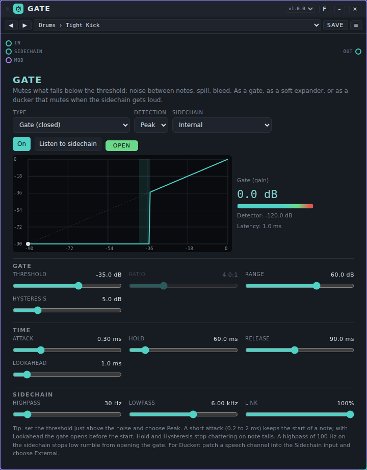

**Controls.**

At the top:

- **Type:** *Gate (closed)*, *Expander (soft)* or *Ducker (loud sidechain = mute)*.
- **Detection:** *Peak* (fast, follows the tops) or *RMS* (average over 15 ms, steadier on sustained tones).
- **Sidechain:** *Internal* (the detector listens to the input) or *External (Sidechain input)* (it listens to what you patch into the **Sidechain** port; required for the Ducker). Without a cable on that port a gate stays closed and a ducker does nothing.
- **On** / **Off (pass through)** and **Listen to sidechain** (hear what the detector hears, after the filters). The **OPEN** / **CLOSED** lamp (for the Ducker **DUCKING** / **IDLE**) shows the state.
- The **curve** shows the input level against the output level, with the hysteresis shaded and a dot at the live level (for the Ducker the reduction against the sidechain level). Next to it: the **Gate (gain)** in dB, a meter that is full when the gate is open, the **Detector** level and the **Latency**.

**Gate:** **Threshold** (−90 to 0 dB), **Ratio** (1:1 to ∞:1; only for *Expander* and *Ducker*, a gate is always infinite), **Range** (0 to 90 dB: the most it mutes) and **Hysteresis** (0 to 24 dB: once open, the gate closes only this much below the threshold, which stops chattering around the threshold; not for the Ducker).

**Time:** **Attack** (0.05 to 100 ms: how fast it opens, for the Ducker how fast it mutes), **Hold** (0 to 500 ms: how long it stays open after the sound falls below the threshold), **Release** (5 to 3000 ms: how fast it closes, for the Ducker how fast it recovers) and **Lookahead** (0 to 10 ms: the sound is delayed so the gate opens before the start of a note).

**Sidechain:** **Highpass** (20 to 1000 Hz; 20 Hz is off), **Lowpass** (1 to 20 kHz; 20 kHz is off) and **Link** (100%: both channels open and close together; 0%: each on its own). The filters work on the detector only, not on the sound.

**Ports.** **In**, **Sidechain** (audio), **Out** and **Mod** (ten parameters; Lookahead is not controllable on purpose).

**Example.** Snare track → Gate → Mixer. Choose the preset **Drums › Snare Gate**, play, and raise the **Threshold** until the spill is gone but every hit still opens the gate; use **Listen to sidechain** and the **Highpass** if low bleed opens it. For a voice-over: patch the speech into **Sidechain** of a Gate on the music, preset **Ducker › Voice-over Duck**. For an over-compressed track that you want to bring back to life: preset **Expander › Squash Recover**.

**Presets.** Pack **Gate Basics** (26 presets) in [`presets/gate.patchkamer-presets.json`](../../presets/gate.patchkamer-presets.json), in the folders **Drums** (Tight Kick, Snare Gate, Tom Gate, Hi-Hat Bleed, Room Mic Tighten, Drum Bus Cleanup), **Instruments** (Guitar Hum, Distorted Chop, Bass Gate, Synth Noise Cut), **Vocals** (Breath Reducer, Vocal Gate Gentle, Spoken Cleanup, Backing Vocal Bleed), **Noise** (Hiss Away, Hum Away, Noise Floor Lower, Room Tone Keep), **Expander** (Gentle Expander, Squash Recover, Dynamics Restore), **Ducker** (Voice-over Duck, Bass Duck, Soft Duck), **Effects** (Hard Chop, Gated Tail). I have not listened to them. Set the **Threshold** to your own material first: a good value lies just above the noise.

**Tips and limits.** *Attack* and *Release* are time constants of the gain (amplitude): after one attack 63% of the way to open is done; after one release the gain is at 37% (−8.7 dB). Muting by 60 dB therefore takes about 7 times the release (measured with release 100 ms: −20 dB after 239 ms, −60 dB after 928 ms). The gate itself reacts after the **Hold** plus the run-out of the peak follower (about 7 ms for a 20 dB fall): with hold 50 ms it starts muting after 59 ms. The expander is exact: threshold −40 dB and ratio 4:1 give −12.0 dB at −44 dB and −30.0 dB at −50 dB. **Lookahead** delays the sound by exactly that many ms (measured 2, 5 and 10 ms); Patchkamer does not compensate for that latency. With a hysteresis of 6 dB a gate that opened at −30 dB stays open at −43 dB and closes at −49 dB. Low tones make the *Peak* detector ripple within one wave: use **Hold**, *RMS* or a **Highpass** on the sidechain. Computing load in Node on this machine: 0.3% to 0.4% of the time budget of a block on average (p99 below 0.8%). A guard limits the input and the sidechain at ±16 (+24 dB), turns NaN into 0 and resets a state that goes wrong; after bursts of NaN, Infinity, 1e9 and 1e30 the sound is exactly the same as without them. It needs AudioWorklet; without it the sound passes through unchanged and the card says so.

## Grit

**What it is for.** Grit distorts a sound and runs it through a resonant low-pass filter, with an LFO on the cutoff. It makes a source rougher and darker.

**Controls.**

- **Drive** is how much the input is distorted.
- **Cutoff** (100 to 16000 Hz) is the corner of the low-pass filter.
- **Reso** (0.3 to 18) is the resonance of the filter.
- **LFO** (0.02 to 8 Hz) is the speed of the movement on the cutoff.
- **Depth** is the size of that movement. At 0% the cutoff stands still.
- **Level** is the output level.

Grit has no **Mix** knob: the whole signal goes through the distortion and the filter.

**Ports.** **In**, **Out**, **CC** (an event input that sets the cutoff: `{type:"cc", id:"cutoff", value:0..1}` goes from 100 to 16000 Hz) and **Mod** (all six controls).

**Example.** A bass synth → Grit → Speakers. **Drive** 60%, **Cutoff** 1200 Hz, **Reso** 6; set **LFO** to 2 Hz and **Depth** to 30% for a wobble.

**Presets.** Pack **Grit Basics** (12 presets) in [`presets/grit.patchkamer-presets.json`](../../presets/grit.patchkamer-presets.json), in the folders **Warm** (Warm Edge, Dull Blanket, Fuzz Bass), **Motion** (Slow Sweep, Wah Pulse, Underwater, Helicopter), **Extreme** (Bright Razor, Acid Bite, Screamer, Siren, Meltdown). Load it with the **Presets** tab of the library → **Import…** (or from a library that contains it), then choose a preset in the bar at the top of the card or step through them with ◀ ▶.

**Tips.** A small guard limits the input to +24 dB and replaces a filter that has gone off course. Grit also works without AudioWorklet; only the input guard is then missing.

## Harmonizer

**What it is for.** Harmonizer makes up to four extra voices from one input. Each voice has its own interval, level, pan, detune and delay. The intervals can be fixed (semitones) or stay inside a scale: then the voices follow the pitch of the source and land on notes of the chosen key and scale. The dry sound stays in the mix.

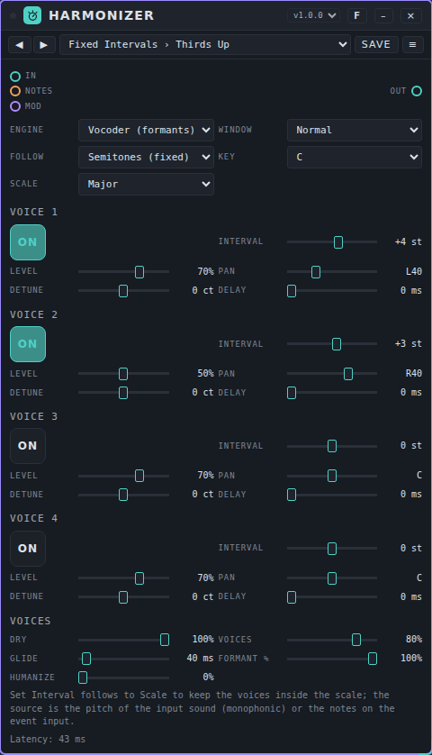

**Controls.**

- **Engine:** *Grain (fast)* or *Vocoder (formants)* (a phase vocoder that can keep the vowel colour of a voice). **Window:** *Fast*, *Normal* or *High* (more latency, cleaner low notes).
- **Follow** decides what the **Interval** knobs mean. *Semitones (fixed)*: every voice moves the sound by that number of semitones, whatever is played. *Scale, pitch of the input*: the intervals are **scale steps**; the pitch of the input (a single voice or line) is measured and every voice goes that many notes up or down in the scale. *Scale, notes (event)*: the same, but the source is the last note that arrives on the **Notes** port, for example from a melody or chord player, so you can also use it on a sound whose pitch cannot be measured.
- **Key** and **Scale** (Major, Minor, Harmonic minor, Melodic minor, Dorian, Phrygian, Lydian, Mixolydian, Major pentatonic, Minor pentatonic, Blues, Whole tone) decide which notes are allowed in the *Scale* settings. The source is first snapped to the nearest note of the scale (the higher one if two are equally close); then **Interval** counts notes of the scale. A step of 0 snaps the voice to the scale. The voice moves the sound by the distance to that note, so the intonation and the vibrato of the source stay.
- **Voice 1 to 4:** the pad **On** switches the voice, **Interval** (−24 to +24, in semitones or scale steps), **Level**, **Pan** (L to R), **Detune** (−100 to +100 ct) and **Delay** (0 to 100 ms; it adds to the compensation that keeps the voices in time).
- **Dry** is the level of the original, **Voices** the level of all voices together, **Glide** (0 to 1000 ms) how fast the voices move to a new note, **Formant %** (only in the *Vocoder*) how much of the vowel colour is kept, and **Humanize** a slow, random drift of the voices (up to about ±14 ct).

**Ports.** **In**, **Out**, **Notes** (event input), **Mod** (15 parameters: **Dry**, **Voices**, **Formant %** and per voice **Level**, **Pan**, **Detune**; the intervals, delays, glide and humanize are not modulated).

**Latency.** The card shows it: *Grain* 26.1 / 36.0 / 50.9 ms and *Vocoder* 21.3 / 42.6 / 85.3 ms for *Fast* / *Normal* / *High*, at 48 kHz. The dry sound and all voices are held in time (measured with noise: dry 36.0 ms and a voice at unison 36.0 ms in *Grain* *Normal*; 42.6 and 43.1 ms in the *Vocoder* *Normal*).

**Example.** A vocal line → Harmonizer → Mixer. Set **Follow** to *Scale, pitch of the input*, **Key** C and **Scale** Major, voice 1 at **Interval** +2 and voice 2 at +4: the voices sing thirds and fifths in the scale (preset **C Major Thirds**). For a pad or a synth lead without a measurable pitch: connect a melody to **Notes** and choose *Scale, notes (event)* (preset **Notes C Major Triad**).

**Presets.** Pack **Harmonizer Basics** (23 presets) in [`presets/harmonizer.patchkamer-presets.json`](../../presets/harmonizer.patchkamer-presets.json), in the folders **Fixed Intervals** (Thirds Up, Power Fifth, Octave Doubles, Low Octave Support, Fourths Stack, Sixths, Minor Third Pair, Triad Cloud), **In Scale (Pitch of Input)** (C Major Thirds, A Minor Thirds, G Major Below, Pentatonic Choir, Dorian Lead, Lydian Glow, Blues Backing, Harmonic Minor Drama), **Driven by Notes** (Notes C Major Triad, Notes A Minor Stack, Notes Pentatonic Pad) and **Choirs** (Detuned Choir, Whisper Doubles, Barbershop, Robot Chord).

**Tips and limits.** The measurement of the pitch is monophonic: use a single voice or line. With chords or noise the source is unreliable; use *Notes (event)* or *Semitones (fixed)*. Measured offline (`docs/tools/measure-pitch.mjs harmonizer`), over 21 combinations of intervals (−12 to +12 st) and base tones (110, 220, 440 Hz): the pitch error of a voice is on average 0.02 ct in the *Vocoder* (largest 0.06 ct) and 0.7 ct in *Grain* (largest 2.2 ct). The scale steps landed on the expected note (within 5 ct) in 8 of 8 test cases, both with the notes and with the measured pitch. Computing load per block of 128 samples (budget 2.67 ms) with four voices on, average / 99th percentile / maximum on this test machine: *Grain* *Normal* 2.9% / 4.1% / 15.0% (with pitch detection 4.5% / 6.1% / 20.7%), *Vocoder* *Fast* 5.2% / 9.9% / 15.1%, *Normal* 5.5% / 20.6% / 29.5% (with detection 7.0% / 21.7% / 30.8%), *High* 5.5% / 38.1% / 45.9%; one voice in the *Vocoder* *Normal* 4.0% / 13.1% / 19.5%. All voices share one analysis, so extra voices are cheap. Formant keeping on a pure tone lowers the level of the voices, because a sine has no formants. A guard limits the input at ±16 and replaces NaN by 0; with 40 random and extreme settings and bursts of NaN, ±Infinity and 1e30 there were no invalid samples and the sound came back every time. Nothing here has been listened to.

## Phaser

**What it is for.** A phaser sweeps a series of notches through the sound with a slow movement. It adds a swirling, passing character.

**Controls.**

- **Stages:** 4, 6, 8 or 12. More stages give more notches.
- **Tempo:** *free* or a note length (8 bars up to 1/8).
- **Rate** (0.02 to 10 Hz); only used when **Tempo** is *free*.
- **Depth** is shown in octaves: how far the sweep moves around **Center**.
- **Center** (100 to 6000 Hz) is the middle of the sweep.
- **Feedback** (−95% to +95%) feeds the output back in; negative values have another character.
- **Stereo** is the phase difference between left and right (0° to 180°).
- **Mix** blends original and effect.

**Ports.** **In**, **Out**, **Mod** (six parameters).

**Example.** Duofone → Phaser → Speakers. **Stages** 6, **Rate** 0.25 Hz, **Depth** 70%, **Center** 800 Hz, **Feedback** 50%, **Mix** 50%.

**Presets.** Pack **Phaser Basics** (11 presets) in [`presets/phaser.patchkamer-presets.json`](../../presets/phaser.patchkamer-presets.json), in the folders **Classic** (Soft Phase, Slow Sweep, Swirl, Hollow Notch), **Tempo** (Bar Phase, Long Rise, Stereo Drift), **Extreme** (Rocket, Warp Drive, Wobble Robot, Wide Vortex). Load it with the **Presets** tab of the library → **Import…** (or from a library that contains it), then choose a preset in the bar at the top of the card or step through them with ◀ ▶.

**Tips.** The card reminds you that **Stereo** sets the phase difference between left and right. A guard rebuilds the filter chains if a faulty value would poison the feedback; the sound is unchanged in normal use.

## Pitch Correction

**What it is for.** Pitch Correction tunes a single voice or melody line. It measures the pitch, picks the nearest allowed note and moves the sound there. You choose which of the twelve notes are allowed, how fast the correction acts (from hard and robotic to slow and natural), how much of the vibrato stays, and whether the vowel colour of the voice is kept.

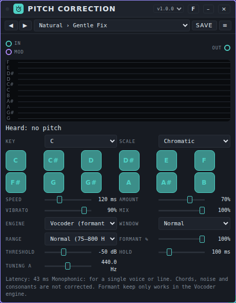

**Controls.**

- The **screen** at the top shows the last four seconds: the grey line is the pitch that is heard, the bright line the corrected pitch, the horizontal lines the notes (bright when allowed). Below it: **Heard** and **Corrected** show the note and the distance in cents.
- **Key** and **Scale** are a shortcut that sets the twelve **note switches** (C to B). Choose a key and a scale (Chromatic, Major, Minor, Harmonic minor, Melodic minor, Dorian, Phrygian, Lydian, Mixolydian, Major pentatonic, Minor pentatonic, Blues, Whole tone), or switch single notes on and off yourself: **Scale** then shows *Custom*. Only the switches decide what is corrected. If no switch is on, nothing is corrected.
- **Speed** (0 to 400 ms) is how quickly the pitch goes to the target note. 0 is hard (internally never faster than 3 ms) and gives the robotic effect; 40 to 120 ms sounds natural.
- **Amount** (0 to 100%) is how far the pitch is moved towards the target. **Vibrato** (0 to 100%) keeps that part of the singer's own vibrato and drift (0% flattens it, 100% leaves it).
- **Mix** is dry against corrected. The dry sound is delayed by the latency, so both stay in time.
- **Engine:** *Grain (fast)* has a low latency; the vowel colour moves a little with the pitch. *Vocoder (formants)* is a phase vocoder that keeps the vowel colour (**Formant %**, only in this engine) and has more latency. **Window:** *Fast*, *Normal* or *High*.
- **Range** limits the search for the pitch: *Low* (62 to 420 Hz), *Normal* (75 to 800 Hz) or *High* (90 to 1100 Hz). A narrower range gives fewer octave mistakes.
- **Threshold** (−70 to −20 dB) is the level below which no pitch is looked for, and **Hold** (0 to 500 ms) is how long the last correction stays when the pitch disappears. Parts without a clear pitch (silence, breath, consonants, noise) pass through **unprocessed**.
- **Tuning A** (430 to 450 Hz) is the reference pitch of the A.

**Ports.** **In**, **Out**, **Mod** (four parameters: **Speed**, **Amount**, **Vibrato**, **Mix**; nothing moves by itself).

**Latency.** The card shows it. At 48 kHz: *Grain* 11.1 / 12.0 / 14.0 ms and *Vocoder* 21.3 / 42.6 / 85.3 ms for *Fast* / *Normal* / *High*. Add about 20 ms for the pitch measurement before a correction has an effect (a jump of 40 ct is corrected 13 ms after the measurement with **Speed** 0). Use *Grain* with *Fast* to monitor yourself while singing; use the *Vocoder* when you tune a recording.

**Example.** A vocal track → Pitch Correction → Mixer. Choose preset **C Major Vocal** (**Speed** 40 ms, **Vibrato** 50%) in a song in C major. For a hard, robotic effect: preset **Hard Chromatic** (**Speed** 0, **Vibrato** 0%).

**Presets.** Pack **Pitch Correction Basics** (24 presets) in [`presets/pitch-correction.patchkamer-presets.json`](../../presets/pitch-correction.patchkamer-presets.json), in the folders **Natural** (Gentle Fix, Natural Vocal, Subtle Polish, Live Safe), **Hard Tune** (Hard Chromatic, Robot Voice, Stepped Glide, Slow Glide), **In Key** (C Major Vocal, A Minor Vocal, G Major Vocal, E Minor Pentatonic, Blues In G, D Dorian, F Lydian, Whole Tone Dream), **Instruments** (Bass Line, Guitar Lead, Whistle High, Violin Fix) and **Special** (Half Correction, Vibrato Smoother, Low Latency Monitor, High Quality Window).

**Tips and limits.** It is **monophonic**: use it on a single voice or line, never on chords or a mix. Consonants, breath and noise are not corrected. Strong octave jumps and a very noisy recording can fool the detection. The correction sounds robotic at **Speed** 0 with a changing pitch; that is the intended effect. The *Grain* engine adds roughness at large shifts; the *Vocoder* is smoother but has more latency and lowers the level of noise by about 3 dB (0.72 in amplitude) when it passes it through unprocessed.

Measured offline (`docs/tools/measure-pitch.mjs correction`). **Detection**, with 36 base tones per range (tested spans: 70 to 420 Hz for *Low*, 80 to 800 Hz for *Normal*, 150 to 1000 Hz for *High*), spread logarithmically with a random offset of ±50 ct, frames after 0.35 s: a clean sine, sawtooth or a vowel-like sound is within 10 ct in 100% of the frames in the ranges *Low* and *Normal* (the sawtooth in *High*: 97.2%, with 2.8% octave mistakes). With noise at 20 dB signal-to-noise: 100% within 10 ct. With noise at 10 dB: 97.9% (*Low*), 86.7% (*Normal*) and 77.1% (*High*) within 10 ct; octave mistakes 0%, 2.7% and 5.9%. With a vibrato of ±50 ct at 5.5 Hz: 100% within 50 ct and 80% (*Low*), 72% (*Normal*), 60% (*High*) within 10 ct, because the detection lags the moving pitch by the length of its window. **Correction** (chromatic, **Speed** 0, **Vibrato** 0%): the pitch after the correction is on average 0.00 ct (sine), 0.08 ct (sawtooth) and 0.05 ct (vowel-like) from the nearest note in the *Vocoder*, and 1.0, 0.9 and 0.5 ct in *Grain*, where it was 15.3 ct off on average; the largest error is 2.3 ct. **Scale:** in C major 20 of 20 test pitches (between the notes, not exactly halfway) went to the expected scale note within 10 ct. **Speed:** a 40 ct step is 90% corrected after 13 ms (**Speed** 0), 53 ms (20 ms), 120 ms (50 ms), 237 ms (100 ms) and 467 ms (200 ms). **Vibrato:** with a ±60 ct vibrato (spread 42 ct), **Vibrato** 0% leaves 7% (at **Speed** 0; 53% at **Speed** 20 ms, because a slower correction also follows the vibrato less), 50% leaves 50% and 100% leaves 98%. On Piano, Guitar and Formant Singer notes (chromatic, **Speed** 0, **Vibrato** 0%, *Vocoder*): the share of the frames within 10 ct of a semitone went from 49% to 99% (Piano), 89% to 100% (Guitar) and 32% to 73% (Formant Singer, which has a vibrato and a scoop at the start of a note); the detection of the input is within 50 ct of the played note in 93%, 100% and 100% of the frames. Computing load per block of 128 samples (budget 2.67 ms), average / 99th percentile / maximum on this test machine: *Grain* *Normal* 2.1% / 3.8% / 14.8%, *Vocoder* *Fast* 4.2% / 8.0% / 25.3%, *Normal* 5.8% / 21.1% / 33.1%, *High* 4.6% / 25.6% / 42.3%. A guard limits the input at ±16 and replaces NaN by 0; with 40 random and extreme settings and bursts of NaN, ±Infinity and 1e30 there were no invalid samples and the sound came back every time. Silence stays silent. Nothing here has been listened to.

## Pitch Shifter

**What it is for.** Pitch Shifter moves the pitch of a sound up or down, from −24 to +24 semitones plus ±100 cents, and keeps the tempo the same. It has three engines for different material, a mix, a feedback for octave echoes and shimmer, and a glide time.

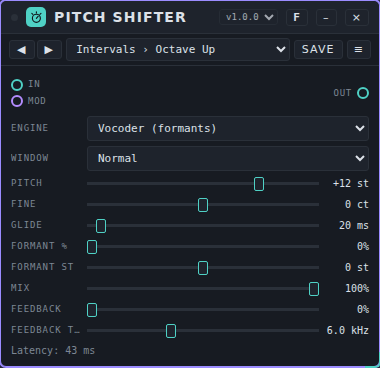

**Controls.**

- **Engine:** *Percussive (grains, fast)* uses very short grains and has almost no delay: for drums and short sounds (a sustained tone becomes rough). *Grain (voice, instruments)* uses longer grains and lines up the waveforms, which is smoother for voices, bass and instruments; formants move with the pitch. *Vocoder (formants)* is a phase vocoder with formant control; it needs the most latency and sounds the cleanest on voices and pads.
- **Window:** *Fast*, *Normal* or *High*. A bigger window gives more latency and a cleaner result, especially on low notes.
- **Pitch** (−24 to +24 st) is the interval in semitones and **Fine** (−100 to +100 ct) is the fine tuning.
- **Glide** (0 to 500 ms) is how long the pitch takes to move when you change **Pitch**, **Fine** or a modulation.
- **Formant %** (0 to 100%, only in the *Vocoder*) keeps the vowel colour of a voice when the pitch changes. At 0% the formants move with the pitch (the chipmunk effect). **Formant st** (−12 to +12 st) moves the formants on their own, for example to make a voice sound smaller or larger.
- **Mix** is dry against shifted. The dry sound is delayed by the minimum latency, so both stay in time.
- **Feedback** (0 to 90%) sends the shifted sound back into the input: with +12 st you get a rising shimmer, with −12 st octave echoes that sink. **Feedback tone** (500 to 16000 Hz) is a low-pass filter in that loop. The loop is limited softly, so it cannot run away.

**Ports.** **In**, **Out**, **Mod** (six parameters: **Pitch**, **Fine**, **Formant keep**, **Formant shift**, **Mix**, **Feedback**; nothing moves by itself, because a moving pitch is easily out of tune).

**Latency.** The card shows it. At 48 kHz: *Percussive* 1.3 / 2.0 / 3.0 ms, *Grain* 14.1 / 16.0 / 18.9 ms and *Vocoder* 21.3 / 42.6 / 85.3 ms for the window *Fast* / *Normal* / *High*. In the two grain engines the delay grows with the interval by about half a window times the distance from the original speed (octave up: about +10 to +26 ms; measured: *Grain* *Normal* +12 st 37 ms against 16 ms at 0 st). Use *Percussive* or *Grain* with *Fast* when you play along live; use the *Vocoder* when you can compensate the latency.

**Example.** A vocal → Pitch Shifter → Mixer. Preset **Natural Octave Down** (*Vocoder*, −12 st, **Formant %** 100%, **Mix** 60%) adds a low octave without a deep "monster" voice. A drum bus → Pitch Shifter with preset **Kick Drop** (*Percussive*, −12 st) for a lower kick. For shimmer: preset **Shimmer** (*Vocoder*, +12 st, **Feedback** 60%, **Feedback tone** 5 kHz, **Mix** 50%) on a send bus after a reverb.

**Presets.** Pack **Pitch Shifter Basics** (30 presets) in [`presets/pitch-shifter.patchkamer-presets.json`](../../presets/pitch-shifter.patchkamer-presets.json), in the folders **Intervals** (Octave Up, Octave Down, Fifth Up Layer, Fourth Down Layer, Major Third Up, Minor Third Down, Two Octaves Up, Two Octaves Down, Tritone), **Voice** (Chipmunk, Deep Voice, Gender Up, Gender Down, Natural Octave Down, Giant), **Doubling** (Subtle Doubler, Wide Detune, Slightly Flat, Micro Thickener), **Drums** (Kick Drop, Snare Up, Tom Down, Hat Up, Drum Octave Layer) and **Effects** (Shimmer, Octave Echo Down, Rising Echoes, Alien, Dark Layer, Smooth Glide).

**Tips and limits.** Measured offline (see `docs/tools/measure-pitch.mjs`), over 13 intervals from −24 to +24 st and the base tones 110, 220 and 440 Hz: the pitch error of a sine, a sawtooth and a chord is on average 0.02 ct in the *Vocoder* (largest 0.06 ct) and 0.8 ct in *Grain* *Normal* (largest 3.8 ct; *Fast* 1.5 ct, largest 7.7 ct). The leftover noise and distortion (THD+N) of a shifted sine is on average −53 dB in the *Vocoder* *Normal* (worst case −41 dB) and −46 dB in *Grain* *Normal* (worst case −30 dB). On Piano, Guitar and Formant Singer notes shifted +7 st the median pitch is within 5.7 ct in *Grain* and within 11.8 ct in the *Vocoder* (Piano; the others within 5.6 ct). The *Percussive* engine does not keep a tone clean: with a sine the mean frequency is within 40 ct, but the sound is rough. For a chord of three sines the *Vocoder* cannot separate the tones when they lie closer than about four FFT bins (at 110 Hz with the window *Fast* or *Normal*); the window *High* does. **Formant %** on a pure tone lowers the level (−8 dB at 100% for +7 st), because a sine has no formants: lower it, or use *Grain*, for such sounds. A formant test with an "a" vowel (first formant 650 Hz) moved by +7 st gives a strongest harmonic at 974 Hz without formant keeping and at 584 Hz with **Formant %** at 100%. Computing load per block of 128 samples (budget 2.67 ms), average / 99th percentile / maximum on this test machine: *Percussive* 0.4% / 0.7% / 12.7%, *Grain* *Normal* 0.8% / 3.6% / 7.7%, *Vocoder* *Fast* 4.2% / 12.4% / 16.8%, *Normal* 4.7% / 25.8% / 29.6%, *High* 4.2% / 33.0% / 40.9%. A guard limits the input at ±16 and replaces NaN by 0; with 40 random and extreme settings and bursts of NaN, ±Infinity and 1e30 there were no invalid samples and the sound came back every time. Nothing here has been listened to.

## Pump

**What it is for.** Pump lowers the volume of a source on the beat, so bass and pads make room for the kick. It does this in three ways: **Sidechain** listens to a second audio input (such as a kick), **Trigger** reacts to trigs or notes, and **Clock** ducks by itself on the tempo, without a cable. Do not confuse it with the **Pumping / Duck** effect in [Effect Chain](#effect-chain): that is a separate, simpler effect of that device.

**Controls.**

At the top:

- **Preset** is a list of starting settings inside the device (*Classic pump*, *Low end only*, *Kick as sidechain*, *Soft breathing*, *Gated (1/16)*, *Trigger from sequencer*, *Parallel (subtle)*). It changes to *Custom* when you change something. This is not the same list as the presets in the bar at the top of the card.
- **Source:** *Sidechain (audio)*, *Trigger (events)* or *Clock (automatic)*.
- **Clock: every:** 1/16, 1/8, 1/4 (every beat), 1/2 or whole bar. Only used for *Clock*.
- **What ducks:** *The whole signal*, *Low end only* or *High end only*.
- **Sidechain listens to:** *Low (kick)*, *Everything* or *High (hats)*. Only used for *Sidechain*.
- **On** / **Off (pass through)**, **Release follows tempo**, **Listen to sidechain** (hear what the detector hears, to set the detector filter) and **Test duck** (one duck to try the settings).
- A meter shows the gain reduction over time, with the number in dB next to the buttons.

**Duck:** **Depth** (how far the signal goes down), **Release** (20 to 1500 ms, how fast it comes back), **Attack** (0.1 to 60 ms), **Hold** (0 to 300 ms; Trigger and Clock) and **Curve** (0 = straight back, 1 = late and fast back, a tight pump).

**Sidechain detector** (only with *Sidechain*): **Threshold** (−60 to 0 dB), **Ratio** (1 to 20) and **Detector filter** (40 to 8000 Hz).

**Tone:** **Crossover** (40 to 1000 Hz, the split between low and high; only when *What ducks* is not *The whole signal*), **Mix** (parallel: the share of the ducked signal), **Make-up** (0 to 12 dB) and **Tempo release** (the share of the distance to the next beat, when **Release follows tempo** is on).

The card hides the controls that do not apply to the chosen source.

**Ports.** **In**, **Sidechain** (audio), **Out**, **Trigger** (events: trig, note) and **Mod**.

**Example.** Put Pump after a bass synth. Choose **Source** *Clock (automatic)*, **Clock: every** *1/4 (every beat)* and switch **Release follows tempo** on; start the clock: the bass ducks on every beat, without cables. For a sidechain, patch the kick (for example a separate drum output) into **Sidechain** and choose **Source** *Sidechain (audio)*.

**Presets.** Pack **Pump Basics** (13 presets) in [`presets/pump.patchkamer-presets.json`](../../presets/pump.patchkamer-presets.json), in the folders **Clock** (Gentle Pulse, Four on the Floor, Eighth Chop, Sixteenth Gate, Half Time Slam, Bar Breath), **Sidechain** (Kick Duck, Vocal Space, Hat Tickle), **Split and Mix** (Low Duck, Top Duck, Parallel Pump, Note Duck). Load it with the **Presets** tab of the library → **Import…** (or from a library that contains it), then choose a preset in the bar at the top of the card or step through them with ◀ ▶.

**Tips.** With **What ducks** on *Low end only*, the top of a pad stays while the bass gives way to the kick. The worklet limits its inputs to +24 dB and needs AudioWorklet; without it the sound passes through unchanged and the card says so.

## Resonator

**What it is for.** The resonator turns a rhythm or noise into a ringing, tuned sound. It has a bank of four resonators that you tune to a root note and a chord.

**Controls.**

- **Root** (a note from 24 to 84, the card shows the name) and **Chord**: *Unison*, *Octaves*, *Fifths*, *Major*, *Minor*, *Sus4*, *Minor 7*, *Fourths* or *Cluster*.
- **Decay** (0.05 to 8 s) is how long the resonators ring.
- **Damping** takes the high end out of the ringing.
- **Detune** (0 to 50 cents) spreads the four resonators slightly apart.
- **Tuning** (−12 to +12 semitones) moves the whole bank.
- **Mix** blends original and effect. **Level** (0 to 200%) is the output level.
- **Notes:** *ignore* or *root follows the notes*. With the second choice, notes that arrive on the **Notes** port set the root.

**Ports.** **In**, **Notes** (events), **Out**, **Mod**.

**Example.** A drum machine → Resonator → Speakers. **Chord** *Minor*, **Decay** 0.6 s, **Mix** 20%: a tuned tint on the drums. To let a keyboard decide the pitch: patch Keys → **Notes** and choose *root follows the notes*.

**Presets.** Pack **Resonator Basics** (13 presets) in [`presets/resonator.patchkamer-presets.json`](../../presets/resonator.patchkamer-presets.json), in the folders **Subtle** (Subtle Tint, Drum Tuner, Sub Ring, Marimba Hit), **Chords** (Minor Haze, Major Shine, Sus Cloud, Jazz Seven, Open Fourths, Note Follower), **Extreme** (Metal Drone, Endless Bells, Scream Pipes). Load it with the **Presets** tab of the library → **Import…** (or from a library that contains it), then choose a preset in the bar at the top of the card or step through them with ◀ ▶.

**Tips.** Resonator needs AudioWorklet; without it the sound passes through unchanged and the card says so. The device keeps the last played root (in `noteRoot`) when you save a preset.

## Reverb

**What it is for.** Reverb gives a sound a believable space. It has five models in one effect: **Hall** (large, long decay, rich), **Plate** (bright, smooth, dense almost at once), **Spring** (the "boing" of a spring tank, lo-fi), **Room** (small and intimate) and **Chamber** (in between). Everything runs in one audio worklet, so the dry signal stays free of delay.

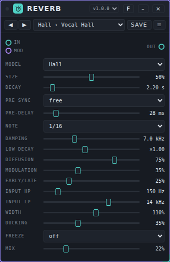

**Controls.**

- **Model:** Hall, Plate, Spring, Room or Chamber. Each model has its own delay lengths, diffusers and early reflections. Changing the model fades between the two (80 ms), without a click.
- **Size** (0 to 100%) scales the space: from half to twice the delay lengths. For Spring it is the length of the spring.
- **Decay** (0.1 to 30 s) is the reverb time (RT60) around 1 kHz.
- **Pre sync:** *free* or *to tempo*. **Pre-delay** (0 to 250 ms) is the time before the reverb starts; with *to tempo* the **Note** value sets it instead (1/32, 1/16, 1/8, 1/4 or 1/2, at most 500 ms).
- **Damping** (1 to 20 kHz) is the frequency at which the reverb time is half as long: lower is darker. **Low decay** (×0.25 to ×2) makes the low end die out faster or slower than the rest.
- **Diffusion** is how smooth the start of the reverb is; for Spring it is the dispersion, which sets how strong the "boing" is.
- **Modulation** moves the delay lengths slightly, which prevents a metallic ring.
- **Early/late** goes from only the tail (0%) to only early reflections (100%).
- **Input HP** and **Input LP** filter what goes into the reverb (the dry signal stays whole).
- **Width** (0 to 200%) is the stereo width of the reverb; 0 makes it mono.
- **Ducking** lowers the reverb while the source plays (it starts around -36 dB and is complete at -12 dB) and lets it bloom in the pauses.
- **Freeze:** *hold* closes the input and keeps the tail going. Use it on a pad or chord that has just ended.
- **Mix** is the balance between dry and reverb (equal power). On a send bus put it at 100%.

**Ports.** **In**, **Out**, **Mod** (13 parameters, in four lanes: space, tone, input, output).

**Example.** Duofone → Reverb → Speakers. Choose the preset **Pad Hall** for a pad, **Vocal Plate** for a voice and **Tight Drum Room** for drums. Raise **Pre-delay** to 30 to 50 ms to keep a voice clear in front of the space.

**Presets.** Pack **Reverb Rooms** (31 presets) in [`presets/reverb.patchkamer-presets.json`](../../presets/reverb.patchkamer-presets.json), in the folders **Hall**, **Plate**, **Spring**, **Room**, **Chamber** and **Creative** (Frozen Hall, Ducked Vocal Hall, Tempo Pre-delay Hall, Infinite Cloud, Metal Tank, Telephone Room, Dark Void), with settings for vocals, drums, strings, synths, pads and film. Load it with the **Presets** tab of the library → **Import…**, then choose a preset in the bar at the top of the card or step through them with ◀ ▶.

**Tips and limits.** These are offline measurements; they were **not listened to**, and these are approximations of kinds of spaces and not copies of a specific one.

- The reverb time follows **Decay** within about 5% (measured at 1 kHz with damping off: set 2.5 s gives 2.40 to 2.47 s on all models; 15 s gives 14.0 to 14.9 s). With **Damping** the high end decays faster as set (hall, 3 s: 3.0 s at 125 Hz, 2.6 s at 1 kHz, 1.6 s at 4 kHz with damping 3 kHz). **Low decay** works as a rough shelf: ×0.5 gives about 2.1 s at 125 Hz instead of 3.0 s.
- The tail gets as dense as noise after about 35 ms (Room) to 265 ms (Hall) with the default **Diffusion** and **Modulation**. At **Diffusion** 0 and **Modulation** 0 the Hall takes 700 ms and sounds more metallic; Spring is on purpose a ringing, combed sound.
- Left and right of the tail are well decorrelated (stereo correlation 0.04 to 0.1 for Hall, Plate, Room and Chamber).
- Rendering takes about 2 to 3% of the audio budget of one processor core per instance (worst case in a block: under 15%).
- **Freeze** does not make the tail grow: after 60 s the level is 0.9 dB (Hall) to 4.7 dB (Spring) lower, so a frozen tail is not literally endless.
- A NaN, infinity or enormous value on the input is limited and cannot make the reverb run away; a model that does break is wiped and restarts.

## Room

**What it is for.** Room puts a delay and a reverb in one effect. The delay and the reverb both take the input; they do not feed each other.

**Controls.**

- **Delay:** *to tempo (3/16)* or *free*. In the first case the echo time is three sixteenth steps of the studio clock.
- **Time** (0.05 to 1.5 s) is the echo time, only for *free*.
- **Feedback** (0 to 92%) is how long the echoes repeat.
- **Delay HP** (40 to 2000 Hz) is a high-pass filter in the echoes, so they do not get muddy.
- **Delay mix** is how much echo you hear.
- **Reverb** (0.3 to 8 s) is the length of the reverb.
- **Reverb tone** (500 to 16000 Hz) is a low-pass filter on the reverb.
- **Reverb mix** is how much reverb you hear.

**Ports.** **In**, **Out**, **Mod** (six parameters, in two lanes: delay and reverb).

**Example.** Duofone → Room → Speakers. Keep **Delay** on *to tempo (3/16)*, **Feedback** 35%, **Delay mix** 25%, **Reverb** 3 s and **Reverb mix** 25%.

**Presets.** Pack **Room Basics** (12 presets) in [`presets/room.patchkamer-presets.json`](../../presets/room.patchkamer-presets.json), in the folders **Spaces** (Small Room, Warm Hall, Bright Plate, Cathedral), **Delays** (Dotted Echo, Slapback, Long Ping, Dub Echo), **Space FX** (Endless Wash, Dark Void, Bright Cloud, Metal Tunnel). Load it with the **Presets** tab of the library → **Import…** (or from a library that contains it), then choose a preset in the bar at the top of the card or step through them with ◀ ▶.

**Tips.** The reverb tail is generated from noise when you change **Reverb**, so it differs a little each time. The packs keep **Feedback** below 75%. A guard lowers the feedback for a moment if the echo loop starts to grow, and rebuilds the loop if it gets a faulty value.

## Tremolo

**What it is for.** Tremolo makes the volume go up and down at a steady speed. It has two knobs.

**Controls.**

- **Rate** (0.1 to 20 Hz) is the speed.
- **Depth** (0 to 100%) is how far the volume goes down. At 100% the sound goes fully silent at the bottom of every movement.

**Ports.** **In**, **Out**, **Mod** (**Rate** and **Depth**).

**Example.** A pad → Tremolo → Speakers. **Rate** 6 Hz, **Depth** 15% is a light shimmer; **Rate** 4 Hz, **Depth** 50% a clear pulse.

**Presets.** Pack **Tremolo Basics** (13 presets) in [`presets/tremolo.patchkamer-presets.json`](../../presets/tremolo.patchkamer-presets.json), in the folders **Classic** (Subtle Shimmer, Gentle Pulse, Vintage Amp, Deep Throb), **Slow** (Slow Swell, Tidal, Deep Breath), **Rhythmic** (Slow Pump, Eighth Chop, Sixteenth Gate), **Extreme** (Helicopter, Ring Buzz, Seasick Wobble). Load it with the **Presets** tab of the library → **Import…** (or from a library that contains it), then choose a preset in the bar at the top of the card or step through them with ◀ ▶.

**Tips.** Tremolo only changes the volume. There is no tempo setting: the rate is always in Hz.

## Vocoder

**What it is for.** The Vocoder makes a voice (or another sound) play a synth. The voice opens 16 frequency bands on a **carrier**: the built-in synth (sawtooth, pulse or triangle, played with notes), noise, or an external synth on the second audio input. The result is the classic talking synth.

**Controls.**

At the top:

- **Preset** is a list of starting settings inside the device (*Warm Robot*, *Whisper Choir*, *Hard Machine*, *Ghost Choir*, *Subtle Voice*, *External Synth*). This is not the same list as the presets in the bar at the top of the card.
- **Internal waveform:** *Sawtooth*, *Pulse* or *Triangle*.
- **Carrier chord on** plays a fixed chord (C, G, C, E♭) on the built-in synth; **Carrier chord off** stops it.
- A scope shows the waveform of the output.

Sliders: **Voice sensitivity** (how strongly the voice opens the bands), **Envelope response** (5 to 80 Hz, how fast the bands follow the voice), **Formant shift** (±12 semitones), **Brightness**, **Air / noise** (noise in the carrier), **Internal carrier**, **External carrier**, **Dry voice** (the original voice mixed in), **Vocoder** (the level of the vocoded sound), **Synth release** (0.02 to 3 s) and **Output**.

**Ports.** **Voice / speech** (audio: the voice), **External carrier** (audio: an external synth), **Carrier notes** (events: notes for the built-in synth), **Vocoder** (audio out) and **Mod**.

**Example.** Patch a sound source with speech into **Voice / speech**, a keyboard (Keys) into **Carrier notes** and **Vocoder** to the mixer. Play notes: the built-in synth speaks with the rhythm of the voice. For an external synth: patch its audio into **External carrier**, set **External carrier** to 100% and **Internal carrier** to 0%.

**Presets.** Pack **Vocoder Basics** (14 presets) in [`presets/vocoder.patchkamer-presets.json`](../../presets/vocoder.patchkamer-presets.json), in the folders **Voices** (Classic Robot, Warm Pad Voice, Soft Choir, Voice Doubler), **Textures** (Whisper, Breathy Pad, Ghost Choir, Deep Giant), **Extreme** (Steel Machine, Tiny Alien, Screamer, Gate Chatter), **External** (External Clean, External Edge). Load it with the **Presets** tab of the library → **Import…** (or from a library that contains it), then choose a preset in the bar at the top of the card or step through them with ◀ ▶.

**Tips.** Without a signal on the voice input the vocoder stays silent. The Vocoder does not ask for microphone access itself; use another device or sample as the source. All 16 bands run on standard Web Audio nodes (no worklet). A guard replaces the bands if a faulty value (`NaN` or infinity), especially on the external carrier, would poison them.

## If it does not work

- **No sound.** Check the cables: audio from the source into **In** (for Vocoder into **Voice / speech**) and from **Out** to the Mixer or Speakers. Press **Start**, or click anywhere in Patchkamer: browsers pause audio until you interact. See also section 13 of the [basic manual](../USER-MANUAL_EN.md).
- **The effect does nothing.** Check **Mix** (at 0% you hear only the original), the slot in Effect Chain (**Bypass on**, or **Pass-through**, or **Effect mix** at 0%) and **Depth** (at 0% a sweeping effect does not move).
- **The effect passes the sound through unchanged.** Flanger, Frequency Shifter, Pump, Resonator and three filter types (ladder and the two comb filters) need AudioWorklet. If your browser has none, the card says so. Use a current Chrome or Edge.
- **Tempo-synced movement stands still.** Press **Start**: the tempo options follow the studio clock. Pump set to *Clock* and the rhythm effects in Effect Chain need it too.
- **Pump does not duck.** *Sidechain* needs a signal on the **Sidechain** port (and it must pass the **Threshold**); *Trigger* needs trigs or notes on **Trigger**; *Clock* needs the clock to run.
- **Resonator does not follow the notes.** Choose *root follows the notes* under **Notes** and patch notes into **Notes**.
- **Crackles or dropouts.** Effect Chain runs many effects in the main thread: use fewer slots, or switch the analyzer to *Off / less CPU*. See also Settings → Audio in the [basic manual](../USER-MANUAL_EN.md).
- **A knob does not move with the modulator.** The knob is the base value. Check the cable (purple) into **Mod** and that the modulator has a lane for this effect. Choices (lists) are not modulated.
