# Gebruikershandleiding effecten

*English version: [USER-MANUAL_EN.md](USER-MANUAL_EN.md)*

Effecten nemen geluid op, veranderen het en sturen het door. Deze handleiding beschrijft de 23 effecten in [`devices/effects/`](../../devices/effects/README_NL.md): Bitcrusher, Chorus, Compressor, Convolution Reverb, De-esser, Delay, Distortion, Effect Chain, Filter, Flanger, Frequency Shifter, Gate, Grit, Harmonizer, Phaser, Pitch Correction, Pitch Shifter, Pump, Resonator, Reverb, Room, Tremolo en Vocoder. Voor het starten van Patchkamer, het laden van een bibliotheek en het trekken van kabels: zie de [basishandleiding](../USER-MANUAL_NL.md).

## Inhoud

1. [Welk effect voor welk doel](#welk-effect-voor-welk-doel)
2. [Effecten gebruiken](#effecten-gebruiken)
3. [De volgorde van effecten in een keten](#de-volgorde-van-effecten-in-een-keten)
4. [Serieel en parallel](#serieel-en-parallel)
5. [Recepten per muziekstijl](#recepten-per-muziekstijl)
6. [Bitcrusher](#bitcrusher)
7. [Chorus](#chorus)
8. [Compressor](#compressor)
9. [Convolution Reverb](#convolution-reverb)
10. [De-esser](#de-esser)
11. [Delay](#delay)
12. [Distortion](#distortion)
13. [Effect Chain](#effect-chain)
14. [Filter](#filter)
15. [Flanger](#flanger)
16. [Frequency Shifter](#frequency-shifter)
17. [Gate](#gate)
18. [Grit](#grit)
19. [Harmonizer](#harmonizer)
20. [Phaser](#phaser)
21. [Pitch Correction](#pitch-correction)
22. [Pitch Shifter](#pitch-shifter)
23. [Pump](#pump)
24. [Resonator](#resonator)
25. [Reverb](#reverb)
26. [Room](#room)
27. [Tremolo](#tremolo)
28. [Vocoder](#vocoder)
29. [Als het niet werkt](#als-het-niet-werkt)

## Welk effect voor welk doel

| Ik wil… | Gebruik | Waarom |
|---|---|---|
| Een geluid dikker of breder maken (beweging) | [Chorus](#chorus), [Flanger](#flanger), [Phaser](#phaser) | Drie effecten met een langzaam bewegende zweep (LFO). Chorus heeft een Ensemble-stand met drie stemmen. |
| Het volume laten pulseren | [Tremolo](#tremolo) | Snelheid en diepte, meer niet. |
| Een geluid onharmonisch of metalig maken | [Frequency Shifter](#frequency-shifter) | Verschuift alle frequenties een vast aantal Hz. Dat is geen toonhoogteverandering. |
| Vervormen en donkerder maken | [Grit](#grit) | Drive in een resonant laagdoorlaatfilter, met een LFO op de cutoff. |
| Echo en galm toevoegen | [Room](#room) | Eén effect met een delay en een galm naast elkaar. |
| Een geluid laten naklinken op een akkoord | [Resonator](#resonator) | Vier gestemde resonatoren, afgestemd op een grondtoon en een akkoord. |
| Bas of pads onder de kick laten wijken | [Pump](#pump) | Sidechain, trigger of de klok van de studio. |
| De klank vormen, een band weghalen of benadrukken | [Filter](#filter) | Tien filtertypen, van laagdoorlaat tot klinkers en kamfilters. |
| Een stem laten praten door een synth | [Vocoder](#vocoder) | 16 banden; de stem opent ze op een draaggolf. |
| Een hele keten bouwen (ambient, cinematic, techno, dub, lo-fi…) | [Effect Chain](#effect-chain) | Tot 8 effecten achter elkaar uit een lijst van 33, met kant-en-klare ketens als presets. |
| Een geluid lo-fi, 8-bit of digitaal kapot maken | [Bitcrusher](#bitcrusher) | Verlaagt bitdiepte en samplerate; aliasing, dither en ruis zijn keuzes. Ook goed voor telefoon- en radiogeluid. |
| De harde en zachte stukken van een stem, bas of mix gelijkmaken | [Compressor](#compressor) | Drempel, ratio, knee, attack en release; automatische release en make-up; peak of RMS; lookahead; parallelle mix; sidechain-filter; mid/side. |
| Een geluid in een bepaalde ruimte of apparaat zetten (kerk, grot, stalen plaat, veer, buis) of in je eigen impulsrespons | [Convolution Reverb](#convolution-reverb) | 15 ingebouwde impulsresponsies en je eigen bestanden, met trim, stretch en balans vroeg/laat. |
| Scherpe s-klanken in een stem temmen | [De-esser](#de-esser) | Dempt alleen de band waar de s zit (of alles), met meeluisteren met de band; temt ook heldere bekkens en strijkers. |
| Echo's toevoegen die op het tempo vastzitten (punt-achtste, triolen, swing) of vrij in milliseconden | [Delay](#delay) | Sync van 1/64 tot 2 maten of vrije tijd; ping-pong, filters in de lus, ducking, tape-wow en omgekeerde echo's. |
| Warmte, crunch, fuzz of zware vervorming toevoegen | [Distortion](#distortion) | Acht soorten met oversampling, toonregelaars en een droog/nat-mix voor parallelle verzadiging. |
| Ruis, brom of lekkage tussen de noten weghalen | [Gate](#gate) | Een gate of zachte expander met hold, hysterese en lookahead; dempt ook een spoor onder een stem. |
| Harmoniestemmen toevoegen aan een zanglijn of melodie | [Harmonizer](#harmonizer) | Tot vier stemmen op vaste intervallen of binnen een toonladder, die de toon van de ingang of de noten op de eventingang volgen. |
| Een valse stem of lijn naar een toonladder stemmen | [Pitch Correction](#pitch-correction) | Monofone detectie, twaalf notenschakelaars, correctiesnelheid van hard tot traag, vibrato behouden of vlak. |
| De toonhoogte van een geluid omhoog of omlaag zetten zonder het tempo te veranderen | [Pitch Shifter](#pitch-shifter) | Drie motoren: percussief voor drums, korrel voor stemmen en instrumenten, vocoder als formanten tellen. Ook octaaflagen en shimmer. |
| Een geloofwaardige ruimte geven aan zang, drums, snaren of een pad (hall, plate, spring, room) | [Reverb](#reverb) | Vijf galmmodellen met decay, demping, pre-delay, ducking en freeze. |

## Effecten gebruiken

- Een effect heeft een audio-ingang (**In**) en een audio-uitgang (**Uit**). Zet het tussen de geluidsbron en het volgende apparaat: bijvoorbeeld Duofone → effect → Mixer of Speakers. Voor de andere manieren om een apparaat aan te sluiten: zie de [basishandleiding](../USER-MANUAL_NL.md) (onderdeel 4 en 5).
- De paarse **Mod**-poort neemt een modulator aan. Die kan de knoppen van het effect bewegen terwijl het speelt. De knop blijft de basiswaarde; de modulator beweegt eromheen.
- Effecten zijn apparaten **zonder eigen geluid**, dus ze hebben **presets** en geen tunes. Kies er een in de balk bovenaan de kaart, blader met ◀ ▶ en bewaar je eigen met **Bewaar**. Zie [Presets](../../presets/README_NL.md) voor de pakketten en het importeren: de tab **Presets** van de bibliotheek → **Importeren…**.
- Dubbelklik op een schuif om terug te gaan naar de beginwaarde.
- Een **Mix**-knop mengt het originele (droge) en het bewerkte (natte) geluid. Op 0% hoor je alleen het origineel.
- Effecten die zwiepen (Chorus, Flanger, Phaser) draaien vrij in Hz of volgen het tempo van de studio (**Tempo**). Start de klok met **Start** om beweging op tempo te horen.

## De volgorde van effecten in een keten

De volgorde telt, want elk effect werkt op wat het vorige maakte. Een gebruikelijke volgorde, van bron naar uitgang:

1. Eerst **opruimen**: een [Filter](#filter) als hoogdoorlaat haalt dreun weg waar de volgende effecten anders op zouden reageren.
2. **Dynamiek**: een [Gate](#gate) om ruis tussen frases weg te halen, daarna een [Compressor](#compressor); een [De-esser](#de-esser) op een stem komt na de compressor, want compressie maakt het sissen harder.
3. **Klank**: vorm het geluid opnieuw met een Filter als het niveau stabiel is.
4. **Toonhoogte**: [Pitch Shifter](#pitch-shifter), [Harmonizer](#harmonizer) of [Pitch Correction](#pitch-correction) werken het best op een schoon, droog geluid, dus vóór de effecten die het uitsmeren.
5. **Karakter**: [Distortion](#distortion), [Grit](#grit) of [Bitcrusher](#bitcrusher). Verzadiging geeft gewicht aan dunne geluiden; een beetje vervorming helpt een instrument door een drukke mix heen.
6. **Beweging**: [Chorus](#chorus), [Flanger](#flanger), [Phaser](#phaser), [Tremolo](#tremolo).
7. **Ritme**: [Pump](#pump), of de trance gate in [Effect Chain](#effect-chain).
8. **Echo** ([Delay](#delay)) en daarna **ruimte** ([Reverb](#reverb), [Room](#room) of [Convolution Reverb](#convolution-reverb)), zodat de echo's ook een ruimte krijgen. Tijdeffecten staan vaak het best op een send (zie [Serieel en parallel](#serieel-en-parallel)).
9. **Breedte** en een **limiter** aan het eind, want een keten met veel effecten kan harder worden dan zijn ingang.

Dit is een beginpunt, geen regel. Vervorming na een galm klinkt anders dan ervoor; probeer beide. [Effect Chain](#effect-chain) volgt deze volgorde in de meeste van zijn presets.

Voor een paar losse effecten verbind je ze in serie met kabels (**Uit** van effect 1 naar **In** van effect 2). Voor meer dan drie of vier doet [Effect Chain](#effect-chain) het in één kaart.

## Serieel en parallel

- **Serieel** betekent het ene effect na het andere, zoals hierboven: elk effect bewerkt de uitvoer van het vorige.
- **Parallel** betekent dat je het originele (droge) geluid mengt met een zwaar bewerkte kopie. Zo kun je stevig bewerken zonder het karakter van het origineel kwijt te raken. In Patchkamer doe je dat op drie manieren:
  - Met de knop **Mix** van het effect zelf. [Compressor](#compressor) heeft een parallelle mix voor parallelle compressie (een sterk samengedrukte kopie onder het origineel); [Distortion](#distortion) heeft er een voor parallelle verzadiging.
  - Met een **send en return op de Mixer**: stuur een deel van een kanaal naar één effect en haal het effect terug op een returnkanaal. Eén Delay of Reverb kan zo veel kanalen bedienen. Zet het effect zelf dan op 100% nat.
  - Met kabels: splits de uitgang van een bron naar twee kabels, één naar het effect en één naar een Mixerkanaal.
- Gebruik parallel voor galm, delay en zware compressie of vervorming; gebruik serieel voor opruimen, vormen en alles wat het geluid helemaal moet veranderen.

## Recepten per muziekstijl

Dit zijn beginpunten. Elk effect heeft presets in de presetbalk van zijn kaart; begin daar en pas aan.

| Stijl | Idee | Effecten |
|---|---|---|
| Hiphop, 808-bas | Voeg midden-harmonischen toe zodat de bas op kleine speakers hoorbaar is, en laat de bas wijken voor de kick | [Distortion](#distortion) (zacht of tape, mix naar smaak), [Pump](#pump) of [Compressor](#compressor) met een externe sidechain |
| EDM, opbouw en drops | Filtersweeps voor spanning, een delay op de beat, een brede ruimte | [Filter](#filter) met een modulator op de cutoff, [Delay](#delay) gesynchroniseerd aan de beat, [Reverb](#reverb) op een send |
| Rock, drums en gitaar | Ruimte-energie op de drums en slapback op gitaar of stem | [Compressor](#compressor) parallel op de drumbus, [Delay](#delay) met korte sync of vrije tijd (40 tot 120 ms), [Reverb](#reverb) in het veermodel |
| Stem | Gelijk niveau, geen scherpe s-klanken, ruimte eromheen | [Gate](#gate), [Compressor](#compressor), [De-esser](#de-esser), daarna [Reverb](#reverb) (plate) op een send |
| Lo-fi | Crunch, smalle band, een beetje beweging | [Bitcrusher](#bitcrusher), [Filter](#filter) als laagdoorlaat, [Tremolo](#tremolo) of [Chorus](#chorus) |
| Ambient en filmisch | Lange ruimtes, evoluerende echo's | [Reverb](#reverb) in het hallmodel of [Convolution Reverb](#convolution-reverb), [Delay](#delay) met lange feedback en modulatie |
| Dub | Echo's die in de ruimte wegsterven | [Delay](#delay) met de tape-tijdwissel en een laagdoorlaat in de lus, [Reverb](#reverb) |
| Harmonieën en zang | Stemmen in de toonladder erbij, de toonhoogte corrigeren | [Harmonizer](#harmonizer), [Pitch Correction](#pitch-correction) |

## Bitcrusher

**Waar het voor dient.** Bitcrusher maakt geluid digitaal ruw op twee manieren: het verlaagt de **bitdiepte** (minder volumestappen, dus kwantiseringsruis) en de **samplerate** (minder momentopnames per seconde, dus aliasing). Beide staan los van elkaar, en wat normaal op de achtergrond gebeurt (anti-alias-filter, dither, ruis) is hier een regelaar waar je zelf over beslist.

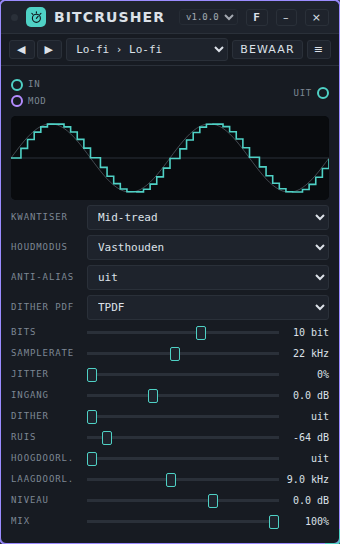

**De regelaars.**

- Het **scherm** bovenin toont een berekende sinusgolf door jouw instellingen: de dunne lijn is het origineel, de heldere lijn de gecrushte golf. Een vage lijn erbovenop is het echte signaal, als er een is. Het scherm toont geen dither, ruis of jitter.
- **Kwantiser:** *Mid-tread* (nul is een niveau; bij 1 bit blijven er maar twee over), *Mid-rise* (geen nulniveau; 1 bit geeft een zuivere vierkante golf), *Afkappen* (naar beneden afronden, zoals goedkope converters) en *µ-law* (eerst comprimeren, zodat zachte geluiden fijnere stappen houden).
- **Houdmodus:** *Vasthouden* houdt elke sample vast tot de volgende (trappen); *Lineair* trekt rechte lijnen tussen de samples, wat zachter is en één houdperiode later komt dan het droge geluid.
- **Anti-alias:** *uit* laat alles boven de halve samplerate terugvouwen (het typische ruwe geluid); *aan* filtert dat eerst weg (vierde orde, op 0,45 × de samplerate).
- **Dither PDF:** de soort dither: *RPDF*, *TPDF* (de standaard) of *Gevormd* (TPDF waarvan de ruis naar de hoge tonen is geschoven).
- **Bits** (1 tot 16, in stappen van 0,1) is de bitdiepte. Breuken werken ook: 7,5 bit heeft 2^7,5 niveaus.
- **Samplerate** (100 tot 48000 Hz) is de doelsamplerate. Op of boven de samplerate van de audiomotor wordt er niets verminderd.
- **Jitter** (0 tot 100%) maakt de samplekloktik onregelmatig (100% is ±50% van de periode).
- **Ingang** (−12 tot +24 dB) is de versterking voor de kwantiseerder. Een zwakkere ingang gebruikt minder stappen.
- **Dither** (uit, dan 0 tot 100%) voegt de ruis toe waardoor kwantisering zachter klinkt.
- **Ruis** (uit tot −20 dB, het pieklevel) voegt witte ruis toe voor de kwantiseerder.
- **Hoogdoorl.** (20 tot 4000 Hz) en **Laagdoorl.** (500 tot 20000 Hz) filteren na het crushen. *uit* aan de randen.
- **Niveau** (−24 tot +12 dB) en **Mix** (droog tegen nat).

**Poorten.** **In**, **Uit**, **Mod** (tien parameters).

**Voorbeeld.** Drumcomputer → Bitcrusher → Mixer. Voor een radio- of telefoonstem: preset **Telephone** (*µ-law*, 8 bit, 8 kHz, **Anti-alias** aan, **Hoogdoorl.** 300 Hz, **Laagdoorl.** 3,4 kHz). Voor klassiek sampler-grit: preset **Vintage Sampler**.

**Presets.** Pakket **Bitcrusher Basics** (25 presets) in [`presets/bitcrusher.patchkamer-presets.json`](../../presets/bitcrusher.patchkamer-presets.json), in de mappen **Lo-fi** (Lo-fi, Dusty Lo-fi, Subtle Crunch, Warm Lo-fi Mix, Smooth Decimator), **Retro** (8-bit, 4-bit Arcade, Vintage Sampler, Early Sampler, Cheap Converter, Dithered Crush), **Industrial** (Industrial, Digital Shred, Glitch Jitter, Noise Floor, Sub Crusher, Shaped Hiss), **Communication** (Radio, Telephone, Walkie Talkie, AM Radio, Old Intercom) en **Drums and Bus** (Crushed Drums, Parallel Crunch, Crushed Snare). Ik heb ze niet beluisterd.

**Tips en grenzen.** Gemeten met een toon van 1 kHz op −0,9 dBFS en zonder samplerate-reductie: de signaal-ruisverhouding is 49,9 dB bij 8 bit en 98,0 dB bij 16 bit (theorie 49,0 en 97,2 dB), met *Mid-tread*. Bij een zachte toon (−40 dBFS, 8 bit) zakt de harmonische vervorming van −11 dB zonder dither naar ongeveer −36 dB met TPDF-dither, tegen de prijs van wat ruis. Bij een samplerate van 12 kHz vouwt een toon van 9 kHz naar 3 kHz: −6,9 dBFS met **Anti-alias** uit en −27,5 dBFS met aan. Jitter kost signaalkwaliteit bij hoge tonen: een toon van 1 kHz bij 24 kHz samplerate houdt 30 dB signaal-ruis bij 25% jitter en 24 dB bij 100%. **Ruis** op 100% is −24,8 dBFS RMS. Een mid-rise-kwantiseerder heeft in stilte een vaste offset; die wordt door een DC-blokkering van 8 Hz geblokkeerd. Rekenlast in Node op deze machine: gemiddeld 0,4% tot 0,5% van het tijdbudget van een blok (p99 0,7%). Een bewaker begrenst de ingang op ±16 (+24 dB), maakt van NaN een 0 en zet de filters terug als er een misgaat.

## Chorus

**Waar het voor dient.** Chorus verdubbelt een geluid met kleine, langzaam bewegende vertragingen. Het geluid wordt breder en minder statisch. Er zijn twee soorten: **Chorus (2 stemmen)** en **Ensemble (3 stemmen)**, waarbij elke stem een trage en een snelle beweging heeft.

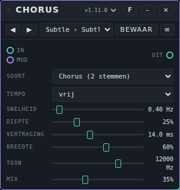

**De regelaars.**

- **Soort:** *Ensemble (3 stemmen)* of *Chorus (2 stemmen)*.
- **Tempo:** *vrij* (de knop **Snelheid** bepaalt) of een nootlengte: 4 maten, 1 maat, 1/2, 1/4 of 1/8 per beweging.
- **Snelheid** (0,03 tot 8 Hz) is het tempo van de beweging; alleen in gebruik als **Tempo** op *vrij* staat.
- **Diepte** is de grootte van de beweging.
- **Vertraging** (3 tot 30 ms) is de basisvertraging van de stemmen.
- **Breedte** bepaalt hoe ver de stemmen over links en rechts verdeeld zijn. Op 0% zitten alle stemmen in het midden.
- **Toon** (800 tot 16000 Hz) is een laagdoorlaatfilter op het bewerkte geluid.
- **Mix** mengt origineel en effect.

**Poorten.** **In**, **Uit**, **Mod** (zes parameters: Snelheid, Diepte, Vertraging, Breedte, Toon en Mix).

**Voorbeeld.** Duofone → Chorus → Speakers. Kies de soort *Chorus (2 stemmen)*, **Snelheid** 0,4 Hz, **Diepte** 25%, **Vertraging** 14 ms, **Mix** 35%: een lichte verdubbeling. Kies voor een pad *Ensemble (3 stemmen)* en een hogere **Breedte**.

**Presets.** Pakket **Chorus Basics** (12 presets) in [`presets/chorus.patchkamer-presets.json`](../../presets/chorus.patchkamer-presets.json), in de mappen **Subtle** (Subtle Double, Classic Chorus, Thick Mono), **Ensemble** (String Section, Wide Pad, Dark Choir), **Movement** (Bar Shimmer, Slow Wash, Eighth Pulse), **Extreme** (Seasick, Tape Warble, Lo-fi Swarm). Laad het met de tab **Presets** van de bibliotheek → **Importeren…** (of via een bibliotheek die het bevat) en kies dan een preset in de balk bovenaan de kaart, of blader met ◀ ▶.

**Tips.** Met **Breedte** op 0% zit elke stem in het midden; gebruik dat als het geluid mono moet blijven. Het toonfilter heeft een bewaker: komt er een foutieve waarde (`NaN` of oneindig) op de ingang, dan wordt het filter binnen een fractie van een seconde vervangen en komt het geluid terug.

## Compressor

**Waar het voor is.** Compressor maakt het verschil tussen zacht en luid kleiner. Alles boven de **Drempel** wordt omlaag gedraaid: bij een **Ratio** van 4:1 komt een signaal dat 8 dB boven de drempel zit er 2 dB boven uit. Het is het gereedschap om een stem of bas gelijk te trekken, drums aan elkaar te lijmen, pieken te vangen en (met **Mix**) voor parallelle compressie. Voor een pompend effect op de tel is er ook [Pump](#pump); met een externe sidechain kan de Compressor dat ook.

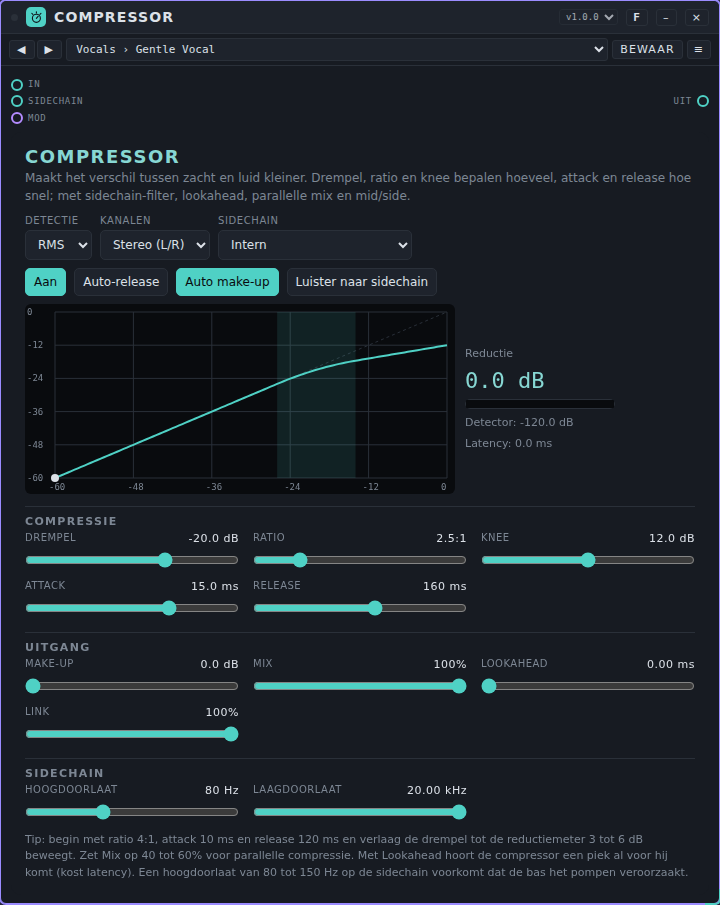

**Bediening.**

Bovenaan:

- **Detectie:** *Peak* volgt de top van elke golf, *RMS* het gemiddelde niveau over 10 ms (gladder, dichter bij hoe hard het klinkt).
- **Kanalen:** *Stereo (L/R)* of *Mid/Side*. Bij *Mid/Side* worden het midden (wat beide kanalen delen) en de zijkanten apart gecomprimeerd, handig om de breedte te beheersen.
- **Sidechain:** *Intern* (de detector luistert naar de ingang) of *Extern (ingang Sidechain)* (hij luistert naar wat je op de poort **Sidechain** trekt, bijvoorbeeld een kick). Zonder kabel op die poort wordt er niet gecomprimeerd.
- **Aan** / **Uit (doorlaten)**, **Auto-release** (twee releases tegelijk, 30 ms en 400 ms: snel herstel na een piek, traag na aanhoudend geluid), **Auto make-up** (telt de reductie bij een ingang van −12 dB bij de make-up op) en **Luister naar sidechain** (hoor wat de detector hoort, na de filters).
- De **curve** toont het ingangsniveau tegen het uitgangsniveau, met de knee gearceerd en een stip op het actuele niveau. Ernaast: de **Reductie** in dB, een meter die vol loopt naarmate de reductie groter wordt, het **Detector**-niveau en de **Latency**.

**Compressie:** **Drempel** (−60 tot 0 dB), **Ratio** (1:1 tot ∞:1; helemaal rechts is het oneindig, een limiter), **Knee** (0 tot 24 dB: 0 is hard, meer geeft een zachte start rond de drempel), **Attack** (0,05 tot 200 ms) en **Release** (5 tot 2000 ms).

**Uitgang:** **Make-up** (0 tot 24 dB), **Mix** (het deel van het gecomprimeerde signaal; onder 100% is het parallelle compressie), **Lookahead** (0 tot 10 ms) en **Link** (100%: beide kanalen krijgen dezelfde reductie, zodat het stereobeeld blijft staan; 0%: elk kanaal apart).

**Sidechain:** **Hoogdoorlaat** (20 tot 1000 Hz; 20 Hz is uit) en **Laagdoorlaat** (1 tot 20 kHz; 20 kHz is uit), alleen op de detector, niet op het geluid. Een hoogdoorlaat van 80 tot 150 Hz voorkomt dat de bas de compressie op gang brengt.

**Poorten.** **In**, **Sidechain** (audio), **Uit** en **Mod** (tien parameters; Lookahead is bewust niet stuurbaar).

**Voorbeeld.** Stem → Compressor → Mixer. Kies de preset **Vocals › Gentle Vocal**, verlaag de **Drempel** tot de reductie bij de luide woorden 3 tot 6 dB toont en stel **Make-up** (of **Auto make-up**) in zodat het niveau voor en na ongeveer gelijk is. Voor een drumbus: preset **Drums › Drum Bus Glue**. Voor parallelle compressie op drums: preset **Parallel › Parallel Punch** (een hard gecomprimeerde kopie, voor 35% bijgemengd). Voor een kick-pomp: trek de kick naar **Sidechain**, preset **Pumping › Kick Pump**.

**Presets.** Pack **Compressor Basics** (30 presets) in [`presets/compressor.patchkamer-presets.json`](../../presets/compressor.patchkamer-presets.json), in de mappen **Vocals** (Gentle Vocal, Vocal Leveler, Vocal Presence, Vocal Peak Catcher, Spoken Word), **Drums** (Drum Bus Glue, Punchy Drums, Snare Snap, Tight Kick, Room Crush), **Bass** (Bass Control, Bass Sustain, Slap Tamer), **Instruments** (Guitar Even, Piano Smooth, Synth Lead Hold, Pad Level), **Mix** (Mix Bus Glue, Gentle Master, Width Control, Stereo Linked Glue), **Parallel** (Parallel Punch, Parallel Smash, Parallel Vocal Lift), **Limiter** (Soft Limiter, Peak Catcher), **Pumping** (Kick Pump, Soft Pump, Voice Ducker, Bass Breath). Ik heb ze niet beluisterd. De drempels gaan uit van een signaal dat rond −6 tot −3 dBFS piekt; verlaag de drempel als het jouwe zachter is.

**Tips en grenzen.** *Attack* en *Release* zijn tijdconstanten van de reductie in dB: na één attacktijd is 63% van de reductie bereikt, na één releasetijd is 63% van het herstel gedaan (gemeten met een stap: attack 10 ms geeft 63% na 10 ms, release 100 ms na 98 ms; van 10% tot 90% duurt ongeveer 2,2 keer zo lang). De statische curve klopt precies: met drempel −20 dB, ratio 4:1 en 0 dB ingang is de reductie 15,0 dB (formule 15,0); met een knee van 12 dB 1,1 dB op de drempel (formule 1,13). **Lookahead** vertraagt het geluid (en het droge deel van **Mix**) met precies zoveel ms (gemeten 2, 5 en 10 ms), zodat de compressor een piek ziet voor hij komt; Patchkamer compenseert die latency niet, dus andere sporen lopen dan zoveel 'voor'. Aan de schuif draaien geeft heel even een kleine toonhoogteverschuiving. Een piek van 0 dBFS krijgt met *Peak* iets meer reductie dan met *RMS* (13,8 tegen 12,8 dB voor een sinus). Bij een heel korte attack op lage tonen kan de reductie de golf zelf volgen: gebruik *RMS* of een langere attack. Rekenlast in Node op deze machine: gemiddeld 0,5% tot 0,7% van het tijdbudget van een blok (p99 onder 1,2%). Een bewaker begrenst de ingang en de sidechain op ±16 (+24 dB), zet NaN op 0 en herstelt een ontspoorde toestand; na bursts van NaN, Infinity, 1e9 en 1e30 klinkt het geluid precies als zonder. Het apparaat heeft AudioWorklet nodig; zonder gaat het geluid ongewijzigd door en meldt de kaart dat.

## Convolution Reverb

**Waar het voor dient.** Convolution Reverb zet een geluid in een ruimte of apparaat door het te vermenigvuldigen met een **impulsrespons** (IR): het geluid dat een ruimte van één klik maakt. Er zijn **15 ingebouwde impulsresponsies** (kerk, concertzaal, studioruimte, kleine cabine, betegelde badkamer, trappenhuis, grot, tunnel, stalen plaat, veertank, metalen buis, metalen ton, gated burst, omgekeerde swell, watertank) en je kunt **je eigen IR** uit een bestand laden. De ingebouwde zijn **synthetisch**: het apparaat genereert ze zelf uit ruis en decaycurves, dus het zijn benaderingen van een soort ruimte en geen opnamen van een bepaalde.

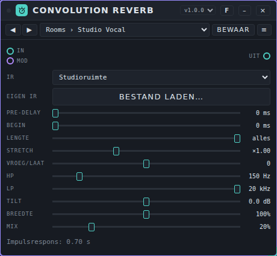

**De regelaars.**

- **IR:** de impulsrespons. **Eigen bestand** is de IR die je zelf hebt geladen.
- **Bestand laden…** (Eigen IR) laadt een audiobestand (WAV, MP3, OGG of FLAC; hoogstens 12 s wordt gebruikt) als impulsrespons, of gebruik → *apparaat* op de tab **Samples** van de bibliotheek. De audio wordt niet in presets of in een song bewaard; een song onthoudt alleen dat hij *Eigen bestand* gebruikt, dus laad het bestand opnieuw na het openen. Tot dan klinkt Concertzaal.
- **Pre-delay** (0 tot 250 ms) is de tijd voordat de galm begint.
- **Begin** (0 tot 1000 ms) knipt het eerste stuk van de IR af; **Lengte** (0,05 s tot alles) kort het einde in.
- **Stretch** (×0,5 tot ×2) rekt de IR in de tijd. Dat is hersamplen: korter is ook helderder, langer ook donkerder.
- **Vroeg/laat** loopt van alleen vroege reflecties (-100%) via ongewijzigd (0) naar alleen de staart (100%), gesplitst rond 80 ms.
- **HP** en **LP** filteren de galm. **Tilt** (±12 dB) maakt hem donkerder of helderder.
- **Breedte** (0 tot 200%) is de stereobreedte. Een mono-IR geeft een mono galm.
- **Mix** is de verhouding droog en galm (gelijk vermogen).

**Poorten.** **In**, **Uit**, **Mod** (10 parameters, in drie sporen: impulsrespons, klank, uitgang). De regelaars die de IR veranderen (**Begin**, **Lengte**, **Stretch**, **Vroeg/laat**) worden bij modulatie een paar keer per seconde opnieuw opgebouwd.

**Voorbeeld.** Duofone → Convolution Reverb → Speakers. Kies **Kerk** op 30% mix voor een pad, of **Stalen plaat** met **Pre-delay** 15 ms voor een stem. Probeer je eigen IR: laad een bestand met **Bestand laden…**.

**Presets.** Pakket **Convolution Spaces** (30 presets) in [`presets/convolution-reverb.patchkamer-presets.json`](../../presets/convolution-reverb.patchkamer-presets.json), in de mappen **Rooms**, **Halls**, **Devices** en **Creative**, met minstens een preset voor elke ingebouwde IR. Laad het met de tab **Presets** van de bibliotheek → **Importeren…** en kies dan een preset in de balk bovenaan de kaart.

**Tips en grenzen.** Dit zijn metingen van de echte convolutiemotor in Chromium, offline; er is **niet naar geluisterd**.

- Motor: twee native convolvers die in elkaar overlopen (60 ms) als je IR, Begin, Lengte, Stretch of Vroeg/laat wijzigt, dus zonder tik (grootste sprong tussen twee samples bij drie IR-wissels tijdens een sinus: 0,020, zonder wissels 0,015). Een wijziging is na ongeveer 0,1 tot 0,3 s hoorbaar, terwijl de nieuwe IR wordt opgebouwd.
- **Latency 0 samples**: een test-IR met een eenheidsimpuls zet de uitgangspiek op dezelfde sample als de ingang; ook het droge pad heeft geen vertraging.
- Elke IR is genormaliseerd op dezelfde energie, dus wisselen van IR verandert het volume weinig (gemeten energie 1,00 voor alle 15).
- De nagalmtijden per band (T20) van de ingebouwde IR's volgen hun ontwerp: bijvoorbeeld Kerk 5,9 s bij 1 kHz en 4,8 s bij 8 kHz, Concertzaal 2,4 s, Studioruimte 0,37 s, Veertank 1,7 s bij 1 kHz en 0,6 s bij 8 kHz.
- Belasting: ongeveer 1,5% van een processorkern met een IR van 0,14 s, 5 tot 9% met Concertzaal, ongeveer 8% met Kerk en ongeveer 14% met een eigen IR van 12 s (offline render, 20 s stereoruis).
- Een NaN, oneindig of enorme waarde op de ingang wordt voor de convolutie begrensd door een kleine bewaker.
- Tilt, HP, LP en breedte zijn gemeten zoals ingesteld (tilt ±6 dB geeft ±3,0 dB aan de uiteinden van het spectrum, HP 200 Hz geeft -10,6 dB bij 100 Hz).

## De-esser

**Waar het voor is.** De-esser temt de scherpe, sissende s- en t-klanken (sibilanten) in een stem, die een compressor nog harder maakt. Hij luistert naar één frequentieband, de **Frequentie** (3 tot 10 kHz) met een **Bandbreedte**, en draait omlaag als die band boven de **Drempel** komt. Omdat hij alleen naar de s-klanken kijkt, blijft de rest van de stem ongemoeid. Ook handig op heldere bekkens, strijkers en synths.

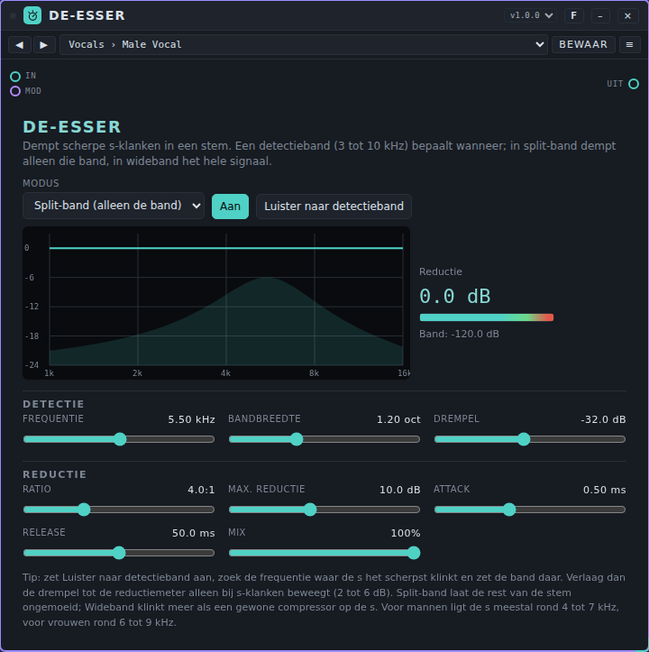

**Bediening.**

Bovenaan:

- **Modus:** *Split-band (alleen de band)* draait alleen de detectieband omlaag, zodat de stem eronder zijn body houdt. *Wideband (alles)* draait het hele signaal omlaag zolang er een s klinkt, als een compressor die alleen op de s reageert.
- **Aan** / **Uit (doorlaten)** en **Luister naar detectieband** (hoor alleen de band die de detector hoort: schuif de **Frequentie** tot de s het scherpst klinkt en zet de band daar).
- Het **scherm** toont het frequentieverloop van het apparaat zoals het nu is: de gearceerde klok is de detectieband, de lijn is wat het apparaat op dit moment met het geluid doet (vlak als er niets wordt gedempt, een dal in de band terwijl hij dempt). Ernaast: de **Reductie** in dB, een meter, en het **Band**-niveau dat de detector leest.

**Detectie:** **Frequentie** (3 tot 10 kHz), **Bandbreedte** (0,25 tot 3 octaven: klein is smal en gericht, groot is breed) en **Drempel** (−60 tot 0 dB: het niveau van de band waarboven hij omlaag draait).

**Reductie:** **Ratio** (1:1 tot ∞:1), **Max. reductie** (0 tot 24 dB), **Attack** (0,05 tot 20 ms), **Release** (5 tot 500 ms) en **Mix** (het deel van het bewerkte signaal).

**Poorten.** **In**, **Uit** en **Mod** (acht parameters).

**Voorbeeld.** Stem → De-esser → Mixer (na de compressor als je die gebruikt). Kies **Vocals › Male Vocal** of **Female Vocal**, zet **Luister naar detectieband** aan en pas de **Frequentie** aan tot de s het scherpst klinkt; zet het uit en verlaag de **Drempel** tot de reductiemeter alleen bij s-klanken beweegt, 2 tot 6 dB. Voor een podcast: de presets in de map **Speech**.

**Presets.** Pack **De-esser Basics** (21 presets) in [`presets/deesser.patchkamer-presets.json`](../../presets/deesser.patchkamer-presets.json), in de mappen **Vocals** (Male Vocal, Deep Male Vocal, Female Vocal, Bright Female Vocal, Gentle Vocal, Strong Vocal, Narrow Sibilant, Backing Vocals), **Speech** (Podcast Male, Podcast Female, Voice-over, Phone Interview), **Wideband** (Wideband Soft, Wideband Fast, Wideband Parallel), **Top End** (Tame Cymbals, Hi-Hat Tamer, Tame Top End, Harsh Strings, Sharp Synth, Light Parallel). Ik heb ze niet beluisterd. Stemmen verschillen: de **Frequentie** en **Drempel** van een preset zijn een beginpunt.

**Tips en grenzen.** Gemeten op de middenfrequentie: de reductie volgt de formule binnen 0,1 dB (drempel −30 dB, ratio 4:1, knee 6 dB: 7,4 dB bij −20 dB, 12,0 dB bij −10 dB met 12 dB maximum). In *Split-band* dempt een band van 1 octaaf die in het midden 12 dB wordt gedempt 4,6 kHz met 2,9 dB bij een midden van 6,5 kHz, 3 kHz met 0,7 dB en 1 kHz met 0,06 dB; een stem op 200 Hz blijft precies gelijk, in *Wideband* gaat die de volle 12 dB omlaag. *Attack* en *Release* zijn tijdconstanten van de reductie in dB (attack 5 ms: 63% na 6 ms; release 100 ms: 63% na 99 ms). Er is geen latency. De drempel is absoluut: een stem die veel zachter of luider is opgenomen vraagt een andere drempel. Rekenlast in Node op deze machine: gemiddeld 0,3% tot 0,4% van het tijdbudget van een blok (p99 onder 0,7%). Een bewaker begrenst de ingang op ±16 (+24 dB), zet NaN op 0 en herstelt een ontspoorde toestand; na bursts van NaN, Infinity, 1e9 en 1e30 klinkt het geluid precies als zonder. Het apparaat heeft AudioWorklet nodig; zonder gaat het geluid ongewijzigd door en meldt de kaart dat.

## Delay

**Waar het voor dient.** Delay herhaalt een geluid. Het is de grotere broer van het delay-deel van [Room](#room): de tijd kan vrij zijn (in milliseconden), vastzitten aan de klok van de host (notenwaarden van 2 maten tot 1/64, recht, met punt of triool, of een aantal zestienden zoals 3/16 of 5/16) of gebaseerd zijn op een eigen tempo dat je intikt. Links en rechts kunnen een eigen tijd hebben, en de herhalingen kunnen pingpongen, donkerder of tape-achtig verzadigd worden, uitgesmeerd, gemoduleerd, onder de bron wegduiken, vastgezet of achterstevoren afgespeeld.

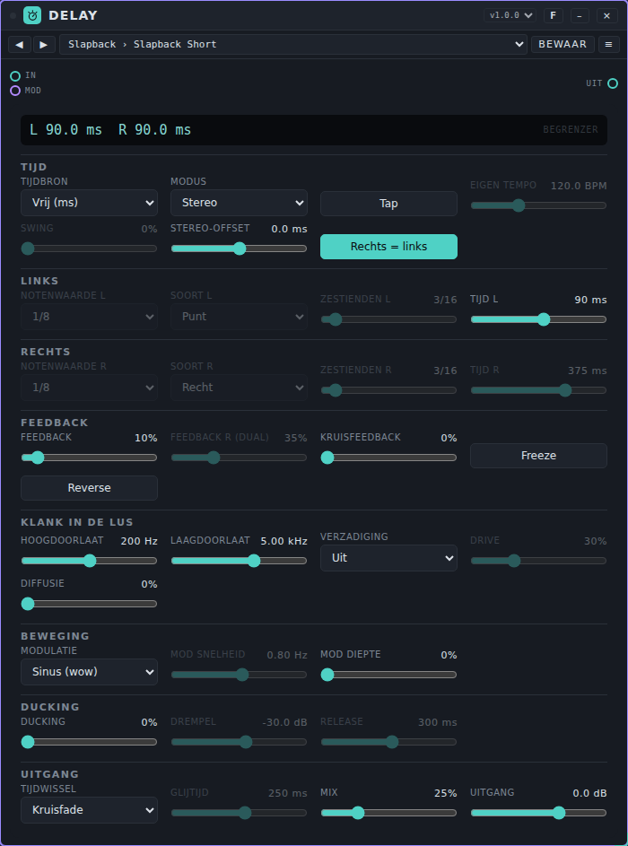

**De regelaars.** Een scherm bovenaan toont de huidige tijd links en rechts in milliseconden, met de notenwaarde en het gebruikte tempo. *Begrenzer* licht op als de begrenzer in de feedbacklus werkt.

**Tijd:**

- **Tijdbron:** *Klok van de host* (de notenwaarden volgen het tempo van de studio, ook als de klok stilstaat en als je het tempo verandert), *Eigen tempo (tap)* (hetzelfde, met een tempo van zichzelf) of *Vrij (ms)*.
- **Modus:** *Stereo* (links en rechts gescheiden), *Ping-pong* (de herhalingen springen van links naar rechts; de ingang wordt tot mono opgeteld), *Mono* of *Dual (eigen feedback)*.
- **Tap** zet **Eigen tempo** (30 tot 300 BPM) uit je tikken en kiest *Eigen tempo (tap)*. Een pauze van meer dan 2 s begint opnieuw.
- **Swing** (0 tot 100%) is het deel van de swing van de studio dat op de herhalingen wordt toegepast. Dat werkt alleen met *Klok van de host* en alleen bij een oneven aantal zestienden (1/16, 1/8 met punt, 5/16, …): de herhalingen blijven dan op het geswingde raster. **Stereo-offset** (−100 tot +100 ms) wordt bij de tijd van rechts opgeteld. **Rechts = links** laat rechts de notenwaarde of tijd van links gebruiken.

**Links** en **Rechts** (rechts telt alleen als **Rechts = links** uit staat):

- **Notenwaarde:** *2 maten*, *1 maat (1/1)*, 1/2, 1/4, 1/8, 1/16, 1/32, 1/64 of *x/16 (aantal zestienden)*. **Soort:** *Recht*, *Punt* of *Triool*. **Zestienden** (1 tot 32) is het aantal voor *x/16*, bijvoorbeeld 3 voor 3/16.
- **Tijd L** / **Tijd R** (1 tot 4000 ms) is de tijd voor *Vrij (ms)*.

**Feedback:**

- **Feedback** (0 tot 120%) is hoeveel van elke herhaling teruggaat. Boven 100% groeien de herhalingen tot de begrenzer ze op ongeveer 0 dBFS houdt. **Feedback R (dual)** is de rechterkant in de modus *Dual*. **Kruisfeedback** (0 tot 100%) stuurt de herhalingen naar de andere kant (stereo en dual).
- **Freeze** houdt de echo vast: de ingang gaat uit de lus en de feedback gaat naar 100%. **Reverse** speelt de herhalingen achterstevoren af, in blokken zo lang als de delaytijd.

**Klank in de lus:** **Hoogdoorlaat** (20 tot 2000 Hz) en **Laagdoorlaat** (500 tot 20000 Hz) werken op elke herhaling, zodat elke herhaling donkerder en dunner wordt. **Verzadiging** *Uit*, *Tape* of *Buis* met **Drive**. **Diffusie** smeert de herhalingen tot een wolk.

**Beweging:** **Modulatie** *Sinus (wow)*, *Tape (wow en flutter)* of *Chorus (stereo)*, met **Mod snelheid** (0,05 tot 10 Hz) en **Mod diepte** (tot 10 ms).

**Ducking:** **Ducking** zet de herhalingen zachter terwijl de ingang speelt (de herhalingen in de lus lopen door); **Drempel** (−60 tot −6 dB) en **Release** (50 tot 1500 ms).

**Uitgang:** **Tijdwissel** is wat er gebeurt als de tijd of het tempo verandert: *Kruisfade* (een tikvrije kruisfade van 20 ms, de toonhoogte blijft) of *Tape* (de tijd glijdt, dus de toonhoogte van de herhalingen glijdt mee; **Glijtijd** 20 tot 2000 ms). **Mix** (0 tot 100%): vanaf 50% gaat het droge signaal omlaag, bij 100% is er geen droog signaal meer, wat je op een send wilt. **Uitgang** (−24 tot +12 dB).

**Poorten.** **In**, **Uit** en **Mod** (zeventien parameters in één spoor).

**Voorbeeld.** Een synthlead → Delay → Mixer. Kies de preset **Dotted Eighth** in de balk bovenaan de kaart: de herhalingen volgen het tempo van de studio. Op een send: zet Delay in de return, zet **Mix** op 100% en stuur de geluiden die je wilt herhalen.

**Presets.** Pakket **Delay Basics** (35 presets) in [`presets/delay.patchkamer-presets.json`](../../presets/delay.patchkamer-presets.json), in de mappen **Slapback** (Slapback Short, Slapback Wide, Tape Slap, Haas Widener), **Dub** (Dub Echo, Dub Throw, Dub Ducked, Dub Long Tail), **Ping-pong** (Ping-pong Eighths, Ping-pong Quarters, Ping-pong Dotted, Ping-pong Free), **Rhythmic** (Dotted Eighth, Triplet Eighths, Swung Sixteenths, Three Against Five, Triplet Against Straight, Gated Sixteenths), **Ambient** (Ambient Wash, Bar Echo, Cloud Ping-pong, Endless Smear), **Tape** (Tape Echo, Slow Wow, Worn Tape, Tube Repeats), **Modulated** (Chorus Echo, Vibrato Repeats, Seasick) en **Creative** (Reverse Echo, Reverse Ping-pong, Runaway Feedback, Dual Offset, Stutter Thirty-seconds, Cross Weave). Laad het met de tab **Presets** van de bibliotheek → **Importeren…** (of via een bibliotheek die het bevat) en kies dan een preset in de balk bovenaan de kaart, of blader met ◀ ▶. Ik heb ze niet beluisterd.

**Tips en grenzen.** Offline gemeten met de echte worklet-code: de tijd klopt op 0,09 sample (minder dan 2 µs) voor vrije tijden van 1 tot 4000 ms en voor alle notenwaarden, soorten en tempi van 60 tot 200 BPM die ik heb geprobeerd; 1/8 blijft exact na een tempowissel, met lopende klok (via het tempo van de stap) en met stilstaande klok (via het tempo van de studio, opgepikt door een timer van 40 ms). Een tempowissel met *Kruisfade* geeft geen sprongen in een sinus van 1 kHz (de grootste stap is 1,01 keer die van de zuivere sinus, waar een harde sprong van de delaytijd 59 keer geeft). Met *Tape* glijdt de toonhoogte (300 naar 200 ms met glijtijd 250 ms: 1330 Hz voor een toon van 1 kHz bij het begin, na ongeveer een seconde terug op 1000 Hz). De afname per herhaling is 20 log(feedback) binnen 0,01 dB (−6,02 dB bij 50%). De filters volgen het digitale Butterworth-ontwerp van de tweede orde binnen 0,02 dB (gecontroleerd bij 21 combinaties van frequentie en instelling). Met feedback tot 120% blijft de uitvoer gedurende 60 s en in alle modi onder 1,4 (+2,9 dBFS) en eindig; een burst van NaN, ±Infinity, 1e9 of 1e30 op de ingang wordt begrensd en het geluid komt terug. Hoogstens 8 s per delaylijn: 2 maten bij 40 BPM (12 s) wordt gehalveerd en het scherm meldt dat. Met *Kruisfade* krijgt een tijd die je continu moduleert (Drift, LFO) bij elke wijziging een kruisfade; gebruik daarvoor *Tape*. Een wissel van **Modus** dempt de herhalingen 15 ms; een wissel van **Verzadiging** gaat abrupt. **Reverse** en **Diffusie** veranderen hoe de herhalingen klinken, niet wanneer ze komen. Rekenlast in Node op deze machine: gemiddeld 0,6 tot 3,4% van het tijdbudget van een blok, 5,4% bij p99, voor de zwaarste instelling (buis, diffusie, tape-modulatie, ducking en reverse) gemiddeld 2,8%. Delay heeft AudioWorklet nodig; zonder gaat het geluid ongewijzigd door en meldt de kaart dat.

## Distortion

**Waar het voor dient.** Distortion voegt harmonischen toe door het geluid door een kromme te persen. Er zijn acht soorten, van milde warmte tot fuzz en wavefolding, toonregelaars voor en na de vervorming en een droog/nat-mix, zodat je het ook voor parallelle verzadiging kunt gebruiken. Een DC-blokkering staat altijd aan.

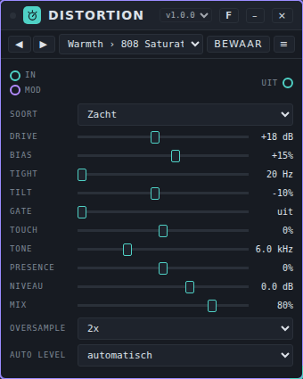

**De regelaars.**

- **Soort:** *Zacht* (gladde knik, oneven harmonischen), *Hard* (platte klip), *Buis* (asymmetrisch, voegt even harmonischen toe), *Tape* (zachte klip met een kleine bult bij 110 Hz), *Diode* (een klipper met een scherpere knik; de schoonste bij hoge drive), *Fuzz* (twee trappen die spuwen en met de gate dichtgaan), *Folder* (een wavefolder: de golf vouwt om bij hoge drive) en *Gelijkrichter* (dubbelzijdige gelijkrichting: een octaaf omhoog).
- **Drive** (0 tot +40 dB) is hoe hard het geluid op de kromme valt. *Fuzz* begint 12 dB lager, want die is al hard.
- **Bias** (−100 tot +100%) schuift het geluid langs de kromme, zodat boven- en onderkant anders worden behandeld. Dat voegt even harmonischen toe. De statische offset wordt gecorrigeerd en de DC-blokkering haalt de rest weg.
- **Tight** (20 tot 1000 Hz) is een hoogdoorlaatfilter *voor* de vervorming. Zet hem hoger om de bas niet te laten dichtslibben.
- **Tilt** (−100 tot +100%) is een toonregelaar voor de vervorming: positief laat de hoge tonen harder op de kromme vallen (±9 dB).
- **Gate** (uit, dan −80 tot −30 dB) is een poort voor de vervorming, zodat ruis niet wordt versterkt.
- **Touch** (−100 tot +100%) laat het ingangsniveau de drive veranderen (±12 dB): positief betekent harder spelen geeft meer vervorming, negatief andersom (comprimeren).
- **Tone** (500 tot 20000 Hz; *uit* bovenaan) is een laagdoorlaatfilter na de vervorming.
- **Presence** (−100 tot +100%) is een plank op 4 kHz na de vervorming (±9 dB).
- **Niveau** (−24 tot +12 dB) is het uitgangsniveau.
- **Mix** is droog tegen nat. Onder 100% krijg je parallelle verzadiging; het droge pad wordt vertraagd zodat het bij het natte past.
- **Oversample:** *uit*, *2x* of *4x*. De vervorming draait dan op een hogere samplerate, om aliasing te verminderen. De beginwaarde volgt de audiokwaliteit in Instellingen.
- **Auto level:** *automatisch* brengt het niveau terug naar wat er inging (gemeten met een toon van −12 dBFS), zodat je instellingen eerlijk kunt vergelijken. *vrij* laat het niveau zoals het is.

**Poorten.** **In**, **Uit**, **Mod** (tien parameters).

**Voorbeeld.** Drumbus → Distortion → Mixer. Kies de preset **Parallel Drums**: *Hard* geklipt met **Drive** 70%, **Tight** 150 Hz en **Mix** 35%. Voor een dikke bas: preset **Bass Distortion**.

**Presets.** Pakket **Distortion Basics** (28 presets) in [`presets/distortion.patchkamer-presets.json`](../../presets/distortion.patchkamer-presets.json), in de mappen **Warmth** (808 Saturation, Subtle Warmth, Tape-like Saturation, Tube Glow, Mix Bus Colour, Vocal Presence), **Crunch** (Crunch, Overdrive, Diode Drive, Heavy Distortion, Wall of Clip, Dynamic Edge), **Fuzz and Fold** (Fuzz, Gated Fuzz, Octave Fuzz, Folder, Wavefolder Lead, Asymmetric Fold, Rectifier Octave), **Drums and Bass** (Parallel Drums, Parallel Snare Crack, Kick Thump, Bass Distortion, Sub Enhancer) en **Lo-fi** (Lo-fi Crunch, Radio Mid, Broken Speaker, Telephone Drive). Ik heb ze niet beluisterd.

**Tips en grenzen.** Gemeten met een toon van 3 kHz op −12 dBFS en drive +20 dB (4x): de harmonischen vormen ongeveer 16% (*Diode*) tot 28% (*Fuzz*) van het geluid. *Zacht*, *Hard* en *Tape* zijn bijna zuiver oneven harmonischen; bij *Buis* ligt de tweede harmonische 22,6 dB onder de grondtoon, bij *Fuzz* 54 dB. Met drive op +40 dB is de aliasing van *Hard* −14,5 dB (uit), −23,7 dB (2x) en −38,9 dB (4x) ten opzichte van het totaal; bij +20 dB is dat −31, −45 en −57 dB. *Folder* en *Gelijkrichter* aliasen het meest; gebruik 4x. De oversamplingfilters geven een vertraging van 24 samples (2x) of 32 samples (4x), 0,5 en 0,67 ms bij 48 kHz; het droge pad loopt mee. Rekenlast in Node op deze machine: *Zacht* 0,7% van het tijdbudget van een blok (1x) tot 2,5% (4x); *Diode* 4x gemiddeld 10,5% (p99 16,5%). Een bewaker begrenst de ingang op ±16 (+24 dB), maakt van NaN een 0 en zet de filters terug als er een misgaat.

## Effect Chain

**Waar het voor dient.** Effect Chain zet tot **8 effecten** achter elkaar in één kaart. Elk van de 8 **slots** bevat één effect dat je kiest uit een lijst van **33**, met een eigen mix, een bypass en eigen regelaars. Over de hele keten staan een ingangsniveau, een uitgangsniveau, een totale mix en een **analyzer**. Hij is gemaakt voor hele ketens: ambient, cinematic, techno, dub, lo-fi, glitch en meer.

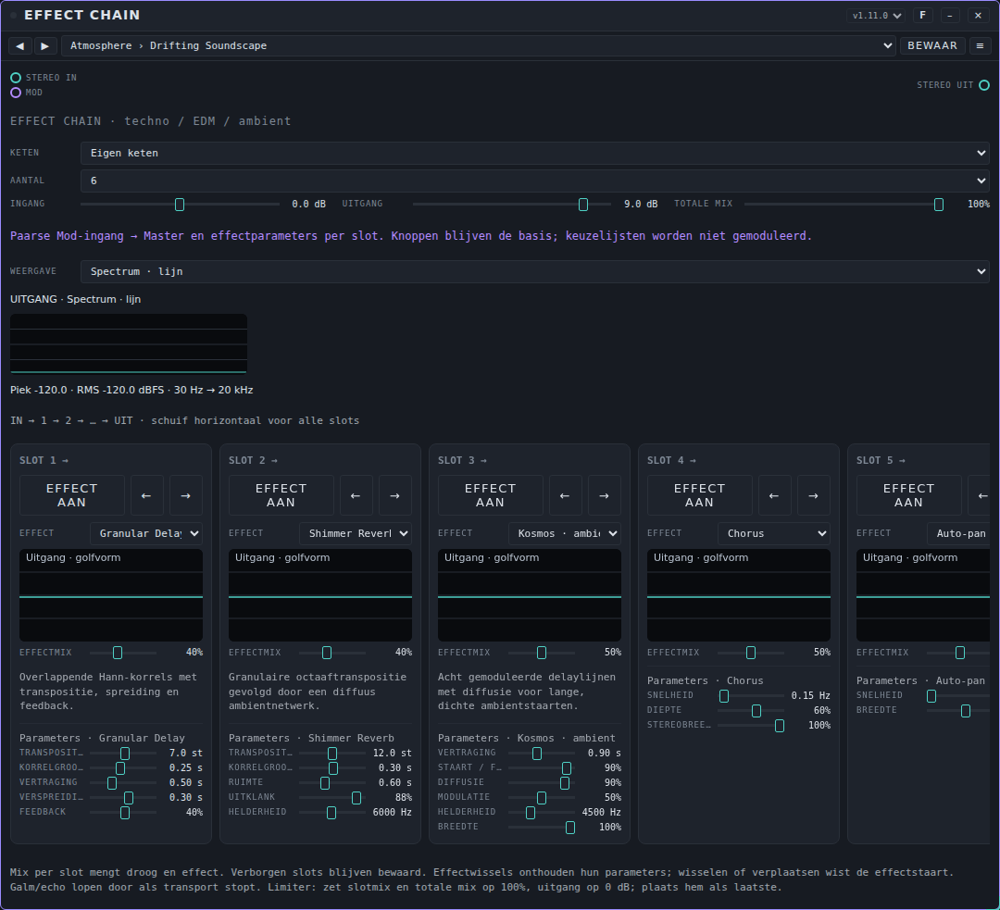

### De kaart instellen

Bovenaan de kaart:

- **Keten** is een lijst met 17 ingebouwde ketens (bijvoorbeeld *Ambient Space*, *Warm Tape*, *Techno · Rumble*; de laatste is *Empty Chain*). Een keuze vult de slots. Wijzig je iets, dan wordt de naam *Eigen keten*. Deze ingebouwde ketens horen bij het apparaat. De presets in de balk bovenaan de kaart (zie "Presets" hieronder) staan los daarvan: dat zijn complete ketens voor één toepassing.
- **Aantal** (1 tot 8) bepaalt hoeveel slots je ziet. Verborgen slots houden hun effect en instellingen.
- **Ingang** en **Uitgang** (beide −12 tot +12 dB) stellen het niveau in de keten in en eruit in. **Totale mix** (0 tot 100%) mengt de hele keten met het originele geluid.
- **Weergave** kiest wat de analyzer toont (zie hieronder).

Daaronder zie je de slots van links naar rechts (het geluid loopt **IN → 1 → 2 → … → UIT**). Schuif opzij voor alle slots.

### Een slot instellen

Elk slot is een kolom:

- **Effect aan** / **Bypass aan** is een knop. Met **Bypass aan** geeft het slot het geluid ongewijzigd door.
- **←** en **→** verplaatsen het slot één plek in de keten. Bij verplaatsen of een ander effect kiezen verdwijnt de staart van dat effect (een echo of galm die nog naklonk).
- **Effect** kiest het effect. **Doorvoer** laat het slot leeg. Kies je later weer terug, dan onthoudt het effect de instellingen die het in dit slot had.
- Een klein plaatje laat zien wat het effect doet: een filtercurve, de vorm van een galm, de echo-taps, het ritme van een gate of de golfvorm van de uitgang.
- **Effectmix** mengt het geluid vóór het slot (droog) en het effect (nat). Gebruikelijke beginwaarden: vervorming 60 tot 100%, beweging 20 tot 50%, echo en galm 15 tot 50%, filter of EQ 100%. Kies je **Limiter · peak**, dan gaat de slotmix naar 100%.
- Onder **Parameters** staan de regelaars van het gekozen effect. Een lijst is een keuze (een ruimte, een patroon, een nootlengte); een schuif is een waarde.

### De 33 effecten

**Klank en dynamiek**

| Effect | Wat het doet |
|---|---|
| Filter | Laagdoorlaat, hoogdoorlaat of banddoorlaat met **Frequentie**, **Resonantie** en een typekeuze. |
| EQ · drie banden | **Laag**, **Midden** en **Hoog** (elk ±12 dB) met een **Middenfrequentie** van 150 tot 6000 Hz. |
| Compressor | **Drempel**, **Verhouding**, **Attack**, **Release** en **Make-up**. |
| Limiter · peak | Een sample-peak-limiter met 5 ms lookahead. **Plafond**, **Herstel** en **Ingangsboost**. Zet hem als laatste. |
| Stereo Beeld | Mid/side-breedte (0 tot 2×). **Mono → stereo** voegt decorrelatie toe (met **Decorrelatie** als vertragingstijd); controleer het resultaat ook in mono. |

**Vervorming en karakter**

| Effect | Wat het doet |
|---|---|
| Warme saturatie | Zachte saturatie met **Drive** (0 tot 24 dB), **Helderheid** en **Compensatie**. |
| Distortion | Hardere vervorming met **Drive** tot 36 dB, **Helderheid** en **Uitgang**. |
| Overdrive | **Drive**, **Helderheid**, **Asymmetrie** en **Uitgang**. |
| Multiband Drive | Een aparte **Laag-drive**, **Midden-drive** en **Hoog-drive**. Het is geen mastering-crossover. |
| Digitale Gruis | Echte bitreductie (2 tot 16 bits) en sample-hold (400 tot 48000 Hz), met **Drive**, **Glitch / jitter** en **Rate-modulatie**. |
| Vinylstof | Gesynthetiseerde **Slijtage**, **Wow / flutter**, **Ruis** en **Tikjes**, met een **Toerental** van 33⅓, 45 of 78 RPM. |

**Beweging**

| Effect | Wat het doet |
|---|---|
| Chorus | **Snelheid**, **Diepte** en **Stereobreedte**. |
| Flanger | **Snelheid**, **Diepte** en **Feedback** (−75% tot +75%). |
| Phaser | **Snelheid**, **Diepte** en **Middenfrequentie**. |
| Tremolo | **Snelheid** en **Diepte**. |
| Auto-pan | Beweegt het geluid tussen links en rechts met **Snelheid** en **Breedte**. |
| Auto Filter | Een LFO beweegt een filter rond de **Basisfrequentie**: **Resonantie**, **Beweging** (snelheid), **LFO-diepte** (in octaven) en het **Filtertype**. |
| Ringmodulator | **Draagfrequentie** (0,1 tot 2000 Hz) en **Diepte**. |

**Ritme** (deze volgen de klok van de studio; start het transport met **Start**)

| Effect | Wat het doet |
|---|---|
| Pumping / Duck | Laat het volume op het tempo wijken, zonder kick-ingang. **Puls** (1/16 tot 1 maat), **Ducking-diepte** en **Herstelcurve**. Zet de effectmix op 100%. |
| Trance Gate | Een volumepatroon van 16 stappen. **Patroon** (*Offbeat*, *Syncopen*, *Tresillo*, *Broken*), **Diepte** en **Gate-lengte**. Mix 100% voor volledige gates. |
| Beat Stutter | Neemt per maat het laatste fragment over en herhaalt het tijdelijk. **Herhaalfragment**, **Herhalen per maat** en **Richting** (vooruit of achteruit). De eerste maat vult de buffer. |
| Tempo Delay | Een echo in notenwaarden (1/16 tot 1 maat, ook gepunteerd), met **Feedback** en **Helderheid**. Volgt het tempo van Patchkamer. |
| Wobble Filter | Een filter dat op het tempo beweegt: **Filtercyclus**, **Basisfrequentie**, **Beweging** (octaven) en **Resonantie**. |

**Echo en ruimte**

| Effect | Wat het doet |
|---|---|
| Stereo delay | **Tijd** (0,03 tot 2 s), **Feedback** en **Echohelderheid**. |
| Pingpong echo | Een echo die tussen links en rechts springt: **Tijd per kant**, **Feedback**, **Echohelderheid** en **Stereobreedte**. |
| Frequentie Echo | Verschuift de boventonen bij elke echo een aantal Hz (geen verschuiving in halve tonen): **Verschuiving**, **Echotijd**, **Feedback** en **Helderheid**. |
| Reverb / Galm | Een galm met 12 ruimtes: *Kamer*, *Hal*, *Hemel*, *Studio*, *Badkamer*, *Houten zaal*, *Plate*, *Kerk*, *Kathedraal*, *Grot*, *Tunnel* en *Bevroren wolk* (de kaart toont de lengte in seconden). Verder **Voorvertraging** en **Galmhelderheid**. De lengtes zijn synthetisch, niet gemeten. |
| Hybride Reverb | Een parallelle mix van een gekozen ruimte en een algoritmische staart (**Algoritmisch aandeel**, **Algoritmische ruimte**, **Algoritmische staart**). |
| Shimmer Reverb | Een granulaire octaafverschuiving (**Transpositie**, **Korrelgrootte**) gevolgd door een diffuse staart (**Ruimte**, **Uitklank**). |
| Kosmos · ambient | Acht gemoduleerde delaylijnen met diffusie voor lange, dichte staarten: **Vertraging**, **Staart / feedback**, **Diffusie**, **Modulatie**, **Helderheid** en **Breedte**. |
| Granular Delay | Overlappende korrels met **Transpositie** (−12 tot +24 st), **Korrelgrootte**, **Vertraging**, **Verspreiding** en **Feedback**. |
| Freeze / Klankwolk | Neemt de afgelopen audio op. Kies **Bevroren** nadat er geluid binnenkomt. Dit is een granulaire tijdlus, geen spectrale freeze. **Opnamelengte** en **Afspeelsnelheid**. |
| Harmonische Resonators | Vijf op akkoord gestemde comb-resonators kleuren het inkomende geluid: **Grondtoon (MIDI)**, **Akkoord** (*Open / majeur*, *Mineur 9*, *Sus*, *Majeur 9*), **Uitklank**, **Helderheid** en **Breedte**. |

### De Mod-ingang

De paarse **Mod**-poort kan de hoofdregelaars (**Ingang**, **Uitgang**, **Totale mix**) bewegen en, voor elk slot dat in gebruik is, de **Effectmix** en de schuiven van het effect. Elk heeft een vaste naam per slotpositie (slot 1, slot 2, …), dus een modulator blijft bij de positie, niet bij het effect dat er staat. Keuzes (ruimtes, patronen, nootlengtes, freeze, akkoord, filtertype, toerental, richting) worden niet gemoduleerd. Modulatie wordt niet in een preset bewaard.

### De analyzer

**Weergave** kiest wat er wordt getoond voor de uitgang van de hele keten:

- **Spectrum · lijn** en **Spectrum · balken** tonen de frequenties van 30 Hz tot 20 kHz.
- **Spectrogram** toont frequenties in de tijd (hoog bovenaan, tijd naar rechts).
- **Golfvorm** toont de golfvorm.
- **Stereobeeld** toont links tegen rechts, met de correlatie ernaast.
- **Niveaumeters** tonen piek (boven) en RMS (onder).
- **Uit / minder CPU** zet de analyzer en de kleine plaatjes van de slots uit.

Onder het beeld staan de **Piek** en de **RMS** van de uitgang in dBFS.

### Presets: complete ketens

Pakket **Effect Chain Basics** (14 presets) in [`presets/effect-chain.patchkamer-presets.json`](../../presets/effect-chain.patchkamer-presets.json), in de mappen **Atmosphere** (Drifting Soundscape, Cinematic Dread, Psychedelic Trip, Dream Voice), **Studio** (Tape Slapback, Lo-Fi Tape Memory, Drum Bus Glue, Dub Chamber), **Club** (Basement Techno, Squelch Bus, Neon Nights, Trance Ascent), **Sound Design** (Glitch Lab, Industrial Warehouse). Laad het met de tab **Presets** van de bibliotheek → **Importeren…** (of via een bibliotheek die het bevat) en kies dan een preset in de balk bovenaan de kaart, of blader met ◀ ▶.

Elke preset is een hele keten, geen los effect. Ze zijn opgebouwd in de volgorde uit het onderdeel "De volgorde van effecten in een keten": klank, vervorming, beweging, ritme, echo, galm, breedte en een limiter. De tabel noemt de effecten in volgorde van de slots, met de **Effectmix** tussen haakjes.

| Preset | Toepassing | Slots in volgorde |
|---|---|---|
| **Drifting Soundscape** (Atmosphere) | Ambient: langzaam bewegende klankwolken zonder ritme | Granular Delay (0,4) › Shimmer Reverb (0,4) › Kosmos · ambient (0,5) › Chorus (0,5) › Auto-pan (0,5) › Stereo Beeld (1) |
| **Cinematic Dread** (Atmosphere) | Filmisch: donkere resonantie, een enorme ruimte, langzame beweging | Warme saturatie (0,4) › Harmonische Resonators (0,5) › Ringmodulator (0,2) › Frequentie Echo (0,4) › Phaser (0,3) › Reverb / Galm (0,5) › Stereo Beeld (1) › Limiter · peak (1) |
| **Psychedelic Trip** (Atmosphere) | Psychedelisch: kolkende beweging en echo's | Phaser (0,6) › Flanger (0,4) › Tremolo (0,4) › Frequentie Echo (0,35) › Kosmos · ambient (0,35) › Auto-pan (0,5) |
| **Dream Voice** (Atmosphere) | Een vocale ruimte: gladgestreken stem met glans | Compressor (1) › EQ · drie banden (1) › Chorus (0,2) › Pingpong echo (0,2) › Reverb / Galm (0,25) › Shimmer Reverb (0,15) › Stereo Beeld (1) |
| **Tape Slapback** (Studio) | Minimalistisch: een korte, warme slapback-echo voor gitaar of zang | Warme saturatie (0,5) › Pingpong echo (0,3) › Filter (1) › Reverb / Galm (0,18) |
| **Lo-Fi Tape Memory** (Studio) | Lo-fi: een oud cassettegevoel met stof, wow en flutter | Digitale Gruis (0,4) › Vinylstof (1) › Filter (1) › Chorus (0,25) › Reverb / Galm (0,2) |
| **Drum Bus Glue** (Studio) | Een drumbus: plakken, aandikken, wat ruimte | Compressor (1) › Warme saturatie (0,5) › Multiband Drive (0,4) › Hybride Reverb (0,12) › Limiter · peak (1) |
| **Dub Chamber** (Studio) | Dub: tape-achtige saturatie, rollende echo's, een stuiterende kamer | Warme saturatie (0,6) › Tempo Delay (0,45) › Pingpong echo (0,3) › Auto Filter (0,6) › Reverb / Galm (0,25) › Compressor (1) |
| **Basement Techno** (Club) | Techno: donker en gruizig, strakke bas, een grote betonnen ruimte | Filter (1) › Warme saturatie (0,6) › Pumping / Duck (1) › Tempo Delay (0,25) › Reverb / Galm (0,3) › Multiband Drive (0,5) › EQ · drie banden (1) |
| **Squelch Bus** (Club) | Een bus voor een acid-bas: schreeuwende vervorming met beweging | Distortion (0,9) › Filter (1) › Wobble Filter (1) › Phaser (0,35) › Tempo Delay (0,2) › EQ · drie banden (1) |
| **Neon Nights** (Club) | Synthwave: brede chorus, overdrive, gepunteerde echo's, een glanzende galm | Chorus (0,5) › Overdrive (0,5) › Tempo Delay (0,3) › Shimmer Reverb (0,2) › Reverb / Galm (0,3) |
| **Trance Ascent** (Club) | Trance: gate, stijgend filter, echo's, een brede galm | Trance Gate (0,9) › Auto Filter (0,8) › Pumping / Duck (1) › Tempo Delay (0,3) › Shimmer Reverb (0,2) › Reverb / Galm (0,3) › Stereo Beeld (1) |
| **Glitch Lab** (Sound Design) | Glitch en sound design: stotteren, bitcrush, frequentie-echo's | Beat Stutter (1) › Digitale Gruis (0,5) › Frequentie Echo (0,35) › Pingpong echo (0,25) |
| **Industrial Warehouse** (Sound Design) | Industrieel: harde vervorming in een enorme ruimte | EQ · drie banden (1) › Overdrive (1) › Distortion (0,8) › Multiband Drive (0,6) › Ringmodulator (0,3) › Reverb / Galm (0,4) › Frequentie Echo (0,35) › Limiter · peak (1) |

*Dit pakket kan nog wijzigen; de tabel hierboven geeft weer wat er in het bestand stond toen deze handleiding werd geschreven.* De instellingen van elk slot (tijd, feedback, drive enzovoort) zitten in de preset zelf; laad hem en bekijk de kaarten.

### Tips en beperkingen

- Veel effecten (die met eigen geluidsverwerking) draaien in de hoofdthread van je browser via een ScriptProcessor, met een korte extra vertraging. Gebruik op een trage computer minder van die slots.
- Ritme-effecten hebben de klok nodig: druk op **Start**.
- Een keten met veel effecten kan harder worden dan de ingang. Gebruik **Ingang**, **Uitgang**, **Totale mix** en de make-up- en uitgangsregelaars, en sluit de keten af met een **Limiter · peak** (alle mixen op 100%, **Uitgang** op 0 dB).
- Galm en echo klinken door als de klok stopt.
- Een bewaker kijkt elke 50 ms naar de uitgang van elk slot. Geeft een slot iets terug dat geen getal is (of absurd hard), dan wordt dat slot opnieuw opgebouwd en is de staart van dat effect weg; daarna gaat het geluid door.

## Filter

**Waar het voor dient.** Een filter haalt frequenties weg of benadrukt ze. Dit filter heeft tien typen, een drive vóór het filter, een mix en een uitgangsniveau.

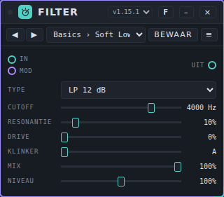

**De regelaars.**

- **Type:** *LP 12 dB*, *LP 24 dB* (laagdoorlaat), *HP 12 dB*, *HP 24 dB* (hoogdoorlaat), *Band*, *Notch*, *Vocaal (klinkers)*, *Ladder 24 dB (worklet)*, *Kam + (worklet)* en *Kam − (worklet)*. *Vocaal* geeft je de klinkers A, E, I, O en U met drie formanten. De *Ladder* en de twee kamfilters hebben AudioWorklet nodig; de kaart meldt dat onder de regelaars.
- **Cutoff** (20 tot 20000 Hz) is waar het filter werkt. Bij *Vocaal* verschuift hij de klinkers; bij de kamfilters bepaalt hij de toonhoogte.
- **Resonantie** benadrukt het gebied rond de cutoff.
- **Drive** vervormt vóór het filter.
- **Klinker** (A tot U, ertussen mengen de klinkers) werkt alleen bij *Vocaal*.
- **Mix** mengt origineel en gefilterd geluid.
- **Niveau** (0 tot 200%) is het uitgangsniveau van het gefilterde geluid.

**Poorten.** **In**, **Uit**, **Mod**. De modulator beweegt **Cutoff** sample voor sample (snel), en ook **Resonantie**, **Drive**, **Klinker** en **Mix**.

**Voorbeeld.** Duofone → Filter → Speakers. Kies *LP 24 dB*, **Cutoff** 1200 Hz, **Resonantie** 30%. Sluit een modulator aan op **Mod** om het filter te openen en te sluiten.

**Presets.** Pakket **Filter Basics** (14 presets) in [`presets/filter.patchkamer-presets.json`](../../presets/filter.patchkamer-presets.json), in de mappen **Basics** (Soft Lowpass, Warm Lowpass, Tight Highpass, Telephone, Notch Scoop), **Movement** (Wah Stop, Vowel Choir, Talking Mouth, Comb Pipe, Hollow Comb), **Aggressive** (Ladder Squelch, Screaming Resonance, Fuzz Wall, Razor Comb). Laad het met de tab **Presets** van de bibliotheek → **Importeren…** (of via een bibliotheek die het bevat) en kies dan een preset in de balk bovenaan de kaart, of blader met ◀ ▶.

**Tips.** Zonder AudioWorklet in je browser geven de drie worklet-typen het geluid ongewijzigd door en meldt de kaart dat. Een foutieve waarde op de ingang vergiftigt het filter niet meer: de ladder en de kamfilters begrenzen hem, de andere typen worden bewaakt en vervangen.

## Flanger

**Waar het voor dient.** Een flanger mengt een geluid met een zeer korte, bewegende vertraging. Met feedback maakt hij een zwiepende, holle beweging.

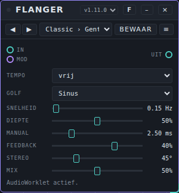

**De regelaars.**

- **Tempo:** *vrij* of een nootlengte (8 maten tot 1/4).
- **Golf:** *Sinus* of *Driehoek*, de vorm van de beweging.
- **Snelheid** (0,02 tot 10 Hz); alleen in gebruik als **Tempo** op *vrij* staat.
- **Diepte** is de grootte van de beweging.
- **Manual** (0,2 tot 12 ms) is de basisvertraging: de plek waar omheen de zwiep beweegt.
- **Feedback** (−97% tot +97%) voert de uitgang terug naar de ingang. Negatieve waarden geven een ander karakter.
- **Stereo** is het faseverschil tussen links en rechts (0° tot 180°).
- **Mix** mengt origineel en effect.

**Poorten.** **In**, **Uit**, **Mod** (zes parameters; **Manual** is snel).

**Voorbeeld.** Duofone → Flanger → Speakers. **Snelheid** 0,15 Hz, **Diepte** 70%, **Manual** 2,5 ms, **Feedback** 60%, **Mix** 50%: een langzame zwiep.

**Presets.** Pakket **Flanger Basics** (12 presets) in [`presets/flanger.patchkamer-presets.json`](../../presets/flanger.patchkamer-presets.json), in de mappen **Classic** (Gentle Flange, Jet Sweep, Slow Tide, Metal Sweep), **Subtle** (Stereo Shimmer, Soft Doubler), **Tempo** (Bar Sweep, Two-Bar Rise), **Extreme** (Metallic Scream, Laser Drop, Comb Drone, Wild Wobble). Laad het met de tab **Presets** van de bibliotheek → **Importeren…** (of via een bibliotheek die het bevat) en kies dan een preset in de balk bovenaan de kaart, of blader met ◀ ▶.

**Tips.** Zonder AudioWorklet geeft de flanger het geluid ongewijzigd door en meldt dat onder de regelaars.

## Frequency Shifter

**Waar het voor dient.** Een frequency shifter verschuift alle frequenties een vast aantal Hz. Dat is geen toonhoogteverandering: de boventonen raken hun onderlinge verhouding kwijt en het resultaat is niet harmonisch. Kleine verschuivingen geven een langzame zweving; grote verschuivingen een metalige, vervreemdende klank.

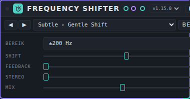

**De regelaars.**

- **Bereik:** *±20 Hz (zweving)*, *±200 Hz* of *±2000 Hz (vervreemding)*. Dat is de grootste verschuiving die de knop **Shift** haalt.
- **Shift** verschuift de frequenties. De knop is gekromd: kleine waarden bij het midden maken kleine stappen. De kaart toont de verschuiving in Hz.
- **Feedback** (0 tot 95%) voert het resultaat terug naar de ingang. Dat maakt spiraaleffecten.
- **Stereo** schuift het rechterkanaal de andere kant op. Boven 50% meldt de kaart *rechts omgekeerd*.
- **Mix** mengt origineel en effect.

**Poorten.** **In**, **Uit**, **Mod** (**Shift** is snel, sample voor sample).

**Voorbeeld.** Duofone → Frequency Shifter → Speakers. **Bereik** ±20 Hz, **Shift** een kleine positieve waarde, **Mix** 50%: een langzame zweving. Met **Bereik** ±2000 Hz en wat **Feedback** wordt het geluid onharmonisch.

**Presets.** Pakket **Frequency Shifter Basics** (13 presets) in [`presets/frequency-shifter.patchkamer-presets.json`](../../presets/frequency-shifter.patchkamer-presets.json), in de mappen **Subtle** (Gentle Shift, Slow Beat, Stereo Drift, Thick Detune), **Inharmonic** (Metal Shimmer, Bell Warp, Robot Voice, Broken Radio, Alien Down), **Feedback** (Rising Spiral, Falling Spiral, Barber Chaos, Endless Fall). Laad het met de tab **Presets** van de bibliotheek → **Importeren…** (of via een bibliotheek die het bevat) en kies dan een preset in de balk bovenaan de kaart, of blader met ◀ ▶.

**Tips.** Zonder AudioWorklet geeft het apparaat het geluid ongewijzigd door en meldt dat. Het droge signaal wordt 63 samples vertraagd, zodat het gelijk loopt met het bewerkte.

## Gate

**Waar het voor is.** Gate dempt wat onder de **Drempel** zakt: de ruis tussen de noten van een gitaar, de lekkage van een snare in de roommicrofoon, de brom van een versterker. Drie soorten: **Gate** (sluit helemaal, tot de **Range**), **Expander** (een zachte gate: hoe zachter het geluid, hoe meer het wordt omlaag gedraaid) en **Ducker** (andersom: hij dempt het hoofdsignaal zodra de sidechain luid wordt, bijvoorbeeld een bas onder een kick of muziek onder een stem).

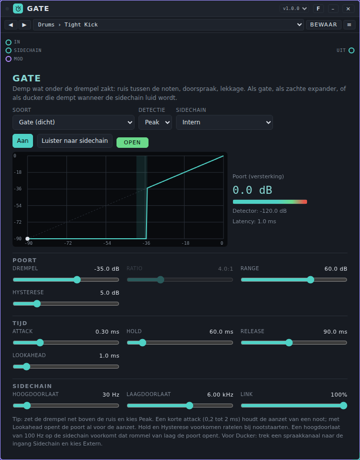

**Bediening.**

Bovenaan:

- **Soort:** *Gate (dicht)*, *Expander (zacht)* of *Ducker (sidechain luid = dempen)*.
- **Detectie:** *Peak* (snel, volgt de toppen) of *RMS* (gemiddelde over 15 ms, rustiger bij aanhoudende tonen).
- **Sidechain:** *Intern* (de detector luistert naar de ingang) of *Extern (ingang Sidechain)* (hij luistert naar wat je op de poort **Sidechain** trekt; nodig voor de Ducker). Zonder kabel op die poort blijft een gate dicht en doet een ducker niets.
- **Aan** / **Uit (doorlaten)** en **Luister naar sidechain** (hoor wat de detector hoort, na de filters). Het lampje **OPEN** / **DICHT** (bij de Ducker **DEMPT** / **LOS**) toont de toestand.
- De **curve** toont het ingangsniveau tegen het uitgangsniveau, met de hysterese gearceerd en een stip op het actuele niveau (bij de Ducker de reductie tegen het sidechain-niveau). Ernaast: de **Poort (versterking)** in dB, een meter die vol is als de poort open staat, het **Detector**-niveau en de **Latency**.

**Poort:** **Drempel** (−90 tot 0 dB), **Ratio** (1:1 tot ∞:1; alleen voor *Expander* en *Ducker*, een gate is altijd oneindig), **Range** (0 tot 90 dB: het meest dat hij dempt) en **Hysterese** (0 tot 24 dB: eenmaal open sluit de poort pas zoveel onder de drempel, wat ratelen rond de drempel voorkomt; niet bij de Ducker).

**Tijd:** **Attack** (0,05 tot 100 ms: hoe snel hij opent, bij de Ducker hoe snel hij dempt), **Hold** (0 tot 500 ms: hoe lang hij open blijft nadat het geluid onder de drempel zakte), **Release** (5 tot 3000 ms: hoe snel hij sluit, bij de Ducker hoe snel hij herstelt) en **Lookahead** (0 tot 10 ms: het geluid wordt vertraagd zodat de poort opent voor de aanzet van een noot).

**Sidechain:** **Hoogdoorlaat** (20 tot 1000 Hz; 20 Hz is uit), **Laagdoorlaat** (1 tot 20 kHz; 20 kHz is uit) en **Link** (100%: beide kanalen gaan samen open en dicht; 0%: elk apart). De filters werken alleen op de detector, niet op het geluid.

**Poorten.** **In**, **Sidechain** (audio), **Uit** en **Mod** (tien parameters; Lookahead is bewust niet stuurbaar).

**Voorbeeld.** Snarespoor → Gate → Mixer. Kies de preset **Drums › Snare Gate**, speel, en verhoog de **Drempel** tot de lekkage weg is maar elke slag de poort nog opent; gebruik **Luister naar sidechain** en de **Hoogdoorlaat** als laag lekkage de poort opent. Voor een voice-over: trek de spraak naar **Sidechain** van een Gate op de muziek, preset **Ducker › Voice-over Duck**. Voor een te sterk gecomprimeerd spoor dat je weer leven wilt geven: preset **Expander › Squash Recover**.

**Presets.** Pack **Gate Basics** (26 presets) in [`presets/gate.patchkamer-presets.json`](../../presets/gate.patchkamer-presets.json), in de mappen **Drums** (Tight Kick, Snare Gate, Tom Gate, Hi-Hat Bleed, Room Mic Tighten, Drum Bus Cleanup), **Instruments** (Guitar Hum, Distorted Chop, Bass Gate, Synth Noise Cut), **Vocals** (Breath Reducer, Vocal Gate Gentle, Spoken Cleanup, Backing Vocal Bleed), **Noise** (Hiss Away, Hum Away, Noise Floor Lower, Room Tone Keep), **Expander** (Gentle Expander, Squash Recover, Dynamics Restore), **Ducker** (Voice-over Duck, Bass Duck, Soft Duck), **Effects** (Hard Chop, Gated Tail). Ik heb ze niet beluisterd. Stel de **Drempel** eerst af op je eigen materiaal: een goede waarde ligt net boven de ruis.

**Tips en grenzen.** *Attack* en *Release* zijn tijdconstanten van de versterking (amplitude): na één attack is 63% van de weg naar open gedaan; na één release staat de versterking op 37% (−8,7 dB). Dempen over 60 dB duurt dus ongeveer 7 keer de release (gemeten met release 100 ms: −20 dB na 239 ms, −60 dB na 928 ms). De gate zelf reageert na de **Hold** plus het uitlopen van de piekvolger (ongeveer 7 ms bij een val van 20 dB): met hold 50 ms begint hij na 59 ms te dempen. De expander klopt precies: drempel −40 dB en ratio 4:1 geven −12,0 dB bij −44 dB en −30,0 dB bij −50 dB. **Lookahead** vertraagt het geluid met precies zoveel ms (gemeten 2, 5 en 10 ms); Patchkamer compenseert die latency niet. Met een hysterese van 6 dB blijft een gate die bij −30 dB opende open bij −43 dB en sluit hij bij −49 dB. Lage tonen laten de *Peak*-detector rimpelen binnen één golf: gebruik **Hold**, *RMS* of een **Hoogdoorlaat** op de sidechain. Rekenlast in Node op deze machine: gemiddeld 0,3% tot 0,4% van het tijdbudget van een blok (p99 onder 0,8%). Een bewaker begrenst de ingang en de sidechain op ±16 (+24 dB), zet NaN op 0 en herstelt een ontspoorde toestand; na bursts van NaN, Infinity, 1e9 en 1e30 klinkt het geluid precies als zonder. Het apparaat heeft AudioWorklet nodig; zonder gaat het geluid ongewijzigd door en meldt de kaart dat.

## Grit

**Waar het voor dient.** Grit vervormt een geluid en stuurt het door een resonant laagdoorlaatfilter, met een LFO op de cutoff. Het maakt een bron ruwer en donkerder.

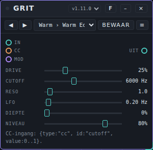

**De regelaars.**

- **Drive** is hoeveel de ingang wordt vervormd.
- **Cutoff** (100 tot 16000 Hz) is de knik van het laagdoorlaatfilter.
- **Reso** (0,3 tot 18) is de resonantie van het filter.
- **LFO** (0,02 tot 8 Hz) is de snelheid van de beweging op de cutoff.
- **Diepte** is de grootte van die beweging. Op 0% blijft de cutoff stilstaan.
- **Niveau** is het uitgangsniveau.

Grit heeft geen **Mix**-knop: het hele signaal gaat door de vervorming en het filter.

**Poorten.** **In**, **Uit**, **CC** (een eventingang die de cutoff instelt: `{type:"cc", id:"cutoff", value:0..1}` loopt van 100 tot 16000 Hz) en **Mod** (alle zes de regelaars).

**Voorbeeld.** Een bassynth → Grit → Speakers. **Drive** 60%, **Cutoff** 1200 Hz, **Reso** 6; zet **LFO** op 2 Hz en **Diepte** op 30% voor een wobble.

**Presets.** Pakket **Grit Basics** (12 presets) in [`presets/grit.patchkamer-presets.json`](../../presets/grit.patchkamer-presets.json), in de mappen **Warm** (Warm Edge, Dull Blanket, Fuzz Bass), **Motion** (Slow Sweep, Wah Pulse, Underwater, Helicopter), **Extreme** (Bright Razor, Acid Bite, Screamer, Siren, Meltdown). Laad het met de tab **Presets** van de bibliotheek → **Importeren…** (of via een bibliotheek die het bevat) en kies dan een preset in de balk bovenaan de kaart, of blader met ◀ ▶.

**Tips.** Een kleine bewaker begrenst de ingang op +24 dB en vervangt een filter dat is ontspoord. Grit werkt ook zonder AudioWorklet; alleen de ingangsbewaker ontbreekt dan.

## Harmonizer

**Waar het voor dient.** Harmonizer maakt tot vier extra stemmen uit één ingang. Elke stem heeft een eigen interval, niveau, pan, detune en vertraging. De intervallen kunnen vast zijn (halve tonen) of binnen een toonladder blijven: dan volgen de stemmen de toonhoogte van de bron en komen ze op noten van de gekozen grondtoon en toonladder. Het droge geluid blijft in de mix.

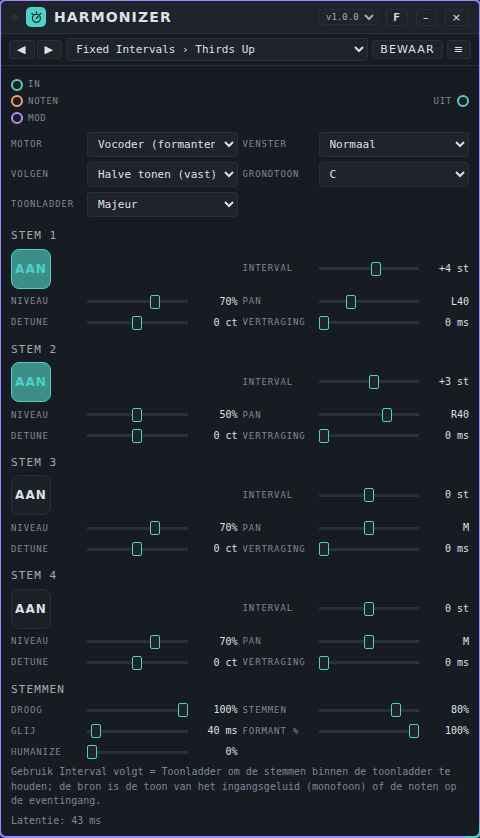

**Regelaars.**

- **Motor:** *Korrel (snel)* of *Vocoder (formanten)* (een fasevocoder die de klinkerkleur van een stem kan behouden). **Venster:** *Snel*, *Normaal* of *Hoog* (meer latentie, schonere lage tonen).
- **Volgen** bepaalt wat de knoppen **Interval** betekenen. *Halve tonen (vast)*: elke stem verschuift het geluid met dat aantal halve tonen, wat er ook wordt gespeeld. *Toonladder, toon van de ingang*: de intervallen zijn **toonladdertrappen**; de toonhoogte van de ingang (een enkele stem of lijn) wordt gemeten en elke stem gaat dat aantal noten omhoog of omlaag in de toonladder. *Toonladder, noten (event)*: hetzelfde, maar de bron is de laatste noot die op de poort **Noten** binnenkomt, bijvoorbeeld van een melodie- of akkoordspeler, zodat je het ook kunt gebruiken op een geluid waarvan de toonhoogte niet te meten is.
- **Grondtoon** en **Toonladder** (Majeur, Mineur, Harmonisch mineur, Melodisch mineur, Dorisch, Frygisch, Lydisch, Mixolydisch, Pentatoniek majeur, Pentatoniek mineur, Blues, Hele toon) bepalen welke noten zijn toegestaan bij de standen *Toonladder*. De bron wordt eerst gesnapt naar de dichtstbijzijnde noot van de toonladder (de hogere als er twee even dichtbij liggen); daarna telt **Interval** noten van de toonladder. Een trap 0 snapt de stem naar de toonladder. De stem verschuift het geluid met de afstand tot die noot, dus de intonatie en het vibrato van de bron blijven.
- **Stem 1 tot 4:** de pad **Aan** schakelt de stem, **Interval** (−24 tot +24, in halve tonen of toonladdertrappen), **Niveau**, **Pan** (L tot R), **Detune** (−100 tot +100 ct) en **Vertraging** (0 tot 100 ms; telt op bij de compensatie die de stemmen in de maat houdt).
- **Droog** is het niveau van het origineel, **Stemmen** het niveau van alle stemmen samen, **Glij** (0 tot 1000 ms) hoe snel de stemmen naar een nieuwe noot gaan, **Formant %** (alleen in de *Vocoder*) hoeveel van de klinkerkleur behouden blijft en **Humanize** een trage, willekeurige drift van de stemmen (tot ongeveer ±14 ct).

**Poorten.** **In**, **Uit**, **Noten** (eventingang), **Mod** (15 parameters: **Droog**, **Stemmen**, **Formant %** en per stem **Niveau**, **Pan**, **Detune**; de intervallen, vertragingen, glij en humanize worden niet gemoduleerd).

**Latentie.** De kaart toont hem: *Korrel* 26,1 / 36,0 / 50,9 ms en *Vocoder* 21,3 / 42,6 / 85,3 ms voor *Snel* / *Normaal* / *Hoog*, bij 48 kHz. Het droge geluid en alle stemmen worden in de maat gehouden (gemeten met ruis: droog 36,0 ms en een stem op unisono 36,0 ms in *Korrel* *Normaal*; 42,6 en 43,1 ms in de *Vocoder* *Normaal*).

**Voorbeeld.** Een zanglijn → Harmonizer → Mixer. Zet **Volgen** op *Toonladder, toon van de ingang*, **Grondtoon** C en **Toonladder** Majeur, stem 1 op **Interval** +2 en stem 2 op +4: de stemmen zingen terts en kwint in de toonladder (preset **C Major Thirds**). Voor een pad of synthlead zonder meetbare toonhoogte: verbind een melodie met **Noten** en kies *Toonladder, noten (event)* (preset **Notes C Major Triad**).

**Presets.** Pack **Harmonizer Basics** (23 presets) in [`presets/harmonizer.patchkamer-presets.json`](../../presets/harmonizer.patchkamer-presets.json), in de mappen **Fixed Intervals** (Thirds Up, Power Fifth, Octave Doubles, Low Octave Support, Fourths Stack, Sixths, Minor Third Pair, Triad Cloud), **In Scale (Pitch of Input)** (C Major Thirds, A Minor Thirds, G Major Below, Pentatonic Choir, Dorian Lead, Lydian Glow, Blues Backing, Harmonic Minor Drama), **Driven by Notes** (Notes C Major Triad, Notes A Minor Stack, Notes Pentatonic Pad) en **Choirs** (Detuned Choir, Whisper Doubles, Barbershop, Robot Chord).

**Tips en grenzen.** De meting van de toonhoogte is monofoon: gebruik een enkele stem of lijn. Bij akkoorden of ruis is de bron onbetrouwbaar; gebruik dan *Noten (event)* of *Halve tonen (vast)*. Offline gemeten (`docs/tools/measure-pitch.mjs harmonizer`), over 21 combinaties van intervallen (−12 tot +12 st) en grondtonen (110, 220, 440 Hz): de toonhoogtefout van een stem is gemiddeld 0,02 ct in de *Vocoder* (grootste 0,06 ct) en 0,7 ct in *Korrel* (grootste 2,2 ct). De toonladdertrappen kwamen in 8 van de 8 testgevallen op de verwachte noot (binnen 5 ct), zowel met de noten als met de gemeten toonhoogte. Rekenlast per blok van 128 samples (budget 2,67 ms) met vier stemmen aan, gemiddeld / 99e percentiel / maximum op deze testmachine: *Korrel* *Normaal* 2,9% / 4,1% / 15,0% (met toonhoogtedetectie 4,5% / 6,1% / 20,7%), *Vocoder* *Snel* 5,2% / 9,9% / 15,1%, *Normaal* 5,5% / 20,6% / 29,5% (met detectie 7,0% / 21,7% / 30,8%), *Hoog* 5,5% / 38,1% / 45,9%; één stem in de *Vocoder* *Normaal* 4,0% / 13,1% / 19,5%. Alle stemmen delen één analyse, dus extra stemmen zijn goedkoop. Formantbehoud op een zuivere toon verlaagt het niveau van de stemmen, omdat een sinus geen formanten heeft. Een bewaker begrenst de ingang op ±16 en vervangt NaN door 0; bij 40 willekeurige en extreme instellingen met bursts van NaN, ±Infinity en 1e30 waren er geen ongeldige samples en kwam het geluid elke keer terug. Er is niets beluisterd.

## Phaser

**Waar het voor dient.** Een phaser laat een reeks inkepingen met een langzame beweging door het geluid zwiepen. Het geeft een wervelend, voorbijtrekkend karakter.

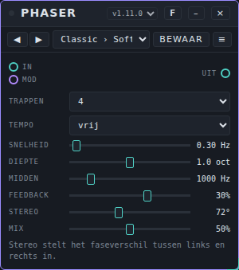

**De regelaars.**

- **Trappen:** 4, 6, 8 of 12. Meer trappen geven meer inkepingen.
- **Tempo:** *vrij* of een nootlengte (8 maten tot 1/8).
- **Snelheid** (0,02 tot 10 Hz); alleen in gebruik als **Tempo** op *vrij* staat.
- **Diepte** wordt in octaven getoond: hoe ver de zwiep rond **Midden** beweegt.
- **Midden** (100 tot 6000 Hz) is het midden van de zwiep.
- **Feedback** (−95% tot +95%) voert de uitgang terug; negatieve waarden hebben een ander karakter.
- **Stereo** is het faseverschil tussen links en rechts (0° tot 180°).
- **Mix** mengt origineel en effect.

**Poorten.** **In**, **Uit**, **Mod** (zes parameters).

**Voorbeeld.** Duofone → Phaser → Speakers. **Trappen** 6, **Snelheid** 0,25 Hz, **Diepte** 70%, **Midden** 800 Hz, **Feedback** 50%, **Mix** 50%.

**Presets.** Pakket **Phaser Basics** (11 presets) in [`presets/phaser.patchkamer-presets.json`](../../presets/phaser.patchkamer-presets.json), in de mappen **Classic** (Soft Phase, Slow Sweep, Swirl, Hollow Notch), **Tempo** (Bar Phase, Long Rise, Stereo Drift), **Extreme** (Rocket, Warp Drive, Wobble Robot, Wide Vortex). Laad het met de tab **Presets** van de bibliotheek → **Importeren…** (of via een bibliotheek die het bevat) en kies dan een preset in de balk bovenaan de kaart, of blader met ◀ ▶.

**Tips.** De kaart herinnert eraan dat **Stereo** het faseverschil tussen links en rechts instelt. Een bewaker bouwt de filterketens opnieuw op als een foutieve waarde de terugkoppeling zou vergiftigen; in normaal gebruik blijft het geluid gelijk.

## Pitch Correction

**Waar het voor dient.** Pitch Correction stemt een enkele stem of melodielijn. Het meet de toonhoogte, kiest de dichtstbijzijnde toegestane noot en schuift het geluid daarheen. Je kiest welke van de twaalf noten zijn toegestaan, hoe snel de correctie werkt (van hard en robotachtig tot traag en natuurlijk), hoeveel van het vibrato blijft en of de klinkerkleur van de stem behouden blijft.

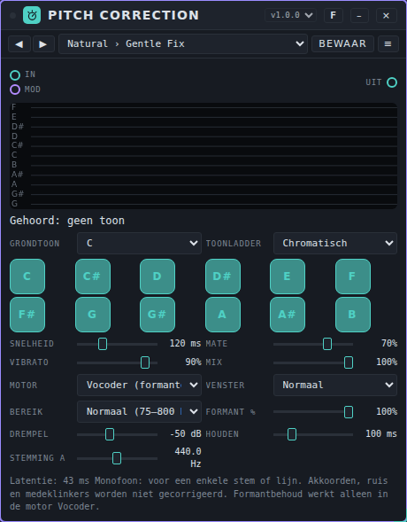

**Regelaars.**

- Het **scherm** bovenaan toont de laatste vier seconden: de grijze lijn is de toonhoogte die gehoord wordt, de heldere lijn de gecorrigeerde toonhoogte, de horizontale lijnen de noten (helder als ze zijn toegestaan). Eronder tonen **Gehoord** en **Gecorrigeerd** de noot en de afstand in cent.
- **Grondtoon** en **Toonladder** zijn een snelkeuze die de twaalf **notenschakelaars** (C tot B) zet. Kies een grondtoon en een toonladder (Chromatisch, Majeur, Mineur, Harmonisch mineur, Melodisch mineur, Dorisch, Frygisch, Lydisch, Mixolydisch, Pentatoniek majeur, Pentatoniek mineur, Blues, Hele toon), of zet losse noten zelf aan en uit: **Toonladder** toont dan *Eigen*. Alleen de schakelaars bepalen wat er gecorrigeerd wordt. Staat er geen enkele aan, dan wordt er niets gecorrigeerd.
- **Snelheid** (0 tot 400 ms) is hoe snel de toonhoogte naar de doelnoot gaat. 0 is hard (intern nooit sneller dan 3 ms) en geeft het robotachtige effect; 40 tot 120 ms klinkt natuurlijk.
- **Mate** (0 tot 100%) is hoe ver de toonhoogte naar het doel wordt verplaatst. **Vibrato** (0 tot 100%) laat dat deel van het eigen vibrato en de eigen drift van de zanger staan (0% maakt het vlak, 100% laat het).
- **Mix** is droog tegenover gecorrigeerd. Het droge geluid wordt met de latentie vertraagd, zodat beide in de maat blijven.
- **Motor:** *Korrel (snel)* heeft een lage latentie; de klinkerkleur schuift een beetje met de toonhoogte mee. *Vocoder (formanten)* is een fasevocoder die de klinkerkleur behoudt (**Formant %**, alleen in deze motor) en meer latentie heeft. **Venster:** *Snel*, *Normaal* of *Hoog*.
- **Bereik** begrenst het zoeken naar de toonhoogte: *Laag* (62 tot 420 Hz), *Normaal* (75 tot 800 Hz) of *Hoog* (90 tot 1100 Hz). Een smaller bereik geeft minder octaaffouten.
- **Drempel** (−70 tot −20 dB) is het niveau waaronder geen toonhoogte wordt gezocht, en **Houden** (0 tot 500 ms) is hoe lang de laatste correctie blijft staan als de toon wegvalt. Stukken zonder duidelijke toonhoogte (stilte, adem, medeklinkers, ruis) gaan **onbewerkt** door.
- **Stemming A** (430 tot 450 Hz) is de referentietoonhoogte van de A.

**Poorten.** **In**, **Uit**, **Mod** (vier parameters: **Snelheid**, **Mate**, **Vibrato**, **Mix**; niets beweegt vanzelf).

**Latentie.** De kaart toont hem. Bij 48 kHz: *Korrel* 11,1 / 12,0 / 14,0 ms en *Vocoder* 21,3 / 42,6 / 85,3 ms voor *Snel* / *Normaal* / *Hoog*. Tel er ongeveer 20 ms bij voor het meten van de toonhoogte voordat een correctie effect heeft (een sprong van 40 ct wordt 13 ms na de meting gecorrigeerd bij **Snelheid** 0). Gebruik *Korrel* met *Snel* om jezelf al zingend te monitoren; gebruik de *Vocoder* als je een opname stemt.

**Voorbeeld.** Een zangspoor → Pitch Correction → Mixer. Kies preset **C Major Vocal** (**Snelheid** 40 ms, **Vibrato** 50%) in een song in C-majeur. Voor een hard, robotachtig effect: preset **Hard Chromatic** (**Snelheid** 0, **Vibrato** 0%).

**Presets.** Pack **Pitch Correction Basics** (24 presets) in [`presets/pitch-correction.patchkamer-presets.json`](../../presets/pitch-correction.patchkamer-presets.json), in de mappen **Natural** (Gentle Fix, Natural Vocal, Subtle Polish, Live Safe), **Hard Tune** (Hard Chromatic, Robot Voice, Stepped Glide, Slow Glide), **In Key** (C Major Vocal, A Minor Vocal, G Major Vocal, E Minor Pentatonic, Blues In G, D Dorian, F Lydian, Whole Tone Dream), **Instruments** (Bass Line, Guitar Lead, Whistle High, Violin Fix) en **Special** (Half Correction, Vibrato Smoother, Low Latency Monitor, High Quality Window).

**Tips en grenzen.** Het is **monofoon**: gebruik het op een enkele stem of lijn, nooit op akkoorden of een mix. Medeklinkers, adem en ruis worden niet gecorrigeerd. Sterke octaafsprongen en een zeer rumoerige opname kunnen de detectie misleiden. De correctie klinkt robotachtig bij **Snelheid** 0 met een veranderende toonhoogte; dat is het bedoelde effect. De motor *Korrel* voegt ruwheid toe bij grote verschuivingen; de *Vocoder* is gladder maar heeft meer latentie en verlaagt het niveau van ruis met ongeveer 3 dB (0,72 in amplitude) als hij die onbewerkt doorlaat.

Offline gemeten (`docs/tools/measure-pitch.mjs correction`). **Detectie**, met 36 grondtonen per bereik (geteste stukken: 70 tot 420 Hz voor *Laag*, 80 tot 800 Hz voor *Normaal*, 150 tot 1000 Hz voor *Hoog*), logaritmisch verdeeld met een willekeurige afwijking van ±50 ct, frames na 0,35 s: een schone sinus, zaagtand of een klinkerachtig geluid ligt in 100% van de frames binnen 10 ct in de bereiken *Laag* en *Normaal* (de zaagtand in *Hoog*: 97,2%, met 2,8% octaaffouten). Met ruis op 20 dB signaal-ruisverhouding: 100% binnen 10 ct. Met ruis op 10 dB: 97,9% (*Laag*), 86,7% (*Normaal*) en 77,1% (*Hoog*) binnen 10 ct; octaaffouten 0%, 2,7% en 5,9%. Met een vibrato van ±50 ct op 5,5 Hz: 100% binnen 50 ct en 80% (*Laag*), 72% (*Normaal*), 60% (*Hoog*) binnen 10 ct, omdat de detectie de bewegende toonhoogte volgt met de lengte van zijn venster achterstand. **Correctie** (chromatisch, **Snelheid** 0, **Vibrato** 0%): de toonhoogte na de correctie ligt gemiddeld 0,00 ct (sinus), 0,08 ct (zaagtand) en 0,05 ct (klinkerachtig) van de dichtstbijzijnde noot in de *Vocoder*, en 1,0, 0,9 en 0,5 ct in *Korrel*, waar hij eerst gemiddeld 15,3 ct afweek; de grootste fout is 2,3 ct. **Toonladder:** in C-majeur gingen 20 van de 20 testtoonhoogtes (tussen de noten, niet precies halverwege) binnen 10 ct naar de verwachte toonladdernoot. **Snelheid:** een stap van 40 ct is na 13 ms (**Snelheid** 0), 53 ms (20 ms), 120 ms (50 ms), 237 ms (100 ms) en 467 ms (200 ms) voor 90% gecorrigeerd. **Vibrato:** bij een vibrato van ±60 ct (spreiding 42 ct) laat **Vibrato** 0% er 7% over (bij **Snelheid** 0; 53% bij **Snelheid** 20 ms, want een tragere correctie volgt ook het vibrato minder), 50% laat er 50% en 100% laat er 98%. Op noten van Piano, Guitar en Formant Singer (chromatisch, **Snelheid** 0, **Vibrato** 0%, *Vocoder*): het aandeel frames binnen 10 ct van een halve toon ging van 49% naar 99% (Piano), 89% naar 100% (Guitar) en 32% naar 73% (Formant Singer, dat vibrato heeft en een uithaal aan het begin van een noot); de detectie van de ingang ligt in 93%, 100% en 100% van de frames binnen 50 ct van de gespeelde noot. Rekenlast per blok van 128 samples (budget 2,67 ms), gemiddeld / 99e percentiel / maximum op deze testmachine: *Korrel* *Normaal* 2,1% / 3,8% / 14,8%, *Vocoder* *Snel* 4,2% / 8,0% / 25,3%, *Normaal* 5,8% / 21,1% / 33,1%, *Hoog* 4,6% / 25,6% / 42,3%. Een bewaker begrenst de ingang op ±16 en vervangt NaN door 0; bij 40 willekeurige en extreme instellingen met bursts van NaN, ±Infinity en 1e30 waren er geen ongeldige samples en kwam het geluid elke keer terug. Stilte blijft stil. Er is niets beluisterd.

## Pitch Shifter

**Waar het voor dient.** Pitch Shifter zet de toonhoogte van een geluid omhoog of omlaag, van −24 tot +24 halve tonen plus ±100 cent, en houdt het tempo gelijk. Er zijn drie motoren voor verschillend materiaal, een mix, een terugkoppeling voor octaaf-echo's en shimmer, en een glijtijd.

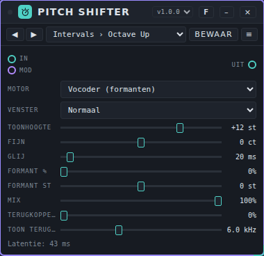

**Regelaars.**

- **Motor:** *Percussief (korrels, snel)* gebruikt heel korte korrels en heeft bijna geen vertraging: voor drums en korte klanken (een aanhoudende toon wordt ruw). *Korrel (zang, instrumenten)* gebruikt langere korrels en laat de golfvormen op elkaar aansluiten, wat gladder is voor stemmen, bas en instrumenten; de formanten schuiven met de toonhoogte mee. *Vocoder (formanten)* is een fasevocoder met formantbesturing; die heeft de meeste latentie en klinkt het schoonst op stemmen en pads.
- **Venster:** *Snel*, *Normaal* of *Hoog*. Een groter venster geeft meer latentie en een schoner resultaat, vooral bij lage tonen.
- **Toonhoogte** (−24 tot +24 st) is het interval in halve tonen en **Fijn** (−100 tot +100 ct) de fijne stemming.
- **Glij** (0 tot 500 ms) is hoe lang de toonhoogte erover doet om te bewegen als je **Toonhoogte**, **Fijn** of een modulatie verandert.
- **Formant %** (0 tot 100%, alleen in de *Vocoder*) behoudt de klinkerkleur van een stem als de toonhoogte verandert. Bij 0% schuiven de formanten mee (het eekhoorntjeseffect). **Formant st** (−12 tot +12 st) verschuift de formanten apart, bijvoorbeeld om een stem kleiner of groter te laten klinken.
- **Mix** is droog tegenover verschoven. Het droge geluid wordt met de minimale latentie vertraagd, zodat beide in de maat blijven.
- **Terugkoppeling** (0 tot 90%) stuurt het verschoven geluid terug naar de ingang: met +12 st krijg je een stijgende shimmer, met −12 st octaaf-echo's die zakken. **Toon terugk.** (500 tot 16000 Hz) is een laagdoorlaatfilter in die lus. De lus wordt zacht begrensd, dus hij kan niet op hol slaan.

**Poorten.** **In**, **Uit**, **Mod** (zes parameters: **Toonhoogte**, **Fijn**, **Formantbehoud**, **Formantverschuiving**, **Mix**, **Terugkoppeling**; niets beweegt vanzelf, want een bewegende toonhoogte klinkt snel vals).

**Latentie.** De kaart toont hem. Bij 48 kHz: *Percussief* 1,3 / 2,0 / 3,0 ms, *Korrel* 14,1 / 16,0 / 18,9 ms en *Vocoder* 21,3 / 42,6 / 85,3 ms voor het venster *Snel* / *Normaal* / *Hoog*. In de twee korrelmotoren groeit de vertraging met het interval, ongeveer een half venster maal de afstand tot de oorspronkelijke snelheid (octaaf omhoog: ca. +10 tot +26 ms; gemeten: *Korrel* *Normaal* +12 st 37 ms tegen 16 ms bij 0 st). Gebruik *Percussief* of *Korrel* met *Snel* als je live meespeelt; gebruik de *Vocoder* als je de latentie kunt compenseren.

**Voorbeeld.** Een zangspoor → Pitch Shifter → Mixer. Preset **Natural Octave Down** (*Vocoder*, −12 st, **Formant %** 100%, **Mix** 60%) voegt een lage octaaf toe zonder een diepe "monsterstem". Een drumbus → Pitch Shifter met preset **Kick Drop** (*Percussief*, −12 st) voor een lagere kick. Voor shimmer: preset **Shimmer** (*Vocoder*, +12 st, **Terugkoppeling** 60%, **Toon terugk.** 5 kHz, **Mix** 50%) op een sendbus na een galm.

**Presets.** Pack **Pitch Shifter Basics** (30 presets) in [`presets/pitch-shifter.patchkamer-presets.json`](../../presets/pitch-shifter.patchkamer-presets.json), in de mappen **Intervals** (Octave Up, Octave Down, Fifth Up Layer, Fourth Down Layer, Major Third Up, Minor Third Down, Two Octaves Up, Two Octaves Down, Tritone), **Voice** (Chipmunk, Deep Voice, Gender Up, Gender Down, Natural Octave Down, Giant), **Doubling** (Subtle Doubler, Wide Detune, Slightly Flat, Micro Thickener), **Drums** (Kick Drop, Snare Up, Tom Down, Hat Up, Drum Octave Layer) en **Effects** (Shimmer, Octave Echo Down, Rising Echoes, Alien, Dark Layer, Smooth Glide).

**Tips en grenzen.** Offline gemeten (zie `docs/tools/measure-pitch.mjs`), over 13 intervallen van −24 tot +24 st en de grondtonen 110, 220 en 440 Hz: de toonhoogtefout van een sinus, een zaagtand en een akkoord is gemiddeld 0,02 ct in de *Vocoder* (grootste 0,06 ct) en 0,8 ct in *Korrel* *Normaal* (grootste 3,8 ct; *Snel* 1,5 ct, grootste 7,7 ct). De overgebleven ruis en vervorming (THD+N) van een verschoven sinus is gemiddeld −53 dB in de *Vocoder* *Normaal* (slechtste geval −41 dB) en −46 dB in *Korrel* *Normaal* (slechtste geval −30 dB). Op noten van Piano, Guitar en Formant Singer, +7 st verschoven, ligt de mediane toonhoogte binnen 5,7 ct in *Korrel* en binnen 11,8 ct in de *Vocoder* (Piano; de andere binnen 5,6 ct). De motor *Percussief* houdt een toon niet schoon: bij een sinus ligt de gemiddelde frequentie binnen 40 ct, maar het geluid is ruw. Bij een akkoord van drie sinussen kan de *Vocoder* de tonen niet scheiden als ze dichter dan ongeveer vier FFT-bins bij elkaar liggen (bij 110 Hz met het venster *Snel* of *Normaal*); het venster *Hoog* kan het wel. **Formant %** op een zuivere toon verlaagt het niveau (−8 dB bij 100% voor +7 st), omdat een sinus geen formanten heeft: zet het lager, of gebruik *Korrel*, voor zulke klanken. Een formanttest met een "a"-klinker (eerste formant 650 Hz) die +7 st wordt verschoven, geeft een sterkste harmonische op 974 Hz zonder formantbehoud en op 584 Hz met **Formant %** op 100%. Rekenlast per blok van 128 samples (budget 2,67 ms), gemiddeld / 99e percentiel / maximum op deze testmachine: *Percussief* 0,4% / 0,7% / 12,7%, *Korrel* *Normaal* 0,8% / 3,6% / 7,7%, *Vocoder* *Snel* 4,2% / 12,4% / 16,8%, *Normaal* 4,7% / 25,8% / 29,6%, *Hoog* 4,2% / 33,0% / 40,9%. Een bewaker begrenst de ingang op ±16 en vervangt NaN door 0; bij 40 willekeurige en extreme instellingen met bursts van NaN, ±Infinity en 1e30 waren er geen ongeldige samples en kwam het geluid elke keer terug. Er is niets beluisterd.

## Pump

**Waar het voor dient.** Pump zet het volume van een bron op de tel omlaag, zodat bas en pads plaatsmaken voor de kick. Dat kan op drie manieren: **Sidechain** luistert naar een tweede audio-ingang (zoals een kick), **Trigger** reageert op trigs of noten en **Klok** duikt vanzelf op het tempo, zonder kabel. Verwar het niet met het effect **Pumping / Duck** in [Effect Chain](#effect-chain): dat is een los, eenvoudiger effect van dat apparaat.

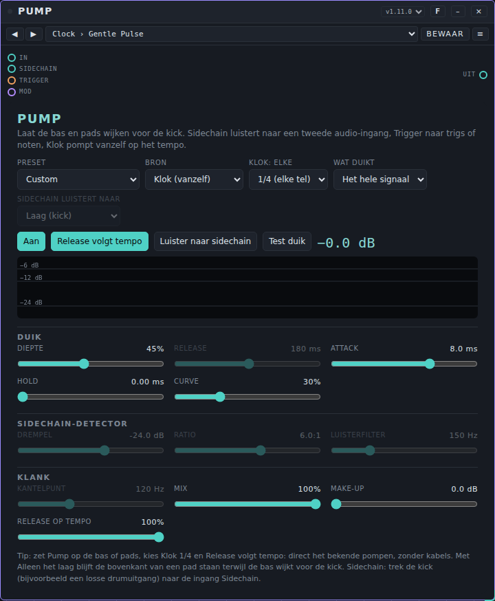

**De regelaars.**

Bovenaan:

- **Preset** is een lijst met beginstanden in het apparaat zelf (*Classic pump*, *Low end only*, *Kick as sidechain*, *Soft breathing*, *Gated (1/16)*, *Trigger from sequencer*, *Parallel (subtle)*). Hij wordt *Custom* zodra je iets wijzigt. Dit is niet dezelfde lijst als de presets in de balk bovenaan de kaart.
- **Bron:** *Sidechain (audio)*, *Trigger (events)* of *Klok (vanzelf)*.
- **Klok: elke:** 1/16, 1/8, 1/4 (elke tel), 1/2 of hele maat. Alleen in gebruik bij *Klok*.
- **Wat duikt:** *Het hele signaal*, *Alleen het laag* of *Alleen het hoog*.
- **Sidechain luistert naar:** *Laag (kick)*, *Alles* of *Hoog (hats)*. Alleen in gebruik bij *Sidechain*.
- **Aan** / **Uit (doorlaten)**, **Release volgt tempo**, **Luister naar sidechain** (hoor wat de detector hoort, om het luisterfilter in te stellen) en **Test duik** (één duik om de instelling te proberen).
- Een meter toont de demping in de tijd, met het getal in dB naast de knoppen.

**Duik:** **Diepte** (hoe ver het signaal omlaag gaat), **Release** (20 tot 1500 ms, hoe snel het terugkomt), **Attack** (0,1 tot 60 ms), **Hold** (0 tot 300 ms; Trigger en Klok) en **Curve** (0 = recht terug, 1 = laat en snel terug, strak pompen).

**Sidechain-detector** (alleen bij *Sidechain*): **Drempel** (−60 tot 0 dB), **Ratio** (1 tot 20) en **Luisterfilter** (40 tot 8000 Hz).

**Klank:** **Kantelpunt** (40 tot 1000 Hz, de grens tussen laag en hoog; alleen als *Wat duikt* niet *Het hele signaal* is), **Mix** (parallel: het deel van het geduikte signaal), **Make-up** (0 tot 12 dB) en **Release op tempo** (het deel van de afstand tot de volgende slag, als **Release volgt tempo** aan staat).

De kaart verbergt de regelaars die niet bij de gekozen bron horen.

**Poorten.** **In**, **Sidechain** (audio), **Uit**, **Trigger** (events: trig, noot) en **Mod**.

**Voorbeeld.** Zet Pump achter een bassynth. Kies **Bron** *Klok (vanzelf)*, **Klok: elke** *1/4 (elke tel)* en zet **Release volgt tempo** aan; start de klok: de bas duikt op elke tel, zonder kabels. Voor een sidechain trek je de kick (bijvoorbeeld een losse drumuitgang) naar **Sidechain** en kies je **Bron** *Sidechain (audio)*.

**Presets.** Pakket **Pump Basics** (13 presets) in [`presets/pump.patchkamer-presets.json`](../../presets/pump.patchkamer-presets.json), in de mappen **Clock** (Gentle Pulse, Four on the Floor, Eighth Chop, Sixteenth Gate, Half Time Slam, Bar Breath), **Sidechain** (Kick Duck, Vocal Space, Hat Tickle), **Split and Mix** (Low Duck, Top Duck, Parallel Pump, Note Duck). Laad het met de tab **Presets** van de bibliotheek → **Importeren…** (of via een bibliotheek die het bevat) en kies dan een preset in de balk bovenaan de kaart, of blader met ◀ ▶.

**Tips.** Met **Wat duikt** op *Alleen het laag* blijft de bovenkant van een pad staan terwijl de bas wijkt voor de kick. De worklet begrenst zijn ingangen op +24 dB en heeft AudioWorklet nodig; zonder gaat het geluid ongewijzigd door en meldt de kaart dat.

## Resonator

**Waar het voor dient.** De resonator maakt van een ritme of ruis een zingende, gestemde klank. Hij heeft een bank van vier resonatoren die je stemt op een grondtoon en een akkoord.

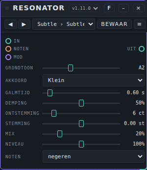

**De regelaars.**

- **Grondtoon** (een noot van 24 tot 84, de kaart toont de naam) en **Akkoord**: *Unisono*, *Octaven*, *Kwinten*, *Groot*, *Klein*, *Sus4*, *Klein 7*, *Kwarten* of *Cluster*.
- **Galmtijd** (0,05 tot 8 s) is hoe lang de resonatoren naklinken.
- **Demping** haalt het hoog uit het naklinken.
- **Ontstemming** (0 tot 50 cent) zet de vier resonatoren een klein stukje uit elkaar.
- **Stemming** (−12 tot +12 halve tonen) verschuift de hele bank.
- **Mix** mengt origineel en effect. **Niveau** (0 tot 200%) is het uitgangsniveau.
- **Noten:** *negeren* of *grondtoon volgt de noten*. Bij de tweede keuze stellen noten die op de poort **Noten** binnenkomen de grondtoon in.

**Poorten.** **In**, **Noten** (events), **Uit**, **Mod**.

**Voorbeeld.** Een drumcomputer → Resonator → Speakers. **Akkoord** *Klein*, **Galmtijd** 0,6 s, **Mix** 20%: een gestemde tint op de drums. Wil je dat een keyboard de toonhoogte bepaalt: sluit Keys aan op **Noten** en kies *grondtoon volgt de noten*.

**Presets.** Pakket **Resonator Basics** (13 presets) in [`presets/resonator.patchkamer-presets.json`](../../presets/resonator.patchkamer-presets.json), in de mappen **Subtle** (Subtle Tint, Drum Tuner, Sub Ring, Marimba Hit), **Chords** (Minor Haze, Major Shine, Sus Cloud, Jazz Seven, Open Fourths, Note Follower), **Extreme** (Metal Drone, Endless Bells, Scream Pipes). Laad het met de tab **Presets** van de bibliotheek → **Importeren…** (of via een bibliotheek die het bevat) en kies dan een preset in de balk bovenaan de kaart, of blader met ◀ ▶.

**Tips.** Resonator heeft AudioWorklet nodig; zonder gaat het geluid ongewijzigd door en meldt de kaart dat. Het apparaat bewaart bij een preset ook de laatst gespeelde grondtoon (in `noteRoot`).

## Reverb

**Waar het voor dient.** Reverb geeft een geluid een geloofwaardige ruimte. Het heeft vijf modellen in één effect: **Hall** (groot, lange decay, rijk), **Plate** (helder, glad, vrijwel meteen dicht), **Spring** (de "boing" van een veertank, lo-fi), **Room** (klein en intiem) en **Chamber** (tussenvorm). Alles draait in één audioworklet, dus het droge signaal blijft vrij van vertraging.

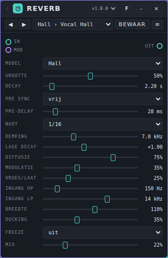

**De regelaars.**

- **Model:** Hall, Plate, Spring, Room of Chamber. Elk model heeft eigen delaylengtes, diffusers en vroege reflecties. Bij een wissel van model loopt het geluid in 80 ms over van het ene naar het andere, zonder tik.
- **Grootte** (0 tot 100%) schaalt de ruimte: van de helft tot het dubbele van de delaylengtes. Bij Spring is het de lengte van de veer.
- **Decay** (0,1 tot 30 s) is de nagalmtijd (RT60) rond 1 kHz.
- **Pre sync:** *vrij* of *op tempo*. **Pre-delay** (0 tot 250 ms) is de tijd voordat de galm begint; bij *op tempo* bepaalt de **Noot** de tijd (1/32, 1/16, 1/8, 1/4 of 1/2, hoogstens 500 ms).
- **Demping** (1 tot 20 kHz) is de frequentie waarop de nagalmtijd half zo lang is: lager is donkerder. **Lage decay** (×0,25 tot ×2) laat het laag sneller of langzamer wegsterven dan de rest.
- **Diffusie** is hoe glad het begin van de galm is; bij Spring is het de dispersie, die bepaalt hoe sterk de "boing" is.
- **Modulatie** beweegt de delaylengtes een klein beetje, wat een metalen klank voorkomt.
- **Vroeg/laat** loopt van alleen de staart (0%) tot alleen vroege reflecties (100%).
- **Ingang HP** en **Ingang LP** filteren wat de galm in gaat (het droge signaal blijft heel).
- **Breedte** (0 tot 200%) is de stereobreedte van de galm; 0 maakt hem mono.
- **Ducking** verlaagt de galm zolang de bron speelt (begint rond -36 dB en is volledig bij -12 dB) en laat hem in de stiltes opbloeien.
- **Freeze:** *vast* sluit de ingang en laat de staart doorlopen. Handig bij een pad of akkoord dat net is afgelopen.
- **Mix** is de verhouding droog en galm (gelijk vermogen). Zet hem op een send-bus op 100%.

**Poorten.** **In**, **Uit**, **Mod** (13 parameters, in vier sporen: ruimte, klank, ingang, uitgang).

**Voorbeeld.** Duofone → Reverb → Speakers. Kies de preset **Pad Hall** voor een pad, **Vocal Plate** voor een stem en **Tight Drum Room** voor drums. Zet **Pre-delay** op 30 tot 50 ms om een stem helder voor de ruimte te houden.

**Presets.** Pakket **Reverb Rooms** (31 presets) in [`presets/reverb.patchkamer-presets.json`](../../presets/reverb.patchkamer-presets.json), in de mappen **Hall**, **Plate**, **Spring**, **Room**, **Chamber** en **Creative** (Frozen Hall, Ducked Vocal Hall, Tempo Pre-delay Hall, Infinite Cloud, Metal Tank, Telephone Room, Dark Void), met instellingen voor zang, drums, snaren, synths, pads en film. Laad het met de tab **Presets** van de bibliotheek → **Importeren…** en kies dan een preset in de balk bovenaan de kaart, of blader met ◀ ▶.

**Tips en grenzen.** Dit zijn offline metingen; er is **niet naar geluisterd**, en het zijn benaderingen van soorten ruimtes, geen kopieën van een bepaalde.

- De nagalmtijd volgt **Decay** binnen ongeveer 5% (gemeten bij 1 kHz zonder demping: ingesteld 2,5 s geeft 2,40 tot 2,47 s op alle modellen; 15 s geeft 14,0 tot 14,9 s). Met **Demping** sterft het hoog sneller weg zoals ingesteld (hall, 3 s: 3,0 s bij 125 Hz, 2,6 s bij 1 kHz, 1,6 s bij 4 kHz met demping 3 kHz). **Lage decay** werkt als een ruwe shelf: ×0,5 geeft ongeveer 2,1 s bij 125 Hz in plaats van 3,0 s.
- De staart wordt ruisachtig dicht na ongeveer 35 ms (Room) tot 265 ms (Hall) met de standaard **Diffusie** en **Modulatie**. Bij **Diffusie** 0 en **Modulatie** 0 duurt dat bij Hall 700 ms en klinkt het metaliger; Spring is met opzet een rinkelend, kamachtig geluid.
- Links en rechts van de staart zijn goed gedecorreleerd (stereocorrelatie 0,04 tot 0,1 bij Hall, Plate, Room en Chamber).
- Het rekenen kost ongeveer 2 tot 3% van het audiobudget van één processorkern per exemplaar (in het slechtste blok minder dan 15%).
- **Freeze** laat de staart niet aangroeien: na 60 s is het niveau 0,9 dB (Hall) tot 4,7 dB (Spring) lager, dus een bevroren staart is niet letterlijk eindeloos.
- Een NaN, oneindig of enorme waarde op de ingang wordt begrensd en kan de galm niet laten ontsporen; een model dat toch stukgaat, wordt gewist en start opnieuw.

## Room

**Waar het voor dient.** Room zet een delay en een galm in één effect. De delay en de galm nemen allebei de ingang; ze voeden elkaar niet.

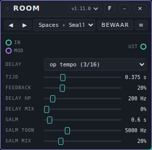

**De regelaars.**

- **Delay:** *op tempo (3/16)* of *vrij*. Bij de eerste is de echotijd drie zestiende stappen van de klok van de studio.
- **Tijd** (0,05 tot 1,5 s) is de echotijd, alleen bij *vrij*.
- **Feedback** (0 tot 92%) is hoe lang de echo's herhalen.
- **Delay HP** (40 tot 2000 Hz) is een hoogdoorlaatfilter in de echo's, zodat ze niet dof worden.
- **Delay mix** is hoeveel echo je hoort.
- **Galm** (0,3 tot 8 s) is de lengte van de galm.
- **Galm toon** (500 tot 16000 Hz) is een laagdoorlaatfilter op de galm.
- **Galm mix** is hoeveel galm je hoort.

**Poorten.** **In**, **Uit**, **Mod** (zes parameters, in twee sporen: delay en galm).

**Voorbeeld.** Duofone → Room → Speakers. Laat **Delay** op *op tempo (3/16)*, **Feedback** 35%, **Delay mix** 25%, **Galm** 3 s en **Galm mix** 25%.

**Presets.** Pakket **Room Basics** (12 presets) in [`presets/room.patchkamer-presets.json`](../../presets/room.patchkamer-presets.json), in de mappen **Spaces** (Small Room, Warm Hall, Bright Plate, Cathedral), **Delays** (Dotted Echo, Slapback, Long Ping, Dub Echo), **Space FX** (Endless Wash, Dark Void, Bright Cloud, Metal Tunnel). Laad het met de tab **Presets** van de bibliotheek → **Importeren…** (of via een bibliotheek die het bevat) en kies dan een preset in de balk bovenaan de kaart, of blader met ◀ ▶.

**Tips.** De galmstaart wordt uit ruis gemaakt als je **Galm** wijzigt, dus hij verschilt telkens een beetje. De pakketten houden **Feedback** onder 75%. Een bewaker verlaagt de feedback even als de echolus gaat oplopen, en bouwt de lus opnieuw op bij een foutieve waarde.

## Tremolo

**Waar het voor dient.** Tremolo laat het volume in een vaste snelheid op en neer gaan. Er zijn twee knoppen.

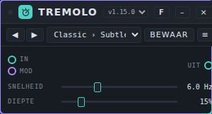

**De regelaars.**

- **Snelheid** (0,1 tot 20 Hz) is het tempo.
- **Diepte** (0 tot 100%) is hoe ver het volume omlaag gaat. Op 100% wordt het geluid onderaan elke beweging helemaal stil.

**Poorten.** **In**, **Uit**, **Mod** (**Snelheid** en **Diepte**).

**Voorbeeld.** Een pad → Tremolo → Speakers. **Snelheid** 6 Hz, **Diepte** 15% is een lichte glinstering; **Snelheid** 4 Hz, **Diepte** 50% een duidelijke puls.

**Presets.** Pakket **Tremolo Basics** (13 presets) in [`presets/tremolo.patchkamer-presets.json`](../../presets/tremolo.patchkamer-presets.json), in de mappen **Classic** (Subtle Shimmer, Gentle Pulse, Vintage Amp, Deep Throb), **Slow** (Slow Swell, Tidal, Deep Breath), **Rhythmic** (Slow Pump, Eighth Chop, Sixteenth Gate), **Extreme** (Helicopter, Ring Buzz, Seasick Wobble). Laad het met de tab **Presets** van de bibliotheek → **Importeren…** (of via een bibliotheek die het bevat) en kies dan een preset in de balk bovenaan de kaart, of blader met ◀ ▶.

**Tips.** Tremolo verandert alleen het volume. Er is geen tempo-instelling: de snelheid is altijd in Hz.

## Vocoder

**Waar het voor dient.** De Vocoder laat een stem (of een ander geluid) een synth bespelen. De stem opent 16 frequentiebanden op een **draaggolf**: de ingebouwde synth (zaagtand, puls of driehoek, bespeeld met noten), ruis, of een externe synth op de tweede audio-ingang. Het resultaat is de klassieke pratende synth.

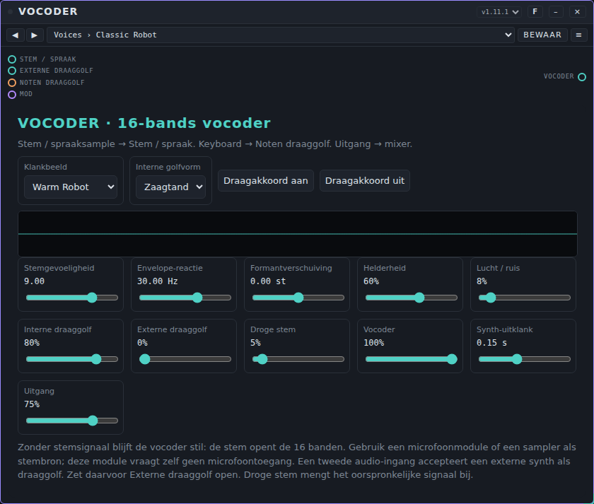

**De regelaars.**

Bovenaan:

- **Klankbeeld** is een lijst met beginstanden in het apparaat zelf (*Warm Robot*, *Whisper Choir*, *Hard Machine*, *Ghost Choir*, *Subtle Voice*, *External Synth*). Dit is niet dezelfde lijst als de presets in de balk bovenaan de kaart.
- **Interne golfvorm:** *Zaagtand*, *Puls* of *Driehoek*.
- **Draagakkoord aan** speelt een vast akkoord (C, G, C, E♭) op de ingebouwde synth; **Draagakkoord uit** stopt het.
- Een scope toont de golfvorm van de uitgang.

Schuiven: **Stemgevoeligheid** (hoe sterk de stem de banden opent), **Envelope-reactie** (5 tot 80 Hz, hoe snel de banden de stem volgen), **Formantverschuiving** (±12 halve tonen), **Helderheid**, **Lucht / ruis** (ruis in de draaggolf), **Interne draaggolf**, **Externe draaggolf**, **Droge stem** (de originele stem erbij gemengd), **Vocoder** (het niveau van het gevocodeerde geluid), **Synth-uitklank** (0,02 tot 3 s) en **Uitgang**.

**Poorten.** **Stem / spraak** (audio: de stem), **Externe draaggolf** (audio: een externe synth), **Noten draaggolf** (events: noten voor de ingebouwde synth), **Vocoder** (audio-uitgang) en **Mod**.

**Voorbeeld.** Sluit een geluidsbron met spraak aan op **Stem / spraak**, een keyboard (Keys) op **Noten draaggolf** en **Vocoder** op de mixer. Speel noten: de ingebouwde synth spreekt in het ritme van de stem. Voor een externe synth: sluit zijn audio aan op **Externe draaggolf**, zet **Externe draaggolf** op 100% en **Interne draaggolf** op 0%.

**Presets.** Pakket **Vocoder Basics** (14 presets) in [`presets/vocoder.patchkamer-presets.json`](../../presets/vocoder.patchkamer-presets.json), in de mappen **Voices** (Classic Robot, Warm Pad Voice, Soft Choir, Voice Doubler), **Textures** (Whisper, Breathy Pad, Ghost Choir, Deep Giant), **Extreme** (Steel Machine, Tiny Alien, Screamer, Gate Chatter), **External** (External Clean, External Edge). Laad het met de tab **Presets** van de bibliotheek → **Importeren…** (of via een bibliotheek die het bevat) en kies dan een preset in de balk bovenaan de kaart, of blader met ◀ ▶.

**Tips.** Zonder signaal op de stem-ingang blijft de vocoder stil. De Vocoder vraagt zelf geen microfoontoegang; gebruik een ander apparaat of een sample als bron. Alle 16 banden draaien op standaard Web Audio-nodes (geen worklet). Een bewaker vervangt de banden als een foutieve waarde (`NaN` of oneindig), vooral op de externe draaggolf, ze zou vergiftigen.

## Als het niet werkt

- **Ik hoor niets.** Controleer de kabels: audio van de bron naar **In** (bij Vocoder naar **Stem / spraak**) en van **Uit** naar de Mixer of Speakers. Druk op **Start**, of klik ergens in Patchkamer: browsers pauzeren audio tot je iets doet. Zie ook onderdeel 13 van de [basishandleiding](../USER-MANUAL_NL.md).
- **Het effect doet niets.** Controleer **Mix** (op 0% hoor je alleen het origineel), het slot in Effect Chain (**Bypass aan**, of **Doorvoer**, of **Effectmix** op 0%) en **Diepte** (op 0% beweegt een zwiepend effect niet).
- **Het effect geeft het geluid ongewijzigd door.** Flanger, Frequency Shifter, Pump, Resonator en drie filtertypen (ladder en de twee kamfilters) hebben AudioWorklet nodig. Heeft je browser dat niet, dan meldt de kaart het. Gebruik een actuele Chrome of Edge.
- **Beweging op tempo staat stil.** Druk op **Start**: de tempokeuzes volgen de klok van de studio. Pump op *Klok* en de ritme-effecten in Effect Chain hebben hem ook nodig.
- **Pump duikt niet.** *Sidechain* heeft een signaal nodig op de poort **Sidechain** (en het moet de **Drempel** halen); *Trigger* heeft trigs of noten nodig op **Trigger**; *Klok* heeft een lopende klok nodig.
- **Resonator volgt de noten niet.** Kies *grondtoon volgt de noten* bij **Noten** en sluit noten aan op **Noten**.
- **Krakende of haperende audio.** Effect Chain draait veel effecten in de hoofdthread: gebruik minder slots, of zet de analyzer op *Uit / minder CPU*. Zie ook Instellingen → Audio in de [basishandleiding](../USER-MANUAL_NL.md).
- **Een knop beweegt niet mee met de modulator.** De knop is de basiswaarde. Controleer de (paarse) kabel naar **Mod** en of de modulator een spoor voor dit effect heeft. Keuzes (lijsten) worden niet gemoduleerd.
