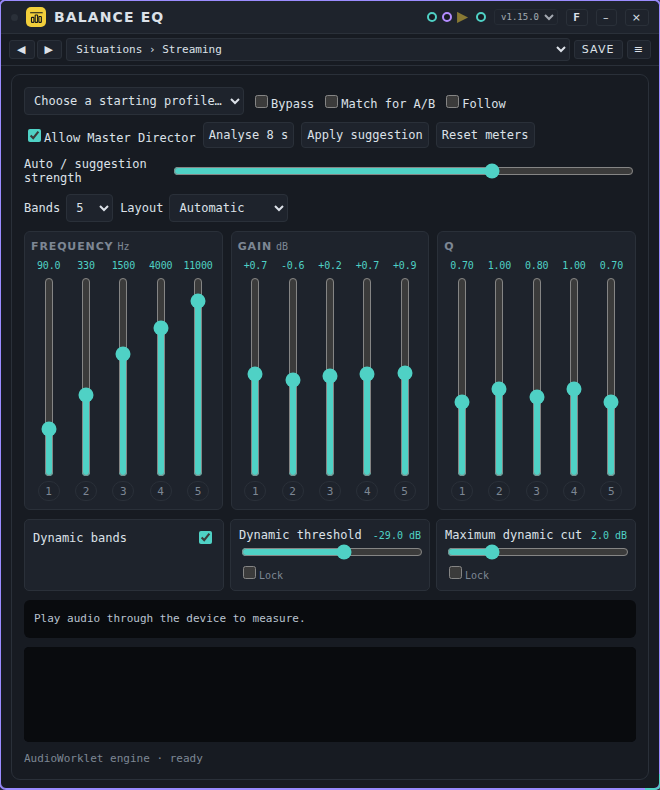
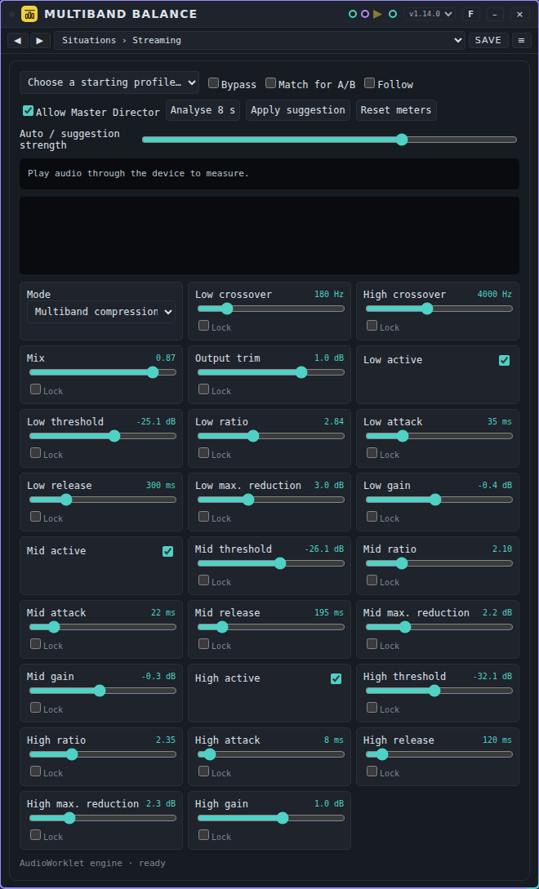
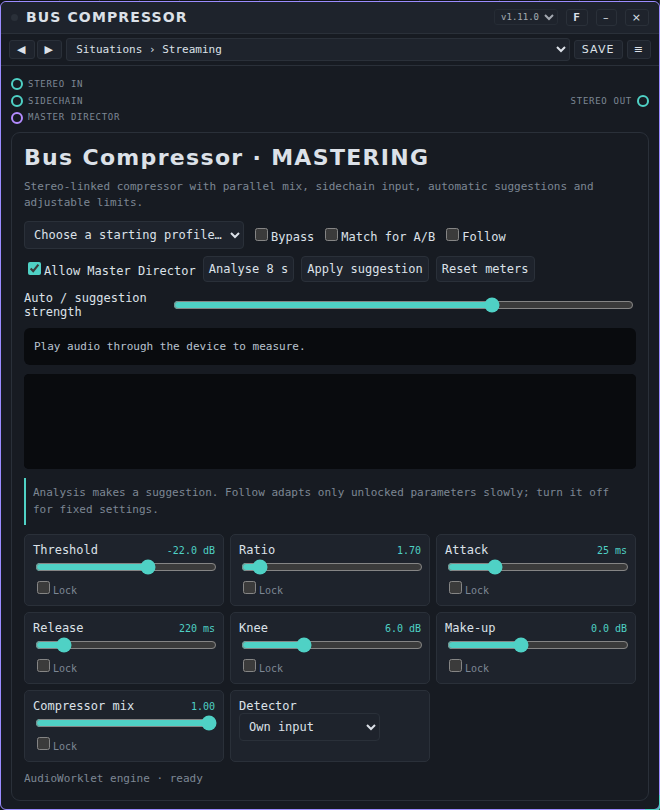
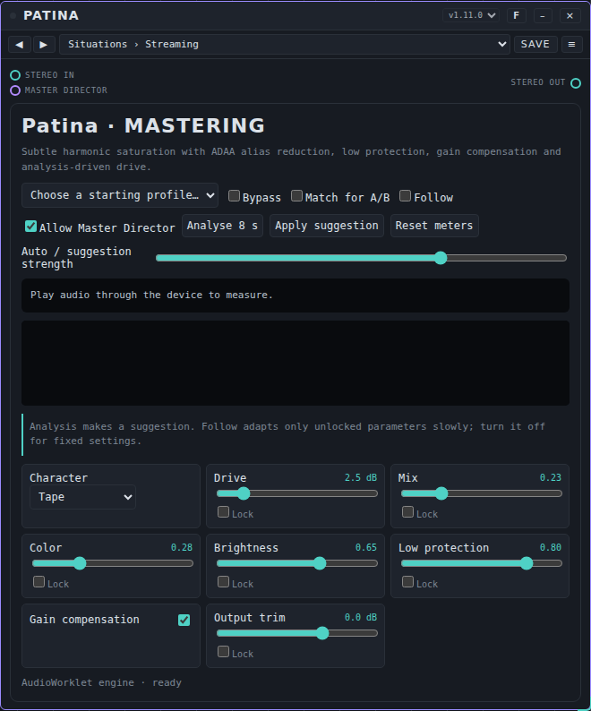
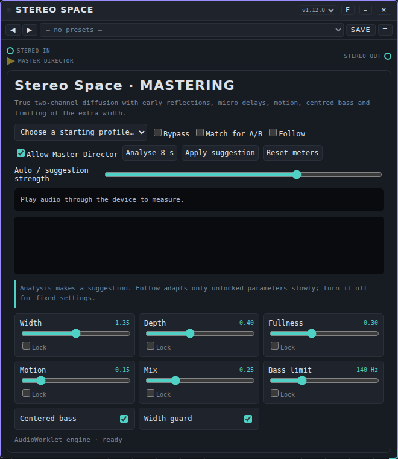
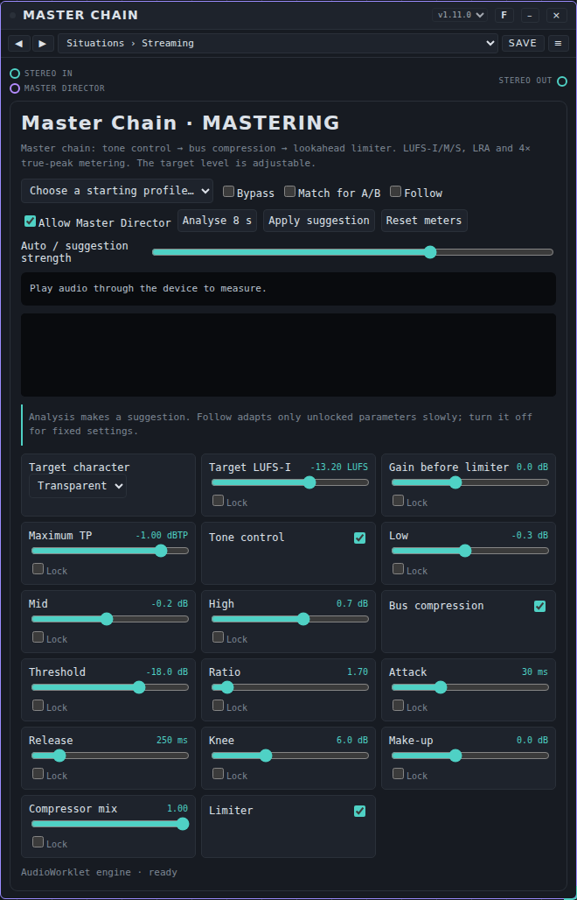
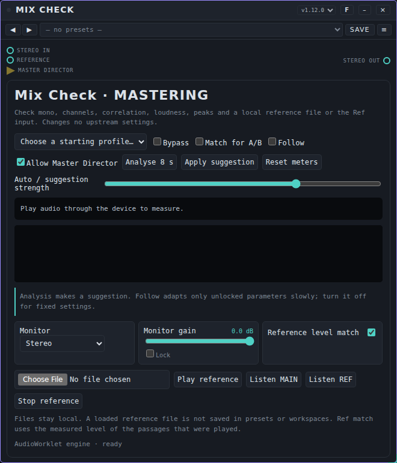
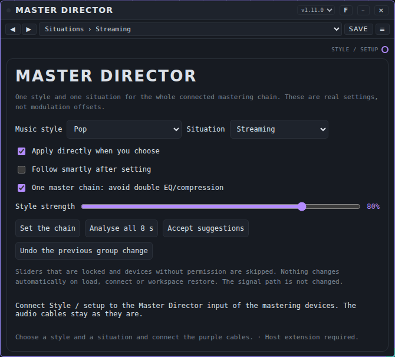
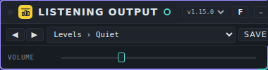

# Mastering: user manual

*Nederlandse versie: [USER-MANUAL_NL.md](USER-MANUAL_NL.md)*

Mastering devices help you finish a mix: balance the tone, control the dynamics, add warmth and width, reach the right loudness for where the music will be played, and check the result. This page covers the nine mastering devices that come with Patchkamer: **Balance EQ**, **Multiband Balance**, **Bus Compressor**, **Patina**, **Stereo Space**, **Master Chain**, **Mix Check**, **Master Director** and **Listening Output**. For the basics (opening Patchkamer, loading a library, drawing cables) see the [main user manual](../USER-MANUAL_EN.md). The folder with the devices is described in [devices/mastering](../../devices/mastering/README.md).

## Contents

1. [What mastering devices do](#what-mastering-devices-do)
2. [Which device for which goal](#which-device-for-which-goal)
3. [A mastering chain](#a-mastering-chain)
4. [Situations and music styles](#situations-and-music-styles)
5. [The card of a mastering device](#the-card-of-a-mastering-device)
6. [Balance EQ](#balance-eq)
7. [Multiband Balance](#multiband-balance)
8. [Bus Compressor](#bus-compressor)
9. [Patina](#patina)
10. [Stereo Space](#stereo-space)
11. [Master Chain](#master-chain)
12. [Mix Check](#mix-check)
13. [Master Director](#master-director)
14. [Listening Output](#listening-output)
15. [If it does not work](#if-it-does-not-work)

## What mastering devices do

A mastering device takes the finished stereo mix and shapes it. They are used one after the other, on the master. Most of them have a **Master Director** port (a yellow triangle): the Master Director can set the whole chain for a music style and a situation at once. Everything is also set by hand, and every device has **presets** (a preset is the setting of one device). See [Presets](../presets/USER-MANUAL_EN.md) for how to use and share them.

All six processing devices measure what comes in and goes out: loudness (LUFS-I, LUFS-M, LUFS-S, loudness range), peaks (sample peak and, in the Master Chain and Mix Check, 4× true peak), stereo correlation and left/right balance. The measurements are our own implementation of the usual loudness method (K-weighting, 400 ms blocks, gating); they are meant as a guide and are not a formal certification.

## Which device for which goal

| I want to… | Use |
|---|---|
| Balance the tone with five to twelve bands | [Balance EQ](#balance-eq) |
| Control the lows, mids and highs separately | [Multiband Balance](#multiband-balance) |
| Glue the mix together | [Bus Compressor](#bus-compressor) |
| Add warmth and colour | [Patina](#patina) |
| Make the stereo picture wider and deeper, safely | [Stereo Space](#stereo-space) |
| Reach a loudness target and limit the peaks | [Master Chain](#master-chain) |
| Check mono, correlation and compare with a reference | [Mix Check](#mix-check) |
| Set the whole chain for a style and a situation | [Master Director](#master-director) |
| Listen at a set volume, as the last device | [Listening Output](#listening-output) |

## A mastering chain

A usual order, from left to right. Leave out what you do not need.

1. **Balance EQ** and **Multiband Balance**: the tone and the dynamic balance.
2. **Bus Compressor**: glue.
3. **Patina**: warmth.
4. **Stereo Space**: width.
5. **Master Chain**: the final tone, compression and limiting to the target loudness.
6. **Mix Check** (to measure and compare) and **Listening Output** (to listen).

The **Master Chain** already has its own tone control and bus compression. If you also use Balance EQ or Bus Compressor, the Master Director switches those parts of the Master Chain off so they do not work twice (when **One master chain** is on).

## Situations and music styles

The Master Director and the presets of every mastering device use two choices: a **situation**, which says where the music will be played, and a **music style**. Together they give the settings.

**Situations**

| Situation | What it does |
|---|---|
| **Streaming** | Pulls the loudness toward about −14 LUFS-I, the level of most streaming services, with a ceiling of −1 dBTP. |
| **Club** | Louder (about 1 dB), a little more low end, a bit narrower and a ceiling of −0.5 dBTP, for club systems. |
| **Festival** | Louder (about 1.5 dB), more low end and presence, narrower (mono-safe on a big PA) and more saturation. |
| **Big room** | The loudest (about 2 dB more), strong compression, extra low end, narrow, for big stages and drops. |
| **Home / hi-fi** | Softer (about 1.5 dB less), gentler compression, a little wider and a softer top, for living-room listening. |
| **Headphones** | Softer, gentle compression, careful width and a softer top, to avoid listening fatigue. |
| **Studio / reference** | About 3 dB more dynamic, light compression and saturation: a reference that keeps headroom. |
| **Radio / broadcast** | Firmer compression, narrower and a little more presence, so it stays clear on radio and in the kitchen. |
| **Car** | More low end and top for road noise, narrower, firm compression. |

**Music styles**

The styles set the target loudness, the amount of compression and saturation, the width, the space and the tone. The loudness of the situation is added to it.

**Transparent**, **Warm / organic**, **Techno**, **Hard techno**, **Deep house**, **House**, **Progressive house**, **Trance**, **Psytrance**, **Electro**, **Synthwave**, **EDM**, **Hardstyle**, **Drum & bass**, **Dubstep**, **Breakbeat**, **Hip-hop**, **Trap**, **R&B / soul**, **Pop**, **Rock**, **Metal**, **Indie / alternative**, **Latin**, **Funk / disco**, **Reggae / dub**, **Lo-fi**, **Folk / acoustic**, **Acoustic / jazz**, **Classical**, **Soundtrack / cinematic**, **Ambient**.

## The card of a mastering device

The six processing devices (Balance EQ, Multiband Balance, Bus Compressor, Patina, Stereo Space and Master Chain) and Mix Check share one card. These parts are the same on all of them:

| Control | What it does |
|---|---|
| **Starting profile** | A few ready-made starting settings of this device. Choosing one sets the values it names; locked controls stay as they are. |
| **Bypass** | Passes the sound through unchanged. |
| **Match for A/B** | Lowers the louder of the processed and the original sound so you compare tone and not loudness. It never boosts. |
| **Follow** | Lets the device follow its own suggestion slowly while audio plays (only unlocked controls). |
| **Allow Master Director** | Allows the Master Director to change the settings. |
| **Analyse 8 s** | Listens for eight seconds and makes a suggestion. |
| **Apply suggestion** | Applies the suggestion; locked controls stay as they are. |
| **Reset meters** | Starts the measurements again. |
| **Auto / suggestion strength** | How far a suggestion or Follow moves a control (0 to 100%). |
| **Lock** (under each control) | Protects a control from suggestions, Follow and the Master Director. |
| The meter and the spectrum | The measurements of the input and the output, and the spectrum of the input. A warning appears for sample clipping, a bad phase, an unbalanced left/right and heavy limiting. |

Double-click a slider to go back to its starting value. Click the number to type a value.

## Balance EQ

### What it is for

An equalizer with five to twelve bands: a low shelf (band 1), bells and a high shelf (band 5); extra bands (6 to 12) are bells. The default is five bands. You see the settings as vertical faders in three sections: **Frequency**, **Gain** and **Q**, with the number above each fader and the band number below it. Bands 2 and 4 can work dynamically, so they cut only when the sound in that range gets loud. An analysis of eight seconds suggests a small, careful correction.

### The controls

Besides the controls of [the card](#the-card-of-a-mastering-device):

| Control | What it does | Range (start) |
|---|---|---|
| **Bands** | The number of active bands. Extra bands sit at their defaults; if you remove bands they return to the default. This number is part of a preset. | 5 to 12 (5) |
| **Layout** | How the three sections are placed: **Automatic** (side by side when there is room, otherwise stacked), **Side by side** or **Stacked**. Not part of a preset. | **Automatic** / **Side by side** / **Stacked** (Automatic) |
| **Frequency** (bands 1 to 12) | Centre frequency of the band (a corner frequency for the shelves). Logarithmic fader. | 20 to 20000 Hz (90, 330, 1000, 3300, 9500; bands 6 to 12: 120, 450, 1500, 2600, 5000, 7500, 14000) |
| **Gain** (bands 1 to 12) | Boost or cut of the band. Step 0.1 dB. | -18 to 18 dB (0) |
| **Q** (bands 1 to 12) | Width of the band (higher is narrower). Logarithmic fader. | 0.1 to 20 (0.707 / 1 / 0.8 / 1 / 0.707; bands 6 to 12: 1) |
| **Dynamic bands** | Makes bands 2 and 4 work only when the sound in that range gets loud. | on or off (off) |
| **Dynamic threshold** | Level above which a dynamic band cuts. | -60 to -6 dB (-30) |
| **Maximum dynamic cut** | The most a dynamic band may cut. | 0 to 9 dB (3) |

Fine adjustment: the arrow keys give a small step (0.1 dB; about 1 percent for frequency and Q), **Shift** or **Page Up/Down** a large step (1 dB; a third of an octave; about 50 percent for Q). **Home** and **End** go to the minimum and maximum. Click the number above a fader to type a value, double-click a fader for its starting value. Click a **band number** below a fader to lock that setting: **Follow** and the Master Director then leave it alone. The analysis suggestions (**Follow**, **Apply suggestion**) apply to bands 1 to 5; extra bands are never adjusted automatically. When you move a fader, frequency and Q are rounded to three digits.

### Ports

| Port | Kind | Use |
|---|---|---|
| **Stereo in** | audio in (teal) | The sound to process. |
| **Stereo out** | audio out (teal) | The processed sound. Connect it to the next device or to **Speakers**. |
| **Master Director** | mastering in (yellow triangle) | Receives the settings of the Master Director. Optional. |

### Presets

Balance EQ has the pack **Balance EQ Situations and Styles**: 128 presets in 10 folders (Situations (9), Styles (32), Club (14), Festival (11), Big Room (8), Home / Hi-Fi (14), Headphones (11), Studio / Reference (13), Radio / Broadcast (8), Car (8)). The file is [`presets/balance-eq.patchkamer-presets.json`](../../presets/balance-eq.patchkamer-presets.json). Load the pack with the **Presets** tab of the library → **Import…**, then pick a preset in the list on the card.

The folders **Situations** and **Styles** have one preset per situation and per music style; the other folders have the usual combinations of a situation and a style (for example **Club › Techno**). The values follow the same recipes as the Master Director.

### Tips and limits

- Cuts are usually safer than boosts: use the sign of the suggestion from **Analyse 8 s** as a hint, not as a rule.
- Use **Dynamic bands** to tame a harsh range (band 4) or a boomy range (band 2) only when it gets loud.

## Multiband Balance

### What it is for

A multiband compressor with three stereo-linked bands (LR4 crossovers), or a broad dynamic EQ. Every band has its own threshold, ratio, attack, release, maximum reduction and gain. It never boosts noise upward.

### The controls

Besides the controls of [the card](#the-card-of-a-mastering-device):

| Control | What it does | Range (start) |
|---|---|---|
| **Mode** | Multiband compression, or a broad dynamic EQ that only cuts (at most 2 to 1). | **Multiband compression** / **Broad dynamic EQ** (Multiband compression) |
| **Low crossover** | Crossover between the low and the mid band. | 50 to 800 Hz (180) |
| **High crossover** | Crossover between the mid and the high band. | 1200 to 8000 Hz (2600) |
| **Mix** | Processed sound against the original. | 0 to 1 (1) |
| **Output trim** | Output gain. | -12 to 6 dB (0) |
| **Low active** | Switches the low band on. | on or off (on) |
| **Low threshold** | Level above which the low band is reduced. | -60 to 0 dB (-27) |
| **Low ratio** | How strongly the low band is reduced above its threshold. | 1 to 6 (1.6) |
| **Low attack** | How fast the low band reacts. | 0.001 to 0.15 s (0.035) |
| **Low release** | How fast the low band lets go. | 0.03 to 1.2 s (0.28) |
| **Low max. reduction** | The most the low band may be reduced. | 0 to 9 dB (3) |
| **Low gain** | Fixed gain of the low band, after the compression. | -6 to 6 dB (0) |
| **Mid active** | Switches the mid band on. | on or off (on) |
| **Mid threshold** | Level above which the mid band is reduced. | -60 to 0 dB (-24) |
| **Mid ratio** | How strongly the mid band is reduced above its threshold. | 1 to 6 (1.35) |
| **Mid attack** | How fast the mid band reacts. | 0.001 to 0.15 s (0.022) |
| **Mid release** | How fast the mid band lets go. | 0.03 to 1.2 s (0.18) |
| **Mid max. reduction** | The most the mid band may be reduced. | 0 to 9 dB (3) |
| **Mid gain** | Fixed gain of the mid band, after the compression. | -6 to 6 dB (0) |
| **High active** | Switches the high band on. | on or off (on) |
| **High threshold** | Level above which the high band is reduced. | -60 to 0 dB (-29) |
| **High ratio** | How strongly the high band is reduced above its threshold. | 1 to 6 (1.4) |
| **High attack** | How fast the high band reacts. | 0.001 to 0.15 s (0.008) |
| **High release** | How fast the high band lets go. | 0.03 to 1.2 s (0.12) |
| **High max. reduction** | The most the high band may be reduced. | 0 to 9 dB (3) |
| **High gain** | Fixed gain of the high band, after the compression. | -6 to 6 dB (0) |

### Ports

| Port | Kind | Use |
|---|---|---|
| **Stereo in** | audio in (teal) | The sound to process. |
| **Stereo out** | audio out (teal) | The processed sound. Connect it to the next device or to **Speakers**. |
| **Master Director** | mastering in (yellow triangle) | Receives the settings of the Master Director. Optional. |

### Presets

Multiband Balance has the pack **Multiband Balance Situations and Styles**: 128 presets in 10 folders (Situations (9), Styles (32), Club (14), Festival (11), Big Room (8), Home / Hi-Fi (14), Headphones (11), Studio / Reference (13), Radio / Broadcast (8), Car (8)). The file is [`presets/multiband-balance.patchkamer-presets.json`](../../presets/multiband-balance.patchkamer-presets.json). Load the pack with the **Presets** tab of the library → **Import…**, then pick a preset in the list on the card.

The folders **Situations** and **Styles** have one preset per situation and per music style; the other folders have the usual combinations of a situation and a style (for example **Club › Techno**). The values follow the same recipes as the Master Director.

### Tips and limits

- Start with **Soft bus glue** or **Low under control** (starting profiles) and keep the reduction small: 1 to 3 dB per band.
- Switch a band off with its **active** control to hear what it does.

## Bus Compressor

### What it is for

A stereo-linked compressor for the master or a bus: threshold, ratio, attack, release, knee, make-up and a parallel mix. The detector can listen to its own input or to the Sidechain input. An analysis of eight seconds makes a suggestion.

### The controls

Besides the controls of [the card](#the-card-of-a-mastering-device):

| Control | What it does | Range (start) |
|---|---|---|
| **Threshold** | Level above which compression starts. | -60 to 0 dB (-18) |
| **Ratio** | How strongly the level above the threshold is reduced (2 means 2 to 1). | 1 to 12 (2) |
| **Attack** | How fast compression starts when the level rises. | 0.001 to 0.1 s (0.02) |
| **Release** | How fast compression lets go again. | 0.03 to 1.5 s (0.2) |
| **Knee** | How gradually compression starts around the threshold (0 is hard). | 0 to 18 dB (6) |
| **Make-up** | Gain after the compression, to make up for the reduction. | -12 to 18 dB (0) |
| **Compressor mix** | Compressed sound against the original: 1 is fully compressed, lower values give parallel compression. | 0 to 1 (1) |
| **Detector** | Where the compressor listens: to its own input, or to the Sidechain input. | **Own input** / **Sidechain input** (Own input) |

### Ports

| Port | Kind | Use |
|---|---|---|
| **Stereo in** | audio in (teal) | The sound to process. |
| **Sidechain** | audio in (teal) | A second signal for the detector (for example a kick), used when **Detector** is on **Sidechain input**. |
| **Stereo out** | audio out (teal) | The processed sound. Connect it to the next device or to **Speakers**. |
| **Master Director** | mastering in (yellow triangle) | Receives the settings of the Master Director. Optional. |

### Presets

Bus Compressor has the pack **Bus Compressor Situations and Styles**: 128 presets in 10 folders (Situations (9), Styles (32), Club (14), Festival (11), Big Room (8), Home / Hi-Fi (14), Headphones (11), Studio / Reference (13), Radio / Broadcast (8), Car (8)). The file is [`presets/bus-compressor.patchkamer-presets.json`](../../presets/bus-compressor.patchkamer-presets.json). Load the pack with the **Presets** tab of the library → **Import…**, then pick a preset in the list on the card.

The folders **Situations** and **Styles** have one preset per situation and per music style; the other folders have the usual combinations of a situation and a style (for example **Club › Techno**). The values follow the same recipes as the Master Director.

### Tips and limits

- Start with the presets **Situations › Streaming** or your style, then lower **Threshold** until the compressor works only a few dB on the loud parts.
- For ducking on a kick, set **Detector** to **Sidechain input** and connect the kick to the Sidechain input.

## Patina

### What it is for

A subtle harmonic saturation (tape, tube or neutral soft) with alias reduction, low-end protection, gain compensation and a parallel mix. For warmth and glue, not for distortion.

### The controls

Besides the controls of [the card](#the-card-of-a-mastering-device):

| Control | What it does | Range (start) |
|---|---|---|
| **Character** | Tape (warm and rounded), Tube (asymmetric, with even harmonics) or Neutral soft. | **Tape** / **Tube** / **Neutral soft** (Tape) |
| **Drive** | How hard the signal is pushed into the saturation. | 0 to 18 dB (3) |
| **Mix** | Saturated sound against the clean sound (parallel). | 0 to 1 (0.28) |
| **Color** | How much warmth and even-harmonic character the saturated part gets: an asymmetric saturation plus a warmth bell around 250 Hz on the saturated path. It differs per character: Tube the most even harmonics, Tape a lot of warmth, Neutral soft the least. Scales with **Mix**. | 0 to 1 (0.35) |
| **Brightness** | Tilt of the saturated part: low is darker (up to 9 dB less above about 3.5 kHz), 0.65 is neutral, high is brighter (up to 6 dB more). Scales with **Mix**. | 0 to 1 (0.65) |
| **Low protection** | Keeps the low end clean: higher means less saturation on the bass. | 0 to 1 (0.7) |
| **Gain compensation** | Keeps the loudness about the same when you change Drive. | on or off (on) |
| **Output trim** | Output gain. | -12 to 6 dB (0) |

### Ports

| Port | Kind | Use |
|---|---|---|
| **Stereo in** | audio in (teal) | The sound to process. |
| **Stereo out** | audio out (teal) | The processed sound. Connect it to the next device or to **Speakers**. |
| **Master Director** | mastering in (yellow triangle) | Receives the settings of the Master Director. Optional. |

### Presets

Patina has the pack **Patina Situations and Styles**: 128 presets in 10 folders (Situations (9), Styles (32), Club (14), Festival (11), Big Room (8), Home / Hi-Fi (14), Headphones (11), Studio / Reference (13), Radio / Broadcast (8), Car (8)). The file is [`presets/patina.patchkamer-presets.json`](../../presets/patina.patchkamer-presets.json). Load the pack with the **Presets** tab of the library → **Import…**, then pick a preset in the list on the card.

The folders **Situations** and **Styles** have one preset per situation and per music style; the other folders have the usual combinations of a situation and a style (for example **Club › Techno**). The values follow the same recipes as the Master Director.

### Tips and limits

- Keep **Mix** low (20 to 35%) and let **Gain compensation** on, so you hear colour and not just loudness.
- Use **Low protection** to keep the kick and the bass clean while the rest gets warmth.

## Stereo Space

### What it is for

True two-channel diffusion with early reflections, micro delays and slow motion, with the bass kept in the centre and a guard that limits the extra width when the stereo picture becomes unsafe for mono.

### The controls

Besides the controls of [the card](#the-card-of-a-mastering-device):

| Control | What it does | Range (start) |
|---|---|---|
| **Width** | Stereo width of the side signal (1 is the original). | 0.5 to 2.2 (1.35) |
| **Depth** | Depth of the early reflections. | 0 to 1 (0.4) |
| **Fullness** | Amount of diffuse sound that fills out the picture. | 0 to 0.8 (0.3) |
| **Motion** | Slow movement of the micro delays. | 0 to 1 (0.15) |
| **Mix** | Processed sound against the original. | 0 to 1 (0.25) |
| **Bass limit** | Frequency below which the sound is kept in the middle (with Centered bass). | 60 to 350 Hz (140) |
| **Centered bass** | Keeps everything below the bass limit in the centre. | on or off (on) |
| **Width guard** | Lowers the extra width when the stereo correlation drops (mono compatibility). | on or off (on) |

### Ports

| Port | Kind | Use |
|---|---|---|
| **Stereo in** | audio in (teal) | The sound to process. |
| **Stereo out** | audio out (teal) | The processed sound. Connect it to the next device or to **Speakers**. |
| **Master Director** | mastering in (yellow triangle) | Receives the settings of the Master Director. Optional. |

### Presets

Stereo Space has the pack **Stereo Space Situations and Styles**: 128 presets in 10 folders (Situations (9), Styles (32), Club (14), Festival (11), Big Room (8), Home / Hi-Fi (14), Headphones (11), Studio / Reference (13), Radio / Broadcast (8), Car (8)). The file is [`presets/stereo-space.patchkamer-presets.json`](../../presets/stereo-space.patchkamer-presets.json). Load the pack with the **Presets** tab of the library → **Import…**, then pick a preset in the list on the card.

The folders **Situations** and **Styles** have one preset per situation and per music style; the other folders have the usual combinations of a situation and a style (for example **Club › Techno**). The values follow the same recipes as the Master Director.

### Tips and limits

- A little goes a long way: a width of 1.1 to 1.3 is enough for most masters. Watch the correlation meter; keep **Width guard** on.
- Keep **Centered bass** on for club and festival systems.

## Master Chain

### What it is for

The end of the chain: tone control (low, mid, high), bus compression and a lookahead limiter with 4× true-peak limiting. It measures LUFS-I, LUFS-M and LUFS-S, loudness range and true peak. You set the target loudness and the ceiling.

### The controls

Besides the controls of [the card](#the-card-of-a-mastering-device):

| Control | What it does | Range (start) |
|---|---|---|
| **Target character** | Character of the bus compressor, also when **Follow** is off (and only when **Bus compression** is on and the ratio is above 1): Transparent is neutral, Warm softer and slower (a little less compression), Firm tighter and Club the firmest. It also steers the suggestions of Analyse and Follow. | **Transparent** / **Warm** / **Firm** / **Club** (Transparent) |
| **Target LUFS-I** | The loudness (LUFS-I) that the measurement and the suggestion aim at. It does not change the sound by itself: the meter shows the target and the deviation (the **TARGET** line), and **Analyse 8 s** and **Follow** use it to suggest the gain. | -24 to -7 LUFS (-14) |
| **Gain before limiter** | Gain before the limiter: raise it to push the limiter harder and make the master louder. | -12 to 18 dB (0) |
| **Maximum TP** | Highest true peak that the limiter lets through; the output peak comes out at this level (measured as the card shows it, 4×). | -6 to -0.1 dBTP (-1) |
| **Tone control** | Switches the three tone controls on. | on or off (on) |
| **Low** | Boost or cut of the low end (a low shelf). | -4 to 4 dB (0) |
| **Mid** | Boost or cut of the middle (a bell). | -4 to 4 dB (0) |
| **High** | Boost or cut of the high end (a high shelf). | -4 to 4 dB (0) |
| **Bus compression** | Switches the bus compressor on. | on or off (on) |
| **Threshold** | Level above which compression starts. | -60 to 0 dB (-18) |
| **Ratio** | How strongly the level above the threshold is reduced (2 means 2 to 1). | 1 to 12 (2) |
| **Attack** | How fast compression starts when the level rises. | 0.001 to 0.1 s (0.02) |
| **Release** | How fast compression lets go again. | 0.03 to 1.5 s (0.2) |
| **Knee** | How gradually compression starts around the threshold (0 is hard). | 0 to 18 dB (6) |
| **Make-up** | Gain after the compression, to make up for the reduction. | -12 to 18 dB (0) |
| **Compressor mix** | Compressed sound against the original: 1 is fully compressed, lower values give parallel compression. | 0 to 1 (1) |
| **Limiter** | Switches the lookahead limiter on. | on or off (on) |

### Ports

| Port | Kind | Use |
|---|---|---|
| **Stereo in** | audio in (teal) | The sound to process. |
| **Stereo out** | audio out (teal) | The processed sound. Connect it to the next device or to **Speakers**. |
| **Master Director** | mastering in (yellow triangle) | Receives the settings of the Master Director. Optional. |

### Presets

Master Chain has the pack **Master Chain Situations and Styles**: 128 presets in 10 folders (Situations (9), Styles (32), Club (14), Festival (11), Big Room (8), Home / Hi-Fi (14), Headphones (11), Studio / Reference (13), Radio / Broadcast (8), Car (8)). The file is [`presets/master-chain.patchkamer-presets.json`](../../presets/master-chain.patchkamer-presets.json). Load the pack with the **Presets** tab of the library → **Import…**, then pick a preset in the list on the card.

The folders **Situations** and **Styles** have one preset per situation and per music style; the other folders have the usual combinations of a situation and a style (for example **Club › Techno**). The values follow the same recipes as the Master Director.

### Tips and limits

- Aim at the loudness of the situation: the presets **Situations › Club**, **Festival** or **Big room** set a higher target, **Studio / reference** a lower one. Check the result with the meter.
- If the limiter works more than about 6 dB, the card warns you: lower the target or **Gain before limiter**.

## Mix Check

### What it is for

A checking device that does not change your mix. It only changes what you listen to: stereo, mono, left, right or only the Side signal, with a listening level, and it measures correlation, loudness and peaks. You can compare against a reference (a local audio file or the Reference input) at the same loudness.

### The controls

Besides the controls of [the card](#the-card-of-a-mastering-device):

| Control | What it does | Range (start) |
|---|---|---|
| **Monitor** | What you listen to: stereo, mono, left, right or only the Side signal. | **Stereo** / **Mono** / **Left only** / **Right only** / **Sidechain input** (Stereo) |
| **Monitor gain** | Lowers the listening level (from 0 down to −24 dB). | -24 to 0 dB (0) |
| **Reference level match** | Plays the reference at the same loudness as your mix. | on or off (on) |

### Ports

| Port | Kind | Use |
|---|---|---|
| **Stereo in** | audio in (teal) | The sound to process. |
| **Reference** | audio in (teal) | A reference track to compare with. You can also load a local audio file on the card. |
| **Stereo out** | audio out (teal) | The processed sound. Connect it to the next device or to **Speakers**. |
| **Master Director** | mastering in (yellow triangle) | Receives the settings of the Master Director. Optional. |

### Presets

Mix Check has the pack **Mix Check Monitoring**: 18 presets in 2 folders (Monitoring (9), Situations (9)). The file is [`presets/mix-check.patchkamer-presets.json`](../../presets/mix-check.patchkamer-presets.json).

- **Monitoring** (9): **Stereo**, **Mono sum** (the check for clubs and PAs that sum everything), **Left only**, **Right only**, **Side only** (the side signal at full level; turning it down only weakens an already weak signal), three quiet levels (**Quiet check (-6 dB)**, **(-12 dB)** and **Neighbour level (-18 dB)**) and **Reference, level-matched**.
- **Situations** (9): how the mix holds up where it is played, each as a mono or one-sided monitor at a fitting level: radio or kitchen speaker (mono, -6 dB), phone speaker (mono, -12 dB), a car where you mostly hear the nearest speaker (**Car, driver's side** left, **Car, passenger side** right, both -6 dB) and the room next door (mono, -18 dB). Five presets with **matched** in the name play the reference at the same loudness as your mix (club in mono, radio, phone, late night).
- **Reference level match** is only on in the presets about the reference. All others switch it off, so a preset never changes the reference level unnoticed. It makes no difference while there is no reference.

### Tips and limits

- Put Mix Check at the very end, after the Master Chain, to hear what the listener hears. It does not change the signal that you export.
- **Reference level match** only lowers the louder variant; it never boosts.

## Master Director

### What it is for

The Master Director sets a whole mastering chain at once. You choose a **music style** and a **situation**; it computes the settings for every connected device and puts them in. These are real settings that you can change afterwards, not modulation offsets.

### The controls

| Control | What it does |
|---|---|
| **Music style** | One of 32 music styles. |
| **Situation** | Club, festival, big room, home, headphones, studio, radio, car or streaming. |
| **Apply directly when you choose** | Sets the chain at once when you change the style, the situation or the strength. |
| **Follow smartly after setting** | Lets the devices follow their own suggestions slowly afterwards. |
| **One master chain: avoid double EQ/compression** | If Balance EQ, Bus Compressor or Multiband Balance are connected, the same parts of the Master Chain are switched off. |
| **Style strength** | How far the recipe goes (0 to 100%). |
| **Set the chain** | Sets the chain now. |
| **Analyse all 8 s** | Starts the eight-second analysis in all selected devices. |
| **Accept suggestions** | Applies the suggestions of the devices. |
| **Undo the previous group change** | Puts back what the last command changed. |
| The list of devices | The devices on the cable. Untick one to leave it out. Mix Check is always left alone. |

### Ports

| Port | Kind | Use |
|---|---|---|
| **Style / setup** | mastering out (yellow triangle) | Connect it to the **Master Director** port of each mastering device with a yellow, dotted wave cable (the mastering cable). The audio cables stay as they are. |

### Presets

Master Director has the pack **Master Director Situations and Styles**: 128 presets in 10 folders (Situations (9), Styles (32), Club (14), Festival (11), Big Room (8), Home / Hi-Fi (14), Headphones (11), Studio / Reference (13), Radio / Broadcast (8), Car (8)). The file is [`presets/master-director.patchkamer-presets.json`](../../presets/master-director.patchkamer-presets.json).

### Tips and limits

- **The host must support the Master Director protocol.** In a host without it the card says "Host extension required" and nothing changes. You can still set every device by hand or with its own presets.
- Nothing changes automatically when you load a song or connect a cable: the Director only acts when you choose or press a button. **Loading a preset** counts as choosing: it also sets the connected chain, like **Set the chain** (only when **Apply directly when you choose** is on, and only for the devices on the yellow cable). The devices then also load their own preset with the same folder and name (for example **Situations › Club**), so it shows in their preset box and their settings are that preset's. A device without a preset of that name keeps what the Director's recipe set. Choosing a style or situation by hand does not load presets.
- Locked controls and devices without **Allow Master Director** are skipped.

## Listening Output

### What it is for

A transparent listening output: the sound goes unchanged to the output of the browser, with only a listening volume. Put it last in the chain, after the mastering devices, so that you measure what you hear.

### The controls

| Control | What it does | Range (start) |
|---|---|---|
| **Volume** | The listening volume: the volume of what you hear. It does not change the level in the chain before it. | 0 to 100% (70%) |

### Ports

| Port | Kind | Use |
|---|---|---|
| **In** | audio in (teal) | The sound to listen to. There is no output port: the sound goes to the speakers or headphones of the computer. |

### Presets

Listening Output has the pack **Listening Output Levels**: 5 presets (Quiet, Low, Normal, High, Full). The file is [`presets/listening-output.patchkamer-presets.json`](../../presets/listening-output.patchkamer-presets.json).

### Tips and limits

- Keep the listening volume the same while you compare two versions: a louder version nearly always sounds better.

## If it does not work

- **No sound.** Check that audio runs from the mix through the device to **Speakers** or **Listening Output** (teal cable), that you pressed **Start** if a source needs the clock, and that **Bypass** is off. Click anywhere in Patchkamer once: browsers pause audio until you do.
- **The meter says "Play audio through the device to measure".** No audio reaches the input yet.
- **The card says "Emergency bypass".** The browser has no AudioWorklet: open Patchkamer in Chrome, Edge or Firefox. The sound passes through unchanged.
- **The Master Director changes nothing.** The host must offer the Master Director protocol; see the Master Director section. Set the devices by hand or with presets instead.
- **A preset sounds too loud or too quiet.** The presets aim at a loudness for the situation. Turn on **Follow** in the Master Chain (then **Target LUFS-I** steers the gain) or change **Gain before limiter**, or the **Listening volume**.
