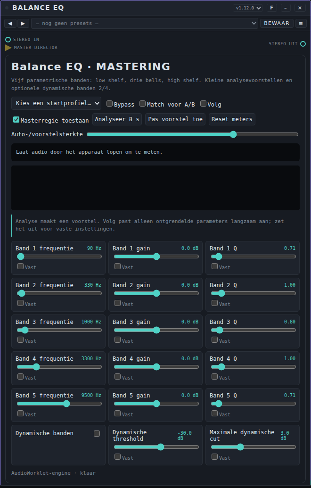
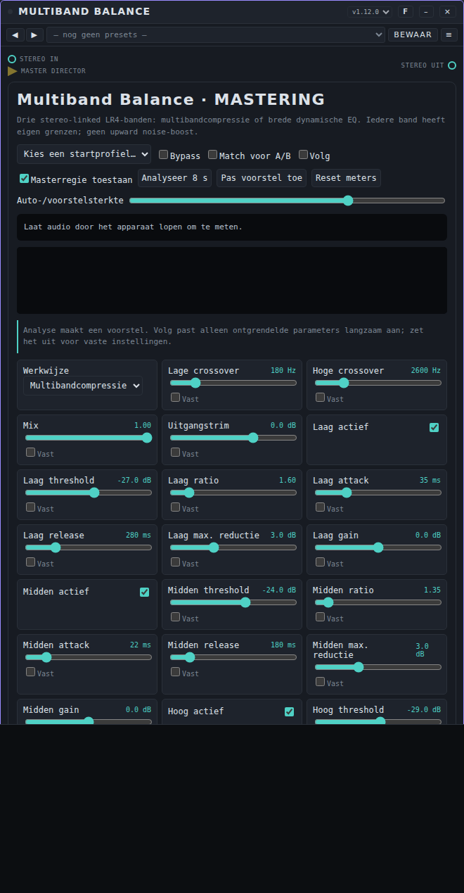
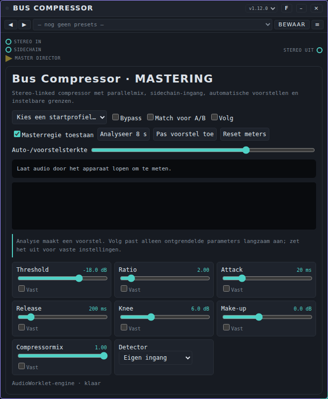
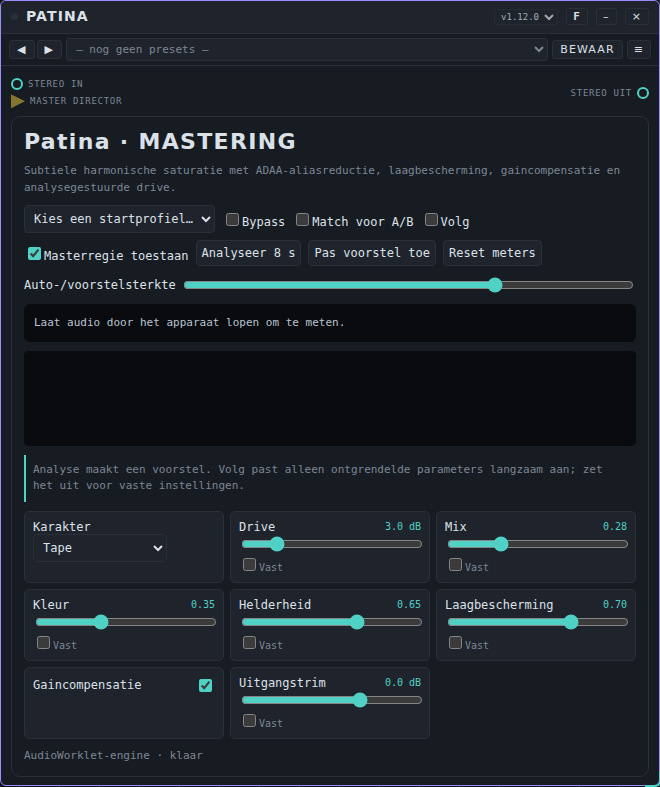
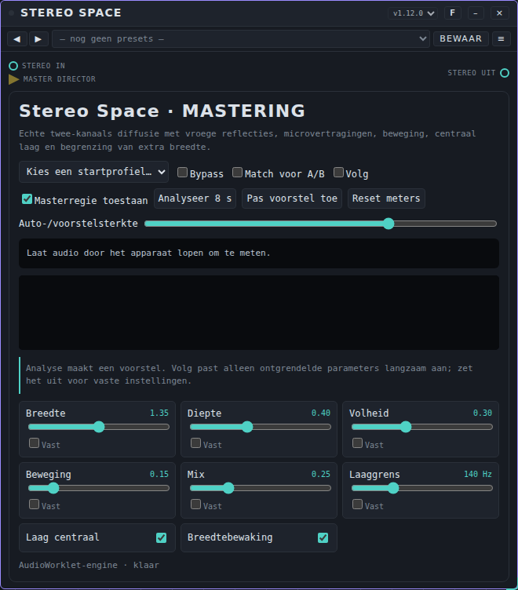
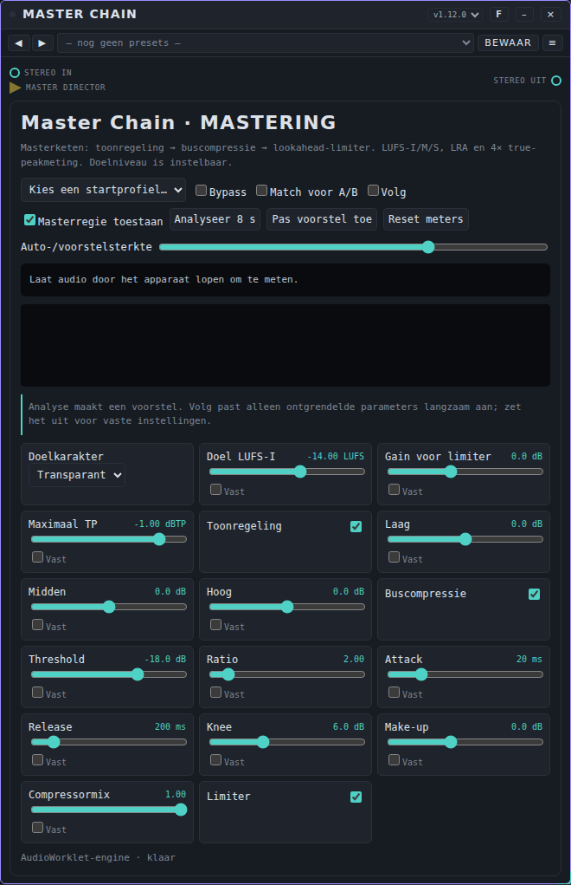
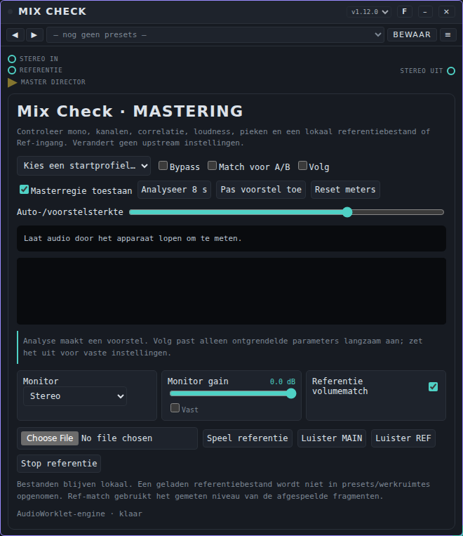
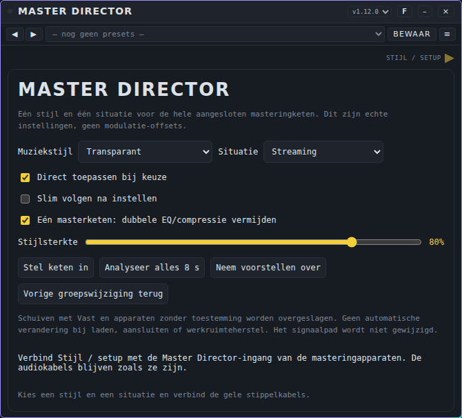
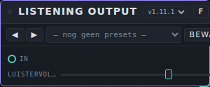

# Mastering: gebruikershandleiding

*English version: [USER-MANUAL_EN.md](USER-MANUAL_EN.md)*

Mastering-apparaten helpen je een mix af te maken: de toon in balans brengen, de dynamiek beheersen, warmte en breedte toevoegen, het juiste volume bereiken voor de plek waar de muziek wordt gespeeld, en het resultaat controleren. Deze pagina beschrijft de negen mastering-apparaten die bij Patchkamer horen: **Balance EQ**, **Multiband Balance**, **Bus Compressor**, **Patina**, **Stereo Space**, **Master Chain**, **Mix Check**, **Master Director** en **Listening Output**. De basis (Patchkamer openen, een bibliotheek laden, kabels trekken) staat in de [basishandleiding](../USER-MANUAL_NL.md). De map met de apparaten is beschreven in [devices/mastering](../../devices/mastering/README_NL.md).

## Inhoud

1. [Wat mastering-apparaten doen](#wat-mastering-apparaten-doen)
2. [Welk apparaat voor welk doel](#welk-apparaat-voor-welk-doel)
3. [Een masteringketen](#een-masteringketen)
4. [Situaties en muziekstijlen](#situaties-en-muziekstijlen)
5. [De kaart van een mastering-apparaat](#de-kaart-van-een-mastering-apparaat)
6. [Balance EQ](#balance-eq)
7. [Multiband Balance](#multiband-balance)
8. [Bus Compressor](#bus-compressor)
9. [Patina](#patina)
10. [Stereo Space](#stereo-space)
11. [Master Chain](#master-chain)
12. [Mix Check](#mix-check)
13. [Master Director](#master-director)
14. [Listening Output](#listening-output)
15. [Als het niet werkt](#als-het-niet-werkt)

## Wat mastering-apparaten doen

Een mastering-apparaat neemt de afgemaakte stereomix en geeft hem vorm. Je gebruikt ze achter elkaar, op de master. De meeste hebben een **Master Director**-poort (een geel driehoekje): de Master Director kan de hele keten in één keer instellen voor een muziekstijl en een situatie. Alles kan ook met de hand, en elk apparaat heeft **presets** (een preset is de instelling van één apparaat). Zie [Presets](../presets/USER-MANUAL_NL.md) voor hoe je ze gebruikt en deelt.

Alle zes bewerkende apparaten meten wat er in en uit gaat: volume (LUFS-I, LUFS-M, LUFS-S, loudness range), pieken (sample peak en, in de Master Chain en Mix Check, 4× true peak), stereocorrelatie en links/rechts-balans. De metingen zijn een eigen uitwerking van de gebruikelijke loudnessmethode (K-weging, blokken van 400 ms, gating); ze zijn een richtlijn en geen formele certificering.

## Welk apparaat voor welk doel

| Ik wil… | Gebruik |
|---|---|
| De toon in balans brengen met vijf banden | [Balance EQ](#balance-eq) |
| Laag, midden en hoog apart beheersen | [Multiband Balance](#multiband-balance) |
| De mix aan elkaar lijmen | [Bus Compressor](#bus-compressor) |
| Warmte en kleur toevoegen | [Patina](#patina) |
| Het stereobeeld breder en dieper maken, veilig | [Stereo Space](#stereo-space) |
| Een volumedoel bereiken en de pieken begrenzen | [Master Chain](#master-chain) |
| Mono en correlatie controleren en vergelijken met een referentie | [Mix Check](#mix-check) |
| De hele keten instellen voor een stijl en een situatie | [Master Director](#master-director) |
| Luisteren op een vast volume, als laatste apparaat | [Listening Output](#listening-output) |

## Een masteringketen

Een gebruikelijke volgorde, van links naar rechts. Laat weg wat je niet nodig hebt.

1. **Balance EQ** en **Multiband Balance**: de toon en de dynamische balans.
2. **Bus Compressor**: lijm.
3. **Patina**: warmte.
4. **Stereo Space**: breedte.
5. **Master Chain**: de laatste toon, compressie en begrenzing tot het doelvolume.
6. **Mix Check** (om te meten en te vergelijken) en **Listening Output** (om te luisteren).

De **Master Chain** heeft al een eigen toonregeling en buscompressie. Gebruik je ook Balance EQ of Bus Compressor, dan zet de Master Director die onderdelen van de Master Chain uit zodat ze niet dubbel werken (als **Eén masterketen** aan staat).

## Situaties en muziekstijlen

De Master Director en de presets van elk mastering-apparaat gebruiken twee keuzes: een **situatie**, die zegt waar de muziek wordt gespeeld, en een **muziekstijl**. Samen geven ze de instellingen.

**Situaties**

| Situatie | Wat het doet |
|---|---|
| **Streaming** | Trekt het volume naar ongeveer −14 LUFS-I, het niveau van de meeste streamingdiensten, met een plafond van −1 dBTP. |
| **Club** | Luider (ongeveer 1 dB), iets meer laag, iets smaller en een plafond van −0,5 dBTP, voor clubsystemen. |
| **Festival** | Luider (ongeveer 1,5 dB), meer laag en aanwezigheid, smaller (mono-veilig op een grote PA) en meer saturatie. |
| **Big room** | De luidste (ongeveer 2 dB meer), sterke compressie, extra laag, smal, voor grote podia en drops. |
| **Thuis / hifi** | Zachter (ongeveer 1,5 dB minder), mildere compressie, iets breder en een zachtere top, voor luisteren in de woonkamer. |
| **Koptelefoon** | Zachter, milde compressie, voorzichtige breedte en een zachtere top, tegen luistermoeheid. |
| **Studio / referentie** | Ongeveer 3 dB dynamischer, lichte compressie en saturatie: een referentie die ruimte houdt. |
| **Radio / omroep** | Stevigere compressie, smaller en iets meer aanwezigheid, zodat het helder blijft op de radio en in de keuken. |
| **Auto** | Meer laag en top tegen wegruis, smaller, stevige compressie. |

**Muziekstijlen**

De stijlen bepalen het doelvolume, de hoeveelheid compressie en saturatie, de breedte, de ruimte en de toon. Het volume van de situatie komt daar nog bij.

**Transparant**, **Warm / organisch**, **Techno**, **Hard techno**, **Deep house**, **House**, **Progressive house**, **Trance**, **Psytrance**, **Electro**, **Synthwave**, **EDM**, **Hardstyle**, **Drum & bass**, **Dubstep**, **Breakbeat**, **Hip-hop**, **Trap**, **R&B / soul**, **Pop**, **Rock**, **Metal**, **Indie / alternatief**, **Latin**, **Funk / disco**, **Reggae / dub**, **Lo-fi**, **Folk / akoestisch**, **Akoestisch / jazz**, **Klassiek**, **Soundtrack / cinematic**, **Ambient**.

## De kaart van een mastering-apparaat

De zes bewerkende apparaten (Balance EQ, Multiband Balance, Bus Compressor, Patina, Stereo Space en Master Chain) en Mix Check delen één kaart. Deze onderdelen zijn bij allemaal gelijk:

| Regelaar | Wat hij doet |
|---|---|
| **Startprofiel** | Een paar kant-en-klare beginstanden van dit apparaat. Een keuze zet de waarden die hij noemt; vergrendelde regelaars blijven staan. |
| **Bypass** | Laat het geluid ongewijzigd door. |
| **Match voor A/B** | Verlaagt het luidste van het bewerkte en het originele geluid, zodat je toon vergelijkt en geen volume. Er is nooit een versterking. |
| **Volg** | Laat het apparaat zijn eigen voorstel langzaam volgen terwijl er audio speelt (alleen ontgrendelde regelaars). |
| **Masterregie toestaan** | Staat toe dat de Master Director de instellingen verandert. |
| **Analyseer 8 s** | Luistert acht seconden en doet een voorstel. |
| **Pas voorstel toe** | Past het voorstel toe; vergrendelde regelaars blijven staan. |
| **Reset meters** | Begint de metingen opnieuw. |
| **Auto-/voorstelsterkte** | Hoe ver een voorstel of Volg een regelaar verschuift (0 tot 100%). |
| **Vast** (onder elke regelaar) | Beschermt een regelaar tegen voorstellen, Volg en de Master Director. |
| De meter en het spectrum | De metingen van de ingang en de uitgang, en het spectrum van de ingang. Er verschijnt een waarschuwing bij sampleclipping, een slechte fase, een scheve links/rechts en veel limiting. |

Dubbelklik op een schuif om terug te gaan naar de beginwaarde. Klik op het getal om een waarde te typen.

## Balance EQ

### Waar het voor dient

Een equalizer met vijf banden: een low shelf, drie bells en een high shelf. Band 2 en 4 kunnen dynamisch werken, zodat ze alleen snijden als het geluid in dat bereik hard wordt. Een analyse van acht seconden stelt een kleine, voorzichtige correctie voor.

### De regelaars

Naast de regelaars van [de kaart](#de-kaart-van-een-mastering-apparaat):

| Regelaar | Wat hij doet | Bereik (start) |
|---|---|---|
| **Band 1 frequentie** | Middenfrequentie van band 1 (een kantelfrequentie bij de shelves). | 25 tot 16000 Hz (90) |
| **Band 1 gain** | Versterking of demping van band 1. | -12 tot 12 dB (0) |
| **Band 1 Q** | Breedte van band 1 (hoger is smaller). | 0,3 tot 8 (0,707) |
| **Band 2 frequentie** | Middenfrequentie van band 2 (een kantelfrequentie bij de shelves). | 25 tot 16000 Hz (330) |
| **Band 2 gain** | Versterking of demping van band 2. | -12 tot 12 dB (0) |
| **Band 2 Q** | Breedte van band 2 (hoger is smaller). | 0,3 tot 8 (1) |
| **Band 3 frequentie** | Middenfrequentie van band 3 (een kantelfrequentie bij de shelves). | 25 tot 16000 Hz (1000) |
| **Band 3 gain** | Versterking of demping van band 3. | -12 tot 12 dB (0) |
| **Band 3 Q** | Breedte van band 3 (hoger is smaller). | 0,3 tot 8 (0,8) |
| **Band 4 frequentie** | Middenfrequentie van band 4 (een kantelfrequentie bij de shelves). | 25 tot 16000 Hz (3300) |
| **Band 4 gain** | Versterking of demping van band 4. | -12 tot 12 dB (0) |
| **Band 4 Q** | Breedte van band 4 (hoger is smaller). | 0,3 tot 8 (1) |
| **Band 5 frequentie** | Middenfrequentie van band 5 (een kantelfrequentie bij de shelves). | 25 tot 16000 Hz (9500) |
| **Band 5 gain** | Versterking of demping van band 5. | -12 tot 12 dB (0) |
| **Band 5 Q** | Breedte van band 5 (hoger is smaller). | 0,3 tot 8 (0,707) |
| **Dynamische banden** | Laat band 2 en 4 alleen werken als het geluid in dat bereik hard wordt. | aan of uit (uit) |
| **Dynamische threshold** | Niveau waarboven een dynamische band snijdt. | -60 tot -6 dB (-30) |
| **Maximale dynamische cut** | Het meeste dat een dynamische band mag snijden. | 0 tot 9 dB (3) |

### Poorten

| Poort | Soort | Gebruik |
|---|---|---|
| **Stereo in** | audio in (groenblauw) | Het geluid dat bewerkt wordt. |
| **Stereo uit** | audio uit (groenblauw) | Het bewerkte geluid. Sluit het aan op het volgende apparaat of op **Speakers**. |
| **Master Director** | mastering in (geel driehoekje) | Ontvangt de instellingen van de Master Director. Optioneel. |

### Presets

Balance EQ heeft het pack **Balance EQ Situations and Styles**: 128 presets in 10 mappen (Situations (9), Styles (32), Club (14), Festival (11), Big Room (8), Home / Hi-Fi (14), Headphones (11), Studio / Reference (13), Radio / Broadcast (8), Car (8)). Het bestand is [`presets/balance-eq.patchkamer-presets.json`](../../presets/balance-eq.patchkamer-presets.json). Laad het pack met het menu **Presets ▾** → **Importeren…**, en kies dan een preset in de lijst op de kaart.

De mappen **Situations** en **Styles** hebben één preset per situatie en per muziekstijl; de andere mappen hebben de gebruikelijke combinaties van een situatie en een stijl (bijvoorbeeld **Club › Techno**). De waarden volgen dezelfde recepten als de Master Director.

### Tips en beperkingen

- Snijden is meestal veiliger dan versterken: gebruik het voorstel van **Analyseer 8 s** als hint, niet als regel.
- Gebruik **Dynamische banden** om een scherp bereik (band 4) of een dreunend bereik (band 2) alleen te temmen als het hard wordt.

## Multiband Balance

### Waar het voor dient

Een multibandcompressor met drie stereo-linked banden (LR4-crossovers), of een brede dynamische EQ. Elke band heeft een eigen threshold, ratio, attack, release, maximale reductie en gain. Hij versterkt nooit ruis omhoog.

### De regelaars

Naast de regelaars van [de kaart](#de-kaart-van-een-mastering-apparaat):

| Regelaar | Wat hij doet | Bereik (start) |
|---|---|---|
| **Werkwijze** | Multibandcompressie, of een brede dynamische EQ die alleen snijdt (hoogstens 2 op 1). | **Multibandcompressie** / **Brede dynamische EQ** (Multibandcompressie) |
| **Lage crossover** | Crossover tussen de lage en de middenband. | 50 tot 800 Hz (180) |
| **Hoge crossover** | Crossover tussen de midden- en de hoge band. | 1200 tot 8000 Hz (2600) |
| **Mix** | Bewerkt geluid tegenover het origineel. | 0 tot 1 (1) |
| **Uitgangstrim** | Uitgangsversterking. | -12 tot 6 dB (0) |
| **Laag actief** | Zet de lage band aan. | aan of uit (aan) |
| **Laag threshold** | Niveau waarboven de lage band wordt verminderd. | -60 tot 0 dB (-27) |
| **Laag ratio** | Hoe sterk de lage band boven zijn threshold wordt verminderd. | 1 tot 6 (1,6) |
| **Laag attack** | Hoe snel de lage band reageert. | 0,001 tot 0,15 s (0,035) |
| **Laag release** | Hoe snel de lage band loslaat. | 0,03 tot 1,2 s (0,28) |
| **Laag max. reductie** | Het meeste dat de lage band mag worden verminderd. | 0 tot 9 dB (3) |
| **Laag gain** | Vaste versterking van de lage band, na de compressie. | -6 tot 6 dB (0) |
| **Midden actief** | Zet de middelste band aan. | aan of uit (aan) |
| **Midden threshold** | Niveau waarboven de middelste band wordt verminderd. | -60 tot 0 dB (-24) |
| **Midden ratio** | Hoe sterk de middelste band boven zijn threshold wordt verminderd. | 1 tot 6 (1,35) |
| **Midden attack** | Hoe snel de middelste band reageert. | 0,001 tot 0,15 s (0,022) |
| **Midden release** | Hoe snel de middelste band loslaat. | 0,03 tot 1,2 s (0,18) |
| **Midden max. reductie** | Het meeste dat de middelste band mag worden verminderd. | 0 tot 9 dB (3) |
| **Midden gain** | Vaste versterking van de middelste band, na de compressie. | -6 tot 6 dB (0) |
| **Hoog actief** | Zet de hoge band aan. | aan of uit (aan) |
| **Hoog threshold** | Niveau waarboven de hoge band wordt verminderd. | -60 tot 0 dB (-29) |
| **Hoog ratio** | Hoe sterk de hoge band boven zijn threshold wordt verminderd. | 1 tot 6 (1,4) |
| **Hoog attack** | Hoe snel de hoge band reageert. | 0,001 tot 0,15 s (0,008) |
| **Hoog release** | Hoe snel de hoge band loslaat. | 0,03 tot 1,2 s (0,12) |
| **Hoog max. reductie** | Het meeste dat de hoge band mag worden verminderd. | 0 tot 9 dB (3) |
| **Hoog gain** | Vaste versterking van de hoge band, na de compressie. | -6 tot 6 dB (0) |

### Poorten

| Poort | Soort | Gebruik |
|---|---|---|
| **Stereo in** | audio in (groenblauw) | Het geluid dat bewerkt wordt. |
| **Stereo uit** | audio uit (groenblauw) | Het bewerkte geluid. Sluit het aan op het volgende apparaat of op **Speakers**. |
| **Master Director** | mastering in (geel driehoekje) | Ontvangt de instellingen van de Master Director. Optioneel. |

### Presets

Multiband Balance heeft het pack **Multiband Balance Situations and Styles**: 128 presets in 10 mappen (Situations (9), Styles (32), Club (14), Festival (11), Big Room (8), Home / Hi-Fi (14), Headphones (11), Studio / Reference (13), Radio / Broadcast (8), Car (8)). Het bestand is [`presets/multiband-balance.patchkamer-presets.json`](../../presets/multiband-balance.patchkamer-presets.json). Laad het pack met het menu **Presets ▾** → **Importeren…**, en kies dan een preset in de lijst op de kaart.

De mappen **Situations** en **Styles** hebben één preset per situatie en per muziekstijl; de andere mappen hebben de gebruikelijke combinaties van een situatie en een stijl (bijvoorbeeld **Club › Techno**). De waarden volgen dezelfde recepten als de Master Director.

### Tips en beperkingen

- Begin met **Soft bus glue** of **Low under control** (startprofielen) en houd de reductie klein: 1 tot 3 dB per band.
- Zet een band uit met zijn **actief**-keuze om te horen wat hij doet.

## Bus Compressor

### Waar het voor dient

Een stereo-linked compressor voor de master of een bus: threshold, ratio, attack, release, knee, make-up en een parallelmix. De detector kan naar de eigen ingang of naar de Sidechain-ingang luisteren. Een analyse van acht seconden doet een voorstel.

### De regelaars

Naast de regelaars van [de kaart](#de-kaart-van-een-mastering-apparaat):

| Regelaar | Wat hij doet | Bereik (start) |
|---|---|---|
| **Threshold** | Niveau waarboven de compressie begint. | -60 tot 0 dB (-18) |
| **Ratio** | Hoe sterk het niveau boven de threshold wordt verminderd (2 betekent 2 op 1). | 1 tot 12 (2) |
| **Attack** | Hoe snel de compressie begint als het niveau stijgt. | 0,001 tot 0,1 s (0,02) |
| **Release** | Hoe snel de compressie weer loslaat. | 0,03 tot 1,5 s (0,2) |
| **Knee** | Hoe geleidelijk de compressie rond de threshold begint (0 is hard). | 0 tot 18 dB (6) |
| **Make-up** | Versterking na de compressie, om de reductie goed te maken. | -12 tot 18 dB (0) |
| **Compressormix** | Gecomprimeerd geluid tegenover het origineel: 1 is helemaal gecomprimeerd, lagere waarden geven parallelle compressie. | 0 tot 1 (1) |
| **Detector** | Waar de compressor naar luistert: naar zijn eigen ingang of naar de Sidechain-ingang. | **Eigen ingang** / **Sidechain-ingang** (Eigen ingang) |

### Poorten

| Poort | Soort | Gebruik |
|---|---|---|
| **Stereo in** | audio in (groenblauw) | Het geluid dat bewerkt wordt. |
| **Sidechain** | audio in (groenblauw) | Een tweede signaal voor de detector (bijvoorbeeld een kick), gebruikt als **Detector** op **Sidechain-ingang** staat. |
| **Stereo uit** | audio uit (groenblauw) | Het bewerkte geluid. Sluit het aan op het volgende apparaat of op **Speakers**. |
| **Master Director** | mastering in (geel driehoekje) | Ontvangt de instellingen van de Master Director. Optioneel. |

### Presets

Bus Compressor heeft het pack **Bus Compressor Situations and Styles**: 128 presets in 10 mappen (Situations (9), Styles (32), Club (14), Festival (11), Big Room (8), Home / Hi-Fi (14), Headphones (11), Studio / Reference (13), Radio / Broadcast (8), Car (8)). Het bestand is [`presets/bus-compressor.patchkamer-presets.json`](../../presets/bus-compressor.patchkamer-presets.json). Laad het pack met het menu **Presets ▾** → **Importeren…**, en kies dan een preset in de lijst op de kaart.

De mappen **Situations** en **Styles** hebben één preset per situatie en per muziekstijl; de andere mappen hebben de gebruikelijke combinaties van een situatie en een stijl (bijvoorbeeld **Club › Techno**). De waarden volgen dezelfde recepten als de Master Director.

### Tips en beperkingen

- Begin met de presets **Situations › Streaming** of jouw stijl en verlaag dan **Threshold** tot de compressor alleen een paar dB werkt op de harde delen.
- Voor ducking op een kick zet je **Detector** op **Sidechain-ingang** en verbind je de kick met de Sidechain-ingang.

## Patina

### Waar het voor dient

Een subtiele harmonische saturatie (tape, buis of neutraal zacht) met aliasreductie, laagbescherming, gaincompensatie en een parallelmix. Voor warmte en lijm, niet voor vervorming.

### De regelaars

Naast de regelaars van [de kaart](#de-kaart-van-een-mastering-apparaat):

| Regelaar | Wat hij doet | Bereik (start) |
|---|---|---|
| **Karakter** | Tape (warm en afgerond), Buis (asymmetrisch, met even harmonischen) of Neutraal zacht. | **Tape** / **Buis** / **Neutraal zacht** (Tape) |
| **Drive** | Hoe hard het signaal in de saturatie wordt geduwd. | 0 tot 18 dB (3) |
| **Mix** | Gesatureerd geluid tegenover het schone geluid (parallel). | 0 tot 1 (0,28) |
| **Kleur** | Hoeveel van de kleuring van het gekozen karakter erbij komt. | 0 tot 1 (0,35) |
| **Helderheid** | Helderheid van het gesatureerde deel. | 0 tot 1 (0,65) |
| **Laagbescherming** | Houdt het laag schoon: hoger betekent minder saturatie op de bas. | 0 tot 1 (0,7) |
| **Gaincompensatie** | Houdt het volume ongeveer gelijk als je Drive verandert. | aan of uit (aan) |
| **Uitgangstrim** | Uitgangsversterking. | -12 tot 6 dB (0) |

### Poorten

| Poort | Soort | Gebruik |
|---|---|---|
| **Stereo in** | audio in (groenblauw) | Het geluid dat bewerkt wordt. |
| **Stereo uit** | audio uit (groenblauw) | Het bewerkte geluid. Sluit het aan op het volgende apparaat of op **Speakers**. |
| **Master Director** | mastering in (geel driehoekje) | Ontvangt de instellingen van de Master Director. Optioneel. |

### Presets

Patina heeft het pack **Patina Situations and Styles**: 128 presets in 10 mappen (Situations (9), Styles (32), Club (14), Festival (11), Big Room (8), Home / Hi-Fi (14), Headphones (11), Studio / Reference (13), Radio / Broadcast (8), Car (8)). Het bestand is [`presets/patina.patchkamer-presets.json`](../../presets/patina.patchkamer-presets.json). Laad het pack met het menu **Presets ▾** → **Importeren…**, en kies dan een preset in de lijst op de kaart.

De mappen **Situations** en **Styles** hebben één preset per situatie en per muziekstijl; de andere mappen hebben de gebruikelijke combinaties van een situatie en een stijl (bijvoorbeeld **Club › Techno**). De waarden volgen dezelfde recepten als de Master Director.

### Tips en beperkingen

- Houd **Mix** laag (20 tot 35%) en laat **Gaincompensatie** aan, zodat je kleur hoort en niet alleen volume.
- Gebruik **Laagbescherming** om de kick en de bas schoon te houden terwijl de rest warmte krijgt.

## Stereo Space

### Waar het voor dient

Echte twee-kanaals diffusie met vroege reflecties, microvertragingen en langzame beweging, met de bas in het midden en een bewaking die de extra breedte begrenst als het stereobeeld onveilig wordt voor mono.

### De regelaars

Naast de regelaars van [de kaart](#de-kaart-van-een-mastering-apparaat):

| Regelaar | Wat hij doet | Bereik (start) |
|---|---|---|
| **Breedte** | Stereobreedte van het side-signaal (1 is het origineel). | 0,5 tot 2,2 (1,35) |
| **Diepte** | Diepte van de vroege reflecties. | 0 tot 1 (0,4) |
| **Volheid** | Hoeveelheid diffuus geluid dat het beeld vult. | 0 tot 0,8 (0,3) |
| **Beweging** | Langzame beweging van de microvertragingen. | 0 tot 1 (0,15) |
| **Mix** | Bewerkt geluid tegenover het origineel. | 0 tot 1 (0,25) |
| **Laaggrens** | Frequentie waaronder het geluid in het midden blijft (met Centered bass). | 60 tot 350 Hz (140) |
| **Laag centraal** | Houdt alles onder de laaggrens in het midden. | aan of uit (aan) |
| **Breedtebewaking** | Verlaagt de extra breedte als de stereocorrelatie daalt (monocompatibiliteit). | aan of uit (aan) |

### Poorten

| Poort | Soort | Gebruik |
|---|---|---|
| **Stereo in** | audio in (groenblauw) | Het geluid dat bewerkt wordt. |
| **Stereo uit** | audio uit (groenblauw) | Het bewerkte geluid. Sluit het aan op het volgende apparaat of op **Speakers**. |
| **Master Director** | mastering in (geel driehoekje) | Ontvangt de instellingen van de Master Director. Optioneel. |

### Presets

Stereo Space heeft het pack **Stereo Space Situations and Styles**: 128 presets in 10 mappen (Situations (9), Styles (32), Club (14), Festival (11), Big Room (8), Home / Hi-Fi (14), Headphones (11), Studio / Reference (13), Radio / Broadcast (8), Car (8)). Het bestand is [`presets/stereo-space.patchkamer-presets.json`](../../presets/stereo-space.patchkamer-presets.json). Laad het pack met het menu **Presets ▾** → **Importeren…**, en kies dan een preset in de lijst op de kaart.

De mappen **Situations** en **Styles** hebben één preset per situatie en per muziekstijl; de andere mappen hebben de gebruikelijke combinaties van een situatie en een stijl (bijvoorbeeld **Club › Techno**). De waarden volgen dezelfde recepten als de Master Director.

### Tips en beperkingen

- Een beetje helpt veel: een breedte van 1,1 tot 1,3 is genoeg voor de meeste masters. Let op de correlatiemeter; laat **Breedtebewaking** aan.
- Laat **Laag centraal** aan voor club- en festivalsystemen.

## Master Chain

### Waar het voor dient

Het eind van de keten: toonregeling (laag, midden, hoog), buscompressie en een lookahead-limiter met 4× true-peakbegrenzing. Het meet LUFS-I, LUFS-M en LUFS-S, loudness range en true peak. Jij stelt het doelniveau en het plafond in.

### De regelaars

Naast de regelaars van [de kaart](#de-kaart-van-een-mastering-apparaat):

| Regelaar | Wat hij doet | Bereik (start) |
|---|---|---|
| **Doelkarakter** | Beginkarakter: Transparent, Warm, Firm of Club. Het bepaalt hoe de compressor en de voorstellen zich gedragen. | **Transparant** / **Warm** / **Stevig** / **Club** (Transparant) |
| **Doel LUFS-I** | Het volume (LUFS-I) waar de meting en het voorstel naar mikken. | -24 tot -7 LUFS (-14) |
| **Gain voor limiter** | Versterking vóór de limiter: verhoog hem om de limiter harder te laten werken en de master luider te maken. | -12 tot 18 dB (0) |
| **Maximaal TP** | Hoogste true peak die de limiter doorlaat. | -6 tot -0,1 dBTP (-1) |
| **Toonregeling** | Zet de drie toonregelaars aan. | aan of uit (aan) |
| **Laag** | Versterking of demping van het laag (een low shelf). | -4 tot 4 dB (0) |
| **Midden** | Versterking of demping van het midden (een bell). | -4 tot 4 dB (0) |
| **Hoog** | Versterking of demping van het hoog (een high shelf). | -4 tot 4 dB (0) |
| **Buscompressie** | Zet de buscompressor aan. | aan of uit (aan) |
| **Threshold** | Niveau waarboven de compressie begint. | -60 tot 0 dB (-18) |
| **Ratio** | Hoe sterk het niveau boven de threshold wordt verminderd (2 betekent 2 op 1). | 1 tot 12 (2) |
| **Attack** | Hoe snel de compressie begint als het niveau stijgt. | 0,001 tot 0,1 s (0,02) |
| **Release** | Hoe snel de compressie weer loslaat. | 0,03 tot 1,5 s (0,2) |
| **Knee** | Hoe geleidelijk de compressie rond de threshold begint (0 is hard). | 0 tot 18 dB (6) |
| **Make-up** | Versterking na de compressie, om de reductie goed te maken. | -12 tot 18 dB (0) |
| **Compressormix** | Gecomprimeerd geluid tegenover het origineel: 1 is helemaal gecomprimeerd, lagere waarden geven parallelle compressie. | 0 tot 1 (1) |
| **Limiter** | Zet de lookahead-limiter aan. | aan of uit (aan) |

### Poorten

| Poort | Soort | Gebruik |
|---|---|---|
| **Stereo in** | audio in (groenblauw) | Het geluid dat bewerkt wordt. |
| **Stereo uit** | audio uit (groenblauw) | Het bewerkte geluid. Sluit het aan op het volgende apparaat of op **Speakers**. |
| **Master Director** | mastering in (geel driehoekje) | Ontvangt de instellingen van de Master Director. Optioneel. |

### Presets

Master Chain heeft het pack **Master Chain Situations and Styles**: 128 presets in 10 mappen (Situations (9), Styles (32), Club (14), Festival (11), Big Room (8), Home / Hi-Fi (14), Headphones (11), Studio / Reference (13), Radio / Broadcast (8), Car (8)). Het bestand is [`presets/master-chain.patchkamer-presets.json`](../../presets/master-chain.patchkamer-presets.json). Laad het pack met het menu **Presets ▾** → **Importeren…**, en kies dan een preset in de lijst op de kaart.

De mappen **Situations** en **Styles** hebben één preset per situatie en per muziekstijl; de andere mappen hebben de gebruikelijke combinaties van een situatie en een stijl (bijvoorbeeld **Club › Techno**). De waarden volgen dezelfde recepten als de Master Director.

### Tips en beperkingen

- Mik op het volume van de situatie: de presets **Situations › Club**, **Festival** of **Big room** stellen een hoger doel in, **Studio / reference** een lager doel. Controleer het resultaat met de meter.
- Werkt de limiter meer dan ongeveer 6 dB, dan waarschuwt de kaart: verlaag het doel of **Gain voor limiter**.

## Mix Check

### Waar het voor dient

Een controle-apparaat dat je mix niet verandert. Het verandert alleen waar je naar luistert: stereo, mono, links, rechts of alleen het Side-signaal, met een luisterniveau, en het meet correlatie, loudness en pieken. Je kunt vergelijken met een referentie (een lokaal audiobestand of de Referentie-ingang) op hetzelfde volume.

### De regelaars

Naast de regelaars van [de kaart](#de-kaart-van-een-mastering-apparaat):

| Regelaar | Wat hij doet | Bereik (start) |
|---|---|---|
| **Monitor** | Waar je naar luistert: stereo, mono, links, rechts of alleen het Side-signaal. | **Stereo** / **Mono** / **Alleen links** / **Alleen rechts** / **Sidechain-ingang** (Stereo) |
| **Monitor gain** | Verlaagt het luisterniveau (van 0 tot −24 dB). | -24 tot 0 dB (0) |
| **Referentie volumematch** | Speelt de referentie op hetzelfde volume als je mix. | aan of uit (aan) |

### Poorten

| Poort | Soort | Gebruik |
|---|---|---|
| **Stereo in** | audio in (groenblauw) | Het geluid dat bewerkt wordt. |
| **Referentie** | audio in (groenblauw) | Een referentietrack om mee te vergelijken. Je kunt ook op de kaart een lokaal audiobestand laden. |
| **Stereo uit** | audio uit (groenblauw) | Het bewerkte geluid. Sluit het aan op het volgende apparaat of op **Speakers**. |
| **Master Director** | mastering in (geel driehoekje) | Ontvangt de instellingen van de Master Director. Optioneel. |

### Presets

Mix Check heeft het pack **Mix Check Monitoring**: 18 presets in 2 mappen (Monitoring (9), Situations (9)). Het bestand is [`presets/mix-check.patchkamer-presets.json`](../../presets/mix-check.patchkamer-presets.json).

### Tips en beperkingen

- Zet Mix Check helemaal aan het eind, na de Master Chain, om te horen wat de luisteraar hoort. Het verandert het signaal dat je exporteert niet.
- **Referentie volumematch** verlaagt alleen de luidere variant; er is nooit een verborgen versterking.

## Master Director

### Waar het voor dient

De Master Director stelt een hele masteringketen in één keer in. Je kiest een **muziekstijl** en een **situatie**; hij rekent de instellingen voor elk aangesloten apparaat uit en zet ze erin. Het zijn echte instellingen die je daarna kunt veranderen, geen modulatie-offsets.

### De regelaars

| Regelaar | Wat hij doet |
|---|---|
| **Muziekstijl** | Een van 32 muziekstijlen. |
| **Situatie** | Club, festival, big room, thuis, koptelefoon, studio, radio, auto of streaming. |
| **Direct toepassen bij keuze** | Stelt de keten meteen in als je de stijl, de situatie of de sterkte verandert. |
| **Slim volgen na instellen** | Laat de apparaten daarna langzaam hun eigen voorstellen volgen. |
| **Eén masterketen: dubbele EQ/compressie vermijden** | Zijn Balance EQ, Bus Compressor of Multiband Balance aangesloten, dan gaan dezelfde onderdelen van de Master Chain uit. |
| **Stijlsterkte** | Hoe ver het recept gaat (0 tot 100%). |
| **Stel keten in** | Stelt de keten nu in. |
| **Analyseer alles 8 s** | Start de analyse van acht seconden in alle gekozen apparaten. |
| **Neem voorstellen over** | Past de voorstellen van de apparaten toe. |
| **Vorige groepswijziging terug** | Zet terug wat de laatste opdracht veranderde. |
| De lijst met apparaten | De apparaten aan de kabel. Haal een vinkje weg om er een buiten te laten. Mix Check blijft altijd ongemoeid. |

### Poorten

| Poort | Soort | Gebruik |
|---|---|---|
| **Stijl / setup** | mastering uit (geel driehoekje) | Verbind hem met de **Master Director**-poort van elk mastering-apparaat met een gele, gestippelde golfkabel (de mastering-kabel). De audiokabels blijven zoals ze zijn. |

### Presets

Master Director heeft het pack **Master Director Situations and Styles**: 128 presets in 10 mappen (Situations (9), Styles (32), Club (14), Festival (11), Big Room (8), Home / Hi-Fi (14), Headphones (11), Studio / Reference (13), Radio / Broadcast (8), Car (8)). Het bestand is [`presets/master-director.patchkamer-presets.json`](../../presets/master-director.patchkamer-presets.json).

### Tips en beperkingen

- **De host moet het Master Director-protocol ondersteunen.** In een host zonder dat meldt de kaart "Hostuitbreiding vereist" en verandert er niets. Je kunt elk apparaat nog steeds met de hand of met zijn eigen presets instellen.
- Er verandert niets automatisch als je een song laadt of een kabel verbindt: de Director doet alleen iets als je kiest of op een knop drukt.
- Vergrendelde regelaars en apparaten zonder **Masterregie toestaan** worden overgeslagen.

## Listening Output

### Waar het voor dient

Een transparante luisteruitgang: het geluid gaat ongewijzigd naar de uitgang van de browser, met alleen een luistervolume. Zet hem als laatste in de keten, na de mastering-apparaten, zodat je meet wat je hoort.

### De regelaars

| Regelaar | Wat hij doet | Bereik (start) |
|---|---|---|
| **Luistervolume** | Het volume van wat je hoort. Het verandert het niveau in de keten ervoor niet. | 0 tot 100% (70%) |

### Poorten

| Poort | Soort | Gebruik |
|---|---|---|
| **In** | audio in (groenblauw) | Het geluid om naar te luisteren. Er is geen uitgangspoort: het geluid gaat naar de luidsprekers of koptelefoon van de computer. |

### Presets

Listening Output heeft het pack **Listening Output Levels**: 5 presets (Quiet, Low, Normal, High, Full). Het bestand is [`presets/listening-output.patchkamer-presets.json`](../../presets/listening-output.patchkamer-presets.json).

### Tips en beperkingen

- Houd het luistervolume gelijk terwijl je twee versies vergelijkt: een luidere versie klinkt bijna altijd beter.

## Als het niet werkt

- **Geen geluid.** Controleer of er audio loopt van de mix door het apparaat naar **Speakers** of **Listening Output** (groenblauwe kabel), of je op **Start** hebt gedrukt als een bron de klok nodig heeft, en of **Bypass** uit staat. Klik één keer ergens in Patchkamer: browsers houden audio tegen tot je dat doet.
- **De meter zegt "Laat audio door het apparaat lopen om te meten".** Er komt nog geen audio binnen.
- **De kaart meldt "Nood-bypass".** De browser heeft geen AudioWorklet: open Patchkamer in Chrome, Edge of Firefox. Het geluid gaat ongewijzigd door.
- **De Master Director verandert niets.** De host moet het Master Director-protocol bieden; zie de sectie Master Director. Stel de apparaten dan met de hand of met presets in.
- **Een preset klinkt te luid of te zacht.** De presets mikken op een volume voor de situatie. Verander **Doel LUFS-I** in de Master Chain, of het **Luistervolume**.
