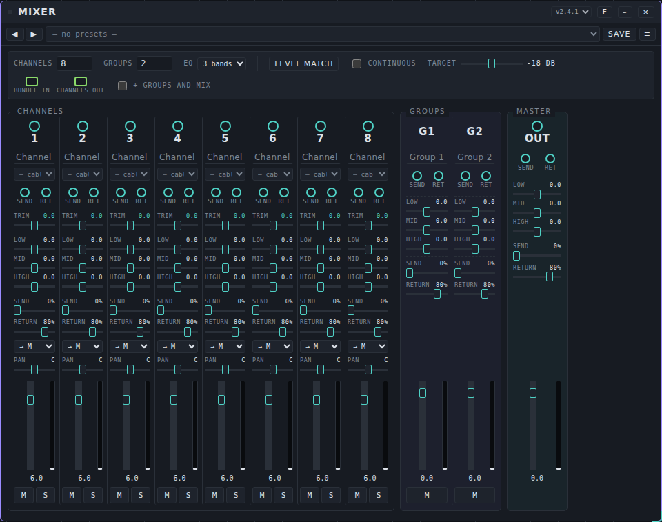
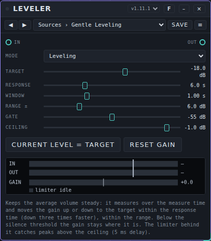
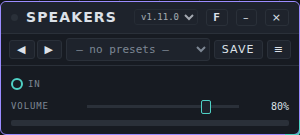

# Mixer: user manual

*Nederlandse versie: [USER-MANUAL_NL.md](USER-MANUAL_NL.md)*

This page covers the devices that bring your sounds together and send them out: **Mixer**, **Leveler** and **Speakers**. For the basics (opening Patchkamer, loading a library, drawing cables) see the [main user manual](../USER-MANUAL_EN.md). The folder with the devices is described in [devices/mixer](../../devices/mixer/README.md).

## Contents

1. [What these devices do](#what-these-devices-do)
2. [Which device for which goal](#which-device-for-which-goal)
3. [Mixer](#mixer)
4. [Leveler](#leveler)
5. [Speakers](#speakers)
6. [If it does not work](#if-it-does-not-work)

## What these devices do

Most patches end the same way: several sound makers (synths, a drum machine, effects) go into a **Mixer**, the Mixer goes through a **Leveler** if you want a steady volume, and the last cable goes into **Speakers**. Speakers is the output device that plays sound on your computer: without an output you hear nothing.

```
synths, drums …  →  Mixer  →  Leveler (optional)  →  Speakers
```

All cables here are teal audio cables. The Mixer also has a green **bundle** cable (many channels in one cable), which is described below.

**Presets.** These three devices do not make sound themselves, so they have **presets** and not tunes. See [Presets](../presets/USER-MANUAL_EN.md) for how to use and share them.

## Which device for which goal

| I want to… | Use |
|---|---|
| Set the balance between several sounds, pan them, mute or solo one | [Mixer](#mixer) |
| Send some of a sound to an effect, such as Room, and bring it back | [Mixer](#mixer) (**Send** and **Return**) |
| Put sounds in groups, for example all drums, and control them with one fader | [Mixer](#mixer) (groups) |
| Bring many sources to the same volume at once | [Mixer](#mixer) (**Level match**) |
| Keep a source that slowly gets louder and softer at a steady volume | [Leveler](#leveler) |
| Hear the result and set the final volume | [Speakers](#speakers) |

## Mixer

### What it is for

A mixing desk with 1 to 32 channels and 0 to 8 groups, and a master. Each channel has trim, an EQ, send and return, pan, a fader, and mute and solo buttons. Groups and the master have an EQ, send, return and a fader too. Behind the master sits a limiter.



### The controls

Double-click a slider to go back to its starting value. Click the number to type a value.

**Top bar**

| Control | What it does |
|---|---|
| **Channels** | How many channels there are, 1 to 32 (start: 8). The ports on the card appear and disappear with it. |
| **Groups** | How many groups there are, 0 to 8 (start: 2). |
| **EQ** | **3 bands** or **5 bands** for all channels, groups and the master. |
| **Level match** | Measures for 4 seconds and sets the **Trim** of every channel so that all sources arrive at the **Target** level. It needs sound coming in, so press **Start** first. If there is no signal the Mixer says so. |
| **Continuous** | Keeps the trims at the target level, slowly (at most 3 dB per second). |
| **Target** | The level that **Level match** aims for, −30 to −6 dB (start: −18). |
| **bundle in**, **channels out** | The two bundle ports (see below). |
| **+ groups and mix** | Adds the groups and the total mix to the **channels out** bundle. |

**A channel** (from top to bottom)

| Control | What it does |
|---|---|
| Number (**1**, **2**, …) | The audio input of the channel. |
| Name field | Type a name for the channel. The name goes with the bundle. Up to 24 characters. |
| Source list | Shows **— cable** (use the cable on the input), or lets you choose a channel of a bundle that arrives on **bundle in**. |
| **SEND**, **RET** (round ports) | The channel's send output and return input. |
| **TRIM** | Input gain, −24 to +24 dB (0). |
| **LOW**, **MID**, **HIGH** | EQ gain, −15 to +15 dB (0). With 3 bands: a low shelf at 120 Hz, a peak at 1 kHz and a high shelf at 6 kHz. With 5 bands the controls are **LOW**, **LO-MID**, **MID**, **HI-MID** and **HIGH**, at 80 Hz, 300 Hz, 1 kHz, 3.5 kHz and 10 kHz (shelves for the lowest and the highest). |
| **SEND** | How much of the channel goes to the send output, 0 to 100% (0%). |
| **RETURN** | How much of the sound on the return input is added, 0 to 100% (80%). |
| **→ M** | Where the channel goes: to the master (**→ M**) or to a group. |
| **PAN** | Left (−1) to right (+1), centre is **C**. |
| Fader and meter | The channel volume, −60 to +6 dB (−6). The bar next to it is a level meter. |
| **M**, **S** | Mute and solo. If any channel has solo on, the channels without solo are silent. |

**Groups** have a name, send and return ports, an EQ, **SEND**, **RETURN**, a fader (0 dB at the start) and **M**. **Master** has the output port **OUT**, send and return ports, an EQ, **SEND**, **RETURN** and a fader. There is a limiter behind the master.

### How the signal flows

Each channel goes input → **TRIM** → EQ → fader → **PAN** → mute → group or master. The **SEND** output takes its sound after the fader, pan and mute. The **RETURN** input is added behind the fader and mute of the same channel, so muting a channel does not mute what comes back on its return.

### Ports

| Port | Kind | Use |
|---|---|---|
| **1**, **2**, … | audio in | The sound of a device. |
| **RET** under a channel (**Return 1**, …) | audio in | Sound coming back from an effect. |
| **SEND** under a channel (**Send 1**, …) | audio out | Sound that goes to an effect. |
| **Group 1 send**, **Group 1 return**, **Master send**, **Master return** | audio out and in | The same, for a group and for the master. |
| **Out** | audio out | The mix. Connect to **Speakers**. |
| **bundle in** | bundle in (green) | A bundle with many channels, for example the separate outputs of a drum machine. Choose per channel which bundle channel arrives there, in the source list under the name. |
| **channels out** | bundle out (green) | All channels after mixing, as one bundle, for example into a recorder. |

### An example

1. Place **Duofone**, **Acid Baselines**, **Mixer**, **Room** and **Speakers**.
2. Connect **Stereo** of Duofone to input **1** and **Out** of Acid Baselines to input **2** of the Mixer.
3. Connect **Out** of the Mixer to **In** on Speakers.
4. Press **Start**. Pull **PAN** of channel 1 a little to the left and of channel 2 a little to the right.
5. For reverb: connect the **SEND** port of channel 1 to **In** on Room, and **Out** of Room to the **RET** port of channel 1. Raise **SEND** on channel 1 to about 30%.
6. Press **S** on channel 2 to hear only the bass, and press it again to hear both.

### Presets

The Mixer has presets: a preset keeps the settings of the desk, but not the source choices of the channels. No preset pack comes with the Mixer. Use **Save** on the card to keep your own settings, and see [Presets](../presets/USER-MANUAL_EN.md) for importing and sharing.

### Tips and limits

- Cables to a channel that you remove (a lower **Channels** number) are removed with it.
- An older Mixer setting (version 1, without groups) is converted when you load it.
- A burst of not-a-number or enormous values from another device is caught: every 100 ms the Mixer replaces an EQ or limiter that has run away and the sound comes back.

## Leveler

### What it is for

Leveler keeps the average volume of a source steady. It measures the level over a set time and slowly turns the volume up or down towards a target level, within a range you choose. Behind it sits a limiter that catches short peaks. Use it for sources that slowly get louder and softer, for example when a modulator moves them, or on the whole mix before **Speakers**.



### The controls

| Control | What it does | Range (start) |
|---|---|---|
| **Mode** | **Leveling** or **Pass through** (the sound goes through unchanged) | Leveling |
| **Target** | The level it aims for | −36 to −6 dB (−18) |
| **Response** | How fast the volume moves up. Down it moves three times faster. | 0.2 to 20 s (3) |
| **Window** | The time over which it measures | 0.1 to 3 s (0.8) |
| **Range ±** | The most it may turn the volume up or down | 0 to 24 dB (12) |
| **Gate** | Below this level the volume stays where it is, so reverb tails and pauses are not blown up | −80 to −30 dB (−55) |
| **Ceiling** | The limit of the limiter behind it | −12 to 0 dB (−1) |

Two buttons: **Current level = target** sets the target to the level that comes in now, and **Reset gain** sets the correction back to 0.

The meter shows **IN**, **OUT** and **GAIN** (the correction in dB), with a lamp for the limiter (**limiter idle** when it is not working).

### Ports

| Port | Kind | Use |
|---|---|---|
| **In** | audio in | The sound to keep steady. |
| **Out** | audio out | The steady sound. |

### An example

1. Place **Acid Baselines**, **Leveler** and **Speakers**.
2. Connect **Out** of Acid Baselines to **In** on Leveler, and **Out** of Leveler to **In** on Speakers.
3. Press **Start**. Choose the preset **Sources › Bass Control**.
4. Look at the **GAIN** meter: it shows how many dB the Leveler adds or takes away. Change **Cutoff** or **Level** on the synth and watch the meter follow slowly.

### Presets

Leveler has the pack **Leveler Basics**: 11 presets in three folders, **Sources** (Gentle Leveling, Drift Tamer, Pad Smoother, Bass Control, Lead Steady, Quiet Rescue), **Mix** (Mix Bus Safety, Slow Ride, Fast Catch, Loud and Tight) and **Utility** (Meter Only). The file is [`presets/leveler.patchkamer-presets.json`](../../presets/leveler.patchkamer-presets.json). Load it from a library (see the main manual) or with the **Presets ▾** menu → **Import…**, then pick a preset in the list on the card.

### Tips and limits

- The limiter looks ahead 5 ms, so the sound is delayed by 5 ms.
- Without AudioWorklet support in your browser Leveler passes the sound through unchanged and tells you so on the card.
- Very high or not-a-number values from another device are limited at the input, so one bad value does not stay in the device.

## Speakers

### What it is for

Speakers is the output of the studio: the sound goes to the speakers or headphones of your computer, through a limiter, with a meter. It has one control, the volume.



### The controls

| Control | What it does | Range (start) |
|---|---|---|
| **Volume** | The volume | 0 to 100% (80%) |

Under the slider is a small bar that shows the level that goes out. Behind the volume sits a limiter (threshold −3 dB, ratio 12:1), so a very high volume does not clip.

### Ports

| Port | Kind | Use |
|---|---|---|
| **In** | audio in | Connect the Mixer, a Leveler, a Recorder or a synth. |

### An example

Connect **Out** of the Mixer to **In** on Speakers. Start with **Volume** at 80% and set your computer volume low, then raise it.

### Presets

Speakers has the preset bar like every device, but no preset pack comes with it: there is only one setting, and it is a personal choice.

### Tips and limits

- Speakers has an input and no output. The volume moves smoothly when you change it or load a preset.
- A volume above 100% is not possible.

## If it does not work

- **I hear nothing.** Press **Start**, or click anywhere in Patchkamer once: browsers pause audio until you do. Check that a teal cable runs from your sound makers to a Mixer channel, from **Out** of the Mixer to **Speakers**, and that **Volume** on Speakers and on your computer is up.
- **One channel is silent.** Look at **M** and **S**: if any channel has **S** on, all other channels are silent. Also check its fader (−60 dB is off) and that it goes to **→ M** or to a group that is not muted.
- **Level match says there is no signal.** Press **Start** so the sources play, and measure again.
- **The reverb or effect is not heard.** Check that **SEND** is above 0%, that the effect output goes to the **RET** port of the same channel and that **RETURN** is not at 0%.
- **A bundle channel does not arrive.** Check that the green cable is on **bundle in** and that you chose a channel in the source list of the channel.
- **Crackles.** Open Settings → Audio and choose a larger latency, or a lower quality. See the [main manual](../USER-MANUAL_EN.md#13-troubleshooting).
