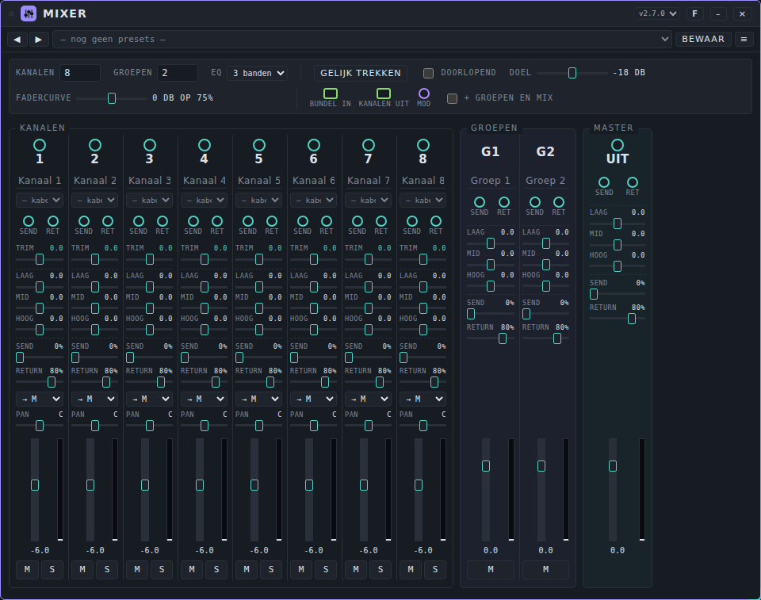
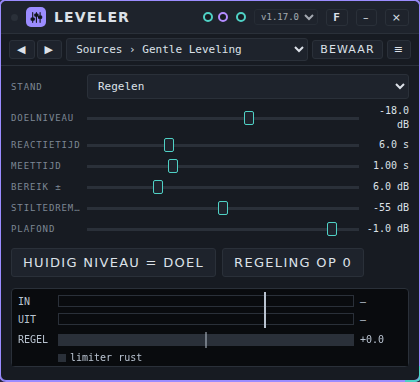
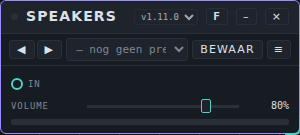
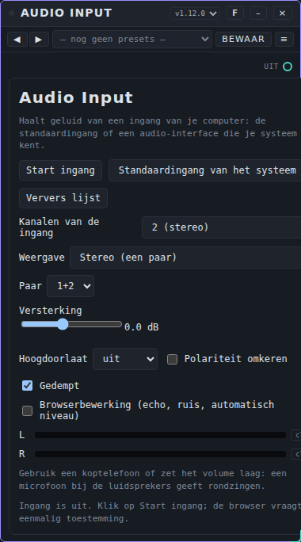
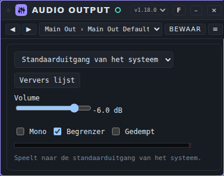

# Mixer: gebruikershandleiding

*English version: [USER-MANUAL_EN.md](USER-MANUAL_EN.md)*

Deze pagina beschrijft de apparaten die je geluiden samenbrengen en naar buiten sturen: **Mixer**, **Leveler**, **Speakers**, **Audio Input** en **Audio Output**. De basis (Patchkamer openen, een bibliotheek laden, kabels trekken) staat in de [basishandleiding](../USER-MANUAL_NL.md). De map met de apparaten is beschreven in [devices/mixer](../../devices/mixer/README_NL.md).

## Inhoud

1. [Wat deze apparaten doen](#wat-deze-apparaten-doen)
2. [Welk apparaat voor welk doel](#welk-apparaat-voor-welk-doel)
3. [Mixer](#mixer)
4. [Leveler](#leveler)
5. [Speakers](#speakers)
6. [Audio Input](#audio-input)
7. [Audio Output](#audio-output)
8. [Als het niet werkt](#als-het-niet-werkt)

## Wat deze apparaten doen

De meeste patches eindigen op dezelfde manier: meerdere geluidmakers (synths, een drumcomputer, effecten) gaan in een **Mixer**, de Mixer gaat door een **Leveler** als je een gelijkmatig volume wilt, en de laatste kabel gaat in **Speakers**. Speakers is het uitgangsapparaat dat geluid afspeelt op je computer: zonder uitgang hoor je niets.

```
synths, drums …  →  Mixer  →  Leveler (optioneel)  →  Speakers
```

Alle kabels hier zijn groenblauwe audiokabels. De Mixer heeft ook een groene **bundel**kabel (veel kanalen in één kabel), die hieronder wordt uitgelegd.

**Presets.** Deze apparaten maken zelf geen geluid, dus ze hebben **presets** en geen tunes. Zie [Presets](../presets/USER-MANUAL_NL.md) voor het gebruiken en delen ervan.

## Welk apparaat voor welk doel

| Ik wil… | Gebruik |
|---|---|
| De balans instellen tussen meerdere geluiden, ze pannen, een kanaal dempen of solo zetten | [Mixer](#mixer) |
| Een deel van een geluid naar een effect sturen, zoals Room, en terughalen | [Mixer](#mixer) (**Send** en **Return**) |
| Geluiden in groepen zetten, bijvoorbeeld alle drums, en met één fader regelen | [Mixer](#mixer) (groepen) |
| Veel bronnen in één keer op hetzelfde volume brengen | [Mixer](#mixer) (**Gelijk trekken**) |
| Een bron die langzaam harder en zachter wordt op een gelijk volume houden | [Leveler](#leveler) |
| Het resultaat horen en het eindvolume instellen | [Speakers](#speakers) |
| Een microfoon, een instrument of een audio-interface naar binnen halen | [Audio Input](#audio-input) |
| Geluid naar een gekozen uitgang sturen, zoals een audio-interface of koptelefoon | [Audio Output](#audio-output) |

## Mixer

### Waar het voor dient

Een mengpaneel met 1 tot 32 kanalen en 0 tot 8 groepen, en een master. Elk kanaal heeft trim, een EQ, send en return, pan, een fader en knoppen voor mute en solo. Groepen en de master hebben ook een EQ, send, return en een fader. Achter de master zit een begrenzer (limiter).



### De regelaars

Dubbelklik op een schuif om terug te gaan naar de beginwaarde. Klik op het getal om een waarde te typen.

**Bovenbalk**

| Regelaar | Wat hij doet |
|---|---|
| **KANALEN** | Hoeveel kanalen er zijn, 1 tot 32 (begin: 8). De poorten op de kaart verschijnen en verdwijnen mee. |
| **GROEPEN** | Hoeveel groepen er zijn, 0 tot 8 (begin: 2). |
| **EQ** | **3 banden** of **5 banden** voor alle kanalen, groepen en de master. |
| **GELIJK TREKKEN** | Meet 4 seconden en zet de **TRIM** van elk kanaal zo dat alle bronnen op het **DOEL**-niveau binnenkomen. Er moet geluid binnenkomen, dus druk eerst op **Start**. Is er geen signaal, dan meldt de Mixer dat. |
| **DOORLOPEND** | Houdt de trims langzaam op het doelniveau (hoogstens 3 dB per seconde). |
| **DOEL** | Het niveau waar **GELIJK TREKKEN** naartoe werkt, −30 tot −6 dB (begin: −18). |
| **BUNDEL IN**, **KANALEN UIT** | De twee bundelpoorten (zie hieronder). |
| **+ GROEPEN EN MIX** | Voegt de groepen en de totale mix toe aan de bundel **KANALEN UIT**. |

**Een kanaal** (van boven naar beneden)

| Regelaar | Wat hij doet |
|---|---|
| Nummer (**1**, **2**, …) | De audio-ingang van het kanaal. |
| Naamveld | Typ een naam voor het kanaal. De naam gaat mee in de bundel. Hoogstens 24 tekens. |
| Bronlijst | Toont **— kabel** (gebruik de kabel op de ingang), of laat je een kanaal kiezen uit een bundel die op **BUNDEL IN** binnenkomt. |
| **SEND**, **RET** (ronde poorten) | De send-uitgang en de return-ingang van het kanaal. |
| **TRIM** | Ingangsversterking, −24 tot +24 dB (0). |
| **LAAG**, **MID**, **HOOG** | EQ-versterking, −15 tot +15 dB (0). Met 3 banden: een lage shelf op 120 Hz, een piek op 1 kHz en een hoge shelf op 6 kHz. Met 5 banden zijn het **LAAG**, **L-MID**, **MID**, **H-MID** en **HOOG**, op 80 Hz, 300 Hz, 1 kHz, 3,5 kHz en 10 kHz (shelf voor de laagste en de hoogste). |
| **SEND** | Hoeveel van het kanaal naar de send-uitgang gaat, 0 tot 100% (0%). |
| **RETURN** | Hoeveel van het geluid op de return-ingang erbij komt, 0 tot 100% (80%). |
| **→ M** | Waar het kanaal heen gaat: naar de master (**→ M**) of naar een groep. |
| **PAN** | Links (−1) tot rechts (+1), midden is **C**. |
| Fader en meter | Het kanaalvolume, −60 tot +6 dB (−6). De balk ernaast is een niveaumeter. |
| **M**, **S** | Mute en solo. Staat bij een kanaal solo aan, dan zijn de kanalen zonder solo stil. |

**Groepen** hebben een naam, send- en returnpoorten, een EQ, **SEND**, **RETURN**, een fader (bij het begin 0 dB) en **M**. De **Master** heeft de uitgangspoort **UIT**, send- en returnpoorten, een EQ, **SEND**, **RETURN** en een fader. Achter de master zit een limiter.

### Hoe het signaal loopt

Elk kanaal loopt ingang → **TRIM** → EQ → fader → **PAN** → mute → groep of master. De **SEND**-uitgang neemt zijn geluid na de fader, pan en mute. De **RETURN**-ingang komt erbij achter de fader en mute van hetzelfde kanaal, dus een kanaal dempen dempt niet wat via zijn return terugkomt.

### Poorten

| Poort | Soort | Gebruik |
|---|---|---|
| **1**, **2**, … | audio in | Het geluid van een apparaat. |
| **RET** onder een kanaal (**Return 1**, …) | audio in | Geluid dat terugkomt van een effect. |
| **SEND** onder een kanaal (**Send 1**, …) | audio uit | Geluid dat naar een effect gaat. |
| **Groep 1 send**, **Groep 1 return**, **Master send**, **Master return** | audio uit en in | Hetzelfde, voor een groep en voor de master. |
| **Uit** | audio uit | De mix. Sluit aan op **Speakers**. |
| **BUNDEL IN** | bundel in (groen) | Een bundel met veel kanalen, bijvoorbeeld de losse uitgangen van een drumcomputer. Kies per kanaal welk bundelkanaal daar binnenkomt, in de bronlijst onder de naam. |
| **KANALEN UIT** | bundel uit (groen) | Alle kanalen na het mixen, als één bundel, bijvoorbeeld naar een recorder. |

### Een voorbeeld

1. Plaats **Duofone**, **Acid Baselines**, **Mixer**, **Room** en **Speakers**.
2. Verbind **Stereo** van Duofone met ingang **1** en **Uit** van Acid Baselines met ingang **2** van de Mixer.
3. Verbind **Uit** van de Mixer met **In** op Speakers.
4. Druk op **Start**. Trek **PAN** van kanaal 1 een beetje naar links en van kanaal 2 een beetje naar rechts.
5. Voor galm: verbind de **SEND**-poort van kanaal 1 met **In** op Room, en **Uit** van Room met de **RET**-poort van kanaal 1. Zet **SEND** op kanaal 1 op ongeveer 30%.
6. Druk op **S** bij kanaal 2 om alleen de bas te horen, en nog een keer om beide te horen.

### Presets

De Mixer heeft presets: een preset bewaart de instellingen van het paneel, maar niet de bronkeuzes van de kanalen. Er hoort geen presetpack bij de Mixer. Gebruik **Bewaar** op de kaart om eigen instellingen te bewaren, en zie [Presets](../presets/USER-MANUAL_NL.md) voor importeren en delen.

### Tips en beperkingen

- Kabels naar een kanaal dat je weghaalt (een lager getal bij **KANALEN**) verdwijnen mee.
- Een oudere Mixerinstelling (versie 1, zonder groepen) wordt omgezet als je hem laadt.
- Een uitbarsting van niet-getallen of enorme waarden van een ander apparaat wordt opgevangen: elke 100 ms vervangt de Mixer een EQ of limiter die is ontspoord en het geluid komt terug.

## Leveler

### Waar het voor dient

Leveler houdt het gemiddelde volume van een bron gelijk. Hij meet het niveau over een instelbare tijd en draait het volume langzaam omhoog of omlaag naar een doelniveau, binnen een bereik dat je kiest. Erachter zit een limiter die korte pieken vangt. Gebruik hem voor bronnen die langzaam harder en zachter worden, bijvoorbeeld als een modulator ze beweegt, of op de hele mix vóór **Speakers**.



### De regelaars

| Regelaar | Wat hij doet | Bereik (begin) |
|---|---|---|
| **STAND** | **Regelen** of **Doorlaten** (het geluid gaat ongewijzigd door) | Regelen |
| **DOELNIVEAU** | Het niveau waar hij naartoe werkt | −36 tot −6 dB (−18) |
| **REACTIETIJD** | Hoe snel het volume omhoog gaat. Omlaag gaat het drie keer sneller. | 0,2 tot 20 s (3) |
| **MEETTIJD** | De tijd waarover hij meet | 0,1 tot 3 s (0,8) |
| **BEREIK ±** | Het meeste dat hij het volume omhoog of omlaag mag draaien | 0 tot 24 dB (12) |
| **STILTEDREMPEL** | Onder dit niveau blijft het volume staan, zodat galmstaarten en pauzes niet worden opgeblazen | −80 tot −30 dB (−55) |
| **PLAFOND** | De grens van de limiter erachter | −12 tot 0 dB (−1) |

Twee knoppen: **Huidig niveau = doel** zet het doelniveau op wat er nu binnenkomt, en **Regeling op 0** zet de correctie terug op 0.

De meter toont **IN**, **UIT** en **REGEL** (de correctie in dB), met een lampje voor de limiter (**limiter rust** als hij niet werkt).

### Poorten

| Poort | Soort | Gebruik |
|---|---|---|
| **In** | audio in | Het geluid dat gelijk moet blijven. |
| **Uit** | audio uit | Het gelijkmatige geluid. |

### Een voorbeeld

1. Plaats **Acid Baselines**, **Leveler** en **Speakers**.
2. Verbind **Uit** van Acid Baselines met **In** op Leveler, en **Uit** van Leveler met **In** op Speakers.
3. Druk op **Start**. Kies de preset **Sources › Bass Control**.
4. Kijk naar de meter **REGEL**: die toont hoeveel dB de Leveler erbij doet of weghaalt. Verander **Cutoff** of **Niveau** op de synth en zie de meter langzaam meebewegen.

### Presets

Leveler heeft het pack **Leveler Basics**: 11 presets in drie mappen, **Sources** (Gentle Leveling, Drift Tamer, Pad Smoother, Bass Control, Lead Steady, Quiet Rescue), **Mix** (Mix Bus Safety, Slow Ride, Fast Catch, Loud and Tight) en **Utility** (Meter Only). Het bestand is [`presets/leveler.patchkamer-presets.json`](../../presets/leveler.patchkamer-presets.json). Laad het vanuit een bibliotheek (zie de basishandleiding) of met de tab **Presets** van de bibliotheek → **Importeren…**, en kies daarna een preset in de lijst op de kaart.

### Tips en beperkingen

- De limiter kijkt 5 ms vooruit, dus het geluid wordt 5 ms vertraagd.
- Ondersteunt je browser geen AudioWorklet, dan laat Leveler het geluid ongewijzigd door en meldt dat op de kaart.
- Zeer hoge waarden of niet-getallen van een ander apparaat worden aan de ingang begrensd, zodat één foute waarde niet in het apparaat blijft hangen.

## Speakers

### Waar het voor dient

Speakers is de uitgang van de studio: het geluid gaat naar de luidsprekers of de koptelefoon van je computer, via een limiter, met een meter. Er is één regelaar: het volume.



### De regelaars

| Regelaar | Wat hij doet | Bereik (begin) |
|---|---|---|
| **Volume** | Het volume | 0 tot 100% (80%) |

Onder de schuif zit een kleine balk die het niveau toont dat naar buiten gaat. Achter het volume zit een limiter (drempel −3 dB, verhouding 12:1), zodat een heel hoog volume niet clipt.

### Poorten

| Poort | Soort | Gebruik |
|---|---|---|
| **In** | audio in | Sluit de Mixer, een Leveler, een Recorder of een synth aan. |

### Een voorbeeld

Verbind **Uit** van de Mixer met **In** op Speakers. Begin met **Volume** op 80% en zet het volume van je computer laag, en draai het dan op.

### Presets

Speakers heeft de presetbalk zoals elk apparaat, maar er hoort geen presetpack bij: er is maar één instelling, en die is een persoonlijke keuze.

### Tips en beperkingen

- Speakers heeft een ingang en geen uitgang. Het volume beweegt zacht mee als je het verandert of een preset laadt.
- Een volume boven 100% is niet mogelijk.

## Audio Input

### Waar het voor dient

Audio Input haalt geluid van buiten de studio naar binnen: de standaardingang van je geluidskaart, of een audio-interface die je computer kent (USB-interfaces, de lijn- of microfooningang van een geluidskaart). Patchkamer vraagt de browser om een lijst met ingangen en toont ze met de namen die je systeem geeft. Gebruik het om een gitaar, een keyboard of een microfoon door effecten te spelen, of om op te nemen met de **Recorder**.



### De regelaars

| Regelaar | Wat hij doet | Bereik (start) |
|---|---|---|
| **Start ingang** / **Stop ingang** | Opent of sluit de ingang. De browser vraagt de eerste keer om toestemming. Er start niets uit zichzelf, ook niet als je een song of preset laadt. | uit |
| **Ingang** (lijst) | De ingang die je gebruikt. **Standaardingang van het systeem** volgt de keuze van je computer. Na de eerste start toont de lijst de echte namen. | standaard van het systeem |
| **Ververs lijst** | Leest de lijst met ingangen opnieuw. De lijst ververst ook als je een interface aansluit of loskoppelt. | |
| **Kanalen van de ingang** | **2 (stereo)** opent twee kanalen. **Zoveel als de ingang geeft** vraagt alle kanalen van een interface, zodat je een paar of één ingang kunt kiezen. | 2 (stereo) |
| **Weergave** | **Stereo (een paar)**, **Mono (één kanaal naar links en rechts)** of **Mono (paar samengeteld)**. | Stereo |
| **Paar** / **Kanaal** | Welk paar (1+2, 3+4 …) of welk los kanaal wordt gebruikt. | 1+2 |
| **Versterking** | Maakt de ingang harder of zachter. | −24 tot +36 dB (0 dB) |
| **Hoogdoorlaat** | Snijdt lage dreun weg: uit, 40, 80 of 120 Hz. | uit |
| **Polariteit omkeren** | Draait het signaal om. Gebruik het als twee microfoons bij één bron elkaar tegenwerken. | uit |
| **Dempen** | Een knop die de uitgang stil maakt; hij licht op zolang hij aan staat. Staat eerst uit, zodat de ingang meteen klinkt. | uit |
| **Browserbewerking** | Echo-onderdrukking, ruisonderdrukking en automatisch niveau van de browser. Uit laat het signaal ongemoeid; zet het aan voor een belgesprek. | uit |
| Meters **L** / **R** | Het niveau na de versterking. **clip** licht even op als het signaal vol uitgestuurd is. | |

### Poorten

| Poort | Soort | Gebruik |
|---|---|---|
| **Uit** | audio uit | Stereogeluid. Verbind met een Mixer-kanaal, een effect, de **Recorder** of **Speakers**. |

### Een voorbeeld

1. Plaats **Audio Input**, **Room** en **Speakers**. Verbind **Uit** van Audio Input met het effect en het effect met **Speakers**.
2. Gebruik een koptelefoon, of zet het volume van je computer laag.
3. Klik op **Start ingang** en geef in de browser toestemming. Kies je interface in de lijst.
4. Speel iets en kijk naar de meters. Verhoog **Versterking** tot de meter op ongeveer driekwart komt en het **clip**-lampje uit blijft.
5. Druk op **Dempen** om het stil te maken, en nog eens om het weer te horen.

### Presets

Het pack **Audio Input Basics** heeft 31 presets in vijf mappen: **Line Level**, **Voice**, **Instruments**, **Interface Channels** en **Utility**. Een preset stelt de weergave, het kanaal, de versterking, de hoogdoorlaat, de polariteit en de browserbewerking in. Hij kiest de ingang zelf niet en haalt de demping niet weg. Zie [Presets](../presets/USER-MANUAL_NL.md).

### Tips en beperkingen

- Een browser kent geen ASIO. Een interface werkt via het stuurprogramma van je besturingssysteem, en hoeveel kanalen de browser ziet, hangt af van dat stuurprogramma en het systeem: sommige systemen tonen in de browser maar twee kanalen. De kaart toont hoeveel kanalen er binnenkomen.
- Het geluid van een ingang loopt door de browser, dus er is vertraging. De grootte hangt af van de interface, het stuurprogramma en je **Latency**-instelling onder Instellingen → Audio.
- Een microfoon in een kamer met luidsprekers geeft rondzingen. Gebruik een koptelefoon, of druk op **Dempen** tot je het volume hebt ingesteld.
- De sample rate van de ingang kan afwijken van die van Patchkamer. De browser rekent dat om.
- Gebruikt een ander programma de ingang, dan kan de browser hem soms niet openen. Sluit dat programma en klik opnieuw op **Start ingang**.

## Audio Output

### Waar het voor dient

Audio Output stuurt het geluid naar een uitgang van je computer die je zelf kiest: de standaarduitgang, een koptelefoonuitgang of een audio-interface die je computer kent. Naast **Speakers** (die altijd naar de standaarduitgang speelt) kun je meerdere Audio Outputs tegelijk gebruiken, bijvoorbeeld de mix naar de monitors en een luistermix naar de koptelefoon. Patchkamer vraagt de browser om een lijst met uitgangen en toont ze met de namen die je systeem geeft.



### De regelaars

| Regelaar | Wat hij doet | Bereik (start) |
|---|---|---|
| **Uitgang** (lijst) | De uitgang waar het geluid naartoe gaat. **Standaarduitgang van het systeem** is de uitgang die je computer gebruikt. | standaard van het systeem |
| **Kies uitgang…** | Laat de browser zijn eigen keuzevenster voor uitgangen tonen en geeft Patchkamer de naam. Staat er alleen in browsers die deze functie hebben. | |
| **Ververs lijst** | Leest de lijst met uitgangen opnieuw. De lijst ververst ook als je een interface aansluit of loskoppelt. | |
| **Paar** | Naar welk paar kanalen (1+2, 3+4 …) het geluid gaat. Staat er alleen als de standaarduitgang meer dan twee kanalen heeft, en werkt alleen op de standaarduitgang. | 1+2 |
| **Volume** | Het volume. | −60 tot +6 dB (−6 dB) |
| **Mono** | Speelt links en rechts als één mono-signaal. Gebruik het om een mix te controleren of voor één luidspreker. | uit |
| **Begrenzer** | Een begrenzer (drempel −1 dB, ratio 20:1) achter het volume. Daarachter ligt een harde grens op 0 dBFS. | aan |
| **Gedempt** | Maakt de uitgang stil. | uit |
| Meters **L** / **R** | Het niveau dat naar buiten gaat. **clip** licht even op bij volle uitsturing. | |

### Poorten

| Poort | Soort | Gebruik |
|---|---|---|
| **In** | audio in | Verbind de Mixer, een Leveler, een Recorder of een synth. |

### Een voorbeeld

1. Plaats twee **Audio Output**-apparaten en een **Mixer** met minstens twee kanalen.
2. Verbind **Uit** van de Mixer met **In** van de eerste Audio Output en kies je monitors in de lijst.
3. Verbind een tweede bron, bijvoorbeeld een klik of een voorluistergeluid, met de tweede Audio Output en kies je koptelefoon. Zet **Mono** aan als je één oor wilt.
4. Begin met een laag **Volume** en draai het op.

### Presets

Het pack **Audio Output Basics** heeft 16 presets in vier mappen: **Main Out**, **Headphones**, **Interface Pairs** en **Checks**. Een preset stelt het volume, mono, de begrenzer en het paar in. Hij kiest de uitgang zelf niet en dempt niet. Zie [Presets](../presets/USER-MANUAL_NL.md).

### Tips en beperkingen

- Een browser kent geen ASIO. Een interface werkt via het stuurprogramma van je besturingssysteem. Een gekozen uitgang is stereo. Een paar kanalen kiezen werkt alleen op de standaarduitgang, en alleen als de browser meer dan twee kanalen toont.
- Een gekozen uitgang loopt in de browser via een tweede route en kan daardoor iets meer vertraging hebben dan de standaarduitgang.
- Het geluid van Audio Output gaat naar de uitgang die je koos en niet meer via de standaarduitgang. Speakers blijft naar de standaarduitgang spelen, dus gebruik voor hetzelfde signaal maar één van de twee, tenzij je het op beide wilt.
- De browser kan het geluid van een gekozen uitgang tegenhouden tot je één keer in Patchkamer klikt (druk op **Start**). De kaart meldt dat dan.
- Is de gekozen uitgang weg, bijvoorbeeld omdat een interface is losgekoppeld, dan gaat het geluid naar de standaarduitgang en meldt de kaart dat.
- Een signaal dat geen getal (NaN) of oneindig is van een ander apparaat wordt tegengehouden en de begrenzer wordt hersteld.

## Als het niet werkt

- **Ik hoor niets.** Druk op **Start**, of klik één keer ergens in Patchkamer: browsers houden audio tegen tot je dat doet. Controleer of er een groenblauwe kabel loopt van je geluidmakers naar een Mixerkanaal, van **Uit** van de Mixer naar **Speakers**, en of **Volume** op Speakers en op je computer hoog genoeg staat.
- **Eén kanaal is stil.** Kijk naar **M** en **S**: staat bij een kanaal **S** aan, dan zijn alle andere kanalen stil. Controleer ook de fader (−60 dB is uit) en of het kanaal naar **→ M** gaat of naar een groep die niet gedempt is.
- **GELIJK TREKKEN meldt dat er geen signaal is.** Druk op **Start** zodat de bronnen spelen, en meet opnieuw.
- **Ik hoor de galm of het effect niet.** Controleer of **SEND** boven 0% staat, of de uitgang van het effect naar de **RET**-poort van hetzelfde kanaal gaat en of **RETURN** niet op 0% staat.
- **Een bundelkanaal komt niet binnen.** Controleer of de groene kabel op **BUNDEL IN** zit en of je in de bronlijst van het kanaal een kanaal hebt gekozen.
- **Gekraak.** Open Instellingen → Audio en kies een grotere latency, of een lagere kwaliteit. Zie de [basishandleiding](../USER-MANUAL_NL.md#13-problemen-oplossen).
