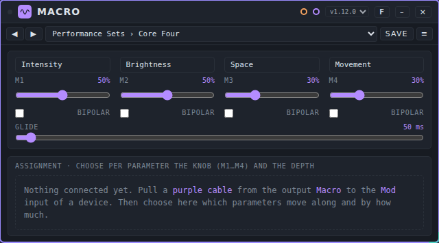
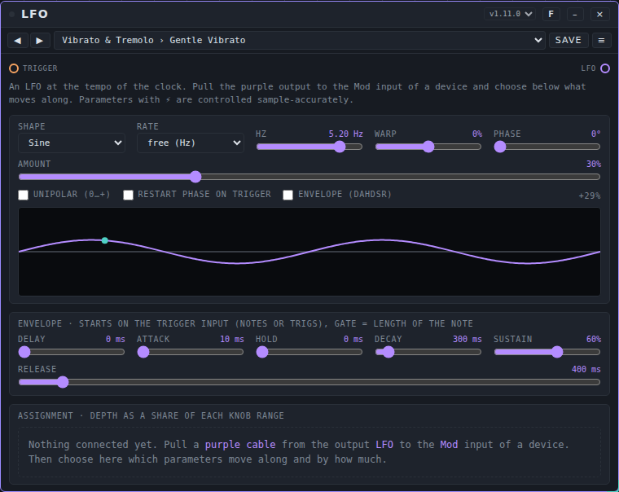
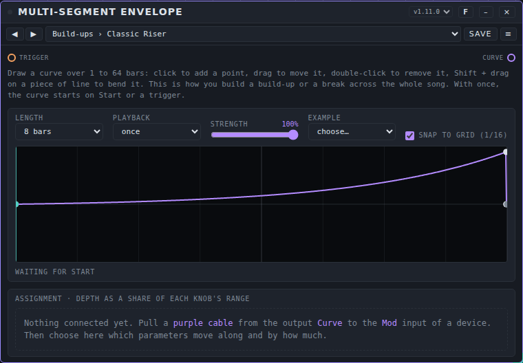
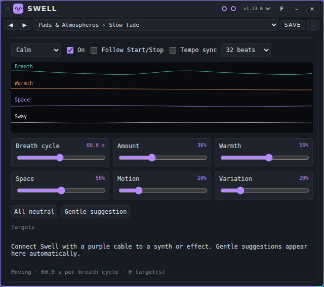
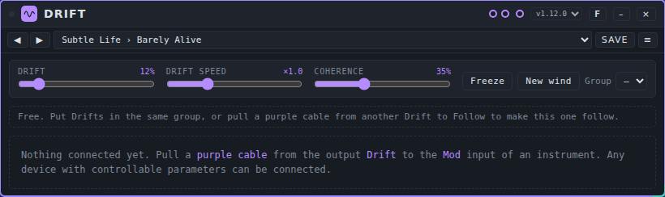

# Modulators: user manual

*Nederlandse versie: [USER-MANUAL_NL.md](USER-MANUAL_NL.md)*

A modulator is a device that moves the controls of another device while you play. This page explains how that works and describes the six modulators that come with Patchkamer: **Macro**, **LFO**, **Multi-Segment Envelope**, **Swell**, **Drift** and **Follower**. For the basics (opening Patchkamer, loading a library, drawing cables) see the [main user manual](../USER-MANUAL_EN.md). The folder with the device is described in [devices/modulators](../../devices/modulators/README.md).

## Contents

1. [How a modulator works](#how-a-modulator-works)
2. [Which modulator for which goal](#which-modulator-for-which-goal)
3. [Macro](#macro)
4. [LFO](#lfo)
5. [Multi-Segment Envelope](#multi-segment-envelope)
6. [Swell](#swell)
7. [Drift](#drift)
8. [Follower](#follower)
9. [If it does not work](#if-it-does-not-work)

## How a modulator works

A modulator makes no sound. It makes **control**: a value that goes up and down over time. You use it to move a knob of another device, such as the cutoff of a synth, without touching the knob yourself.

It takes three steps:

1. **Draw a purple cable** from the modulation output of the modulator to the **Mod** input of the device you want to move. Purple cables carry modulation. Devices with controls that can be moved have a **Mod** input.
2. **Choose what moves.** The card of the modulator now lists the controls of the other device, under a heading with its name. For each control you choose how much it moves (the **depth**) and, if the modulator offers more than one signal (Macro has four knobs, Follower has three signals), which one it follows. Swell and Drift have their own way of choosing, described in their sections.
3. **Play.** The knob on the other device stays where you put it. The modulator moves the sound around that value. When you remove the cable or set the depth to 0, the control is back at its knob value.

The depth is a share of the range of the control. At **+50%** the modulator can move a control up by about half of its range. At **−50%** it moves it down. You can connect a modulator to more than one device, and give each its own assignments.

A control that is marked with **⚡** is *fast*: the modulator controls it with an audio signal, sample by sample. Other controls are updated about 30 times per second, which is fine for slow movements.

Modulators have **presets** (they make no sound, so no tunes). A preset keeps the settings of the modulator itself. The assignments of the controls are not part of a preset. See [Presets](../presets/USER-MANUAL_EN.md) for how to use and share them.

## Which modulator for which goal

| I want to… | Use |
|---|---|
| Let the loudness of one sound move a control of another device | [Follower](#follower) |
| Let the hits of a sound play a drum or a note on another device | [Follower](#follower) (**Onsets** port) |
| Move a control by how much high frequency a sound has | [Follower](#follower) (**Brightness**) |
| Turn one knob and move many controls (of several devices) at once | [Macro](#macro) |
| Move a control up and down in a steady rhythm (vibrato, tremolo, wobble, gates) | [LFO](#lfo) |
| Draw a movement over 1 to 64 bars (a build-up, a break, a sweep over a whole section) | [Multi-Segment Envelope](#multi-segment-envelope) |
| Let the soundscape breathe slowly and together (pads, drones, ambient) | [Swell](#swell) |
| Keep a sound alive with very slow, small changes around the knob position | [Drift](#drift) |

## Macro

### What it is for

Macro gives you four knobs (**M1** to **M4**). Each knob can move a whole group of controls at once, also on different devices. You choose per control which knob drives it and how far. One hand, four knobs, many controls: handy for a build-up or when you play live. Macro also listens to its **CC** event input, so the four knobs can be moved from outside, for example by [Pad Controller](../tools/USER-MANUAL_EN.md#pad-controller) or a MIDI controller.

### The controls

| Control | What it does | Range (start) |
|---|---|---|
| Name field (above each knob) | A name for the knob, for yourself. It changes nothing in the sound | up to 24 characters ("Macro 1" to "Macro 4") |
| **M1** to **M4** | The knob position | 0 to 100% (0%) |
| **BIPOLAR** (per knob) | Off: the knob goes from 0 to 1. On: 50% is the middle; below it the knob moves controls down, above it up (−1 to +1) | off |
| **GLIDE** | How long the output takes to follow a knob when it jumps, for all four knobs | 0 to 2 s (0.05 s) |

**The assignments.** Once a purple cable runs to another device, the card lists the controls of that device under a heading with its name. Per control you see a **source** list (**M1** to **M4**: which knob drives it), a **depth** slider from −100% to +100% (double-click for 0) and a **⚡** mark when the control is fast. A search field (**search parameter**) and the check box **active only** help you find a control. A knob moves a control by its position times the depth, as a share of the range of that control.

### Ports

| Port | Kind | Use |
|---|---|---|
| **CC** | events in (orange) | Moves the knobs from outside. It accepts a control change with id `m1` to `m4` (or `macro 1` to `macro 4`) and a value from 0 to 1. |
| **Macro** | modulation out (purple) | The control signals. Connect to the **Mod** input of the devices you want to move. |

### An example: one knob for a build-up

1. Place a synth with a filter (for example Acid Baselines), an effect with a **Mix** control (for example a reverb), a **Mixer** and **Speakers**, and Macro.
2. Draw a purple cable from **Macro** to **Mod** on the synth, and another from **Macro** to **Mod** on the reverb.
3. Choose the preset **Build-ups › Build-up**.
4. Under the heading of the synth set **Cutoff** to source **M1** with depth **+60%**. Under the reverb set the mix to source **M1** with depth **+40%**.
5. Press **Start** and slowly move **M1** up: the filter opens and the reverb mix goes up together. Move it back and both come down.

Switch **BIPOLAR** on for a knob that has to go two ways: at 50% nothing moves, below it a control with a positive depth goes down, above it up.

### Presets

Macro has the pack **Macro Basics**: 40 presets in five folders: **Performance Sets**, **Pairs**, **Build-ups**, **Styles** and **Sound Design**. A few names: Core Four, Filter and Resonance, Build-up, Techno Console, Timbre Morph. The file is [`presets/macro.patchkamer-presets.json`](../../presets/macro.patchkamer-presets.json). Load it from a library (see the main manual) or with the **Presets** tab of the library → **Import…**, then pick a preset in the list on the card. A preset holds the knob positions, the names, which knobs are bipolar and the glide time. The assignments are not part of a preset: you make those yourself.

### Tips and limits

- A control only moves when the other device is connected with a purple cable and its depth is not 0.
- A value from the **CC** input outside 0 to 1 is limited to that range. A value that is not a number is ignored.
- Macro has no memory of MIDI controller numbers: it only reacts to the ids **m1** to **m4**.

## LFO

### What it is for

An LFO (low-frequency oscillator) is a wave that goes up and down by itself, in time with the clock of the studio. Use it for vibrato, tremolo, auto-pan, filter sweeps, wobbles and rhythmic gates. It has eight shapes, runs at a musical rate (from 8 bars to 1/32, also triplets and dotted) or at a free speed in Hz, and can behave like an envelope that starts on every note.

### The controls

The picture in the middle of the card shows the wave and a dot with the current value. Double-click a slider to go back to its starting value.

| Control | What it does | Range (start) |
|---|---|---|
| **SHAPE** | **Sine**, **Triangle**, **Saw up**, **Saw down**, **Square**, **S&H (random steps)** (a new random value every cycle), **Smooth random** (glides between random values) or **Steps (draw your own)** | Sine |
| **RATE** | How long one cycle lasts: **8 bars**, **4 bars**, **2 bars**, **1 bar**, down to 1/32, with **triplet** and **dotted** values, or **free (Hz)** | 1/4 (one beat) |
| **HZ** | The speed when **RATE** is **free (Hz)** | 0.01 to 20 Hz (1) |
| **WARP** | Bends the shape. For sine and triangle it moves the peak, for the saws it bends the slope, for square it sets the pulse width, for smooth random it sets how fast the change is. The other shapes ignore it | −100 to +100% (0) |
| **PHASE** | Where in the cycle the LFO starts | 0 to 360° (0) |
| **AMOUNT** | Scales the whole movement | 0 to 100% (100) |
| **UNIPOLAR (0…+)** | On: the LFO only goes from 0 upward, so a control only moves up from its knob position (with a negative depth: only down). Off: it goes around the knob position | off |
| **RESTART PHASE ON TRIGGER** | Every event on the **Trigger** input puts the LFO back at the start of the cycle | off |
| **ENVELOPE (DAHDSR)** | The movement follows an envelope that starts on the **Trigger** input | off |

**Steps.** With the shape **Steps (draw your own)** you draw the steps in the wave. **Steps** sets how many count (2 to 16, start 16) and **Glide** how much of every step slides to the next (0 to 100%).

**The envelope.** With **ENVELOPE (DAHDSR)** on, the movement is multiplied by an envelope that starts on every note or trig on the **Trigger** input. The gate is the length of the note. Without any trigger the output is 0, so such a preset only moves once notes or trigs come in.

| Control | What it does | Range (start) |
|---|---|---|
| **DELAY** | Waiting time before the envelope starts | 0 to 2 s (0) |
| **ATTACK** | Time to go up | 1 ms to 4 s (10 ms) |
| **HOLD** | Time at the top | 0 to 2 s (0) |
| **DECAY** | Time to fall to the sustain level | 1 ms to 4 s (300 ms) |
| **SUSTAIN** | The level while the note lasts | 0 to 100% (60%) |
| **RELEASE** | Time to fall after the note ends | 1 ms to 6 s (400 ms) |

**The assignments** work as in Macro: a heading with the name of the other device, per control a **depth** slider from −100% to +100% and a **⚡** mark for fast controls, plus **search parameter** and **active only**. There is one source, so no source list.

### Ports

| Port | Kind | Use |
|---|---|---|
| **Trigger** | events in (orange) | Notes or trigs that restart the phase or start the envelope. |
| **LFO** | modulation out (purple) | The control signal. Connect to the **Mod** input of the device you want to move. |

### An example: a wobble on a bass

1. Place Acid Baselines, a **Mixer** and **Speakers** and an LFO.
2. Draw a purple cable from **LFO** to **Mod** on Acid Baselines.
3. Choose the preset **Wobble › Wobble 1/4**.
4. Under **→ Acid Baselines** set **Cutoff** to depth **+50%**.
5. Press **Start**. The cutoff moves around its knob position once per beat, in time with the clock. Change **RATE** to 1/8 for a faster wobble.

For a vibrato, choose **Vibrato & Tremolo › Gentle Vibrato** and give the pitch control of a synth a small depth.

### Presets

LFO has the pack **LFO Basics**: 60 presets in ten folders: **Vibrato & Tremolo**, **Pan & Space**, **Filter Sweeps**, **Wobble**, **Rhythmic Gates**, **Step Patterns**, **Generative**, **Slow & Ambient**, **Trigger Envelopes** and **By Genre**. A few names: Gentle Vibrato, Slow Auto-Pan, Wobble 1/4, Trance Gate, Pluck Envelope. The file is [`presets/lfo.patchkamer-presets.json`](../../presets/lfo.patchkamer-presets.json). Load it from a library or with the **Presets** tab of the library → **Import…**. A preset holds the shape, rate, warp, phase, amount, the steps and the envelope settings, not the assignments.

### Tips and limits

- The LFO follows the clock, also when the clock stands still (at the tempo of the host). Two LFOs with the same rate run exactly together.
- Presets for pitch use a low **AMOUNT** on purpose: a full depth on a pitch control sounds out of tune.
- The presets in the folder **Trigger Envelopes** only move once notes or trigs reach the **Trigger** input.

## Multi-Segment Envelope

### What it is for

With the Multi-Segment Envelope you draw a curve over 1 to 64 bars and let it move controls of other devices. That is how you make a build-up, a break, a pump or a slow sweep across a whole section of the song. The curve can repeat in time with the bars of the clock, or run once from Start or from a trigger.

### The controls

**Drawing.** Click in the curve to add a point, drag a point to move it, double-click a point to remove it, and Shift + drag on a piece of line to bend it. A line that starts at a point has its own bend. Two points on the same spot in time make a jump (steps, gates, saw teeth). The line at the middle of the display is 0: the rest value, where the knob of the other device stays.

| Control | What it does | Range (start) |
|---|---|---|
| **LENGTH** | The length of the curve | 1, 2, 4, 8, 16, 32 or 64 bars (16) |
| **PLAYBACK** | **loop**: repeats in time with the bars of the clock. **once**: runs once from Start or from a trigger and then stays at the end value | loop |
| **STRENGTH** | Scales the whole curve | 0 to 100% (100) |
| **EXAMPLE** | Replaces the curve by an example: **Build-up**, **Wave**, **Steps**, **Breathing**, **Break** or **Flat** | choose… |
| **SNAP TO GRID (1/16)** | Only for drawing with the mouse: points snap to a grid. It does not change the sound | on |

A line under the curve shows the position (**bar 3 of 8**), or **waiting for start** when the curve in **once** mode has not started yet.

**The assignments** work as in LFO: per control a **depth** slider from −100% to +100%, a **⚡** mark for fast controls, **search parameter** and **active only**. The value of the curve times the depth is added to the knob position of the control, as a share of its range. A negative depth turns the curve upside down.

### Ports

| Port | Kind | Use |
|---|---|---|
| **Trigger** | events in (orange) | Starts the curve when **PLAYBACK** is **once**. |
| **Curve** | modulation out (purple) | The control signal. Connect to the **Mod** input of the device you want to move. |

### An example: a build-up of 8 bars

1. Place a synth with a filter, a **Mixer**, **Speakers** and the Multi-Segment Envelope.
2. Draw a purple cable from **Curve** to **Mod** on the synth.
3. Choose the preset **Build-ups › Classic Riser** (length 8 bars, **once**).
4. Under the heading of the synth set **Cutoff** to depth **+60%**.
5. Press **Start**. The curve runs once over 8 bars and the filter opens further and further. After the last bar it stays at the end value. Press Stop and Start to run it again, or send a trigger to the **Trigger** input.

### Presets

The pack **Multi-Segment Envelope Presets** has 54 presets in nine folders: **Build-ups**, **Drops & Breaks**, **Filter Sweeps**, **Steps**, **Breathing & Swells**, **Gates & Ratchets**, **Pumps & Plucks**, **Generative & Ambient** and **By Style**. A few names: Classic Riser, Tape Stop, Triangle Sweep, Trance Gate, Slow Drift. The file is [`presets/mseg.patchkamer-presets.json`](../../presets/mseg.patchkamer-presets.json). Load it from a library or with the **Presets** tab of the library → **Import…**. A preset holds the curve, the length, the playback mode and the strength, not the assignments.

### Tips and limits

- The curve always runs the full range from −1 to +1, so with a high depth it moves a control far. Lower **STRENGTH** for a subtle movement.
- A jump exactly at the end of the curve is never played (the end is also the start of the next loop). Put it a little before the end if the curve has to fall to 0 after a build-up.
- In **loop** mode the curve is tied to the bars of the clock, so it stays in time with the song.

## Swell

### What it is for

Swell moves several controls together in a slow, coherent way, like breathing. It is made for pads, drones and ambient music, for soundscapes that have to stay alive without anyone playing. From one slow wave it makes four linked tracks: **Breath**, **Warmth**, **Space** and **Sway**. You tick which controls of the connected device move, and which track each one follows.

### The controls

The display shows the four tracks while the movement runs.

| Control | What it does | Range (start) |
|---|---|---|
| **Mood** | A profile that sets the six sliders below at once: **Calm**, **Cosy**, **Closeness** or **Euphoria** | Calm |
| **On** | Movement on. Off: the connected controls stay on their knob position | on |
| **Follow Start/Stop** | Only moves while the clock runs | off |
| **Tempo sync** | The length of the wave follows the clock, set in beats, instead of seconds | off |
| **Length in beats** | The wave length with **Tempo sync**: 4, 8, 16, 32, 64 or 128 beats (4 beats = one bar in 4/4) | 32 beats |
| **Breath cycle** | The wave length in seconds (without **Tempo sync**) | 4 to 120 s (22) |
| **Amount** | Scales all four tracks | 0 to 100% (38) |
| **Warmth** | The fixed position of the **Warmth** track: 50% is neutral | 0 to 100% (62) |
| **Space** | The fixed position of the **Space** track | 0 to 100% (45) |
| **Motion** | How much the tracks **Warmth**, **Space** and **Sway** move themselves | 0 to 100% (22) |
| **Variation** | A slower, irregular wave over the tracks, so the movement does not repeat exactly | 0 to 100% (12) |
| **All neutral** | Switches the movement off (the same as **On** off) | |
| **Gentle suggestion** | Fills in careful starting assignments for all connected devices | |

**The targets.** Once Swell is connected, the card lists the controls of the other device. Tick a control, choose which track it follows and set its **range**: a share of the control's range up to 20%; a negative range reverses the direction. Swell suggests values for common controls when a device is connected: for example a filter cutoff follows **Warmth** downward, a reverb mix follows **Space**, a pan follows **Sway**. All other controls start off. The movement is smoothed and sent about 25 times a second.

### Ports

| Port | Kind | Use |
|---|---|---|
| **Swell** | modulation out (purple) | The control signals. Connect to the **Mod** input of a synth or effect. Swell has no other ports. |

### An example: a pad that breathes

1. Place a pad synth, a reverb, a **Mixer**, **Speakers** and Swell.
2. Draw a purple cable from **Swell** to **Mod** on the pad synth, and another to **Mod** on the reverb.
3. Choose the preset **Pads & Atmospheres › Slow Tide** (a wave of 60 seconds).
4. Press **Gentle suggestion** to get starting values, then tick or untick controls and adjust their **range**.
5. Play a long chord. The ticked controls move slowly and together. Raise **Amount** for more movement; the result stays small because the ranges are limited to 20%.

For movement in time with the song, switch on **Tempo sync** and **Follow Start/Stop**, and choose 16 or 32 beats.

### Presets

The pack **Swell Presets** has 55 presets in eight folders: **Pads & Atmospheres**, **Warm & Close**, **Bright & Open**, **Tempo Synced**, **Subtle & Natural**, **Big & Expressive**, **Generative & Evolving** and **By Application**. A few names: Slow Tide, Warm Blanket, Four Bar Swell, Barely There, Pad Breath. The file is [`presets/swell.patchkamer-presets.json`](../../presets/swell.patchkamer-presets.json). Load it from a library or with the **Presets** tab of the library → **Import…**. A preset holds the mood, the switches and the six sliders. The ticked targets are not part of a preset: they stay as you set them.

### Tips and limits

- Swell moves controls by at most 20% of their range. That is on purpose: the movement should be felt, not heard as an effect.
- A very slow wave is the character here: the 60-second presets take a minute for one breath.
- Swell was called Deining in earlier versions. A workspace or preset from that time refers to the old id and does not load into Swell.

## Drift

### What it is for

Drift lets the controls you tick on connected devices wander very slowly around their knob position, so a sound keeps varying. It plays no notes and makes no sound. The knob you set stays the base; Drift moves around it. The wander is very slow: periods from about half a minute to over twenty minutes at speed ×1.

### The controls

| Control | What it does | Range (start) |
|---|---|---|
| **DRIFT** | How far the controls wander, as a share of what you allow per control | 0 to 100% (60%) |
| **DRIFT SPEED** | How fast drift time runs. ×1 is the slow default; ×4 is four times as fast, ×0.25 four times as slow | ×0.25 to ×32 (×1) |
| **COHERENCE** | 0%: every control has its own wind. 100%: controls with the same role (all filters, all pitches) move together, also across devices | 0 to 100% (35%) |
| **Freeze** | Holds all movement at its current position (the button then reads **Frozen**) | |
| **New wind** | Picks a new, different movement | |
| **Group** | Drifts in the same group (**A** to **D**) share clock, speed, amount, coherence and wind. **–** is no group | – |

**Follow.** Pull a purple cable from another Drift to the **Follow** input and this Drift takes over the clock and the wind of that one. A **Follow mode** list then sets how: **same**, **mirrored** or **shifted**. A slider **Own** mixes some of its own movement into the shared one (0 to 100%). Without a group or a master, **Own** has no effect. A line under the controls shows the state: free, in a group, or following.

**The assignments.** Once Drift is connected, the card lists the controls of the other device in groups. Tick a control to let it drift and set its **range**: the maximum deviation, up to ±50% of the knob range. Per lane of controls there are switches to turn all of them on or off, to freeze the lane and to give it a new wind. A small graph shows the movement of each group.

### Ports

| Port | Kind | Use |
|---|---|---|
| **Follow** | modulation in (purple) | The **Drift** output of another Drift: this one follows it. |
| **Drift** | modulation out (purple) | The control signals. Connect to the **Mod** input of the device you want to move. |

### An example: a synth that never stands still

1. Place a synth, a **Mixer**, **Speakers** and Drift.
2. Draw a purple cable from **Drift** to **Mod** on the synth.
3. Choose the preset **Subtle Life › Gentle Life**.
4. Tick the controls that may wander (for example the filter cutoff and the detune) and keep the **range** small, around 5 to 10%.
5. Play the synth. After a minute or so the sound has shifted a little. Press **New wind** for a different movement.

For an ensemble that drifts together, put two Drifts in group **A**, or pull a cable from one **Drift** output to the **Follow** input of the other.

### Presets

The pack **Drift Presets** has 44 presets in seven folders: **Subtle Life**, **Slow Evolution**, **Wide Wander**, **Restless**, **Together & Apart**, **Per Style** and **Group Ensembles**. A few names: Barely Alive, Glacial, Wide Wander, Shared Breath, Ambient Bed. The file is [`presets/drift.patchkamer-presets.json`](../../presets/drift.patchkamer-presets.json). Load it from a library or with the **Presets** tab of the library → **Import…**. A preset holds only the wind: the amount, the speed, the coherence and the seed (and **Own** with its seed). The ticked controls, the group and the follow mode stay as they are.

### Tips and limits

- Each preset has its own seed, so presets that are otherwise alike still move differently. Choosing another preset can make the control jump once to a new position.
- A Drift in a group shares its settings with the other members: a preset on one member changes the whole group.
- Two Drifts with the same seed and the same clock move exactly together, without exchanging messages.

## Follower

### What it is for

Follower listens to a sound and turns it into control. From one audio input it makes three signals:

- **Level**: how loud the sound is.
- **Transient**: a short spike at every hit (an attack).
- **Brightness**: how much high frequency is in the sound.

For every control you move on another device, you choose which of the three signals it follows and how deep. At every hit Follower also sends a trigger or a note out of its **Onsets** port, so a drum or a synth can play along with another sound. The sound itself passes through unchanged.

### The controls

Double-click a slider to go back to its starting value. Click the number to type a value. The card shows a small display with the three signals (**Level**, **Transient** and **Brightness**) while sound comes in.

**The level signal**

| Control | What it does | Range (start) |
|---|---|---|
| **Focus** | Which part of the sound it listens to: **All**, **Low (kick, bass)**, **Mid (snare, voice)**, **High (hats)** or **Custom frequency** | All |
| **Custom frequency** | The frequency to listen to when **Focus** is **Custom frequency** | 40 to 16000 Hz (1000) |
| **Gain** | Amplifies the sound before it is measured | −24 to +36 dB (0) |
| **Attack** | How fast the level signal goes up | 0.1 to 200 ms (5) |
| **Release** | How fast the level signal comes down | 5 to 3000 ms (150) |
| **Floor** | The level that gives 0 | −90 to −10 dB (−50) |
| **Range** | The number of dB between 0 and 1 | 6 to 80 dB (40) |
| **Output range** | **0 … +1 (upward only)** or **−1 … +1 (around the centre)** | 0 … +1 |
| **Direction** | **Louder = more** or **Louder = less (inverted)** | Louder = more |

**The hits (onsets)**

| Control | What it does | Range (start) |
|---|---|---|
| **Onset sensitivity** | How easily a hit is detected | 0 to 100% (50%) |
| **Transient decay** | How long the **Transient** signal takes to fall after a hit | 10 to 1000 ms (120) |
| **Minimum spacing** | The shortest time between two hits | 10 to 500 ms (60) |
| **Gate** | Below this level there are no hits and no level | −90 to −10 dB (−60) |
| **Send onsets as** | What a hit sends: **Trig lane 1** to **Trig lane 8**, or **Note** | Trig lane 1 |
| **Note** | The note number that is sent when **Send onsets as** is **Note** | 24 to 96, shown as a note name (C4) |

**The assignments.** Under the controls you see what the modulator moves. Until a cable is connected it says that nothing is connected yet. Once a purple cable runs to another device, the card shows a heading with the name of that device, for example **→ Acid Baselines**, and below it the controls of that device in groups. Per control you see:

- a **source** list (**Level**, **Transient** or **Brightness**),
- a **depth** slider from −100% to +100% (double-click for 0),
- a **⚡** mark when the control is fast.

A search field (**search parameter**) and the check box **active only** help you find a control. A group shows how many controls are active.

### Ports

| Port | Kind | Use |
|---|---|---|
| **Listens to** | audio in (teal) | The sound to listen to, for example a drum machine. |
| **Through** | audio out (teal) | The same sound, unchanged. Connect it to your mixer so you keep hearing it. |
| **Onsets** | events out (orange) | A trigger or a note at every hit. Connect to a drum machine or a synth. |
| **Follower** | modulation out (purple) | The control signals. Connect to the **Mod** input of the device you want to move. |

### An example: a bass that follows the drums

1. Place a **Drum Machine**, **Follower**, **Acid Baselines**, a **Mixer** and **Speakers**.
2. Connect **Out** of the Drum Machine to **Listens to** on Follower, and **Through** of Follower to input **1** of the Mixer.
3. Connect **Out** of Acid Baselines to input **2** of the Mixer, and **Out** of the Mixer to **In** on Speakers.
4. Draw a purple cable from **Follower** (on the Follower card) to **Mod** on Acid Baselines.
5. On the Follower card choose the preset **Level › Bass Follower**. This listens to the low part of the drums.
6. Press **Start**. Under **→ Acid Baselines** open the group **Bass**, find the control **Level**, leave the source on **Level** and set the depth to **−50%**: the louder the low end of the drums, the quieter the bass, and it comes back between the hits.
7. Try another control: **Cutoff** at **+40%** opens the filter of the bass on every drum hit.

A second example: a synth plays along with another sound. Choose the preset **Onsets › Note Follower**, connect **Onsets** to **Notes** on Acid Baselines, and switch **internal** off on Acid Baselines. Every hit that comes in on **Listens to** now plays the note that is set under **Note** on the synth. With **Send onsets as** set to **Trig lane 1** to **Trig lane 8**, Follower sends a trigger for that lane instead of a note.

### Presets

Follower has the pack **Follower Basics**: 14 presets in three folders. **Level** (Smooth Envelope, Slow Swell, Bass Follower, Voice Follower, Hat Follower, Kick Ducker), **Onsets** (Kick Trigger, Snare Trigger, Hat Trigger, Note Follower) and **Extreme** (Centered Wobble, Gate Slammer, Hair Trigger, Tuned Band Follower). The file is [`presets/follower.patchkamer-presets.json`](../../presets/follower.patchkamer-presets.json). Load it from a library (see the main manual) or with the **Presets** tab of the library → **Import…**, then pick a preset in the list on the card. **Kick Ducker** uses **Louder = less (inverted)**. A preset does not contain assignments: you choose those yourself.

### Tips and limits

- The assignments only work once the other device is connected with a purple cable: the list of controls comes from that device.
- Without AudioWorklet support in your browser the sound still passes through, but Follower controls nothing. The card says so.
- Very high or not-a-number values from another device are limited at the input, so one bad value does not stay in Follower.
- **Direction** and **Output range** change the signal before the depth is applied.

## If it does not work

- **Nothing moves.** Check that sound comes in on **Listens to** (the display shows the three signals), that the purple cable runs from **Follower** to **Mod** on the other device, and that a depth other than 0 is set for at least one control. Press **Start** so the sound plays.
- **The list of controls is empty.** The card says "Nothing connected yet" until a purple cable is connected. Check that the cable ends on a **Mod** input.
- **I stopped hearing the sound.** Follower passes sound through its **Through** port: connect that port, not **Listens to**, on to the mixer or speakers.
- **The hits are not detected.** Raise **Onset sensitivity**, lower **Gate**, or choose another **Focus**. Lower **Minimum spacing** for fast hits.
- **No sound at all or crackles.** See the [main manual](../USER-MANUAL_EN.md#13-troubleshooting).
