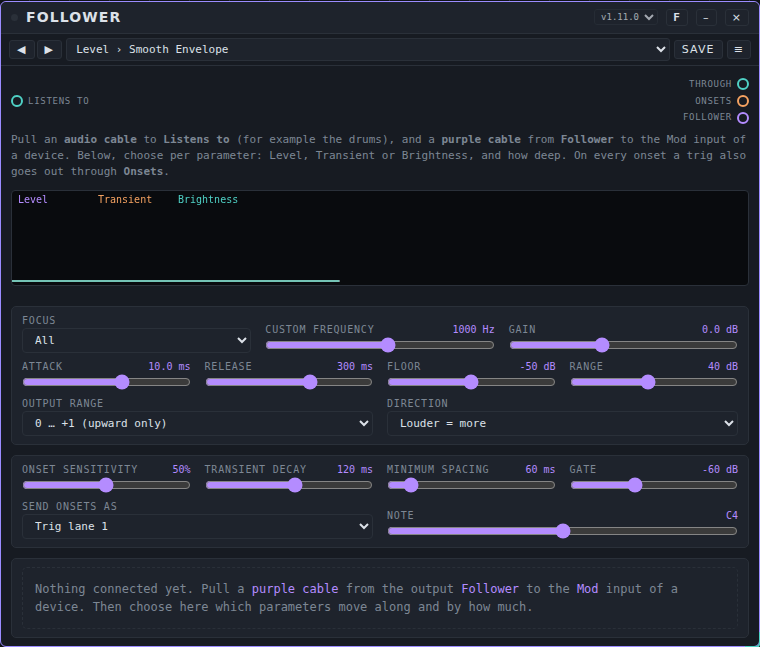

# Modulators: user manual

*Nederlandse versie: [USER-MANUAL_NL.md](USER-MANUAL_NL.md)*

A modulator is a device that moves the controls of another device while you play. This page explains how that works and describes the one modulator that comes with Patchkamer: **Follower**. For the basics (opening Patchkamer, loading a library, drawing cables) see the [main user manual](../USER-MANUAL_EN.md). The folder with the device is described in [devices/modulators](../../devices/modulators/README.md).

## Contents

1. [How a modulator works](#how-a-modulator-works)
2. [Which modulator for which goal](#which-modulator-for-which-goal)
3. [Follower](#follower)
4. [If it does not work](#if-it-does-not-work)

## How a modulator works

A modulator makes no sound. It makes **control**: a value that goes up and down over time. You use it to move a knob of another device, such as the cutoff of a synth, without touching the knob yourself.

It takes three steps:

1. **Draw a purple cable** from the modulation output of the modulator to the **Mod** input of the device you want to move. Purple cables carry modulation. Devices with controls that can be moved have a **Mod** input.
2. **Choose what moves.** The card of the modulator now lists the controls of the other device, under a heading with its name. For each control you choose how much it moves (the **depth**) and, if the modulator offers more than one signal, which signal it follows.
3. **Play.** The knob on the other device stays where you put it. The modulator moves the sound around that value. When you remove the cable or set the depth to 0, the control is back at its knob value.

The depth is a share of the range of the control. At **+50%** the modulator can move a control up by about half of its range. At **−50%** it moves it down. You can connect a modulator to more than one device, and give each its own assignments.

A control that is marked with **⚡** is *fast*: the modulator controls it with an audio signal, sample by sample. Other controls are updated about 30 times per second, which is fine for slow movements.

Modulators have **presets** (they make no sound, so no tunes). A preset keeps the settings of the modulator itself. The assignments of the controls are not part of a preset. See [Presets](../presets/USER-MANUAL_EN.md) for how to use and share them.

## Which modulator for which goal

| I want to… | Use |
|---|---|
| Let the loudness of one sound move a control of another device | [Follower](#follower) |
| Let the hits of a sound play a drum or a note on another device | [Follower](#follower) (**Onsets** port) |
| Move a control by how much high frequency a sound has | [Follower](#follower) (**Brightness**) |

## Follower

### What it is for

Follower listens to a sound and turns it into control. From one audio input it makes three signals:

- **Level**: how loud the sound is.
- **Transient**: a short spike at every hit (an attack).
- **Brightness**: how much high frequency is in the sound.

For every control you move on another device, you choose which of the three signals it follows and how deep. At every hit Follower also sends a trigger or a note out of its **Onsets** port, so a drum or a synth can play along with another sound. The sound itself passes through unchanged.

### The controls

Double-click a slider to go back to its starting value. Click the number to type a value. The card shows a small display with the three signals (**Level**, **Transient** and **Brightness**) while sound comes in.

**The level signal**

| Control | What it does | Range (start) |
|---|---|---|
| **Focus** | Which part of the sound it listens to: **All**, **Low (kick, bass)**, **Mid (snare, voice)**, **High (hats)** or **Custom frequency** | All |
| **Custom frequency** | The frequency to listen to when **Focus** is **Custom frequency** | 40 to 16000 Hz (1000) |
| **Gain** | Amplifies the sound before it is measured | −24 to +36 dB (0) |
| **Attack** | How fast the level signal goes up | 0.1 to 200 ms (5) |
| **Release** | How fast the level signal comes down | 5 to 3000 ms (150) |
| **Floor** | The level that gives 0 | −90 to −10 dB (−50) |
| **Range** | The number of dB between 0 and 1 | 6 to 80 dB (40) |
| **Output range** | **0 … +1 (upward only)** or **−1 … +1 (around the centre)** | 0 … +1 |
| **Direction** | **Louder = more** or **Louder = less (inverted)** | Louder = more |

**The hits (onsets)**

| Control | What it does | Range (start) |
|---|---|---|
| **Onset sensitivity** | How easily a hit is detected | 0 to 100% (50%) |
| **Transient decay** | How long the **Transient** signal takes to fall after a hit | 10 to 1000 ms (120) |
| **Minimum spacing** | The shortest time between two hits | 10 to 500 ms (60) |
| **Gate** | Below this level there are no hits and no level | −90 to −10 dB (−60) |
| **Send onsets as** | What a hit sends: **Trig lane 1** to **Trig lane 8**, or **Note** | Trig lane 1 |
| **Note** | The note number that is sent when **Send onsets as** is **Note** | 24 to 96, shown as a note name (C4) |

**The assignments.** Under the controls you see what the modulator moves. Until a cable is connected it says that nothing is connected yet. Once a purple cable runs to another device, the card shows a heading with the name of that device, for example **→ Acid Baselines**, and below it the controls of that device in groups. Per control you see:

- a **source** list (**Level**, **Transient** or **Brightness**),
- a **depth** slider from −100% to +100% (double-click for 0),
- a **⚡** mark when the control is fast.

A search field (**search parameter**) and the check box **active only** help you find a control. A group shows how many controls are active.

### Ports

| Port | Kind | Use |
|---|---|---|
| **Listens to** | audio in (teal) | The sound to listen to, for example a drum machine. |
| **Through** | audio out (teal) | The same sound, unchanged. Connect it to your mixer so you keep hearing it. |
| **Onsets** | events out (orange) | A trigger or a note at every hit. Connect to a drum machine or a synth. |
| **Follower** | modulation out (purple) | The control signals. Connect to the **Mod** input of the device you want to move. |

### An example: a bass that follows the drums

1. Place a **Drum Machine**, **Follower**, **Acid Baselines**, a **Mixer** and **Speakers**.
2. Connect **Out** of the Drum Machine to **Listens to** on Follower, and **Through** of Follower to input **1** of the Mixer.
3. Connect **Out** of Acid Baselines to input **2** of the Mixer, and **Out** of the Mixer to **In** on Speakers.
4. Draw a purple cable from **Follower** (on the Follower card) to **Mod** on Acid Baselines.
5. On the Follower card choose the preset **Level › Bass Follower**. This listens to the low part of the drums.
6. Press **Start**. Under **→ Acid Baselines** open the group **Bass**, find the control **Level**, leave the source on **Level** and set the depth to **−50%**: the louder the low end of the drums, the quieter the bass, and it comes back between the hits.
7. Try another control: **Cutoff** at **+40%** opens the filter of the bass on every drum hit.

A second example: a synth plays along with another sound. Choose the preset **Onsets › Note Follower**, connect **Onsets** to **Notes** on Acid Baselines, and switch **internal** off on Acid Baselines. Every hit that comes in on **Listens to** now plays the note that is set under **Note** on the synth. With **Send onsets as** set to **Trig lane 1** to **Trig lane 8**, Follower sends a trigger for that lane instead of a note.

### Presets

Follower has the pack **Follower Basics**: 14 presets in three folders. **Level** (Smooth Envelope, Slow Swell, Bass Follower, Voice Follower, Hat Follower, Kick Ducker), **Onsets** (Kick Trigger, Snare Trigger, Hat Trigger, Note Follower) and **Extreme** (Centered Wobble, Gate Slammer, Hair Trigger, Tuned Band Follower). The file is [`presets/follower.patchkamer-presets.json`](../../presets/follower.patchkamer-presets.json). Load it from a library (see the main manual) or with the **Presets ▾** menu → **Import…**, then pick a preset in the list on the card. **Kick Ducker** uses **Louder = less (inverted)**. A preset does not contain assignments: you choose those yourself.

### Tips and limits

- The assignments only work once the other device is connected with a purple cable: the list of controls comes from that device.
- Without AudioWorklet support in your browser the sound still passes through, but Follower controls nothing. The card says so.
- Very high or not-a-number values from another device are limited at the input, so one bad value does not stay in Follower.
- **Direction** and **Output range** change the signal before the depth is applied.

## If it does not work

- **Nothing moves.** Check that sound comes in on **Listens to** (the display shows the three signals), that the purple cable runs from **Follower** to **Mod** on the other device, and that a depth other than 0 is set for at least one control. Press **Start** so the sound plays.
- **The list of controls is empty.** The card says "Nothing connected yet" until a purple cable is connected. Check that the cable ends on a **Mod** input.
- **I stopped hearing the sound.** Follower passes sound through its **Through** port: connect that port, not **Listens to**, on to the mixer or speakers.
- **The hits are not detected.** Raise **Onset sensitivity**, lower **Gate**, or choose another **Focus**. Lower **Minimum spacing** for fast hits.
- **No sound at all or crackles.** See the [main manual](../USER-MANUAL_EN.md#13-troubleshooting).
