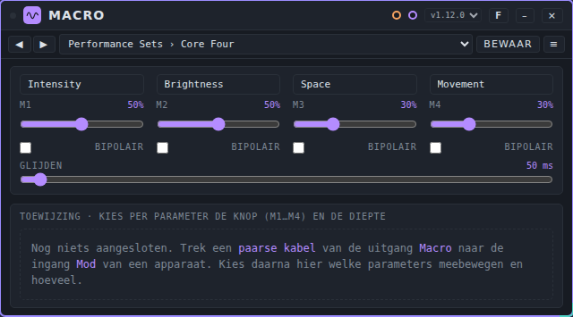
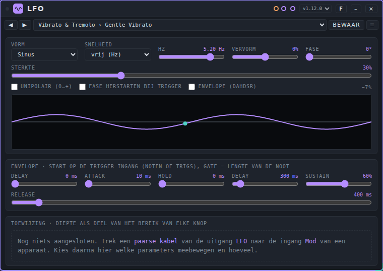
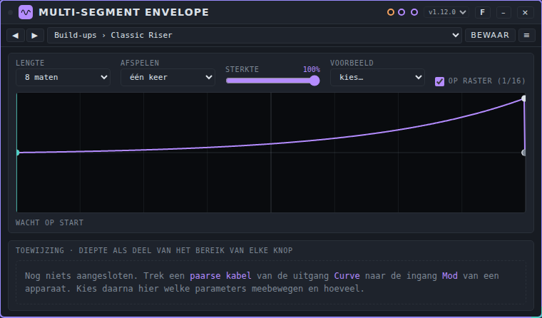
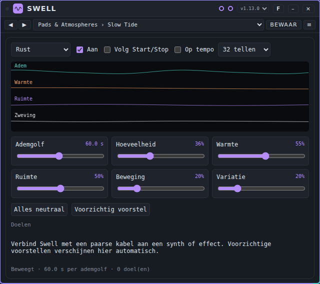
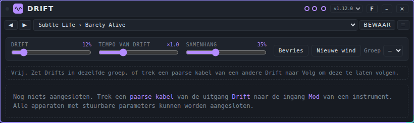
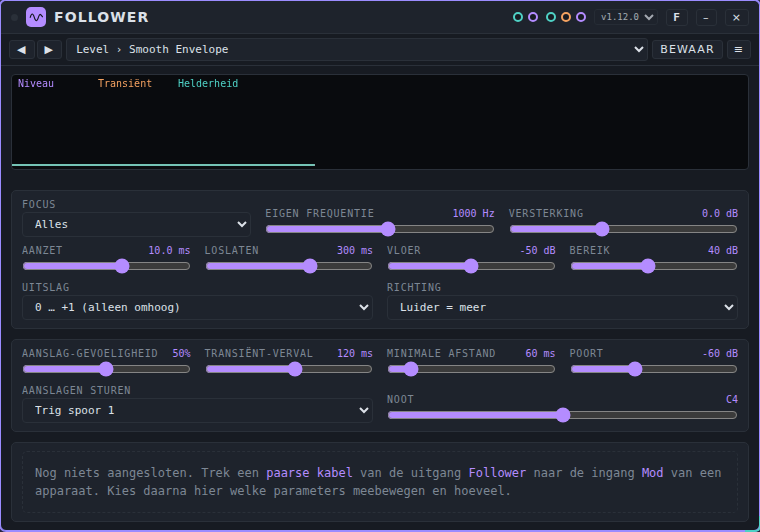

# Modulators: gebruikershandleiding

*English version: [USER-MANUAL_EN.md](USER-MANUAL_EN.md)*

Een modulator is een apparaat dat de regelaars van een ander apparaat laat bewegen terwijl je speelt. Deze pagina legt uit hoe dat werkt en beschrijft de zes modulators die bij Patchkamer horen: **Macro**, **LFO**, **Multi-Segment Envelope**, **Swell**, **Drift** en **Follower**. De basis (Patchkamer openen, een bibliotheek laden, kabels trekken) staat in de [basishandleiding](../USER-MANUAL_NL.md). De map met het apparaat is beschreven in [devices/modulators](../../devices/modulators/README_NL.md).

## Inhoud

1. [Hoe een modulator werkt](#hoe-een-modulator-werkt)
2. [Welke modulator voor welk doel](#welke-modulator-voor-welk-doel)
3. [Macro](#macro)
4. [LFO](#lfo)
5. [Multi-Segment Envelope](#multi-segment-envelope)
6. [Swell](#swell)
7. [Drift](#drift)
8. [Follower](#follower)
9. [Als het niet werkt](#als-het-niet-werkt)

## Hoe een modulator werkt

Een modulator maakt geen geluid. Hij maakt **sturing**: een waarde die in de tijd omhoog en omlaag gaat. Je gebruikt hem om een regelaar van een ander apparaat te laten bewegen, zoals de cutoff van een synth, zonder dat je zelf aan de regelaar draait.

Dat gaat in drie stappen:

1. **Trek een paarse kabel** van de modulatie-uitgang van de modulator naar de **Mod**-ingang van het apparaat dat je wilt laten bewegen. Paarse kabels voeren modulatie. Apparaten met regelaars die kunnen bewegen hebben een **Mod**-ingang.
2. **Kies wat beweegt.** De kaart van de modulator toont nu de regelaars van het andere apparaat, onder een kop met de naam ervan. Per regelaar kies je hoeveel hij beweegt (de **diepte**) en, als de modulator meer dan één signaal heeft (Macro heeft vier knoppen, Follower drie signalen), welk hij volgt. Swell en Drift kiezen op hun eigen manier, beschreven in hun secties.
3. **Speel.** De knop op het andere apparaat blijft staan waar jij hem zette. De modulator beweegt het geluid rond die waarde. Haal je de kabel weg of zet je de diepte op 0, dan staat de regelaar weer op zijn knopwaarde.

De diepte is een deel van het bereik van de regelaar. Bij **+50%** kan de modulator een regelaar ongeveer de helft van zijn bereik omhoog bewegen. Bij **−50%** beweegt hij hem omlaag. Je kunt een modulator op meer dan één apparaat aansluiten, met voor elk eigen toewijzingen.

Een regelaar met het teken **⚡** is *snel*: de modulator stuurt hem met een audiosignaal, sample voor sample. Andere regelaars worden ongeveer 30 keer per seconde bijgewerkt, wat prima is voor langzame bewegingen.

Modulators hebben **presets** (ze maken geen geluid, dus geen tunes). Een preset bewaart de instellingen van de modulator zelf. De toewijzingen van de regelaars horen niet bij een preset. Zie [Presets](../presets/USER-MANUAL_NL.md) voor het gebruiken en delen ervan.

## Welke modulator voor welk doel

| Ik wil… | Gebruik |
|---|---|
| Het volume van het ene geluid een regelaar van een ander apparaat laten bewegen | [Follower](#follower) |
| De klappen van een geluid een drum of een noot op een ander apparaat laten spelen | [Follower](#follower) (poort **Aanslagen**) |
| Een regelaar bewegen met hoeveel hoge frequenties een geluid heeft | [Follower](#follower) (**Helderheid**) |
| Eén knop draaien en veel regelaars (van meerdere apparaten) tegelijk bewegen | [Macro](#macro) |
| Een regelaar in een vast ritme op en neer bewegen (vibrato, tremolo, wobble, gates) | [LFO](#lfo) |
| Een beweging tekenen over 1 tot 64 maten (een opbouw, een break, een sweep over een heel deel) | [Multi-Segment Envelope](#multi-segment-envelope) |
| Het klankveld langzaam en samen laten ademen (pads, drones, ambient) | [Swell](#swell) |
| Een klank levend houden met heel trage, kleine veranderingen rond de knopstand | [Drift](#drift) |

## Macro

### Waar het voor dient

Macro geeft je vier knoppen (**M1** tot **M4**). Elke knop kan een hele groep regelaars tegelijk bewegen, ook op verschillende apparaten. Per regelaar kies je welke knop hem stuurt en hoe ver. Eén hand, vier knoppen, veel regelaars: handig voor een opbouw of als je live speelt. Macro luistert ook naar zijn eventingang **CC**, dus de vier knoppen kunnen van buiten bewogen worden, bijvoorbeeld door [Pad Controller](../tools/USER-MANUAL_NL.md#pad-controller) of een MIDI-controller.

### De regelaars

| Regelaar | Wat hij doet | Bereik (begin) |
|---|---|---|
| Naamveld (boven elke knop) | Een naam voor de knop, voor jezelf. Het verandert niets aan het geluid | tot 24 tekens ("Macro 1" tot "Macro 4") |
| **M1** tot **M4** | De stand van de knop | 0 tot 100% (0%) |
| **BIPOLAIR** (per knop) | Uit: de knop loopt van 0 tot 1. Aan: 50% is het midden; eronder beweegt de knop regelaars omlaag, erboven omhoog (−1 tot +1) | uit |
| **GLIJDEN** | Hoe lang de uitgang erover doet om een knop te volgen als die springt, voor alle vier de knoppen | 0 tot 2 s (0,05 s) |

**De toewijzingen.** Loopt er een paarse kabel naar een ander apparaat, dan toont de kaart de regelaars van dat apparaat onder een kop met zijn naam. Per regelaar zie je een **bron**-lijst (**M1** tot **M4**: welke knop hem stuurt), een **diepte**-schuif van −100% tot +100% (dubbelklik voor 0) en een teken **⚡** als de regelaar snel is. Een zoekveld (**zoek parameter**) en het vinkje **alleen actief** helpen je een regelaar te vinden. Een knop beweegt een regelaar met zijn stand maal de diepte, als deel van het bereik van die regelaar.

### Poorten

| Poort | Soort | Gebruik |
|---|---|---|
| **CC** | events in (oranje) | Beweegt de knoppen van buiten. Hij accepteert een control change met id `m1` tot `m4` (of `macro 1` tot `macro 4`) en een waarde van 0 tot 1. |
| **Macro** | modulatie uit (paars) | De stuursignalen. Sluit aan op de **Mod**-ingang van de apparaten die je wilt laten bewegen. |

### Een voorbeeld: één knop voor een opbouw

1. Plaats een synth met een filter (bijvoorbeeld Acid Baselines), een effect met een **Mix**-regelaar (bijvoorbeeld een reverb), een **Mixer**, **Speakers** en Macro.
2. Trek een paarse kabel van **Macro** naar **Mod** op de synth, en nog een van **Macro** naar **Mod** op de reverb.
3. Kies de preset **Build-ups › Build-up**.
4. Zet onder de kop van de synth **Cutoff** op bron **M1** met diepte **+60%**. Zet onder de reverb de mix op bron **M1** met diepte **+40%**.
5. Druk op **Start** en beweeg **M1** langzaam omhoog: het filter gaat open en de reverbmix gaat samen omhoog. Beweeg je hem terug, dan gaan beide omlaag.

Zet **BIPOLAIR** aan voor een knop die twee kanten op moet: bij 50% beweegt er niets, eronder gaat een regelaar met een positieve diepte omlaag, erboven omhoog.

### Presets

Macro heeft het pack **Macro Basics**: 40 presets in vijf mappen: **Performance Sets**, **Pairs**, **Build-ups**, **Styles** en **Sound Design**. Een paar namen: Core Four, Filter and Resonance, Build-up, Techno Console, Timbre Morph. Het bestand is [`presets/macro.patchkamer-presets.json`](../../presets/macro.patchkamer-presets.json). Laad het vanuit een bibliotheek (zie de basishandleiding) of met de tab **Presets** van de bibliotheek → **Importeren…**, en kies daarna een preset in de lijst op de kaart. Een preset bevat de standen van de knoppen, de namen, welke knoppen bipolair zijn en de glijtijd. De toewijzingen horen niet bij een preset: die maak je zelf.

### Tips en beperkingen

- Een regelaar beweegt pas als het andere apparaat met een paarse kabel is aangesloten en de diepte niet 0 is.
- Een waarde van de ingang **CC** buiten 0 tot 1 wordt tot dat bereik begrensd. Een waarde die geen getal is, wordt genegeerd.
- Macro onthoudt geen MIDI-controllernummers: hij reageert alleen op de id's **m1** tot **m4**.

## LFO

### Waar het voor dient

Een LFO (low-frequency oscillator) is een golf die vanzelf omhoog en omlaag gaat, op het tempo van de klok van de studio. Gebruik hem voor vibrato, tremolo, auto-pan, filtersweeps, wobbles en ritmische gates. Hij heeft acht vormen, loopt op een muzikale snelheid (van 8 maten tot 1/32, ook triolen en punten) of op een vrije snelheid in Hz, en kan zich gedragen als een envelope die bij elke noot start.

### De regelaars

Het beeld in het midden van de kaart toont de golf en een stip met de huidige waarde. Dubbelklik op een schuif om terug te gaan naar de beginwaarde.

| Regelaar | Wat hij doet | Bereik (begin) |
|---|---|---|
| **VORM** | **Sinus**, **Driehoek**, **Zaag op**, **Zaag neer**, **Blok**, **S&H (stappen toeval)** (een nieuwe willekeurige waarde per cyclus), **Glad toeval** (glijdt tussen willekeurige waarden) of **Stappen (zelf tekenen)** | Sinus |
| **SNELHEID** | Hoe lang één cyclus duurt: **8 maten**, **4 maten**, **2 maten**, **1 maat**, tot 1/32, met **triool**- en **punt**-waarden, of **vrij (Hz)** | 1/4 (één tel) |
| **HZ** | De snelheid als **SNELHEID** op **vrij (Hz)** staat | 0,01 tot 20 Hz (1) |
| **VERVORM** | Trekt de vorm scheef. Bij sinus en driehoek schuift het de piek, bij de zagen buigt het de helling, bij blok stelt het de pulsbreedte in, bij glad toeval hoe snel de overgang is. De andere vormen negeren het | −100 tot +100% (0) |
| **FASE** | Waar in de cyclus de LFO begint | 0 tot 360° (0) |
| **STERKTE** | Schaalt de hele beweging | 0 tot 100% (100) |
| **UNIPOLAIR (0…+)** | Aan: de LFO loopt alleen van 0 omhoog, dus een regelaar beweegt alleen omhoog vanaf zijn knopstand (met een negatieve diepte: alleen omlaag). Uit: hij beweegt rond de knopstand | uit |
| **FASE HERSTARTEN BIJ TRIGGER** | Elke gebeurtenis op de ingang **Trigger** zet de LFO terug op het begin van de cyclus | uit |
| **ENVELOPE (DAHDSR)** | De beweging volgt een envelope die start op de ingang **Trigger** | uit |

**Stappen.** Bij de vorm **Stappen (zelf tekenen)** teken je de stappen in de golf. **Aantal stappen** bepaalt hoeveel er meetellen (2 tot 16, begin 16) en **Glijden** hoeveel van elke stap naar de volgende glijdt (0 tot 100%).

**De envelope.** Staat **ENVELOPE (DAHDSR)** aan, dan wordt de beweging vermenigvuldigd met een envelope die start bij elke noot of trig op de ingang **Trigger**. De gate is de lengte van de noot. Zonder trigger is de uitgang 0, dus zo'n preset beweegt pas als er noten of trigs binnenkomen.

| Regelaar | Wat hij doet | Bereik (begin) |
|---|---|---|
| **DELAY** | Wachttijd voordat de envelope start | 0 tot 2 s (0) |
| **ATTACK** | Tijd om omhoog te gaan | 1 ms tot 4 s (10 ms) |
| **HOLD** | Tijd op de top | 0 tot 2 s (0) |
| **DECAY** | Tijd om te zakken naar het sustain-niveau | 1 ms tot 4 s (300 ms) |
| **SUSTAIN** | Het niveau zolang de noot duurt | 0 tot 100% (60%) |
| **RELEASE** | Tijd om te zakken nadat de noot eindigt | 1 ms tot 6 s (400 ms) |

**De toewijzingen** werken zoals bij Macro: een kop met de naam van het andere apparaat, per regelaar een **diepte**-schuif van −100% tot +100% en een teken **⚡** voor snelle regelaars, plus **zoek parameter** en **alleen actief**. Er is één bron, dus geen bronlijst.

### Poorten

| Poort | Soort | Gebruik |
|---|---|---|
| **Trigger** | events in (oranje) | Noten of trigs die de fase herstarten of de envelope starten. |
| **LFO** | modulatie uit (paars) | Het stuursignaal. Sluit aan op de **Mod**-ingang van het apparaat dat je wilt laten bewegen. |

### Een voorbeeld: een wobble op een bas

1. Plaats Acid Baselines, een **Mixer**, **Speakers** en een LFO.
2. Trek een paarse kabel van **LFO** naar **Mod** op Acid Baselines.
3. Kies de preset **Wobble › Wobble 1/4**.
4. Zet onder **→ Acid Baselines** **Cutoff** op diepte **+50%**.
5. Druk op **Start**. De cutoff beweegt één keer per tel rond zijn knopstand, op het tempo van de klok. Zet **SNELHEID** op 1/8 voor een snellere wobble.

Kies voor een vibrato **Vibrato & Tremolo › Gentle Vibrato** en geef de toonhoogte-regelaar van een synth een kleine diepte.

### Presets

LFO heeft het pack **LFO Basics**: 60 presets in tien mappen: **Vibrato & Tremolo**, **Pan & Space**, **Filter Sweeps**, **Wobble**, **Rhythmic Gates**, **Step Patterns**, **Generative**, **Slow & Ambient**, **Trigger Envelopes** en **By Genre**. Een paar namen: Gentle Vibrato, Slow Auto-Pan, Wobble 1/4, Trance Gate, Pluck Envelope. Het bestand is [`presets/lfo.patchkamer-presets.json`](../../presets/lfo.patchkamer-presets.json). Laad het vanuit een bibliotheek of met de tab **Presets** van de bibliotheek → **Importeren…**. Een preset bevat de vorm, snelheid, vervorming, fase, sterkte, de stappen en de envelope-instellingen, niet de toewijzingen.

### Tips en beperkingen

- De LFO volgt de klok, ook als de klok stilstaat (op het tempo van de host). Twee LFO's met dezelfde snelheid lopen precies gelijk.
- Presets voor toonhoogte hebben bewust een lage **STERKTE**: een volle diepte op een toonhoogte-regelaar klinkt vals.
- De presets in de map **Trigger Envelopes** bewegen pas als er noten of trigs binnenkomen op de ingang **Trigger**.

## Multi-Segment Envelope

### Waar het voor dient

Met de Multi-Segment Envelope teken je een curve over 1 tot 64 maten en laat je hem regelaars van andere apparaten bewegen. Zo maak je een opbouw, een break, een pomp of een langzame sweep over een heel deel van het nummer. De curve kan herhalen op de maten van de klok, of één keer lopen vanaf Start of vanaf een trigger.

### De regelaars

**Tekenen.** Klik in de curve om een punt te maken, sleep een punt om het te verplaatsen, dubbelklik op een punt om het weg te halen en Shift + sleep op een stuk lijn om het te krommen. Een lijn die bij een punt begint heeft zijn eigen kromming. Twee punten op dezelfde plek in de tijd maken een sprong (trappen, gates, zaagtanden). De lijn in het midden van het beeld is 0: de rustwaarde, waar de knop van het andere apparaat blijft staan.

| Regelaar | Wat hij doet | Bereik (begin) |
|---|---|---|
| **LENGTE** | De lengte van de curve | 1, 2, 4, 8, 16, 32 of 64 maten (16) |
| **AFSPELEN** | **herhalen**: herhaalt op de maten van de klok. **één keer**: loopt één keer vanaf Start of vanaf een trigger en blijft dan op de eindwaarde staan | herhalen |
| **STERKTE** | Schaalt de hele curve | 0 tot 100% (100) |
| **VOORBEELD** | Vervangt de curve door een voorbeeld: **Opbouw**, **Golf**, **Trap**, **Ademen**, **Break** of **Plat** | kies… |
| **OP RASTER (1/16)** | Alleen voor tekenen met de muis: punten springen op een raster. Het verandert het geluid niet | aan |

Een regel onder de curve toont de positie (**maat 3 van 8**), of **wacht op start** als de curve in de stand **één keer** nog niet is gestart.

**De toewijzingen** werken zoals bij LFO: per regelaar een **diepte**-schuif van −100% tot +100%, een teken **⚡** voor snelle regelaars, **zoek parameter** en **alleen actief**. De waarde van de curve maal de diepte wordt opgeteld bij de knopstand van de regelaar, als deel van zijn bereik. Een negatieve diepte zet de curve op zijn kop.

### Poorten

| Poort | Soort | Gebruik |
|---|---|---|
| **Trigger** | events in (oranje) | Start de curve als **AFSPELEN** op **één keer** staat. |
| **Curve** | modulatie uit (paars) | Het stuursignaal. Sluit aan op de **Mod**-ingang van het apparaat dat je wilt laten bewegen. |

### Een voorbeeld: een opbouw van 8 maten

1. Plaats een synth met een filter, een **Mixer**, **Speakers** en de Multi-Segment Envelope.
2. Trek een paarse kabel van **Curve** naar **Mod** op de synth.
3. Kies de preset **Build-ups › Classic Riser** (lengte 8 maten, **één keer**).
4. Zet onder de kop van de synth **Cutoff** op diepte **+60%**.
5. Druk op **Start**. De curve loopt één keer over 8 maten en het filter gaat steeds verder open. Na de laatste maat blijft hij op de eindwaarde staan. Druk op Stop en Start om hem opnieuw te laten lopen, of stuur een trigger naar de ingang **Trigger**.

### Presets

Het pack **Multi-Segment Envelope Presets** heeft 54 presets in negen mappen: **Build-ups**, **Drops & Breaks**, **Filter Sweeps**, **Steps**, **Breathing & Swells**, **Gates & Ratchets**, **Pumps & Plucks**, **Generative & Ambient** en **By Style**. Een paar namen: Classic Riser, Tape Stop, Triangle Sweep, Trance Gate, Slow Drift. Het bestand is [`presets/mseg.patchkamer-presets.json`](../../presets/mseg.patchkamer-presets.json). Laad het vanuit een bibliotheek of met de tab **Presets** van de bibliotheek → **Importeren…**. Een preset bevat de curve, de lengte, de afspeelstand en de sterkte, niet de toewijzingen.

### Tips en beperkingen

- De curve loopt altijd het volle bereik van −1 tot +1, dus met een hoge diepte beweegt hij een regelaar ver. Zet **STERKTE** lager voor een subtiele beweging.
- Een sprong precies op het einde van de curve wordt nooit uitgevoerd (het einde is ook het begin van de volgende ronde). Zet hem een klein stukje voor het einde als de curve na een opbouw naar 0 moet vallen.
- In de stand **herhalen** is de curve vast aan de maten van de klok, dus hij blijft in de maat van het nummer.

## Swell

### Waar het voor dient

Swell beweegt meerdere regelaars samen op een langzame, samenhangende manier, als ademhaling. Hij is gemaakt voor pads, drones en ambient: klankvelden die moeten blijven leven zonder dat iemand speelt. Uit één trage golf maakt hij vier gekoppelde banen: **Adem**, **Warmte**, **Ruimte** en **Zweving**. Je vinkt aan welke regelaars van het aangesloten apparaat bewegen en welke baan elk volgt.

### De regelaars

Het beeld toont de vier banen terwijl de beweging loopt.

| Regelaar | Wat hij doet | Bereik (begin) |
|---|---|---|
| **Sfeer** | Een profiel dat de zes schuiven hieronder in één keer zet: **Rust**, **Geborgenheid**, **Nabijheid** of **Euforie** | Rust |
| **Aan** | Beweging aan. Uit: de aangesloten regelaars blijven op hun knopstand | aan |
| **Volg Start/Stop** | Beweegt alleen terwijl de klok loopt | uit |
| **Op tempo** | De golflengte volgt de klok, in tellen, in plaats van in seconden | uit |
| **Tempoverdeling** | De golflengte bij **Op tempo**: 4, 8, 16, 32, 64 of 128 tellen (4 tellen = één maat in 4/4) | 32 tellen |
| **Ademgolf** | De golflengte in seconden (zonder **Op tempo**) | 4 tot 120 s (22) |
| **Hoeveelheid** | Schaalt alle vier de banen | 0 tot 100% (38) |
| **Warmte** | De vaste stand van de baan **Warmte**: 50% is neutraal | 0 tot 100% (62) |
| **Ruimte** | De vaste stand van de baan **Ruimte** | 0 tot 100% (45) |
| **Beweging** | Hoeveel de banen **Warmte**, **Ruimte** en **Zweving** zelf meebewegen | 0 tot 100% (22) |
| **Variatie** | Een tragere, onregelmatige golf over de banen, zodat de beweging zich niet precies herhaalt | 0 tot 100% (12) |
| **Alles neutraal** | Zet de beweging uit (hetzelfde als **Aan** uit) | |
| **Voorzichtig voorstel** | Vult voorzichtige beginwaarden in voor alle aangesloten apparaten | |

**De doelen.** Is Swell aangesloten, dan toont de kaart de regelaars van het andere apparaat. Vink een regelaar aan, kies welke baan hij volgt en stel zijn **bereik** in: een deel van het bereik van de regelaar tot 20%; een negatief bereik keert de richting om. Swell stelt waarden voor bij veelvoorkomende regelaars als een apparaat wordt aangesloten: een filter-cutoff volgt bijvoorbeeld **Warmte** omlaag, een reverbmix volgt **Ruimte**, een pan volgt **Zweving**. Alle andere regelaars staan eerst uit. De beweging wordt gladgestreken en ongeveer 25 keer per seconde verstuurd.

### Poorten

| Poort | Soort | Gebruik |
|---|---|---|
| **Swell** | modulatie uit (paars) | De stuursignalen. Sluit aan op de **Mod**-ingang van een synth of effect. Swell heeft geen andere poorten. |

### Een voorbeeld: een pad die ademt

1. Plaats een padsynth, een reverb, een **Mixer**, **Speakers** en Swell.
2. Trek een paarse kabel van **Swell** naar **Mod** op de padsynth, en nog een naar **Mod** op de reverb.
3. Kies de preset **Pads & Atmospheres › Slow Tide** (een golf van 60 seconden).
4. Druk op **Voorzichtig voorstel** voor beginwaarden, vink daarna regelaars aan of uit en pas hun **bereik** aan.
5. Speel een lang akkoord. De aangevinkte regelaars bewegen langzaam en samen. Verhoog **Hoeveelheid** voor meer beweging; het resultaat blijft klein omdat de bereiken tot 20% beperkt zijn.

Voor beweging op het tempo van het nummer zet je **Op tempo** en **Volg Start/Stop** aan en kies je 16 of 32 tellen.

### Presets

Het pack **Swell Presets** heeft 55 presets in acht mappen: **Pads & Atmospheres**, **Warm & Close**, **Bright & Open**, **Tempo Synced**, **Subtle & Natural**, **Big & Expressive**, **Generative & Evolving** en **By Application**. Een paar namen: Slow Tide, Warm Blanket, Four Bar Swell, Barely There, Pad Breath. Het bestand is [`presets/swell.patchkamer-presets.json`](../../presets/swell.patchkamer-presets.json). Laad het vanuit een bibliotheek of met de tab **Presets** van de bibliotheek → **Importeren…**. Een preset bevat de sfeer, de schakelaars en de zes schuiven. De aangevinkte doelen horen niet bij een preset: die blijven staan zoals jij ze hebt ingesteld.

### Tips en beperkingen

- Swell beweegt regelaars met hoogstens 20% van hun bereik. Dat is bewust: de beweging moet je voelen, niet als effect horen.
- Een heel trage golf is hier het karakter: bij de presets van 60 seconden duurt één ademhaling een minuut.
- Swell heette in eerdere versies Deining. Een werkruimte of preset uit die tijd verwijst naar de oude id en laadt niet in Swell.

## Drift

### Waar het voor dient

Drift laat de regelaars die je aanvinkt op aangesloten apparaten heel langzaam rond hun knopstand zwerven, zodat een klank blijft variëren. Hij speelt geen noten en maakt geen geluid. De knop die je instelt blijft de basis; Drift beweegt eromheen. Het zwerven is heel traag: bij tempo ×1 periodes van ongeveer een halve minuut tot ruim twintig minuten.

### De regelaars

| Regelaar | Wat hij doet | Bereik (begin) |
|---|---|---|
| **DRIFT** | Hoe ver de regelaars zwerven, als deel van wat je per regelaar toestaat | 0 tot 100% (60%) |
| **TEMPO VAN DRIFT** | Hoe snel de drifttijd loopt. ×1 is de trage standaard; ×4 is vier keer zo snel, ×0,25 vier keer zo langzaam | ×0,25 tot ×32 (×1) |
| **SAMENHANG** | 0%: elke regelaar heeft zijn eigen wind. 100%: regelaars met dezelfde rol (alle filters, alle toonhoogtes) bewegen samen, ook over apparaten heen | 0 tot 100% (35%) |
| **Bevries** | Houdt alle beweging vast op de huidige stand (de knop heet dan **Bevroren**) | |
| **Nieuwe wind** | Kiest een nieuwe, andere beweging | |
| **Groep** | Drifts in dezelfde groep (**A** tot **D**) delen klok, tempo, sterkte, samenhang en wind. **–** is geen groep | – |

**Volgen.** Trek een paarse kabel van een andere Drift naar de ingang **Volg** en deze Drift neemt de klok en de wind van die ander over. Een lijst **Volgen** bepaalt dan hoe: **gelijk**, **gespiegeld** of **verschoven**. Een schuif **Eigen** mengt een deel eigen beweging door de gedeelde (0 tot 100%). Zonder groep of master heeft **Eigen** geen effect. Een regel onder de regelaars toont de toestand: vrij, in een groep of volgend.

**De toewijzingen.** Is Drift aangesloten, dan toont de kaart de regelaars van het andere apparaat in groepen. Vink een regelaar aan om hem te laten driften en stel zijn **bereik** in: de maximale afwijking, tot ±50% van het bereik van de knop. Per spoor met regelaars zijn er schakelaars om alles aan of uit te zetten, het spoor te bevriezen en het een nieuwe wind te geven. Een klein beeld toont de beweging van elke groep.

### Poorten

| Poort | Soort | Gebruik |
|---|---|---|
| **Volg** | modulatie in (paars) | De uitgang **Drift** van een andere Drift: deze volgt hem. |
| **Drift** | modulatie uit (paars) | De stuursignalen. Sluit aan op de **Mod**-ingang van het apparaat dat je wilt laten bewegen. |

### Een voorbeeld: een synth die nooit stilstaat

1. Plaats een synth, een **Mixer**, **Speakers** en Drift.
2. Trek een paarse kabel van **Drift** naar **Mod** op de synth.
3. Kies de preset **Subtle Life › Gentle Life**.
4. Vink de regelaars aan die mogen zwerven (bijvoorbeeld de filter-cutoff en de detune) en houd het **bereik** klein, rond 5 tot 10%.
5. Speel de synth. Na ongeveer een minuut is de klank een beetje verschoven. Druk op **Nieuwe wind** voor een andere beweging.

Voor een ensemble dat samen drift zet je twee Drifts in groep **A**, of trek je een kabel van de ene uitgang **Drift** naar de ingang **Volg** van de andere.

### Presets

Het pack **Drift Presets** heeft 44 presets in zeven mappen: **Subtle Life**, **Slow Evolution**, **Wide Wander**, **Restless**, **Together & Apart**, **Per Style** en **Group Ensembles**. Een paar namen: Barely Alive, Glacial, Wide Wander, Shared Breath, Ambient Bed. Het bestand is [`presets/drift.patchkamer-presets.json`](../../presets/drift.patchkamer-presets.json). Laad het vanuit een bibliotheek of met de tab **Presets** van de bibliotheek → **Importeren…**. Een preset bevat alleen de wind: de sterkte, het tempo, de samenhang en het zaad (en **Eigen** met zijn zaad). De aangevinkte regelaars, de groep en de volgwijze blijven zoals ze zijn.

### Tips en beperkingen

- Elke preset heeft een eigen zaad, dus presets die verder gelijk zijn bewegen toch anders. Een andere preset kiezen kan de regelaar één keer naar een nieuwe stand laten springen.
- Een Drift in een groep deelt zijn instellingen met de andere leden: een preset op één lid verandert de hele groep.
- Twee Drifts met hetzelfde zaad en dezelfde klok bewegen precies samen, zonder berichten uit te wisselen.

## Follower

### Waar het voor dient

Follower luistert naar een geluid en maakt er sturing van. Uit één audio-ingang maakt hij drie signalen:

- **Niveau**: hoe luid het geluid is.
- **Transiënt**: een korte piek bij elke klap (aanslag).
- **Helderheid**: hoeveel hoge frequenties er in het geluid zitten.

Voor elke regelaar die je op een ander apparaat laat bewegen, kies je welk van de drie signalen hij volgt en hoe diep. Bij elke aanslag stuurt Follower ook een trig of een noot uit zijn poort **Aanslagen**, zodat een drum of een synth kan meespelen met een ander geluid. Het geluid zelf gaat ongewijzigd door.

### De regelaars

Dubbelklik op een schuif om terug te gaan naar de beginwaarde. Klik op het getal om een waarde te typen. De kaart toont een klein beeld met de drie signalen (**Niveau**, **Transiënt** en **Helderheid**) zolang er geluid binnenkomt.

**Het niveausignaal**

| Regelaar | Wat hij doet | Bereik (begin) |
|---|---|---|
| **FOCUS** | Naar welk deel van het geluid hij luistert: **Alles**, **Laag (kick, bas)**, **Midden (snare, stem)**, **Hoog (hats)** of **Eigen frequentie** | Alles |
| **EIGEN FREQUENTIE** | De frequentie waar hij naar luistert als **FOCUS** op **Eigen frequentie** staat | 40 tot 16000 Hz (1000) |
| **VERSTERKING** | Versterkt het geluid vóór het gemeten wordt | −24 tot +36 dB (0) |
| **AANZET** | Hoe snel het niveausignaal omhoog gaat | 0,1 tot 200 ms (5) |
| **LOSLATEN** | Hoe snel het niveausignaal omlaag komt | 5 tot 3000 ms (150) |
| **VLOER** | Het niveau dat 0 geeft | −90 tot −10 dB (−50) |
| **BEREIK** | Het aantal dB tussen 0 en 1 | 6 tot 80 dB (40) |
| **UITSLAG** | **0 … +1 (alleen omhoog)** of **−1 … +1 (rond het midden)** | 0 … +1 |
| **RICHTING** | **Luider = meer** of **Luider = minder (omgekeerd)** | Luider = meer |

**De aanslagen**

| Regelaar | Wat hij doet | Bereik (begin) |
|---|---|---|
| **AANSLAG-GEVOELIGHEID** | Hoe makkelijk een aanslag wordt opgemerkt | 0 tot 100% (50%) |
| **TRANSIËNT-VERVAL** | Hoe lang het signaal **Transiënt** na een aanslag nodig heeft om te zakken | 10 tot 1000 ms (120) |
| **MINIMALE AFSTAND** | De kortste tijd tussen twee aanslagen | 10 tot 500 ms (60) |
| **POORT** | Onder dit niveau zijn er geen aanslagen en geen niveau | −90 tot −10 dB (−60) |
| **AANSLAGEN STUREN** | Wat een aanslag stuurt: **Trig spoor 1** tot **Trig spoor 8**, of **Noot** | Trig spoor 1 |
| **NOOT** | Het nootnummer dat verstuurd wordt als **AANSLAGEN STUREN** op **Noot** staat | 24 tot 96, getoond als nootnaam (C4) |

**De toewijzingen.** Onder de regelaars zie je wat de modulator beweegt. Zolang er geen kabel is aangesloten staat er dat er nog niets is aangesloten. Loopt er een paarse kabel naar een ander apparaat, dan toont de kaart een kop met de naam van dat apparaat, bijvoorbeeld **→ Acid Baselines**, en daaronder de regelaars van dat apparaat in groepen. Per regelaar zie je:

- een **bron**-lijst (**Niveau**, **Transiënt** of **Helderheid**),
- een **diepte**-schuif van −100% tot +100% (dubbelklik voor 0),
- een teken **⚡** als de regelaar snel is.

Een zoekveld (**zoek parameter**) en het vinkje **alleen actief** helpen je een regelaar te vinden. Een groep toont hoeveel regelaars actief zijn.

### Poorten

| Poort | Soort | Gebruik |
|---|---|---|
| **Luistert naar** | audio in (groenblauw) | Het geluid waar hij naar luistert, bijvoorbeeld een drumcomputer. |
| **Door** | audio uit (groenblauw) | Hetzelfde geluid, ongewijzigd. Sluit het aan op je mixer zodat je het blijft horen. |
| **Aanslagen** | events uit (oranje) | Een trig of een noot bij elke aanslag. Sluit aan op een drumcomputer of een synth. |
| **Follower** | modulatie uit (paars) | De stuursignalen. Sluit aan op de **Mod**-ingang van het apparaat dat je wilt laten bewegen. |

### Een voorbeeld: een bas die de drums volgt

1. Plaats een **Drum Machine**, **Follower**, **Acid Baselines**, een **Mixer** en **Speakers**.
2. Verbind **Uit** van de Drum Machine met **Luistert naar** op Follower, en **Door** van Follower met ingang **1** van de Mixer.
3. Verbind **Uit** van Acid Baselines met ingang **2** van de Mixer, en **Uit** van de Mixer met **In** op Speakers.
4. Trek een paarse kabel van **Follower** (op de Follower-kaart) naar **Mod** op Acid Baselines.
5. Kies op de Follower-kaart de preset **Level › Bass Follower**. Die luistert naar het lage deel van de drums.
6. Druk op **Start**. Open onder **→ Acid Baselines** de groep **Bas**, zoek de regelaar **Niveau**, laat de bron op **Niveau** staan en zet de diepte op **−50%**: hoe luider het lage deel van de drums, hoe zachter de bas, en tussen de klappen komt hij terug.
7. Probeer een andere regelaar: **Cutoff** op **+40%** opent het filter van de bas bij elke drumklap.

Een tweede voorbeeld: een synth speelt mee met een ander geluid. Kies de preset **Onsets › Note Follower**, verbind **Aanslagen** met **Noten** op Acid Baselines en zet **intern aan** uit op Acid Baselines. Elke aanslag die binnenkomt op **Luistert naar** speelt nu de noot die je bij **NOOT** hebt ingesteld op de synth. Staat **AANSLAGEN STUREN** op **Trig spoor 1** tot **Trig spoor 8**, dan stuurt Follower een trig voor dat spoor in plaats van een noot.

### Presets

Follower heeft het pack **Follower Basics**: 14 presets in drie mappen. **Level** (Smooth Envelope, Slow Swell, Bass Follower, Voice Follower, Hat Follower, Kick Ducker), **Onsets** (Kick Trigger, Snare Trigger, Hat Trigger, Note Follower) en **Extreme** (Centered Wobble, Gate Slammer, Hair Trigger, Tuned Band Follower). Het bestand is [`presets/follower.patchkamer-presets.json`](../../presets/follower.patchkamer-presets.json). Laad het vanuit een bibliotheek (zie de basishandleiding) of met de tab **Presets** van de bibliotheek → **Importeren…**, en kies daarna een preset in de lijst op de kaart. **Kick Ducker** gebruikt **Luider = minder (omgekeerd)**. Een preset bevat geen toewijzingen: die kies je zelf.

### Tips en beperkingen

- De toewijzingen werken pas als het andere apparaat met een paarse kabel is aangesloten: de lijst met regelaars komt van dat apparaat.
- Ondersteunt je browser geen AudioWorklet, dan gaat het geluid wel door maar stuurt Follower niets. De kaart meldt dat.
- Zeer hoge waarden of niet-getallen van een ander apparaat worden aan de ingang begrensd, zodat één foute waarde niet in Follower blijft hangen.
- **RICHTING** en **UITSLAG** veranderen het signaal voordat de diepte wordt toegepast.

## Als het niet werkt

- **Er beweegt niets.** Controleer of er geluid binnenkomt op **Luistert naar** (het beeld toont de drie signalen), of de paarse kabel loopt van **Follower** naar **Mod** op het andere apparaat, en of er bij minstens één regelaar een diepte ongelijk aan 0 staat. Druk op **Start** zodat het geluid speelt.
- **De lijst met regelaars is leeg.** De kaart meldt "Nog niets aangesloten" tot er een paarse kabel is aangesloten. Controleer of de kabel eindigt op een **Mod**-ingang.
- **Ik hoor het geluid niet meer.** Follower laat geluid door via zijn poort **Door**: sluit die poort aan op de mixer of de speakers, niet **Luistert naar**.
- **De aanslagen worden niet opgemerkt.** Verhoog **AANSLAG-GEVOELIGHEID**, verlaag **POORT**, of kies een andere **FOCUS**. Verlaag **MINIMALE AFSTAND** voor snelle aanslagen.
- **Helemaal geen geluid of gekraak.** Zie de [basishandleiding](../USER-MANUAL_NL.md#13-problemen-oplossen).
