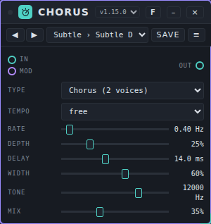
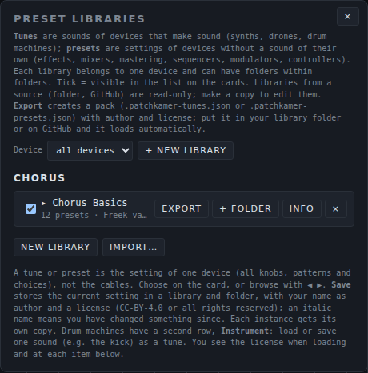
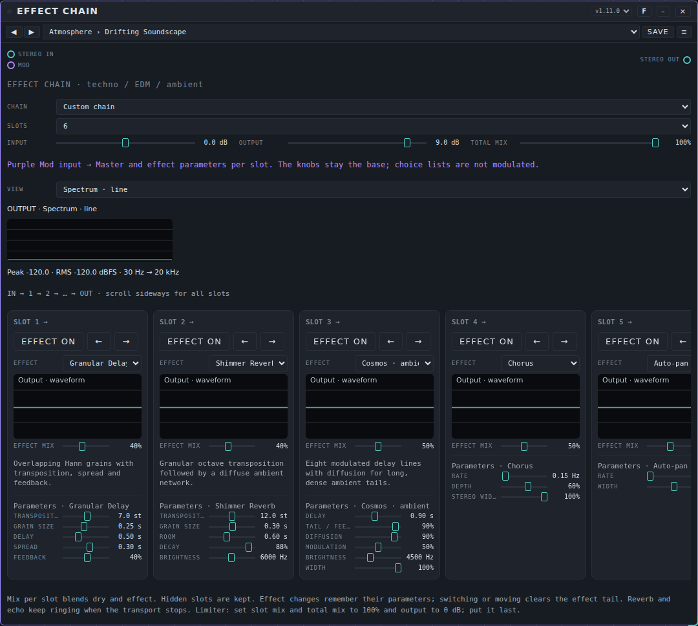

# Presets: user manual

*Nederlandse versie: [USER-MANUAL_NL.md](USER-MANUAL_NL.md)*

A **preset** is a saved setting of one device that makes no sound of its own: an effect, a mixer, a modulator, a sequencer or a tool. You pick a preset from a list on the device's card and every knob and choice moves to the saved value. This page explains how to use presets, how to import, export and share a pack, which packs come with Patchkamer, and how to make your own. Devices that make sound (synths, drum machines) have **tunes** instead: see the [tunes manual](../tunes/USER-MANUAL_EN.md). For the basics of Patchkamer (start, loading a library, cables), see the [main manual](../USER-MANUAL_EN.md).

## Contents

1. [What a preset is](#what-a-preset-is)
2. [Choose a preset on the card](#choose-a-preset-on-the-card)
3. [Save your own preset](#save-your-own-preset)
4. [The Presets menu: libraries and folders](#the-presets-menu-libraries-and-folders)
5. [Import and export a pack](#import-and-export-a-pack)
6. [Share a pack: the file and the license](#share-a-pack-the-file-and-the-license)
7. [The packs that come with Patchkamer](#the-packs-that-come-with-patchkamer)
8. [Effect Chain: complete chains](#effect-chain-complete-chains)
9. [Sequencers: patterns and song starters](#sequencers-patterns-and-song-starters)
10. [Make your own pack](#make-your-own-pack)
11. [If it does not work](#if-it-does-not-work)

## What a preset is

A preset is the **setting of one device**: all its knobs, choices and, where the device has them, its patterns. It does not contain cables, and the sources a mixer channel listens to are not part of it either. Presets are for devices without a sound of their own: effects, mixers, mastering, sequencers, modulators and controllers. Devices that make sound have tunes.

Presets are kept per device. A preset made for Chorus only shows up on a Chorus card. Every card with that device gets its own copy of the values when you load a preset, so changing one Chorus does not change another.

## Choose a preset on the card

Every card that can have presets has a bar under its title with ◀ ▶ buttons, a list, **Save** and a **≡** button. Here is a Chorus with the preset **Subtle › Subtle Double**:



- **The list** shows the presets of all libraries for this device. The list is grouped by library, and each entry is written as *folder › name*. Hover over the list to see the author and license of the current preset.
- **◀ ▶** step to the previous or next preset in the list. They are greyed out when the device has no presets yet; the list then reads "— no presets —".
- **Save** stores the current setting (see below). It lights up when you have changed something since you loaded the preset.
- **≡** opens the **Presets** panel for this device (see [The Presets menu](#the-presets-menu-libraries-and-folders)).
- An asterisk (*) behind the name in the list, and an *italic* name on the card, mean: you changed something since you loaded the preset. The list also marks (⧉) a preset that another card of the same device is using.

If you do not see the bar, switch on **Show the tune and preset bar on the cards** in **Settings**.

To try a preset: place a Chorus, connect it between a source and your speakers, open the list and choose **Subtle › Subtle Double**. Then use ▶ to step through the presets while the sound plays.

## Save your own preset

1. Set the device the way you want it.
2. Click **Save** on the card.
3. In the window that opens, give the preset a **name**. Pick the **library** and **folder** it goes into (or choose **+ New library…** and **+ New folder…**), and fill in the **author** and the **license**: CC-BY-4.0 or all rights reserved.
4. Click **Save**.

If a preset with that name already exists in the folder, it is replaced. Other cards that use it keep their own copy. You can only save into a library that is yours: libraries that come from a source (a GitHub address or a folder on your computer) are read-only. Make a copy first with **Copy** in the Presets panel.

Your own presets are kept in your browser. Export a library to put it in a file (see [Import and export a pack](#import-and-export-a-pack)). **Clear browser storage…** in Settings removes them.

## The Presets menu: libraries and folders

The **Presets** tab of the library window (the **Library** button at the top, or **Presets** in the ☰ menu) shows the **Preset libraries**. It lists the libraries per device. A library belongs to one device and can have folders, and folders can have folders.



| Control | What it does |
|---|---|
| **Device** | Filters the panel on one device. **All devices** shows everything. |
| **New library** | Makes an empty library for the chosen device. |
| **Import…** | Reads a pack from a file (see below). |
| Tick box | A ticked library is visible in the list on the cards. Untick it to hide it without deleting it. |
| Library name | Click it to open or close the library and see its folders and presets. |
| **Export** | Writes the library to a pack file. |
| **+ folder** | Adds a folder at the top level of the library. Every folder in your own libraries has its own **+ folder**, **Name** (rename), a move list and **×**. |
| **Info** | Shows and edits the name, author, license and description of the library. |
| **Copy** | Only on read-only libraries: makes an editable copy of the library. |
| **×** | Deletes the library. The button asks you to click a second time before it deletes. |

Open a library to see its folders and presets. Next to each preset, **Load** puts it on the selected card of that device (otherwise on the first one; if the device is not on the floor yet, it is placed). Presets in your own libraries also have **Name** (rename), a move list and **×**. In a read-only library, a button **→ library name** copies the preset to your own library.

## Import and export a pack

A **pack** is one library in one file, `name.patchkamer-presets.json`.

- **Import:** open the **Presets** tab of the library, click **Import…** and choose one or more pack files. Each pack becomes a library of your own for the device named in the file, so you can edit it. If you already have a library with the same name for that device, the new one gets a number: "Chorus Basics (2)". The device does not have to be on the floor, but the presets only show on a card once that device is placed.
- **Export:** open the **Presets** tab of the library and click **Export** next to a library. Patchkamer saves it as *Device - Library name.patchkamer-presets.json*.
- **Automatically:** a library that you load from GitHub or from a folder brings its pack files along: every `*.patchkamer-presets.json` and `*.patchkamer-tunes.json` in it appears in the panels on its own, as a read-only library. The address `github.com/unboxednl/patchkamer` loads the packs of this repository (see [the main manual](../USER-MANUAL_EN.md#4-load-a-library)).

## Share a pack: the file and the license

A pack is a plain JSON file. You can send it, put it on GitHub or in the library folder of a project. The short version of the format:

```json
{
  "format": "patchkamer-presets",
  "formatVersion": 2,
  "device": "nl.patchkamer.chorus",
  "name": "Chorus Basics",
  "author": "Freek van Gool",
  "license": "CC0-1.0",
  "description": "Starting points for Chorus: …",
  "tree": [
    { "folder": "Subtle", "items": [
      { "name": "Subtle Double", "kind": "set", "version": "1.0.0", "state": { "mode": "chorus", "rate": 0.4 } }
    ] }
  ]
}
```

- `format` is `patchkamer-presets` and `formatVersion` is `2`.
- `device` is the exact id of the device the pack is for. A wrong id gives a pack that belongs to no device.
- `tree` holds **folders** (`folder` with `items`) and presets. A folder can sit in a folder. Every preset has a `name`, `kind: "set"` (the whole setting of the device) and a `state` with the device's own values. Values that the device does not know are ignored; missing values get the starting value.
- Older files with a flat `presets` list can still be imported.

The packs that come with Patchkamer are **CC0-1.0**: public domain. You may use, change and share them without naming the author. The license of a pack of your own is yours to choose when you save and export. The whole `presets/` folder is CC0-1.0; see [LICENSING.md](../../LICENSING.md).

## The packs that come with Patchkamer

This repository has 41 packs with **1902 presets** in total, one per device: 12 for effects (153 presets), 9 for mastering (919), 3 for the mixer (58), 6 for modulators (267), 8 for sequencers (461) and 3 for the tools (44). Each is named after its device ("Chorus Basics", "Chord Sequencer Styles" and so on) and is licensed CC0-1.0. The files have `formatVersion` 2. The names of packs, folders and presets are English. The devices are described in the manuals for [effects](../effects/USER-MANUAL_EN.md), [mastering](../mastering/USER-MANUAL_EN.md), [mixer](../mixer/USER-MANUAL_EN.md), [modulators](../modulators/USER-MANUAL_EN.md), [sequencers](../sequencers/USER-MANUAL_EN.md) and [tools](../tools/USER-MANUAL_EN.md).

### Effects (12)

| Device | Pack | Presets | Folders | File |
|---|---|---|---|---|
| [Chorus](../../devices/effects/Chorus/) | Chorus Basics | 12 | Subtle (3), Ensemble (3), Movement (3), Extreme (3) | [`chorus.patchkamer-presets.json`](../../presets/chorus.patchkamer-presets.json) |
| [Effect Chain](../../devices/effects/EffectChain/) | Effect Chain Basics | 14 | Atmosphere (4), Studio (4), Club (4), Sound Design (2) | [`effect-chain.patchkamer-presets.json`](../../presets/effect-chain.patchkamer-presets.json) |
| [Filter](../../devices/effects/Filter/) | Filter Basics | 14 | Basics (5), Movement (5), Aggressive (4) | [`filter.patchkamer-presets.json`](../../presets/filter.patchkamer-presets.json) |
| [Flanger](../../devices/effects/Flanger/) | Flanger Basics | 12 | Classic (4), Subtle (2), Tempo (2), Extreme (4) | [`flanger.patchkamer-presets.json`](../../presets/flanger.patchkamer-presets.json) |
| [Frequency Shifter](../../devices/effects/FrequencyShifter/) | Frequency Shifter Basics | 13 | Subtle (4), Inharmonic (5), Feedback (4) | [`frequency-shifter.patchkamer-presets.json`](../../presets/frequency-shifter.patchkamer-presets.json) |
| [Grit](../../devices/effects/Grit/) | Grit Basics | 12 | Warm (3), Motion (4), Extreme (5) | [`grit.patchkamer-presets.json`](../../presets/grit.patchkamer-presets.json) |
| [Phaser](../../devices/effects/Phaser/) | Phaser Basics | 11 | Classic (4), Tempo (3), Extreme (4) | [`phaser.patchkamer-presets.json`](../../presets/phaser.patchkamer-presets.json) |
| [Pump](../../devices/effects/Pump/) | Pump Basics | 13 | Clock (6), Sidechain (3), Split and Mix (4) | [`pump.patchkamer-presets.json`](../../presets/pump.patchkamer-presets.json) |
| [Resonator](../../devices/effects/Resonator/) | Resonator Basics | 13 | Subtle (4), Chords (6), Extreme (3) | [`resonator.patchkamer-presets.json`](../../presets/resonator.patchkamer-presets.json) |
| [Room](../../devices/effects/Room/) | Room Basics | 12 | Spaces (4), Delays (4), Space FX (4) | [`room.patchkamer-presets.json`](../../presets/room.patchkamer-presets.json) |
| [Tremolo](../../devices/effects/Tremolo/) | Tremolo Basics | 13 | Classic (4), Slow (3), Rhythmic (3), Extreme (3) | [`tremolo.patchkamer-presets.json`](../../presets/tremolo.patchkamer-presets.json) |
| [Vocoder](../../devices/effects/Vocoder/) | Vocoder Basics | 14 | Voices (4), Textures (4), Extreme (4), External (2) | [`vocoder.patchkamer-presets.json`](../../presets/vocoder.patchkamer-presets.json) |

### Mastering (9)

| Device | Pack | Presets | Folders | File |
|---|---|---|---|---|
| [Balance EQ](../../devices/mastering/BalanceEQ/) | Balance EQ Situations and Styles | 128 | Situations (9), Styles (32), Club (14), Festival (11), Big Room (8), Home / Hi-Fi (14), Headphones (11), Studio / Reference (13), Radio / Broadcast (8), Car (8) | [`balance-eq.patchkamer-presets.json`](../../presets/balance-eq.patchkamer-presets.json) |
| [Bus Compressor](../../devices/mastering/BusCompressor/) | Bus Compressor Situations and Styles | 128 | Situations (9), Styles (32), Club (14), Festival (11), Big Room (8), Home / Hi-Fi (14), Headphones (11), Studio / Reference (13), Radio / Broadcast (8), Car (8) | [`bus-compressor.patchkamer-presets.json`](../../presets/bus-compressor.patchkamer-presets.json) |
| [Listening Output](../../devices/mastering/ListeningOutput/) | Listening Output Levels | 5 | Levels (5) | [`listening-output.patchkamer-presets.json`](../../presets/listening-output.patchkamer-presets.json) |
| [Master Chain](../../devices/mastering/MasterChain/) | Master Chain Situations and Styles | 128 | Situations (9), Styles (32), Club (14), Festival (11), Big Room (8), Home / Hi-Fi (14), Headphones (11), Studio / Reference (13), Radio / Broadcast (8), Car (8) | [`master-chain.patchkamer-presets.json`](../../presets/master-chain.patchkamer-presets.json) |
| [Master Director](../../devices/mastering/MasterDirector/) | Master Director Situations and Styles | 128 | Situations (9), Styles (32), Club (14), Festival (11), Big Room (8), Home / Hi-Fi (14), Headphones (11), Studio / Reference (13), Radio / Broadcast (8), Car (8) | [`master-director.patchkamer-presets.json`](../../presets/master-director.patchkamer-presets.json) |
| [Mix Check](../../devices/mastering/MixCheck/) | Mix Check Monitoring | 18 | Monitoring (9), Situations (9) | [`mix-check.patchkamer-presets.json`](../../presets/mix-check.patchkamer-presets.json) |
| [Multiband Balance](../../devices/mastering/MultibandBalance/) | Multiband Balance Situations and Styles | 128 | Situations (9), Styles (32), Club (14), Festival (11), Big Room (8), Home / Hi-Fi (14), Headphones (11), Studio / Reference (13), Radio / Broadcast (8), Car (8) | [`multiband-balance.patchkamer-presets.json`](../../presets/multiband-balance.patchkamer-presets.json) |
| [Patina](../../devices/mastering/Patina/) | Patina Situations and Styles | 128 | Situations (9), Styles (32), Club (14), Festival (11), Big Room (8), Home / Hi-Fi (14), Headphones (11), Studio / Reference (13), Radio / Broadcast (8), Car (8) | [`patina.patchkamer-presets.json`](../../presets/patina.patchkamer-presets.json) |
| [Stereo Space](../../devices/mastering/StereoSpace/) | Stereo Space Situations and Styles | 128 | Situations (9), Styles (32), Club (14), Festival (11), Big Room (8), Home / Hi-Fi (14), Headphones (11), Studio / Reference (13), Radio / Broadcast (8), Car (8) | [`stereo-space.patchkamer-presets.json`](../../presets/stereo-space.patchkamer-presets.json) |

### Mixer (1)

| Device | Pack | Presets | Folders | File |
|---|---|---|---|---|
| [Audio Output](../../devices/mixer/AudioOutput/) | Audio Output Basics | 16 | Main Out (5), Headphones (4), Interface Pairs (4), Checks (3) | [`audio-output.patchkamer-presets.json`](../../presets/audio-output.patchkamer-presets.json) |
| [Audio Input](../../devices/mixer/AudioInput/) | Audio Input Basics | 31 | Line Level (7), Voice (6), Instruments (6), Interface Channels (8), Utility (4) | [`audio-input.patchkamer-presets.json`](../../presets/audio-input.patchkamer-presets.json) |
| [Leveler](../../devices/mixer/Leveler/) | Leveler Basics | 11 | Sources (6), Mix (4), Utility (1) | [`leveler.patchkamer-presets.json`](../../presets/leveler.patchkamer-presets.json) |

### Modulators (6)

| Device | Pack | Presets | Folders | File |
|---|---|---|---|---|
| [Drift](../../devices/modulators/Drift/) | Drift Presets | 44 | Subtle Life (6), Slow Evolution (6), Wide Wander (6), Restless (6), Together & Apart (6), Per Style (10), Group Ensembles (4) | [`drift.patchkamer-presets.json`](../../presets/drift.patchkamer-presets.json) |
| [Follower](../../devices/modulators/Follower/) | Follower Basics | 14 | Level (6), Onsets (4), Extreme (4) | [`follower.patchkamer-presets.json`](../../presets/follower.patchkamer-presets.json) |
| [LFO](../../devices/modulators/Lfo/) | LFO Basics | 60 | Vibrato & Tremolo (8), Pan & Space (4), Filter Sweeps (7), Wobble (5), Rhythmic Gates (7), Step Patterns (6), Generative (5), Slow & Ambient (6), Trigger Envelopes (6), By Genre (6) | [`lfo.patchkamer-presets.json`](../../presets/lfo.patchkamer-presets.json) |
| [Macro](../../devices/modulators/Macro/) | Macro Basics | 40 | Performance Sets (8), Pairs (8), Build-ups (6), Styles (11), Sound Design (7) | [`macro.patchkamer-presets.json`](../../presets/macro.patchkamer-presets.json) |
| [MSEG](../../devices/modulators/Mseg/) | Multi-Segment Envelope Presets | 54 | Build-ups (8), Drops & Breaks (6), Filter Sweeps (7), Steps (5), Breathing & Swells (5), Gates & Ratchets (7), Pumps & Plucks (6), Generative & Ambient (5), By Style (5) | [`mseg.patchkamer-presets.json`](../../presets/mseg.patchkamer-presets.json) |
| [Swell](../../devices/modulators/Swell/) | Swell Presets | 55 | Pads & Atmospheres (9), Warm & Close (7), Bright & Open (6), Tempo Synced (6), Subtle & Natural (6), Big & Expressive (7), Generative & Evolving (6), By Application (8) | [`swell.patchkamer-presets.json`](../../presets/swell.patchkamer-presets.json) |

### Sequencers (8)

| Device | Pack | Presets | Folders | File |
|---|---|---|---|---|
| [Chord Sequencer](../../devices/sequencers/ChordSequencer/) | Chord Sequencer Styles | 80 | Pop (6), Ballad (5), Cinematic (6), Film Score (5), Ambient (6), Trance (6), Synthwave (6), Lo-fi (5), Neo-classical (5), Deep House (5), Funk & Disco (5), Dynamics (8), Rolls (6), Melodies (6) | [`chord-sequencer.patchkamer-presets.json`](../../presets/chord-sequencer.patchkamer-presets.json) |
| [Clip Arranger](../../devices/sequencers/ClipArranger/) | Clip Arranger Song Starters | 58 | Pop & Rock (7), Electronic Dance (13), Bass Music (7), Hip-Hop & Chill (4), Funk, Soul & Disco (4), Jazz & Blues (5), Reggae & World (4), Ambient & Cinematic (5), Classical & Neo-Classical (4), Retro & Game (5) | [`clip-arranger.patchkamer-presets.json`](../../presets/clip-arranger.patchkamer-presets.json) |
| [Euclidean Rhythms](../../devices/sequencers/EuclideanRhythms/) | Euclidean Rhythms Grooves | 65 | Techno (8), House (7), Afro & Latin (11), Dub & Reggae (6), Drum & Bass and Breakbeat (8), Odd Meters and Polymeters (8), Fills and Rolls (8), Melodic (notes) (9) | [`euclidean-rhythms.patchkamer-presets.json`](../../presets/euclidean-rhythms.patchkamer-presets.json) |
| [Pattern Playlist](../../devices/sequencers/PatternPlaylist/) | Pattern Playlist Arrangements | 35 | Dance Floor (13), Bass Music (6), Hip-hop and Soul (5), Song Forms (5), Ambient and Cinematic (6) | [`pattern-playlist.patchkamer-presets.json`](../../presets/pattern-playlist.patchkamer-presets.json) |
| [Pattern Tracker](../../devices/sequencers/PatternTracker/) | Pattern Tracker Modules | 34 | Module Classics (12), Songwriting Forms (8), World and Latin (7), Electronic Rows (7) | [`pattern-tracker.patchkamer-presets.json`](../../presets/pattern-tracker.patchkamer-presets.json) |
| [Scale Arpeggiator](../../devices/sequencers/ScaleArpeggiator/) | Scale Arpeggiator Patterns | 59 | Classic Patterns (10), Trance and Dance (8), House and Disco (5), Synthwave and Retro (4), Ambient and Cinematic (7), Funk and Jazz (4), Fine Grids and Rolls (7), Dynamics (7), Generative (5), Live Playing (2) | [`scale-arpeggiator.patchkamer-presets.json`](../../presets/scale-arpeggiator.patchkamer-presets.json) |
| [Step Sequencer](../../devices/sequencers/StepSequencer/) | Step Sequencer Patterns | 70 | Bass Lines (14), Arpeggios (12), Drum Triggers (13), Melodic Hooks (17), Long Notes & Pads (6), Polymeter & Feel (8) | [`step-sequencer.patchkamer-presets.json`](../../presets/step-sequencer.patchkamer-presets.json) |
| [Wanderer](../../devices/sequencers/Wanderer/) | Wanderer Melodies | 60 | Lead Lines (9), Basslines (7), Arps and Plucks (8), Ambient and Slow (5), Genre Starters (13), Dynamics (6), Rolls and Ratchets (5), Follow Chord (3), Evolving (4) | [`wanderer.patchkamer-presets.json`](../../presets/wanderer.patchkamer-presets.json) |

### Tools (3)

| Device | Pack | Presets | Folders | File |
|---|---|---|---|---|
| [Control Surface](../../devices/tools/ControlSurface/) | Control Surface Layouts | 20 | Strips (5), Faders (4), Knobs (5), Pads (6) | [`control-surface.patchkamer-presets.json`](../../presets/control-surface.patchkamer-presets.json) |
| [MIDI Hub](../../devices/tools/MidiHub/) | MIDI Hub Basics | 15 | Sound Controllers (6), Wheels and Pedals (5), Effects (3), Utility (1) | [`midi-hub.patchkamer-presets.json`](../../presets/midi-hub.patchkamer-presets.json) |
| [Metronome](../../devices/tools/Metronome/) | Metronome Basics | 9 | Practice (4), Subdivisions (3), Loud (2) | [`metronome.patchkamer-presets.json`](../../presets/metronome.patchkamer-presets.json) |

Mixer, Speakers, Multitrack, Notes, Recorder, Scope and other devices can also have presets, but no pack comes with them yet: save your own with **Save**.

To use them: either load `github.com/unboxednl/patchkamer` as a library (the packs come with it, read-only), or download a file from the [presets folder](../../presets/) and use **Import…**.

## Effect Chain: complete chains

Most packs are a set of starting points for one effect. The **Effect Chain Basics** pack is different. Effect Chain holds up to eight effects one after the other, and **every preset in this pack is a complete chain** of 4 to 8 effects, built for one use: ambient soundscape, cinematic, techno, dub, lo-fi and so on. Each slot has its own effect, its own effect mix and its own settings, and several chains end with a limiter or compressor to keep the level in check.



When you load a preset, the chain list on the card (**Chain**) shows **Custom chain**: the settings are yours to change. The card has its own built-in chains in that list; they are part of the device and not a preset pack.

The 14 chains in four folders. **Slots** is the number of slots in use; **In / out** is the input and output level that the preset sets, in dB. The signal goes through the slots from left to right, slot 1 first:

| Folder | Chain | Built for | Slots | In / out (dB) | Slot effects, from slot 1 to slot 8 |
|---|---|---|---|---|---|
| Atmosphere | **Drifting Soundscape** | ambient soundscape | 6 | 0 / +9 | Granular Delay → Shimmer Reverb → Cosmos · ambient → Chorus → Auto-pan → Stereo Image |
| Atmosphere | **Cinematic Dread** | cinematic dread | 8 | -2 / 0 | Warm saturation → Harmonic Resonators → Ring Modulator → Frequency Echo → Phaser → Reverb → Stereo Image → Limiter · peak |
| Atmosphere | **Psychedelic Trip** | psychedelic sound design | 6 | 0 / +6 | Phaser → Flanger → Tremolo → Frequency Echo → Cosmos · ambient → Auto-pan |
| Atmosphere | **Dream Voice** | a dreamy voice | 7 | 0 / +1 | Compressor → EQ · three bands → Chorus → Ping-pong echo → Reverb → Shimmer Reverb → Stereo Image |
| Studio | **Tape Slapback** | a tape slapback echo | 4 | 0 / 0 | Warm saturation → Ping-pong echo → Filter → Reverb |
| Studio | **Lo-Fi Tape Memory** | lo-fi tape | 5 | 0 / 0 | Digital Crush → Vinyl Dust → Filter → Chorus → Reverb |
| Studio | **Drum Bus Glue** | a drum bus | 5 | 0 / 0 | Compressor → Warm saturation → Multiband Drive → Hybrid Reverb → Limiter · peak |
| Studio | **Dub Chamber** | dub | 6 | -1 / 0 | Warm saturation → Tempo Delay → Ping-pong echo → Auto Filter → Reverb → Compressor |
| Club | **Basement Techno** | basement techno | 7 | 0 / +6 | Filter → Warm saturation → Pumping / Duck → Tempo Delay → Reverb → Multiband Drive → EQ · three bands |
| Club | **Squelch Bus** | a squelchy bass bus | 6 | -3 / -3 | Distortion → Filter → Wobble Filter → Phaser → Tempo Delay → EQ · three bands |
| Club | **Neon Nights** | synthwave | 5 | 0 / +3 | Chorus → Overdrive → Tempo Delay → Shimmer Reverb → Reverb |
| Club | **Trance Ascent** | trance | 7 | 0 / +6 | Trance Gate → Auto Filter → Pumping / Duck → Tempo Delay → Shimmer Reverb → Reverb → Stereo Image |
| Sound Design | **Glitch Lab** | glitch | 4 | 0 / +4 | Beat Stutter → Digital Crush → Frequency Echo → Ping-pong echo |
| Sound Design | **Industrial Warehouse** | industrial | 8 | -6 / +4 | EQ · three bands → Overdrive → Distortion → Multiband Drive → Ring Modulator → Reverb → Frequency Echo → Limiter · peak |

How to use them:

- Put Effect Chain after a source or on a mixer output. It is stereo: **Stereo in** and **Stereo out**.
- Open the list on the card and choose a chain. Move through them with ◀ ▶.
- Set **Total mix** or the **Effect mix** of a slot to taste; every knob stays yours. Use the arrows on a slot to move it, and **Effect on** / **Bypass on** to skip it. Changing the chain this way marks the preset as changed.
- The tempo-based effects (pumping, trance gate, beat stutter, tempo delay, wobble filter) follow the clock of Patchkamer: press Start. In this pack that applies to Dub Chamber, Basement Techno, Squelch Bus, Neon Nights, Trance Ascent and Glitch Lab.
- Some of the effects in the chain run on the main thread of the browser and add a little latency. On a slow computer, use chains with fewer of them, or hide slots.
- The chain levels were set on paper and have not been listened to. Check the loudness with your own source and use **Input**, **Output** and **Total mix**.

## Sequencers: patterns and song starters

A sequencer makes no sound of its own: it sends notes to other devices, which you connect yourself. So a sequencer has presets, not tunes. The 8 sequencer packs hold 461 presets together: Chord Sequencer Styles, Step Sequencer Patterns, Wanderer Melodies, Scale Arpeggiator Patterns, Euclidean Rhythms Grooves, Pattern Playlist Arrangements, Pattern Tracker Modules and Clip Arranger Song Starters. The folders and their sizes are in the table above.

**A preset holds the pattern and the settings, not the working state of the card.** The selected track, the zoom and other things that only describe how you are looking at the device are not part of a preset (for Clip Arranger, the AGENTS.md of the device lists them). It also holds no cables: connect the outputs to your synths yourself, and see the [sequencers manual](../sequencers/USER-MANUAL_EN.md) for how. The synths that go with it are in the [tunes manual](../tunes/USER-MANUAL_EN.md).

**Chord Sequencer Styles** has 80 presets in 14 folders: Pop, Ballad, Cinematic, Film Score, Ambient, Trance, Synthwave, Lo-fi, Neo-classical, Deep House, Funk & Disco, Dynamics, Rolls, Melodies. For example **Pop**: Bright Four, Sunday Drive, Late Night Minor. **Ambient**: Floating Garden, Deep Water, Aurora Drift. According to the description of the pack, the style presets fill all four tracks (chords, bass, pulse and bells) in one key, and all four scenes (main, variation, breakdown and lift). The pack description adds that the newer presets use per-step velocity and length, 1/32 and 1/64 rolls and recorded-note tracks (see the folders **Dynamics**, **Rolls** and **Melodies**).

**Clip Arranger Song Starters** is different from the other packs: its 58 presets are **composition starting configurations per genre**. Each one sets up a handful of tracks with a clear role (drums, bass, chords, pad, arp, lead, percussion, FX), up to eight scenes (intro, verse, chorus, build, drop, break, bridge, outro and so on) with section lengths in bars, a song arrangement in the order that genre uses, and a first usable part in every clip. Load one, then replace the parts with your own. Folders: Pop & Rock (7), Electronic Dance (13), Bass Music (7), Hip-Hop & Chill (4), Funk, Soul & Disco (4), Jazz & Blues (5), Reggae & World (4), Ambient & Cinematic (5), Classical & Neo-Classical (4), Retro & Game (5). For example **Electronic Dance**: Techno Peak-Time, Minimal Techno Groove, Melodic Techno Journey.

**Step Sequencer Patterns** (bass lines, arpeggios, drum triggers, melodic hooks, long notes and polymetric figures) and **Euclidean Rhythms Grooves** are loaded into the device the same way. **Metronome Basics** (tools) holds click settings: bar, beat, eighth and sixteenth clicks at practice, rehearsal and loud levels.

## Make your own pack

**Without an agent.** Place the device, set a sound, click **Save** and choose **+ New library…** to start a library. Repeat for every preset, use folders to sort them, and click **Info** to fill in the author, the license and a description. Then click **Export**. The file is your pack.

**With an AI agent.** An agent can write a pack file directly. Give it:

- the `AGENTS.md` in the device's folder (for example `devices/effects/Chorus/AGENTS.md` or `devices/sequencers/ChordSequencer/AGENTS.md`): it lists the device's id, its values and their ranges;
- [`tunes/AGENTS.md`](../../tunes/AGENTS.md): the file layout and the rules for the license. It is written for tunes; for presets the layout is the same, except that `formatVersion` is `2` and the file is named `name.patchkamer-presets.json` in `presets/`.

Ask the agent to use only values that the device knows, to keep names in English and free of brand names, and to say that it did not listen to the result. Then import the pack, step through it and listen yourself.

## If it does not work

- **The bar is not on the card.** Switch on **Show the tune and preset bar on the cards** in Settings.
- **The list says "— no presets —".** There is no library for this device, or it is unticked in the Presets panel. Import a pack or load a library.
- **I imported a pack but it does not show.** The pack is for another device: its `device` id has to match the card's device. The Presets panel groups libraries per device; check there.
- **Import says "not a Patchkamer tune or preset file".** The file is not a pack, or the JSON is damaged. A pack file without a `device` is refused.
- **I cannot save into a library.** It is read-only (loaded from GitHub or a folder). Make a copy with **Copy** and save there.
- **The preset changed after I loaded it.** The name is in italics: you moved a knob. **Save** stores your version, or choose the preset again to go back.
