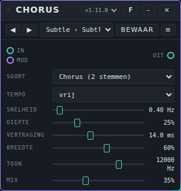
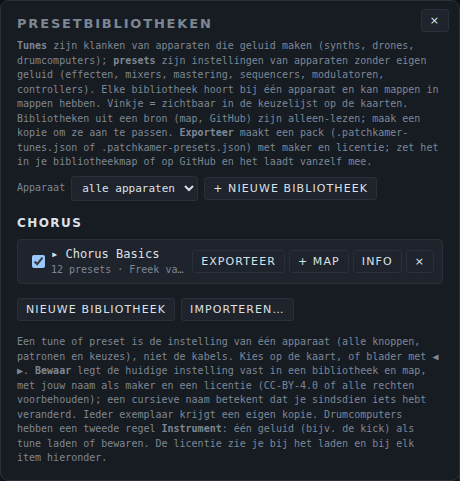
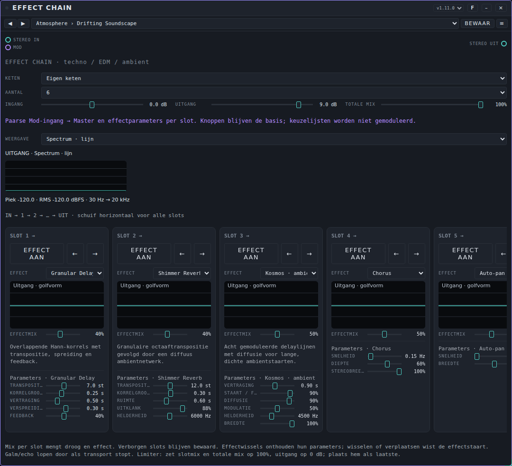

# Presets: gebruikershandleiding

*English version: [USER-MANUAL_EN.md](USER-MANUAL_EN.md)*

Een **preset** is een bewaarde instelling van één apparaat dat geen eigen geluid maakt: een effect, een mixer, een modulator, een sequencer of een tool. Je kiest een preset uit een lijst op de kaart van het apparaat en alle knoppen en keuzes springen naar de bewaarde waarden. Deze pagina legt uit hoe je presets gebruikt, hoe je een pack importeert, exporteert en deelt, welke packs er met Patchkamer meekomen en hoe je een eigen pack maakt. Apparaten die geluid maken (synths, drumcomputers) hebben **tunes**: zie de [handleiding voor tunes](../tunes/USER-MANUAL_NL.md). De basis van Patchkamer (opstarten, een bibliotheek laden, kabels trekken) staat in de [basishandleiding](../USER-MANUAL_NL.md).

## Inhoud

1. [Wat een preset is](#wat-een-preset-is)
2. [Een preset kiezen op de kaart](#een-preset-kiezen-op-de-kaart)
3. [Je eigen preset bewaren](#je-eigen-preset-bewaren)
4. [Het menu Presets: bibliotheken en mappen](#het-menu-presets-bibliotheken-en-mappen)
5. [Een pack importeren en exporteren](#een-pack-importeren-en-exporteren)
6. [Een pack delen: het bestand en de licentie](#een-pack-delen-het-bestand-en-de-licentie)
7. [De packs die met Patchkamer meekomen](#de-packs-die-met-patchkamer-meekomen)
8. [Effect Chain: complete ketens](#effect-chain-complete-ketens)
9. [Sequencers: patronen en songstarters](#sequencers-patronen-en-songstarters)
10. [Een eigen pack maken](#een-eigen-pack-maken)
11. [Als het niet werkt](#als-het-niet-werkt)

## Wat een preset is

Een preset is de **instelling van één apparaat**: alle knoppen en keuzes en, als het apparaat ze heeft, de patronen. Kabels zitten er niet in, en de bronnen waar een mengkanaal naar luistert ook niet. Presets zijn voor apparaten zonder eigen geluid: effecten, mixers, mastering, sequencers, modulatoren en controllers. Apparaten die geluid maken hebben tunes.

Presets horen bij één apparaat. Een preset die voor Chorus is gemaakt, zie je alleen op een Chorus-kaart. Elke kaart met dat apparaat krijgt bij het laden een eigen kopie van de waarden, dus als je de ene Chorus verandert, verandert de andere niet.

## Een preset kiezen op de kaart

Elke kaart die presets kan hebben, heeft onder de titel een balk met de knoppen ◀ ▶, een lijst, **Bewaar** en een knop **≡**. Hier een Chorus met de preset **Subtle › Subtle Double**:



- **De lijst** toont de presets van alle bibliotheken voor dit apparaat. De lijst is gegroepeerd per bibliotheek en elke regel staat er als *map › naam*. Houd de muis boven de lijst om de maker en de licentie van de huidige preset te zien.
- **◀ ▶** gaan naar de vorige of volgende preset in de lijst. Ze zijn grijs als het apparaat nog geen presets heeft; de lijst zegt dan "— nog geen presets —".
- **Bewaar** legt de huidige instelling vast (zie hieronder). De knop licht op als je iets hebt veranderd sinds je de preset laadde.
- **≡** opent het paneel **Presets** voor dit apparaat (zie [Het menu Presets](#het-menu-presets-bibliotheken-en-mappen)).
- Een sterretje (*) achter de naam in de lijst en een *cursieve* naam op de kaart betekenen: je hebt iets veranderd sinds je de preset laadde. In de lijst staat ook een (⧉) bij een preset die een andere kaart van hetzelfde apparaat gebruikt.

Zie je de balk niet, zet dan **Tune- en presetbalk op de kaarten tonen** aan bij **Instellingen**.

Zelf proberen: plaats een Chorus, zet hem tussen een bron en je speakers, open de lijst en kies **Subtle › Subtle Double**. Blader daarna met ▶ door de presets terwijl het geluid speelt.

## Je eigen preset bewaren

1. Stel het apparaat in zoals je wilt.
2. Klik op **Bewaar** op de kaart.
3. Geef in het venster dat opent de preset een **naam**. Kies de **bibliotheek** en de **map** waar hij in komt (of kies **+ Nieuwe bibliotheek…** en **+ Nieuwe map…**) en vul de **maker** en de **licentie** in: CC-BY-4.0 of alle rechten voorbehouden.
4. Klik op **Bewaar**.

Bestaat er al een preset met die naam in de map, dan wordt hij vervangen. Andere kaarten die hem gebruiken houden hun eigen kopie. Je kunt alleen bewaren in een bibliotheek die van jou is: bibliotheken uit een bron (een GitHub-adres of een map op je computer) zijn alleen-lezen. Maak eerst een kopie met **Kopie** in het paneel Presets.

Je eigen presets worden in je browser onthouden. Exporteer een bibliotheek om hem in een bestand te zetten (zie [Een pack importeren en exporteren](#een-pack-importeren-en-exporteren)). **Browsergeheugen wissen…** bij Instellingen haalt ze weg.

## Het menu Presets: bibliotheken en mappen

Het menu **Presets ▾** bovenaan opent het paneel **Presetbibliotheken**. Het toont de bibliotheken per apparaat. Een bibliotheek hoort bij één apparaat en kan mappen hebben, en mappen kunnen weer mappen hebben.



| Regelaar | Wat hij doet |
|---|---|
| **Apparaat** | Filtert het paneel op één apparaat. **alle apparaten** toont alles. |
| **Nieuwe bibliotheek** | Maakt een lege bibliotheek voor het gekozen apparaat. |
| **Importeren…** | Leest een pack uit een bestand (zie hieronder). |
| Vinkje | Een aangevinkte bibliotheek is zichtbaar in de lijst op de kaarten. Haal het vinkje weg om hem te verbergen zonder hem te verwijderen. |
| Naam van de bibliotheek | Klik erop om de bibliotheek open of dicht te klappen en zijn mappen en presets te zien. |
| **Exporteer** | Schrijft de bibliotheek naar een packbestand. |
| **+ Map** | Voegt een map toe op het hoogste niveau van de bibliotheek. In je eigen bibliotheken heeft elke map zelf **+ Map**, **Naam** (hernoemen), een verplaatslijst en **×**. |
| **Info** | Toont en wijzigt de naam, de maker, de licentie en de omschrijving van de bibliotheek. |
| **Kopie** | Alleen bij alleen-lezen bibliotheken: maakt een aanpasbare kopie van de bibliotheek. |
| **×** | Verwijdert de bibliotheek. De knop vraagt om een tweede klik voordat hij verwijdert. |

Open een bibliotheek om zijn mappen en presets te zien. Naast elke preset zet **Laden** hem op de geselecteerde kaart van dat apparaat (anders op de eerste; staat het apparaat nog niet op de vloer, dan wordt het geplaatst). Presets in je eigen bibliotheken hebben ook **Naam** (hernoemen), een verplaatslijst en **×**. In een alleen-lezen bibliotheek kopieert een knop **→ naam van de bibliotheek** de preset naar je eigen bibliotheek.

## Een pack importeren en exporteren

Een **pack** is één bibliotheek in één bestand, `naam.patchkamer-presets.json`.

- **Importeren:** open **Presets ▾**, klik op **Importeren…** en kies een of meer packbestanden. Elk pack wordt een eigen bibliotheek van jou voor het apparaat dat in het bestand staat, dus je kunt hem aanpassen. Heb je al een bibliotheek met dezelfde naam voor dat apparaat, dan krijgt de nieuwe een nummer: "Chorus Basics (2)". Het apparaat hoeft niet op de vloer te staan, maar de presets verschijnen pas op een kaart zodra dat apparaat is geplaatst.
- **Exporteren:** open **Presets ▾** en klik op **Exporteer** naast een bibliotheek. Patchkamer bewaart hem als *Apparaat - Naam van de bibliotheek.patchkamer-presets.json*.
- **Vanzelf:** een bibliotheek die je van GitHub of uit een map laadt, brengt zijn packbestanden mee: elk `*.patchkamer-presets.json` en `*.patchkamer-tunes.json` erin verschijnt vanzelf in de panelen, als alleen-lezen bibliotheek. Het adres `github.com/unboxednl/patchkamer` laadt de packs van deze repository (zie [de basishandleiding](../USER-MANUAL_NL.md#4-een-bibliotheek-laden)).

## Een pack delen: het bestand en de licentie

Een pack is een gewoon JSON-bestand. Je kunt het sturen, op GitHub zetten of in de bibliotheekmap van een project leggen. Het formaat in het kort:

```json
{
  "format": "patchkamer-presets",
  "formatVersion": 2,
  "device": "nl.patchkamer.chorus",
  "name": "Chorus Basics",
  "author": "Freek van Gool",
  "license": "CC0-1.0",
  "description": "Starting points for Chorus: …",
  "tree": [
    { "folder": "Subtle", "items": [
      { "name": "Subtle Double", "kind": "set", "version": "1.0.0", "state": { "mode": "chorus", "rate": 0.4 } }
    ] }
  ]
}
```

- `format` is `patchkamer-presets` en `formatVersion` is `2`.
- `device` is de exacte id van het apparaat waar het pack voor is. Een verkeerde id geeft een pack dat bij geen enkel apparaat hoort.
- `tree` bevat **mappen** (`folder` met `items`) en presets. Een map kan in een map zitten. Elke preset heeft een `name`, `kind: "set"` (de hele instelling van het apparaat) en een `state` met de eigen waarden van het apparaat. Waarden die het apparaat niet kent, worden genegeerd; ontbrekende waarden krijgen de beginwaarde.
- Oudere bestanden met een platte lijst `presets` kun je nog steeds importeren.

De packs die met Patchkamer meekomen zijn **CC0-1.0**: publiek domein. Je mag ze gebruiken, aanpassen en delen zonder de maker te noemen. De licentie van een eigen pack kies je zelf bij het bewaren en exporteren. De hele map `presets/` is CC0-1.0; zie [LICENSING.md](../../LICENSING.md).

## De packs die met Patchkamer meekomen

Deze repository heeft 39 packs met samen **1867 presets**, één per apparaat: 12 voor effecten (153 presets), 9 voor mastering (919), 3 voor de mixer (58), 6 voor modulatoren (267), 8 voor sequencers (461) en 1 voor de tools (9). Elk pack is genoemd naar zijn apparaat ("Chorus Basics", "Chord Sequencer Styles" enzovoort) en heeft de licentie CC0-1.0. De bestanden hebben `formatVersion` 2. De namen van packs, mappen en presets zijn Engels. De apparaten staan beschreven in de handleidingen voor [effecten](../effects/USER-MANUAL_NL.md), [mastering](../mastering/USER-MANUAL_NL.md), [mixer](../mixer/USER-MANUAL_NL.md), [modulatoren](../modulators/USER-MANUAL_NL.md), [sequencers](../sequencers/USER-MANUAL_NL.md) en [tools](../tools/USER-MANUAL_NL.md).

### Effecten (12)

| Apparaat | Pack | Presets | Mappen | Bestand |
|---|---|---|---|---|
| [Chorus](../../devices/effects/Chorus/) | Chorus Basics | 12 | Subtle (3), Ensemble (3), Movement (3), Extreme (3) | [`chorus.patchkamer-presets.json`](../../presets/chorus.patchkamer-presets.json) |
| [Effect Chain](../../devices/effects/EffectChain/) | Effect Chain Basics | 14 | Atmosphere (4), Studio (4), Club (4), Sound Design (2) | [`effect-chain.patchkamer-presets.json`](../../presets/effect-chain.patchkamer-presets.json) |
| [Filter](../../devices/effects/Filter/) | Filter Basics | 14 | Basics (5), Movement (5), Aggressive (4) | [`filter.patchkamer-presets.json`](../../presets/filter.patchkamer-presets.json) |
| [Flanger](../../devices/effects/Flanger/) | Flanger Basics | 12 | Classic (4), Subtle (2), Tempo (2), Extreme (4) | [`flanger.patchkamer-presets.json`](../../presets/flanger.patchkamer-presets.json) |
| [Frequency Shifter](../../devices/effects/FrequencyShifter/) | Frequency Shifter Basics | 13 | Subtle (4), Inharmonic (5), Feedback (4) | [`frequency-shifter.patchkamer-presets.json`](../../presets/frequency-shifter.patchkamer-presets.json) |
| [Grit](../../devices/effects/Grit/) | Grit Basics | 12 | Warm (3), Motion (4), Extreme (5) | [`grit.patchkamer-presets.json`](../../presets/grit.patchkamer-presets.json) |
| [Phaser](../../devices/effects/Phaser/) | Phaser Basics | 11 | Classic (4), Tempo (3), Extreme (4) | [`phaser.patchkamer-presets.json`](../../presets/phaser.patchkamer-presets.json) |
| [Pump](../../devices/effects/Pump/) | Pump Basics | 13 | Clock (6), Sidechain (3), Split and Mix (4) | [`pump.patchkamer-presets.json`](../../presets/pump.patchkamer-presets.json) |
| [Resonator](../../devices/effects/Resonator/) | Resonator Basics | 13 | Subtle (4), Chords (6), Extreme (3) | [`resonator.patchkamer-presets.json`](../../presets/resonator.patchkamer-presets.json) |
| [Room](../../devices/effects/Room/) | Room Basics | 12 | Spaces (4), Delays (4), Space FX (4) | [`room.patchkamer-presets.json`](../../presets/room.patchkamer-presets.json) |
| [Tremolo](../../devices/effects/Tremolo/) | Tremolo Basics | 13 | Classic (4), Slow (3), Rhythmic (3), Extreme (3) | [`tremolo.patchkamer-presets.json`](../../presets/tremolo.patchkamer-presets.json) |
| [Vocoder](../../devices/effects/Vocoder/) | Vocoder Basics | 14 | Voices (4), Textures (4), Extreme (4), External (2) | [`vocoder.patchkamer-presets.json`](../../presets/vocoder.patchkamer-presets.json) |

### Mastering (9)

| Apparaat | Pack | Presets | Mappen | Bestand |
|---|---|---|---|---|
| [Balance EQ](../../devices/mastering/BalanceEQ/) | Balance EQ Situations and Styles | 128 | Situations (9), Styles (32), Club (14), Festival (11), Big Room (8), Home / Hi-Fi (14), Headphones (11), Studio / Reference (13), Radio / Broadcast (8), Car (8) | [`balance-eq.patchkamer-presets.json`](../../presets/balance-eq.patchkamer-presets.json) |
| [Bus Compressor](../../devices/mastering/BusCompressor/) | Bus Compressor Situations and Styles | 128 | Situations (9), Styles (32), Club (14), Festival (11), Big Room (8), Home / Hi-Fi (14), Headphones (11), Studio / Reference (13), Radio / Broadcast (8), Car (8) | [`bus-compressor.patchkamer-presets.json`](../../presets/bus-compressor.patchkamer-presets.json) |
| [Listening Output](../../devices/mastering/ListeningOutput/) | Listening Output Levels | 5 | Levels (5) | [`listening-output.patchkamer-presets.json`](../../presets/listening-output.patchkamer-presets.json) |
| [Master Chain](../../devices/mastering/MasterChain/) | Master Chain Situations and Styles | 128 | Situations (9), Styles (32), Club (14), Festival (11), Big Room (8), Home / Hi-Fi (14), Headphones (11), Studio / Reference (13), Radio / Broadcast (8), Car (8) | [`master-chain.patchkamer-presets.json`](../../presets/master-chain.patchkamer-presets.json) |
| [Master Director](../../devices/mastering/MasterDirector/) | Master Director Situations and Styles | 128 | Situations (9), Styles (32), Club (14), Festival (11), Big Room (8), Home / Hi-Fi (14), Headphones (11), Studio / Reference (13), Radio / Broadcast (8), Car (8) | [`master-director.patchkamer-presets.json`](../../presets/master-director.patchkamer-presets.json) |
| [Mix Check](../../devices/mastering/MixCheck/) | Mix Check Monitoring | 18 | Monitoring (9), Situations (9) | [`mix-check.patchkamer-presets.json`](../../presets/mix-check.patchkamer-presets.json) |
| [Multiband Balance](../../devices/mastering/MultibandBalance/) | Multiband Balance Situations and Styles | 128 | Situations (9), Styles (32), Club (14), Festival (11), Big Room (8), Home / Hi-Fi (14), Headphones (11), Studio / Reference (13), Radio / Broadcast (8), Car (8) | [`multiband-balance.patchkamer-presets.json`](../../presets/multiband-balance.patchkamer-presets.json) |
| [Patina](../../devices/mastering/Patina/) | Patina Situations and Styles | 128 | Situations (9), Styles (32), Club (14), Festival (11), Big Room (8), Home / Hi-Fi (14), Headphones (11), Studio / Reference (13), Radio / Broadcast (8), Car (8) | [`patina.patchkamer-presets.json`](../../presets/patina.patchkamer-presets.json) |
| [Stereo Space](../../devices/mastering/StereoSpace/) | Stereo Space Situations and Styles | 128 | Situations (9), Styles (32), Club (14), Festival (11), Big Room (8), Home / Hi-Fi (14), Headphones (11), Studio / Reference (13), Radio / Broadcast (8), Car (8) | [`stereo-space.patchkamer-presets.json`](../../presets/stereo-space.patchkamer-presets.json) |

### Mixer (1)

| Apparaat | Pack | Presets | Mappen | Bestand |
|---|---|---|---|---|
| [Audio Output](../../devices/mixer/AudioOutput/) | Audio Output Basics | 16 | Main Out (5), Headphones (4), Interface Pairs (4), Checks (3) | [`audio-output.patchkamer-presets.json`](../../presets/audio-output.patchkamer-presets.json) |
| [Audio Input](../../devices/mixer/AudioInput/) | Audio Input Basics | 31 | Line Level (7), Voice (6), Instruments (6), Interface Channels (8), Utility (4) | [`audio-input.patchkamer-presets.json`](../../presets/audio-input.patchkamer-presets.json) |
| [Leveler](../../devices/mixer/Leveler/) | Leveler Basics | 11 | Sources (6), Mix (4), Utility (1) | [`leveler.patchkamer-presets.json`](../../presets/leveler.patchkamer-presets.json) |

### Modulatoren (6)

| Apparaat | Pack | Presets | Mappen | Bestand |
|---|---|---|---|---|
| [Drift](../../devices/modulators/Drift/) | Drift Presets | 44 | Subtle Life (6), Slow Evolution (6), Wide Wander (6), Restless (6), Together & Apart (6), Per Style (10), Group Ensembles (4) | [`drift.patchkamer-presets.json`](../../presets/drift.patchkamer-presets.json) |
| [Follower](../../devices/modulators/Follower/) | Follower Basics | 14 | Level (6), Onsets (4), Extreme (4) | [`follower.patchkamer-presets.json`](../../presets/follower.patchkamer-presets.json) |
| [LFO](../../devices/modulators/Lfo/) | LFO Basics | 60 | Vibrato & Tremolo (8), Pan & Space (4), Filter Sweeps (7), Wobble (5), Rhythmic Gates (7), Step Patterns (6), Generative (5), Slow & Ambient (6), Trigger Envelopes (6), By Genre (6) | [`lfo.patchkamer-presets.json`](../../presets/lfo.patchkamer-presets.json) |
| [Macro](../../devices/modulators/Macro/) | Macro Basics | 40 | Performance Sets (8), Pairs (8), Build-ups (6), Styles (11), Sound Design (7) | [`macro.patchkamer-presets.json`](../../presets/macro.patchkamer-presets.json) |
| [MSEG](../../devices/modulators/Mseg/) | Multi-Segment Envelope Presets | 54 | Build-ups (8), Drops & Breaks (6), Filter Sweeps (7), Steps (5), Breathing & Swells (5), Gates & Ratchets (7), Pumps & Plucks (6), Generative & Ambient (5), By Style (5) | [`mseg.patchkamer-presets.json`](../../presets/mseg.patchkamer-presets.json) |
| [Swell](../../devices/modulators/Swell/) | Swell Presets | 55 | Pads & Atmospheres (9), Warm & Close (7), Bright & Open (6), Tempo Synced (6), Subtle & Natural (6), Big & Expressive (7), Generative & Evolving (6), By Application (8) | [`swell.patchkamer-presets.json`](../../presets/swell.patchkamer-presets.json) |

### Sequencers (8)

| Apparaat | Pack | Presets | Mappen | Bestand |
|---|---|---|---|---|
| [Chord Sequencer](../../devices/sequencers/ChordSequencer/) | Chord Sequencer Styles | 80 | Pop (6), Ballad (5), Cinematic (6), Film Score (5), Ambient (6), Trance (6), Synthwave (6), Lo-fi (5), Neo-classical (5), Deep House (5), Funk & Disco (5), Dynamics (8), Rolls (6), Melodies (6) | [`chord-sequencer.patchkamer-presets.json`](../../presets/chord-sequencer.patchkamer-presets.json) |
| [Clip Arranger](../../devices/sequencers/ClipArranger/) | Clip Arranger Song Starters | 58 | Pop & Rock (7), Electronic Dance (13), Bass Music (7), Hip-Hop & Chill (4), Funk, Soul & Disco (4), Jazz & Blues (5), Reggae & World (4), Ambient & Cinematic (5), Classical & Neo-Classical (4), Retro & Game (5) | [`clip-arranger.patchkamer-presets.json`](../../presets/clip-arranger.patchkamer-presets.json) |
| [Euclidean Rhythms](../../devices/sequencers/EuclideanRhythms/) | Euclidean Rhythms Grooves | 65 | Techno (8), House (7), Afro & Latin (11), Dub & Reggae (6), Drum & Bass and Breakbeat (8), Odd Meters and Polymeters (8), Fills and Rolls (8), Melodic (notes) (9) | [`euclidean-rhythms.patchkamer-presets.json`](../../presets/euclidean-rhythms.patchkamer-presets.json) |
| [Pattern Playlist](../../devices/sequencers/PatternPlaylist/) | Pattern Playlist Arrangements | 35 | Dance Floor (13), Bass Music (6), Hip-hop and Soul (5), Song Forms (5), Ambient and Cinematic (6) | [`pattern-playlist.patchkamer-presets.json`](../../presets/pattern-playlist.patchkamer-presets.json) |
| [Pattern Tracker](../../devices/sequencers/PatternTracker/) | Pattern Tracker Modules | 34 | Module Classics (12), Songwriting Forms (8), World and Latin (7), Electronic Rows (7) | [`pattern-tracker.patchkamer-presets.json`](../../presets/pattern-tracker.patchkamer-presets.json) |
| [Scale Arpeggiator](../../devices/sequencers/ScaleArpeggiator/) | Scale Arpeggiator Patterns | 59 | Classic Patterns (10), Trance and Dance (8), House and Disco (5), Synthwave and Retro (4), Ambient and Cinematic (7), Funk and Jazz (4), Fine Grids and Rolls (7), Dynamics (7), Generative (5), Live Playing (2) | [`scale-arpeggiator.patchkamer-presets.json`](../../presets/scale-arpeggiator.patchkamer-presets.json) |
| [Step Sequencer](../../devices/sequencers/StepSequencer/) | Step Sequencer Patterns | 70 | Bass Lines (14), Arpeggios (12), Drum Triggers (13), Melodic Hooks (17), Long Notes & Pads (6), Polymeter & Feel (8) | [`step-sequencer.patchkamer-presets.json`](../../presets/step-sequencer.patchkamer-presets.json) |
| [Wanderer](../../devices/sequencers/Wanderer/) | Wanderer Melodies | 60 | Lead Lines (9), Basslines (7), Arps and Plucks (8), Ambient and Slow (5), Genre Starters (13), Dynamics (6), Rolls and Ratchets (5), Follow Chord (3), Evolving (4) | [`wanderer.patchkamer-presets.json`](../../presets/wanderer.patchkamer-presets.json) |

### Tools (1)

| Apparaat | Pack | Presets | Mappen | Bestand |
|---|---|---|---|---|
| [Metronome](../../devices/tools/Metronome/) | Metronome Basics | 9 | Practice (4), Subdivisions (3), Loud (2) | [`metronome.patchkamer-presets.json`](../../presets/metronome.patchkamer-presets.json) |

Mixer, Speakers, Multitrack, Notes, Recorder, Scope en andere apparaten kunnen ook presets hebben, maar daar komt nog geen pack bij: bewaar je eigen met **Bewaar**.

Gebruiken kan zo: laad `github.com/unboxednl/patchkamer` als bibliotheek (de packs komen mee, alleen-lezen), of download een bestand uit de [map presets](../../presets/) en gebruik **Importeren…**.

## Effect Chain: complete ketens

De meeste packs zijn een set beginpunten voor één effect. Het pack **Effect Chain Basics** is anders. Effect Chain zet tot acht effecten achter elkaar, en **elke preset in dit pack is een complete keten** van 4 tot 8 effecten, gemaakt voor één toepassing: ambient soundscape, filmisch (cinematic), techno, dub, lo-fi enzovoort. Elk slot heeft een eigen effect, een eigen effectmix en eigen instellingen, en meerdere ketens eindigen met een limiter of compressor om het niveau in de hand te houden.



Laad je een preset, dan toont de ketenlijst op de kaart (**Keten**) **Eigen keten**: de instellingen zijn van jou om te veranderen. De kaart heeft in die lijst ook eigen ingebouwde ketens; die horen bij het apparaat en zijn geen presetpack.

De 14 ketens in vier mappen. **Slots** is het aantal gebruikte slots; **In / uit** is het ingangs- en uitgangsniveau dat de preset instelt, in dB. Het signaal loopt van links naar rechts door de slots, slot 1 eerst:

| Map | Keten | Gemaakt voor | Slots | In / uit (dB) | Effecten per slot, van slot 1 tot slot 8 |
|---|---|---|---|---|---|
| Atmosphere | **Drifting Soundscape** | ambient soundscape | 6 | 0 / +9 | Granular Delay → Shimmer Reverb → Kosmos · ambient → Chorus → Auto-pan → Stereo Beeld |
| Atmosphere | **Cinematic Dread** | filmische spanning (cinematic dread) | 8 | -2 / 0 | Warme saturatie → Harmonische Resonators → Ringmodulator → Frequentie Echo → Phaser → Reverb / Galm → Stereo Beeld → Limiter · peak |
| Atmosphere | **Psychedelic Trip** | psychedelisch sound design | 6 | 0 / +6 | Phaser → Flanger → Tremolo → Frequentie Echo → Kosmos · ambient → Auto-pan |
| Atmosphere | **Dream Voice** | een droomachtige stem (dream voice) | 7 | 0 / +1 | Compressor → EQ · drie banden → Chorus → Pingpong echo → Reverb / Galm → Shimmer Reverb → Stereo Beeld |
| Studio | **Tape Slapback** | een tape slapback-echo | 4 | 0 / 0 | Warme saturatie → Pingpong echo → Filter → Reverb / Galm |
| Studio | **Lo-Fi Tape Memory** | lo-fi tape | 5 | 0 / 0 | Digitale Gruis → Vinylstof → Filter → Chorus → Reverb / Galm |
| Studio | **Drum Bus Glue** | een drumbus | 5 | 0 / 0 | Compressor → Warme saturatie → Multiband Drive → Hybride Reverb → Limiter · peak |
| Studio | **Dub Chamber** | dub | 6 | -1 / 0 | Warme saturatie → Tempo Delay → Pingpong echo → Auto Filter → Reverb / Galm → Compressor |
| Club | **Basement Techno** | kelder-techno (basement techno) | 7 | 0 / +6 | Filter → Warme saturatie → Pumping / Duck → Tempo Delay → Reverb / Galm → Multiband Drive → EQ · drie banden |
| Club | **Squelch Bus** | een bus voor een kwakkende (squelchy) bas | 6 | -3 / -3 | Distortion → Filter → Wobble Filter → Phaser → Tempo Delay → EQ · drie banden |
| Club | **Neon Nights** | synthwave | 5 | 0 / +3 | Chorus → Overdrive → Tempo Delay → Shimmer Reverb → Reverb / Galm |
| Club | **Trance Ascent** | trance | 7 | 0 / +6 | Trance Gate → Auto Filter → Pumping / Duck → Tempo Delay → Shimmer Reverb → Reverb / Galm → Stereo Beeld |
| Sound Design | **Glitch Lab** | glitch | 4 | 0 / +4 | Beat Stutter → Digitale Gruis → Frequentie Echo → Pingpong echo |
| Sound Design | **Industrial Warehouse** | industrial | 8 | -6 / +4 | EQ · drie banden → Overdrive → Distortion → Multiband Drive → Ringmodulator → Reverb / Galm → Frequentie Echo → Limiter · peak |

Zo gebruik je ze:

- Zet Effect Chain achter een bron of op een uitgang van de mixer. Hij is stereo: **Stereo in** en **Stereo uit**.
- Open de lijst op de kaart en kies een keten. Blader erdoor met ◀ ▶.
- Stel **Totale mix** of de **Effectmix** van een slot naar smaak in; elke knop blijft van jou. Met de pijltjes op een slot verplaats je het, met **Effect aan** / **Bypass aan** sla je het over. Verander je de keten zo, dan staat de preset als gewijzigd gemarkeerd.
- De effecten die op tempo werken (pumping, trance gate, beat stutter, tempo delay, wobble filter) volgen de klok van Patchkamer: druk op Start. In dit pack geldt dat voor Dub Chamber, Basement Techno, Squelch Bus, Neon Nights, Trance Ascent en Glitch Lab.
- Een deel van de effecten in de keten draait op de hoofdthread van de browser en voegt wat latency toe. Gebruik op een trage computer ketens met minder van die effecten, of verberg slots.
- De niveaus van de ketens zijn op papier ingesteld en niet beluisterd. Controleer het volume met je eigen bron en gebruik **Ingang**, **Uitgang** en **Totale mix**.

## Sequencers: patronen en songstarters

Een sequencer maakt zelf geen geluid: hij stuurt noten naar andere apparaten, die je zelf verbindt. Daarom heeft een sequencer presets en geen tunes. De 8 sequencerpacks bevatten samen 461 presets: Chord Sequencer Styles, Step Sequencer Patterns, Wanderer Melodies, Scale Arpeggiator Patterns, Euclidean Rhythms Grooves, Pattern Playlist Arrangements, Pattern Tracker Modules en Clip Arranger Song Starters. De mappen en hun omvang staan in de tabel hierboven.

**Een preset bevat het patroon en de instellingen, niet de werkstand van de kaart.** Het gekozen spoor, de zoom en andere dingen die alleen beschrijven hoe je naar het apparaat kijkt, horen niet bij een preset (voor Clip Arranger staan ze in de AGENTS.md van het apparaat). Ook kabels zitten er niet in: verbind de uitgangen zelf met je synths, en zie de [handleiding voor sequencers](../sequencers/USER-MANUAL_NL.md) voor hoe. De synths die erbij passen staan in de [handleiding voor tunes](../tunes/USER-MANUAL_NL.md).

**Chord Sequencer Styles** heeft 80 presets in 14 mappen: Pop, Ballad, Cinematic, Film Score, Ambient, Trance, Synthwave, Lo-fi, Neo-classical, Deep House, Funk & Disco, Dynamics, Rolls, Melodies. Bijvoorbeeld **Pop**: Bright Four, Sunday Drive, Late Night Minor. **Ambient**: Floating Garden, Deep Water, Aurora Drift. Volgens de omschrijving van het pack vullen de stijlpresets alle vier de sporen (akkoorden, bas, puls en bellen) in één toonsoort, en alle vier de scènes (hoofdpart, variatie, breakdown en lift). De omschrijving van het pack zegt dat de nieuwere presets snelheid en lengte per stap, 1/32- en 1/64-rolls en opgenomen-notensporen gebruiken (zie de mappen **Dynamics**, **Rolls** en **Melodies**).

**Clip Arranger Song Starters** wijkt af van de andere packs: de 58 presets zijn **compositie-startconfiguraties per genre**. Elke preset zet een handvol sporen op met een duidelijke rol (drums, bas, akkoorden, pad, arp, lead, percussie, FX), tot acht scènes (intro, couplet, refrein, opbouw, drop, break, brug, outro enzovoort) met een lengte in maten, een songarrangement in de volgorde die bij dat genre hoort, en in elke clip een eerste bruikbare partij. Laad er een en vervang de partijen door je eigen. Mappen: Pop & Rock (7), Electronic Dance (13), Bass Music (7), Hip-Hop & Chill (4), Funk, Soul & Disco (4), Jazz & Blues (5), Reggae & World (4), Ambient & Cinematic (5), Classical & Neo-Classical (4), Retro & Game (5). Bijvoorbeeld **Electronic Dance**: Techno Peak-Time, Minimal Techno Groove, Melodic Techno Journey.

**Step Sequencer Patterns** (baslijnen, arpeggio's, drumtriggers, melodische hooks, lange noten en polymetrische figuren) en **Euclidean Rhythms Grooves** laad je op dezelfde manier in het apparaat. **Metronome Basics** (tools) bevat klikinstellingen: maat-, tel-, achtste- en zestiende-kliks op oefen-, repetitie- en hard niveau.

## Een eigen pack maken

**Zonder agent.** Plaats het apparaat, stel een geluid in, klik op **Bewaar** en kies **+ Nieuwe bibliotheek…** om een bibliotheek te beginnen. Herhaal dat voor elke preset, sorteer ze in mappen en klik op **Info** om de maker, de licentie en een omschrijving in te vullen. Klik dan op **Exporteer**. Het bestand is je pack.

**Met een AI-agent.** Een agent kan een packbestand rechtstreeks schrijven. Geef hem:

- de `AGENTS.md` in de map van het apparaat (bijvoorbeeld `devices/effects/Chorus/AGENTS.md` of `devices/sequencers/ChordSequencer/AGENTS.md`): daar staan de id van het apparaat, zijn waarden en hun bereiken;
- [`tunes/AGENTS.md`](../../tunes/AGENTS.md): de indeling van het bestand en de regels voor de licentie. Die is geschreven voor tunes; voor presets is de indeling gelijk, behalve dat `formatVersion` `2` is en het bestand `naam.patchkamer-presets.json` heet, in `presets/`.

Vraag de agent alleen waarden te gebruiken die het apparaat kent, namen Engels en zonder merknamen te houden, en erbij te zeggen dat hij het resultaat niet heeft beluisterd. Importeer het pack daarna, blader erdoor en luister zelf.

## Als het niet werkt

- **De balk staat niet op de kaart.** Zet **Tune- en presetbalk op de kaarten tonen** aan bij Instellingen.
- **De lijst zegt "— nog geen presets —".** Er is geen bibliotheek voor dit apparaat, of hij staat uitgevinkt in het paneel Presets. Importeer een pack of laad een bibliotheek.
- **Ik heb een pack geïmporteerd maar zie het niet.** Het pack is voor een ander apparaat: zijn `device`-id moet bij het apparaat van de kaart passen. Het paneel Presets groepeert de bibliotheken per apparaat; kijk daar.
- **Importeren meldt "geen Patchkamer-tune- of presetbestand".** Het bestand is geen pack, of de JSON is beschadigd. Een packbestand zonder `device` wordt geweigerd.
- **Ik kan niet bewaren in een bibliotheek.** Hij is alleen-lezen (geladen van GitHub of uit een map). Maak een kopie met **Kopie** en bewaar daar.
- **De preset is veranderd nadat ik hem laadde.** De naam staat cursief: je hebt een knop verplaatst. **Bewaar** legt jouw versie vast, of kies de preset opnieuw om terug te gaan.
