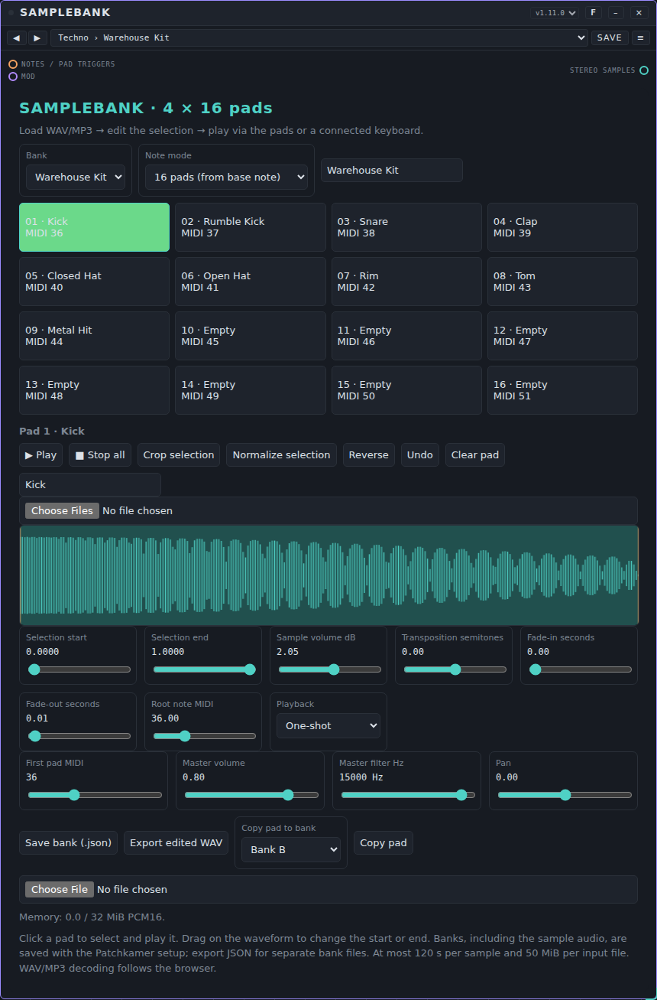
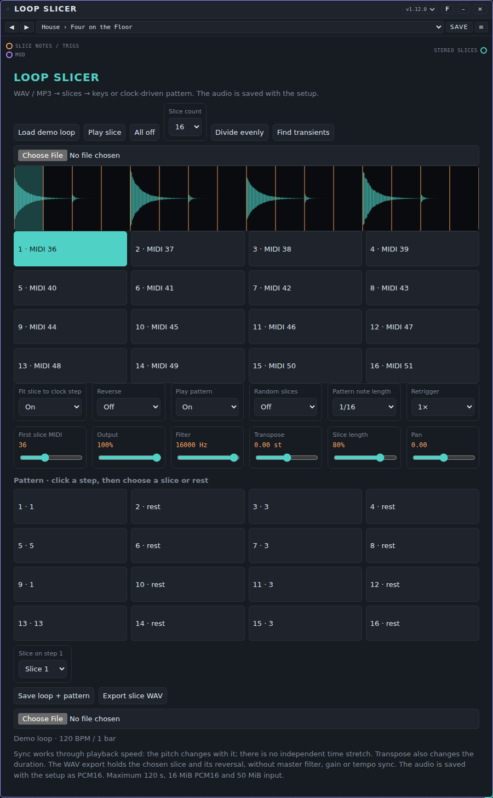

# Samplers: user manual

*Nederlandse versie: [USER-MANUAL_NL.md](USER-MANUAL_NL.md)*

Samplers play back recorded sound instead of making it from oscillators. This page covers the two samplers that come with Patchkamer: **Samplebank** and **Loop Slicer**. For the basics (opening Patchkamer, loading a library, drawing cables) see the [main user manual](../USER-MANUAL_EN.md). The folder with the devices is described in [devices/samplers](../../devices/samplers/README.md).

## Contents

1. [What samplers do](#what-samplers-do)
2. [Which sampler for which goal](#which-sampler-for-which-goal)
3. [Samplebank](#samplebank)
4. [Loop Slicer](#loop-slicer)
5. [If it does not work](#if-it-does-not-work)

## What samplers do

A sampler holds audio that you load yourself: a WAV or MP3 file, decoded by your browser. It has no audio input. It receives **notes** (orange cables) and gives you **sound** (a teal audio cable). Every sampler also has a purple **Mod** input: a modulator can move some of its controls while you play (see [Modulators](../modulators/USER-MANUAL_EN.md)). The knob keeps its value; the modulator adds to it.

A typical patch has three steps, from left to right:

1. A source of notes: **Keys / MIDI** (a keyboard that makes no sound itself) or a sequencer. Loop Slicer can also play its own 16-step pattern on the clock.
2. The sampler.
3. Where the sound goes: **Speakers** directly, or first a channel of a **Mixer** and an effect.

The audio you load is saved **inside the song or workspace**, so it comes back when you load that song again. The price is size: a sampler with long audio makes a large song. Both samplers have limits (120 seconds per sample or loop, 50 MiB per file to load).

Samplers have **tunes**: a tune is the complete setting of one sampler. Load a pack from a library or with the **Tunes** tab of the library → **Import…**, then pick a tune in the list at the top of the card (it reads `Folder › Name`). See [Tunes](../tunes/USER-MANUAL_EN.md) for how to use, save and share them. Samplers have no presets. What a tune holds differs per sampler and is explained in each section below.

## Which sampler for which goal

| I want to… | Use |
|---|---|
| Play my own sounds on pads (drums, one-shots, vocal hits) | [Samplebank](#samplebank) |
| Play one sample chromatically from a keyboard | [Samplebank](#samplebank) (note mode **Selected sample chromatic**) |
| Keep several kits or instruments ready in four banks | [Samplebank](#samplebank) |
| Cut a drum loop or any other loop into pieces and play them | [Loop Slicer](#loop-slicer) |
| Rearrange a loop with a 16-step pattern on the clock | [Loop Slicer](#loop-slicer) |
| Stutter, reverse or randomise the slices of a loop | [Loop Slicer](#loop-slicer) |
| Start straight away without loading a file | Both: their tunes bring their own small sounds (see each section) |

## Samplebank

**What it is for.** A sampler with four banks of 16 pads. You load a WAV or MP3 file onto a pad, trim it, and play it from a keyboard, a sequencer or by clicking the pad. Use it for drum kits made of your own recordings, for one-shot sounds, or for one sample that you play chromatically. The banks, with all their audio, are saved with the song.

**Controls.** Double-click a slider to go back to its starting value. The card follows the way you work: choose a bank and a pad, load and edit a sample, then set the sound of the whole sampler.

- **Bank:** the list chooses one of the four banks. Next to it is a text field with the name of the bank, which you can change.
- **Note mode:** **16 pads (from base note)** plays pad *n* from the note *First pad MIDI* + *n* − 1 (so pad 1 on note 36, pad 16 on note 51 by default). **Selected sample chromatic** plays the selected pad on every note, transposed relative to its **Root note MIDI**.
- **The 16 pads.** Click a pad to select it and play it. Each pad shows its number, its name (**Empty** when there is no sample) and its MIDI note.
- **Pad tools:** **▶ Play** plays the selected pad, **■ Stop all** silences everything, **Crop selection** throws away the audio outside the selection, **Normalize selection** makes the selection as loud as possible without clipping, **Reverse** turns the sample around, **Undo** takes back the last edit of a pad and **Clear pad** empties it. Below these tools is a field for the name of the sample.
- **Load a sample:** the file chooser under the pad name loads one or more WAV or MP3 files. With several files, they fill the following pads from the selected one. You can also drop a file on the waveform.
- **Waveform:** drag on it to move the start or the end of the selection. The sliders below do the same with numbers.
- **Per-pad sliders:** **Selection start** and **Selection end** (0 to 1 of the sample), **Sample volume dB** (−24 to +24), **Transposition semitones** (−24 to +24), **Fade-in seconds** and **Fade-out seconds** (0 to 2 s) and **Root note MIDI** (the note at which the sample sounds at its own pitch; only used in the chromatic note mode).
- **Playback:** **One-shot** plays the sample to its end (a note-off does nothing), **Gate / noteoff** stops when the key is released or when the note length ends, **Loop until noteoff** repeats the selection until the key is released or the note length ends.
- **Whole sampler:** **First pad MIDI** (the note of pad 1, 0 to 111), **Master volume**, **Master filter Hz** (a lowpass from 100 to 16000 Hz) and **Pan**.
- **Banks and files:** **Save bank (.json)** writes the chosen bank, with its audio, to a file; the file chooser under it (**Import bank file**) reads such a file back into the chosen bank. **Export edited WAV** writes the selected pad, with its selection, reversal, fades, volume and tuning applied, as a WAV file. **Copy pad to bank** (choose the bank in the list, then press **Copy pad**) copies the selected pad to the same place in another bank.
- **Memory:** a line under the card shows how much of the 32 MiB of sample memory (shared by all four banks) is used.

**Ports.**

| Port | Kind | Use |
|---|---|---|
| **Notes / pad triggers** | notes in (orange) | Notes from **Keys / MIDI** or a sequencer. In pad mode the note chooses the pad; a note outside the 16 pads is ignored. A *trig* with the lane `pad3` or `3` plays pad 3 of the chosen bank. Velocity sets the loudness. |
| **Mod** | modulation in (purple) | A modulator can move **Volume**, **Filter** and **Pan** (the volume is not switched on for modulation at the start). |
| **Stereo samples** | audio out (teal) | Connect to **Speakers** or a **Mixer** channel. |

**Example: your own drum kit.**

1. Place **Samplebank**, **Keys / MIDI** and **Speakers**. Connect the notes of Keys to **Notes / pad triggers** and **Stereo samples** to **In** on Speakers.
2. Choose bank A and pad 1. Load a kick sample with the file chooser. Drag the end of the selection to cut a long tail, and name the pad.
3. Choose pad 2, load a snare, and so on. Set **Playback** to **Gate / noteoff** for sounds you want to cut when you release the key; leave drums on **One-shot**.
4. Play the pads from note 36 upward on Keys, or from a sequencer that plays those notes.
5. For a melody from one sample instead: choose the sample's pad, set **Root note MIDI** to the note at which it sounds right and set the note mode to **Selected sample chromatic**.

**Tunes.** Pack **Samplebank Styles**: 79 tunes in 16 folders (Techno, House, Trance, Ambient, Synthwave, Hip-hop, Lo-fi, Trap, Drum & Bass, Dubstep, Electro, Pop, Chiptune, Funk & Disco, Dub and Cinematic), file [`samplebank-styles.patchkamer-tunes.json`](../../tunes/samplebank-styles.patchkamer-tunes.json). Unlike the tunes of other devices, a Samplebank tune **contains its own audio**: small, generated sounds, so every tune plays at once without loading a file. 13 tunes are drum kits on the pads (note mode **16 pads (from base note)**, pad 1 on note 36), 66 are a single sound played chromatically. A few names: **Warehouse Kit**, **Rolling Sub**, **Gate Pad**, **Dusty Boom Kit**, **Disco Strings**. The sounds are short and have a low sample rate; load your own sample on a pad to replace them. A tune sets the whole device, so it replaces the four banks you had: save a bank you want to keep with **Save bank (.json)** first.

**Tips and limits.**

- At most 120 seconds per sample, 32 MiB of audio over all four banks, 50 MiB per file you load, and 32 voices at the same time.
- A file that cannot be decoded, or that holds no audio, gives a message on the card and leaves the bank as it was. What can be decoded depends on your browser.
- A note that is held on a **One-shot** pad plays to the end of the sample; the key release does nothing. Use **Gate / noteoff** or **Loop until noteoff** when you want to control the length with the key.
- When the transport stops, all pads fall silent.
- The output goes through a compressor as a safety net.

## Loop Slicer

**What it is for.** A sampler for loops. It cuts a loop (a WAV or MP3 file, or the built-in demo loop) into 4, 8, 16 or 32 slices and plays those slices from keys, from trigs, or from a pattern of 16 steps on the clock. You can drag the cuts, let Loop Slicer look for the starts of sounds, reverse the slices, pitch them, shorten them and repeat them. It was called Snede before; songs from that time refer to the old name and do not load into this device, but bank files from it can still be read.

**Controls.** Double-click a slider to go back to its starting value.

- **Load demo loop:** loads the built-in loop, one bar of drums at 120 BPM. It is the quickest way to hear what a tune does. **Play slice** plays the selected slice, **All off** silences everything.
- **Slice count:** 4, 8, 16 or 32 slices. **Divide evenly** puts the cuts at equal distances; **Find transients** places them at the starts of sounds that it finds in the loop (and fills up with even cuts if it finds too few).
- **Load a loop:** the file chooser under the buttons loads a WAV or MP3 file, or drop a file on the waveform. The loop is saved with the song as 16-bit audio.
- **Waveform:** the orange lines are the cuts and the shaded part is the selected slice. Drag a cut to move it; it cannot pass its neighbours.
- **Slice buttons:** one per slice, with its number and MIDI note. Click one to select it and play it.
- **Fit slice to clock step:** **On** makes a slice fit in one step of the clock (times the note length below), so the pitch of a slice changes with the speed. **Off** plays a slice at its own speed, shifted by **Transpose**.
- **Reverse:** plays the slices backwards.
- **Play pattern:** **On** plays the pattern below on the clock; **Off** plays only notes and trigs.
- **Random slices:** **On** picks a random slice at every step of the pattern (rests stay rests). The sequence of random choices is the same every time you start.
- **Pattern note length:** **1/16**, **1/8** or **1/4**: how long each pattern step lasts.
- **Retrigger:** **1×**, **2×** or **4×**: repeats a step this many times within its length, each repeat shorter.
- **First slice MIDI:** the note of slice 1 (0 to 95). Slice *n* is on that note + *n* − 1.
- **Sound:** **Output** (level), **Filter** (a lowpass, 100 to 18000 Hz), **Transpose** (−24 to +24 semitones), **Slice length** (10 to 100% of the slice, the rest is cut off with a short fade) and **Pan**.
- **Pattern:** 16 buttons, one per step, showing the slice number or **rest**. Click a step, then choose its slice (or **Rest**) in the list **Slice on step …** below the buttons.
- **Save loop + pattern** writes a bank file with the loop and all settings; the file chooser next to **Export slice WAV** (**Load Loop Slicer bank**) reads such a file back. **Export slice WAV** writes the selected slice, with its reversal, as a WAV file (without the filter, level and tempo fit).

**Ports.**

| Port | Kind | Use |
|---|---|---|
| **Slice notes / trigs** | notes in (orange) | Notes from **Keys / MIDI** or a sequencer: the note *First slice MIDI* + *n* − 1 plays slice *n*; velocity sets the loudness. A *trig* with the lane `slice3` or `3` plays slice 3. A note that is held does not shorten the slice: it plays for its own length. The pattern needs the clock; notes work without it. |
| **Mod** | modulation in (purple) | A modulator can move **Output**, **Filter**, **Transpose**, **Slice length** and **Pan** (**Output** and **Transpose** are not switched on for modulation at the start). |
| **Stereo slices** | audio out (teal) | Connect to **Speakers** or a **Mixer** channel. |

**Example: a rearranged beat.**

1. Place **Loop Slicer** and **Speakers** and connect **Stereo slices** to **In** on Speakers.
2. Press **Load demo loop** (or load a loop of your own) and set **Slice count** to 16.
3. Set **Play pattern** to **On** and press **Start**. The pattern plays on the clock.
4. Click step 3 in the pattern and choose another slice in **Slice on step 3**. Choose **Rest** to make a gap.
5. Set **Retrigger** to **2×** for rolls, **Reverse** to **On** for a backwards version, or **Random slices** to **On** for a different order.
6. To play the slices yourself instead: set **Play pattern** to **Off**, place **Keys / MIDI** and connect its notes to **Slice notes / trigs**. Slice 1 is on note 36 by default.

**Tunes.** Pack **Loop Slicer Styles**: 69 tunes in 12 folders (House, Techno, Breakbeat, Drum and Bass, Hip-hop, Trap, Funk, Dub, Cinematic, Glitch, Pitched Hits and Own Loop), file [`loop-slicer-styles.patchkamer-tunes.json`](../../tunes/loop-slicer-styles.patchkamer-tunes.json). A tune holds how the loop is cut and played, never the audio of your loop. 61 tunes switch on the built-in **demo loop** and replace the loop you had loaded, so they sound at once; 53 of those play a pattern (press **Start**), 8 are played from keys. The 8 tunes in the folder **Own Loop** keep the loop you have loaded and only change the slicing and playing: they stay silent until you load a loop. A few names: **Four on the Floor**, **Chopped Break**, **Stutter Snare**, **Random Shards**, **Even 16 Chop**.

**Tips and limits.**

- There is no time stretch. A slice is played by changing its playback speed, so when a slice does not fit its step exactly, its pitch changes. For slices at their own pitch, choose the slice count and the note length so that one slice fills one step (16 slices at **1/16**, 8 at **1/8**, 4 at **1/4**), or set **Fit slice to clock step** to **Off**.
- **Transpose** also changes the length of a slice.
- At most 120 seconds per loop, 16 MiB of audio, 50 MiB per file, 32 voices at the same time.
- A note that is held does not stop a slice: it plays out its own length (see **Slice length**).
- Loading a loop gives 16 equal slices; the pattern is kept.

## If it does not work

- **No sound.** A sampler is silent until audio is loaded: load a file on a pad (Samplebank) or press **Load demo loop** (Loop Slicer). Check that audio runs from the sampler to **Speakers** (teal cable), that the volume on Speakers is up and that **Master volume** or **Output** is not at zero. Click anywhere in Patchkamer once: browsers pause audio until you do.
- **Samplebank does not react to the keyboard.** Connect the orange cable to **Notes / pad triggers**. In pad mode the notes must lie in the 16 notes from **First pad MIDI** (36 to 51 by default); a pad without a sample stays silent.
- **A Loop Slicer tune is silent.** The tunes in the folder **Own Loop** need a loop that you loaded yourself. A tune with a pattern also needs the clock: press **Start**.
- **Loop Slicer plays no pattern.** Check that **Play pattern** is **On** and that the pattern has at least one step that is not a rest.
- **A file does not load.** The card shows a message: too large (50 MiB per file), too long (120 seconds), or not decodable. Samplebank also stops at 32 MiB of audio over all banks.
- **Crackles.** Open Settings → Audio and choose a larger latency, or a lower quality.
