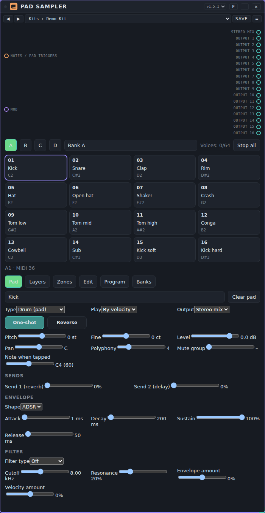
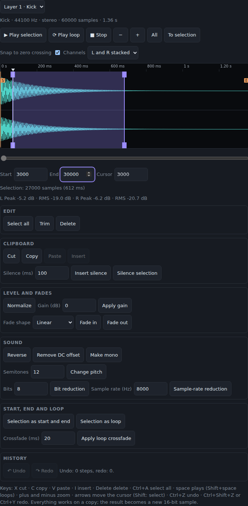
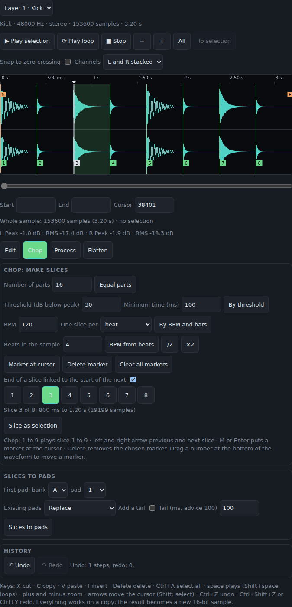
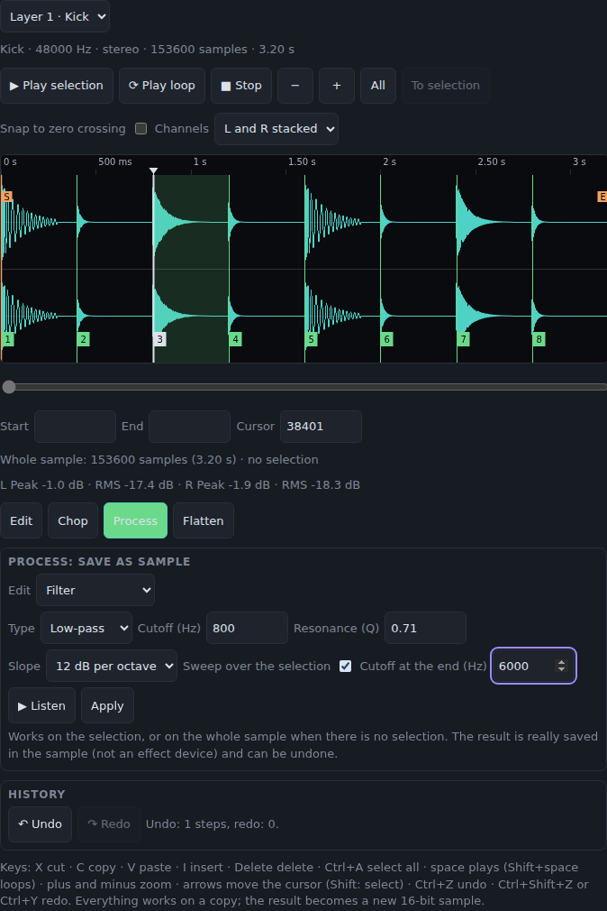
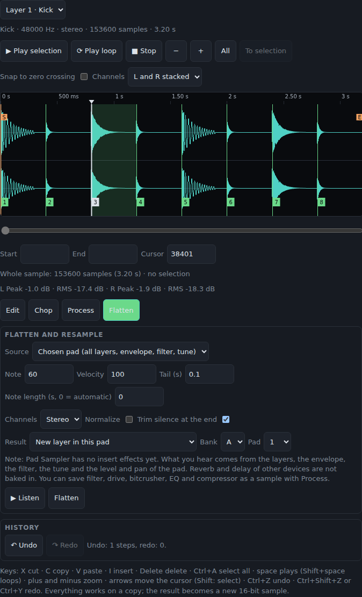
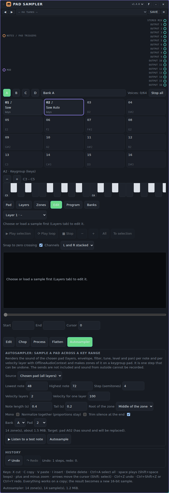
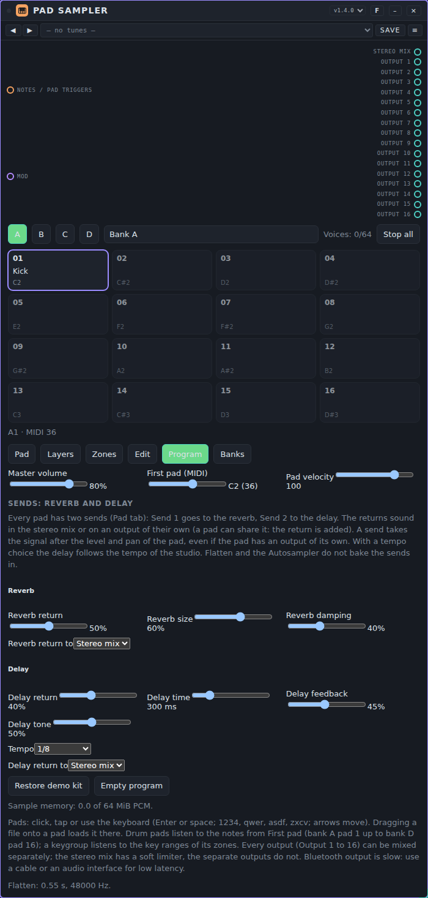
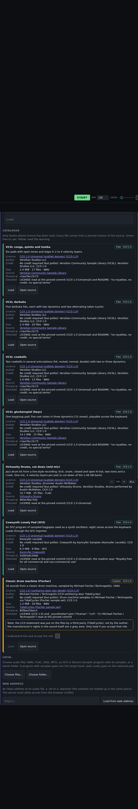

# Samplers: user manual

*Nederlandse versie: [USER-MANUAL_NL.md](USER-MANUAL_NL.md)*

Samplers play back recorded sound instead of making it from oscillators. This page covers the three samplers that come with Patchkamer: **Samplebank**, **Pad Sampler** and **Loop Slicer**. For the basics (opening Patchkamer, loading a library, drawing cables) see the [main user manual](../USER-MANUAL_EN.md). The folder with the devices is described in [devices/samplers](../../devices/samplers/README.md).

## Contents

1. [What samplers do](#what-samplers-do)
2. [Which sampler for which goal](#which-sampler-for-which-goal)
3. [Samplebank](#samplebank)
4. [Pad Sampler](#pad-sampler)
5. [Loop Slicer](#loop-slicer)
6. [If it does not work](#if-it-does-not-work)

## What samplers do

A sampler holds audio that you load yourself: a WAV or MP3 file, decoded by your browser. It has no audio input. It receives **notes** (orange cables) and gives you **sound** (a teal audio cable). Every sampler also has a purple **Mod** input: a modulator can move some of its controls while you play (see [Modulators](../modulators/USER-MANUAL_EN.md)). The knob keeps its value; the modulator adds to it.

A typical patch has three steps, from left to right:

1. A source of notes: **Keys / MIDI** (a keyboard that makes no sound itself) or a sequencer. Loop Slicer can also play its own 16-step pattern on the clock.
2. The sampler.
3. Where the sound goes: **Speakers** directly, or first a channel of a **Mixer** and an effect.

The audio you load is saved **inside the song or workspace**, so it comes back when you load that song again. The price is size: a sampler with long audio makes a large song. Both samplers have limits (120 seconds per sample or loop, 50 MiB per file to load).

Samplers have **tunes**: a tune is the complete setting of one sampler. Load a pack from a library or with the **Tunes** tab of the library → **Import…**, then pick a tune in the list at the top of the card (it reads `Folder › Name`). See [Tunes](../tunes/USER-MANUAL_EN.md) for how to use, save and share them. Samplers have no presets. What a tune holds differs per sampler and is explained in each section below.

## Which sampler for which goal

| I want to… | Use |
|---|---|
| Play my own sounds on pads (drums, one-shots, vocal hits) | [Samplebank](#samplebank) |
| Play one sample chromatically from a keyboard | [Samplebank](#samplebank) (note mode **Selected sample chromatic**) |
| Keep several kits or instruments ready in four banks | [Samplebank](#samplebank) |
| Drum kits and instruments with layers by velocity, keygroups, a separate output per pad, envelope and filter | [Pad Sampler](#pad-sampler) |
| Cut a drum loop or any other loop into pieces and play them | [Loop Slicer](#loop-slicer) |
| Rearrange a loop with a 16-step pattern on the clock | [Loop Slicer](#loop-slicer) |
| Stutter, reverse or randomise the slices of a loop | [Loop Slicer](#loop-slicer) |
| Start straight away without loading a file | All three: Pad Sampler has a built-in demo kit, the others' tunes bring their own small sounds (see each section) |

## Samplebank

**What it is for.** A sampler with four banks of 16 pads. You load a WAV or MP3 file onto a pad, trim it, and play it from a keyboard, a sequencer or by clicking the pad. Use it for drum kits made of your own recordings, for one-shot sounds, or for one sample that you play chromatically. The banks, with all their audio, are saved with the song.

**Controls.** Double-click a slider to go back to its starting value. The card follows the way you work: choose a bank and a pad, load and edit a sample, then set the sound of the whole sampler.

- **Bank:** the list chooses one of the four banks. Next to it is a text field with the name of the bank, which you can change.
- **Note mode:** **16 pads (from base note)** plays pad *n* from the note *First pad MIDI* + *n* − 1 (so pad 1 on note 36, pad 16 on note 51 by default). **Selected sample chromatic** plays the selected pad on every note, transposed relative to its **Root note MIDI**.
- **The 16 pads.** Click a pad to select it and play it. Each pad shows its number, its name (**Empty** when there is no sample) and its MIDI note.
- **Pad tools:** **▶ Play** plays the selected pad, **■ Stop all** silences everything, **Crop selection** throws away the audio outside the selection, **Normalize selection** makes the selection as loud as possible without clipping, **Reverse** turns the sample around, **Undo** takes back the last edit of a pad and **Clear pad** empties it. Below these tools is a field for the name of the sample.
- **Load a sample:** the file chooser under the pad name loads one or more WAV or MP3 files. With several files, they fill the following pads from the selected one. You can also drop a file on the waveform.
- **Waveform:** drag on it to move the start or the end of the selection. The sliders below do the same with numbers.
- **Per-pad sliders:** **Selection start** and **Selection end** (0 to 1 of the sample), **Sample volume dB** (−24 to +24), **Transposition semitones** (−24 to +24), **Fade-in seconds** and **Fade-out seconds** (0 to 2 s) and **Root note MIDI** (the note at which the sample sounds at its own pitch; only used in the chromatic note mode).
- **Playback:** **One-shot** plays the sample to its end (a note-off does nothing), **Gate / noteoff** stops when the key is released or when the note length ends, **Loop until noteoff** repeats the selection until the key is released or the note length ends.
- **Whole sampler:** **First pad MIDI** (the note of pad 1, 0 to 111), **Master volume**, **Master filter Hz** (a lowpass from 100 to 16000 Hz) and **Pan**.
- **Banks and files:** **Save bank (.json)** writes the chosen bank, with its audio, to a file; the file chooser under it (**Import bank file**) reads such a file back into the chosen bank. **Export edited WAV** writes the selected pad, with its selection, reversal, fades, volume and tuning applied, as a WAV file. **Copy pad to bank** (choose the bank in the list, then press **Copy pad**) copies the selected pad to the same place in another bank.
- **Memory:** a line under the card shows how much of the 32 MiB of sample memory (shared by all four banks) is used.

**Ports.**

| Port | Kind | Use |
|---|---|---|
| **Notes / pad triggers** | notes in (orange) | Notes from **Keys / MIDI** or a sequencer. In pad mode the note chooses the pad; a note outside the 16 pads is ignored. A *trig* with the lane `pad3` or `3` plays pad 3 of the chosen bank. Velocity sets the loudness. |
| **Mod** | modulation in (purple) | A modulator can move **Volume**, **Filter** and **Pan** (the volume is not switched on for modulation at the start). |
| **Stereo samples** | audio out (teal) | Connect to **Speakers** or a **Mixer** channel. |

**Example: your own drum kit.**

1. Place **Samplebank**, **Keys / MIDI** and **Speakers**. Connect the notes of Keys to **Notes / pad triggers** and **Stereo samples** to **In** on Speakers.
2. Choose bank A and pad 1. Load a kick sample with the file chooser. Drag the end of the selection to cut a long tail, and name the pad.
3. Choose pad 2, load a snare, and so on. Set **Playback** to **Gate / noteoff** for sounds you want to cut when you release the key; leave drums on **One-shot**.
4. Play the pads from note 36 upward on Keys, or from a sequencer that plays those notes.
5. For a melody from one sample instead: choose the sample's pad, set **Root note MIDI** to the note at which it sounds right and set the note mode to **Selected sample chromatic**.

**Tunes.** Pack **Samplebank Styles**: 79 tunes in 16 folders (Techno, House, Trance, Ambient, Synthwave, Hip-hop, Lo-fi, Trap, Drum & Bass, Dubstep, Electro, Pop, Chiptune, Funk & Disco, Dub and Cinematic), file [`samplebank-styles.patchkamer-tunes.json`](../../tunes/samplebank-styles.patchkamer-tunes.json). Unlike the tunes of other devices, a Samplebank tune **contains its own audio**: small, generated sounds, so every tune plays at once without loading a file. 13 tunes are drum kits on the pads (note mode **16 pads (from base note)**, pad 1 on note 36), 66 are a single sound played chromatically. A few names: **Warehouse Kit**, **Rolling Sub**, **Gate Pad**, **Dusty Boom Kit**, **Disco Strings**. The sounds are short and have a low sample rate; load your own sample on a pad to replace them. A tune sets the whole device, so it replaces the four banks you had: save a bank you want to keep with **Save bank (.json)** first.

**Tips and limits.**

- At most 120 seconds per sample, 32 MiB of audio over all four banks, 50 MiB per file you load, and 32 voices at the same time.
- A file that cannot be decoded, or that holds no audio, gives a message on the card and leaves the bank as it was. What can be decoded depends on your browser.
- A note that is held on a **One-shot** pad plays to the end of the sample; the key release does nothing. Use **Gate / noteoff** or **Loop until noteoff** when you want to control the length with the key.
- When the transport stops, all pads fall silent.
- The output goes through a compressor as a safety net.

## Pad Sampler

**What it is for.** A larger sampler for drum kits and instruments. It has four banks of 16 pads; every pad has four **layers** (samples that sound by velocity, in turn, at random or all together), an envelope, a filter, a mute group and its own audio output. A pad is either a **drum** pad (one note, one hit) or a **keygroup** (samples with a key range and a root note, played chromatically from a keyboard). It starts with a built-in demo kit in bank A, so it sounds straight away. Since version 1.1.0 it has a **waveform editor** (tab Edit); since 1.2.0 also **chop**, **Process** and **Flatten** (rendering to a new sample); since 1.4.0 also two **sends** (reverb and delay), a **loop crossfade** that sounds at once and an **Autosampler**.

**Controls.** Double-click a slider to go back to its starting value.

- **Banks A to D** and the bank name; **Stop all** silences everything; **Voices** shows how many of the 64 voices sound.
- **The 16 pads.** Click, tap or press Enter or space on a pad: it is selected and plays at the **Pad velocity** (program tab). With the keyboard of your computer the four rows `1234`, `qwer`, `asdf` and `zxcv` play pads 1 to 16; the arrow keys move between pads. Drop an audio file on a pad to load it there. A keygroup pad shows a ♪ and an on-screen keyboard (two octaves, with − and + for the octave; the keys `a w s e d f t g y h u j k o l p` play the notes of that keyboard).
- **Tab Pad:** the name; **Type** (**Drum** or **Keygroup**; changing it also sets One-shot and the polyphony to sensible values); **Play** (how the layers are chosen: **By velocity**, **Cycle**, **Random** or **All layers**); **Output** (**Stereo mix** or **Output 1** to **16**); **One-shot** (ignore note-off; the sample plays to its end) and **Reverse**; **Pitch** (±24 semitones), **Fine** (±100 cents), **Level** (dB), **Pan**, **Polyphony** (1 to 16; 1 is mono: a new hit cuts the previous one), **Mute group** (0 is none: a hit cuts the other pads in the same group, with a 5 ms fade) and **Note when tapped** (the note a keygroup pad plays when you click it); **Send 1** (to the reverb) and **Send 2** (to the delay), see **Sends** below.
- **Envelope:** **ADSR** or **AD** (attack and decay only: a percussive shape that dies out after the decay; a note-off then still releases early). **Attack**, **Decay**, **Sustain**, **Release**. The release applies on note-off when One-shot is off.
- **Filter:** **Off**, **Low-pass**, **High-pass** or **Band-pass**, with **Cutoff**, **Resonance**, **Envelope amount** (how far the envelope opens or closes the filter; it has no release of its own) and **Velocity amount** (positive: soft hits are darker).
- **Tab Layers:** four layers per pad. Choose the **Sample** (the built-in demo samples start with a dot) or **Load file…** (WAV, FLAC, OGG or MP3; several files fill the next pads). Per layer: **Semitones**, **Fine**, **Level**, **Pan**, **Offset** (negative delays the layer by that many milliseconds, positive starts that far into the sample), **Root note**, **Velocity from / to** (1 to 127), **Start** and **End** (as a part of the sample), **Gain** and a **Loop** with start and end and a **Loop crossfade** (0 to 100% of half the loop: the end of the loop blends softly into the stretch just before the loop start, so the seam does not click; so there must be sound before the loop start). A loop only works when One-shot is off. A WAV file with a `smpl` block gives its root note and first loop automatically.
- **Tab Zones:** for a keygroup pad. A zone is a sample with a **Root note**, a key range (**Key from / to**), a velocity range, a **Tuning** and an optional loop; up to 128 zones. Without zones, the pad plays its layers chromatically around the root note of each layer.
- **Tab Edit:** the waveform editor, see below.
- **Tab Banks:** load a whole bank of sounds, see below.
- **Tab Program:** **Master volume** (the stereo mix only), **First pad (MIDI)** (the note of bank A pad 1; banks B, C and D continue after 16 notes each), **Pad velocity**, **Restore demo kit**, **Empty program**, the sample memory in use and the **Sends** (see below).

**The waveform editor (tab Edit).**

At the top, choose which layer or zone you edit. Everything you do works on a copy and the result becomes a new 16-bit sample; the layer then points to it. Other pads that use the same sample keep the old one.

- **Waveform.** Drag to make a selection; drag the handles to move the start or the end (also with a finger). A tap places the cursor. Zoom with the mouse wheel, with two fingers (pinch) or with **−**, **+**, **All** and **To selection**, down to single samples; scroll with the bar below, Shift+wheel or by dragging with the right mouse button. Drag on the ruler to **scrub** (a short piece sounds). **Snap to zero crossing** makes the start, end and cursor jump to the nearest zero crossing against clicks. A stereo sample shows **L and R stacked** or as a **Sum**; below it are the peak and RMS of the selection. You can also type **Start**, **End** and **Cursor** (in samples).
- **Listening.** **Play selection** (from the cursor when nothing is selected), **Play loop** and **Stop**; a line follows as the play head.
- **Edit:** **Select all**, **Trim** (only the selection stays, and stays selected), **Delete** (the rest closes up). **Cut**, **Copy**, **Paste** (replaces the selection, or goes at the cursor) and **Insert** (always at the cursor) use a clipboard that works across pads. **Insert silence** (ms) at the cursor, **Silence selection**.
- **Level and fades:** **Normalize** (peak to 0 dBFS), **Gain** (dB, with a message if it clips), **Fade in** and **Fade out** over the selection or the whole sample, **linear**, **logarithmic** (fast up, then gentle) or **exponential** (gentle first).
- **Sound:** **Reverse** (permanent; separate from the pad's Reverse switch), **Remove DC offset**, **Make mono**, **Change pitch** (semitones; the sound gets shorter or longer), **Bit reduction** (2 to 15 bits) and **Sample-rate reduction** (Hz). Without a selection they apply to the whole sample.
- **Start, end and loop:** **Selection as start and end** and **Selection as loop** (the loop switches on); the markers S, E and L are in the waveform and can be dragged. **Apply loop crossfade** calculates a crossfade (ms) into the sample, just before the loop start, so the seam does not click. The **Loop crossfade** control (tab Layers) does the same while playing, without changing the sample.
- **Undo and Redo.** At least 100 steps (limited to 128 MiB of memory; the oldest expires). Ctrl+Z, Ctrl+Shift+Z or Ctrl+Y. The history is not saved with the song and is empty after loading.
- **Keyboard** (in the editor): **X** cut, **C** copy, **V** paste, **I** insert, **Delete** delete, **Ctrl+A** select all, **space** plays the selection (Shift+space: loop), **+** and **−** zoom, the arrows move the cursor (with Shift you make a selection).
- **Limits.** If the result no longer fits in the 64 MiB (or is longer than 120 s), the edit does not happen and you get a message. The builder did not listen to the sound but checked it with measurements.

**Chop, Process and Flatten (tab Edit, kind of edit).** Below the waveform you choose the kind of edit: **Edit** (above), **Chop**, **Process**, **Flatten** or **Autosampler**.

- **Chop: make slices.** A slice is a marker in the sample (not a copy). **Equal parts** (2 to 64, default 16), **By threshold** (finds hits: **Threshold** in dB below the peak and **Minimum time** between two hits; flams count as one hit), **By BPM and bars** (one slice per bar, beat, eighth or sixteenth; **BPM from beats** works out the tempo from the number of beats in the sample, with **/2** and **×2** for a wrong guess) and by hand: **Marker at cursor**, **Delete marker**, **Clear all markers**. The markers are numbered flags at the bottom of the waveform; drag a flag to move it (mouse and finger, snapping to a zero crossing when that is on). By default the end of a slice is the start of the next; turn off **End of a slice linked to the start of the next** to drag end points separately too. A demo sample becomes a sample of its own at the first chop.
- **Listening to slices.** Click or tap a number (button or flag), or press **1** to **9**; left and right arrow go to the previous and next slice, **M** or **Enter** puts a marker at the cursor and **Delete** removes the chosen marker. **Slice as selection** turns the slice into a selection.
- **Slices to pads.** Choose the bank and pad where slice 1 goes; slice n goes to the n-th pad after it. Every pad gets layer 1 with the same sample and the start and end of the slice (no copies). **Replace** turns existing pads into a new pad, **Fill empty pads only** leaves occupied pads alone. **Add a tail** stretches the end of every pad by 0 to 5000 ms (advice 100 ms) so a cut-off hit ends more softly. It is one step for Undo.
- **Process: save as sample.** **Filter** (low-pass, high-pass or band-pass; 12 or 24 dB per octave; **Cutoff**, **Resonance** and a **Sweep over the selection** to an end cutoff), **Drive** (soft clipping, with **Mix**), **Bitcrusher** (bits and sample rate), **Three-band EQ** (low 200 Hz, mid 1 kHz, high 5 kHz, ±18 dB), **Compressor** (threshold, ratio, attack, release and make-up) and **Tempo match** (bring a loop to a target BPM by resampling: **Beats in the sample** gives the current tempo, **/2** and **×2** correct a wrong guess; the pitch changes with it, real time-stretch follows later). **Listen** calculates the result and plays it without changing anything; **Apply** really saves it in the sample (on the selection, or the whole sample without a selection) and can be undone.

- **Flatten and resample.** Renders the chosen pad (all layers, envelope, filter, tune, reverse, level and pan; without the output choice) or the selection of the editor, faster than real time, to a new sample. Choose the **Note** and **Velocity** (default the root and 100), the **Tail** (default 0.1 s), the **Note length** (0 is automatic), **Stereo** or **Mono**, **Normalize**, **Trim silence at the end** and the **Result**: a new layer in this pad, replace the chosen layer, replace this pad (the baked-in settings go back to default) or another pad. The sends (the reverb and delay of Pad Sampler itself) and reverb and delay of other devices are not baked in, because Pad Sampler has no insert effects; use Process for filter, drive, bitcrusher, EQ and compressor.
- **Autosampler.** Samples the sound of the chosen pad (or only the chosen layer) over a range of notes and velocity layers and makes zones of it on a keygroup pad. Every note and every velocity layer is rendered with the same chain as Flatten (layers, envelope, filter, tune, level and pan, without the sends). You choose the **Lowest** and **Highest note**, the **Step** in semitones (with step 3 every zone gets three keys), 1 to 4 **Velocity layers** (the velocity ranges are divided equally; with one layer **Velocity for one layer** applies), the **Note length** and the **Tail**, the **Root of the zone** (middle of the zone or lowest key), **Mono**, **Normalize together** (all zones get the same gain, so the proportions stay) and **Trim silence at the end**. The **Target** is another pad (by default the first empty pad after the source; if the target pad has sound it says it will be replaced; output and mute group of the target pad stay). Below the buttons you see the number of zones and the estimated size. A zone sounds at the rendered velocity like the source pad: the velocity steers the choice of layer and the filter, the amplitude comes when the zone itself is played. Identical sounds (for example with a source that has one velocity layer) share one sample. The pad becomes a keygroup with one-shot on: every sample contains its own release. Too many zones (more than 128), a result that does not fit in the 64 MiB or a length above 120 s give a message before anything is rendered. **Stop** aborts without changing anything; **Listen to a test note** plays one note without storing anything. It is one step for Undo. The Autosampler can only record the sound of Pad Sampler itself, not sound from outside.

- **Undo and Redo** also apply to chop, slices to pads, Process and Flatten (they are steps in the same history). An edit that no longer fits in the 64 MiB is refused with a message.

**Ports.**

| Port | Kind | Use |
|---|---|---|
| **Notes / pad triggers** | notes in (orange) | A note plays the drum pad with that note (pad 1 of bank A is on **First pad**, 36 by default, up to bank D pad 16). A note that no drum pad with a sample claims plays the keygroup pads. A held key (`held`) ends at note-off; other notes end after their length. A *trig* with the lane `pad3` or `3` plays pad 3 of the chosen bank, `b1` pad 1 of bank B. Events are planned on the audio clock. `allnotesoff` silences everything. |
| **Mod** | modulation in (purple) | **Master volume**, and per pad **Level**, **Cutoff** and **Pitch** (193 parameters, none switched on at the start). |
| **Stereo mix** | audio out (teal) | The sum of all pads that go to the mix, through a soft limiter. |
| **Output 1** to **16** | audio out (teal) | A pad that is set to an output sounds only there, not in the mix. Connect them to channels of a **Mixer** to mix each pad yourself. The return of the reverb or the delay can also be set to such an output; it is then added to what already sounds there. |

**Example: a kit with its own channel per drum.**

1. Place **Pad Sampler**, a **Mixer**, **Keys / MIDI** and **Speakers**. Connect the notes of Keys to **Notes / pad triggers**, **Output 1** to **Output 3** to channels 1 to 3 of the Mixer and its output to Speakers.
2. Select pad 1 and set **Output** to **Output 1**; do the same for the snare (pad 2, **Output 2**) and the hat (pad 5, **Output 3**). Pads that stay on **Stereo mix** do not reach the Mixer; connect **Stereo mix** as well if you want them.
3. Set the open hat (pad 6) and the closed hat (pad 5) to the same **Mute group** so a closed hat cuts the open one.
4. For a keyboard instrument: choose a pad, set **Type** to **Keygroup**, load a sample, set its **Root note** and turn on the **Loop** if it is a looped tone.

**Sends: reverb and delay (since 1.4.0).** Every pad has two sends in the tab Pad: **Send 1** goes to a built-in **reverb**, **Send 2** to a built-in **delay**. The buses and their settings are in the tab Program and belong to the program, not to a pad.

- **Send level** (0 to 100%, default 0): how much of the pad goes to the bus. The send takes the signal after the pad's **Level** and **Pan**, even if the pad has an output of its own. At 0 nothing happens and the buses do not even exist.
- **Reverb:** **Reverb return** (how much comes back), **Reverb size** (the tail, about 0.3 to 6 seconds) and **Reverb damping** (higher is darker). The reverb is a convolver with a self-generated stereo impulse; a new size or damping fades softly to a new impulse.
- **Delay:** **Delay return**, **Delay time** (10 ms to 1.5 s), **Delay feedback** (up to 95%), **Delay tone** (how dark the repeats become) and a **Tempo** choice (**Free**, or 1/2, dotted 1/4, 1/4, dotted 1/8, 1/8, 1/8 triplet, 1/16): with a tempo choice the delay follows the tempo of the studio and **Delay time** is not in use.
- **Return to:** for both returns you choose the **Stereo mix** (before the limiter) or **Output 1** to **16**. A return on an output is added to what already sounds there; there are no extra ports, the 17 audio outputs stay the same.
- **Limits:** the sends are not part of **Flatten**, **Autosampler** or Process (a warning appears), and the sends cannot be steered with the **Mod** port. A new impulse is calculated in a few tens of milliseconds at the first hit with a send; the delay was measured in Chromium (a DelayNode in a loop counts one render quantum of 128 samples extra there; the device corrects for that, in another browser a repeat can be a few milliseconds off).

**Tunes.** Pack **Pad Sampler Demos**: 15 tunes in two folders (**Kits**: Demo Kit, Tight Kit, Soft Kit, Lo-fi Kit, Velocity Kick, Round Robin Kit, Random Toms, Eight Outputs, Mute Group Hats; **Keygroups**: Saw Keys, Sine Sub, Square Lead, Pluck Keys, Split Keys, Soft Pad), file [`pad-sampler-demos.patchkamer-tunes.json`](../../tunes/pad-sampler-demos.patchkamer-tunes.json). They use only the built-in synthesised samples, so they are small and sound at once. A tune replaces the whole program, including your banks.

**Banks and catalogue.** The **Banks** tab loads sounds into the **Target bank** (with **Empty the bank first** you replace the bank; without it the free pads are filled). Loading a bank is one step that you undo with **Undo** (Edit tab).

- **Catalogue:** seven free banks (VCSL conga, darbuka and cowbells, a VCSL glockenspiel as a keygroup, a cut-down jazz drum kit, an SFZ program and a classic drum machine). Only banks whose licence has been read; every file comes from a pinned version of the source. Every bank always shows its **licence**, **author**, **credit**, size and source. **Green** is free to use; **yellow** shows a warning first and you must accept the risk before Load works. Nothing goes over the network until you press **Load** yourself.
- **Local:** **Choose files…** or **Choose folder…** (WAV, FLAC, OGG, MP3, or an SFZ or Decent Sampler program with its samples). You enter your own **Author**, **Licence** and **Credit** at the top; they are stored with the samples.
- **Web address:** an https address of an audio file, a `.sfz` or a `.dspreset`. The server must allow access from the browser. **Freesound:** enter your own token (it stays in the window and never goes into the song), search, and load the preview of a CC0 or CC-BY sound into the selected layer.
- **Importers:** WAV with root and loop from the `smpl` chunk; FLAC, OGG and MP3 through the browser (MP3 is not accurate for loops: you get a warning); an SFZ subset (`region`, `sample`, `lokey`/`hikey`/`key`, `lovel`/`hivel`, `pitch_keycenter`, `tune`, `transpose`, `loop_mode`, `loop_start`/`loop_end`, `group`/`off_by`, `seq_length`/`seq_position`, `volume`, `pan`) and Decent Sampler (`.dspreset`). The **Import report** says what was imported, what was ignored (with counts) and what did not fit (16 pads, four layers, 16 zones, 64 MiB). NKI, EXS, Battery and Ableton are not read.
- **Credits** at the bottom of the tab are the licences of the samples that are actually in the program; they are also in the state (`credits`) and so travel with the song.
- This Patchkamer fetches files from the internet for a device through the host (`host.fetchFile`). If that is missing you see an explanation: download the files through **Open source** and choose them under **Local**.

**Tips and limits.**

- 64 voices at the same time (the oldest is cut), 120 seconds per sample, 50 MiB per file to load and 64 MiB of audio (PCM16) in total; identical samples are stored once. Audio you load is decoded at the sample rate of the studio and saved with the song.
- The separate outputs have no limiter; keep an eye on the levels when you mix them yourself.
- Pitch and cutoff changes (and modulation) also move voices that are already sounding; envelope, filter type and other settings apply from the next hit.
- Bluetooth output is slow. Use a cable or an audio interface for low latency.

## Loop Slicer

**What it is for.** A sampler for loops. It cuts a loop (a WAV or MP3 file, or the built-in demo loop) into 4, 8, 16 or 32 slices and plays those slices from keys, from trigs, or from a pattern of 16 steps on the clock. You can drag the cuts, let Loop Slicer look for the starts of sounds, reverse the slices, pitch them, shorten them and repeat them. It was called Snede before; songs from that time refer to the old name and do not load into this device, but bank files from it can still be read.

**Controls.** Double-click a slider to go back to its starting value.

- **Load demo loop:** loads the built-in loop, one bar of drums at 120 BPM. It is the quickest way to hear what a tune does. **Play slice** plays the selected slice, **All off** silences everything.
- **Slice count:** 4, 8, 16 or 32 slices. **Divide evenly** puts the cuts at equal distances; **Find transients** places them at the starts of sounds that it finds in the loop (and fills up with even cuts if it finds too few).
- **Load a loop:** the file chooser under the buttons loads a WAV or MP3 file, or drop a file on the waveform. The loop is saved with the song as 16-bit audio.
- **Waveform:** the orange lines are the cuts and the shaded part is the selected slice. Drag a cut to move it; it cannot pass its neighbours.
- **Slice buttons:** one per slice, with its number and MIDI note. Click one to select it and play it.
- **Fit slice to clock step:** **On** makes a slice fit in one step of the clock (times the note length below), so the pitch of a slice changes with the speed. **Off** plays a slice at its own speed, shifted by **Transpose**.
- **Reverse:** plays the slices backwards.
- **Play pattern:** **On** plays the pattern below on the clock; **Off** plays only notes and trigs.
- **Random slices:** **On** picks a random slice at every step of the pattern (rests stay rests). The sequence of random choices is the same every time you start.
- **Pattern note length:** **1/16**, **1/8** or **1/4**: how long each pattern step lasts.
- **Retrigger:** **1×**, **2×** or **4×**: repeats a step this many times within its length, each repeat shorter.
- **First slice MIDI:** the note of slice 1 (0 to 95). Slice *n* is on that note + *n* − 1.
- **Sound:** **Output** (level), **Filter** (a lowpass, 100 to 18000 Hz), **Transpose** (−24 to +24 semitones), **Slice length** (10 to 100% of the slice, the rest is cut off with a short fade) and **Pan**.
- **Pattern:** 16 buttons, one per step, showing the slice number or **rest**. Click a step, then choose its slice (or **Rest**) in the list **Slice on step …** below the buttons.
- **Save loop + pattern** writes a bank file with the loop and all settings; the file chooser next to **Export slice WAV** (**Load Loop Slicer bank**) reads such a file back. **Export slice WAV** writes the selected slice, with its reversal, as a WAV file (without the filter, level and tempo fit).

**Ports.**

| Port | Kind | Use |
|---|---|---|
| **Slice notes / trigs** | notes in (orange) | Notes from **Keys / MIDI** or a sequencer: the note *First slice MIDI* + *n* − 1 plays slice *n*; velocity sets the loudness. A *trig* with the lane `slice3` or `3` plays slice 3. A note that is held does not shorten the slice: it plays for its own length. The pattern needs the clock; notes work without it. |
| **Mod** | modulation in (purple) | A modulator can move **Output**, **Filter**, **Transpose**, **Slice length** and **Pan** (**Output** and **Transpose** are not switched on for modulation at the start). |
| **Stereo slices** | audio out (teal) | Connect to **Speakers** or a **Mixer** channel. |

**Example: a rearranged beat.**

1. Place **Loop Slicer** and **Speakers** and connect **Stereo slices** to **In** on Speakers.
2. Press **Load demo loop** (or load a loop of your own) and set **Slice count** to 16.
3. Set **Play pattern** to **On** and press **Start**. The pattern plays on the clock.
4. Click step 3 in the pattern and choose another slice in **Slice on step 3**. Choose **Rest** to make a gap.
5. Set **Retrigger** to **2×** for rolls, **Reverse** to **On** for a backwards version, or **Random slices** to **On** for a different order.
6. To play the slices yourself instead: set **Play pattern** to **Off**, place **Keys / MIDI** and connect its notes to **Slice notes / trigs**. Slice 1 is on note 36 by default.

**Tunes.** Pack **Loop Slicer Styles**: 69 tunes in 12 folders (House, Techno, Breakbeat, Drum and Bass, Hip-hop, Trap, Funk, Dub, Cinematic, Glitch, Pitched Hits and Own Loop), file [`loop-slicer-styles.patchkamer-tunes.json`](../../tunes/loop-slicer-styles.patchkamer-tunes.json). A tune holds how the loop is cut and played, never the audio of your loop. 61 tunes switch on the built-in **demo loop** and replace the loop you had loaded, so they sound at once; 53 of those play a pattern (press **Start**), 8 are played from keys. The 8 tunes in the folder **Own Loop** keep the loop you have loaded and only change the slicing and playing: they stay silent until you load a loop. A few names: **Four on the Floor**, **Chopped Break**, **Stutter Snare**, **Random Shards**, **Even 16 Chop**.

**Tips and limits.**

- There is no time stretch. A slice is played by changing its playback speed, so when a slice does not fit its step exactly, its pitch changes. For slices at their own pitch, choose the slice count and the note length so that one slice fills one step (16 slices at **1/16**, 8 at **1/8**, 4 at **1/4**), or set **Fit slice to clock step** to **Off**.
- **Transpose** also changes the length of a slice.
- At most 120 seconds per loop, 16 MiB of audio, 50 MiB per file, 32 voices at the same time.
- A note that is held does not stop a slice: it plays out its own length (see **Slice length**).
- Loading a loop gives 16 equal slices; the pattern is kept.

## If it does not work

- **No sound.** A sampler is silent until audio is loaded: load a file on a pad (Samplebank) or press **Load demo loop** (Loop Slicer). Check that audio runs from the sampler to **Speakers** (teal cable), that the volume on Speakers is up and that **Master volume** or **Output** is not at zero. Click anywhere in Patchkamer once: browsers pause audio until you do.
- **Samplebank does not react to the keyboard.** Connect the orange cable to **Notes / pad triggers**. In pad mode the notes must lie in the 16 notes from **First pad MIDI** (36 to 51 by default); a pad without a sample stays silent.
- **A Loop Slicer tune is silent.** The tunes in the folder **Own Loop** need a loop that you loaded yourself. A tune with a pattern also needs the clock: press **Start**.
- **Loop Slicer plays no pattern.** Check that **Play pattern** is **On** and that the pattern has at least one step that is not a rest.
- **A file does not load.** The card shows a message: too large (50 MiB per file), too long (120 seconds), or not decodable. Samplebank also stops at 32 MiB of audio over all banks.
- **Crackles.** Open Settings → Audio and choose a larger latency, or a lower quality.
