# Samplers: gebruikershandleiding

*English version: [USER-MANUAL_EN.md](USER-MANUAL_EN.md)*

Samplers spelen opgenomen geluid af in plaats van het met oscillatoren te maken. Deze pagina beschrijft de drie samplers die bij Patchkamer horen: **Samplebank**, **Pad Sampler** en **Loop Slicer**. De basis (Patchkamer openen, een bibliotheek laden, kabels trekken) staat in de [basishandleiding](../USER-MANUAL_NL.md). De map met de apparaten is beschreven in [devices/samplers](../../devices/samplers/README_NL.md).

## Inhoud

1. [Wat samplers doen](#wat-samplers-doen)
2. [Welke sampler voor welk doel](#welke-sampler-voor-welk-doel)
3. [Samplebank](#samplebank)
4. [Pad Sampler](#pad-sampler)
5. [Loop Slicer](#loop-slicer)
6. [Als het niet werkt](#als-het-niet-werkt)

## Wat samplers doen

Een sampler bevat audio die je zelf laadt: een WAV- of MP3-bestand, gedecodeerd door je browser. Hij heeft geen audio-ingang. Hij ontvangt **noten** (oranje kabels) en geeft **geluid** (een groenblauwe audiokabel). Elke sampler heeft ook een paarse **Mod**-ingang: een modulator kan een deel van zijn regelaars laten bewegen terwijl je speelt (zie [Modulators](../modulators/USER-MANUAL_NL.md)). De knop houdt zijn waarde; de modulator telt erbij op.

Een gewone patch heeft drie stappen, van links naar rechts:

1. Een bron van noten: **Keys / MIDI** (een toetsenbord dat zelf geen geluid maakt) of een sequencer. Loop Slicer kan ook zijn eigen patroon van 16 stappen op de klok spelen.
2. De sampler.
3. Waar het geluid heen gaat: direct naar **Speakers**, of eerst via een kanaal van een **Mixer** en een effect.

De audio die je laadt, wordt **in de song of werkruimte** bewaard en komt dus terug als je die song weer laadt. De prijs is de grootte: een sampler met lange audio maakt een grote song. Beide samplers hebben grenzen (120 seconden per sample of loop, 50 MiB per bestand dat je laadt).

Samplers hebben **tunes**: een tune is de volledige instelling van één sampler. Laad een pack uit een bibliotheek of met de tab **Tunes** van de bibliotheek → **Importeren…**, en kies dan een tune in de lijst bovenaan de kaart (er staat `Map › Naam`). Zie [Tunes](../tunes/USER-MANUAL_NL.md) voor gebruiken, bewaren en delen. Samplers hebben geen presets. Wat een tune bevat, verschilt per sampler en staat bij elk apparaat hieronder.

## Welke sampler voor welk doel

| Ik wil… | Gebruik |
|---|---|
| Mijn eigen geluiden op pads spelen (drums, one-shots, stemgeluiden) | [Samplebank](#samplebank) |
| Eén sample chromatisch vanaf een toetsenbord spelen | [Samplebank](#samplebank) (notenmodus **Geselecteerde sample chromatisch**) |
| Meerdere kits of instrumenten klaar hebben in vier banken | [Samplebank](#samplebank) |
| Een drumloop of een andere loop in stukken knippen en die spelen | [Loop Slicer](#loop-slicer) |
| Een loop herschikken met een patroon van 16 stappen op de klok | [Loop Slicer](#loop-slicer) |
| De slices van een loop laten stotteren, omkeren of willekeurig spelen | [Loop Slicer](#loop-slicer) |
| Drumkits en instrumenten met lagen op velocity, keygroups, een aparte uitgang per pad, envelope en filter | [Pad Sampler](#pad-sampler) |
| Meteen beginnen zonder een bestand te laden | Alle drie: Pad Sampler heeft een ingebouwde demo-kit, de tunes van de andere brengen hun eigen kleine geluiden mee (zie elke sectie) |

## Samplebank

**Waar het voor dient.** Een sampler met vier banken van 16 pads. Je laadt een WAV- of MP3-bestand op een pad, knipt het bij en speelt het vanaf een toetsenbord, een sequencer of door op het pad te klikken. Gebruik hem voor drumkits van je eigen opnames, voor one-shots, of voor één sample die je chromatisch speelt. De banken, met alle audio, worden met de song bewaard.

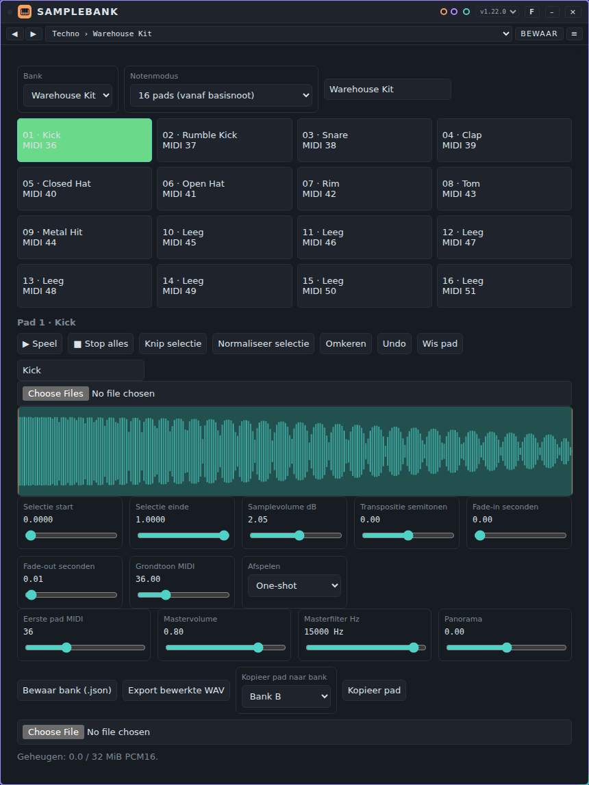

**Regelaars.** Dubbelklik op een schuif om terug te gaan naar de beginwaarde. De kaart volgt de manier waarop je werkt: kies een bank en een pad, laad en bewerk een sample, stel dan het geluid van de hele sampler in.

- **Bank:** de lijst kiest een van de vier banken. Ernaast staat een tekstveld met de naam van de bank, die je kunt wijzigen.
- **Notenmodus:** **16 pads (vanaf basisnoot)** speelt pad *n* vanaf de noot *Eerste pad MIDI* + *n* − 1 (standaard pad 1 op noot 36, pad 16 op noot 51). **Geselecteerde sample chromatisch** speelt het geselecteerde pad op elke noot, getransponeerd ten opzichte van zijn **Grondtoon MIDI**.
- **De 16 pads.** Klik op een pad om het te selecteren en te spelen. Elk pad toont zijn nummer, zijn naam (**Leeg** als er geen sample is) en zijn MIDI-noot.
- **Padgereedschap:** **▶ Speel** speelt het geselecteerde pad, **■ Stop alles** maakt alles stil, **Knip selectie** gooit de audio buiten de selectie weg, **Normaliseer selectie** maakt de selectie zo luid mogelijk zonder te clippen, **Omkeren** draait de sample om, **Undo** neemt de laatste bewerking van een pad terug en **Wis pad** maakt het leeg. Onder het gereedschap staat een veld voor de naam van de sample.
- **Een sample laden:** de bestandskiezer onder de padnaam laadt een of meer WAV- of MP3-bestanden. Met meerdere bestanden vullen ze de volgende pads vanaf het geselecteerde pad; de padnaam wordt de bestandsnaam. Je kunt ook een bestand op de golfvorm laten vallen.
- **Golfvorm:** sleep erop om het begin of het einde van de selectie te verplaatsen. De schuiven eronder doen hetzelfde met getallen.
- **Schuiven per pad:** **Selectie start** en **Selectie einde** (0 tot 1 van de sample), **Samplevolume dB** (−24 tot +24), **Transpositie semitonen** (−24 tot +24), **Fade-in seconden** en **Fade-out seconden** (0 tot 2 s) en **Grondtoon MIDI** (de noot waarop de sample op zijn eigen toonhoogte klinkt; alleen gebruikt in de chromatische notenmodus).
- **Afspelen:** **One-shot** speelt de sample tot het einde (een noteoff doet niets), **Gate / noteoff** stopt als je de toets loslaat of als de nootlengte voorbij is, **Loop tot noteoff** herhaalt de selectie tot je de toets loslaat of de nootlengte voorbij is.
- **De hele sampler:** **Eerste pad MIDI** (de noot van pad 1, 0 tot 111), **Mastervolume**, **Masterfilter Hz** (een laagdoorlaatfilter van 100 tot 16000 Hz) en **Panorama**.
- **Banken en bestanden:** **Bewaar bank (.json)** schrijft de gekozen bank, met audio, naar een bestand; de bestandskiezer eronder (**Bankbestand importeren**) leest zo'n bestand terug in de gekozen bank. **Export bewerkte WAV** schrijft het geselecteerde pad, met selectie, omkering, fades, volume en stemming verwerkt, als WAV-bestand. **Kopieer pad naar bank** (kies de bank in de lijst en druk dan op **Kopieer pad**) kopieert het geselecteerde pad naar dezelfde plek in een andere bank.
- **Geheugen:** een regel onder de kaart toont hoeveel van de 32 MiB samplegeheugen (gedeeld door alle vier de banken) in gebruik is.

**De golfvormeditor (tab Bewerken).**

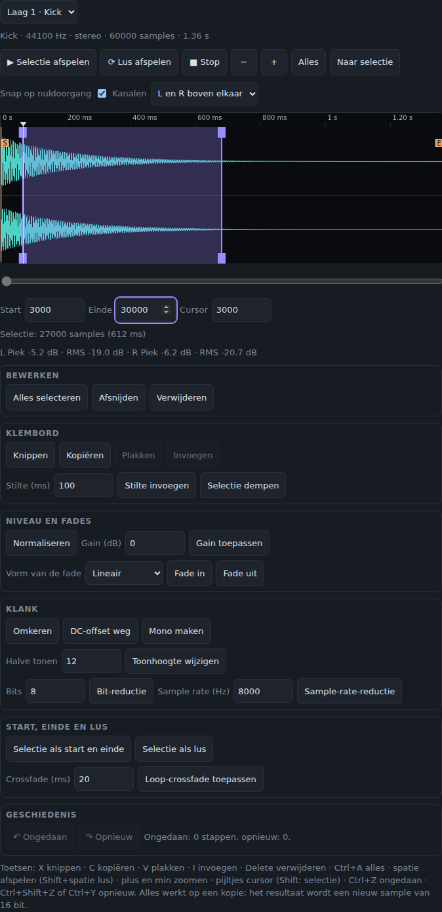

Kies bovenaan welke laag of zone je bewerkt. Alles wat je doet werkt op een kopie en het resultaat wordt een nieuw sample van 16 bit; de laag wijst er daarna naar. Andere pads die hetzelfde sample gebruiken, houden het oude.

- **Golfvorm.** Sleep om een selectie te maken; sleep de handvatten om start of einde te verplaatsen (ook met een vinger). Een tik zet de cursor. Zoom met het scrollwiel, met twee vingers (pinch) of met **−**, **+**, **Alles** en **Naar selectie**, tot je de losse samples ziet; scroll met de balk eronder, Shift+scrollwiel of met de rechter muisknop slepen. Sleep op de liniaal om te **scrubben** (een kort stukje klinkt). **Snap op nuldoorgang** laat start, einde en cursor naar de dichtstbijzijnde nuldoorgang springen tegen kliks. Bij stereo staan **L en R boven elkaar** of als **Som**; eronder staan piek en RMS van de selectie. **Start**, **Einde** en **Cursor** (in samples) kun je ook intikken.
- **Beluisteren.** **Selectie afspelen** (zonder selectie vanaf de cursor), **Lus afspelen** en **Stop**; een lijn loopt als afspeelkop mee.
- **Bewerken:** **Alles selecteren**, **Afsnijden** (alleen de selectie blijft, en blijft geselecteerd), **Verwijderen** (de rest sluit aan). **Knippen**, **Kopiëren**, **Plakken** (vervangt de selectie, of komt op de cursor) en **Invoegen** (altijd op de cursor) gebruiken een klembord dat over pads heen werkt. **Stilte invoegen** (ms) op de cursor, **Selectie dempen**.
- **Niveau en fades:** **Normaliseren** (piek naar 0 dBFS), **Gain** (dB, met een melding als het afkapt), **Fade in** en **Fade uit** over de selectie of het hele sample, **lineair**, **logaritmisch** (snel omhoog, daarna rustig) of **exponentieel** (eerst rustig).
- **Klank:** **Omkeren** (blijvend; los van de schakelaar Omgekeerd van het pad), **DC-offset weg**, **Mono maken**, **Toonhoogte wijzigen** (halve tonen; het geluid wordt korter of langer), **Bit-reductie** (2 tot 15 bits) en **Sample-rate-reductie** (Hz). Zonder selectie gelden ze voor het hele sample.
- **Start, einde en lus:** **Selectie als start en einde** en **Selectie als lus** (de lus gaat aan); de markeringen S, E en L staan in de golfvorm en zijn te slepen. **Loop-crossfade toepassen** rekent een crossfade (ms) in het sample, vlak voor het lusbegin, zodat de naad niet klikt. De regelaar **Lus crossfade** (tab Lagen) doet hetzelfde tijdens het afspelen, zonder het sample te veranderen.
- **Ongedaan en Opnieuw.** Minstens 100 stappen (begrensd op 128 MiB aan geheugen; de oudste vervalt). Ctrl+Z, Ctrl+Shift+Z of Ctrl+Y. De geschiedenis wordt niet bewaard met de song en is leeg na het laden.
- **Toetsenbord** (in de editor): **X** knippen, **C** kopiëren, **V** plakken, **I** invoegen, **Delete** verwijderen, **Ctrl+A** alles, **spatie** speelt de selectie (Shift+spatie: lus), **+** en **−** zoomen, pijltjes verplaatsen de cursor (met Shift maak je een selectie).
- **Grenzen.** Past het resultaat niet meer in de 64 MiB (of is het langer dan 120 s), dan gebeurt de bewerking niet en krijg je een melding. Het geluid is niet beluisterd door de bouwer maar met metingen gecontroleerd.

**Chop, Process en Flatten (tab Bewerken, soort bewerking).** Onder de golfvorm kies je de soort bewerking: **Bewerken** (hierboven), **Chop**, **Process**, **Flatten** of **Autosampler**.

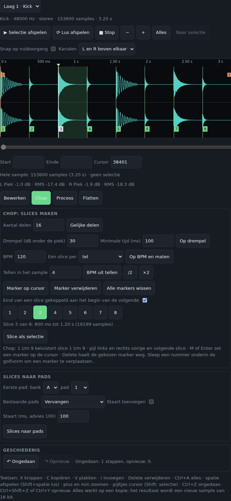

- **Chop: slices maken.** Een slice is een markering in het sample (geen kopie). **Gelijke delen** (2 tot 64, standaard 16), **Op drempel** (aanslagen zoeken: **Drempel** in dB onder de piek en **Minimale tijd** tussen twee aanslagen; flams worden één slag), **Op BPM en maten** (een slice per maat, tel, achtste of zestiende; **BPM uit tellen** rekent het tempo uit het aantal tellen in het sample, met **/2** en **×2** voor een verkeerde schatting) en handmatig: **Marker op cursor**, **Marker verwijderen**, **Alle markers wissen**. De markers staan als genummerde vlaggetjes onderin de golfvorm; sleep een vlaggetje om hem te verplaatsen (muis en vinger, met snappen op nuldoorgang als die aan staat). Standaard is het eind van een slice het begin van de volgende; zet **Eind van een slice gekoppeld aan het begin van de volgende** uit om ook eindpunten los te slepen. Een demo-sample wordt bij de eerste chop een eigen sample.
- **Slices beluisteren.** Klik of tik op een nummer (knop of vlaggetje), of druk op **1** t/m **9**; pijl links en rechts gaan naar de vorige en volgende slice, **M** of **Enter** zet een marker op de cursor en **Delete** haalt de gekozen marker weg. **Slice als selectie** maakt van de slice een selectie.
- **Slices naar pads.** Kies bank en pad waar slice 1 heen gaat; slice n gaat naar het n-de pad daarna. Elk pad krijgt laag 1 met hetzelfde sample en het begin en einde van de slice (geen kopieën). **Vervangen** maakt van bestaande pads een nieuw pad, **Alleen lege pads vullen** laat bezette pads staan. **Staart toevoegen** rekt het einde van elk pad op met 0 tot 5000 ms (advies 100 ms) zodat een afgekapte slag zachter eindigt. Het is één stap voor Ongedaan.
- **Process: als sample opslaan.** **Filter** (laagdoorlaat, hoogdoorlaat of banddoorlaat; 12 of 24 dB per octaaf; **Cutoff**, **Resonantie** en een **Sweep over de selectie** naar een eindcutoff), **Drive** (zacht afknijpen, met **Mix**), **Bitcrusher** (bits en sample rate), **EQ met drie banden** (laag 200 Hz, midden 1 kHz, hoog 5 kHz, ±18 dB), **Compressor** (drempel, ratio, attack, release en make-up) en **Tempo-afstemming** (een lus op een doel-BPM brengen door te hersamplen: **Tellen in het sample** geeft het huidige tempo, **/2** en **×2** corrigeren een verkeerde schatting; de toonhoogte verandert mee; voor tempo zonder toonhoogte kies je **Time-stretch**) en **Time-stretch** (zie hieronder). **Beluisteren** rekent het resultaat uit en speelt het af zonder iets te wijzigen; **Toepassen** slaat het echt in het sample op (op de selectie, of het hele sample zonder selectie) en is ongedaan te maken.
- **Time-stretch (sinds 1.5.0).** Bij **Wat verandert** kies je **Tempo naar doel-BPM** (met **Tellen in het sample** en **Doel-BPM**, zoals bij Tempo-afstemming), **Tempo met een factor** (**Tempofactor** 0,5 tot 2; 2 is twee keer zo snel) of **Toonhoogte, tempo blijft** (**Halve tonen** tot 12 en **Cent**; het sample wordt eerst gerekt en dan teruggehersampled naar dezelfde lengte). **Kwaliteit**: **Ritmisch** gebruikt korte vensters en herkent elke aanslag, die dan precies op zijn plek begint (voor drums en loops); **Tonaal** gebruikt lange vensters (voor klank en melodie, maar aanslagen kunnen dan vervagen of wegvallen). **Time-stretch toepassen** werkt op de selectie of het hele sample, is één stap Ongedaan en geeft een melding als het resultaat langer dan 120 seconden of te groot voor het geheugen wordt. De info-regel toont de nieuwe lengte. Het rekenen gebeurt in een achtergrond-thread, met voortgang in procenten en een knop **Annuleren** (er verandert dan niets); je kunt intussen niet iets anders in de editor doen. Een lange stereo-opname in Tonaal kost een paar seconden. Niet beluisterd door de bouwer: de kwaliteit is gemeten (lengte, toonhoogte, plaats en aanstijgtijd van aanslagen), niet gehoord.

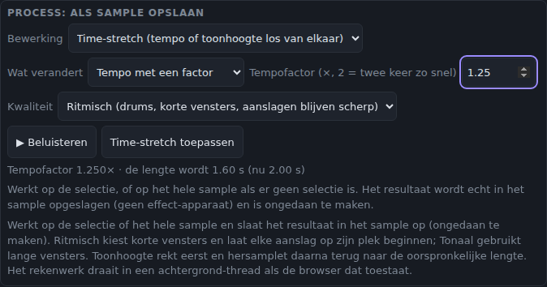

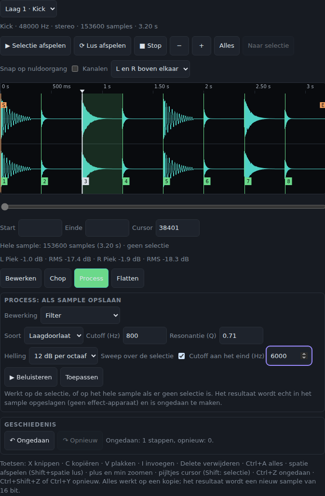

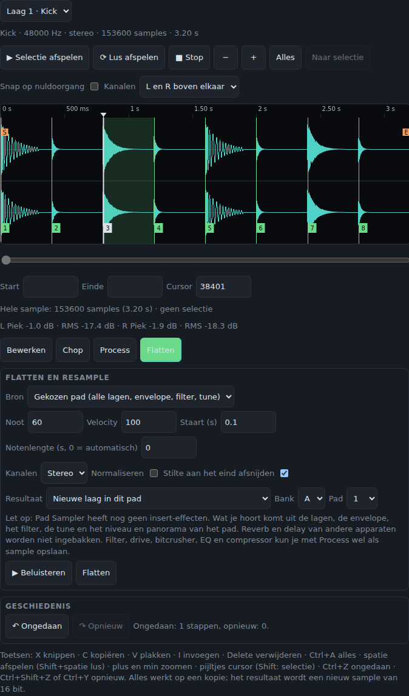

- **Flatten en resample.** Rendert het gekozen pad (alle lagen, envelope, filter, tune, omkeren, niveau en panorama; zonder de keuze van de uitgang) of de selectie van de editor, sneller dan realtime, naar een nieuw sample. Kies de **Noot** en **Velocity** (standaard de grondtoon en 100), de **Staart** (standaard 0,1 s), de **Notenlengte** (0 is automatisch), **Stereo** of **Mono**, **Normaliseren**, **Stilte aan het eind afsnijden** en het **Resultaat**: een nieuwe laag in dit pad, de gekozen laag vervangen, dit pad vervangen (de ingebakken instellingen gaan terug naar standaard) of een ander pad. De sends (reverb en delay van Pad Sampler zelf) en reverb en delay van andere apparaten worden niet ingebakken, want Pad Sampler heeft geen insert-effecten; gebruik Process voor filter, drive, bitcrusher, EQ en compressor.
- **Autosampler.** Bemonstert het geluid van het gekozen pad (of alleen de gekozen laag) over een bereik van noten en velocity-lagen en maakt er zones van op een keygroup-pad. Elke noot en elke velocity-laag wordt gerenderd met dezelfde keten als Flatten (lagen, envelope, filter, tune, niveau en panorama, zonder de sends). Je kiest de **Laagste** en **Hoogste noot**, de **Stap** in halve tonen (met stap 3 krijgt elke zone drie toetsen), 1 tot 4 **Velocity-lagen** (de velocity-bereiken worden gelijk verdeeld; bij één laag geldt **Velocity bij één laag**), de **Notenlengte** en de **Staart**, de **Grondtoon van de zone** (midden van de zone of onderste toets), **Mono**, **Gelijk normaliseren** (alle zones krijgen dezelfde versterking, zodat de verhoudingen blijven) en **Stilte aan het eind afsnijden**. Het **Doel** is een ander pad (standaard het eerste lege pad na de bron; heeft het doelpad geluid, dan staat er dat het wordt vervangen; uitgang en mutegroep van het doelpad blijven). Onder de knoppen staat het aantal zones en de geschatte grootte. Een zone klinkt bij de gerenderde aanslag zoals het bronpad: de aanslag stuurt de keuze van de laag en het filter, de amplitude komt bij het spelen van de zone zelf. Identieke klanken (bijvoorbeeld bij een bron met één velocity-laag) delen één sample. Het pad wordt een keygroup met one-shot aan: elk sample bevat zijn eigen release. Te veel zones (meer dan 128), een resultaat dat niet in de 64 MiB past of een lengte boven 120 s geven een melding vóór er iets gerenderd wordt. **Stop** breekt af zonder iets te veranderen; **Proefnoot beluisteren** speelt één noot zonder iets op te slaan. Het is één stap voor Ongedaan. De Autosampler kan alleen het geluid van Pad Sampler zelf opnemen, geen geluid van buiten.

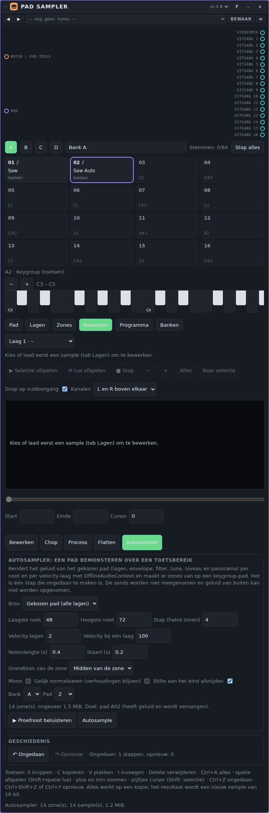
- **Ongedaan en Opnieuw** gelden ook voor chop, slices naar pads, Process en Flatten (het zijn stappen in dezelfde geschiedenis). Een bewerking die niet meer in de 64 MiB past, wordt geweigerd met een melding.

**Poorten.**

| Poort | Soort | Gebruik |
|---|---|---|
| **Noten / pad-trigs** | noten in (oranje) | Noten van **Keys / MIDI** of een sequencer. In padmodus kiest de noot het pad; een noot buiten de 16 pads wordt genegeerd. Een *trig* met de lane `pad3` of `3` speelt pad 3 van de gekozen bank. De velocity bepaalt het volume. |
| **Mod** | modulatie in (paars) | Een modulator kan **Volume**, **Filter** en **Pan** bewegen (het volume staat bij het begin niet aan voor modulatie). |
| **Stereo samples** | audio uit (groenblauw) | Verbind met **Speakers** of een **Mixer**-kanaal. |

**Voorbeeld: je eigen drumkit.**

1. Plaats **Samplebank**, **Keys / MIDI** en **Speakers**. Verbind de noten van Keys met **Noten / pad-trigs** en **Stereo samples** met **In** op Speakers.
2. Kies bank A en pad 1. Laad een kicksample met de bestandskiezer. Sleep het einde van de selectie om een lange uitloop weg te knippen, en geef het pad een naam.
3. Kies pad 2, laad een snare, enzovoort. Zet **Afspelen** op **Gate / noteoff** voor geluiden die je wilt afkappen als je de toets loslaat; laat drums op **One-shot**.
4. Speel de pads vanaf noot 36 omhoog op Keys, of vanaf een sequencer die die noten speelt.
5. Wil je liever een melodie van één sample: kies het pad van de sample, zet **Grondtoon MIDI** op de noot waarop hij goed klinkt en zet de notenmodus op **Geselecteerde sample chromatisch**.

**Tunes.** Pack **Samplebank Styles**: 79 tunes in 16 mappen (Techno, House, Trance, Ambient, Synthwave, Hip-hop, Lo-fi, Trap, Drum & Bass, Dubstep, Electro, Pop, Chiptune, Funk & Disco, Dub en Cinematic), bestand [`samplebank-styles.patchkamer-tunes.json`](../../tunes/samplebank-styles.patchkamer-tunes.json). Anders dan de tunes van andere apparaten bevat een Samplebank-tune **zijn eigen audio**: kleine, gegenereerde geluiden, zodat elke tune meteen klinkt zonder een bestand te laden. 13 tunes zijn drumkits op de pads (notenmodus **16 pads (vanaf basisnoot)**, pad 1 op noot 36), 66 zijn één geluid dat chromatisch gespeeld wordt. Enkele namen: **Warehouse Kit**, **Rolling Sub**, **Gate Pad**, **Dusty Boom Kit**, **Disco Strings**. De geluiden zijn kort en hebben een lage sample rate; laad je eigen sample op een pad om ze te vervangen. Een tune stelt het hele apparaat in en vervangt dus de vier banken die je had: bewaar een bank die je wilt houden eerst met **Bewaar bank (.json)**.

**Tips en beperkingen.**

- Maximaal 120 seconden per sample, 32 MiB audio over alle vier de banken, 50 MiB per bestand dat je laadt en 32 stemmen tegelijk.
- Een bestand dat niet te decoderen is, of geen audio bevat, geeft een melding op de kaart en laat de bank ongemoeid. Wat gedecodeerd kan worden, hangt van je browser af.
- Een ingehouden noot op een **One-shot**-pad speelt tot het einde van de sample; het loslaten van de toets doet niets. Gebruik **Gate / noteoff** of **Loop tot noteoff** als je de lengte met de toets wilt bepalen.
- Als het transport stopt, vallen alle pads stil.
- De uitgang gaat als vangnet door een compressor.

## Pad Sampler

**Waar is het voor.** Een grotere sampler voor drumkits en instrumenten. Hij heeft vier banken van 16 pads; elk pad heeft vier **lagen** (samples die klinken op velocity, om de beurt, willekeurig of allemaal tegelijk), een envelope, een filter, een mutegroep en een eigen audio-uitgang. Een pad is een **drum**-pad (één noot, één slag) of een **keygroup** (samples met een toetsbereik en een grondtoon, chromatisch te spelen vanaf een keyboard). Hij begint met een ingebouwde demo-kit in bank A en klinkt dus meteen. Sinds versie 1.1.0 heeft hij een **golfvormeditor** (tab Bewerken); sinds 1.2.0 ook **chop**, **Process** en **Flatten** (renderen naar een nieuw sample); sinds 1.4.0 ook twee **sends** (reverb en delay), een **lus-crossfade** die direct klinkt en een **Autosampler**; sinds 1.5.0 **Time-stretch** en het laden van **SoundFonts** (SF2 en SF3) en **XPM-programma's**.

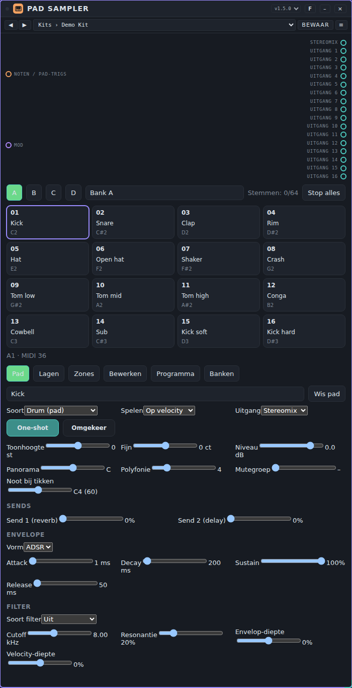

**Regelaars.** Dubbelklik op een schuif om terug te gaan naar de beginwaarde.

- **Banken A t/m D** en de banknaam; **Stop alles** brengt alles tot zwijgen; **Stemmen** toont hoeveel van de 64 stemmen klinken.
- **De 16 pads.** Klik, tik of druk Enter of spatie op een pad: het wordt gekozen en speelt met de **Aanslag van pads** (tab Programma). Met het toetsenbord van je computer spelen de vier rijen `1234`, `qwer`, `asdf` en `zxcv` de pads 1 tot 16; met de pijltjes ga je van pad naar pad. Sleep een audiobestand op een pad om het daar te laden. Een keygroup-pad toont een ♪ en een toetsenbord op het scherm (twee octaven, met − en + voor het octaaf; de toetsen `a w s e d f t g y h u j k o l p` spelen de noten van dat toetsenbord).
- **Tab Pad:** de naam; **Soort** (**Drum** of **Keygroup**; wisselen zet ook One-shot en de polyfonie op zinnige waarden); **Spelen** (hoe de lagen gekozen worden: **Op velocity**, **Om de beurt**, **Willekeurig** of **Alle lagen**); **Uitgang** (**Stereomix** of **Uitgang 1** t/m **16**); **One-shot** (negeer noteoff; het sample speelt uit) en **Omgekeerd**; **Toonhoogte** (±24 halve tonen), **Fijn** (±100 cent), **Niveau** (dB), **Panorama**, **Polyfonie** (1 tot 16; 1 is mono: een nieuwe slag kapt de vorige af), **Mutegroep** (0 is geen: een slag kapt de andere pads in dezelfde groep af, met een fade van 5 ms) en **Noot bij tikken** (de noot die een keygroup-pad speelt als je erop klikt); **Send 1** (naar de reverb) en **Send 2** (naar de delay), zie **Sends** hieronder.
- **Envelope:** **ADSR** of **AD** (alleen attack en decay: een percussieve vorm die na de decay uitsterft; een noteoff laat hem dan nog steeds eerder los). **Attack**, **Decay**, **Sustain**, **Release**. De release geldt bij noteoff als One-shot uit staat.
- **Filter:** **Uit**, **Laagdoorlaat**, **Hoogdoorlaat** of **Banddoorlaat**, met **Cutoff**, **Resonantie**, **Envelop-diepte** (hoever de envelope het filter opent of sluit; hij heeft geen eigen release) en **Velocity-diepte** (positief: zachte slagen klinken donkerder).
- **Tab Lagen:** vier lagen per pad. Kies het **Sample** (de ingebouwde demo-samples beginnen met een punt) of **Bestand laden…** (WAV, FLAC, OGG of MP3; meerdere bestanden vullen de volgende pads). Per laag: **Halve tonen**, **Fijn**, **Niveau**, **Panorama**, **Offset** (negatief vertraagt de laag zoveel milliseconden, positief begint zo ver in het sample), **Grondtoon**, **Velocity vanaf / tot** (1 tot 127), **Start** en **Einde** (als deel van het sample), **Gain** en een **Lus** met start en einde en een **Lus crossfade** (0 tot 100% van de halve lus: het eind van de lus gaat zacht over in het stuk vlak voor het lusbegin, zodat de naad niet klikt; er moet dus geluid vóór het lusbegin zijn). Een lus werkt alleen als One-shot uit staat. Een WAV-bestand met een `smpl`-blok geeft zijn grondtoon en eerste lus vanzelf. In de golfvorm van de tabs Lagen en Zones loopt een lichte **afspeelkop** mee (vanaf 1.6.0), één per klinkende stem die het getoonde sample speelt; hij volgt de lus, omgekeerd afspelen en toonhoogte.
- **Tab Zones:** voor een keygroup-pad. Een zone is een sample met een **Grondtoon**, een toetsbereik (**Toets vanaf / tot**), een velocity-bereik, een **Stemming** en een optionele lus; tot 128 zones. Zonder zones speelt het pad zijn lagen chromatisch rond de grondtoon van elke laag.
- **Tab Bewerken:** de golfvormeditor, zie hieronder.
- **Tab Banken:** laad een hele bank geluiden, zie hieronder.
- **Tab Programma:** **Mastervolume** (alleen de stereomix), **Eerste pad (MIDI)** (de noot van bank A pad 1; bank B, C en D volgen na telkens 16 noten), **Aanslag van pads**, **Demo-kit herstellen**, **Leeg programma** het gebruikte samplegeheugen en de **Sends** (zie hieronder).

**Poorten.**

| Poort | Soort | Gebruik |
|---|---|---|
| **Noten / pad-trigs** | noten in (oranje) | Een noot speelt het drum-pad met die noot (pad 1 van bank A staat op **Eerste pad**, standaard 36, tot bank D pad 16). Een noot die geen drum-pad met een sample opeist, speelt de keygroup-pads. Een vastgehouden toets (`held`) eindigt bij noteoff; andere noten eindigen na hun lengte. Een *trig* met de lane `pad3` of `3` speelt pad 3 van de gekozen bank, `b1` pad 1 van bank B. Events worden op de audioklok gepland. `allnotesoff` brengt alles tot zwijgen. |
| **Mod** | sturing in (paars) | **Mastervolume**, en per pad **Niveau**, **Cutoff** en **Toonhoogte** (193 parameters, geen enkele staat bij het begin aan). |
| **Stereomix** | audio uit (blauwgroen) | De som van alle pads die naar de mix gaan, via een zachte begrenzer. |
| **Uitgang 1** t/m **16** | audio uit (blauwgroen) | Een pad dat op een uitgang staat, klinkt alleen daar en niet in de mix. Verbind ze met kanalen van een **Mixer** om elk pad zelf af te mixen. Ook de retour van de reverb of de delay kan op zo'n uitgang staan; die komt dan bij wat daar al klinkt. |

**Voorbeeld: een kit met een eigen kanaal per drum.**

1. Plaats **Pad Sampler**, een **Mixer**, **Keys / MIDI** en **Speakers**. Verbind de noten van Keys met **Noten / pad-trigs**, **Uitgang 1** t/m **Uitgang 3** met kanaal 1 t/m 3 van de Mixer en de uitgang daarvan met Speakers.
2. Kies pad 1 en zet **Uitgang** op **Uitgang 1**; doe hetzelfde voor de snare (pad 2, **Uitgang 2**) en de hat (pad 5, **Uitgang 3**). Pads die op **Stereomix** blijven staan, komen niet in de Mixer; verbind ook **Stereomix** als je ze wilt horen.
3. Zet de open hat (pad 6) en de gesloten hat (pad 5) op dezelfde **Mutegroep**, zodat een gesloten hat de open afkapt.
4. Voor een toetsenbordinstrument: kies een pad, zet **Soort** op **Keygroup**, laad een sample, stel zijn **Grondtoon** in en zet de **Lus** aan als het een lustoon is.

**Sends: reverb en delay (sinds 1.4.0).** Elk pad heeft twee sends in de tab Pad: **Send 1** gaat naar een ingebouwde **reverb**, **Send 2** naar een ingebouwde **delay**. De bussen en hun instellingen staan in de tab Programma en horen bij het programma, niet bij een pad.

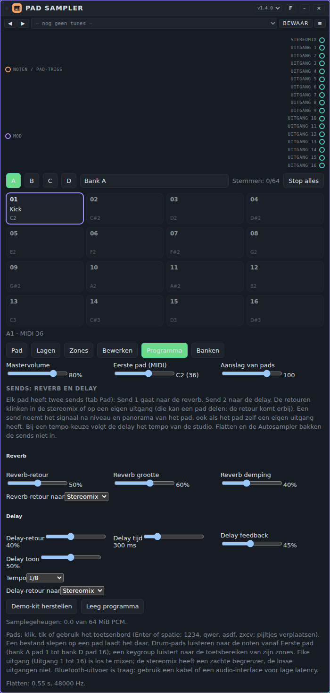

- **Send-niveau** (0 tot 100%, standaard 0): hoeveel van het pad naar de bus gaat. De send neemt het signaal na **Niveau** en **Panorama** van het pad, ook als het pad een eigen uitgang heeft. Op 0 gebeurt er niets en bestaan de bussen niet eens.
- **Reverb:** **Reverb-retour** (hoeveel er terugkomt), **Reverb grootte** (de staart, ongeveer 0,3 tot 6 seconden) en **Reverb demping** (hoger is donkerder). De reverb is een convolver met een zelf gegenereerde stereo-impuls; een nieuwe grootte of demping wisselt zacht naar een nieuwe impuls.
- **Delay:** **Delay-retour**, **Delay tijd** (10 ms tot 1,5 s), **Delay feedback** (tot 95%), **Delay toon** (hoe donker de herhalingen worden) en een **Tempo**-keuze (**Vrij**, of 1/2, 1/4 met punt, 1/4, 1/8 met punt, 1/8, 1/8 triool, 1/16): met een tempo-keuze volgt de delay het tempo van de studio en is **Delay tijd** niet in gebruik.
- **Retour naar:** voor beide retouren kies je de **Stereomix** (voor de begrenzer) of **Uitgang 1** t/m **16**. Een retour op een uitgang komt bij wat daar al klinkt; er zijn geen extra poorten, de 17 audio-uitgangen blijven gelijk.
- **Grenzen:** de sends zitten niet in **Flatten**, **Autosampler** of Process (er verschijnt een waarschuwing), en de sends zijn niet te sturen met de poort **Mod**. Een nieuwe impuls wordt in een paar tientallen milliseconden berekend bij de eerste slag met een send; de delay is gemeten in Chromium (een DelayNode in een lus telt daar een rendersegment van 128 samples extra mee; het apparaat corrigeert dat, in een andere browser kan een herhaling een paar milliseconden afwijken).

**Tunes.** Pack **Pad Sampler Demos**: 15 tunes in twee mappen (**Kits**: Demo Kit, Tight Kit, Soft Kit, Lo-fi Kit, Velocity Kick, Round Robin Kit, Random Toms, Eight Outputs, Mute Group Hats; **Keygroups**: Saw Keys, Sine Sub, Square Lead, Pluck Keys, Split Keys, Soft Pad), bestand [`pad-sampler-demos.patchkamer-tunes.json`](../../tunes/pad-sampler-demos.patchkamer-tunes.json). Ze gebruiken alleen de ingebouwde, gesynthetiseerde samples, zijn dus klein en klinken meteen. Een tune vervangt het hele programma, ook je banken.

**Banken en catalogus.** De tab **Banken** laadt geluiden in de **Doelbank** (met **Bank eerst leegmaken** vervang je de bank; zonder vul je de vrije pads). Een bank laden is één stap die je met **Ongedaan** (tab Bewerken) terugdraait.

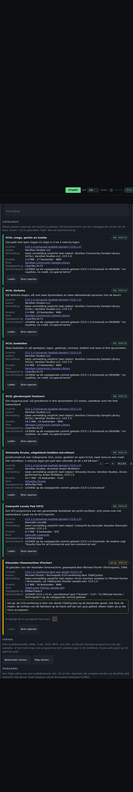

- **Catalogus:** elf gratis banken (VCSL conga, darbuka en koebellen, een VCSL-glockenspiel als keygroup, een uitgekleed jazzdrumstel, een SFZ-programma, een klassieke ritmemachine, een lo-fi drumstel in jaren-70-stijl, een getokkelde contrabas, een gestreken cello en een uitgeklede concertvleugel als keygroups). Alleen banken waarvan de licentie is gelezen; elk bestand komt van een vastgepinde versie van de bron. Bij elke bank staan altijd de **licentie**, de **auteur**, de **vermelding**, de grootte en de bron. **Groen** is vrij te gebruiken; **geel** toont eerst een waarschuwing en je moet het risico bevestigen voor Laden werkt. Er gaat niets over het net voor je zelf op **Laden** drukt.
- **Lokaal:** **Bestanden kiezen…** of **Map kiezen…** (WAV, FLAC, OGG, MP3, of een SFZ-, Decent Sampler- of XPM-programma met zijn samples, of een SoundFont). Eigen **Auteur**, **Licentie** en **Vermelding** vul je boven in; ze worden bij de samples bewaard.
- **Webadres:** een https-adres van een audiobestand, een `.sfz` of een `.dspreset`. De server moet toegang vanuit de browser toestaan. **Freesound:** vul je eigen token in (dat blijft alleen in het venster en gaat nooit in de song), zoek, en laad het voorbeeld van een CC0- of CC-BY-geluid in de gekozen laag.
- **Importers:** WAV met root en lus uit het `smpl`-blok; FLAC, OGG en MP3 via de browser (MP3 is niet nauwkeurig voor lussen: je krijgt een waarschuwing); een SFZ-subset (`region`, `sample`, `lokey`/`hikey`/`key`, `lovel`/`hivel`, `pitch_keycenter`, `tune`, `transpose`, `loop_mode`, `loop_start`/`loop_end`, `group`/`off_by`, `seq_length`/`seq_position`, `volume`, `pan`) en Decent Sampler (`.dspreset`). Het **Importrapport** zegt wat is overgenomen, wat is genegeerd (met aantallen) en wat niet past (pads, vier lagen, zones, 64 MiB). NKI, EXS, Battery en Ableton worden niet gelezen. SoundFont en XPM staan hieronder.
- **SoundFont (SF2 en SF3, sinds 1.5.0).** Kies één `.sf2`- of `.sf3`-bestand. Onder Lokaal verschijnt het blok **SoundFont** met de naam, de versie, het aantal presets, instrumenten en samples, de **grootte van het bestand** en hoeveel Patchkamer voor de lijst in het geheugen las, en de gegevens uit het bestand zelf (copyright en opmerking; staat er niets, dan zegt het blok dat je zelf moet nagaan of je het mag gebruiken). Kies een **preset** (met bank en programma; bank 128 is slagwerk) of een los **instrument**; de regel eronder toont het aantal zones of pads, het aantal samples en ongeveer hoeveel geheugen (MiB PCM16) het kost. **Importeer in de doelbank** laadt alleen de samples van die keuze: de rest van het bestand blijft ongelezen. Overgenomen: toets- en velocity-bereik, grondtoon (ook de vaste grondtoon van het instrument), stemming (grof, fijn en de correctie van het sample), lus (alleen als de zone lust), volume-envelope (attack, decay, sustain, release; bij een korte aanslag zonder lus als AD), balans en demping, filter (afkapfrequentie en resonantie, grof als laagdoorlaat), exclusieve klasse als mutegroep, en een linker en rechter sample die bij elkaar horen als één stereosample. Een melodische preset wordt één keygroep-pad (hoogstens 128 zones); een slagwerkpreset wordt drum-pads, per toets één, in de volgorde van de toetsen en over hoogstens vier banken vanaf de doelbank. Niet overgenomen en in het **Importrapport** genoemd: alle modulatoren en de standaardmodulatoren, LFO's en modulatie-envelopes, effecten-sends, vertraging en hold van de envelope, vaste toets of velocity, 24-bit uitbreiding en ROM-samples. Een keygroep-pad heeft één volume, balans, envelope en filter voor het hele pad: verschilt dat per zone, dan wordt het niet overgenomen (het pad houdt de standaard) en staat dat in het rapport. **Licentie:** bij een lokaal bestand zet Patchkamer er niets bij behalve wat in het bestand zelf staat (naam en copyright als **Vermelding**, een herkenbare licentienaam als **Licentie**); je eigen velden boven in gaan voor. SF3 (samples als Ogg Vorbis) wordt met de decoder van de browser gedecodeerd; de lusposities zijn dan afgeleid uit de gedecodeerde lengte en kunnen een paar milliseconden afwijken. Getest met zelfgemaakte bestanden (SF2 en SF3), niet met grote echte SoundFonts.

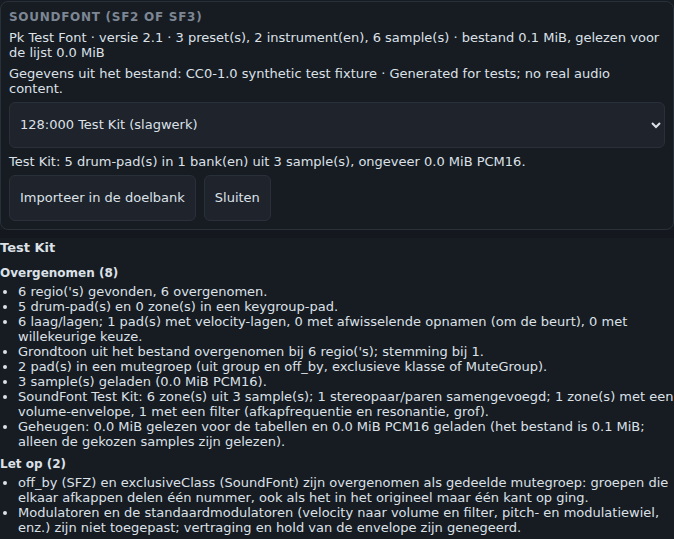
- **XPM-programma (sinds 1.5.0).** Kies het `.xpm`-bestand samen met zijn samples (of een hele map). Een **drum**-programma wordt drum-pads in de volgorde van het instrumentnummer (de toetstoewijzing van de pads wordt niet gebruikt); een **keygroup**-programma wordt één keygroep-pad met zones. Per instrument en laag worden overgenomen: samplenaam (de samples worden op naam gezocht, met of zonder extensie, bij voorkeur naast het programma), toets- en velocity-bereik, grondtoon, stemming, niveau, balans, lus, one-shot, mutegroep, polyfonie, afwisselen of willekeurig kiezen (bij drum-pads) en de volume-envelope. Filter, pitch-envelope, start en einde per laag, richting en mutedoelen worden genegeerd en in het rapport genoemd, net als alles wat Patchkamer niet kent. **Let op:** de opbouw van het bestand is gelezen uit openbare beschrijvingen van andere programma's en alleen getest met zelfgemaakte bestanden; er waren geen echte XPM-bestanden om mee te testen. Controleer het resultaat en laat het weten als een programma niet goed binnenkomt.
- **Vermeldingen** onder in de tab zijn de licenties van de samples die er echt in zitten; ze staan ook in de state (`credits`) en gaan dus mee in de song.
- Deze Patchkamer haalt bestanden van internet voor een apparaat via de host (`host.fetchFile`). Ontbreekt dat, dan zie je een uitleg: download dan de bestanden via **Bron openen** en kies ze onder **Lokaal**.

**Tips en grenzen.**

- 64 stemmen tegelijk (de oudste wordt afgekapt), 120 seconden per sample, 50 MiB per bestand om te laden en 64 MiB audio (PCM16) in totaal; identieke samples worden één keer bewaard. Audio die je laadt wordt gedecodeerd op de sample rate van de studio en met de song bewaard.
- De losse uitgangen hebben geen begrenzer; let op de niveaus als je ze zelf afmixt.
- Veranderingen van toonhoogte en cutoff (en sturing) bewegen ook stemmen die al klinken; envelope, filtersoort en de rest gelden vanaf de volgende slag.
- Bluetooth-uitvoer is traag. Gebruik een kabel of een audio-interface voor lage latency.

## Loop Slicer

**Waar het voor dient.** Een sampler voor loops. Hij knipt een loop (een WAV- of MP3-bestand, of de ingebouwde demo-loop) in 4, 8, 16 of 32 slices en speelt die slices vanaf toetsen, vanaf trigs of vanuit een patroon van 16 stappen op de klok. Je kunt de knippunten verslepen, Loop Slicer laten zoeken naar de aanzetten van geluiden, de slices omkeren, hoger of lager laten klinken, korter laten spelen en laten herhalen. Hij heette eerder Snede; songs uit die tijd verwijzen naar de oude naam en laden niet in dit apparaat, maar bankbestanden ervan kunnen nog gelezen worden.

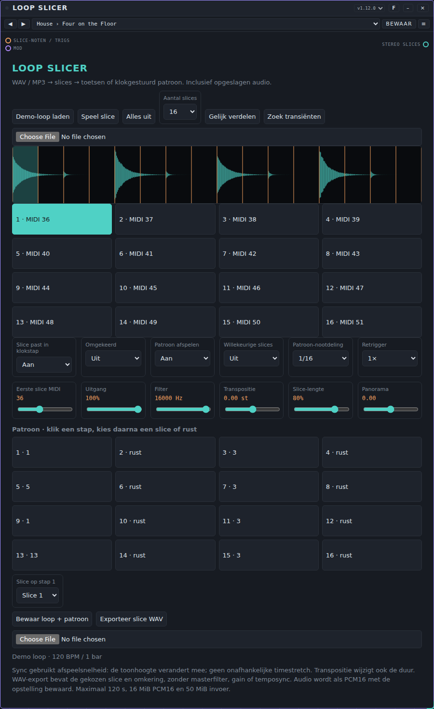

**Regelaars.** Dubbelklik op een schuif om terug te gaan naar de beginwaarde.

- **Demo-loop laden:** laadt de ingebouwde loop, één maat drums op 120 BPM. Dat is de snelste manier om te horen wat een tune doet. **Speel slice** speelt de geselecteerde slice, **Alles uit** maakt alles stil.
- **Aantal slices:** 4, 8, 16 of 32 slices. **Gelijk verdelen** zet de knippunten op gelijke afstand; **Zoek transiënten** zet ze op de aanzetten van geluiden die hij in de loop vindt (en vult aan met gelijke knippunten als hij er te weinig vindt).
- **Een loop laden:** de bestandskiezer onder de knoppen laadt een WAV- of MP3-bestand, of laat een bestand op de golfvorm vallen. De loop wordt als 16-bit audio met de song bewaard.
- **Golfvorm:** de oranje lijnen zijn de knippunten en het gearceerde deel is de geselecteerde slice. Sleep een knippunt om het te verplaatsen; het kan zijn buren niet passeren.
- **Slice-knoppen:** één per slice, met zijn nummer en MIDI-noot. Klik op een knop om de slice te selecteren en te spelen.
- **Slice past in klokstap:** **Aan** laat een slice in één stap van de klok passen (maal de nootdeling hieronder), zodat de toonhoogte van een slice met de snelheid meebeweegt. **Uit** speelt een slice op zijn eigen snelheid, verschoven met **Transpositie**.
- **Omgekeerd:** speelt de slices achterstevoren.
- **Patroon afspelen:** **Aan** speelt het patroon hieronder op de klok; **Uit** speelt alleen noten en trigs.
- **Willekeurige slices:** **Aan** kiest bij elke stap van het patroon een willekeurige slice (rusten blijven rusten). De reeks willekeurige keuzes is elke keer bij het starten dezelfde.
- **Patroon-nootdeling:** **1/16**, **1/8** of **1/4**: hoe lang elke patroonstap duurt.
- **Retrigger:** **1×**, **2×** of **4×**: herhaalt een stap zo vaak binnen zijn lengte, elke herhaling korter.
- **Eerste slice MIDI:** de noot van slice 1 (0 tot 95). Slice *n* ligt op die noot + *n* − 1.
- **Klank:** **Uitgang** (niveau), **Filter** (een laagdoorlaatfilter, 100 tot 18000 Hz), **Transpositie** (−24 tot +24 halve tonen), **Slice-lengte** (10 tot 100% van de slice, de rest wordt met een korte fade afgekapt) en **Panorama**.
- **Patroon:** 16 knoppen, een per stap, met het slicenummer of **rust**. Klik op een stap en kies dan zijn slice (of **Rust**) in de lijst **Slice op stap …** onder de knoppen.
- **Bewaar loop + patroon** schrijft een bankbestand met de loop en alle instellingen; de bestandskiezer naast **Exporteer slice WAV** (**Loop Slicer-bank laden**) leest zo'n bestand terug. **Exporteer slice WAV** schrijft de geselecteerde slice, met omkering, als WAV-bestand (zonder filter, niveau en tempoaanpassing).

**Poorten.**

| Poort | Soort | Gebruik |
|---|---|---|
| **Slice-noten / trigs** | noten in (oranje) | Noten van **Keys / MIDI** of een sequencer: de noot *Eerste slice MIDI* + *n* − 1 speelt slice *n*; de velocity bepaalt het volume. Een *trig* met de lane `slice3` of `3` speelt slice 3. Een ingehouden noot kapt de slice niet af: hij speelt zijn eigen lengte uit. Het patroon heeft de klok nodig; noten werken er zonder. |
| **Mod** | modulatie in (paars) | Een modulator kan **Uitgang**, **Filter**, **Transpositie**, **Slice-lengte** en **Panorama** bewegen (**Uitgang** en **Transpositie** staan bij het begin niet aan voor modulatie). |
| **Stereo slices** | audio uit (groenblauw) | Verbind met **Speakers** of een **Mixer**-kanaal. |

**Voorbeeld: een herschikte beat.**

1. Plaats **Loop Slicer** en **Speakers** en verbind **Stereo slices** met **In** op Speakers.
2. Druk op **Demo-loop laden** (of laad een eigen loop) en zet **Aantal slices** op 16.
3. Zet **Patroon afspelen** op **Aan** en druk op **Start**. Het patroon speelt op de klok.
4. Klik in het patroon op stap 3 en kies een andere slice bij **Slice op stap 3**. Kies **Rust** voor een gat.
5. Zet **Retrigger** op **2×** voor rollen, **Omgekeerd** op **Aan** voor een achterstevoren versie, of **Willekeurige slices** op **Aan** voor een andere volgorde.
6. Wil je de slices liever zelf spelen: zet **Patroon afspelen** op **Uit**, plaats **Keys / MIDI** en verbind zijn noten met **Slice-noten / trigs**. Slice 1 ligt standaard op noot 36.

**Tunes.** Pack **Loop Slicer Styles**: 69 tunes in 12 mappen (House, Techno, Breakbeat, Drum and Bass, Hip-hop, Trap, Funk, Dub, Cinematic, Glitch, Pitched Hits en Own Loop), bestand [`loop-slicer-styles.patchkamer-tunes.json`](../../tunes/loop-slicer-styles.patchkamer-tunes.json). Een tune bevat hoe de loop geknipt en gespeeld wordt, nooit de audio van je loop. 61 tunes zetten de ingebouwde **demo-loop** aan en vervangen de loop die je had geladen, zodat ze meteen klinken; 53 daarvan spelen een patroon (druk op **Start**), 8 speel je vanaf toetsen. De 8 tunes in de map **Own Loop** laten de loop die je hebt geladen staan en veranderen alleen het knippen en spelen: ze blijven stil tot je een loop laadt. Enkele namen: **Four on the Floor**, **Chopped Break**, **Stutter Snare**, **Random Shards**, **Even 16 Chop**.

**Tips en beperkingen.**

- Er is geen timestretch. Een slice wordt gespeeld door de afspeelsnelheid te veranderen, dus als een slice niet precies in zijn stap past, verandert zijn toonhoogte. Voor slices op hun eigen toon kies je het aantal slices en de nootdeling zo dat één slice één stap vult (16 slices bij **1/16**, 8 bij **1/8**, 4 bij **1/4**), of zet je **Slice past in klokstap** op **Uit**.
- **Transpositie** verandert ook de lengte van een slice.
- Maximaal 120 seconden per loop, 16 MiB audio, 50 MiB per bestand en 32 stemmen tegelijk.
- Een ingehouden noot stopt een slice niet: hij speelt zijn eigen lengte uit (zie **Slice-lengte**).
- Een loop laden geeft 16 gelijke slices; het patroon blijft staan.

## Als het niet werkt

- **Geen geluid.** Een sampler is stil tot er audio is geladen: laad een bestand op een pad (Samplebank) of druk op **Demo-loop laden** (Loop Slicer). Controleer of er audio loopt van de sampler naar **Speakers** (groenblauwe kabel), of het volume op Speakers openstaat en of **Mastervolume** of **Uitgang** niet op nul staat. Klik één keer ergens in Patchkamer: browsers houden audio tegen tot je dat doet.
- **Samplebank reageert niet op het toetsenbord.** Verbind de oranje kabel met **Noten / pad-trigs**. In padmodus moeten de noten binnen de 16 noten vanaf **Eerste pad MIDI** liggen (standaard 36 tot 51); een pad zonder sample blijft stil.
- **Een Loop Slicer-tune is stil.** De tunes in de map **Own Loop** hebben een loop nodig die je zelf hebt geladen. Een tune met een patroon heeft ook de klok nodig: druk op **Start**.
- **Loop Slicer speelt geen patroon.** Controleer of **Patroon afspelen** op **Aan** staat en of het patroon minstens één stap heeft die geen rust is.
- **Een bestand laadt niet.** De kaart toont een melding: te groot (50 MiB per bestand), te lang (120 seconden) of niet te decoderen. Samplebank stopt ook bij 32 MiB audio over alle banken.
- **Geknetter.** Open Instellingen → Audio en kies een grotere latency, of een lagere kwaliteit.
