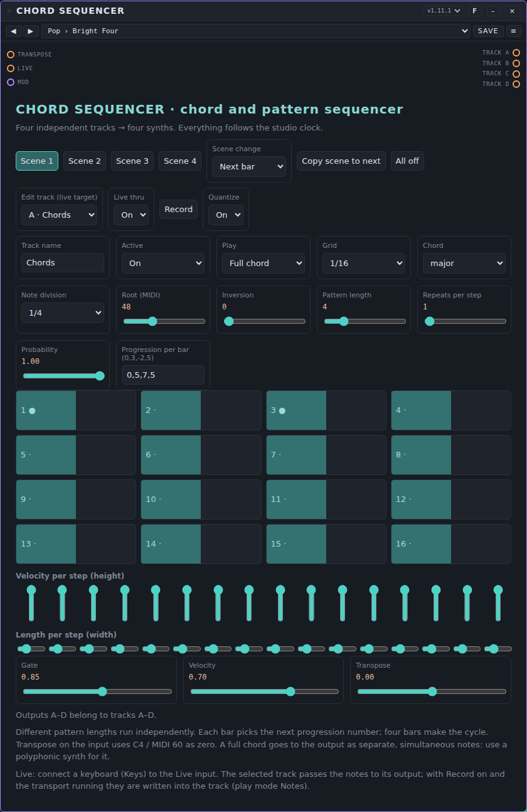
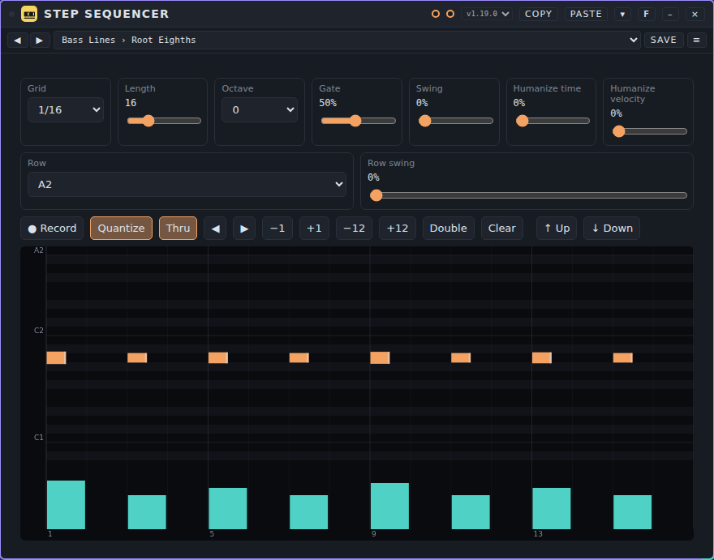
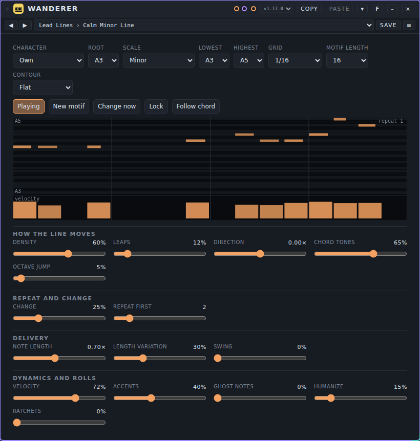
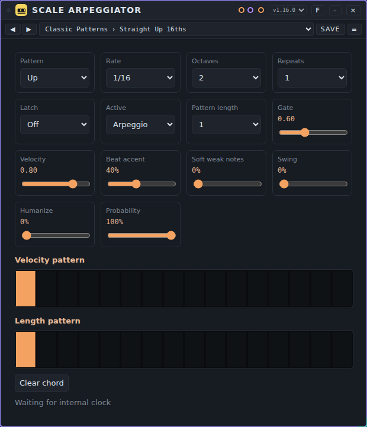
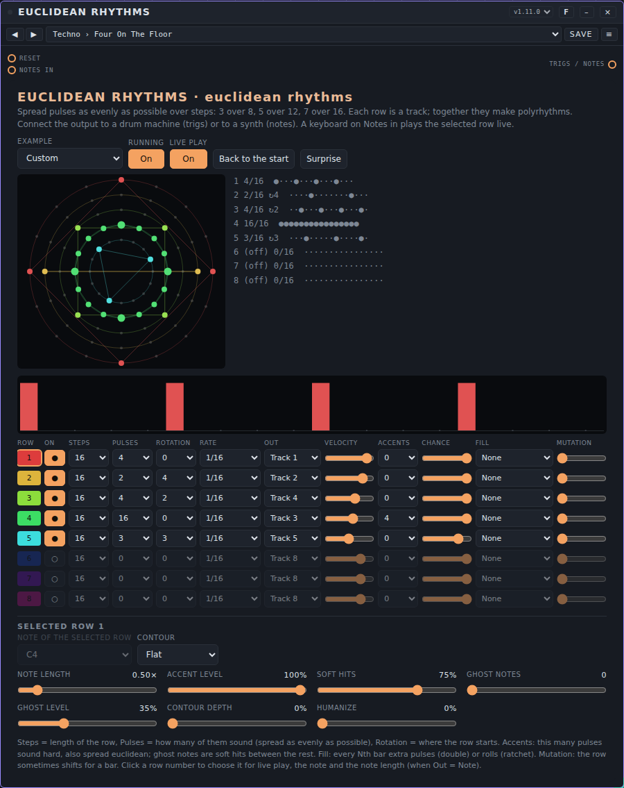
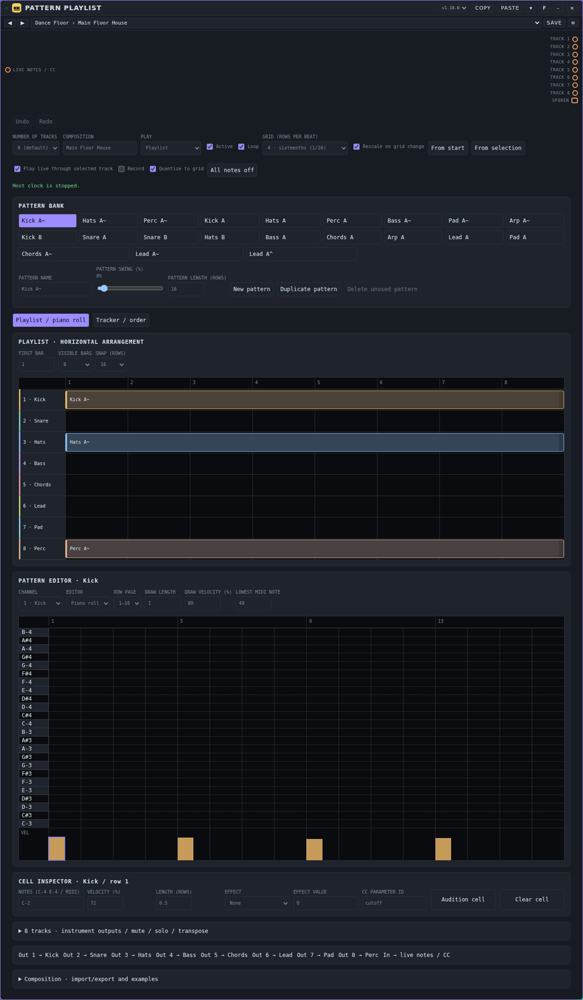
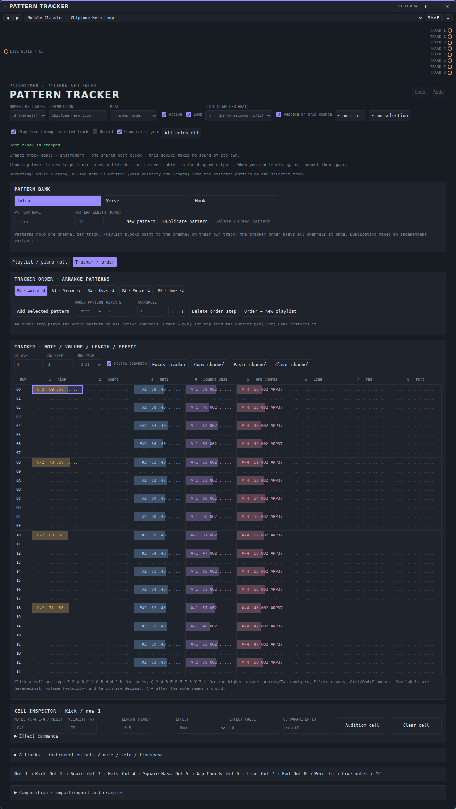
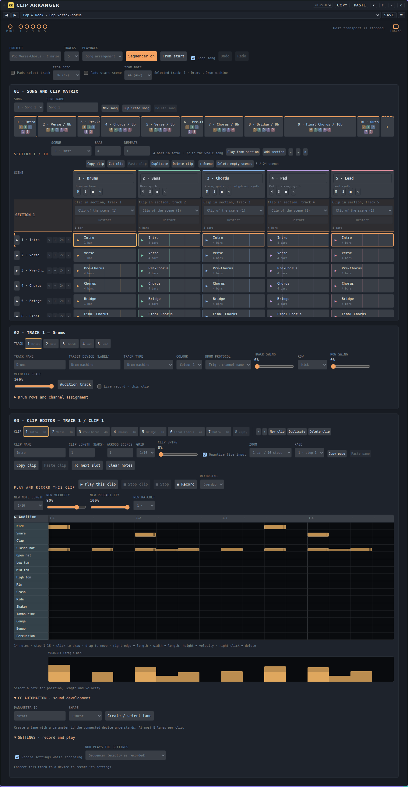
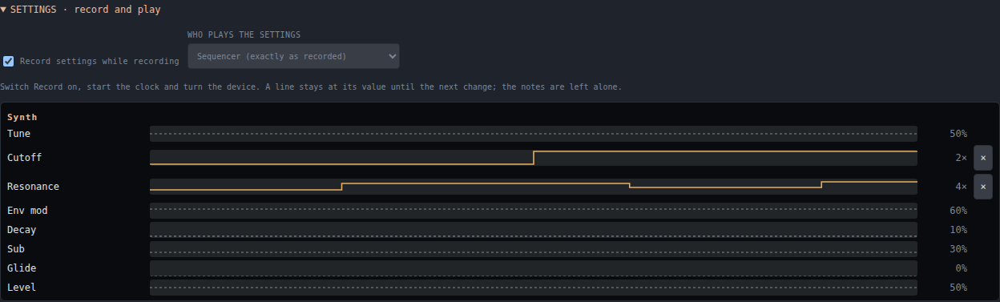

# Sequencers: user manual

*Nederlandse versie: [USER-MANUAL_NL.md](USER-MANUAL_NL.md)*

A sequencer plays notes for other devices. It makes **no sound of its own**: it sends notes along a cable, and a synth, a drone or a drum machine turns them into sound. This page covers the eight sequencers that come with Patchkamer: **Chord Sequencer**, **Step Sequencer**, **Wanderer**, **Scale Arpeggiator**, **Euclidean Rhythms**, **Pattern Playlist**, **Pattern Tracker** and **Clip Arranger**. For the basics (opening Patchkamer, loading a library, drawing cables) see the [main user manual](../USER-MANUAL_EN.md). The folder with the devices is described in [devices/sequencers](../../devices/sequencers/README.md).

## Contents

1. [How to use a sequencer](#how-to-use-a-sequencer)
2. [Which device for which purpose](#which-device-for-which-purpose)
3. [What the sequencers have in common](#what-the-sequencers-have-in-common): [Live playing and recording](#live-playing-and-recording), [Velocity and length](#velocity-and-length), [Grid: 1/16, 1/32 and 1/64](#grid-116-132-and-164), [Composing: note lengths, timing and accents](#composing-note-lengths-timing-and-accents)
4. [Chord sequencers](#chord-sequencers): [Chord Sequencer](#chord-sequencer)
5. [Step and melody sequencers](#step-and-melody-sequencers): [Step Sequencer](#step-sequencer), [Wanderer](#wanderer)
6. [Arpeggiators](#arpeggiators): [Scale Arpeggiator](#scale-arpeggiator)
7. [Rhythm sequencers](#rhythm-sequencers): [Euclidean Rhythms](#euclidean-rhythms)
8. [Pattern and clip sequencers](#pattern-and-clip-sequencers): [Pattern Playlist](#pattern-playlist), [Pattern Tracker](#pattern-tracker), [Clip Arranger](#clip-arranger)
9. [If it does not work](#if-it-does-not-work)

## How to use a sequencer

1. Place the sequencer and a synth (or a drone, or a drum machine). Draw a cable from an **event output** of the sequencer to the **Notes** input of the synth (for some synths the input is called **Keyboard / notes**).
2. Connect the synth's audio output to your speakers or to a mixer.
3. Press Start (the studio clock). A sequencer plays only while the clock runs and follows its tempo.

Event cables carry notes, not sound. A sequencer therefore sits at the start of the chain, before the synths. Several synths can play from one sequencer at the same time, each from its own output.

A sequencer has **presets**, not tunes: a preset is the setting of a device without a sound of its own. See [Presets: user manual](../presets/USER-MANUAL_EN.md). Every sequencer has its own pack in the folder `presets/`; load it with **Presets ▾ → Import…**, or load `github.com/unboxednl/patchkamer` as a library.

## Which device for which purpose

| I want to… | Use |
|---|---|
| play chords, a bass line, a pulse and a melody together from one place, on four synths | [Chord Sequencer](#chord-sequencer) |
| write one line (a bass, a melody, a trigger row) step by step on a piano roll, with a length and a velocity per step | [Step Sequencer](#step-sequencer) |
| let a melody invent and slowly change itself inside a scale | [Wanderer](#wanderer) |
| turn a chord that I play or that another sequencer sends into an arpeggio | [Scale Arpeggiator](#scale-arpeggiator) |
| build rhythms and polyrhythms from "pulses over steps", for drums or for notes | [Euclidean Rhythms](#euclidean-rhythms) |
| build a song from layers (kick, bass, chords…) placed as blocks on a timeline | [Pattern Playlist](#pattern-playlist) |
| write a song in rows, like a tracker, with an effect column and a play order | [Pattern Tracker](#pattern-tracker) |
| launch clips and scenes per track, and record a song arrangement from them | [Clip Arranger](#clip-arranger) |

## What the sequencers have in common

All eight sequencers share a few abilities. The table shows which device has which. Each device has the details in its own section below.

| Device | Live playing (keyboard through to the synth) | Recording | Velocity and length visible | Grid |
|---|---|---|---|---|
| Chord Sequencer | yes: input **Live**, to the track you are editing | yes, in play mode **Notes (recorded)** | per step (sliders) and in the piano roll | 1/16, 1/32, 1/64 per track |
| Step Sequencer | yes: input **Notes in** | yes | piano roll with velocity strip | 1/16, 1/32, 1/64 |
| Wanderer | no: the keyboard is the chord source | no | piano roll of the motif with velocity strip | 1/4 to 1/64, with triplets |
| Scale Arpeggiator | only as **Pass-through** | no | velocity pattern and length pattern | 1/64 to 1/2, with triplets |
| Euclidean Rhythms | yes: input **Notes in**, to the selected row | no | bars: height is velocity, width is length | 1/4 to 1/64, with triplets, per row |
| Pattern Playlist | yes: input **Live notes / CC**, to the selected track | yes | piano roll with velocity strip | 1/8, 1/16, 1/32, 1/64 |
| Pattern Tracker | yes: input **Live notes / CC**, to the selected track | yes | tracker columns and piano roll | 1/8, 1/16, 1/32, 1/64 |
| Clip Arranger | yes: input **MIDI / record**, to the selected track | yes | piano roll with velocity strip | 1/16, 1/32, 1/64 per clip |

### Live playing and recording

Connect a keyboard (the device **Keys**, or another source of notes) to the notes input of the sequencer. The notes then go **straight to the output of the selected track**, so you hear the synth, drone or drum machine that hangs on that output. You do not need a second cable from the keyboard to the synth. If you do connect the keyboard to the synth as well, you hear every note twice; the sequencer never doubles notes itself.

- Which track is "selected" depends on the device: **Edit track** (Chord Sequencer), the selected row (Euclidean Rhythms), the selected track (Pattern Playlist, Pattern Tracker, Clip Arranger). Step Sequencer has one output, so that is always the one.
- A held key (the **Keys** hold mode) is passed on with its release, so the note ends when you let go. Changing the selected track, loading a new setting or pressing all-notes-off closes any notes that are still sounding.
- **Recording**: switch on **Record** and start the clock. Every note you play is written into the selected track, with the velocity of your key and the length of the note (from key down to key up, at least one grid step). With **Quantize** on, the note snaps to the nearest grid position; with it off, the position is kept more finely (the exact fineness differs per device, see its section).
- Step Sequencer can also record step by step when the clock is stopped: with **Record** on, every key writes into the current step and moves on.
- Wanderer and Scale Arpeggiator do not pass the keyboard on and do not record: there the keyboard is the **chord** that the device plays from. Euclidean Rhythms does not record either, because a row is a formula and not a list of notes.
- Recording and the position of the cursor are working states: they are **not** stored in a preset.

### Driving a drum machine: the rows follow the device

When a drum machine (**Drum Kit**, **Pulse Drums**, **Click Synth** or **Latin Percussion**) hangs on the note output of a sequencer, that machine passes on its sounds with their note numbers. The sequencer then shows **the sounds themselves** instead of notes, in the order of the drum machine:

- **Step Sequencer**: every row of the roll is a sound, with its name on the left. When the kit, the order or the note of a channel changes in the drum machine, the rows follow at once. A note in the pattern that the new kit does not know stays as a row with only the note number and a question mark. A Step Sequencer plays one note per step: for a whole kit you use one per sound, or a Pattern Tracker.
- **Pattern Tracker** and **Pattern Playlist**: the **drum editor** shows the sounds of the drum machine that hangs on the **chosen track** (the cable from that track's output), with the name, the order and the note of the device. When you lay the cable for the first time, the editor switches once to the drum rows. The piano roll and the titles of the cells also name the sounds.
- **Euclidean Rhythms**: the output choice of each row shows the sound name (**3 · Handclap** instead of Track 3), and the note choice of the selected row puts the sound name behind the note name. The track follows the order of the drum machine; if two channels share a note, a name can shift one place.
- **Clip Arranger**: a **drum track** that hangs on one of those drum machines shows the machine's whole list of sounds one below the other, in its order (at most 64). With Pulse Drums that includes every instrument of the instrument choice that has no channel yet. Name, note and channel come from the device, so you set nothing up. If the kit or the order changes, your notes stay with their sound.
- Without a cable, or with a device that passes on no names, everything stays as it was (piano roll, or the six fixed drum rows of the drum editor).

If the drum machine's **own sequencer** is on, it plays at the same time as your sequencer. The tunes of the drum machines switch it off (see the drum machine manual), so you can audition with your own sequencer which kit fits best.

### Swing per level

At the top of the studio sits the **Swing** for the whole song: every second sixteenth (steps 2, 4, 6, … of the bar) comes a little later, so it sounds less rigid. Many sequencers also have **extra swing at a lower level**, which is added:

| Device | Levels |
|---|---|
| Clip Arranger | **Clip swing**, **Track swing** and (on drum tracks) **Row swing** |
| Pattern Tracker, Pattern Playlist | **Pattern**, **track** and per **drum row** |
| Step Sequencer | **Swing** of the pattern and per row (**Row swing**) |
| Euclidean Rhythms | per **row** |
| Chord Sequencer, Wanderer, Scale Arpeggiator | one **Swing** per device (Chord Sequencer per track) |

Each slider runs from 0 to 50 % of a sixteenth; double-click resets it to 0. The levels add to the host swing, with an upper limit of 50 % for the local part. Only the odd sixteenths move (also a ratchet or a 32nd note inside them); a grid of 1/8 or slower shows none of it, because all hits fall on even sixteenths. With all sliders at 0, everything sounds exactly as before.

### Recording and quantizing

Pattern Tracker, Pattern Playlist, Chord Sequencer, Clip Arranger and Step Sequencer can **record live**: switch **Record** on, start the clock and play on your keyboard or pads. With **Quantize** on, every note jumps to the nearest point of the set grid, **with the swing taken into account** (a note you play on a swung step stays there). Off: the note lands on the step you played it in. A new note in the same place replaces the old one. Euclidean Rhythms, Wanderer and Scale Arpeggiator generate their notes and do not record.

In the **Clip Arranger** you choose under **Record** between **Overdub** (existing notes stay, the default) and **Replace** (the clip is cleared at the first note you play, then you add; Undo restores the old clip). With **Play this clip** you play only the chosen clip of the chosen track in a loop, apart from scenes and song, and you can record while it plays: each round adds (Overdub) or overwrites (Replace), as you chose. **Stop clip** (or launching a scene) returns you to the normal view.

### Velocity and length

Every note has two things besides its pitch: how hard it is played (**velocity**) and how long it lasts (**length**). In all sequencers that edit notes you can see both:

- in a piano roll the **width** of a block is the length and the **height** (or the strip under the roll) is the velocity;
- Chord Sequencer shows them per step as two rows of sliders: **Velocity per step (height)** and **Length per step (width)**;
- Scale Arpeggiator has a **Velocity pattern** and a **Length pattern**, Euclidean Rhythms has accents, soft hits and ghost notes per row.

Recorded notes keep the velocity and length you played.

### Grid: 1/16, 1/32 and 1/64

The studio clock gives a sixteenth note per step. Sequencers can divide that further: **1/32** is two steps per sixteenth, **1/64** is four. Use 1/32 and 1/64 for rolls, trills, grace notes and fast arpeggios; stay on 1/16 as long as sixteenth notes are enough. A pattern with a fine grid is short in time: 16 steps of 1/64 last only a quarter of a bar.

- Chord Sequencer: **Grid** per track (1/16, 1/32, 1/64).
- Step Sequencer: **Grid** (1/16, 1/32, 1/64).
- Wanderer: **Grid**, from 1/4 to 1/64, also triplets.
- Scale Arpeggiator: **Rate**, from 1/64 to 1/2, also triplets.
- Euclidean Rhythms: **Rate** per row, from 1/4 to 1/64, also triplets.
- Pattern Playlist and Pattern Tracker: **Grid (rows per beat)**: 1/8, 1/16, 1/32 or 1/64.
- Clip Arranger: **Grid** per clip (1/16, 1/32, 1/64).

If you change the grid of a pattern that already has notes in it, the notes stay where they are and the pattern plays faster or slower (twice or four times). Pattern Playlist and Pattern Tracker can rescale for you: switch on **Rescale on grid change**.

### Composing: note lengths, timing and accents

A short guide. The `AGENTS.md` file in the folder of each device (see [devices/sequencers](../../devices/sequencers/README.md)) has the full version with exact ranges and examples; those files are written for AI agents, in Dutch.

- **Note lengths.** Short (staccato) notes suit basses, plucks and techno; notes that run into the next one (legato) suit pads and smooth lines. On a **single-voice** synth a note that is longer than the distance to the next note cuts the previous note off. Long notes that overlap need a synth that can play several notes at once.
- **Timing.** Put the strong notes on the beat (steps 1, 5, 9, 13 of a sixteenth-note bar) and the weak notes in between. Use 1/32 or 1/64 for a short run into a beat. Small shifts and small velocity differences make a line feel played by a person; Step Sequencer has **Swing** and **Humanize**, Wanderer and Scale Arpeggiator have **Humanize**, Euclidean Rhythms has **Humanize** per row. Other swing comes from the swing of the studio clock.
- **Strong and weak notes.** Give the notes that matter (the first beat, the end of a phrase) a high velocity, around 0.9 to 1, normal notes 0.6 to 0.8 and "ghost notes" (quiet notes between the others) 0.25 to 0.35. All notes at the same velocity sound mechanical.
- **Accents.** Several devices have an accent control: **Accents** in Wanderer and Euclidean Rhythms, **Beat accent** in Scale Arpeggiator, an accent row in Step Sequencer, per-step velocity everywhere else.
- **Structure.** One sequencer is one loop. Build a song with scenes (Chord Sequencer, Clip Arranger), blocks on a timeline (Pattern Playlist), a play order (Pattern Tracker), or by switching sequencers on and off in the mixer.

Nothing in this guide was listened to: the values are starting points from the device files, not promises about how it sounds.

## Chord sequencers

### Chord Sequencer

#### What it is for

Chord Sequencer plays up to four parts at once, each on its own **track** (A to D): for example chords, a bass, a pulse and bells. Each track has its own root note, chord type, pattern length and note length, and each track has its own cable to its own synth. You can store four different arrangements as **scenes** and switch between them on the beat, so a song can move from a main part to a breakdown and back. A track can also play **recorded or drawn notes** (a melody, a hook, a bass line) instead of chords, with a velocity and a length per note.

#### The controls

**Top row**

- **Scene 1** … **Scene 4**: choose the active scene. The highlighted button is the scene that plays now. While the clock runs, a new scene starts at the next bar (see **Scene change**); the line under the controls then reads "Scene 2 on the next bar".
- **Scene change**: **Next bar** (the new scene starts at the next bar) or **Immediately** (the notes that sound are cut off and the new scene starts at once).
- **Copy scene to next**: copies the current scene (all four tracks) into the next scene. Scene 4 copies into scene 1. Handy for making a variation.
- **All off**: stops all sounding notes on the four outputs.

**Edit track and live playing**

- **Edit track (live target)**: choose which track the controls below show and change (A, B, C or D, with its name). The other tracks keep playing. This is also the track that receives your keyboard.
- **Live thru**: **On** or **Off**. On: a keyboard on the **Live** input goes straight to the output of the edited track.
- **Record**: with the clock running, every note you play is written into the edited track. A track that is not yet in play mode **Notes (recorded)** is switched to it; the old settings of the track stay stored.
- **Quantize**: **On** snaps recorded notes to the **Grid** of the track; **Off** snaps them to 1/64.

**Settings of the track** (stored per scene, so each scene can have different tracks)

| Control | What it does |
|---|---|
| **Track name** | A name for the track. Leave it as it is to keep the default name (Chords, Bass, Pulse, Bells for A to D). Up to 40 characters. |
| **Active** | **On** or **Off**. A track that is off plays nothing. By default A and B are on, C and D are off. |
| **Play** | **Full chord**: all notes of the chord at the same time. **Arpeggio**: the notes one by one, the next note at each step that plays. **Root only**: only the root note. **Notes (recorded)**: plays the notes you recorded or drew; the chord settings below then do not apply, and a piano roll appears. |
| **Grid** | **1/16**, **1/32** or **1/64**: the finest step of the track. |
| **Chord** | The chord type: `major`, `minor`, `sus`, `minor7`, `fifth` (root and fifth) or `single` (just the root). These words are English in both languages. |
| **Note division** | How often the track plays: **1/16**, **1/8**, **1/4** or **1/2** (counted in steps of the **Grid**). Also the length of a step. |
| **Root (MIDI)** | The root note as a MIDI note number, 24 to 96. 60 is C4. Defaults: 48, 36, 60 and 72 for A to D. |
| **Inversion** | 0 to 3. Each step moves the lowest note of the chord up an octave. |
| **Pattern length** | 1 to 16 steps. Every track loops on its own, so tracks with different lengths shift against each other. |
| **Repeats per step** | 1 to 4. A note is repeated that many times within its step, and the length is divided. |
| **Probability** | 0 to 1. The chance that a step plays. 1 is always, 0 is never. |
| **Progression per bar (0,3,-2,5)** | Four numbers, separated by commas: the number of semitones added to the root in bar 1, 2, 3 and 4. After four bars it starts over. `0,0,0,0` keeps the chord the same. |

**Step buttons**: sixteen buttons, **1** to **16**. A dot (●) means this step plays; click a button to switch it. Only the first steps up to the **Pattern length** are used. While the clock runs, the step that is playing has a coloured edge.

**Velocity per step (height)** and **Length per step (width)**: two rows of sixteen small sliders under the step buttons. The velocity sliders are vertical (height is velocity), the length sliders are horizontal (width is length). They are factors: the velocity of a step is multiplied by the track's **Velocity**, and the length is multiplied by the track's **Gate**. A step left at full velocity and normal length behaves as before. The two rows are stored with the track.

**Notes (recorded) mode**: a piano roll shows the notes of the track, with the block height as velocity and the width as length. Click in the grid to place a note, click a block to select it. Below the roll: **New note: velocity**, **New note: length (grid steps)**, **Selected note: velocity**, **Selected note: length (grid steps)**, **Delete note**, **Clear all notes**, and **Bars** (the loop is 1 to 4 bars long).

**Sound of the track**

| Control | What it does |
|---|---|
| **Gate** | The length of the note compared to its step, 0.10 to 1.50. Start value 0.70. Shorter is more detached. |
| **Velocity** | How hard the notes are played, 0.05 to 1.00. Start value 0.80. |
| **Transpose** (**Transpositie** in Dutch) | Shifts the whole track in semitones, −24 to 24. It is rounded to whole semitones when playing. |

Double-click a slider to set it back to its start value.

The line under the controls shows the scene and the tempo in BPM, for example "Scene 1 · 120 BPM".

#### The ports

| Port | Kind | What to connect |
|---|---|---|
| **Transpose** | event input | Notes from a **Keys / MIDI** device or another sequencer. The note C4 (60) means no shift; every note around it shifts all tracks by that many semitones (up to 36 up or down). |
| **Live** | event input | A keyboard to play and record on. The notes go to the output of the edited track. Not transposed. |
| **Mod** | modulation input | A modulator. It can move the **Gate**, **Velocity** and **Transpose** of each track. |
| **Track A** … **Track D** | event outputs | Each goes to the notes input of the synth that plays that track. |
| **Tracks** | multi-MIDI out | All tracks in one double dashed orange cable, with the track names. Connect it to **Tracks in** of the [MIDI Hub](../tools/USER-MANUAL_EN.md#midi-hub). |

There are no audio ports.

#### An example

A small band of three synths:

1. Place Chord Sequencer, and three synths: for example Chord Poly for the chords, Low Bass for the bass and Sub Line for the pulse. Chord Poly and the other synths in the [synths manual](../synths/USER-MANUAL_EN.md) say which can play several notes at once.
2. Connect **Track A** to the notes input of the chord synth, **Track B** to the bass synth and **Track C** to the third synth. Connect the three audio outputs to a mixer or to your speakers.
3. On the card, check track A: **Full chord**, **Chord** `minor`, **Note division** 1/4. Switch track C on (**Active** → **On**) and set **Play** to **Root only**.
4. Press Start. Change **Progression per bar** of track A to `0,5,3,7` to make the chords change every bar.
5. Use scene 2 for a variation: choose **Copy scene to next**, click **Scene 2** and change a few things there.
6. To add a melody: connect a **Keys** device to the **Live** input, choose track D in **Edit track**, switch **Record** on and play along. Track D now plays what you played.

Or skip steps 3 and 4 and choose a preset (see below).

#### The presets

The pack **Chord Sequencer Styles** has 80 presets in 14 folders: Pop (6), Ballad (5), Cinematic (6), Film Score (5), Ambient (6), Trance (6), Synthwave (6), Lo-fi (5), Neo-classical (5), Deep House (5), Funk & Disco (5), **Dynamics** (8), **Rolls** (6) and **Melodies** (6). Examples: **Pop** › Bright Four, **Ambient** › Floating Garden, **Trance** › Uplifting Anthem, **Dynamics** › Accent Four, **Rolls** › Grace Notes, **Melodies** › Hook In A Minor.

The first 11 folders fill the four tracks and the four scenes. According to the description of the pack the scenes are a main part, a variation, a breakdown and a lift. The folder **Dynamics** uses velocity and length per step (accents, ghost notes, crescendo, legato and staccato), **Rolls** uses the 1/32 and 1/64 grids, and **Melodies** uses the play mode **Notes (recorded)** with written-out melodies and bass lines. Load the pack with **Presets ▾ → Import…** from [`presets/chord-sequencer.patchkamer-presets.json`](../../presets/chord-sequencer.patchkamer-presets.json), or load `github.com/unboxednl/patchkamer` as a library. Then choose a preset in the list on the card. More in [Presets: user manual](../presets/USER-MANUAL_EN.md).

A preset does not hold cables, and it does not change which track you are editing or whether you are recording. Connect the outputs to your synths yourself.

#### Tips and limits

- A **Full chord** goes out as separate notes at the same moment. Use a synth that can play several notes at once; a single-voice synth plays only one of them.
- Four tracks send events on four different cables, so each track can have its own synth. Use **Root only** or **Arpeggio** for a single-voice synth.
- Each track counts its own steps, so a track of 5 steps and a track of 16 steps start together again only after 80 steps (when both use the same **Note division**).
- With **Grid** 1/32 or 1/64 a pattern of 16 steps lasts only half or a quarter of a bar. Use fine grids for short rolls and let the other steps rest.
- A track in **Notes (recorded)** mode ignores the chord type, the pattern, **Repeats per step** and **Probability**. The progression is not added to the notes either: choose the notes yourself in the key of the song.
- Stopping the clock stops all notes and resets the counters; the next start begins at step 1 and bar 1.
- The chance of a step (**Probability**) is random but repeatable: the same state and the same clock steps give the same notes on every run.
- A scene switch with **Immediately** cuts off the notes that are sounding. Use **Next bar** for a live switch.
- A keyboard that is connected to **Live** and to the synth at the same time sounds twice.

**Copy and paste.** With **Copy** and **Paste** in the card bar you take the selected track of the active scene along as notes. A track in Notes mode is a real clip (at most 4 bars, 256 notes); a chord, arpeggio or pulse track is rendered and copied as a snapshot of four bars of notes, with no link to the settings. Pasting sets the track to Notes mode (the chord settings stay) and the message has an Undo button. **Shift-click** on Copy (or **Copy all tracks** in the menu next to Paste) takes the whole active scene along, all four tracks; if you paste it into another Chord Sequencer or into another scene, the chords, arpeggios and settings come back exactly. In another kind of device the four tracks arrive as notes.

## Step and melody sequencers

### Step Sequencer

#### What it is for

Step Sequencer is one line of notes on a piano roll: a pattern of 1 to 64 steps. Every step has a note (or a rest), a velocity, a length and a small timing shift. It sends the notes to one output, which you connect to a synth, a drone or a drum machine. For chords and several voices you use more than one Step Sequencer, or Chord Sequencer.

#### The controls

**Top row**

| Control | What it does |
|---|---|
| **Grid** | **1/16**, **1/32** or **1/64**: the size of one step. |
| **Length** | The number of steps in the pattern, 1 to 64. With more than 32 steps, page buttons appear. |
| **Octave** | Shifts the playing by −1, 0 or +1 octave. |
| **Gate** | The length of notes that have no length of their own, as a part of one step (10% to 100%). |
| **Swing** | Delays every second step, 0% to 60%. |
| **Humanize time** | Random small shifts in time. 0 is exact. |
| **Humanize velocity** | Random small differences in velocity. 0 is exact. |

**Buttons under the top row**

- **Record**: record what you play on the **Notes in** input into the pattern.
- **Quantize**: on, recorded notes snap to the nearest step; off, the small shift is stored in the step.
- **Thru**: on, notes on the input go straight to the output.
- **◀ ▶**: shift the whole pattern one step left or right.
- **−1 / +1 / −12 / +12**: transpose the pattern by a semitone or an octave.
- **Double**: copies the pattern into the second half.
- **Clear**: empties the pattern.
- **↑ Up / ↓ Down**: moves the visible part of the roll up or down.

**The piano roll.** Click in the roll to place a note; click an existing note to remove it; drag to place a row of notes. Drag the **right edge** of a block to change its length. The **width** of a block is the length and the **height** is the velocity. Under the roll is an accent row and the **velocity strip**: click or drag in the strip to change the velocity of a step (the height of the bar is the velocity).

#### The ports

| Port | Kind | What to connect |
|---|---|---|
| **Notes in** | event input | A keyboard (**Keys**) or another source of notes, to play through and to record. |
| **Notes** | event output | The notes input of a synth, drone or drum machine. |

#### An example

A bass line on a bass synth:

1. Place Step Sequencer and a bass synth (for example Low Bass). Connect **Notes** to the notes input of the synth and the audio output of the synth to your speakers.
2. Choose a preset from the folder **Bass Lines**, for example **Root Eighths**, and press Start.
3. Change a few notes in the roll and drag the bottom strip to give some steps a higher velocity.
4. To record: connect **Keys** to **Notes in**, switch **Record** on and play along while the clock runs. With the clock stopped, **Record** writes one key per step and moves on.

#### The presets

The pack **Step Sequencer Patterns** has 70 presets in 6 folders: Bass Lines (14), Arpeggios (12), Drum Triggers (13), Melodic Hooks (17), Long Notes & Pads (6) and Polymeter & Feel (8). Examples: **Bass Lines** › Root Eighths, **Arpeggios** › Minor Arp Up, **Drum Triggers** › Four On The Floor Kick, **Melodic Hooks** › Pop Hook. The presets use varied velocities, note lengths and the grids 1/16, 1/32 and 1/64. File: [`presets/step-sequencer.patchkamer-presets.json`](../../presets/step-sequencer.patchkamer-presets.json). Import it with **Presets ▾ → Import…**; more in [Presets: user manual](../presets/USER-MANUAL_EN.md).

#### Tips and limits

- One note per step: for two notes at once, use two Step Sequencers.
- For a drum machine, the note number picks the sound. The device file lists the usual numbers (36 kick, 38 snare, 42 closed hi-hat). One sequencer plays one sound.
- If you change **Grid** on a pattern that has notes, the pattern plays two or four times faster. Rewrite the steps if the music must stay the same.
- A pattern whose length is not 16 (for example 5, 7 or 24 steps) shifts against other sequencers: handy for polymeter.
- Hanging notes are closed when you switch **Thru** off, load a new setting or press all-notes-off.
- The keyboard is passed on, with its velocity and length. If the keyboard is also connected straight to the synth you hear every note twice.

### Wanderer

#### What it is for

Wanderer is a probability melody. It invents a **motif** of 2 to 64 steps inside a scale, plays it again and again and changes it a little each time: mostly small steps, now and then a leap, a preference for up or down, chord tones on strong beats, octave jumps, varying length and accents. You can let it find a line, or write the motif yourself and lock it. You can also play a chord on the input; with **Follow chord** it then wanders only over the notes you hold.

#### The controls

**Top row**

- **Character**: a ready-made starting point (Calm line, Arp wanderer, Bass wanderer, Leaps, Pentatonic play, Slow song, Chord follower, Japanese garden) or **Own** when you changed things yourself.
- **Root**: the root note of the scale. **Scale**: minor, major, dorian, phrygian, lydian, mixolydian, harmonic minor, minor pentatonic, major pentatonic, blues, whole tone or japanese.
- **Lowest** and **Highest**: the range the melody stays in. Keep at least an octave between them.
- **Grid**: the step size, from 1/4 to 1/64 including triplets. **Motif length**: 2 to 64 steps.
- **Contour**: how the velocity moves over the motif: Flat, Crescendo, Decrescendo, Swell or Dip.
- **Playing** / **Stopped**: starts or stops this device. **New motif**: invents a new motif. **Change now**: changes the motif right now. **Lock**: the motif stays as it is. **Follow chord**: use only the notes held on the input as the scale.

**The motif roll.** The motif is drawn as a piano roll: the **width** of a block is the length, the **height** of a block and of the strip below is the velocity. Click to set or clear a note, drag sideways for the length, drag in the strip for the velocity. This is an editor; recording a keyboard into the motif does not exist.

**How the line moves**: **Density** (the chance of a note per step), **Leaps** (chance of a big jump), **Direction** (−1 mostly down, +1 mostly up), **Chord tones** (chance that a strong beat moves to a chord tone), **Octave jump**.

**Repeat and change**: **Change** (chance per note to change when the motif starts again) and **Repeat first** (how often the motif sounds the same before something changes).

**Delivery**: **Note length** and **Length variation**.

**Dynamics and rolls**: **Velocity**, **Accents** (strong beats louder), **Ghost notes** (chance that a weak note becomes a soft ghost note), **Humanize** (random velocity and a slight delay) and **Ratchets** (chance that a new note becomes a roll of 2 to 4 notes inside its step).

Double-click a slider to set it back to its start value.

#### The ports

| Port | Kind | What to connect |
|---|---|---|
| **Chord / keys** | event input | A chord from a sequencer, or a keyboard. Used for **Follow chord**. |
| **Mod** | modulation input | A modulator, for example on **Density** or **Leaps** so the melody breathes. |
| **Notes** | event output | The notes input of a synth. |

#### An example

A lead over a chord:

1. Place Wanderer and a lead synth. Connect **Notes** to the synth and the synth to your speakers.
2. Choose a preset from **Lead Lines**, for example **Calm Minor Line**, and press Start.
3. Switch on **Lock** when you like the motif, so it stays.
4. For a line that follows chords: connect Chord Sequencer track A (or a keyboard) to **Chord / keys**, switch **Follow chord** on and choose a preset from the folder **Follow Chord**.

#### The presets

The pack **Wanderer Melodies** has 60 presets in 9 folders: Lead Lines (9), Basslines (7), Arps and Plucks (8), Ambient and Slow (5), Genre Starters (13), Dynamics (6), Rolls and Ratchets (5), Follow Chord (3) and Evolving (4). Examples: **Lead Lines** › Calm Minor Line, **Basslines** › Root Walker, **Dynamics** › Ghost Note Groove, **Rolls and Ratchets** › Trap Style Rolls, **Follow Chord** › Chord Tone Arp Follower. Every preset carries a ready motif. File: [`presets/wanderer.patchkamer-presets.json`](../../presets/wanderer.patchkamer-presets.json).

#### Tips and limits

- Wanderer does not pass a keyboard on to a synth and does not record. If you want the keyboard to sound as well, connect it to the synth yourself.
- A new motif is random: it differs every time you press **New motif**. A preset brings its own motif, so it sounds the same each time.
- Notes outside **Lowest** and **Highest** are moved by octaves into the range.
- A very fast **Grid** (1/32, 1/64) with a high **Ratchets** gives very many notes per second.
- The swing of the studio clock moves the notes; Wanderer has no swing of its own.

**Copy and paste.** **Copy** in the card bar puts the current motif (with its drift and ratchets, converted to MIDI notes) on the clipboard as a snapshot. **Paste** is not possible: Wanderer changes the motif itself.

## Arpeggiators

### Scale Arpeggiator

#### What it is for

Scale Arpeggiator takes the notes that sound or are held on its input (a keyboard, or a chord from a sequencer) and plays them one by one on the studio clock, in a pattern, over 1 to 4 octaves. It has no clock of its own. You choose pattern, speed, length and dynamics; the chord comes from outside.

#### The controls

| Control | What it does |
|---|---|
| **Pattern** | Up, Down, Up / down, Up / down (repeat ends), Play order, Random, Chord pulse (all notes at once), Converge, Thumb. |
| **Rate** | The speed: 1/64, 1/32, 1/16, 1/8, 1/4, 1/2, and the triplets 1/16, 1/8 and 1/32. |
| **Octaves** | 1 to 4: the chord is repeated over that many octaves. |
| **Repeats** | 1 to 4: every note is repeated (a roll) within its step. |
| **Latch** | **Off**, or **Hold chord**: the chord keeps sounding until a new chord begins or you press **Clear chord**. |
| **Active** | **Arpeggio**, or **Pass-through**: the keyboard goes through unchanged. |
| **Pattern length** | 1 to 16 notes: how long the velocity and length patterns are. |
| **Gate** | The length of a note compared to the step. |
| **Velocity** | A factor on the velocity of the incoming note. |
| **Beat accent** | Notes that fall on a beat get extra velocity. |
| **Soft weak notes** | Notes that do not fall on an eighth get softer. |
| **Humanize** | Random velocity and a slight delay. |
| **Probability** | The chance that a note plays. |

**Velocity pattern** and **Length pattern**: two rows of 16 bars. Click or drag to set the velocity and the length of each note in the cycle (high is loud or long). Only as many bars as the **Pattern length** count. With a pattern length of 4 and bars like loud, soft, medium, soft, the first note of every four is the loudest. **Clear chord** empties the held chord.

#### The ports

| Port | Kind | What to connect |
|---|---|---|
| **Chord / keyboard** | event input | A keyboard (**Keys**) or the output of a sequencer that plays chords. |
| **Mod** | modulation input | A modulator. |
| **Arpeggio** | event output | The notes input of a synth. |

#### An example

An arpeggio on a chord track:

1. Place Chord Sequencer, Scale Arpeggiator and a synth. Connect Chord Sequencer **Track A** to **Chord / keyboard**, and **Arpeggio** to the synth.
2. Choose a preset, for example **Trance and Dance** › Trance Gate 16ths, and press Start.
3. Change **Pattern** and **Rate** and listen to what the arpeggio does with the chord.

With a keyboard: connect **Keys** to **Chord / keyboard**, play a chord and keep holding it; or switch **Latch** to **Hold chord** and let go.

#### The presets

The pack **Scale Arpeggiator Patterns** has 59 presets in 10 folders: Classic Patterns (10), Trance and Dance (8), House and Disco (5), Synthwave and Retro (4), Ambient and Cinematic (7), Funk and Jazz (4), Fine Grids and Rolls (7), Dynamics (7), Generative (5) and Live Playing (2). Examples: **Classic Patterns** › Straight Up 16ths, **Fine Grids and Rolls** › 32nd Run Up, **Dynamics** › Accent Every Fourth, **Generative** › Random Walk 16ths, **Live Playing** › Latch Pad Arp. A preset holds the pattern, not the chord. File: [`presets/scale-arpeggiator.patchkamer-presets.json`](../../presets/scale-arpeggiator.patchkamer-presets.json).

#### Tips and limits

- No chord, no arpeggio: the device plays only what comes in on the input.
- **Pass-through** lets everything on the input go to the output unchanged: use it to play the keyboard without arpeggio. The keyboard is not "passed on" in any other way.
- The incoming velocity is the basis; **Velocity**, the patterns and **Beat accent** scale it.
- A **Gate** above 1 with **Repeats** 3 or 4 and a fast rate gives overlapping notes, which a single-voice synth cuts off.
- A keyboard that is connected to the synth and to this device sounds twice.

## Rhythm sequencers

### Euclidean Rhythms

#### What it is for

Euclidean Rhythms has **eight rows**. Each row spreads a number of **pulses** as evenly as possible over a number of **steps**, can shift the pattern with a **rotation**, and runs at its own **rate**. That gives well-known rhythms (3 over 8, 5 over 8, 7 over 12) and polyrhythms, because each row has its own length. A row sends either a **trig** (a hit for a drum machine, on a channel 1 to 8) or a **note**.

#### The controls

**Top row**

- **Example**: a starting point (Drum kit, Afro-Cuban, Bembe (7 over 12), Polyrhythm 3·4·5·7, Techno, IDM stutter, Melodic (notes)) or **Custom**. The name is only a label.
- **Running**: **On** / **Off**. **Live play**: **On** / **Off** (see below).
- **Back to the start**: all rows start again. **Surprise**: random distributions for the rows that are on.

**The picture.** Rings: every row is a ring and the pulses are dots. Under it, a list of the rows, and a strip of bars where the height is the velocity and the width is the note length of the selected row.

**The eight rows** (click the row number to select a row):

| Control | What it does |
|---|---|
| **On** | The row plays. |
| **Steps** | The length of the pattern, 1 to 32. |
| **Pulses** | How many of the steps sound, spread as evenly as possible. |
| **Rotation** | Where the row starts: the pattern shifts. |
| **Rate** | The grid of the row: 1/4, 1/8, 1/16, 1/32, 1/64 and the triplets 1/8, 1/16 and 1/32. |
| **Out** | **Track 1** … **Track 8** (a trig on that channel) or **Note** (a note). |
| **Velocity** | The strength of the pulses. |
| **Accents** | This many pulses sound as an accent, spread evenly. |
| **Chance** | The chance that a pulse sounds. |
| **Fill** | **None**, or every 2nd, 4th or 8th bar an extra fill: double pulses or a ratchet (two short pulses). |
| **Mutation** | The chance per bar that the row shifts by one step. |

**Selected row** (the row you clicked): **Note of the selected row** (only with **Out** = **Note**), **Contour** (Flat, Up, Down or Arch: how the velocity moves over the steps) and the sliders **Note length** (a part of one grid step of the row, up to 4; no effect on trigs), **Accent level**, **Soft hits** (the strength of the other pulses in a row with accents), **Ghost notes** (how many of the non-accent pulses become soft ghost notes), **Ghost level**, **Contour depth** and **Humanize** (random variation in velocity and length).

#### The ports

| Port | Kind | What to connect |
|---|---|---|
| **Reset** | event input | A trig or note: all rows start again. |
| **Notes in** | event input | A keyboard, to play the selected row live. |
| **Trigs / notes** | event output | A drum machine (it plays channel 1 to 8) or a synth (it plays the note rows). |

#### An example

A drum groove:

1. Place Euclidean Rhythms and a drum machine. Connect **Trigs / notes** to the trig or notes input of the drum machine.
2. Choose the preset **Techno** › Four On The Floor and press Start. Channel 1 is a kick, 2 a snare or clap, 3 a closed hi-hat, 4 an open hi-hat, 5 to 7 percussion, 8 a crash or effect; the presets that play drums use this plan, so set up the drum machine to match.
3. Change **Pulses** of row 4 to hear a different hi-hat, and give row 5 a **Chance** of 80% for a rhythm that varies.
4. For a bass: set **Out** of a row to **Note**, choose its note and a long **Note length**, and connect **Trigs / notes** to a bass synth as well.

#### The presets

The pack **Euclidean Rhythms Grooves** has 65 presets in 8 folders: Techno (8), House (7), Afro & Latin (11), Dub & Reggae (6), Drum & Bass and Breakbeat (8), Odd Meters and Polymeters (8), Fills and Rolls (8) and Melodic (notes) (9). Examples: **Techno** › Four On The Floor, **Afro & Latin** › Tresillo Roll, **Dub & Reggae** › One Drop, **Odd Meters and Polymeters** › 3 Against 4. File: [`presets/euclidean-rhythms.patchkamer-presets.json`](../../presets/euclidean-rhythms.patchkamer-presets.json).

#### Tips and limits

- **Live play**: with it on, a keyboard on **Notes in** goes straight to the output, depending on the selected row. If the row sends a note, you play the note of your key. If the row sends a trig, every key triggers that channel with the velocity of your key. You need no second cable.
- There is no recording: a row is a formula, not a list of notes.
- Rows on the same output add up. Do not put two rows on the same output on the same step: the hit sounds twice.
- **Fill** and **Mutation** count whole bars of the clock, not bars of the pattern of the row.
- With 1/32 or 1/64 use **Chance** or a **Contour**; otherwise it is a constant burst.
- Swing comes from the studio clock; for a shuffle feel use 12 steps at the 1/8 triplet rate.

**Copy and paste.** **Copy** in the card bar puts a snapshot of the rhythm on the clipboard: the selected row as notes (Note row) or all playing rows as drums, with their own lane lengths. **Paste** is not possible here: the rows are calculated from numbers.

## Pattern and clip sequencers

Pattern Playlist, Pattern Tracker and Clip Arranger are of another kind: they do not play one loop but a whole **song**, built from patterns or clips. Pattern Playlist and Pattern Tracker are the same engine with a different starting view.

### Pattern Playlist

#### What it is for

Pattern Playlist builds a song in **layers**, like a producer program. Each layer (kick, hats, bass, chords, lead, pad) is its own **pattern**, and you place **blocks** of those patterns on a timeline. A block says "play this pattern on this track, from here, this long". A song grows by adding and removing blocks. There are up to 32 tracks, 32 patterns and many blocks; a block longer than its pattern repeats the pattern, so a bass of three bars can run under drums of one bar.

#### The controls

**Top part**

- **Number of tracks**: 1 to 32 (default 8). Choosing fewer keeps the notes but removes cables to the dropped outputs.
- **Composition**: the name of the song.
- **Play**: **Playlist** (the blocks on the timeline), **Tracker order** or the **Selected pattern** in a loop.
- **Active**: the device plays along with the clock. **Loop**: start again at the end.
- **Grid (rows per beat)**: **eighths (1/8)**, **sixteenths (1/16)**, **thirty-seconds (1/32)** or **sixty-fourths (1/64)**. **Rescale on grid change**: rows, lengths and block starts are converted when you change the grid.
- **From start** and **From selection**: play from the beginning or from the selected place.
- **Play live through selected track** (on: a keyboard on the input goes through to the selected track), **Record**, **Quantize to grid**, **All notes off**.
- **Undo** and **Redo**.

**Pattern bank.** The patterns appear as buttons. **Pattern name**, **Pattern length (rows)** (1 to 1024), **New pattern**, **Duplicate pattern**, **Delete unused pattern**. A pattern holds one channel for each track.

**Two views.** **Playlist / piano roll** and **Tracker / order**. In the playlist view:

- **First bar**, **Visible bars**, **Snap (rows)**. Click an empty place on a track to put the selected pattern there. Drag blocks to move them, drag the right edge for the length (the pattern repeats), right-click deletes a block.
- A selected block has **Block pattern**, **Start (row, from 1)**, **Block length (rows)**, **Pattern offset (rows)** (the row of the pattern where the block starts, to let a loop "phase"), **Block transpose**, **Make block unique** and **Duplicate block next to it**. Keep block transpose at 0 on drum tracks.

**Pattern editor.** **Channel** (the track), **Editor**: **Piano roll** or **Drum steps**, **Row page**, **Draw length**, **Draw velocity (%)**, **Lowest MIDI note**. Click draws or erases a note, drag moves it, the right edge changes the length, right-click erases. The **width** of a block is its length and the **height** is its velocity; the **VEL strip** under the roll changes the velocity by dragging. Notes on the same row of one track form a chord that shares one length and velocity.

**Cell inspector.** For the selected cell: **Notes** (as C-4 E-4 or MIDI numbers), **Velocity (%)**, **Length (rows)**, **Effect**, **Effect value**, **CC parameter ID**, **Audition cell** and **Clear cell**. The effects are:

| Effect | What it does |
|---|---|
| **ARP** | Plays the note, and two more notes a number of semitones higher, one after the other inside one row. The value is two hex digits: 37 is a minor chord, 47 a major chord. |
| **RAT** | Repeats the cell 1 to 8 times inside one row (a roll). |
| **DEL** | Delays the cell by 0 to 90% of a row. |
| **PRB** | The chance in percent that the cell plays. |
| **CUT** | The gate in percent of the length, for a short note in one cell. |
| **CC** | Sends no note but a control value (for example a filter sweep), to the parameter named in **CC parameter ID**. |

**Tracks.** The panel "tracks · instrument outputs / mute / solo / transpose" has for each track a name, **Mute**, **Solo**, **Transpose**, **Gate (%)** and a velocity factor. The cable decides which instrument a track plays; the name is a label. The panel **Composition · import/export and examples** exports and imports the song as a JSON file.

#### The ports

| Port | Kind | What to connect |
|---|---|---|
| **Live notes / CC** | event input | A keyboard (**Keys**), to play live through the selected track and to record. |
| **Track 1** … **Track 8** | event outputs | One per track, to a synth or drum machine. With **Number of tracks** you get up to 32. |
| **Tracks** | multi-MIDI out | All tracks in one double dashed orange cable, with the track names. Connect it to **Tracks in** of the [MIDI Hub](../tools/USER-MANUAL_EN.md#midi-hub). |

#### An example

A dance track with four layers:

1. Place Pattern Playlist, a drum machine, a bass synth and a chord synth. Connect **Track 1**, **Track 2** and **Track 3** to the drum machine (kick, snare, hats), **Track 4** to the bass synth and **Track 5** to the chord synth.
2. Choose the preset **Dance Floor** › Main Floor House and press Start. In this pack the tracks are: 1 kick, 2 snare, 3 hats, 4 bass, 5 chords, 6 lead, 7 pad or arp, 8 percussion.
3. In the playlist, drag the bass block to the right (or change its **Start**), so the bass comes in after the intro. Drag the right edge of the hats block to the left to let them drop out earlier.
4. To record: switch on **Record**, choose the lead track and play a keyboard on **Live notes / CC**.

#### The presets

The pack **Pattern Playlist Arrangements** has 35 presets in 5 folders: Dance Floor (13), Bass Music (6), Hip-hop and Soul (5), Song Forms (5) and Ambient and Cinematic (6). Every preset is a full arrangement of 40 to 150 bars in the playlist view. Examples: **Dance Floor** › Main Floor House, **Bass Music** › Liquid Drum and Bass, **Hip-hop and Soul** › Lo-fi Rainy Window, **Song Forms** › Indie Pop Verse-Chorus, **Ambient and Cinematic** › Minimal Polymeter Loops. File: [`presets/pattern-playlist.patchkamer-presets.json`](../../presets/pattern-playlist.patchkamer-presets.json).

#### Tips and limits

- One cell per row per track and one velocity per cell: for a quiet root and a loud top note, use two tracks.
- Two overlapping blocks on the same track both play. Put them one after the other.
- A note longer than the distance to the next one overlaps it; a single-voice synth cuts the earlier note off.
- Change the grid before you write rows, or use **Rescale on grid change**.
- Notes you record are picked up by the playback on the next round. The record and quantize switches are not stored in a preset.
- The songs of the earlier device (Regie Playlist) refer to its old id and do not load; its export file format can be imported.

**Copy and paste.** **Copy** and **Paste** in the card bar work on the channel of the selected track in the selected pattern: as notes in the piano roll, as drums in the drum editor. Paste replaces only the cells of that channel; the pattern length stays (a longer clip is cut, a shorter one that divides evenly is repeated). Notes on the same row share velocity and length. Probability and retrigger come along; arpeggio, gate and CC only between Tracker and Playlist. Ctrl+Z undoes the paste. **Shift-click** on Copy (or **Copy all tracks** in the menu) takes the whole pattern along, all channels: a channel with a connected drum machine as drums, the others as notes. When pasting they go to the channels of the target by kind and in order; channels that do not fit are left out and reported, channels of the target without a source stay as they are. Between Tracker and Playlist everything comes along without loss.

### Pattern Tracker

#### What it is for

Pattern Tracker is a **tracker**: you write notes in **rows**, in a table of up to 32 columns (tracks). Each cell has a note (or a chord of up to 8 notes), a velocity, a length and an **effect**. Patterns are blocks of 1 to 1024 rows. A **play order** plays patterns one after the other, each with a number of repeats and a transposition, and plays **all channels at once**; that is how you build a song as in a classic module.

It is the same engine as Pattern Playlist, with a different starting view: the tracker and the order are in front, and **Follow playback** is on. In Playlist the layers and the timeline are the main thing.

#### The controls

The top part, the pattern bank, the pattern editor, the cell inspector, the tracks panel and the effects are the same as in [Pattern Playlist](#pattern-playlist). What is special here:

- **Play** starts as **Tracker order**.
- **Tracker order · arrange patterns**: the steps of the order are buttons (for example "00 · Intro ×1"). **Add selected pattern** adds a step; for the selected step: **Order pattern**, **Repeats** (1 to 32), **Transpose** (leave it at 0 for patterns with drums), the arrows **↑ ↓** to move the step, **Delete order step**. **Order → new playlist** turns the order into a playlist (Undo restores the old one).
- **Tracker · note / volume / length / effect**: the table. Columns are the tracks, rows are numbered in hexadecimal. Each cell shows note, velocity (volume) and length. Controls: **Octave**, **Row step**, **Row page**, **Follow playback**, **Focus tracker**, **Copy channel**, **Paste channel**, **Clear channel**.
- Typing: click a cell and type Z S X D C V G B H N J M for the notes of one octave and Q 2 W 3 E R 5 T 6 Y 7 U for the octave above. The arrow keys and Tab move around, Delete erases, Ctrl/Cmd+Z undoes.

#### The ports

| Port | Kind | What to connect |
|---|---|---|
| **Live notes / CC** | event input | A keyboard (**Keys**), to play through the selected track and to record. |
| **Track 1** … **Track 8** | event outputs | One per track, to a synth or drum machine. Up to 32 with **Number of tracks**. |
| **Tracks** | multi-MIDI out | All tracks in one double dashed orange cable, with the track names. Connect it to **Tracks in** of the [MIDI Hub](../tools/USER-MANUAL_EN.md#midi-hub). |

#### An example

A chiptune loop:

1. Place Pattern Tracker and two synths: a bass synth and a lead or chord synth. Connect **Track 4** to the bass synth and **Track 5** to the chord synth.
2. Choose **Module Classics** › Chiptune Hero Loop and press Start. Follow the playing in the table.
3. In the column of the chord track you see cells with the effect **ARP37**: one short note that is played as a chord inside one row.
4. Add a step to the order with **Add selected pattern** to repeat the Hook one more time.

#### The presets

The pack **Pattern Tracker Modules** has 34 presets in 4 folders: Module Classics (12), Songwriting Forms (8), World and Latin (7) and Electronic Rows (7). Each preset is a module with 2 to 5 patterns (for example Intro, Verse, Break, Chorus) and an order. Tracks: 1 kick, 2 snare, 3 hats, 4 bass, 5 chords or arp, 6 lead, 7 pad, 8 percussion or a CC track for a filter. Examples: **Module Classics** › Chiptune Hero Loop, **Songwriting Forms** › Twelve-Bar Blues, **World and Latin** › Bossa Nova Rows, **Electronic Rows** › Probability Groove Machine. File: [`presets/pattern-tracker.patchkamer-presets.json`](../../presets/pattern-tracker.patchkamer-presets.json).

#### Tips and limits

- A waltz pattern uses 12 rows per bar (3 beats at 1/16); the bar line of the clock stays 4/4, so such a pattern drifts against other sequencers.
- A transposition in the order applies to **all** channels of the pattern, drums included. Use it only on patterns without drums.
- The same limits as Pattern Playlist apply: one cell per row per track, row positions inside the pattern, and set the grid before you write.
- Recording writes into the pattern of the current order step.

**Copy and paste.** **Copy** and **Paste** in the card bar work on the channel of the selected track in the selected pattern: as notes in the piano roll, as drums in the drum editor. Paste replaces only the cells of that channel; the pattern length stays (a longer clip is cut, a shorter one that divides evenly is repeated). Notes on the same row share velocity and length. Probability and retrigger come along; arpeggio, gate and CC only between Tracker and Playlist. Ctrl+Z undoes the paste. **Shift-click** on Copy (or **Copy all tracks** in the menu) takes the whole pattern along, all channels: a channel with a connected drum machine as drums, the others as notes. When pasting they go to the channels of the target by kind and in order; channels that do not fit are left out and reported, channels of the target without a source stay as they are. Between Tracker and Playlist everything comes along without loss.

### Clip Arranger

#### What it is for

Clip Arranger works like a session view. For each track (1 to 16) there are 8 **clips**: patterns with notes and control lanes. A **scene** starts the clips of all tracks together. On top of that is a linear **song arrangement**: a list of sections, each with a scene, a number of bars and a number of repeats. You can launch clips while the clock runs, or play the arrangement as a song.

**Playing apart from the rest of the canvas.** If the page clock (the green **Start** button) is stopped, you do not need to turn it on. **▶ Play this clip**, the **▶** next to a scene and the **▶** on a clip in the grid make the Clip Arranger run on its **own clock**, at the tempo and swing of the page. Only this clip or scene plays, and the line in the editor moves along (for a long clip the view follows the line to the next page). All other devices stay silent. **■ Stop** stops the own clock. If you press the page's **Start**, that clock takes over and everything plays along.

#### The controls

**Top part**

- **Song**: the title. **Tracks**: the number of tracks, 1 to 16.
- **Playback**: **Clips / scenes** (launching) or **Song arrangement** (play the sections in order).
- **Sequencer on** / **Sequencer off**, **From start**, **Loop song**, **Undo**, **Redo**.
- **Pads select track** and **Pads start scene**, each with **from note**: with a controller that has pads (for example the Akai MPK mini, pads on notes 36 to 51), pad 1 selects track 1, pad 2 track 2 and so on, and the second group of pads starts scene 1 to 8. Those pads make no sound themselves; the keys then play the selected track, so the device behind that track. Next to the controls the card shows which track is selected, with its target device. Both are off by default and belong to your controller, not to the composition: a preset and **Load template** leave them alone. With a MIDI Hub in between it works the same, as long as the hub passes the pads on to the Clip Arranger (route **Keyboard**).
- **Template** and **Load template**: a starting point (Techno / house, Ambient / drone, Rock / pop, Empty project). It replaces the composition; Undo gets the previous version back.

**01 · Clip matrix.** Tracks are columns, scenes are rows. Click a scene button on the left to start the whole scene at the next bar. Click a clip to start it; its name opens the clip in the editor. The scene of the section you chose in **04 · Song arrangement** has a gold outline; choosing a section also puts the editor on the clip of that scene (for the selected track). Per track there are buttons **M** (mute), **S** (solo) and **■** (stop at the next bar).

**02 · Track.** **Track name**, **Target device (label)** (only a label for you; the cable decides), **Track type** (**Keys / melody**, **Drum machine**, **Drone / pad / ambient**), **Colour**, **Drum protocol** (**Trig → channel name** or **MIDI → note number**, for drum tracks), **Velocity scale**, **Audition track**, and **Live record → this clip**. A drum track has 16 drum rows with a name, a note and a channel.

**03 · Clip editor.** At the top is the **clip bar**: buttons for the tracks (**Track**) and for the 8 clips of the selected track (**Clip**, with name and length; an empty clip is dimmed and the clip that is playing is marked). One click switches straight to that clip, without scrolling back to the matrix. **‹** and **›** go to the previous and next clip, **New clip** jumps to the first empty slot of the track, **Duplicate** puts a copy of the clip in the next empty slot and **Delete clip** empties the slot (**Undo** brings it back). Every track has a fixed 8 clip slots, so "making" a clip means filling an empty slot. Below that: **Clip name**, **Clip length (bars)** (1 to 64), **Grid** (**1/16**, **1/32** or **1/64**), **Quantize live input**, **Zoom**, **Page**, **Copy clip**, **Paste clip**, **To next slot**, **Clear notes**. For new notes: **New note length**, **New velocity**, **New probability**, **New ratchet** (drum tracks). Click in the roll to draw a note, drag to move it, drag the right edge for the length, right-click deletes. The **width** of a block is the length and the **height** is the velocity; a **velocity strip** below the roll changes the velocity per note by dragging. For a selected note you can set start, length, MIDI note, velocity and probability exactly. **CC automation**: lanes (up to 8 per clip) with a **Parameter ID** and a **Shape** (**Linear** or **Steps / hold**), for example a rising cutoff.

**Copy and paste.** **Copy** and **Paste** in the card bar work on the selected clip of the selected track (keys and drone as notes, a drum track as drums). **Shift-click** on Copy (or **Copy all tracks** in the menu next to Paste) takes the whole scene along: the selected clip of every track. Paste assigns the tracks by kind and in order, in one go and with one Undo; tracks that do not fit stay as they are and are reported.

**04 · Song arrangement.** The sections are buttons. **Play from section**, **Add section**, **Duplicate scene → next**. For each section: **Scene**, **Bars** and **Repeats**. A section lasts bars × repeats bars, and every clip repeats inside it. A clip that is longer than its section is cut off at the section's end. **Edit scene names** names the 8 scenes.

**05 · Assign devices.** A list of the outputs with the labels of the tracks, as a reminder for what to connect.

#### Recording and playing settings

Under the CC lanes in the clip editor is the section **Settings · record and play**. It shows every control of the device that the track's cable goes to (the first one, if there are several) as a line over the length of the clip. As long as nothing has been recorded, a line is flat and dashed at the current position of the knob.

- **Record settings while recording** (on by default). With **Record** on and the clock running, every turn of a control on the connected device is written as a point on its line, next to the notes you play. A value stays until the next change, so a knob that goes from 10 to 20 stays at 20. Settings that a modulator moves (Drift, LFO, MSEG) are recorded too, as the value you hear. The notes, drums and chords that are already in the clip are left alone: only the lines you turn change. With **Overdub** the points of a line you turn stay and new ones are added; with **Replace** a line you touch is first cleared, once per recording round.
- **Who plays the settings** (a choice per song). **Sequencer (exactly as recorded)**: the clip plays its lines and modulators on those controls are ignored while it plays; controls without a line are still modulated. **Modulators (line is the base position)**: the line sets the knob and Drift or another modulator moves on top of it. While you record, the modulators are always active, so that they can be recorded.
- Playing works per clip, per scene and in the whole song: each point is set at its own moment and the knob moves visibly on the card of the device. The clip does not have to be selected.
- The **×** at the end of a line clears it. **Undo** brings recorded lines back, like notes.
- Only sliders and rotary knobs that the device offers to modulators (the ones Drift, LFO and MSEG can steer) take part. Selects, checkboxes and buttons do not. Fast modulation (audio rate) is not recorded.
- If you turn a knob yourself while its line is playing, the line takes it back at the next point.

#### The ports

| Port | Kind | What to connect |
|---|---|---|
| **MIDI** (left) | event input | A keyboard (**Keys**), to play through the selected track and to record into the selected clip. |
| **1**, **2**, … | event outputs | One per track, to a synth, drone or drum machine. The ports sit in one row at the top of the card, with only the track number, and there are exactly as many as there are tracks (1 to 16). If you remove a track, its cable goes away. |
| **Tracks** (right) | multi-MIDI out | All tracks in one double dashed orange cable, with the track names. Connect it to **Tracks in** of the [MIDI Hub](../tools/USER-MANUAL_EN.md#midi-hub). |

#### An example

A small song with drums, bass and chords:

1. Place Clip Arranger, a drum machine, a bass synth and a chord synth. Connect **Track 1** to the drum machine, **Track 2** to the bass synth and **Track 3** to the chord synth.
2. Choose a preset such as **Electronic Dance** › Deep House Chords, or load a template. Set **Playback** to **Song arrangement** and press Start.
3. Switch to **Clips / scenes**, click scene 4 (the chorus) while the song plays, and the clips of scene 4 start at the next bar.
4. To record a clip: click a clip so that it is selected, switch **Live record → this clip** on, connect **Keys** to **MIDI / record** and play. The notes are written with your velocity and length at the **Grid** of the clip.

#### The presets

The pack **Clip Arranger Song Starters** has 58 presets in 10 folders: Pop & Rock (7), Electronic Dance (13), Bass Music (7), Hip-Hop & Chill (4), Funk, Soul & Disco (4), Jazz & Blues (5), Reggae & World (4), Ambient & Cinematic (5), Classical & Neo-Classical (4) and Retro & Game (5). Each preset is the **start of a composition built on the music theory and the usual song form of its genre**: 3 to 7 tracks with a role (drums, bass, chords, pad, arp, lead, percussion, FX), a key and a chord progression (the song title shows key and tempo), up to 8 scenes and an arrangement in the usual form, with a first usable clip in every place. Examples: **Pop & Rock** › Pop Verse-Chorus, **Electronic Dance** › Deep House Chords, **Jazz & Blues** › Twelve-Bar Blues Shuffle, **Classical & Neo-Classical** › Rondo Refrain ABACA, **Retro & Game** › Chiptune Adventure. All presets play in song mode. For jazz and blues the title says "swing on": switch on the swing of the studio clock yourself; the notes sit straight on the grid. The tracks hang on no device; the label of each track says what kind of device it is meant for. File: [`presets/clip-arranger.patchkamer-presets.json`](../../presets/clip-arranger.patchkamer-presets.json).

#### Tips and limits

- Keep clips short: a drum clip of 1 bar, a chord clip of 4 bars. The sections repeat them.
- Set the bars of a section to a multiple of the longest clip in it.
- Notes of a clip are stored in sixteenths and may sit on a quarter of a sixteenth, so a fine grid (1/32, 1/64) works for rolls, strums and laid-back timing. The **Grid** of the clip decides what the editor and the live recording snap to.
- The tempo is not stored in the song: set it on the transport. The title of a preset names the tempo.
- Songs and presets of the earlier device (Regie) refer to its old id and do not load.

## If it does not work

- **No sound.** The sequencer makes no sound itself. Check that the output you use is connected to the notes input of a synth, that the synth is connected to your speakers, and that the clock is running (Start). For Scale Arpeggiator also check that a chord is coming in.
- **A track is silent.** Chord Sequencer: check that **Active** is **On**, that some steps within the **Pattern length** are switched on (●), and that **Probability** is above 0. Playlist, Tracker and Clip Arranger: check **Mute** and **Solo** and that the cable of that track goes somewhere.
- **The keyboard sounds twice.** The keyboard is connected to the sequencer and to the synth. Remove one of the two cables.
- **The keyboard sounds nothing.** Check **Live thru** (Chord Sequencer), **Thru** (Step Sequencer), **Live play** (Euclidean Rhythms) or **Play live through selected track** (Playlist, Tracker), and that the selected track has a cable. Wanderer does not pass a keyboard on at all, and Scale Arpeggiator only in **Pass-through**.
- **Recording writes nothing.** The clock must run and **Record** must be on. In Chord Sequencer the notes go into the track chosen in **Edit track**.
- **Only one note of a chord sounds.** The synth has one voice. Use a synth that can play several notes at once, or switch **Play** to **Arpeggio** or **Root only**.
- **A scene does not switch.** With **Next bar** the switch happens at the start of the next bar, and only while the clock runs. When the clock is stopped, the scene changes at once.
- **Notes are cut short or overlap.** Lower **Repeats per step** or **Gate**, or use a longer **Note division**. With a single-voice synth, a note that is longer than the distance to the next note cuts the earlier one off.
- **A pattern suddenly plays twice or four times as fast.** The grid was changed after the notes were written. Change it back, or rewrite the steps (Pattern Playlist and Pattern Tracker: **Rescale on grid change**).
- **A song or preset from an earlier device does not load.** Songs and presets made for earlier devices with another name (Puls Sequencer, Sequencer, Regie, Regie Playlist, Regie Tracker, Euclides, Dwaler, Toonladder) refer to the old id and do not load into the new device.
