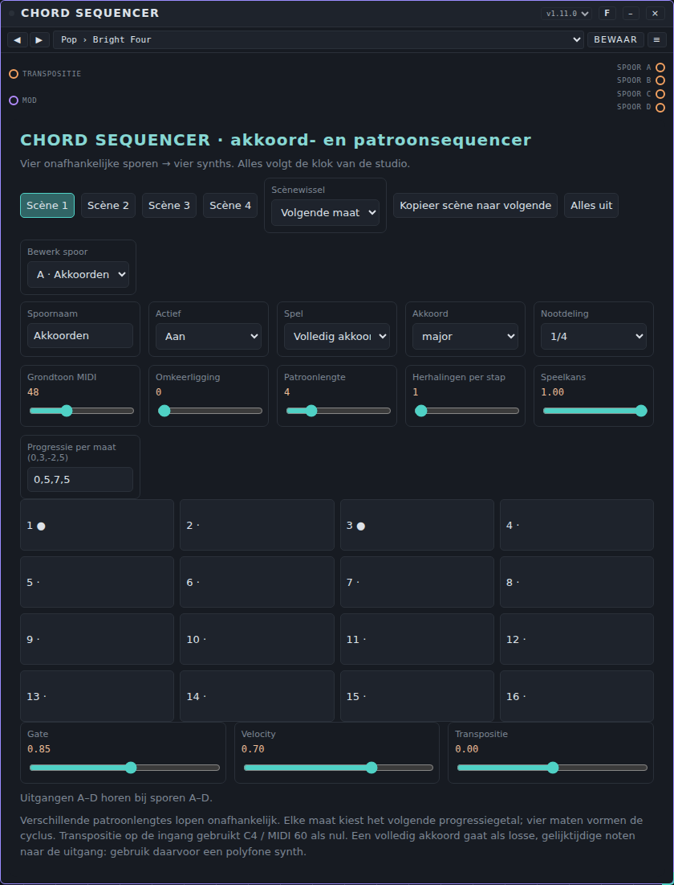
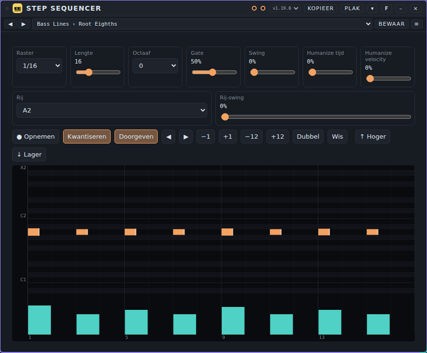
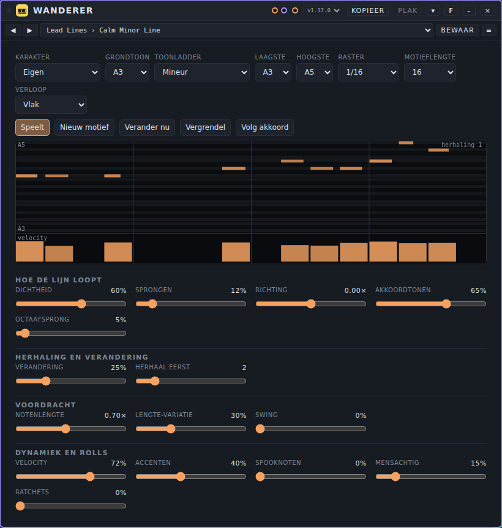
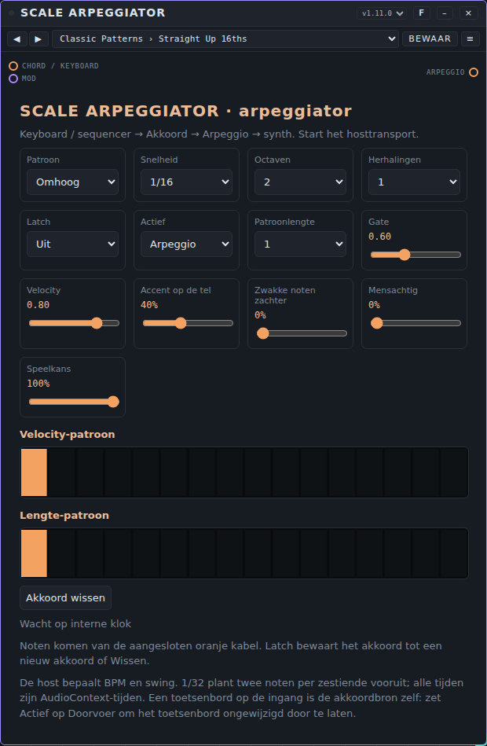
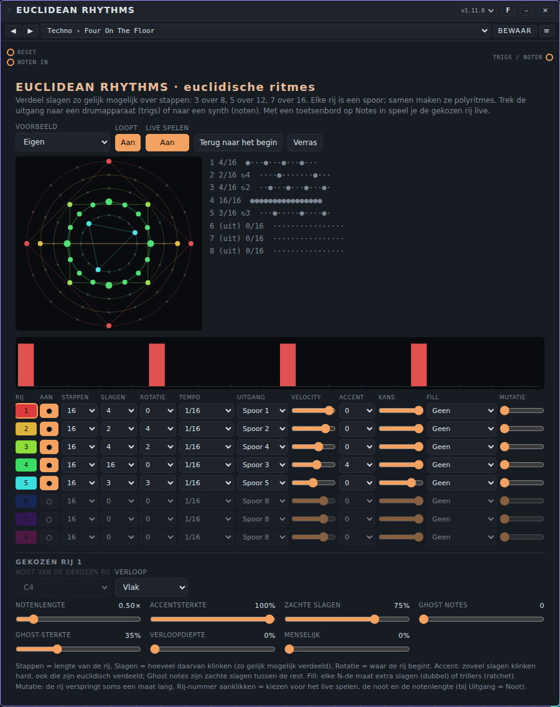
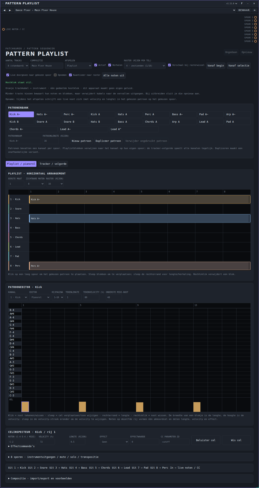
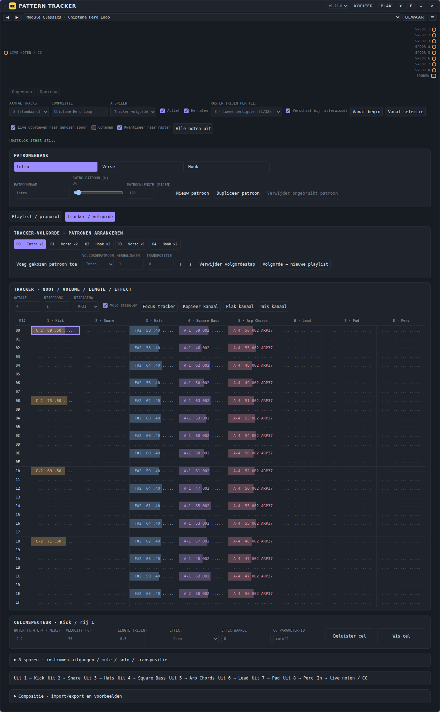
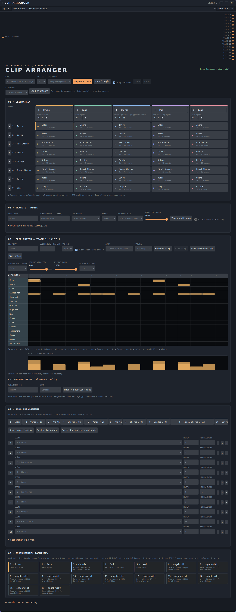
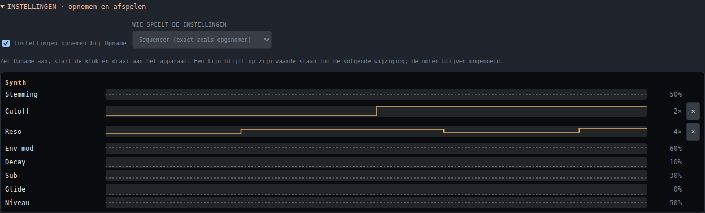

# Sequencers: gebruikershandleiding

*English version: [USER-MANUAL_EN.md](USER-MANUAL_EN.md)*

Een sequencer speelt noten voor andere apparaten. Hij maakt **zelf geen geluid**: hij stuurt noten langs een kabel, en een synth, een drone of een drumcomputer maakt er geluid van. Deze pagina behandelt de acht sequencers die met Patchkamer meekomen: **Chord Sequencer**, **Step Sequencer**, **Wanderer**, **Scale Arpeggiator**, **Euclidean Rhythms**, **Pattern Playlist**, **Pattern Tracker** en **Clip Arranger**. Voor de basis (Patchkamer openen, een bibliotheek laden, kabels trekken) zie de [basishandleiding](../USER-MANUAL_NL.md). De map met de apparaten staat beschreven in [devices/sequencers](../../devices/sequencers/README_NL.md).

## Inhoud

1. [Een sequencer gebruiken](#een-sequencer-gebruiken)
2. [Welk apparaat voor welk doel](#welk-apparaat-voor-welk-doel)
3. [Wat de sequencers gemeen hebben](#wat-de-sequencers-gemeen-hebben): [Live spelen en inspelen](#live-spelen-en-inspelen), [Velocity en lengte](#velocity-en-lengte), [Raster: 1/16, 1/32 en 1/64](#raster-116-132-en-164), [Componeren: nootlengtes, timing en accenten](#componeren-nootlengtes-timing-en-accenten)
4. [Akkoordsequencers](#akkoordsequencers): [Chord Sequencer](#chord-sequencer)
5. [Stap- en melodiesequencers](#stap--en-melodiesequencers): [Step Sequencer](#step-sequencer), [Wanderer](#wanderer)
6. [Arpeggiators](#arpeggiators): [Scale Arpeggiator](#scale-arpeggiator)
7. [Ritmesequencers](#ritmesequencers): [Euclidean Rhythms](#euclidean-rhythms)
8. [Patroon- en clipsequencers](#patroon--en-clipsequencers): [Pattern Playlist](#pattern-playlist), [Pattern Tracker](#pattern-tracker), [Clip Arranger](#clip-arranger)
9. [Als het niet werkt](#als-het-niet-werkt)

## Een sequencer gebruiken

1. Plaats de sequencer en een synth (of een drone, of een drumcomputer). Trek een kabel van een **eventuitgang** van de sequencer naar de **Noten**-ingang van de synth (bij sommige synths heet de ingang **Keyboard / notes**).
2. Verbind de audio-uitgang van de synth met je speakers of met een mixer.
3. Druk op Start (de klok van de studio). Een sequencer speelt alleen terwijl de klok loopt en volgt het tempo ervan.

Eventkabels dragen noten, geen geluid. Een sequencer staat dus aan het begin van de keten, vóór de synths. Meerdere synths kunnen tegelijk van één sequencer spelen, elk vanaf een eigen uitgang.

Een sequencer heeft **presets**, geen tunes: een preset is de instelling van een apparaat zonder eigen geluid. Zie [Presets: gebruikershandleiding](../presets/USER-MANUAL_NL.md). Elke sequencer heeft een eigen pack in de map `presets/`; laad het met **Presets ▾ → Importeren…**, of laad `github.com/unboxednl/patchkamer` als bibliotheek.

## Welk apparaat voor welk doel

| Ik wil… | Gebruik |
|---|---|
| akkoorden, een baslijn, een puls en een melodie samen vanaf één plek laten spelen, op vier synths | [Chord Sequencer](#chord-sequencer) |
| één lijn (een bas, een melodie, een rij triggers) stap voor stap op een pianorol schrijven, met een lengte en een velocity per stap | [Step Sequencer](#step-sequencer) |
| een melodie zichzelf laten verzinnen en langzaam laten veranderen binnen een toonladder | [Wanderer](#wanderer) |
| een akkoord dat ik speel, of dat een andere sequencer stuurt, omzetten in een arpeggio | [Scale Arpeggiator](#scale-arpeggiator) |
| ritmes en polyritmes maken uit "slagen over stappen", voor drums of voor noten | [Euclidean Rhythms](#euclidean-rhythms) |
| een song opbouwen uit lagen (kick, bas, akkoorden…) die als blokken op een tijdlijn staan | [Pattern Playlist](#pattern-playlist) |
| een song in rijen schrijven, zoals in een tracker, met een effectkolom en een volgorde | [Pattern Tracker](#pattern-tracker) |
| clips en scènes per spoor lanceren en daar een song-arrangement van maken | [Clip Arranger](#clip-arranger) |

## Wat de sequencers gemeen hebben

Alle acht sequencers delen een paar mogelijkheden. De tabel laat zien welk apparaat wat heeft. De details staan in de sectie van elk apparaat hieronder.

| Apparaat | Live spelen (toetsenbord door naar de synth) | Inspelen | Velocity en lengte zichtbaar | Raster |
|---|---|---|---|---|
| Chord Sequencer | ja: ingang **Live**, naar het spoor dat je bewerkt | ja, in de spelwijze **Noten (opgenomen)** | per stap (schuiven) en in de pianorol | 1/16, 1/32, 1/64 per spoor |
| Step Sequencer | ja: ingang **Noten in** | ja | pianorol met velocity-strook | 1/16, 1/32, 1/64 |
| Wanderer | nee: het toetsenbord is de akkoordbron | nee | pianorol van het motief met velocity-strook | 1/4 tot 1/64, ook met triolen |
| Scale Arpeggiator | alleen als **Doorvoer** | nee | velocity-patroon en lengte-patroon | 1/64 tot 1/2, ook met triolen |
| Euclidean Rhythms | ja: ingang **Noten in**, naar de gekozen rij | nee | staafjes: hoogte is velocity, breedte is lengte | 1/4 tot 1/64, ook met triolen, per rij |
| Pattern Playlist | ja: ingang **Live noten / CC**, naar het gekozen spoor | ja | pianorol met velocity-strook | 1/8, 1/16, 1/32, 1/64 |
| Pattern Tracker | ja: ingang **Live noten / CC**, naar het gekozen spoor | ja | trackerkolommen en pianorol | 1/8, 1/16, 1/32, 1/64 |
| Clip Arranger | ja: ingang **MIDI / opname**, naar het gekozen spoor | ja | pianorol met velocity-strook | 1/16, 1/32, 1/64 per clip |

### Live spelen en inspelen

Sluit een toetsenbord (het apparaat **Keys**, of een andere notenbron) aan op de notenpoort van de sequencer. De noten gaan dan **direct naar de uitgang van het gekozen spoor**, zodat je de synth, drone of drumcomputer hoort die aan die uitgang hangt. Je hebt geen tweede kabel van het toetsenbord naar de synth nodig. Verbind je het toetsenbord ook nog rechtstreeks met de synth, dan hoor je elke noot twee keer; de sequencer dubbelt zelf nooit noten.

- Welk spoor "gekozen" is, hangt van het apparaat af: **Bewerk spoor** (Chord Sequencer), de gekozen rij (Euclidean Rhythms), het gekozen spoor (Pattern Playlist, Pattern Tracker, Clip Arranger). Step Sequencer heeft één uitgang, dus dat is altijd die ene.
- Een vastgehouden toets (de vasthoudstand van **Keys**) wordt doorgegeven met zijn loslaten, zodat de noot eindigt als jij loslaat. Wissel je van gekozen spoor, laad je een nieuwe instelling of druk je op alle-noten-uit, dan worden noten die nog klinken afgesloten.
- **Inspelen**: zet **Opnemen** aan en start de klok. Elke noot die je speelt wordt in het gekozen spoor geschreven, met de velocity van je toets en de lengte van de noot (van toets in tot toets los, minstens één rasterstap). Met **Kwantiseren** aan springt de noot naar de dichtstbijzijnde rasterplek; uit blijft de plek nauwkeuriger bewaard (hoe fijn precies verschilt per apparaat, zie de sectie ervan).
- Step Sequencer kan ook stap voor stap inspelen als de klok stilstaat: met **Opnemen** aan schrijft elke toets in de huidige stap en schuift door.
- Wanderer en Scale Arpeggiator geven het toetsenbord niet door en nemen niets op: daar is het toetsenbord het **akkoord** waarover het apparaat speelt. Euclidean Rhythms neemt ook niet op, omdat een rij een formule is en geen lijst noten.
- Opnemen en de plek van de cursor zijn werkstanden: ze worden **niet** in een preset bewaard.

### Een drumcomputer aansturen: de rijen volgen het apparaat

Hangt er aan de notenuitgang van een sequencer een drumcomputer (**Drum Kit**, **Pulse Drums**, **Click Synth** of **Latin Percussion**), dan geeft die computer zijn klanken met hun nootnummer door. De sequencer toont dan geen noten maar **de klanken zelf**, in de volgorde van de drumcomputer:

- **Step Sequencer**: elke rij van de rol is een klank, met de naam links. Verandert de kit, de volgorde of de noot van een kanaal in de drumcomputer, dan volgen de rijen direct. Een noot in het patroon die de nieuwe kit niet kent, blijft staan als rij met alleen het nootnummer en een vraagteken. Een Step Sequencer speelt één noot per stap: voor een heel drumstel zet je er één per klank, of gebruik je een Pattern Tracker.
- **Pattern Tracker** en **Pattern Playlist**: de **drum-editor** toont de klanken van de drumcomputer die aan het **gekozen spoor** hangt (de kabel van de uitgang van dat spoor), met de naam, de volgorde en de noot van het apparaat. Leg je de kabel voor het eerst, dan schakelt de editor eenmalig naar de drumrijen. De pianorol en de titels van de cellen noemen de klanknamen erbij.
- **Euclidean Rhythms**: de uitgangskeuze van elke rij toont de naam van de klank (**3 · Handclap** in plaats van Spoor 3) en de nootkeuze van de gekozen rij zet de klanknaam achter de nootnaam. Het spoor volgt de volgorde van de drumcomputer; hebben twee kanalen dezelfde noot, dan kan een naam een plaats opschuiven.
- **Clip Arranger**: een **drumspoor** dat aan een van die drumcomputers hangt, toont de hele lijst klanken van de computer onder elkaar, in zijn volgorde (hoogstens 64). Bij Pulse Drums zijn dat ook alle instrumenten uit de instrumentkeuze die nog geen kanaal hebben. Naam, noot en kanaal komen van het apparaat, je hoeft niets in te stellen. Verandert de kit of de volgorde, dan blijven je noten bij hun klank staan.
- Zonder kabel, of bij een apparaat dat geen namen doorgeeft, blijft alles zoals het was (pianorol, of de zes vaste drumrijen van de drum-editor).

Staat de **eigen sequencer van de drumcomputer** aan, dan speelt die tegelijk met jouw sequencer. De tunes van de drumcomputers zetten hem uit (zie de handleiding van de drumcomputers), zodat je met je eigen sequencer kunt beluisteren welke kit het best past.

### Swing per niveau

Bovenaan de studio staat de **Swing** voor het hele nummer: elke tweede zestiende (stap 2, 4, 6, … van de maat) komt wat later, zodat het minder strak klinkt. Veel sequencers hebben daarnaast **extra swing op een lager niveau**, die erbij komt:

| Apparaat | Niveaus |
|---|---|
| Clip Arranger | **Swing clip**, **Swing spoor** en (bij drumsporen) **Swing rij** |
| Pattern Tracker, Pattern Playlist | **Patroon**, **spoor** en per **drumrij** |
| Step Sequencer | **Swing** van het patroon en per rij (**Rij-swing**) |
| Euclidean Rhythms | per **rij** |
| Chord Sequencer, Wanderer, Scale Arpeggiator | één **Swing** per apparaat (Chord Sequencer per spoor) |

Elke schuif loopt van 0 tot 50 % van een zestiende; dubbelklik zet hem terug op 0. De niveaus tellen op bij de hostswing, met een bovengrens van 50 % voor het lokale deel. Alleen de oneven zestienden schuiven (ook een ratchet of een 32e-noot daarbinnen); een raster van 1/8 of langzamer heeft er niets van, omdat alle slagen op even zestienden vallen. Staan alle schuiven op 0, dan klinkt alles precies als voorheen.

### Inspelen en kwantiseren

Pattern Tracker, Pattern Playlist, Chord Sequencer, Clip Arranger en Step Sequencer kunnen **live inspelen**: zet **Opname** aan, start de klok en speel op je toetsenbord of pads. Met **Kwantiseer** aan springt elke noot naar het dichtstbijzijnde punt van het ingestelde raster, **mét de swing meegerekend** (een noot die je op een swingende stap speelt, blijft daar). Uit: de noot komt op de stap waarin je hem speelde. Een nieuwe noot op dezelfde plek vervangt de oude. Euclidean Rhythms, Wanderer en Scale Arpeggiator genereren hun noten en nemen niet op.

In de **Clip Arranger** kies je bij **Opname** tussen **Aanvullen** (bestaande noten blijven, standaard) en **Overschrijven** (de clip wordt gewist bij de eerste noot die je inspeelt, daarna vul je aan; Undo herstelt de oude clip). Met **Speel deze clip** speel je alleen de gekozen clip van het gekozen spoor in een lus, los van scènes en song, en je kunt daarbij opnemen: elke ronde vult aan of overschrijft, volgens je keuze. **Stop clip** (of een scène lanceren) brengt je terug in de gewone weergave.

### Velocity en lengte

Elke noot heeft naast zijn toonhoogte twee dingen: hoe hard hij wordt gespeeld (**velocity**) en hoe lang hij duurt (**lengte**). In alle sequencers die noten bewerken zie je allebei:

- in een pianorol is de **breedte** van een blokje de lengte en de **hoogte** (of de strook onder de rol) de velocity;
- Chord Sequencer toont ze per stap als twee rijen schuifjes: **Velocity per stap (hoogte)** en **Lengte per stap (breedte)**;
- Scale Arpeggiator heeft een **Velocity-patroon** en een **Lengte-patroon**, Euclidean Rhythms heeft accenten, zachte slagen en ghost notes per rij.

Ingespeelde noten behouden de velocity en lengte die je speelde.

### Raster: 1/16, 1/32 en 1/64

De klok van de studio geeft per stap een zestiende noot. Sequencers kunnen dat verder verdelen: **1/32** is twee stappen per zestiende, **1/64** vier. Gebruik 1/32 en 1/64 voor rolls, trillers, versieringen en snelle arpeggio's; blijf op 1/16 zolang zestienden volstaan. Een patroon met een fijn raster duurt kort: 16 stappen van 1/64 zijn maar een kwart maat.

- Chord Sequencer: **Raster** per spoor (1/16, 1/32, 1/64).
- Step Sequencer: **Raster** (1/16, 1/32, 1/64).
- Wanderer: **Raster**, van 1/4 tot 1/64, ook triolen.
- Scale Arpeggiator: **Snelheid**, van 1/64 tot 1/2, ook triolen.
- Euclidean Rhythms: **Tempo** per rij, van 1/4 tot 1/64, ook triolen.
- Pattern Playlist en Pattern Tracker: **Raster (rijen per tel)**: 1/8, 1/16, 1/32 of 1/64.
- Clip Arranger: **Raster** per clip (1/16, 1/32, 1/64).

Verander je het raster van een patroon dat al noten heeft, dan blijven de noten staan en speelt het patroon sneller of langzamer (twee of vier keer). Pattern Playlist en Pattern Tracker kunnen het voor je omrekenen: zet **Verschaal bij rasterwissel** aan.

### Componeren: nootlengtes, timing en accenten

Een korte gids. De `AGENTS.md` in de map van elk apparaat (zie [devices/sequencers](../../devices/sequencers/README_NL.md)) heeft de volledige versie met exacte bereiken en voorbeelden; die bestanden zijn geschreven voor AI-agents.

- **Nootlengtes.** Korte (staccato) noten passen bij bassen, pluks en techno; noten die doorlopen in de volgende (legato) passen bij pads en vloeiende lijnen. Op een **monofone** synth knipt een noot die langer is dan de afstand tot de volgende de vorige af. Lange noten die overlappen vragen een synth die meerdere noten tegelijk kan spelen.
- **Timing.** Zet de sterke noten op de tel (stap 1, 5, 9, 13 van een maat in zestienden) en de zwakke ertussen. Gebruik 1/32 of 1/64 voor een korte loop naar een tel toe. Kleine verschuivingen en kleine velocity-verschillen laten een lijn gespeeld klinken; Step Sequencer heeft **Swing** en **Humanize tijd**, Wanderer en Scale Arpeggiator hebben **Mensachtig**, Euclidean Rhythms heeft **Menselijk** per rij. Andere swing komt van de swing van de klok van de studio.
- **Sterke en zwakke noten.** Geef de noten die ertoe doen (de eerste tel, het eind van een frase) een hoge velocity, rond 0,9 tot 1, gewone noten 0,6 tot 0,8 en "ghost notes" (zachte noten tussen de andere) 0,25 tot 0,35. Alle noten op dezelfde velocity klinken mechanisch.
- **Accenten.** Meerdere apparaten hebben een accentregelaar: **Accenten** in Wanderer en Euclidean Rhythms, **Accent op de tel** in Scale Arpeggiator, een accentrij in Step Sequencer, en velocity per stap overal elders.
- **Opbouw.** Eén sequencer is één lus. Een song bouw je met scènes (Chord Sequencer, Clip Arranger), blokken op een tijdlijn (Pattern Playlist), een volgorde (Pattern Tracker), of door sequencers in de mixer aan en uit te zetten.

Niets in deze gids is beluisterd: de waarden zijn beginpunten uit de apparaatbestanden, geen beloften over hoe het klinkt.

## Akkoordsequencers

### Chord Sequencer

#### Waar het voor dient

Chord Sequencer speelt tot vier partijen tegelijk, elk op een eigen **spoor** (A tot D): bijvoorbeeld akkoorden, een bas, een puls en bellen. Elk spoor heeft een eigen grondtoon, akkoordsoort, patroonlengte en nootlengte, en een eigen kabel naar een eigen synth. Je kunt vier verschillende arrangementen bewaren als **scènes** en er op de maat tussen wisselen, zodat een song van een hoofdpart naar een breakdown kan gaan en terug. Een spoor kan ook **opgenomen of getekende noten** spelen (een melodie, een hook, een baslijn) in plaats van akkoorden, met een velocity en een lengte per noot.

#### De regelaars

**Bovenste rij**

- **Scène 1** … **Scène 4**: kies de actieve scène. De gemarkeerde knop is de scène die nu speelt. Terwijl de klok loopt, begint een nieuwe scène op de volgende maat (zie **Scènewissel**); de regel onder de regelaars zegt dan "Scène 2 op de volgende maat".
- **Scènewissel**: **Volgende maat** (de nieuwe scène begint op de volgende maat) of **Direct** (de klinkende noten worden afgekapt en de nieuwe scène begint meteen).
- **Kopieer scène naar volgende**: kopieert de huidige scène (alle vier de sporen) naar de volgende scène. Scène 4 kopieert naar scène 1. Handig om een variatie te maken.
- **Alles uit**: stopt alle klinkende noten op de vier uitgangen.

**Bewerk spoor en live spelen**

- **Bewerk spoor**: kies welk spoor de regelaars hieronder tonen en veranderen (A, B, C of D, met zijn naam). De andere sporen blijven spelen. Dit is ook het spoor dat je toetsenbord ontvangt.
- **Live doorgeven**: **Aan** of **Uit**. Aan: een toetsenbord op de ingang **Live** gaat rechtstreeks naar de uitgang van het bewerkte spoor.
- **Opnemen**: met de klok aan wordt elke noot die je speelt in het bewerkte spoor geschreven. Staat het spoor nog niet in de spelwijze **Noten (opgenomen)**, dan wordt het daarheen omgezet; de oude instellingen van het spoor blijven bewaard.
- **Kwantiseren**: **Aan** zet opgenomen noten op het **Raster** van het spoor; **Uit** zet ze op 1/64.

**Instellingen van het spoor** (bewaard per scène, dus elke scène kan andere sporen hebben)

| Regelaar | Wat hij doet |
|---|---|
| **Spoornaam** | Een naam voor het spoor. Laat je hem staan, dan blijft de standaardnaam (Akkoorden, Bas, Puls, Bellen voor A tot D). Hoogstens 40 tekens. |
| **Actief** | **Aan** of **Uit**. Een spoor dat uit staat speelt niets. Standaard staan A en B aan, C en D uit. |
| **Spel** | **Volledig akkoord**: alle noten van het akkoord tegelijk. **Arpeggio**: de noten om de beurt, bij elke stap die speelt de volgende noot. **Alleen grondtoon**: alleen de grondtoon. **Noten (opgenomen)**: speelt de noten die je opnam of tekende; de akkoordinstellingen hieronder gelden dan niet, en er verschijnt een pianorol. |
| **Raster** | **1/16**, **1/32** of **1/64**: de fijnste stap van het spoor. |
| **Akkoord** | De akkoordsoort: `major`, `minor`, `sus`, `minor7`, `fifth` (grondtoon en kwint) of `single` (alleen de grondtoon). Deze woorden zijn in beide talen Engels. |
| **Nootdeling** | Hoe vaak het spoor speelt: **1/16**, **1/8**, **1/4** of **1/2** (geteld in stappen van het **Raster**). Tegelijk de lengte van een stap. |
| **Grondtoon MIDI** | De grondtoon als MIDI-nootnummer, 24 tot 96. 60 is C4. Standaard: 48, 36, 60 en 72 voor A tot D. |
| **Omkeerligging** | 0 tot 3. Elke stap tilt de laagste noot van het akkoord een octaaf omhoog. |
| **Patroonlengte** | 1 tot 16 stappen. Elk spoor loopt op zichzelf rond, dus sporen met een verschillende lengte schuiven ten opzichte van elkaar. |
| **Herhalingen per stap** | 1 tot 4. Een noot wordt zo vaak herhaald binnen zijn stap, en de lengte wordt gedeeld. |
| **Speelkans** | 0 tot 1. De kans dat een stap speelt. 1 is altijd, 0 is nooit. |
| **Progressie per maat (0,3,-2,5)** | Vier getallen, gescheiden door komma's: het aantal halve tonen dat bij de grondtoon wordt opgeteld in maat 1, 2, 3 en 4. Na vier maten begint het opnieuw. `0,0,0,0` houdt het akkoord gelijk. |

**Stapknoppen**: zestien knoppen, **1** tot **16**. Een stip (●) betekent dat deze stap speelt; klik op een knop om hem om te zetten. Alleen de eerste stappen tot de **Patroonlengte** tellen mee. Terwijl de klok loopt, heeft de stap die speelt een gekleurde rand.

**Velocity per stap (hoogte)** en **Lengte per stap (breedte)**: twee rijen van zestien kleine schuifjes onder de stapknoppen. De velocity-schuifjes staan rechtop (hoogte is velocity), de lengte-schuifjes liggen plat (breedte is lengte). Het zijn factoren: de velocity van een stap wordt vermenigvuldigd met de **Velocity** van het spoor, en de lengte met de **Gate** van het spoor. Een stap op volle velocity en normale lengte gedraagt zich als vroeger. De twee rijen worden met het spoor bewaard.

**Spelwijze Noten (opgenomen)**: een pianorol toont de noten van het spoor, met de hoogte van het blokje als velocity en de breedte als lengte. Klik in het rooster om een noot te zetten, klik op een blokje om het te kiezen. Onder de rol staan **Nieuwe noot: velocity**, **Nieuwe noot: lengte (rasterstappen)**, **Gekozen noot: velocity**, **Gekozen noot: lengte (rasterstappen)**, **Verwijder noot**, **Wis alle noten** en **Maten** (de lus is 1 tot 4 maten lang).

**Klank van het spoor**

| Regelaar | Wat hij doet |
|---|---|
| **Gate** | De lengte van de noot ten opzichte van zijn stap, 0,10 tot 1,50. Beginwaarde 0,70. Korter is kortaf. |
| **Velocity** | Hoe hard de noten worden gespeeld, 0,05 tot 1,00. Beginwaarde 0,80. |
| **Transpositie** | Verschuift het hele spoor in halve tonen, −24 tot 24. Bij het spelen afgerond op hele halve tonen. |

Dubbelklik op een schuif om hem terug te zetten op zijn beginwaarde.

De regel onder de regelaars toont de scène en het tempo in BPM, bijvoorbeeld "Scène 1 · 120 BPM".

#### De poorten

| Poort | Soort | Waar je hem op aansluit |
|---|---|---|
| **Transpositie** | eventingang | Noten van een **Keys / MIDI**-apparaat of een andere sequencer. De noot C4 (60) betekent geen verschuiving; elke noot daaromheen verschuift alle sporen zoveel halve tonen (tot 36 omhoog of omlaag). |
| **Live** | eventingang | Een toetsenbord om op te spelen en in te spelen. De noten gaan naar de uitgang van het bewerkte spoor. Niet getransponeerd. |
| **Mod** | modulatie-ingang | Een modulator. Die kan de **Gate**, **Velocity** en **Transpositie** van elk spoor bewegen. |
| **Spoor A** … **Spoor D** | eventuitgangen | Elk gaat naar de notenpoort van de synth die dat spoor speelt. |
| **Sporen** | multi-MIDI uit | Alle sporen in één dubbele gestreepte oranje kabel, met de spoornamen. Verbind hem met **Sporen in** van de [MIDI Hub](../tools/USER-MANUAL_NL.md#midi-hub). |

Er zijn geen audiopoorten.

#### Een voorbeeld

Een kleine band van drie synths:

1. Plaats Chord Sequencer en drie synths: bijvoorbeeld Chord Poly voor de akkoorden, Low Bass voor de bas en Sub Line voor de puls. Chord Poly en de andere synths in de [synthhandleiding](../synths/USER-MANUAL_NL.md) zeggen welke meerdere noten tegelijk kan spelen.
2. Verbind **Spoor A** met de notenpoort van de akkoordsynth, **Spoor B** met de bassynth en **Spoor C** met de derde synth. Verbind de drie audio-uitgangen met een mixer of met je speakers.
3. Controleer op de kaart spoor A: **Volledig akkoord**, **Akkoord** `minor`, **Nootdeling** 1/4. Zet spoor C aan (**Actief** → **Aan**) en zet **Spel** op **Alleen grondtoon**.
4. Druk op Start. Verander **Progressie per maat** van spoor A in `0,5,3,7` om de akkoorden elke maat te laten wisselen.
5. Gebruik scène 2 voor een variatie: kies **Kopieer scène naar volgende**, klik op **Scène 2** en verander daar een paar dingen.
6. Een melodie erbij: verbind een **Keys**-apparaat met de ingang **Live**, kies spoor D bij **Bewerk spoor**, zet **Opnemen** aan en speel mee. Spoor D speelt nu wat je speelde.

Of sla stap 3 en 4 over en kies een preset (zie hieronder).

#### De presets

Het pack **Chord Sequencer Styles** heeft 80 presets in 14 mappen: Pop (6), Ballad (5), Cinematic (6), Film Score (5), Ambient (6), Trance (6), Synthwave (6), Lo-fi (5), Neo-classical (5), Deep House (5), Funk & Disco (5), **Dynamics** (8), **Rolls** (6) en **Melodies** (6). Voorbeelden: **Pop** › Bright Four, **Ambient** › Floating Garden, **Trance** › Uplifting Anthem, **Dynamics** › Accent Four, **Rolls** › Grace Notes, **Melodies** › Hook In A Minor.

De eerste 11 mappen vullen de vier sporen en de vier scènes. Volgens de beschrijving van het pack zijn de scènes een hoofdpart, een variatie, een breakdown en een lift. De map **Dynamics** gebruikt velocity en lengte per stap (accenten, ghost notes, crescendo, legato en staccato), **Rolls** gebruikt de rasters 1/32 en 1/64, en **Melodies** gebruikt de spelwijze **Noten (opgenomen)** met uitgeschreven melodieën en baslijnen. Laad het pack met **Presets ▾ → Importeren…** uit [`presets/chord-sequencer.patchkamer-presets.json`](../../presets/chord-sequencer.patchkamer-presets.json), of laad `github.com/unboxednl/patchkamer` als bibliotheek. Kies daarna een preset in de lijst op de kaart. Meer in [Presets: gebruikershandleiding](../presets/USER-MANUAL_NL.md).

Een preset bevat geen kabels, en verandert niet welk spoor je bewerkt of of je opneemt. Verbind de uitgangen zelf met je synths.

#### Tips en beperkingen

- Een **Volledig akkoord** gaat als losse noten op hetzelfde moment naar buiten. Gebruik een synth die meerdere noten tegelijk kan spelen; een synth met één stem speelt er maar één van.
- Vier sporen sturen events op vier verschillende kabels, dus elk spoor kan een eigen synth hebben. Gebruik **Alleen grondtoon** of **Arpeggio** voor een synth met één stem.
- Elk spoor telt zijn eigen stappen, dus een spoor van 5 stappen en een spoor van 16 stappen beginnen pas na 80 stappen weer samen (als beide dezelfde **Nootdeling** gebruiken).
- Met **Raster** 1/32 of 1/64 duurt een patroon van 16 stappen maar een halve of een kwart maat. Gebruik fijne rasters voor korte rolls en laat de andere stappen rusten.
- Een spoor in de spelwijze **Noten (opgenomen)** negeert de akkoordsoort, het patroon, **Herhalingen per stap** en **Speelkans**. De progressie wordt ook niet bij de noten opgeteld: kies de noten zelf in de toonsoort van de song.
- Als je de klok stopt, stoppen alle noten en worden de tellers teruggezet; de volgende start begint bij stap 1 en maat 1.
- De kans op een stap (**Speelkans**) is willekeurig maar herhaalbaar: dezelfde state en dezelfde klokstappen geven bij elke run dezelfde noten.
- Een scènewissel met **Direct** kapt de klinkende noten af. Gebruik **Volgende maat** voor een live wissel.
- Een toetsenbord dat tegelijk met **Live** en met de synth is verbonden, klinkt dubbel.

**Kopiëren en plakken.** Met **Kopieer patroon** en **Plak patroon** in het menu achter het icoontje neem je het gekozen spoor van de actieve scène mee als noten. Een spoor in de spelwijze Noten is een echte clip (hoogstens 4 maten, 256 noten); een akkoord-, arpeggio- of pulsespoor wordt gerenderd en gekopieerd als momentopname van vier maten noten, zonder koppeling met de instellingen. Plakken zet het spoor op de spelwijze Noten (de akkoordinstellingen blijven staan) en de melding heeft een knop Ongedaan maken. **Shift-klik** op Kopieer (of **Kopieer alle sporen** in het menu naast Plak) neemt de hele actieve scène mee, alle vier de sporen; plak je die in een andere Chord Sequencer of in een andere scène, dan komen ook de akkoorden, arpeggio's en instellingen exact terug. In een ander soort apparaat komen de vier sporen als noten aan.

## Stap- en melodiesequencers

### Step Sequencer

#### Waar het voor dient

Step Sequencer is één lijn noten op een pianorol: een patroon van 1 tot 64 stappen. Elke stap heeft een noot (of een rust), een velocity, een lengte en een kleine tijdverschuiving. Hij stuurt de noten naar één uitgang, die je met een synth, een drone of een drumcomputer verbindt. Voor akkoorden en meerdere stemmen gebruik je meer dan één Step Sequencer, of Chord Sequencer.

#### De regelaars

**Bovenste rij**

| Regelaar | Wat hij doet |
|---|---|
| **Raster** | **1/16**, **1/32** of **1/64**: de grootte van één stap. |
| **Lengte** | Het aantal stappen van het patroon, 1 tot 64. Bij meer dan 32 stappen verschijnen paginaknoppen. |
| **Octaaf** | Verschuift het spelen met −1, 0 of +1 octaaf. |
| **Gate** | De lengte van noten die geen eigen lengte hebben, als deel van één stap (10% tot 100%). |
| **Swing** | Vertraagt elke tweede stap, 0% tot 60%. |
| **Humanize tijd** | Willekeurige kleine verschuivingen in de tijd. 0 is exact. |
| **Humanize velocity** | Willekeurige kleine verschillen in velocity. 0 is exact. |

**Knoppen onder de bovenste rij**

- **Opnemen**: neem op wat je op de ingang **Noten in** speelt in het patroon.
- **Kwantiseren**: aan, dan springen opgenomen noten naar de dichtstbijzijnde stap; uit, dan wordt de kleine verschuiving in de stap bewaard.
- **Doorgeven**: aan, dan gaan noten op de ingang meteen door naar de uitgang.
- **◀ ▶**: schuif het hele patroon een stap naar links of rechts.
- **−1 / +1 / −12 / +12**: transponeer het patroon met een halve toon of een octaaf.
- **Dubbel**: kopieert het patroon naar de tweede helft.
- **Wis**: maakt het patroon leeg.
- **Hoger / Lager**: schuift het zichtbare deel van de rol omhoog of omlaag.

**De pianorol.** Klik in de rol om een noot te zetten; klik op een bestaande noot om hem weg te halen; sleep om een reeks noten te zetten. Sleep de **rechterrand** van een blokje om de lengte te veranderen. De **breedte** van een blokje is de lengte en de **hoogte** is de velocity. Onder de rol staat een accentrij en de **velocity-strook**: klik of sleep in de strook om de velocity van een stap te veranderen (de hoogte van de balk is de velocity).

#### De poorten

| Poort | Soort | Waar je hem op aansluit |
|---|---|---|
| **Noten in** | eventingang | Een toetsenbord (**Keys**) of een andere notenbron, om door te spelen en in te spelen. |
| **Noten** | eventuitgang | De notenpoort van een synth, drone of drumcomputer. |

#### Een voorbeeld

Een baslijn op een bassynth:

1. Plaats Step Sequencer en een bassynth (bijvoorbeeld Low Bass). Verbind **Noten** met de notenpoort van de synth en de audio-uitgang van de synth met je speakers.
2. Kies een preset uit de map **Bass Lines**, bijvoorbeeld **Root Eighths**, en druk op Start.
3. Verander een paar noten in de rol en sleep in de onderste strook om sommige stappen een hogere velocity te geven.
4. Inspelen: verbind **Keys** met **Noten in**, zet **Opnemen** aan en speel mee terwijl de klok loopt. Staat de klok stil, dan schrijft **Opnemen** één toets per stap en schuift door.

#### De presets

Het pack **Step Sequencer Patterns** heeft 70 presets in 6 mappen: Bass Lines (14), Arpeggios (12), Drum Triggers (13), Melodic Hooks (17), Long Notes & Pads (6) en Polymeter & Feel (8). Voorbeelden: **Bass Lines** › Root Eighths, **Arpeggios** › Minor Arp Up, **Drum Triggers** › Four On The Floor Kick, **Melodic Hooks** › Pop Hook. De presets gebruiken gevarieerde velocities, nootlengtes en de rasters 1/16, 1/32 en 1/64. Bestand: [`presets/step-sequencer.patchkamer-presets.json`](../../presets/step-sequencer.patchkamer-presets.json). Importeer het met **Presets ▾ → Importeren…**; meer in [Presets: gebruikershandleiding](../presets/USER-MANUAL_NL.md).

#### Tips en beperkingen

- Eén noot per stap: voor twee noten tegelijk gebruik je twee Step Sequencers.
- Bij een drumcomputer kiest het nootnummer het geluid. Het apparaatbestand noemt de gebruikelijke nummers (36 kick, 38 snare, 42 gesloten hi-hat). Eén sequencer speelt één geluid.
- Verander je het **Raster** van een patroon met noten, dan speelt het patroon twee of vier keer zo snel. Schrijf de stappen opnieuw als de muziek gelijk moet blijven.
- Een patroon waarvan de lengte niet 16 is (bijvoorbeeld 5, 7 of 24 stappen) schuift ten opzichte van andere sequencers: handig voor polymetrie.
- Hangende noten worden afgesloten als je **Doorgeven** uitzet, een nieuwe instelling laadt of alle noten uit drukt.
- Het toetsenbord wordt doorgegeven, met velocity en lengte. Staat het toetsenbord ook rechtstreeks met de synth verbonden, dan hoor je elke noot twee keer.

### Wanderer

#### Waar het voor dient

Wanderer is een kansmelodie. Hij verzint een **motief** van 2 tot 64 stappen binnen een toonladder, speelt het steeds opnieuw en verandert het elke keer een beetje: meestal kleine stapjes, af en toe een sprong, een voorkeur voor omhoog of omlaag, akkoordtonen op de zware tellen, octaafsprongen, wisselende lengte en accenten. Je kunt hem een lijn laten zoeken, of het motief zelf schrijven en vergrendelen. Je kunt ook een akkoord op de ingang spelen; met **Volg akkoord** dwaalt hij dan alleen over de noten die je vasthoudt.

#### De regelaars

**Bovenste rij**

- **Karakter**: een kant-en-klaar beginpunt (Calm line, Arp wanderer, Bass wanderer, Leaps, Pentatonic play, Slow song, Chord follower, Japanese garden) of **Eigen** als je zelf dingen hebt veranderd.
- **Grondtoon**: de grondtoon van de toonladder. **Toonladder**: minor, major, dorian, phrygian, lydian, mixolydian, harmonic minor, minor pentatonic, major pentatonic, blues, whole tone of japanese.
- **Laagste** en **Hoogste**: het bereik waarbinnen de melodie blijft. Houd minstens een octaaf ertussen.
- **Raster**: de stapgrootte, van 1/4 tot 1/64, ook triolen. **Motieflengte**: 2 tot 64 stappen.
- **Verloop**: hoe de velocity over het motief loopt: Vlak, Crescendo, Decrescendo, Zwelling of Dip.
- **Speelt** / **Stil**: start of stopt dit apparaat. **Nieuw motief**: verzint een nieuw motief. **Verander nu**: verandert het motief meteen. **Vergrendel**: het motief blijft zoals het is. **Volg akkoord**: gebruik alleen de tonen die op de ingang worden vastgehouden als toonladder.

**De motiefrol.** Het motief staat als pianorol: de **breedte** van een blokje is de lengte, de **hoogte** van een blokje en van de strook eronder is de velocity. Klik om een noot te zetten of te wissen, sleep opzij voor de lengte, sleep in de strook voor de velocity. Dit is een editor; een toetsenbord in het motief inspelen bestaat niet.

**Hoe de lijn loopt**: **Dichtheid** (kans op een noot per stap), **Sprongen** (kans op een grote sprong), **Richting** (−1 vooral omlaag, +1 vooral omhoog), **Akkoordtonen** (kans dat een zware tel naar een akkoordtoon schuift), **Octaafsprong**.

**Herhaling en verandering**: **Verandering** (kans per noot om te veranderen als het motief opnieuw begint) en **Herhaal eerst** (zo vaak klinkt het motief gelijk voordat er iets verandert).

**Voordracht**: **Notenlengte** en **Lengte-variatie**.

**Dynamiek en rolls**: **Velocity**, **Accenten** (zware tellen harder), **Spooknoten** (kans dat een lichte noot een zachte spooknoot wordt), **Mensachtig** (willekeurige velocity en een lichte vertraging) en **Ratchets** (kans dat een nieuwe noot een roll van 2 tot 4 noten binnen zijn stap wordt).

Dubbelklik op een schuif om hem terug te zetten op zijn beginwaarde.

#### De poorten

| Poort | Soort | Waar je hem op aansluit |
|---|---|---|
| **Akkoord / toetsen** | eventingang | Een akkoord van een sequencer, of een toetsenbord. Gebruikt voor **Volg akkoord**. |
| **Mod** | modulatie-ingang | Een modulator, bijvoorbeeld op **Dichtheid** of **Sprongen** zodat de melodie ademt. |
| **Noten** | eventuitgang | De notenpoort van een synth. |

#### Een voorbeeld

Een lead boven een akkoord:

1. Plaats Wanderer en een leadsynth. Verbind **Noten** met de synth en de synth met je speakers.
2. Kies een preset uit **Lead Lines**, bijvoorbeeld **Calm Minor Line**, en druk op Start.
3. Zet **Vergrendel** aan als je het motief mooi vindt, zodat het blijft.
4. Voor een lijn die akkoorden volgt: verbind spoor A van Chord Sequencer (of een toetsenbord) met **Akkoord / toetsen**, zet **Volg akkoord** aan en kies een preset uit de map **Follow Chord**.

#### De presets

Het pack **Wanderer Melodies** heeft 60 presets in 9 mappen: Lead Lines (9), Basslines (7), Arps and Plucks (8), Ambient and Slow (5), Genre Starters (13), Dynamics (6), Rolls and Ratchets (5), Follow Chord (3) en Evolving (4). Voorbeelden: **Lead Lines** › Calm Minor Line, **Basslines** › Root Walker, **Dynamics** › Ghost Note Groove, **Rolls and Ratchets** › Trap Style Rolls, **Follow Chord** › Chord Tone Arp Follower. Elke preset brengt een kant-en-klaar motief mee. Bestand: [`presets/wanderer.patchkamer-presets.json`](../../presets/wanderer.patchkamer-presets.json).

#### Tips en beperkingen

- Wanderer geeft een toetsenbord niet door aan een synth en neemt niet op. Wil je het toetsenbord ook horen, verbind het dan zelf met de synth.
- Een nieuw motief is willekeurig: het verschilt elke keer dat je op **Nieuw motief** drukt. Een preset brengt zijn eigen motief mee, dus die klinkt elke keer gelijk.
- Noten buiten **Laagste** en **Hoogste** worden in octaven het bereik in geschoven.
- Een heel snel **Raster** (1/32, 1/64) met hoge **Ratchets** geeft heel veel noten per seconde.
- De swing van de klok van de studio verschuift de noten; Wanderer heeft geen eigen swing.

**Kopiëren en plakken.** **Kopieer patroon** in het menu achter het icoontje legt het huidige motief (met verloop en ratchets, omgezet naar MIDI-noten) als momentopname op het klembord. **Plak** kan niet: Wanderer verandert het motief zelf.

## Arpeggiators

### Scale Arpeggiator

#### Waar het voor dient

Scale Arpeggiator neemt de noten die op zijn ingang klinken of worden vastgehouden (een toetsenbord, of een akkoord van een sequencer) en speelt ze om de beurt op de klok van de studio, in een patroon, over 1 tot 4 octaven. Hij heeft geen eigen klok. Jij kiest patroon, snelheid, lengte en dynamiek; het akkoord komt van buiten.

#### De regelaars

| Regelaar | Wat hij doet |
|---|---|
| **Patroon** | Omhoog, Omlaag, Heen / terug, Heen / terug (herhaald), Speelvolgorde, Willekeurig, Akkoord-puls (alle noten tegelijk), Naar elkaar toe, Duim. |
| **Snelheid** | De snelheid: 1/64, 1/32, 1/16, 1/8, 1/4, 1/2, en de triolen 1/16, 1/8 en 1/32. |
| **Octaven** | 1 tot 4: het akkoord wordt over zoveel octaven herhaald. |
| **Herhalingen** | 1 tot 4: elke noot wordt binnen zijn stap herhaald (een roll). |
| **Latch** | **Uit**, of **Akkoord vasthouden**: het akkoord blijft klinken tot een nieuw akkoord begint of je op **Akkoord wissen** drukt. |
| **Actief** | **Arpeggio**, of **Doorvoer**: het toetsenbord gaat ongewijzigd door. |
| **Patroonlengte** | 1 tot 16 noten: hoe lang het velocity- en het lengte-patroon zijn. |
| **Gate** | De lengte van een noot ten opzichte van de stap. |
| **Velocity** | Een factor op de velocity van de inkomende noot. |
| **Accent op de tel** | Noten die op een tel vallen krijgen extra velocity. |
| **Zwakke noten zachter** | Noten die niet op een achtste vallen worden zachter. |
| **Mensachtig** | Willekeurige velocity en een lichte vertraging. |
| **Speelkans** | De kans dat een noot gespeeld wordt. |

**Velocity-patroon** en **Lengte-patroon**: twee rijen van 16 balkjes. Klik of sleep om de velocity en de lengte van elke noot in de cyclus te zetten (hoog is hard of lang). Alleen zoveel balkjes als de **Patroonlengte** tellen mee. Met een patroonlengte van 4 en balkjes als hard, zacht, midden, zacht is de eerste noot van elke vier de hardste. **Akkoord wissen** maakt het vastgehouden akkoord leeg.

#### De poorten

| Poort | Soort | Waar je hem op aansluit |
|---|---|---|
| **Chord / keyboard** | eventingang | Een toetsenbord (**Keys**) of de uitgang van een sequencer die akkoorden speelt. |
| **Mod** | modulatie-ingang | Een modulator. |
| **Arpeggio** | eventuitgang | De notenpoort van een synth. |

De poortnamen zijn in beide talen Engels.

#### Een voorbeeld

Een arpeggio op een akkoordspoor:

1. Plaats Chord Sequencer, Scale Arpeggiator en een synth. Verbind **Spoor A** van Chord Sequencer met **Chord / keyboard**, en **Arpeggio** met de synth.
2. Kies een preset, bijvoorbeeld **Trance and Dance** › Trance Gate 16ths, en druk op Start.
3. Verander **Patroon** en **Snelheid** en luister wat de arpeggio met het akkoord doet.

Met een toetsenbord: verbind **Keys** met **Chord / keyboard**, speel een akkoord en houd het vast; of zet **Latch** op **Akkoord vasthouden** en laat los.

#### De presets

Het pack **Scale Arpeggiator Patterns** heeft 59 presets in 10 mappen: Classic Patterns (10), Trance and Dance (8), House and Disco (5), Synthwave and Retro (4), Ambient and Cinematic (7), Funk and Jazz (4), Fine Grids and Rolls (7), Dynamics (7), Generative (5) en Live Playing (2). Voorbeelden: **Classic Patterns** › Straight Up 16ths, **Fine Grids and Rolls** › 32nd Run Up, **Dynamics** › Accent Every Fourth, **Generative** › Random Walk 16ths, **Live Playing** › Latch Pad Arp. Een preset bevat het patroon, niet het akkoord. Bestand: [`presets/scale-arpeggiator.patchkamer-presets.json`](../../presets/scale-arpeggiator.patchkamer-presets.json).

#### Tips en beperkingen

- Geen akkoord, geen arpeggio: het apparaat speelt alleen wat er op de ingang binnenkomt.
- **Doorvoer** laat alles op de ingang ongewijzigd naar de uitgang gaan: gebruik dat om het toetsenbord zonder arpeggio te spelen. Op een andere manier wordt het toetsenbord niet doorgegeven.
- De inkomende velocity is de basis; **Velocity**, de patronen en **Accent op de tel** schalen die.
- Een **Gate** boven 1 met **Herhalingen** 3 of 4 en een snelle snelheid geeft overlappende noten, die een synth met één stem afknipt.
- Een toetsenbord dat met de synth en met dit apparaat is verbonden, klinkt dubbel.

## Ritmesequencers

### Euclidean Rhythms

#### Waar het voor dient

Euclidean Rhythms heeft **acht rijen**. Elke rij verdeelt een aantal **slagen** zo gelijk mogelijk over een aantal **stappen**, kan het patroon opschuiven met een **rotatie** en loopt in een eigen **tempo**. Zo ontstaan bekende ritmes (3 over 8, 5 over 8, 7 over 12) en polyritmes, omdat elke rij een eigen lengte heeft. Een rij stuurt een **trig** (een slag voor een drumcomputer, op een kanaal 1 tot 8) of een **noot**.

#### De regelaars

**Bovenste rij**

- **Voorbeeld**: een beginpunt (Drum kit, Afro-Cuban, Bembe (7 over 12), Polyrhythm 3·4·5·7, Techno, IDM stutter, Melodic (notes)) of **Eigen**. De naam is alleen een label.
- **Loopt**: **Aan** / **Uit**. **Live spelen**: **Aan** / **Uit** (zie hieronder).
- **Terug naar het begin**: alle rijen beginnen opnieuw. **Verras**: willekeurige verdelingen voor de rijen die aan staan.

**Het beeld.** Ringen: elke rij is een ring en de slagen zijn stippen. Eronder een lijst van de rijen, en een strook staafjes waarin de hoogte de velocity is en de breedte de notenlengte van de gekozen rij.

**De acht rijen** (klik op het rijnummer om een rij te kiezen):

| Regelaar | Wat hij doet |
|---|---|
| **Aan** | De rij speelt. |
| **Stappen** | De lengte van het patroon, 1 tot 32. |
| **Slagen** | Hoeveel van de stappen klinken, zo gelijk mogelijk verdeeld. |
| **Rotatie** | Waar de rij begint: het patroon schuift op. |
| **Tempo** | Het raster van de rij: 1/4, 1/8, 1/16, 1/32, 1/64 en de triolen 1/8, 1/16 en 1/32. |
| **Uitgang** | **Spoor 1** … **Spoor 8** (een trig op dat kanaal) of **Noot** (een noot). |
| **Velocity** | De sterkte van de slagen. |
| **Accent** | Zoveel slagen klinken als accent, gelijk verdeeld. |
| **Kans** | De kans dat een slag klinkt. |
| **Fill** | **Geen**, of om de 2e, 4e of 8e maat een extra fill: dubbele slagen of een ratchet (twee korte slagen). |
| **Mutatie** | De kans per maat dat de rij een stap verspringt. |

**Gekozen rij** (de rij die je aanklikte): **Noot van de gekozen rij** (alleen bij **Uitgang** = **Noot**), **Verloop** (Vlak, Crescendo, Decrescendo of Boog: hoe de velocity over de stappen loopt) en de schuiven **Notenlengte** (een deel van één rasterstap van de rij, tot 4; geen effect bij trigs), **Accentsterkte**, **Zachte slagen** (de sterkte van de andere slagen in een rij met accenten), **Ghost notes** (hoeveel van de niet-accent slagen zachte ghost notes worden), **Ghost-sterkte**, **Verloopdiepte** en **Menselijk** (willekeurige variatie in velocity en lengte).

#### De poorten

| Poort | Soort | Waar je hem op aansluit |
|---|---|---|
| **Reset** | eventingang | Een trig of noot: alle rijen beginnen opnieuw. |
| **Noten in** | eventingang | Een toetsenbord, om de gekozen rij live te spelen. |
| **Trigs / noten** | eventuitgang | Een drumcomputer (die speelt kanaal 1 tot 8) of een synth (die speelt de nootrijen). |

#### Een voorbeeld

Een drumgroove:

1. Plaats Euclidean Rhythms en een drumcomputer. Verbind **Trigs / noten** met de trig- of notenpoort van de drumcomputer.
2. Kies de preset **Techno** › Four On The Floor en druk op Start. Kanaal 1 is een kick, 2 een snare of clap, 3 een gesloten hi-hat, 4 een open hi-hat, 5 tot 7 percussie, 8 een crash of effect; de presets met drums gebruiken dit plan, dus stel de drumcomputer erop in.
3. Verander **Slagen** van rij 4 om een andere hi-hat te horen, en geef rij 5 een **Kans** van 80% voor een ritme dat varieert.
4. Voor een bas: zet **Uitgang** van een rij op **Noot**, kies de noot en een lange **Notenlengte**, en verbind **Trigs / noten** ook met een bassynth.

#### De presets

Het pack **Euclidean Rhythms Grooves** heeft 65 presets in 8 mappen: Techno (8), House (7), Afro & Latin (11), Dub & Reggae (6), Drum & Bass and Breakbeat (8), Odd Meters and Polymeters (8), Fills and Rolls (8) en Melodic (notes) (9). Voorbeelden: **Techno** › Four On The Floor, **Afro & Latin** › Tresillo Roll, **Dub & Reggae** › One Drop, **Odd Meters and Polymeters** › 3 Against 4. Bestand: [`presets/euclidean-rhythms.patchkamer-presets.json`](../../presets/euclidean-rhythms.patchkamer-presets.json).

#### Tips en beperkingen

- **Live spelen**: staat het aan, dan gaat een toetsenbord op **Noten in** direct naar de uitgang, afhankelijk van de gekozen rij. Stuurt de rij een noot, dan speel je de noot van je toets. Stuurt de rij een trig, dan triggert elke toets dat kanaal met de velocity van je toets. Je hebt geen tweede kabel nodig.
- Er is geen inspelen: een rij is een formule, geen lijst noten.
- Rijen op dezelfde uitgang tellen bij elkaar op. Zet geen twee rijen op dezelfde uitgang op dezelfde stap: de slag klinkt dubbel.
- **Fill** en **Mutatie** tellen hele maten van de klok, niet maten van het patroon van de rij.
- Gebruik bij 1/32 of 1/64 **Kans** of een **Verloop**; anders is het een constante vlaag.
- Swing komt van de klok van de studio; voor een shuffle-gevoel gebruik je 12 stappen met het tempo 1/8 triool.

**Kopiëren en plakken.** **Kopieer patroon** in het menu achter het icoontje legt een momentopname van het ritme op het klembord: de gekozen rij als noten (rij Noot) of alle rijen die spelen als drums, met eigen baanlengtes. **Plak** kan hier niet: de rijen worden berekend uit getallen.

## Patroon- en clipsequencers

Pattern Playlist, Pattern Tracker en Clip Arranger zijn van een andere soort: ze spelen geen lus maar een hele **song**, opgebouwd uit patronen of clips. Pattern Playlist en Pattern Tracker zijn dezelfde motor met een andere beginweergave.

### Pattern Playlist

#### Waar het voor dient

Pattern Playlist bouwt een song in **lagen**, zoals een producerprogramma. Elke laag (kick, hats, bas, akkoorden, lead, pad) is een eigen **patroon**, en je legt **blokken** van die patronen op een tijdlijn. Een blok zegt: "speel dit patroon op dit spoor, vanaf hier, zo lang". Een song groeit door blokken toe te voegen en weg te halen. Er zijn tot 32 sporen, 32 patronen en veel blokken; een blok dat langer is dan zijn patroon herhaalt het patroon, zodat een bas van drie maten onder drums van één maat kan lopen.

#### De regelaars

**Bovenste deel**

- **Aantal tracks**: 1 tot 32 (standaard 8). Kies je er minder, dan blijven de noten bewaard maar verdwijnen de kabels naar de vervallen uitgangen.
- **Compositie**: de naam van de song.
- **Afspelen**: **Playlist** (de blokken op de tijdlijn), **Tracker-volgorde** of het **Gekozen patroon** in een lus.
- **Actief**: het apparaat speelt mee met de klok. **Herhalen**: begin opnieuw aan het eind.
- **Raster (rijen per tel)**: **achtsten (1/8)**, **zestienden (1/16)**, **tweeëndertigsten (1/32)** of **vierenzestigsten (1/64)**. **Verschaal bij rasterwissel**: rijen, lengtes en blokstarts worden omgerekend als je het raster verandert.
- **Vanaf begin** en **Vanaf selectie**: speel vanaf het begin of vanaf de gekozen plek.
- **Live doorgeven naar gekozen spoor** (aan: een toetsenbord op de ingang gaat door naar het gekozen spoor), **Opnemen**, **Kwantiseer naar raster**, **Alle noten uit**.
- **Ongedaan** en **Opnieuw**.

**Patronenbank.** De patronen staan als knoppen. **Patroonnaam**, **Patroonlengte (rijen)** (1 tot 1024), **Nieuw patroon**, **Dupliceer patroon**, **Verwijder ongebruikt patroon**. Een patroon bevat één kanaal voor elk spoor.

**Twee weergaven.** **Playlist / pianorol** en **Tracker / volgorde**. In de playlist-weergave:

- **Eerste maat**, **Zichtbare maten**, **Raster (rijen)**. Klik op een lege plek op een spoor om het gekozen patroon daar neer te zetten. Sleep blokken om ze te verplaatsen, sleep de rechterrand voor de lengte (het patroon herhaalt zich), rechtsklik verwijdert een blok.
- Een gekozen blok heeft **Blokpatroon**, **Start (rij, vanaf 1)**, **Bloklengte (rijen)**, **Patroonoffset (rijen)** (de rij van het patroon waar het blok begint, om een lus te laten "faseren"), **Bloktranspositie**, **Maak blok uniek** en **Dupliceer blok ernaast**. Houd de bloktranspositie op 0 bij drumsporen.

**Patroon-editor.** **Kanaal** (het spoor), **Editor**: **Pianorol** of **Drumstappen**, **Rijpagina**, **Tekenlengte**, **Tekenvelocity (%)**, **Onderste MIDI-noot**. Klik tekent of wist een noot, slepen verplaatst hem, de rechterrand verandert de lengte, rechtsklik wist. De **breedte** van een blokje is zijn lengte en de **hoogte** is zijn velocity; de **VEL-strook** onder de rol verandert de velocity door te slepen. Noten op dezelfde rij van één spoor vormen een akkoord dat één lengte en velocity deelt.

**Celinspecteur.** Voor de gekozen cel: **Noten** (als C-4 E-4 of MIDI-nummers), **Velocity (%)**, **Lengte (rijen)**, **Effect**, **Effectwaarde**, **CC parameter-ID**, **Beluister cel** en **Wis cel**. De effecten zijn:

| Effect | Wat het doet |
|---|---|
| **ARP** | Speelt de noot, en nog twee noten een aantal halve tonen hoger, achter elkaar binnen één rij. De waarde is twee hex-cijfers: 37 is een mineurakkoord, 47 een majeurakkoord. |
| **RAT** | Herhaalt de cel 1 tot 8 keer binnen één rij (een roll). |
| **DEL** | Vertraagt de cel met 0 tot 90% van een rij. |
| **PRB** | De kans in procenten dat de cel speelt. |
| **CUT** | De gate in procenten van de lengte, voor een korte noot in één cel. |
| **CC** | Stuurt geen noot maar een stuurwaarde (bijvoorbeeld een filtersweep) naar de parameter die bij **CC parameter-ID** staat. |

**Sporen.** Het paneel "sporen · instrumentuitgangen / mute / solo / transpositie" heeft per spoor een naam, **Mute**, **Solo**, **Transpositie**, **Gate (%)** en een velocityfactor. De kabel bepaalt welk instrument een spoor speelt; de naam is een label. Het paneel **Compositie · import/export en voorbeelden** exporteert en importeert de song als JSON-bestand.

#### De poorten

| Poort | Soort | Waar je hem op aansluit |
|---|---|---|
| **Live noten / CC** | eventingang | Een toetsenbord (**Keys**), om live door het gekozen spoor te spelen en in te spelen. |
| **Spoor 1** … **Spoor 8** | eventuitgangen | Eén per spoor, naar een synth of drumcomputer. Met **Aantal tracks** krijg je er tot 32. |
| **Sporen** | multi-MIDI uit | Alle sporen in één dubbele gestreepte oranje kabel, met de spoornamen. Verbind hem met **Sporen in** van de [MIDI Hub](../tools/USER-MANUAL_NL.md#midi-hub). |

#### Een voorbeeld

Een dancetrack met vier lagen:

1. Plaats Pattern Playlist, een drumcomputer, een bassynth en een akkoordsynth. Verbind **Spoor 1**, **Spoor 2** en **Spoor 3** met de drumcomputer (kick, snare, hats), **Spoor 4** met de bassynth en **Spoor 5** met de akkoordsynth.
2. Kies de preset **Dance Floor** › Main Floor House en druk op Start. In dit pack zijn de sporen: 1 kick, 2 snare, 3 hats, 4 bas, 5 akkoorden, 6 lead, 7 pad of arp, 8 percussie.
3. Sleep in de playlist het basblok naar rechts (of verander zijn **Start**), zodat de bas na de intro binnenkomt. Sleep de rechterrand van het hatsblok naar links om de hats eerder te laten wegvallen.
4. Inspelen: zet **Opnemen** aan, kies het leadspoor en speel een toetsenbord op **Live noten / CC**.

#### De presets

Het pack **Pattern Playlist Arrangements** heeft 35 presets in 5 mappen: Dance Floor (13), Bass Music (6), Hip-hop and Soul (5), Song Forms (5) en Ambient and Cinematic (6). Elke preset is een volledig arrangement van 40 tot 150 maten in de playlist-weergave. Voorbeelden: **Dance Floor** › Main Floor House, **Bass Music** › Liquid Drum and Bass, **Hip-hop and Soul** › Lo-fi Rainy Window, **Song Forms** › Indie Pop Verse-Chorus, **Ambient and Cinematic** › Minimal Polymeter Loops. Bestand: [`presets/pattern-playlist.patchkamer-presets.json`](../../presets/pattern-playlist.patchkamer-presets.json).

#### Tips en beperkingen

- Eén cel per rij per spoor en één velocity per cel: voor een zachte grondtoon en een harde topnoot gebruik je twee sporen.
- Twee overlappende blokken op hetzelfde spoor spelen allebei. Zet ze achter elkaar.
- Een noot die langer is dan de afstand tot de volgende overlapt die; een synth met één stem knipt de eerdere noot af.
- Verander het raster voordat je rijen schrijft, of gebruik **Verschaal bij rasterwissel**.
- Noten die je opneemt worden bij de volgende ronde door het afspelen opgepikt. De schakelaars voor opnemen en kwantiseren worden niet in een preset bewaard.
- Songs van het eerdere apparaat (Regie Playlist) verwijzen naar de oude id en laden niet; het exportbestandsformaat kun je wel importeren.

**Kopiëren en plakken.** **Kopieer patroon** en **Plak patroon** in het menu achter het icoontje werken op het kanaal van het gekozen spoor in het gekozen patroon: in de pianorol als noten, in de drum-editor als drums. Plakken vervangt alleen de cellen van dat kanaal; de patroonlengte blijft (een langere clip wordt afgekapt, een korter veelvoud herhaald). Noten op dezelfde rij delen velocity en lengte. Kans en retrigger gaan mee; arpeggio, gate en CC alleen tussen Tracker en Playlist. Ctrl+Z maakt het plakken ongedaan. **Shift-klik** op Kopieer (of **Kopieer alle sporen** in het menu) neemt het hele patroon mee, alle kanalen: een kanaal met een aangesloten drumcomputer als drums, de andere als noten. Bij plakken gaan ze op soort en volgorde naar de kanalen van het doel; kanalen die niet passen blijven weg en worden gemeld, kanalen van het doel zonder bron blijven staan. Tussen Tracker en Playlist gaat alles verliesvrij mee.

### Pattern Tracker

#### Waar het voor dient

Pattern Tracker is een **tracker**: je schrijft noten in **rijen**, in een tabel van tot 32 kolommen (sporen). Elke cel heeft een noot (of een akkoord van hoogstens 8 noten), een velocity, een lengte en een **effect**. Patronen zijn blokken van 1 tot 1024 rijen. Een **volgorde** speelt patronen achter elkaar, elk met een aantal herhalingen en een transpositie, en speelt **alle kanalen tegelijk**; zo bouw je een song op zoals in een klassieke module.

Het is dezelfde motor als Pattern Playlist, met een andere beginweergave: de tracker en de volgorde staan voorop, en **Volg afspelen** staat aan. In Playlist zijn de lagen en de tijdlijn de hoofdzaak.

#### De regelaars

Het bovenste deel, de patronenbank, de patroon-editor, de celinspecteur, het sporenpaneel en de effecten zijn hetzelfde als bij [Pattern Playlist](#pattern-playlist). Wat hier bijzonder is:

- **Afspelen** begint als **Tracker-volgorde**.
- **Tracker-volgorde · patronen arrangeren**: de stappen van de volgorde zijn knoppen (bijvoorbeeld "00 · Intro ×1"). **Voeg gekozen patroon toe** voegt een stap toe; voor de gekozen stap: **Volgordepatroon**, **Herhalingen** (1 tot 32), **Transpositie** (laat die op 0 bij patronen met drums), de pijltjes **↑ ↓** om de stap te verplaatsen, **Verwijder volgordestap**. **Volgorde → nieuwe playlist** zet de volgorde om in een playlist (Ongedaan herstelt de oude).
- **Tracker · noot / volume / lengte / effect**: de tabel. De kolommen zijn de sporen, de rijen zijn hexadecimaal genummerd. Elke cel toont noot, velocity (volume) en lengte. Regelaars: **Octaaf**, **Rijsprong**, **Rijpagina**, **Volg afspelen**, **Focus tracker**, **Kopieer kanaal**, **Plak kanaal**, **Wis kanaal**.
- Typen: klik op een cel en typ Z S X D C V G B H N J M voor de noten van één octaaf en Q 2 W 3 E R 5 T 6 Y 7 U voor het octaaf erboven. De pijltoetsen en Tab navigeren, Delete wist, Ctrl/Cmd+Z maakt ongedaan.

#### De poorten

| Poort | Soort | Waar je hem op aansluit |
|---|---|---|
| **Live noten / CC** | eventingang | Een toetsenbord (**Keys**), om door het gekozen spoor te spelen en in te spelen. |
| **Spoor 1** … **Spoor 8** | eventuitgangen | Eén per spoor, naar een synth of drumcomputer. Tot 32 met **Aantal tracks**. |
| **Sporen** | multi-MIDI uit | Alle sporen in één dubbele gestreepte oranje kabel, met de spoornamen. Verbind hem met **Sporen in** van de [MIDI Hub](../tools/USER-MANUAL_NL.md#midi-hub). |

#### Een voorbeeld

Een chiptune-lus:

1. Plaats Pattern Tracker en twee synths: een bassynth en een lead- of akkoordsynth. Verbind **Spoor 4** met de bassynth en **Spoor 5** met de akkoordsynth.
2. Kies **Module Classics** › Chiptune Hero Loop en druk op Start. Volg het spelen in de tabel.
3. In de kolom van het akkoordspoor zie je cellen met het effect **ARP37**: één korte noot die als akkoord binnen één rij wordt gespeeld.
4. Voeg met **Voeg gekozen patroon toe** een stap aan de volgorde toe om de Hook nog een keer te herhalen.

#### De presets

Het pack **Pattern Tracker Modules** heeft 34 presets in 4 mappen: Module Classics (12), Songwriting Forms (8), World and Latin (7) en Electronic Rows (7). Elke preset is een module met 2 tot 5 patronen (bijvoorbeeld Intro, Verse, Break, Chorus) en een volgorde. Sporen: 1 kick, 2 snare, 3 hats, 4 bas, 5 akkoorden of arp, 6 lead, 7 pad, 8 percussie of een CC-spoor voor een filter. Voorbeelden: **Module Classics** › Chiptune Hero Loop, **Songwriting Forms** › Twelve-Bar Blues, **World and Latin** › Bossa Nova Rows, **Electronic Rows** › Probability Groove Machine. Bestand: [`presets/pattern-tracker.patchkamer-presets.json`](../../presets/pattern-tracker.patchkamer-presets.json).

#### Tips en beperkingen

- Een walspatroon gebruikt 12 rijen per maat (3 tellen op 1/16); de maatstreep van de klok blijft 4/4, dus zo'n patroon loopt uit de pas met andere sequencers.
- Een transpositie in de volgorde geldt voor **alle** kanalen van het patroon, drums inbegrepen. Gebruik hem alleen bij patronen zonder drums.
- Dezelfde beperkingen als bij Pattern Playlist gelden: één cel per rij per spoor, rijposities binnen het patroon, en stel het raster in voordat je schrijft.
- Inspelen schrijft in het patroon van de huidige volgordestap.

**Kopiëren en plakken.** **Kopieer patroon** en **Plak patroon** in het menu achter het icoontje werken op het kanaal van het gekozen spoor in het gekozen patroon: in de pianorol als noten, in de drum-editor als drums. Plakken vervangt alleen de cellen van dat kanaal; de patroonlengte blijft (een langere clip wordt afgekapt, een korter veelvoud herhaald). Noten op dezelfde rij delen velocity en lengte. Kans en retrigger gaan mee; arpeggio, gate en CC alleen tussen Tracker en Playlist. Ctrl+Z maakt het plakken ongedaan. **Shift-klik** op Kopieer (of **Kopieer alle sporen** in het menu) neemt het hele patroon mee, alle kanalen: een kanaal met een aangesloten drumcomputer als drums, de andere als noten. Bij plakken gaan ze op soort en volgorde naar de kanalen van het doel; kanalen die niet passen blijven weg en worden gemeld, kanalen van het doel zonder bron blijven staan. Tussen Tracker en Playlist gaat alles verliesvrij mee.

### Clip Arranger

#### Waar het voor dient

Clip Arranger werkt als een sessieweergave. Per spoor (1 tot 16) zijn er 8 **clips**: patronen met noten en stuurlijnen. Een **scène** start de clips van alle sporen tegelijk. Daarboven staat een lineair **song-arrangement**: een lijst secties, elk met een scène, een aantal maten en een aantal herhalingen. Je kunt clips lanceren terwijl de klok loopt, of het arrangement als song afspelen.

**Los van de rest van het canvas spelen.** Staat de klok van de pagina (de groene **Start**-knop) stil, dan hoef je hem niet aan te zetten. **▶ Speel deze clip**, de **▶** bij een scène en de **▶** bij een clip in het raster laten de Clip Arranger op zijn **eigen klok** lopen, met het tempo en de swing van de pagina. Alleen deze clip of scène speelt, en de lijn in de editor loopt mee (bij een lange clip volgt de weergave de lijn naar de volgende pagina). Alle andere apparaten blijven stil. **■ Stop** stopt de eigen klok. Druk je op **Start** van de pagina, dan neemt die klok het over en speelt alles mee.

#### De regelaars

**Bovenste deel**

- **Project**: de titel. **Tracks**: het aantal sporen, 1 tot 16.
- **Afspelen**: **Clips / scènes** (lanceren) of **Song arrangement** (speel de secties op volgorde).
- **Sequencer aan** / **Sequencer uit**, **Vanaf begin**, **Song herhalen**, **Undo**, **Redo** (alles in volgorde terugdraaien). Daarnaast heeft elk deel eigen **Undo** en **Redo** knoppen (de songbalk, de clipmatrix en de clip-editor): die maken alleen de laatste wijziging in dat deel ongedaan, zonder wat je daarna in andere delen deed. **Ctrl+Z** (en **Ctrl+Shift+Z**) werkt voor het deel waar je het laatst klikte.
- **Pads kiezen spoor** en **Pads starten scène**, elk met **vanaf noot**: met een controller met pads (bijvoorbeeld de Akai MPK mini, pads op de noten 36 tot en met 51) kiest pad 1 spoor 1, pad 2 spoor 2 enzovoort, en start de tweede groep pads scène 1 en verder (zoveel pads als er scènes zijn). Die pads klinken zelf niet; de toetsen spelen daarna het gekozen spoor, dus op het apparaat achter dat spoor. Naast de regelaars staat welk spoor gekozen is, met het doelapparaat. Beide staan standaard uit en horen bij je controller, niet bij de compositie: een preset en **Laad startpunt** laten ze staan. Met een MIDI Hub ertussen werkt het hetzelfde, zolang de hub de pads naar de Clip Arranger doorstuurt (route **Keyboard**).
- **Status** (rechts in de regel met de poorten): *Host transport staat stil*, of tijdens het afspelen de maat en het tempo.

**01 · Song en clipmatrix.** Bovenaan staat de **songbalk**: de secties van de song als blokken, breed naar hun aantal maten (met de scène en het aantal maten erin). Tijdens het afspelen loopt er een lijn door het blok waar de sequencer is. Klik op een blok om die sectie te kiezen. Daaronder staan de instellingen van de gekozen sectie: **Scènes**, **Maten** (per scène) en **Herhalingen**, en de knoppen **Speel vanaf sectie**, **Sectie toevoegen** (een kopie direct na deze sectie), **←** en **→** (verplaatsen) en **×** (verwijderen). Boven de songbalk kies je de **song** en geef je hem een **Songnaam**; **Nieuwe song**, **Dupliceer song** (een remix begint zo als kopie) en **Verwijder song** doen de rest. Alle songs gebruiken dezelfde scènes en clips: een song is alleen de volgorde, dus je kunt hetzelfde materiaal anders componeren of remixen. De **+** achter de blokken voegt een sectie toe met de gekozen scène. **Meer scènes in één sectie:** kies bij **Scènes** met **+ scène** nog een scène erbij (of sleep een scène met **Ctrl** ingedrukt op het sectieblok). De scènes van een sectie spelen na elkaar, elk **Maten** lang, en de hele reeks herhaalt **Herhalingen** keer; een sectie duurt dus scènes × maten × herhalingen maten. Met **‹** en **›** wissel je de volgorde, met **×** haal je een scène weer uit de sectie. Een clip die je over twee scènes hebt uitgerekt, speelt zo door de hele sectie. De rij **Sectie** onder de spoorkoppen bestaat niet meer; in een song-bestand kunnen secties nog per spoor een andere clip of **Doorlopen** hebben (`clips`, `cont`), en dat blijft werken. Zo werkte de rij **Sectie** (voor 1.36.0): per spoor welke clip de gekozen sectie speelt (standaard de clip van de scène, of kies een andere clip of **Stil**), hoeveel maten die clip heeft, en **Opnieuw** of **Doorlopen**. Bij **Opnieuw** begint de clip aan het begin van de sectie (en wordt hij aan het eind van de sectie afgekapt als hij langer is). Bij **Doorlopen** gaat een clip die ook in de vorige sectie speelde verder waar hij was: zo loopt een lange clip over meerdere secties heen, terwijl de andere sporen hun eigen clips blijven herhalen. Sporen zijn kolommen, scènes zijn rijen. Klik links op een scèneknop om de hele scène op de volgende maat te starten. Klik op een clip om hem te starten; zijn naam opent de clip in de editor.

**Scènes beheren.** Het aantal scènes is vrij, van 1 tot 24. Elke scène heeft aan de linkerkant knoppen (ze worden helder als je erover beweegt): **✎** hernoemt (dubbelklik op de naam kan ook), **+** voegt een lege scène in na deze, **2×** dupliceert de scène met alle sporen naar het volgende vak en **×** verwijdert de scène (de rij); secties die naar die scène verwijzen vervallen. De clips blijven in de clipbalk (02) staan en op hun plek. De knop is uit als er maar één scène is. **+ Scène** (onder de matrix-knoppen) voegt er achteraan een toe en **Verwijder lege scènes** ruimt scènes op die leeg zijn en in geen enkele song voorkomen. Een scène die in de gekozen song niet voorkomt is gedimd en schuin gedrukt; de tooltip zegt in welke songs hij wel zit. **Slepen:** een scène op een andere scène zet hem op die plek, een scène op een songblok wijst hem toe aan die sectie, en een scène op de **+** in de songbalk maakt een nieuwe sectie achteraan. Bij het slepen van een clip tonen alle plekken waar je hem kunt neerzetten een stippellijn en de plek onder de muis een dikke rand, in elke kleurstelling. De matrix scrolt binnen zijn kader, met vaste spoorkoppen en een vaste scènekolom, zodat de pagina niet langer wordt.

**Secties en clips kopiëren, knippen, plakken en verwijderen.** Klik met de **rechtermuisknop** op een sectieblok in de songbalk voor **Kopieer sectie**, **Knip sectie**, **Plak sectie (na deze)**, **Dupliceer sectie** en **Verwijder sectie**. Hetzelfde kan met het toetsenbord: klik een sectie aan en gebruik **Ctrl+C**, **Ctrl+X**, **Ctrl+V** en **Delete** (**Ctrl+Z** maakt ongedaan). **Een sectie verplaatsen:** klik hem aan, houd de muisknop ingedrukt en sleep hem naar een andere plek (een dikke rand toont of hij voor of na het blok komt). In elk sectieblok staan kleine vakjes met het clipnummer per spoor (in de kleur van het spoor): een rand betekent een andere clip dan die van de scène, een streep eronder is **Doorlopen**. Ze volgen wat je in de rij **Sectie** van de matrix kiest, en andersom toont de matrix de sectie die je in de songbalk kiest. Voor clips werkt het hetzelfde in de matrix: rechtermuisknop op een clip geeft **Kopieer clip**, **Knip clip**, **Plak clip**, **Naar volgende slot** en **Verwijder clip**, en Ctrl+C, Ctrl+X, Ctrl+V en Delete werken op de gekozen clip. Een clip past alleen op een spoor van dezelfde soort: drums met drums, toetsen en drone onderling; anders is **Plak clip** uitgeschakeld.

**Clips zijn een bibliotheek.** De clips van een spoor staan in de clipbalk van 02, in een vaste volgorde met vaste nummers. Een scène is alleen een rij die per spoor naar een clip uit die bibliotheek wijst. Daarom verandert er in 02 niets als je scènes verwijdert, toevoegt, dupliceert of verplaatst. **Elke cel in de matrix heeft een keuzelijst** (de ▾ in de hoek; een lege cel toont *kies clip ▾*): kies daar welke clip uit de bibliotheek deze scène op dit spoor speelt, **— geen clip —**, of **+ Nieuwe clip**. Je kunt dezelfde clip in zoveel scènes zetten als je wilt. Een lege cel maakt niet vanzelf een clip aan. Een clip **uit een scène halen** (rechtermuisknop op de clip: **Haal uit scène**, of **Delete**) laat hem in 02 staan; **Verwijder clip helemaal** (of **Verwijder clip** in 02) gooit hem weg, ook uit alle scènes waar hij in staat. De bibliotheek begint met 8 clips en groeit met **Nieuwe clip** (maximaal 48 per spoor).

**Een clip hergebruiken.** Dezelfde clip kan in meer scènes staan zonder kopie: kies hem in de keuzelijst van elke cel; of rechtermuisknop op de clip en kies **Hergebruik in volgende lege scène** of **Hergebruik in alle lege scènes**; of sleep een clip uit de clipbalk naar een cel; of sleep de clip van scène naar scène met **Alt** ingedrukt. Een gedeelde clip toont ↻ achter zijn naam. Het is een verwijzing, geen kopie: pas je de clip aan, dan klinkt dat in elke scène die hem gebruikt. **Maak eigen kopie** (rechtermuisknop) maakt er voor deze scène een losse kopie van; slepen met **Ctrl** doet dat ook.

**Een clip uitrekken over scènes.** Sleep de greep onderaan een clip (hij verschijnt als je erover beweegt) omlaag over de lege scènes eronder, of vul **Over scènes** in de clip-editor in. De clip dekt dan die scènes: scène 2 speelt vanaf de volgende deel van de clip, enzovoort, dus een clip van 8 maten over 4 scènes geeft vier scènes die elk twee maten verder beginnen. Dit werkt bij het lanceren van scènes en in de song, met of zonder **Doorlopen**. **In de song volgt de clip de secties:** een clip van 16 maten over twee scènes speelt sectie 1 en daarna sectie 2, ook als sectie 2 niet de scène direct eronder gebruikt, zolang die sectie op dat spoor geen eigen clip heeft. De clip gaat verder waar de vorige sectie ophield, dus de lengte van de secties (bijvoorbeeld 8 maten) bepaalt hoeveel maten van de clip elke sectie speelt. Zo maak je één lange clip in plaats van kopiëren en plakken, terwijl de andere sporen in elke sectie hun eigen clips spelen. Een gedekte plek toont het deel (bijvoorbeeld *deel 2/4*); zodra je in een gedekte plek een clip zet, stopt het uitrekken daar. Zet de clip terug op 1 scène met het veld of door de greep omhoog te slepen. Een clip toont zijn lengte in maten. **Tijdens het afspelen** staat boven de matrix in welke songsectie en maat de sequencer is (of de maat in de sessie), en elke spelende clip heeft een verticale lijn die meeloopt (bij clips van meer dan één maat staan er streepjes per maat). **Slepen:** sleep een clip naar een ander slot om hem te verplaatsen, of houd **Ctrl** ingedrukt om te kopiëren; dat kan ook naar een ander spoor, zolang dat van dezelfde soort is (drums naar drums, toetsen of drone naar toetsen of drone). De knoppen **Kopieer clip**, **Plak clip**, **Dupliceer** en **Verwijder clip** boven de matrix werken op de gekozen clip. Met **✎** in de spoorkop pas je de naam van het spoor aan. De clips die de gekozen sectie speelt hebben een gouden rand; een sectie kiezen zet de editor ook op de clip van die sectie (voor het gekozen spoor). Per spoor zijn er knoppen **M** (dempen), **S** (solo) en **■** (stop op de volgende maat).

**De spoorkop (in de matrix).** In de kop van elk spoor klik je op de **naam** om hem aan te passen en op het **label** eronder (het doelapparaat; alleen een label voor jou, de kabel beslist) om dat aan te passen: typ en druk op Enter. **Tracktype** (**Toetsen / melodie**, **Drumcomputer**, **Drone / pad / ambient**) is een keuzelijst in de kop, naast **M** (dempen), **S** (solo) en **■** (stoppen). Onder het **potlood** (✎) staan **Kleur**, **Transponeren** en **Gate** (toetsen en drone), **Drumprotocol** (**Trig → kanaalnaam** of **MIDI → notennummer**), **Swing spoor**, bij drums **Rij** en **Swing rij** met de 16 drumrijen (naam, noot, kanaal), **Velocity schaal** en **Track auditeren**. Het paneel blijft open tot je ergens anders klikt.

**02 · Clip editor.** Ook **Live opname → deze clip** staat hier (hij hoort bij de clip). Bovenin staat de **clipbalk**: knoppen voor de clips van het gekozen spoor (een per scène) (**Clip**, met naam en lengte; een lege clip is gedimpt en de clip die speelt is gemarkeerd). Een klik schakelt meteen naar die clip, zonder terug te scrollen naar de matrix. **‹** en **›** gaan naar de vorige en volgende clip, **Nieuwe clip** springt naar het eerste lege slot van het spoor, **Dupliceer** zet een kopie van de clip in het eerstvolgende lege slot en **Verwijder clip** maakt het slot leeg (**Ongedaan** brengt hem terug). Elk spoor heeft een clipslot per scène; een clip "maken" is dus een leeg slot vullen. Daaronder: **Clipnaam**, **Cliplengte (maten)** (1 tot 64), **Over scènes** (de clip uitrekken, zie hierboven), **Raster** (**1/16**, **1/32** of **1/64**), **Kwantiseer live invoer**, **Zoom**, **Pagina**, **Kopieer pagina** en **Plak pagina** (kopieert de noten, CC en instellingen van de gekozen pagina en plakt ze op een andere pagina; dat mag in dezelfde clip, maar ook in een andere clip of op een ander spoor van dezelfde soort, zolang de pagina daar bestaat; wat op de doelpagina stond wordt vervangen), **Kopieer clip**, **Plak clip**, **Naar volgende slot**, **Wis noten**. Voor nieuwe noten: **Nieuwe nootlengte**, **Nieuwe velocity**, **Nieuwe kans**, **Nieuwe ratchet** (drumsporen). Klik in de rol om een noot te tekenen, sleep om hem te verplaatsen, sleep de rechterrand voor de lengte, rechtsklik wist. De **breedte** van een blokje is de lengte en de **hoogte** is de velocity; een **velocity-strook** onder de rol verandert de velocity per noot door te slepen. Voor een gekozen noot kun je begin, lengte, MIDI-noot, velocity en kans exact instellen. **CC-automatisering**: lanes (tot 8 per clip) met een **Parameter-ID** en een **Vorm** (**Lineair** of **Stappen / hold**), bijvoorbeeld een oplopende cutoff.

**Lengte verdubbelen of halveren.** De knoppen **÷ 2** en **× 2** naast CLIPLENGTE halveren of verdubbelen de clip en verdelen alle noten (positie en lengte), CC-punten en instellingspunten gelijkmatig opnieuw. Bij hetzelfde tempo klinkt een verdubbelde clip half zo snel; bij het dubbele tempo klinkt hij weer als eerst. Verdubbelen kan tot 64 maten, halveren alleen bij een even aantal maten; tijden die niet op 1/64 vallen worden afgerond. Ctrl+Z maakt het ongedaan.

**Kopiëren en plakken.** **Kopieer patroon** en **Plak patroon** in het menu achter het icoontje werken op de gekozen clip van het gekozen spoor (toetsen en drone als noten, een drumspoor als drums). **Shift-klik** op Kopieer (of **Kopieer alle sporen** in het menu naast Plak) neemt de hele scène mee: de gekozen clip van elk spoor. Plakken wijst de sporen toe op soort en volgorde, in één keer en met één Ongedaan maken; sporen die niet passen blijven staan en worden gemeld.

#### Instellingen opnemen en afspelen

Onder de CC-lanes in de clip-editor staat het onderdeel **Instellingen · opnemen en afspelen**. Het toont elke regelaar van het apparaat waar de kabel van het spoor naartoe gaat (het eerste, als het er meer zijn) als een lijn over de lengte van de clip. Zolang er niets is opgenomen, is een lijn vlak en gestippeld op de huidige stand van de knop.

- **Instellingen opnemen bij Opname** (standaard aan). Met **Opname** aan en de klok lopend wordt elke draai aan een regelaar van het aangesloten apparaat als punt op zijn lijn geschreven, naast de noten die je speelt. Een waarde blijft staan tot de volgende wijziging: een knop die van 10 naar 20 gaat, blijft op 20. Instellingen die een modulator beweegt (Drift, LFO, MSEG) worden ook opgenomen, als de waarde die je hoort. De noten, drums en akkoorden die al in de clip staan, blijven ongemoeid: alleen de lijnen waaraan je draait veranderen. Bij **Aanvullen** blijven de punten van een lijn waaraan je draait staan en komen er nieuwe bij; bij **Overschrijven** wordt een lijn die je aanraakt eerst leeggemaakt, één keer per opnameronde.
- **Wie speelt de instellingen** (een keuze per song). **Sequencer (exact zoals opgenomen)**: de clip speelt zijn lijnen en modulatoren op die regelaars worden genegeerd zolang hij speelt; regelaars zonder lijn worden nog steeds gemoduleerd. **Modulatoren (lijn is de basisstand)**: de lijn zet de knop en Drift of een andere modulator beweegt erbovenop. Tijdens het opnemen zijn de modulatoren altijd actief, zodat ze opgenomen kunnen worden.
- Afspelen werkt per clip, per scène en in de hele song: elk punt wordt op zijn eigen moment gezet en de knop beweegt zichtbaar mee op de kaart van het apparaat. De clip hoeft niet geselecteerd te zijn.
- De **×** aan het eind van een lijn maakt hem leeg. **Undo** haalt opgenomen lijnen terug, zoals noten.
- Alleen schuiven en draaiknoppen die het apparaat aan modulatoren aanbiedt (de regelaars waar Drift, LFO en MSEG op werken) doen mee. Keuzelijsten, vinkjes en knoppen niet. Snelle modulatie (audiosnelheid) wordt niet opgenomen.
- Draai je zelf aan een knop terwijl zijn lijn speelt, dan neemt de lijn hem bij het volgende punt weer terug.

#### De poorten

| Poort | Soort | Waar je hem op aansluit |
|---|---|---|
| **MIDI** (links) | eventingang | Een toetsenbord (**Keys**), om door het gekozen spoor te spelen en in de gekozen clip in te spelen. |
| **1**, **2**, … | eventuitgangen | Eén per spoor, naar een synth, drone of drumcomputer. De poorten staan in één rij bovenin de kaart, met alleen het spoornummer, en er zijn er precies zoveel als er sporen zijn (1 tot 16). Haal je een spoor weg, dan verdwijnt zijn kabel. |
| **Sporen** (rechts) | multi-MIDI uit | Alle sporen in één dubbele gestreepte oranje kabel, met de spoornamen. Verbind hem met **Sporen in** van de [MIDI Hub](../tools/USER-MANUAL_NL.md#midi-hub). |

#### Een voorbeeld

Een kleine song met drums, bas en akkoorden:

1. Plaats Clip Arranger, een drumcomputer, een bassynth en een akkoordsynth. Verbind **Track 1** met de drumcomputer, **Track 2** met de bassynth en **Track 3** met de akkoordsynth.
2. Kies een preset zoals **Electronic Dance** › Deep House Chords, of begin met een leeg project. Zet **Afspelen** op **Song arrangement** en druk op Start.
3. Schakel over op **Clips / scènes**, klik terwijl de song speelt op scène 4 (het refrein), en de clips van scène 4 starten op de volgende maat.
4. Een clip inspelen: klik een clip aan zodat hij gekozen is, zet **Live opname → deze clip** aan, verbind **Keys** met **MIDI / opname** en speel. De noten worden geschreven met jouw velocity en lengte op het **Raster** van de clip.

#### De presets

Het pack **Clip Arranger Song Starters** heeft 58 presets in 10 mappen: Pop & Rock (7), Electronic Dance (13), Bass Music (7), Hip-Hop & Chill (4), Funk, Soul & Disco (4), Jazz & Blues (5), Reggae & World (4), Ambient & Cinematic (5), Classical & Neo-Classical (4) en Retro & Game (5). Elke preset is het **begin van een compositie, gebouwd op de muziektheorie en de gebruikelijke songvorm van zijn genre**: 3 tot 7 sporen met een rol (drums, bas, akkoorden, pad, arp, lead, percussie, FX), een toonsoort en akkoordprogressie (in de songtitel staan toonsoort en tempo), tot 8 scènes en een arrangement in de gebruikelijke vorm, met op elke plek een eerste bruikbare clip. Voorbeelden: **Pop & Rock** › Pop Verse-Chorus, **Electronic Dance** › Deep House Chords, **Jazz & Blues** › Twelve-Bar Blues Shuffle, **Classical & Neo-Classical** › Rondo Refrain ABACA, **Retro & Game** › Chiptune Adventure. Alle presets spelen in songmodus. Bij jazz en blues staat "swing on" in de titel: zet de swing van de klok van de studio zelf aan; de noten staan recht op het raster. De sporen hangen aan geen apparaat; het label van elk spoor zegt voor wat voor soort apparaat het bedoeld is. Bestand: [`presets/clip-arranger.patchkamer-presets.json`](../../presets/clip-arranger.patchkamer-presets.json).

#### Tips en beperkingen

- Houd clips kort: een drumclip van 1 maat, een akkoordclip van 4 maten. De secties herhalen ze.
- Zet de maten van een sectie op een veelvoud van de langste clip erin.
- Noten van een clip staan in zestienden en mogen op een kwart zestiende staan, dus een fijn raster (1/32, 1/64) werkt voor rolls, strums en laid-back timing. Het **Raster** van de clip bepaalt waarop de editor en het live inspelen afronden.
- Het tempo staat niet in de song: stel het in op de transport. De titel van een preset noemt het tempo.
- Songs en presets van het eerdere apparaat (Regie) verwijzen naar de oude id en laden niet.

## Als het niet werkt

- **Geen geluid.** De sequencer maakt zelf geen geluid. Controleer of de uitgang die je gebruikt met de notenpoort van een synth is verbonden, of de synth met je speakers is verbonden, en of de klok loopt (Start). Controleer bij Scale Arpeggiator ook of er een akkoord binnenkomt.
- **Een spoor is stil.** Chord Sequencer: controleer of **Actief** op **Aan** staat, of er stappen binnen de **Patroonlengte** aan staan (●) en of de **Speelkans** boven 0 is. Playlist, Tracker en Clip Arranger: controleer **Mute** en **Solo** en of de kabel van dat spoor ergens heen gaat.
- **Het toetsenbord klinkt dubbel.** Het toetsenbord is met de sequencer én met de synth verbonden. Haal een van de twee kabels weg.
- **Het toetsenbord klinkt niet.** Controleer **Live doorgeven** (Chord Sequencer), **Doorgeven** (Step Sequencer), **Live spelen** (Euclidean Rhythms) of **Live doorgeven naar gekozen spoor** (Playlist, Tracker), en of het gekozen spoor een kabel heeft. Wanderer geeft een toetsenbord helemaal niet door, en Scale Arpeggiator alleen bij **Doorvoer**.
- **Inspelen schrijft niets.** De klok moet lopen en **Opnemen** moet aan staan. Bij Chord Sequencer gaan de noten naar het spoor dat bij **Bewerk spoor** is gekozen.
- **Er klinkt maar één noot van een akkoord.** De synth heeft één stem. Gebruik een synth die meerdere noten tegelijk kan spelen, of zet **Spel** op **Arpeggio** of **Alleen grondtoon**.
- **Een scène wisselt niet.** Met **Volgende maat** gebeurt de wissel aan het begin van de volgende maat, en alleen terwijl de klok loopt. Staat de klok stil, dan verandert de scène meteen.
- **Noten worden afgekapt of overlappen.** Verlaag **Herhalingen per stap** of **Gate**, of gebruik een langere **Nootdeling**. Bij een synth met één stem knipt een noot die langer is dan de afstand tot de volgende de eerdere af.
- **Een patroon speelt ineens twee of vier keer zo snel.** Het raster is veranderd nadat de noten geschreven waren. Zet het terug, of schrijf de stappen opnieuw (Pattern Playlist en Pattern Tracker: **Verschaal bij rasterwissel**).
- **Een song of preset van een eerder apparaat laadt niet.** Songs en presets die voor eerdere apparaten met een andere naam zijn gemaakt (Puls Sequencer, Sequencer, Regie, Regie Playlist, Regie Tracker, Euclides, Dwaler, Toonladder) verwijzen naar de oude id en laden niet in het nieuwe apparaat.
