# Synths: user manual

*Nederlandse versie: [USER-MANUAL_NL.md](USER-MANUAL_NL.md)*

Synths are the devices that make sound from notes. This page covers the 18 synths that come with Patchkamer. For the basics (opening Patchkamer, loading a library, drawing cables) see the [main user manual](../USER-MANUAL_EN.md). The folder with the devices is described in [devices/synths](../../devices/synths/README.md).

## Contents

1. [What synths do](#what-synths-do)
2. [Which synth for which goal](#which-synth-for-which-goal)
3. [Basses](#basses): [Acid Baselines](#acid-baselines), [Acid Stepper](#acid-stepper), [Low Bass](#low-bass), [Sub Line](#sub-line), [Basic Mono](#basic-mono)
4. [Mono synths for leads and sound design](#mono-synths-for-leads-and-sound-design): [Duofone](#duofone), [Cross Mod Mono](#cross-mod-mono), [Patch Mono](#patch-mono)
5. [Polyphonic synths, pads and chords](#polyphonic-synths-pads-and-chords): [Poly Chorus](#poly-chorus), [Triple Osc Poly](#triple-osc-poly), [Supersaw Swarm](#supersaw-swarm), [Chord Poly](#chord-poly), [Bowed Ensemble](#bowed-ensemble)
6. [Keys and strings](#keys-and-strings): [Stage Keys](#stage-keys), [Four-Operator FM](#four-operator-fm), [Karplus String](#karplus-string)
7. [Special and modular](#special-and-modular): [Dissonant Cluster](#dissonant-cluster), [Patchbay Synth](#patchbay-synth)
8. [If it does not work](#if-it-does-not-work)

## What synths do

A synth has no audio input (one exception: the **Preamp in** of Patchbay Synth and the **External audio / envelope** input of Patch Mono). It receives **notes** (orange cables) and gives you **sound** (a teal audio cable). Every synth also has a purple **Mod** input: a modulator can move its controls while you play (see [Modulators](../modulators/USER-MANUAL_EN.md)). The knob keeps its value; the modulator adds to it.

A typical patch has three steps, from left to right:

1. A source of notes: **Keys / MIDI** (a keyboard that makes no sound itself), a sequencer, or the built-in sequencer of the synth (Acid Baselines, Acid Stepper, Sub Line, Cross Mod Mono).
2. The synth.
3. Where the sound goes: **Speakers** directly, or first a channel of a **Mixer** and an effect.

Press **Start** to run the clock. Built-in sequencers, arpeggiators, the trance gate of Supersaw Swarm and the pump only move while the clock runs. Notes from Keys and the test buttons on the cards work without it. A sequencer that sends notes to a polyphonic synth should always send a note length (`dur`); a note without a length keeps sounding on some synths.

Every synth has **tunes**: a tune is the complete setting of one synth, and some tunes include a bass line or pattern. Load a pack from a library or with the **Tunes ▾** menu → **Import…**, then pick a tune in the list at the top of the card (it reads `Folder › Name`). See [Tunes](../tunes/USER-MANUAL_EN.md) for how to use, save and share them. The synths have no presets: the choices that look like presets inside a card (a **Sound** list, **Preset** buttons) are starting sounds that set the knobs once.

## Which synth for which goal

| I want to… | Use |
|---|---|
| A bass line that plays by itself, with accent and slide per step | [Acid Baselines](#acid-baselines) (16 steps, 16 patterns), [Acid Stepper](#acid-stepper) (simpler) |
| A bass or lead that plays its own pattern or arpeggio | [Sub Line](#sub-line), [Cross Mod Mono](#cross-mod-mono) |
| A bass played from my own keyboard or sequencer | [Low Bass](#low-bass), [Basic Mono](#basic-mono), [Sub Line](#sub-line) |
| A simple, direct mono sound with few knobs | [Basic Mono](#basic-mono) |
| A lead with two pitches at once, ring modulation, hard sync or sample & hold | [Duofone](#duofone), [Cross Mod Mono](#cross-mod-mono) |
| A mono synth I can re-wire inside, with an input for outside sound | [Patch Mono](#patch-mono) |
| Pads and polyphonic sounds with a built-in chorus | [Poly Chorus](#poly-chorus) |
| A big, flexible polyphonic synth with three oscillators and two filters | [Triple Osc Poly](#triple-osc-poly) |
| Trance supersaws with delay, reverb and gate | [Supersaw Swarm](#supersaw-swarm) |
| Chords from single notes (stabs, organ chords, pads) | [Chord Poly](#chord-poly), [Supersaw Swarm](#supersaw-swarm), [Triple Osc Poly](#triple-osc-poly) |
| Strings and string sections | [Bowed Ensemble](#bowed-ensemble) |
| Electric pianos, organs, vibraphone | [Stage Keys](#stage-keys) |
| Bells, glass, tines, FM basses | [Four-Operator FM](#four-operator-fm) |
| Plucked or bowed single strings (guitar, harp, koto) | [Karplus String](#karplus-string) |
| Dissonant clusters, drones, tension, sound effects | [Dissonant Cluster](#dissonant-cluster) |
| A modular feel: patch cables between modules | [Patchbay Synth](#patchbay-synth) |

## Basses

### Acid Baselines

**What it is for.** A bass synth with its own 16-step sequencer. You draw a bass line on a grid, add accent and slide on the steps you want, and shape the sound with six sections of controls. It plays along with the clock, and it can also play notes you send from a keyboard or another sequencer.

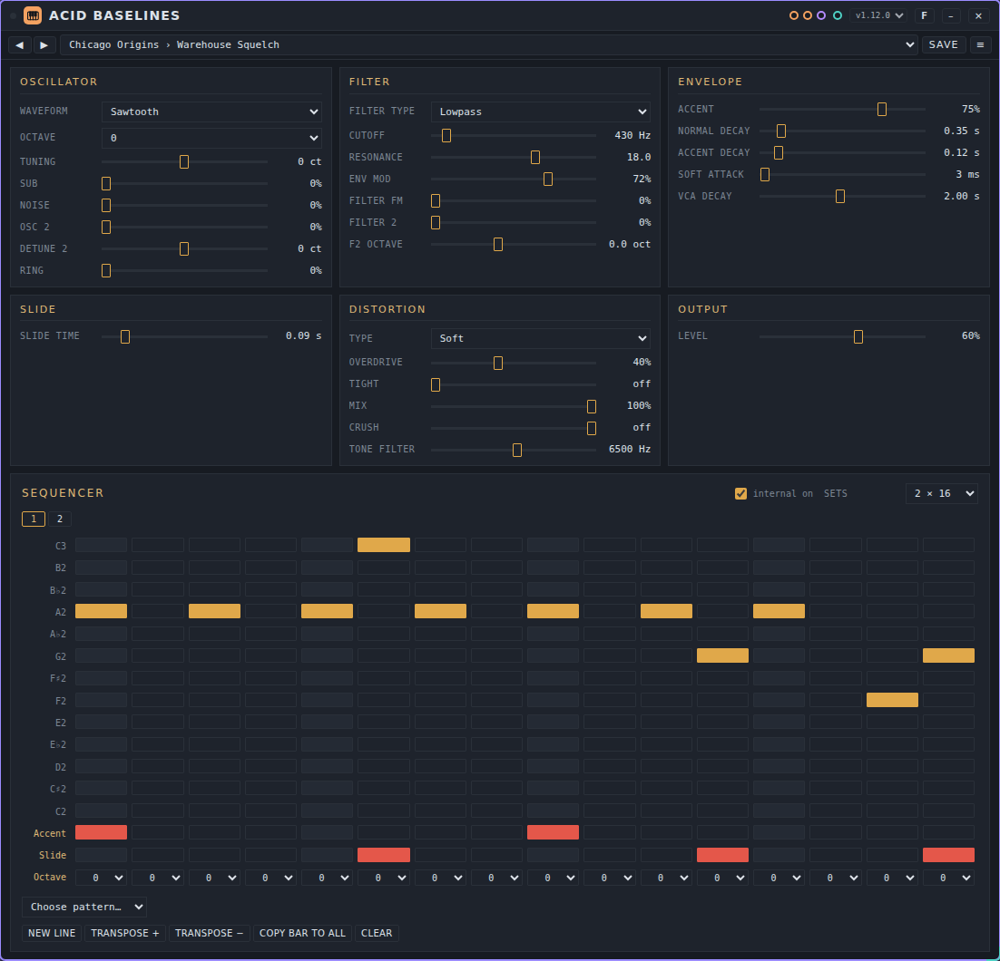

**Controls.** Double-click a slider to go back to its starting value. Click the number to type a value. The six sections follow the way the sound travels through the device.

- **Oscillator:** **Waveform** (Sawtooth or Square), **Octave** (−1, 0, +1), **Tuning** (−100 to +100 ct), **Sub** (a square wave one octave lower), **Noise**, **Osc 2** (second oscillator, same waveform), **Detune 2** (−100 to +100 ct) and **Ring** (ring modulation of the two oscillators).
- **Filter:** **Filter type** (Lowpass, Bandpass or Highpass), **Cutoff** (80 to 5000 Hz), **Resonance** (0.5 to 28), **Env mod** (how far each note opens the filter), **Filter FM**, **Filter 2** (level of a second bandpass filter in parallel) and **F2 octave** (moves Filter 2 from −2 to +3 octaves).
- **Envelope:** **Accent** (how much louder an accented step is and how much more it opens the filter), **Normal decay** (0.03 to 3 s), **Accent decay** (0.03 to 1 s), **Soft attack** (1 to 300 ms) and **VCA decay** (0.1 to 4 s).
- **Slide:** **Slide time**, the glide time on steps that have slide (0.02 to 0.6 s).
- **Distortion:** **Type** (Soft, Hard, Fold or Asym: four shapes), **Overdrive**, **Tight** (filters low frequencies out before the distortion, off to 600 Hz), **Mix** (distorted against clean), **Crush** (bit depth after the distortion, 2 to 16 bits, off = 16) and **Tone filter** (a lowpass after the distortion, 500 to 12000 Hz).
- **Output:** **Level**.

Everything from **Sub** onwards (Sub, Noise, Osc 2, Detune 2, Ring, Filter type, Filter 2, F2 octave, Type, Tight, Mix, Crush) is off or neutral at the start, so older tunes sound as they did before.

The sequencer under the controls:

- **Grid.** Click a square to put a note on that step; click it again to remove it. The rows run from C2 to C3, one row per semitone. There are 16 steps in a set.
- **Accent row.** A step with accent is louder and opens the filter more (see **Accent**).
- **Slide row.** A step with slide glides from the note of the previous step. The same note with slide is a tie: the note keeps going.
- **Octave row.** Each step has its own choice, +2 to −2 octaves, on top of the **Octave** control.
- **SETS.** The list chooses 1, 2, 4, 8 or 16 sets of 16 steps. The numbered buttons above the grid choose which set you edit. The set that is playing is marked.
- **internal on.** With it on, the sequencer plays along with the clock. Switch it off to play only notes that arrive on the **Notes** port.
- **Choose pattern…** puts one of 16 patterns in the set you are editing: 01 Rolling, 02 Squelch, 03 Pump, 04 Climb, 05 Stab, 06 Bounce, 07 Hypno, 08 Chase, 09 Walk, 10 Drop, 11 Wobble, 12 Slide run, 13 Offbeat, 14 Octave jump, 15 Minor run, 16 Closing.
- **NEW LINE** fills the set with a random line. **TRANSPOSE +** and **TRANSPOSE −** move all notes of the set by two semitones (a note past the grid wraps around). **COPY BAR TO ALL** copies the set you are editing to all 16 sets. **CLEAR** empties the set.

**Ports.**

| Port | Kind | Use |
|---|---|---|
| **Notes** | notes in (orange) | Notes from **Keys / MIDI** or another sequencer. A note with velocity above 0.9 counts as an accent. Overlapping notes slide. |
| **CC** | notes in (orange) | Control changes with a value from 0 to 1 for `cutoff`, `res`, `env`, `drive` and `level`. Other ids are ignored. |
| **Mod** | modulation in (purple) | A modulator can move 14 controls: **Tuning**, **Cutoff**, **Resonance**, **Env mod**, **Normal decay**, **Accent**, **Accent decay**, **Soft attack**, **Slide time**, **Filter FM**, **Overdrive**, **Tone filter**, **VCA decay** and **Level**. |
| **Out** | audio out (teal) | Connect to **Speakers** or a **Mixer** channel. |

**Example.**

1. Place **Acid Baselines** and **Speakers**. Connect **Out** to **In** on Speakers.
2. Press **Start**. The start line plays at once.
3. Set **SETS** to **1 × 16**, then choose **Choose pattern… › 02 · Squelch**.
4. Set **Resonance** to about 20, **Env mod** to 80% and turn **Cutoff** down slowly while it plays.
5. Set **Distortion › Type** to **Fold** and raise **Overdrive** until you like it. Use **Tight** to keep the lowest notes clear.
6. To play it from a keyboard instead: switch **internal on** off, place **Keys / MIDI** and connect its notes to **Notes**.

**Tunes.** Pack **Acid Baselines Classics**: 49 tunes in nine folders (Chicago Origins, Frankfurt Rolling, Minimal Acid, Squelch Anthems, Acid Techno, Acid Trance, Electro Acid, Deep Acid and AIcid), file [`acid-baselines-classics.patchkamer-tunes.json`](../../tunes/acid-baselines-classics.patchkamer-tunes.json). Every tune comes with its own bass line. The **AIcid** folder uses the newest controls (the extra oscillators, filter types and distortions). A few names: **Warehouse Squelch**, **Rolling Thunder**, **Hard Drive**, **Sunrise Acid**, **Neural Squelch**.

**Tips and limits.**

- **Resonance**, **Filter FM** and a cutoff that a modulator turns down can make a filter unstable. A built-in guard checks this every 50 ms and replaces the filters, so the sound comes back by itself.
- A note is held for about 62% of a step, unless the next step has slide: then it is held until the next note.
- The notes in the grid run from C2 to C3. Use **Octave**, the per-step octave row or a tune to go outside that range.

### Acid Stepper

**What it is for.** A simpler acid bass synth for a quick, direct bass line: one oscillator and a sub, a four-pole lowpass filter with resonance and an envelope, accent, slide, drive, and a fixed grid of 16 steps. Compared with Acid Baselines it has no sets, no octave per step, no second filter and fewer kinds of distortion. The internal clock of the host sets tempo and swing.

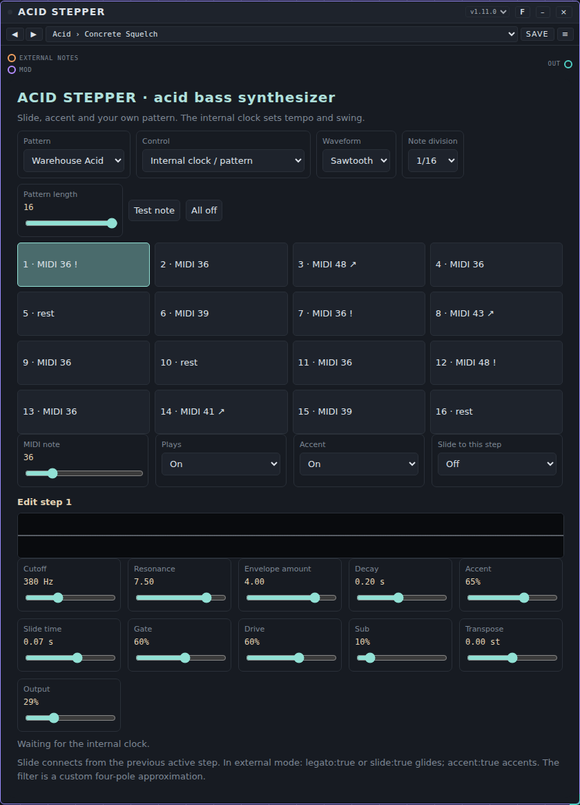

**Controls.**

- **Top row:** **Pattern** (six start lines: Warehouse Acid, Octave Engine, Dark Rubber, Open Skyline, Sparse Pulse, Broken Staircase), **Control** (**Internal clock / pattern** or **External keyboard / sequencer**), **Waveform** (Sawtooth or Square), **Note division** (1/16, 1/8 or 1/4: with 1/8 every note lasts two steps), **Pattern length** (1 to 16), **Test note** and **All off**.
- **The 16 step buttons.** Each shows its number and note (`1 · MIDI 36`); `!` means accent, `↗` means slide and `rest` means silent. Click one to edit it.
- **Edit step:** **MIDI note** (24 to 84; 36 = C2), **Plays** (On or Off; off is a rest), **Accent** and **Slide to this step** (the pitch glides from the previous active step and the note stays open).
- **Sound:** **Cutoff** (70 to 10000 Hz), **Resonance** (0.4 to 9), **Envelope amount** (0 to 5 octaves the cutoff jumps up on each note), **Decay** (0.03 to 2 s), **Accent** (0 to 1), **Slide time** (0.005 to 0.4 s), **Gate** (how long a note sounds as part of the step, 0.1 to 1), **Drive**, **Sub**, **Transpose** (−24 to 24 semitones) and **Output**.

**Ports.**

| Port | Kind | Use |
|---|---|---|
| **External notes** | notes in (orange) | Only used when **Control** is **External keyboard / sequencer**. A velocity above 0.9 counts as accent. In the pattern mode, incoming notes are ignored. |
| **Mod** | modulation in (purple) | A modulator can move 11 controls: **Cutoff**, **Resonance**, **Envelope amount**, **Decay**, **Accent**, **Slide time**, **Gate**, **Drive**, **Sub**, **Transpose** and **Output**. |
| **Out** | audio out (teal) | Connect to **Speakers** or a **Mixer** channel. |

**Example.**

1. Place **Acid Stepper** and **Speakers** and connect **Out** to **In**.
2. Press **Start**: the line plays on the clock (the card says "Waiting for the internal clock." until then).
3. Click step 5 and set **Plays** to **On**, then give step 6 **Slide to this step: On** to make a glide.
4. Raise **Resonance** and **Envelope amount** and turn **Cutoff** down while it plays.

**Tunes.** Pack **Acid Stepper Styles**: 65 tunes in 12 folders (Acid, Techno, House, Deep House, Electro, Trance, Breakbeat, Hip-hop, Synthwave, Dub, Industrial, Garage), file [`acid-stepper-styles.patchkamer-tunes.json`](../../tunes/acid-stepper-styles.patchkamer-tunes.json). 45 of the 65 tunes bring their own line; the others keep the line that is on the card. A few names: **Concrete Squelch**, **Rubber Climb**, **Driving Rumble**, **Funky Offbeat**, **Neon Arp**.

**Tips and limits.**

- With every start or stop of the clock the line begins again at step 1.
- A rest closes the note before it. A slide on the next active step ties the current note to it, so you can build long gliding phrases.
- The **Pattern** list only names the start line you chose; a tune that sets only knobs does not change the line.

### Low Bass

**What it is for.** A mono bass synth without a sequencer: it plays the notes that arrive on its **Notes** port (the last note wins). Two slightly detuned oscillators, a sine sub one octave lower, optional FM, drive, a filter with envelope, glide and legato.

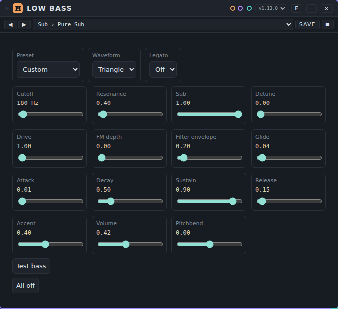

**Controls.**

- **Top row:** **Preset** (Analog Bass, Deep Sub, Acid Slide, Square Punch, FM Growl, Rumble Bass, Pluck Bass; choosing one loads its knob settings; it shows **Custom** as soon as you change a knob), **Waveform** (the waveform of both oscillators: Sawtooth, Square or Triangle) and **Legato** (overlapping notes glide instead of striking again).
- **Sound:** **Cutoff** (40 to 10000 Hz), **Resonance** (0.2 to 7), **Sub**, **Detune** (0 to 20 cents between the two oscillators), **Drive** (1 to 16; the level is compensated), **FM depth** (how strongly the second oscillator modulates the pitch of the first), **Filter envelope** (0 to 5 octaves) and **Glide** (0.001 to 1.5 s).
- **Envelope:** **Attack**, **Decay** (for amplifier and filter), **Sustain** and **Release**.
- **Level:** **Accent** (how much extra volume a hard key press gets), **Volume** and **Pitchbend** (a fixed shift of −12 to 12 semitones).
- **Test bass** plays a note, **All off** stops everything.

**Ports.**

| Port | Kind | Use |
|---|---|---|
| **Notes** | notes in (orange) | Notes from **Keys / MIDI** or a sequencer. |
| **Mod** | modulation in (purple) | A modulator can move 15 controls (all the knobs on the card). |
| **Bass out** | audio out (teal) | Connect to **Speakers** or a **Mixer** channel. |

**Example.**

1. Place **Keys / MIDI**, **Low Bass** and **Speakers**. Connect the notes of Keys to **Notes** and **Bass out** to **In**.
2. Play low notes (the tunes expect roughly MIDI notes 28 to 48).
3. Choose the preset **Acid Slide** and play two keys overlapping: with **Legato** on they glide.
4. Turn **FM depth** up slowly for a harder edge.

**Tunes.** Pack **Low Bass Styles**: 64 tunes in 13 folders (Sub, Rolling Bass, Detuned Wide, Dub, Booming Sub, Acid, Funk, Drum & Bass, Dubstep, Garage, Trap, Synthwave, Techno & House), file [`low-bass-styles.patchkamer-tunes.json`](../../tunes/low-bass-styles.patchkamer-tunes.json). A tune is only a sound; the notes come from your keyboard or sequencer. A few names: **Pure Sub**, **Rolling Saw**, **Wide Detuned Growl**, **Heavy Dub Sub**, **Squelch Mono**.

**Tips and limits.**

- Legato only works while the previous note still sounds (overlapping or held notes); separate notes always strike again. The filter envelope restarts on every note, also with legato.
- Envelopes and glide are read when the next note starts.
- A built-in guard replaces the filters if they derail, so a modulator can not silence the device for good.

### Sub Line

**What it is for.** A mono synth for bass lines and leads. It has one oscillator bank (sawtooth, pulse with pulse width, a sub and noise), a filter with envelope, portamento and an LFO, plus its own 32-step pattern and an arpeggiator. It also plays notes from a keyboard or an external sequencer.

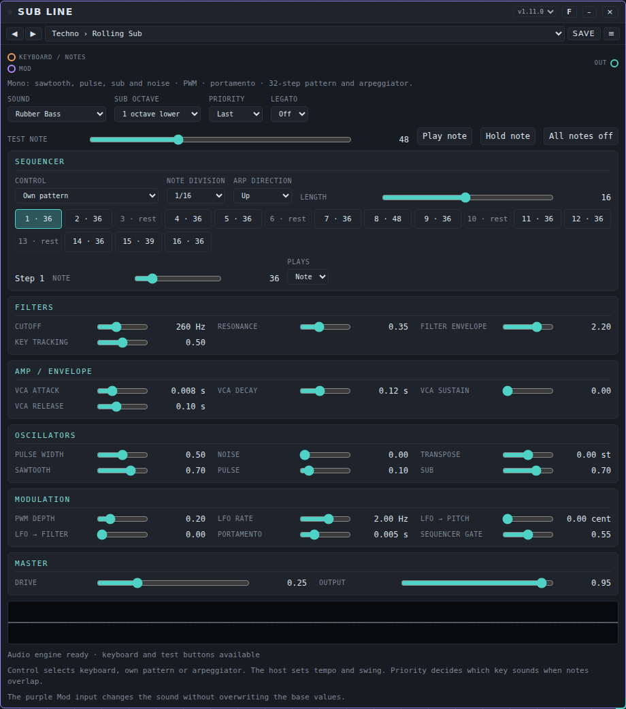

**Controls.**

- **Top row:** **Sound** (a list of starting sounds, starting with Rubber Bass), **Sub octave** (1 or 2 octaves lower), **Priority** (**Last**, **Low** or **High**: which key sounds when several are held) and **Legato**. **Test note** (24 to 96) with **Play note**, **Hold note** and **All notes off**.
- **Sequencer:** **Control** (**Keyboard / external sequencer**, **Own pattern** or **Arpeggiator**), **Note division** (1/16, 1/8, 1/4), **Arp direction** (Up or Down), **Length** (1 to 32 steps). The step buttons show `1 · 36` (step and MIDI note) or `rest`; click one to edit it with **Note** and **Plays** (Note or Rest). **Sequencer gate** (under Modulation) sets how long a pattern or arp note lasts as part of the step.
- **Filters:** **Cutoff** (30 to 16000 Hz), **Resonance**, **Filter envelope** (−5 to 5 octaves) and **Key tracking**.
- **Amp / envelope:** **VCA attack**, **VCA decay**, **VCA sustain** and **VCA release** (one envelope for filter and amplifier).
- **Oscillators:** **Pulse width**, **Noise**, **Transpose**, **Sawtooth**, **Pulse** and **Sub** (levels).
- **Modulation:** **PWM depth**, **LFO rate**, **LFO → pitch** (vibrato in cents), **LFO → filter**, **Portamento** and **Sequencer gate**.
- **Master:** **Drive** and **Output**. At the bottom of the card you see a small scope.

**Ports.**

| Port | Kind | Use |
|---|---|---|
| **Keyboard / notes** | notes in (orange) | Notes from **Keys / MIDI** or a sequencer (**Control** = keyboard), or the held keys for the arpeggiator. |
| **Mod** | modulation in (purple) | A modulator can move the knobs; the knob values stay the base. |
| **Out** | audio out (teal) | Connect to **Speakers** or a **Mixer** channel. |

**Example.**

1. Place **Sub Line** and **Speakers** and connect **Out** to **In**.
2. Choose the tune **Techno › Rolling Sub**, which plays its own pattern (**Control** = **Own pattern**), and press **Start**.
3. Click a step, change **Note** and turn **Plays** to **Rest** on another step.
4. Switch **Control** to **Arpeggiator**, place **Keys / MIDI** and hold three keys: they play one after the other, low to high (or high to low with **Arp direction**).

**Tunes.** Pack **Sub Line Styles**: 68 tunes in 10 folders (Techno, House, Deep House, Acid, Electro, Synthwave, Hip-hop, Dub, Drum & Bass, Trance), file [`subline-styles.patchkamer-tunes.json`](../../tunes/subline-styles.patchkamer-tunes.json). 42 tunes play from a keyboard, 23 play their own pattern and 3 are arpeggios. A few names: **Rolling Sub**, **Squelch Runner**, **Neon Bass**, **Boom Sub**, **Gate Arp**.

**Tips and limits.**

- The own pattern and the arpeggiator only play while the clock runs (**Start**). A tune with the mode **Keyboard / external sequencer** plays only the notes you send.
- With the arpeggiator, a **Length** that is a multiple of the number of held keys keeps the pattern even: 12 fits 1, 2, 3 and 4 keys, 16 fits 1, 2, 4 and 8.
- **Sound** is only a starting point: choosing it sets the knobs once.

### Basic Mono

**What it is for.** The simplest mono synth: one oscillator, a sub, a resonant lowpass filter with envelope, glide and one level knob. It has no sequencer, no arpeggiator and no LFO; it plays the notes you send, one voice at a time (a new note takes over the old one). Good for a quick bass, lead or pluck.

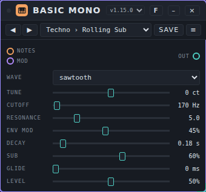

**Controls.** Double-click a knob to go back to its starting value.

- **Wave:** sawtooth, square or triangle.
- **Tune:** −100 to 100 ct (oscillator and sub together).
- **Cutoff:** 80 to 8000 Hz, the resting position of the filter.
- **Resonance:** 0.5 to 24.
- **Env mod:** how far each note shoots the cutoff up (0 to 100%).
- **Decay:** 0.05 to 2 s; how fast the cutoff falls back and how fast the volume falls to its sustain level. There is no sustain knob: the sustain is fixed at 30% of the attack. A long **Decay** on a held note therefore sounds almost like an organ; a short one gives a short pluck.
- **Sub:** level of the square-wave sub one octave lower.
- **Glide:** 0 to 300 ms (0 = off).
- **Level:** 0 to 100%.

**Ports.**

| Port | Kind | Use |
|---|---|---|
| **Notes** | notes in (orange) | Notes from **Keys / MIDI** or a sequencer. Overlapping notes cut each other off: the newest wins. |
| **Mod** | modulation in (purple) | A modulator can move every knob except **Wave**. |
| **Out** | audio out (teal) | Connect to **Speakers** or a **Mixer** channel. |

**Example.**

1. Place **Keys / MIDI**, **Basic Mono** and **Speakers**; connect notes to **Notes** and **Out** to **In**.
2. Choose the tune **Techno › Rolling Sub** and play low notes.
3. Raise **Env mod** and **Resonance** and turn **Cutoff** up and down.

**Tunes.** Pack **Basic Mono Styles**: 65 tunes in 12 folders (Techno, House, Electro, Hip-hop, Funk, Synthwave, Dub, Pop, Chiptune, Acid, Trance, Ambient), file [`basic-mono-styles.patchkamer-tunes.json`](../../tunes/basic-mono-styles.patchkamer-tunes.json). A few names: **Rolling Sub**, **Zap Bass**, **Slap Bass**, **Square Lead**, **Deep Drone**.

**Tips and limits.**

- Keep **Level** below 0.6 (60%), and below 0.4 when **Sub** and **Resonance** are both high: in a measurement, **Level** 100%, **Sub** 100% and **Resonance** 8 clipped.
- A pad is not really possible (mono, no slow attack); a drone with long notes is.
- A built-in guard replaces the filter if it derails.

## Mono synths for leads and sound design

### Duofone

**What it is for.** A synth with two oscillators that can play two different pitches at the same time (**duophonic**). The two oscillators share one filter and one amplifier. It has ring modulation, hard sync, sample & hold and a built-in test keyboard. It is inspired by classic duophonic analog synths. Of the keys you hold, only the lowest and the highest are heard: it is not a chord synth.

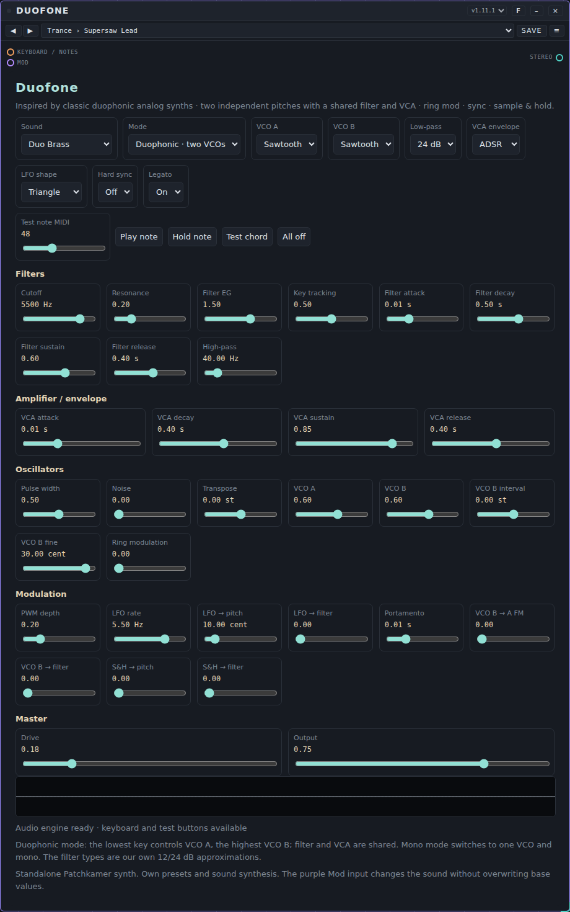

**Controls.** Double-click a slider to go back to its starting value. Click the number to type a value.

*Top row (choices)*

| Control | What it does |
|---|---|
| **Sound** | Picks one of six starting sounds: Duo Brass, Ring Factory, Sample Hold Lab, Sync Flight, Mono Pulse Bass and Duo Atmosphere. It sets many controls at once. You can change everything afterwards. |
| **Mode** | **Duophonic · two VCOs** or **Mono · one VCO**. In mono mode there is one oscillator and one envelope for filter and amplifier, and part of the controls disappear from the card. |
| **VCO A**, **VCO B** | The waveform of each oscillator: Sawtooth, Pulse or Triangle. (In mono mode only **VCO A** is shown.) |
| **Low-pass** | The steepness of the filter: 12 dB or 24 dB (duophonic mode only). |
| **VCA envelope** | **ADSR** or **AR** (duophonic mode only). |
| **LFO shape** | The shape of the slow oscillator (LFO): Sawtooth, Pulse or Triangle. |
| **Hard sync** | **On** or **Off**. When it is on, the phase of VCO B restarts every time VCO A completes a cycle (duophonic mode only). |
| **Legato** | **On** or **Off**. When it is on, a note you play while another key is still held does not restart the envelopes. |

**Test note.** **Test note MIDI** chooses a note number (24 to 96, starting at 48). **Play note** plays it once, **Hold note** holds it until you press the button again, **Test chord** plays three notes together (the chosen note, a minor third up and a fifth up; Duofone then plays the lowest and the highest of them) and **All off** stops everything.

*Filters (the filter and its envelope)*

| Control | What it does | Range |
|---|---|---|
| **Cutoff** | Where the filter starts to cut | 30 to 16000 Hz (2400) |
| **Resonance** | Emphasis around the cutoff | 0 to 1 (0.25) |
| **Filter EG** | How far the filter envelope moves the cutoff | −5 to 5 (2.5) |
| **Key tracking** | How much the cutoff follows the pitch you play | 0 to 1 (0.5) |
| **Filter attack**, **Filter decay**, **Filter sustain**, **Filter release** | The filter envelope | 0.001 to 4 s, 0.01 to 8 s, 0 to 1, 0.01 to 8 s |
| **High-pass** | Cuts low frequencies | 20 to 6000 Hz (40) |

*Amplifier / envelope:* **VCA attack**, **VCA decay**, **VCA sustain** and **VCA release** shape the volume of each note. Attack 0.001 to 4 s, decay 0.01 to 8 s, sustain 0 to 1, release 0.01 to 8 s.

*Oscillators*

| Control | What it does | Range |
|---|---|---|
| **Pulse width** | Width of the pulse wave | 0.05 to 0.95 (0.5) |
| **Noise** | Amount of noise | 0 to 1 |
| **Transpose** | Moves everything up or down | −24 to 24 semitones |
| **VCO A**, **VCO B** | The level of each oscillator | 0 to 1 (0.7 and 0.5) |
| **VCO B interval** | Distance between VCO B and its note | −24 to 24 semitones |
| **VCO B fine** | Small detune of VCO B | −35 to 35 cents |
| **Ring modulation** | Mix of the ring modulation of both oscillators | 0 to 1 |

*Modulation*

| Control | What it does | Range |
|---|---|---|
| **PWM depth** | How much the pulse width moves | 0 to 1 |
| **LFO rate** | Speed of the LFO | 0.05 to 30 Hz |
| **LFO → pitch** | LFO on the pitch (vibrato) | 0 to 120 cents |
| **LFO → filter** | LFO on the cutoff | 0 to 1 |
| **Portamento** | Glide time between notes | 0.001 to 1 s |
| **VCO B → A FM** | VCO B modulates the frequency of VCO A | 0 to 3 |
| **VCO B → filter** | VCO B modulates the cutoff | 0 to 1 |
| **S&H → pitch**, **S&H → filter** | A random, stepped value (sample & hold) on the pitch or the cutoff | 0 to 1 |

*Master:* **Drive** (0 to 1) adds distortion, **Output** (0 to 1) sets the level. At the bottom of the card you see a small scope.

In mono mode the controls for the second oscillator (**VCO B** level, **VCO B interval**, **VCO B fine**, **VCO B → A FM**, **VCO B → filter**, **Ring modulation**), the filter envelope and **High-pass** are hidden.

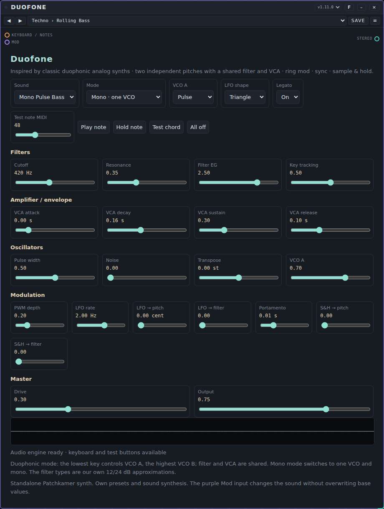

**Ports.**

| Port | Kind | Use |
|---|---|---|
| **Keyboard / notes** | notes in (orange) | Connect **Keys / MIDI** or a sequencer. In duophonic mode the lowest key you hold plays VCO A and the highest plays VCO B. |
| **Mod** | modulation in (purple) | A modulator can move the controls. The knob values stay as you set them. |
| **Stereo** | audio out (teal) | Connect to **Speakers** or a **Mixer** channel. |

**Example.**

1. Place **Keys / MIDI**, **Duofone** and **Speakers**.
2. Connect the orange notes out of Keys to **Keyboard / notes** on Duofone, and **Stereo** to **In** on Speakers.
3. Press **Start**, choose the tune **Trance › Supersaw Lead** (or leave the sound as it is) and play two keys at once.
4. Set **VCO B interval** to 7 semitones and **VCO B fine** to 8 cents, and turn **Cutoff** up and down while you play.

No keyboard? Use **Hold note** or **Test chord** on the card instead.

**Tunes.** Pack **Duofone Styles**: 60 tunes in 12 folders (Techno, House, Trance, Ambient, Drum & Bass, Dubstep, Synthwave, Funk & Disco, Hip-hop, Electro, Pop, Chiptune), five per folder, file [`duofone-styles.patchkamer-tunes.json`](../../tunes/duofone-styles.patchkamer-tunes.json). A few names: **Dark Stab**, **Supersaw Lead**, **Detuned Saw Bass** and **Neon Lead** (two oscillators), and **Rolling Bass**, **Wobble Bass** and **Pulse Lead** (mono mode). A tune also sets **Mode**.

**Tips and limits.**

- **Sound** replaces many controls at once. Choose it first, then adjust. After you pick a tune, **Sound** shows the starting sound that the tune is based on.
- Mono mode plays one note at a time. Duophonic mode plays two pitches at once (the lowest and the highest key you hold).
- Without AudioWorklet support in your browser the card says that the audio engine is not available.

### Cross Mod Mono

**What it is for.** A mono synth (one voice) built around two oscillators that influence each other: hard sync, and cross modulation at audio rate where oscillator B moves the pitch of A and the cutoff of the filter. It has two envelopes, a two-pole lowpass filter, an LFO, portamento, a pattern of up to 32 steps and an arpeggiator. It also plays notes from a keyboard or a sequencer.

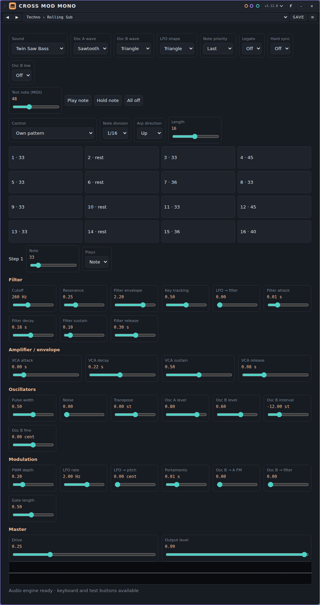

**Controls.**

- **Top row:** **Sound** (six starting sounds: Twin Saw Bass, Sync Blade, Cross Mod Metal, Low B Motion, Detroit Pluck and Long Unison Lead; choosing one keeps the mode, the pattern and the note priority), **Osc A wave**, **Osc B wave**, **LFO shape**, **Note priority** (Last, Low, High), **Legato**, **Hard sync** and **Osc B low** (oscillator B becomes a slow modulator at a fixed frequency of about 0.125 to 2 Hz, set by **Osc B interval**, no longer following the note).
- **Test note** (MIDI) with **Play note**, **Hold note** and **All off**.
- **Control, Note division, Arp direction, Length** and the step buttons: **Control** is **Keyboard / external sequencer**, **Own pattern** or **Arpeggiator**; **Length** is 1 to 32 steps. A step button shows its number and note (`1 · 33`) or `rest`; **Note** and **Plays** edit the step.
- **Filter:** **Cutoff** (30 to 16000 Hz), **Resonance**, **Filter envelope** (−5 to 5 octaves), **Key tracking**, **LFO → filter** and **Filter attack**, **Filter decay**, **Filter sustain**, **Filter release**.
- **Amplifier / envelope:** **VCA attack**, **VCA decay**, **VCA sustain**, **VCA release**.
- **Oscillators:** **Pulse width** (only on a pulse wave), **Noise**, **Transpose**, **Osc A level**, **Osc B level**, **Osc B interval** (−24 to 24 semitones) and **Osc B fine** (−35 to 35 cents).
- **Modulation:** **PWM depth**, **LFO rate**, **LFO → pitch**, **Portamento**, **Osc B → A FM** (0 to 3), **Osc B → filter** and **Gate length** (how long a pattern or arp note lasts as part of the step).
- **Master:** **Drive** and **Output level**.

**Ports.**

| Port | Kind | Use |
|---|---|---|
| **Keyboard / notes** | notes in (orange) | Notes and control changes from **Keys / MIDI** or a sequencer. |
| **Mod** | modulation in (purple) | A modulator can move 29 controls in five groups (Filter, Amplifier / envelope, Oscillators, Modulation, Master). |
| **Stereo** | audio out (teal) | Connect to **Speakers** or a **Mixer** channel. |

**Example.**

1. Place **Keys / MIDI**, **Cross Mod Mono** and **Speakers**; connect notes to **Keyboard / notes** and **Stereo** to **In**.
2. Set **Hard sync** to **On**, **Osc B interval** to 12 or more semitones, and turn **Cutoff** and **Filter envelope** up while you hold a note: you get the sync sweep.
3. For metallic sounds: **Osc B → A FM** around 0.3 to 1.2 with **Osc B interval** at 7 or 12 semitones.

**Tunes.** Pack **Cross Mod Mono Styles**: 63 tunes in 12 folders (Techno, Acid, House, Trance, Ambient, Synthwave, Electro, Drum & Bass, Dub, Hip-hop, Chiptune, Funk & Disco), file [`cross-mod-mono-styles.patchkamer-tunes.json`](../../tunes/cross-mod-mono-styles.patchkamer-tunes.json). 47 tunes play from a keyboard, 11 play their own pattern and 5 are arpeggios. A few names: **Rolling Sub**, **Squelch Line**, **Sync Screamer**, **Neon Bass**, **Metal Zap**.

**Tips and limits.**

- Own pattern and Arpeggiator only play while the clock runs; the arpeggiator also needs held keys. Pick an arp **Length** that is a multiple of the number of keys you hold (12 fits 1 to 4 keys, 16 fits 1, 2, 4 and 8).
- **Osc B → A FM** above 1 can make the pitch of A nearly stall for a moment.
- It is mono: a chord can only be played as an arpeggio.

### Patch Mono

**What it is for.** A mono synth in two builds, chosen with **Voice layout**: one oscillator with a 12 dB lowpass filter and one envelope for volume and filter, or two oscillators (VCO A and VCO B, with interval, fine tune, FM and ring modulation) with a high-pass and two lowpass filters in series (24 dB) and a separate filter envelope. In both builds it has noise, an LFO with sample & hold, pulse-width modulation, portamento, legato, key tracking and drive. It also has an audio input for outside sound and **four internal patch routes** that connect a source to a target.

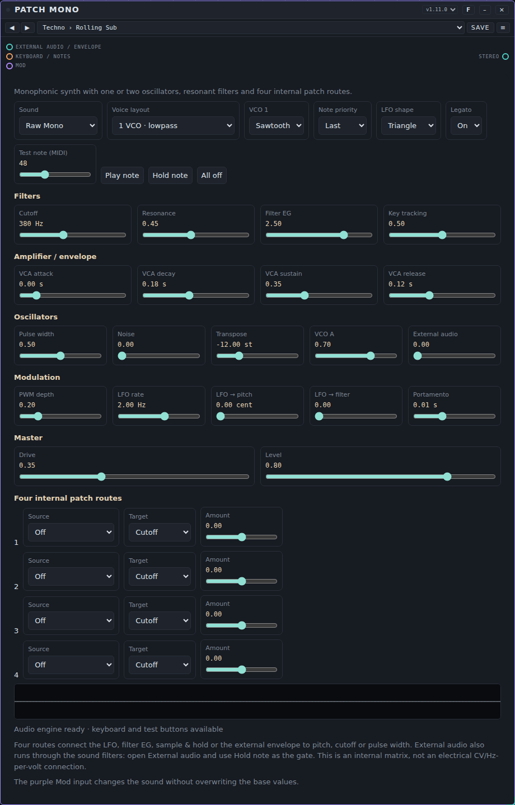

**Controls.** The picture shows the one-oscillator build.

- **Top row:** **Sound** (a list of starting sounds, starting with Raw Mono), **Voice layout** (**1 VCO · lowpass** or the two-oscillator build), **VCO 1** (waveform: Sawtooth, Pulse, Triangle or Noise), **Note priority**, **LFO shape**, **Legato**. **Test note (MIDI)** with **Play note**, **Hold note** and **All off**.
- **Filters:** **Cutoff**, **Resonance**, **Filter EG** (octaves) and **Key tracking**.
- **Amplifier / envelope:** **VCA attack**, **VCA decay**, **VCA sustain**, **VCA release** (in the one-oscillator build they also drive the filter).
- **Oscillators:** **Pulse width**, **Noise**, **Transpose**, **VCO A** (level) and **External audio** (level of the sound from the audio input, which runs through the filters; its volume follows the note).
- **Modulation:** **PWM depth**, **LFO rate**, **LFO → pitch**, **LFO → filter** and **Portamento**.
- **Master:** **Drive** and **Level**.
- **Four internal patch routes:** each route has a **Source** (off, LFO, filter envelope, sample & hold or the external envelope), a **Target** (pitch, cutoff or pulse width) and an **Amount** (−1 to 1; pitch ±24 semitones, cutoff ±5 octaves at 1).
- In the two-oscillator build the card also offers the second oscillator (level, interval, fine tune, FM onto VCO A, ring modulation, B → filter), the high-pass filter with its resonance and a separate filter envelope. Those controls have no effect in the one-oscillator build.

**Ports.**

| Port | Kind | Use |
|---|---|---|
| **External audio / envelope** | audio in (teal) | Outside sound that runs through the filters and can act as an envelope follower. |
| **Keyboard / notes** | notes in (orange) | Notes from **Keys / MIDI** or a sequencer. |
| **Mod** | modulation in (purple) | A modulator can move the knobs; the knob values stay the base. |
| **Stereo** | audio out (teal) | Connect to **Speakers** or a **Mixer** channel. |

**Example.** A wobble with a patch route:

1. Place **Keys / MIDI**, **Patch Mono** and **Speakers**; connect the notes and the sound as usual.
2. In route 1, set **Source** to the LFO, **Target** to **Cutoff** and **Amount** to about 0.3.
3. Set **LFO rate** to 2 to 6 Hz and hold a low note.

To shape outside sound: connect an audio source to **External audio / envelope**, open **External audio** and use **Hold note** as the gate.

**Tunes.** Pack **Patch Mono Styles**: 79 tunes in 14 folders (Techno, Acid, Dubstep, Drum & Bass, Hip-hop, Dub, Synthwave, Ambient, Electro, Funk & Disco, Trance, Chiptune, **Patch Routes** and **External Input**), file [`patch-mono-styles.patchkamer-tunes.json`](../../tunes/patch-mono-styles.patchkamer-tunes.json). 42 tunes use the one-oscillator build, 37 the two-oscillator build. A few names: **Rolling Sub**, **Acid Squelch**, **Wobble Bass** and **Sample and Hold Computer** (folder Patch Routes), **Input Through Lowpass** and **Input Follower Bass** (folder External Input).

**Tips and limits.**

- The routes are an internal matrix, not electrical CV cables (for those, see [Patchbay Synth](#patchbay-synth)).
- Mono: one note at a time; **Note priority** decides which held key sounds.

## Polyphonic synths, pads and chords

### Poly Chorus

**What it is for.** A polyphonic synth with six voices and a stereo chorus. Each voice has a sawtooth, a pulse (with pulse-width modulation), a sub and noise. Good for chords, pads and bright basses.

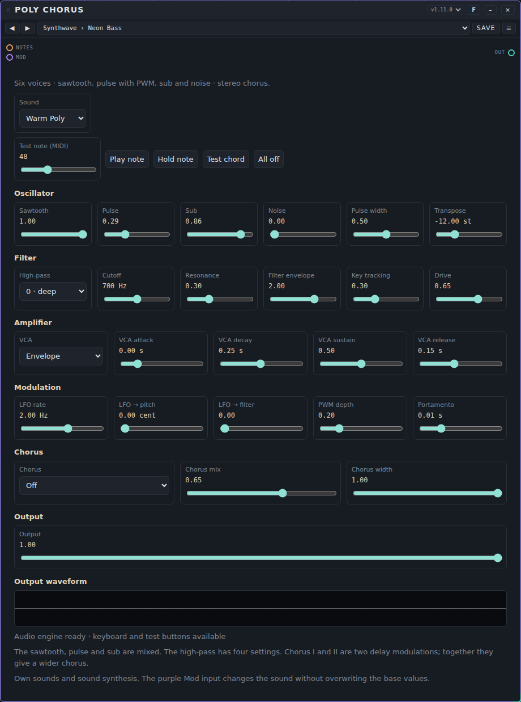

**Controls.**

- **Sound** (eight starting sounds: Warm Poly, Rave Chords, Silk Strings, Deep Sub, PWM Cloud, Slow Brass, Muted Pluck, Wide Organ). **Test note (MIDI)** with **Play note**, **Hold note**, **Test chord** and **All off**.
- **Oscillator:** **Sawtooth**, **Pulse**, **Sub** and **Noise** (levels), **Pulse width** and **Transpose** (−24 to 24 semitones).
- **Filter:** **High-pass** (four settings, `0 · deep` to the thinnest, cutting at 20, 80, 180 or 400 Hz), **Cutoff** (30 to 16000 Hz), **Resonance**, **Filter envelope** (−5 to 5 octaves), **Key tracking** and **Drive**.
- **Amplifier:** **VCA** (**Envelope** or **Gate**), **VCA attack**, **VCA decay**, **VCA sustain**, **VCA release**.
- **Modulation:** **LFO rate**, **LFO → pitch**, **LFO → filter**, **PWM depth**, **Portamento**.
- **Chorus:** **Chorus** (**Off**, **I** (slow), **II** (faster) or **I + II**), **Chorus mix** and **Chorus width**.
- **Output** and a scope (**Output waveform**).

**Ports.**

| Port | Kind | Use |
|---|---|---|
| **Notes** | notes in (orange) | Notes from **Keys / MIDI** or a sequencer. |
| **Mod** | modulation in (purple) | A modulator can move the knobs (not the choices). |
| **Out** | audio out (teal, stereo) | Connect to **Speakers** or a **Mixer** channel. |

**Example.** Place **Keys / MIDI**, **Poly Chorus** and **Speakers**. Choose the sound **Silk Strings**, set **Chorus** to **I + II** and play chords. Lengthen **VCA attack** for a slow swell.

**Tunes.** Pack **Poly Chorus Styles**: 72 tunes in 12 folders (Synthwave, Ambient, Cinematic, Pop, Trance, House, Deep House, Funk & Disco, Soul, Electro, Lo-fi, Techno), six per folder, file [`poly-chorus-styles.patchkamer-tunes.json`](../../tunes/poly-chorus-styles.patchkamer-tunes.json). A few names: **Neon Bass**, **Slow Tide**, **Rising Strings**, **Bright Pop Chords**, **Stab Chord**.

**Tips and limits.**

- The four envelope knobs steer two things at once: the amplifier and, through **Filter envelope**, the filter. A long **VCA attack** also opens the filter slowly. With **VCA** on **Gate**, the amplifier gets a fixed fast attack (3 ms), full sustain and a short release (30 ms), and the knobs only move the filter.
- Six voices: a seventh note takes over the oldest voice that is already letting go. Long releases with many notes break notes off.

### Triple Osc Poly

**What it is for.** A flexible polyphonic subtractive synth. Each voice has three oscillators (sawtooth, square, triangle, sine, FM or noise) with unison up to seven voices, a mixer with ring modulation, a shaper, two filters (the second is off at the start) and two envelopes. It can also turn a single key into a chord.

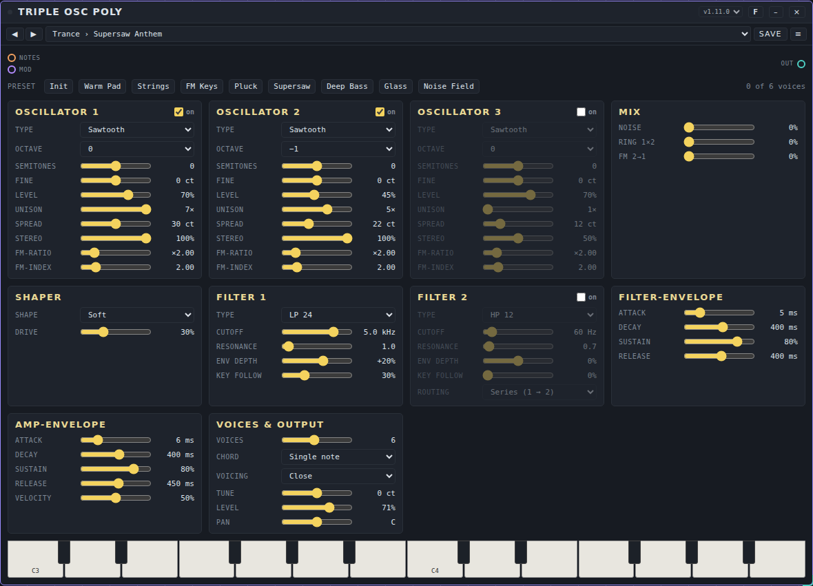

**Controls.**

- **Preset buttons** (Init, Warm Pad, Strings, FM Keys, Pluck, Supersaw, Deep Bass, Glass, Noise Field): starting sounds that set the controls once. The counter shows how many voices sound (`0 of 6 voices`).
- **Oscillator 1, 2 and 3** (each with an **on** checkbox): **Type** (Sawtooth, Square, Triangle, Sine, FM, Noise), **Octave**, **Semitones**, **Fine** (cents), **Level**, **Unison** (1 to 7), **Spread** (the detune between the unison voices, in cents), **Stereo** (width of the unison voices), **FM-ratio** and **FM-index** (only for type FM).
- **Mix:** **Noise**, **Ring 1×2** (ring modulation of oscillators 1 and 2) and **FM 2→1** (oscillator 2 modulates the pitch of oscillator 1).
- **Shaper:** **Shape** (Off, Soft, Hard, Fold, Asym) and **Drive**.
- **Filter 1** and **Filter 2** (second one has an **on** checkbox): **Type** (for example **LP 24**, **HP 12**), **Cutoff**, **Resonance**, **Env depth** and **Key follow**; **Routing** (**Series (1 → 2)** or parallel).
- **Filter-envelope** and **Amp-envelope:** **Attack**, **Decay**, **Sustain**, **Release**; the amp envelope also has **Velocity** (0 = every note equally loud). One filter envelope is shared by both filters.
- **Voices & output:** **Voices** (maximum number of notes), **Chord** (a single note or a chord built from one key), **Voicing** (how open the chord is), **Tune**, **Level** and **Pan**.

**Ports.**

| Port | Kind | Use |
|---|---|---|
| **Notes** | notes in (orange) | Notes from **Keys / MIDI** or a sequencer. Every chord note counts as a voice. |
| **Mod** | modulation in (purple) | A modulator can move 21 controls (tune, oscillator levels, unison spread and more). |
| **Out** | audio out (teal, stereo) | Connect to **Speakers** or a **Mixer** channel. |

**Example.** Click **Supersaw**, then place **Keys / MIDI** and **Speakers**. Lower **Cutoff** of **Filter 1** a little, raise **Env depth** and play chords. Switch on **Filter 2** with **Routing** on **Series** for a steeper cut.

**Tunes.** Pack **Triple Osc Poly Styles**: 73 tunes in 12 folders (Trance, House, Pop, Synthwave, Ambient, Cinematic, Future Bass, Funk, Disco, Electro, Techno, Lo-fi), file [`triple-osc-poly-styles.patchkamer-tunes.json`](../../tunes/triple-osc-poly-styles.patchkamer-tunes.json). A few names: **Supersaw Anthem**, **Piano Stab**, **Epic Strings**, **Sub Bass**, **Warehouse Stab**.

**Tips and limits.**

- A note that is shorter than the amplifier **Attack** is silent (measured). Keep the attack short for short notes.
- The level of each voice is divided by the square root of the unison count and of the number of chord notes, so many unison voices do not make it louder in the same measure.
- Oscillator type **Noise** is very soft; a patch with only noise oscillators stays quiet.

### Supersaw Swarm

**What it is for.** A polyphonic trance supersaw. Each note is a swarm of 1, 3, 5, 7 or 9 detuned sawtooth waves, with an octave layer, a sub, chorus, ping-pong delay, reverb, a trance gate and a pump effect, all in one card.

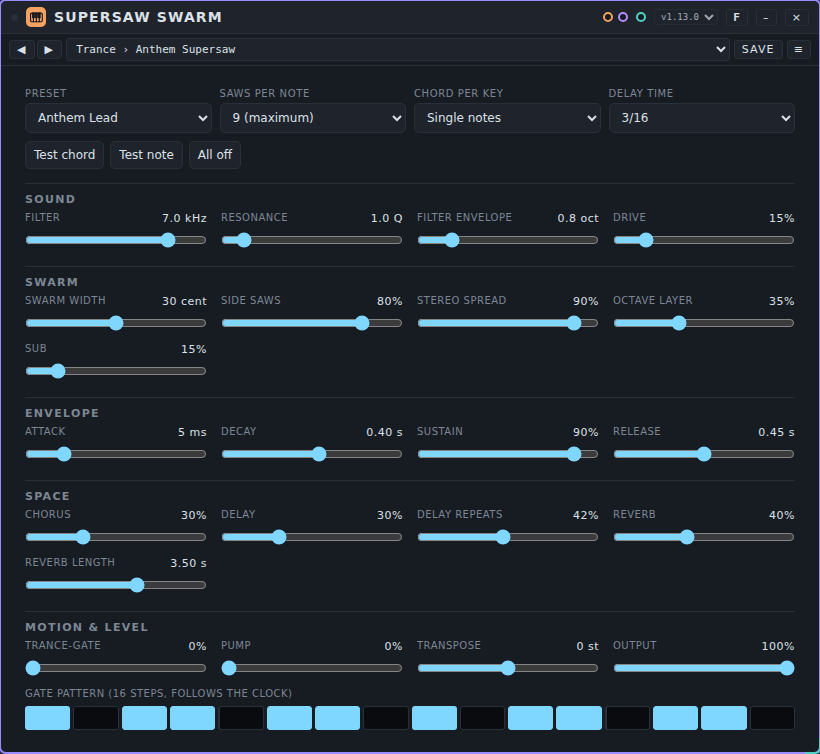

**Controls.**

- **Top row:** **Preset** (starting sounds, for example Anthem Lead, Heaven Pad and Hall Chords), **Saws per note** (1, 3, 5, 7 or 9), **Chord per key** (**Single notes**, Minor, Major, Sus2, Sus4, Minor 7, Minor add9 or Fifth + octave; every key becomes that chord), **Delay time** (1/16, 1/8, 3/16, 1/4 or 3/8; it follows the clock). **Test chord**, **Test note** and **All off**.
- **Sound:** **Filter** (cutoff), **Resonance**, **Filter envelope** and **Drive**.
- **Swarm:** **Swarm width** (detune of the outer saws, up to 60 cents), **Side saws** (side saws against the middle saw), **Stereo spread**, **Octave layer** (two saws one octave higher) and **Sub**.
- **Envelope:** **Attack**, **Decay**, **Sustain**, **Release**.
- **Space:** **Chorus**, **Delay**, **Delay repeats**, **Reverb** and **Reverb length** (0.6 to 10 s).
- **Motion & level:** **Trance gate** (depth), **Pump** (depth), **Transpose** and **Output**.
- **Gate pattern (16 steps, follows the clock):** 16 squares, one per sixteenth note; a lit square is open, a dark one closed (down to the depth of **Trance gate**).

**Ports.**

| Port | Kind | Use |
|---|---|---|
| **Notes** | notes in (orange) | Notes from **Keys / MIDI** or a sequencer. |
| **Mod** | modulation in (purple) | A modulator can move the knobs except **Reverb length**, the choices and the preset. |
| **Stereo** | audio out (teal) | Connect to **Speakers** or a **Mixer** channel. |

**Example.** Place **Keys / MIDI**, **Supersaw Swarm** and **Speakers**. Press **Start**, set **Chord per key** to **Minor**, **Trance gate** to about 70% and play single notes: every key plays a chord that chops to the gate pattern. Try **Pump** at 50% for a volume dip on every beat.

**Tunes.** Pack **Supersaw Swarm Styles**: 61 tunes in 10 folders (Trance, Hardstyle, Progressive, Big Room, Synthwave, Pop, Future Bass, Eurodance, Ambient, Cinematic), file [`supersaw-swarm-styles.patchkamer-tunes.json`](../../tunes/supersaw-swarm-styles.patchkamer-tunes.json). A few names: **Anthem Supersaw**, **Euphoric Lead**, **Festival Lead**, **Future Chord Stack**, **Slow Bloom Pad**.

**Tips and limits.**

- **Trance gate** and **Pump** only move while the clock runs (**Start**). **Pump** lowers the volume on every beat to `1 − 0.85 × depth` and lets it come back.
- At most 14 notes at once; a new note releases the oldest. A chord counts for every note in it. Choose **Single notes** if your sequencer already sends chords.
- Changing **Reverb length** rebuilds the reverb, so the new reverb arrives after about 0.2 s.

### Chord Poly

**What it is for.** A polyphonic chord synth with up to 24 voices. Every note becomes a chord (or stays single). Each note has two slightly detuned oscillators and a sub, a lowpass filter with envelope, a stereo chorus and drive. Made for stabs, organ chords and pads.

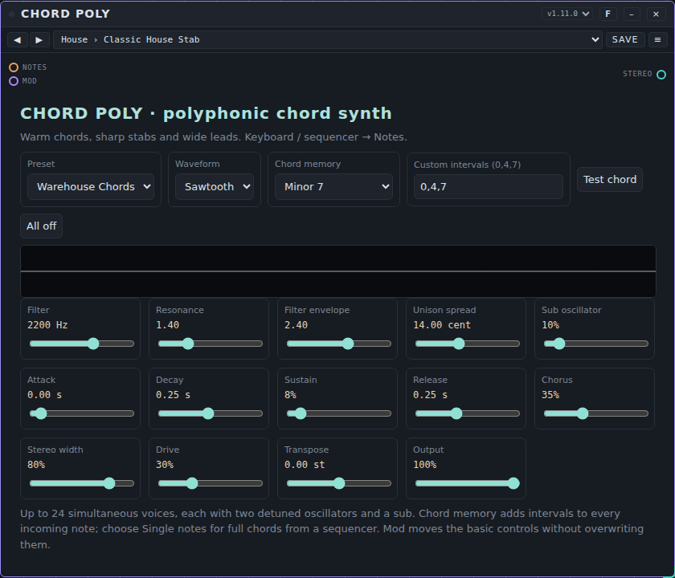

**Controls.**

- **Top row:** **Preset** (Warehouse Chords, Warm Horizon, Rave Stab, Glass Pulse, Soft Organ, Wide Lead, Night Pad, Electric Chimes), **Waveform** (Sawtooth, Square, Triangle or Sine for both oscillators), **Chord memory** (**Single notes**, Major, Minor, a suspended chord, Minor 7, or a custom chord that uses **Custom intervals**) and **Custom intervals** (semitones above the played note, separated by commas, for example `0,4,7`; at most 6). **Test chord** and **All off**.
- **Filter:** **Filter** (cutoff, 80 to 16000 Hz), **Resonance** and **Filter envelope** (0 to 4 octaves).
- **Oscillators:** **Unison spread** (the two oscillators sit this many cents above and below the note, 0 to 35) and **Sub oscillator**.
- **Envelope:** **Attack**, **Decay**, **Sustain** and **Release**.
- **Space and level:** **Chorus**, **Stereo width**, **Drive**, **Transpose** and **Output**.

**Ports.**

| Port | Kind | Use |
|---|---|---|
| **Notes** | notes in (orange) | Notes from **Keys / MIDI** or a sequencer. |
| **Mod** | modulation in (purple) | A modulator can move the knobs. |
| **Stereo** | audio out (teal) | Connect to **Speakers** or a **Mixer** channel. |

**Example.** Place **Keys / MIDI**, **Chord Poly** and **Speakers**. Set **Chord memory** to **Minor 7** and play one key at a time: each key sounds a four-note chord. For your own chord, choose the custom chord and type `0,4,7,11` in **Custom intervals**.

**Tunes.** Pack **Chord Poly Styles**: 60 tunes in 10 folders (House, Deep House, Garage, Lo-fi, Ambient, Pop, Soul, Synthwave, Cinematic, Disco & Funk), six per folder, file [`chord-poly-styles.patchkamer-tunes.json`](../../tunes/chord-poly-styles.patchkamer-tunes.json). A few names: **Classic House Stab**, **Deep Ninth Chord**, **Velvet Chord**, **Endless Pad**, **Disco Stab**.

**Tips and limits.**

- Every chord note takes one of the 24 voices: a four-note chord leaves room for six chords.
- The volume of a chord is divided by the square root of the number of notes, so a chord is not much louder than a single note.
- If your sequencer already sends chords, choose **Single notes**.

### Bowed Ensemble

**What it is for.** A polyphonic string ensemble with sixteen voices. Each voice has four slightly detuned oscillators, bow or air noise, a lowpass filter with its own envelope and a stereo position. All voices share a high-pass filter, two tone filters, a three-tap ensemble chorus and a hall of about 5.5 seconds. Made for chords, pads and long lines. It is a section, not a model of one string (for that, see [Karplus String](#karplus-string)).

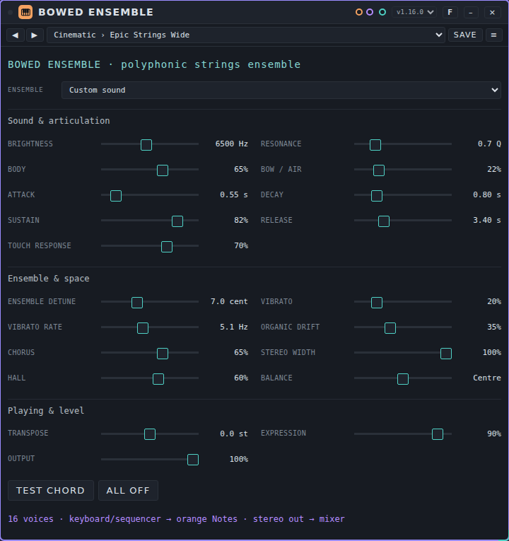

**Controls.**

- **Ensemble** (list of starting sounds: Chamber Ensemble, Cinematic Strings, Velvet Strings, Vintage String Machine, Disco Strings, Slow Bloom, Spiccato, Pizzicato, Dark Cellos, Glass Strings, Wide Legato, String Lead; it shows **Custom sound** once you change a knob).
- **Sound & articulation:** **Brightness** (cutoff, 200 to 14000 Hz), **Resonance**, **Body** (fuller low mids), **Bow / air** (bow noise under the note), **Attack** (0.005 to 5 s), **Decay**, **Sustain**, **Release** (up to 12 s) and **Touch response** (how much the velocity sets the level).
- **Ensemble & space:** **Ensemble detune** (0 to 20 cents between the oscillators), **Vibrato** and **Vibrato rate** (3 to 8 Hz), **Organic drift** (slow pitch wandering per voice), **Chorus**, **Stereo width**, **Hall** and **Balance**.
- **Playing & level:** **Transpose**, **Expression** (a second volume control after the compressor, for swells) and **Output**. **Test chord** and **All off**.

**Ports.**

| Port | Kind | Use |
|---|---|---|
| **Keyboard / notes** | notes in (orange) | Notes from **Keys / MIDI** or a sequencer. A sequencer must send the note length. |
| **Mod** | modulation in (purple) | A modulator can move the knobs; the **Ensemble** list is not moved. |
| **Stereo strings** | audio out (teal, stereo) | Connect to **Speakers** or a **Mixer** channel. |

**Example.** Place **Keys / MIDI**, **Bowed Ensemble** and **Speakers**. Choose the tune **Cinematic › Epic Strings Wide**, hold a chord and move **Expression** while you play for a swell. Raise **Attack** to about 1 s for a slow bloom.

**Tunes.** Pack **Bowed Ensemble Styles**: 65 tunes in 11 folders (Cinematic, Ambient, Pop, Ballad, Trance, Synthwave, Film Score, Lo-fi, Neo-classical, Disco & Funk, Deep House), file [`bowed-ensemble-styles.patchkamer-tunes.json`](../../tunes/bowed-ensemble-styles.patchkamer-tunes.json). A few names: **Epic Strings Wide**, **Slow Bloom**, **Tender Violins**, **Chamber Quartet**, **Funk Chops**.

**Tips and limits.**

- Sixteen voices: a seventeenth note takes over the voice that finishes first. A long **Release** with many notes breaks notes off.
- A note without a length and without a note-off keeps sounding until the transport stops or a panic arrives: make a sequencer send note lengths.
- Hardware MIDI connects through **Keys / MIDI** (see the [main manual](../USER-MANUAL_EN.md)).

## Keys and strings

### Stage Keys

**What it is for.** A polyphonic keys synth with seven sound models, its own keyboard and an output chain with drive and stereo tremolo. It has no sequencer: you play it from the card keyboard or from another device.

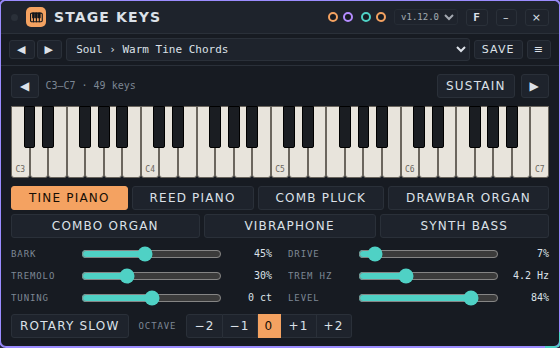

**Controls.**

- **Keyboard strip:** the arrows move the 49-key keyboard (C3 to C7 in the picture) and **Sustain** holds notes.
- **Sound model buttons:** **Tine Piano**, **Reed Piano**, **Comb Pluck**, **Drawbar Organ**, **Combo Organ**, **Vibraphone** and **Synth Bass**.
- **Tone knob** (its label changes with the model, 0 to 1): **Bark** for Tine Piano (hardness of the strike), a reed growl for Reed Piano, **Pickup** for Comb Pluck, **Drawbars** for Drawbar Organ (0 = only the lowest drawbars), a flute-to-reed blend for Combo Organ, **Mallet** for Vibraphone and **Filter** for Synth Bass.
- **Drive**, **Tremolo** (depth), **Trem Hz** (speed, 0.5 to 12 Hz; the two channels run in opposite phase), **Tuning** (−50 to 50 cents) and **Level**.
- **Rotary slow / fast:** speed of the rotary effect (only for the Drawbar Organ: 0.7 Hz slow, 6.6 Hz fast).
- **Octave** (−2 to +2): shifts incoming notes, not the card keyboard.

**Ports.**

| Port | Kind | Use |
|---|---|---|
| **Notes** | notes in (orange) | Notes from **Keys / MIDI** or a sequencer. |
| **Mod** | modulation in (purple) | A modulator can move six controls: tone, drive, tremolo depth, tremolo rate, tuning and level. |
| **Out** | audio out (teal) | Connect to **Speakers** or a **Mixer** channel. |
| **Played** | notes out (orange) | Sends on what you play on the card keyboard, so you can feed it to another device. |

**Example.** Place **Stage Keys** and **Speakers** and connect **Out** to **In**. Click **Drawbar Organ**, play on the card keyboard, raise **Tone** for more drawbars and toggle **Rotary slow / fast**. Connect **Played** to a second synth to play two sounds at once.

**Tunes.** Pack **Stage Keys Styles**: 66 tunes in 11 folders (Soul, Funk, Jazz, Pop, Gospel, Rock, Disco, House, Lo-fi, Reggae, Ballad), six per folder, file [`stage-keys-styles.patchkamer-tunes.json`](../../tunes/stage-keys-styles.patchkamer-tunes.json). Together they cover all seven models (Tine Piano 12 tunes, Drawbar Organ 12, Reed Piano 10, Synth Bass 10, Vibraphone 8, Combo Organ 8, Comb Pluck 6). A few names: **Warm Tine Chords**, **Greasy Organ**, **Smoky Vibes**, **Church Drawbars**, **Skank Organ**.

**Tips and limits.**

- Up to 24 voices; one voice per pitch, so striking the same note again cuts the previous one of that pitch short.
- The **Tone** value is read at every new note, so a change affects the next note.
- Every model has a fixed release after you let go of a key (for example about 0.2 s for Tine Piano and 0.12 s for Synth Bass).

### Four-Operator FM

**What it is for.** An FM synth with four sine operators and eight voices. Every operator has its own frequency ratio, level, fine tune and envelope. Eight algorithms decide which operators modulate each other and which ones you hear (the carriers). Operator 4 has feedback. Good for bells, glass, tines, electric pianos and FM basses.

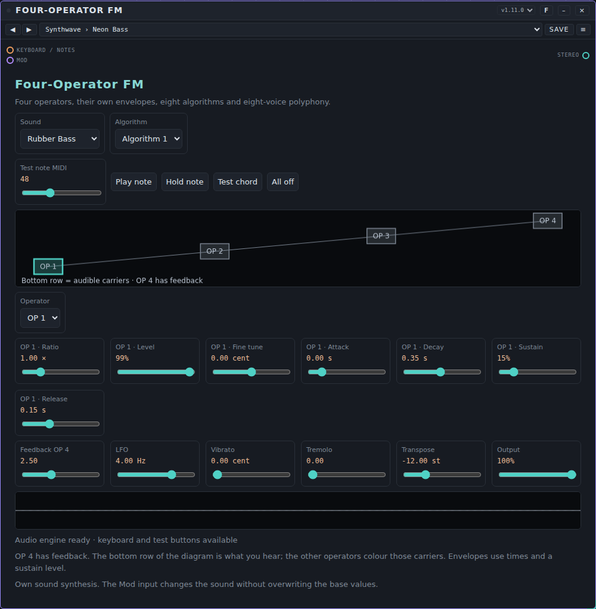

**Controls.**

- **Top row:** **Sound** (Rubber Bass, Digital Tines, Hollow Organ, Metal Bells, Stab Chord, Glass Marimba, Breathing Pad, Wire Pluck), **Algorithm** (1 to 8). **Test note MIDI** with **Play note**, **Hold note**, **Test chord** and **All off**.
- **The diagram:** shows the chosen algorithm. The bottom row is what you hear; operators higher up colour those carriers. Use **Operator** to choose which one you edit.
- **Per operator (OP 1 to OP 4):** **Ratio** (frequency against the note, 0.5 to 16: whole numbers give harmonic sounds, fractions give bells and metal), **Level** (for a modulator the modulation depth, for a carrier the volume), **Fine tune** (−12 to 12 cents), **Attack**, **Decay**, **Sustain** and **Release**.
- **General:** **Feedback OP 4** (0 to 7: 0 is a pure sine, 2 to 3 a sawtooth-like tone, 6 to 7 noise), **LFO** (rate, 0.05 to 20 Hz), **Vibrato** (0 to 80 cents), **Tremolo**, **Transpose** and **Output**.

The eight algorithms (`a → b` means a modulates b):

1. 4 → 3 → 2 → 1; you hear 1. One long chain.
2. 3 and 4 → 2 → 1; you hear 1.
3. 4 → 3 and 2 both → 1; you hear 1.
4. 4 → 2 and 3 both → 1; you hear 1.
5. 2 → 1 and 4 → 3; you hear 1 and 3. Two pairs.
6. 4 → 1, 4 → 2 and 4 → 3; you hear 1, 2 and 3. One modulator for three carriers.
7. 4 → 3; you hear 1, 2 and 3.
8. No modulation; you hear all four. Purely additive.

**Ports.**

| Port | Kind | Use |
|---|---|---|
| **Keyboard / notes** | notes in (orange) | Notes from **Keys / MIDI** or a sequencer. |
| **Mod** | modulation in (purple) | A modulator can move all the numeric controls. |
| **Stereo** | audio out (teal) | Connect to **Speakers** or a **Mixer** channel. |

**Example.** Choose **Algorithm 6** and set **OP 4 · Ratio** to 3.5, with a long **Decay** (1.5 to 3 s) and **Sustain** 0 on the carriers: bell-like tones. Play single notes from **Keys / MIDI**.

**Tunes.** Pack **Four-Operator FM Styles**: 67 tunes in 11 folders (Synthwave, Electro, Pop, Chiptune, Jazz & Soul, Ambient, Cinematic, Techno & House, Drum & Bass, Hip-hop & Lo-fi, Funk & Disco), file [`four-operator-fm-styles.patchkamer-tunes.json`](../../tunes/four-operator-fm-styles.patchkamer-tunes.json). A few names: **Neon Bass**, **Tine Piano**, **Warm Vibes**, **Deep Impact**, **Dusty Keys**.

**Tips and limits.**

- Keep the sum of the carrier levels at about 1 or lower. The device already divides by the square root of the number of carriers and has a limiter behind the output; **Output** around 60 to 80% is usual.
- A carrier with **Sustain** 0 and a short **Decay** gives a tick; **Sustain** 1 holds the tone as long as the key is down.
- Eight voices: with long releases and fast notes the oldest voice drops out.

### Karplus String

**What it is for.** A model of a plucked or bowed string with eight voices and its own keyboard of two octaves. Each note is a string: a short burst of noise (pluck) or a continuing noise (bow) goes into a delay loop with damping, stiffness and ring time.

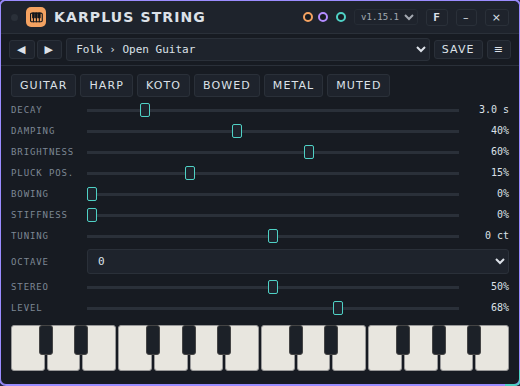

**Controls.**

- **Quick settings:** **Guitar**, **Harp**, **Koto**, **Bowed**, **Metal** and **Muted** set **Decay**, **Damping**, **Brightness**, **Pluck pos.**, **Bowing** and **Stiffness** in one go. The other controls stay.
- **Decay:** the ring time of a held note, 0.1 to 20 s.
- **Damping:** 0 = bright and long, 1 = dull and short.
- **Brightness:** how sharp the strike is.
- **Pluck pos.:** where on the string it is plucked (0.02 to 0.5): near 0 is sharp and nasal, 0.5 is hollow.
- **Bowing:** 0 = pluck, higher = a continuing bowed sound; 1 is strong.
- **Stiffness:** higher makes the overtones sit too high (metal, bell).
- **Tuning:** −100 to 100 cents. **Octave:** −2 to +2, for incoming notes and the card keyboard. **Stereo:** every note gets a random place; 0 = middle, 1 = wide. **Level.**

**Ports.**

| Port | Kind | Use |
|---|---|---|
| **Notes** | notes in (orange) | Notes from **Keys / MIDI** or a sequencer. |
| **Mod** | modulation in (purple) | A modulator can move eight controls: **Decay**, **Damping**, **Brightness**, **Pluck pos.**, **Bowing**, **Stiffness**, **Tuning** and **Level**. |
| **Out** | audio out (teal) | Connect to **Speakers** or a **Mixer** channel. |

**Example.** Place **Keys / MIDI**, **Karplus String** and **Speakers**. Click **Harp** and play. Click **Bowed** and hold notes for two seconds or more: the string keeps sounding while you hold.

**Tunes.** Pack **Karplus String Styles**: 60 tunes in 10 folders (Folk, Ambient, Cinematic, Pop, World, Lo-fi, Ballad, Flamenco, Jazz, Metallic), six per folder, file [`karplus-string-styles.patchkamer-tunes.json`](../../tunes/karplus-string-styles.patchkamer-tunes.json). A tune is a sound only; there is no pattern. A few names: **Open Guitar**, **Glass Strings**, **Koto Lead**, **Slow Bow Pad**, **Rust Strings**.

**Tips and limits.**

- A note sounds for its length and then rings out for at most 0.25 s, even when **Decay** is larger: **Decay** sets the ring while the note is held. For a long ringing string, hold the note long.
- The pitch stays accurate above about MIDI note 24 (C1).
- Eight voices: a ninth note takes over the voice that has sounded longest.
- There is no arpeggiator: send short notes (0.1 to 0.25 s) from a sequencer for a plucked rhythm.

## Special and modular

### Dissonant Cluster

**What it is for.** A polyphonic synth that only sounds dissonant. Every note becomes a cluster of 2 to 6 voices in a structure you choose (a narrow cloud, a chromatic cluster, a wide 13-tone layout and more). A guard shifts voices by a few cents when needed, so no pair of tones sounds consonant. For drones, tension, industrial sounds and effects.

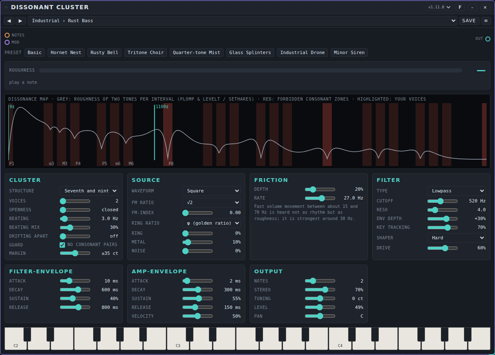

**Controls.**

- **Preset buttons** at the top: Basic, Hornet Nest, Rusty Bell, Tritone Choir, Quarter-tone Mist, Glass Splinters, Industrial Drone and Minor Siren (starting settings). Below them the **Roughness** meter and the dissonance map (grey: roughness of two tones per interval, red: forbidden consonant zones, highlighted: your voices).
- **Cluster:** **Structure** (cloud, chromatic, wide, tritone, seventh and ninth, 13-tone or random), **Voices** (2 to 6), **Openness** (every second voice an octave higher: closed to 3), **Beating** (Hz) and **Beating mix** (how much of the second oscillator per voice sounds), **Drifting apart** (voices drift apart, in cents per second; off = 0), **Guard** (the consonance guard) and **Margin** (in cents).
- **Source:** **Waveform**, **FM ratio** and **FM-index**, **Ring ratio** and **Ring**, **Metal** (a metallic source of six square waves) and **Noise**.
- **Friction:** **Depth** and **Rate** (8 to 70 Hz): a fast volume movement that you hear as roughness, strongest around 30 Hz.
- **Filter:** **Type** (Lowpass, Bandpass, Highpass, Notch, Peaking), **Cutoff**, **Reso**, **Env depth**, **Key tracking**, **Shaper** and **Drive**.
- **Filter-envelope** and **Amp-envelope:** **Attack**, **Decay**, **Sustain**, **Release**; the amp envelope also has **Velocity**.
- **Output:** **Notes** (how many notes sound at once, each a whole cluster), **Stereo**, **Tuning**, **Level** and **Pan**. A keyboard at the bottom plays the card.

**Ports.**

| Port | Kind | Use |
|---|---|---|
| **Notes** | notes in (orange) | Notes from **Keys / MIDI** or a sequencer. |
| **Mod** | modulation in (purple) | A modulator can move 19 controls (beating, drifting, FM, ring, metal, noise, friction, filter, envelope times and more). |
| **Out** | audio out (teal) | Connect to **Speakers** or a **Mixer** channel. |

**Example.** Place **Keys / MIDI**, **Dissonant Cluster** and **Speakers**. Click the preset **Hornet Nest** and hold a low chord. Then set **Structure** to **tritone** with **Voices** 3, raise **Friction › Depth** and turn **Cutoff** down slowly for a threatening drone.

**Tunes.** Pack **Dissonant Cluster Styles**: 60 tunes in 9 folders (Industrial, Horror & Cinematic, Dark Ambient, Techno, Experimental, Sound Design, Noise, Dubstep, Drone), file [`dissonant-cluster-styles.patchkamer-tunes.json`](../../tunes/dissonant-cluster-styles.patchkamer-tunes.json). A few names: **Rust Bass**, **Dread Pad**, **Abyss Drone**, **Quarter Tone Choir**, **Laser Zap**.

**Tips and limits.**

- Low notes with a close cluster come out as a humming beat rather than as a pitch; try 2 or 3 voices, **seventh and ninth** or **tritone** for basses.
- The tritone structure plays at most 5 voices.
- With **Guard** off the cluster is not corrected and may sound consonant.
- It has no arpeggiator of its own; keep **Notes** low for fast sequences from outside.

### Patchbay Synth

**What it is for.** A semi-modular synth with a patch panel: inputs, outputs and sliders that link modules. Every input already has a built-in source (marked **←**); a cable replaces it. Three VCOs, a noise generator, a ring modulator, a four-pole 24 dB lowpass filter (it can self-oscillate with high resonance), an ADSR and an AR envelope, sample & hold with its own clock, an envelope follower, a preamp for outside audio, two inverters, a lag, an electronic switch and a keyboard from C2 to C6. It has no sequencer or arpeggiator.

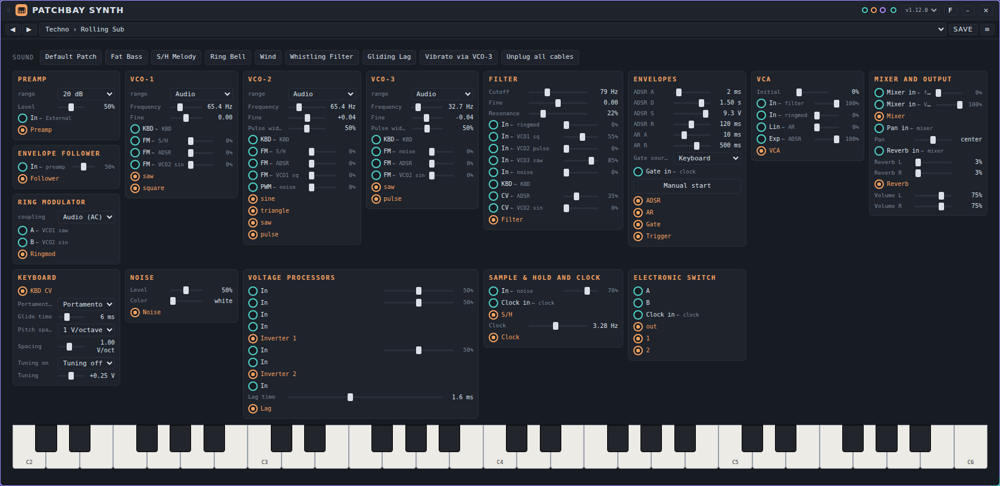

**Controls.**

- **Sound buttons** at the top: Default Patch, Fat Bass, S/H Melody, Ring Bell, Wind, Whistling Filter, Gliding Lag, Vibrato via VCO-3 and **Unplug all cables**. Each is a set of cables and knobs you can start from.
- **Panels** (left to right): **Preamp**, **Envelope follower**, **Ring modulator**, **Keyboard**, **VCO-1**, **VCO-2**, **VCO-3** (each with a **range** of **Audio** or **LF**, **Frequency**, **Fine** and amounts for frequency modulation), **Noise**, **Voltage processors** (two inverters and a lag), **Filter**, **Envelopes**, **Sample & hold and clock**, **VCA**, **Electronic switch**, **Mixer and output**.
- **Cables.** Drag from an **output** (orange dot) to an **input** (teal dot). An input can have one cable. Click a cable to unplug it; drag from an occupied input to move the cable. **Unplug all cables** removes all of them.
- **Keyboard panel:** **KBD CV** output, **Portamento** (with **Glide time**), pitch spacing (**1 V/octave** by default, adjustable) and a **Tuning** offset.

**Ports.**

| Port | Kind | Use |
|---|---|---|
| **Preamp in** | audio in (teal) | Outside sound for the preamp. |
| **Notes** | notes in (orange) | Notes from **Keys / MIDI** or a sequencer (the keys on the card also work). |
| **Mod** | modulation in (purple) | A modulator can move the knobs. |
| **Out** | audio out (teal) | Connect to **Speakers** or a **Mixer** channel. |

**Example.**

1. Place **Keys / MIDI**, **Patchbay Synth** and **Speakers**; connect the notes to **Notes** and **Out** to **In**. Click **Default Patch** and play.
2. Click **Fat Bass** or **Ring Bell** and compare which cables are plugged in.
3. Make a glide: drag a cable from the **KBD CV** output to the **In** of the lag (the last **In** above **Lag time**) and a second cable from the **Lag** output to the **KBD** input of **VCO-1**. Turn **Lag time** to taste.

**Tunes.** Pack **Patchbay Synth Styles**: 89 tunes in 15 folders (Techno, Acid, House, Synthwave, Ambient, Cinematic, Electro, Hip-hop, Dub, Funk & Disco, Trance, Chiptune, Drum & Bass, Generative, FX), file [`patchbay-synth-styles.patchkamer-tunes.json`](../../tunes/patchbay-synth-styles.patchkamer-tunes.json). A tune holds all knobs and the list of cables. A few names: **Rolling Sub**, **Squelch Bass**, **S/H Bleeps**, **Random Bells**, **Laser Zap**, **Siren**.

**Tips and limits.**

- **The VCA decides what you hear.** Its gain is **Initial** plus the linear input times its amount plus the exponential input (the **ADSR** by default). If all three are zero, the VCA gives nothing and the synth is silent.
- **Volume** (left and right) is the real level control; the output is limited hard.
- Pitch and filter follow 1 volt per octave. The LF range decouples the keyboard from a VCO.
- The envelopes take their gate from the keyboard and host notes; with **Gate source** on **Gate in** the gate comes from the external input (the clock by default).

## If it does not work

- **No sound.** Check that audio runs from the synth to **Speakers** (teal cable), that you pressed **Start** and that the volume on Speakers is up. Click anywhere in Patchkamer once: browsers pause audio until you do.
- **A built-in sequencer or arpeggiator is silent.** Acid Baselines (with **internal on**), Acid Stepper (**Control** = **Internal clock / pattern**), Sub Line and Cross Mod Mono (**Control** = **Own pattern** or **Arpeggiator**) only play while the clock runs: press **Start**. An arpeggiator also needs held keys.
- **A synth does not react to a keyboard.** Connect the orange cable to its notes port (**Notes**, **Keyboard / notes**, **External notes**), not to **Mod**. Acid Baselines needs **internal on** off for outside notes, Acid Stepper needs **Control** = **External keyboard / sequencer**, and Sub Line and Cross Mod Mono need **Control** = **Keyboard / external sequencer**. For a MIDI keyboard use **Connect MIDI** on Keys; see the [main manual](../USER-MANUAL_EN.md#13-troubleshooting).
- **Notes keep sounding.** A note without a length keeps sounding on some synths (Bowed Ensemble). Make the sequencer send note lengths, or press **All off** on the card.
- **Supersaw Swarm gate or pump does nothing.** They only work while the clock runs.
- **Quiet or silent.** Check **Level** or **Output**, and the sound controls: a very low cutoff with a low envelope amount is very quiet (Acid Baselines, Basic Mono), Patchbay Synth needs a VCA source (see its tips) and a note shorter than the amplifier attack is silent on Triple Osc Poly.
- **A filter blows up or goes silent.** Several synths (for example Acid Baselines, Basic Mono and Low Bass) have a guard that checks the filter every 50 ms and replaces it when it derails, so the sound comes back by itself. If it happens again, lower **Resonance**.
- **Crackles.** Open Settings → Audio and choose a larger latency, or a lower quality.
