# Synths: gebruikershandleiding

*English version: [USER-MANUAL_EN.md](USER-MANUAL_EN.md)*

Synths zijn de apparaten die uit noten geluid maken. Deze pagina beschrijft de 18 synths die bij Patchkamer horen. De basis (Patchkamer openen, een bibliotheek laden, kabels trekken) staat in de [basishandleiding](../USER-MANUAL_NL.md). De map met de apparaten is beschreven in [devices/synths](../../devices/synths/README_NL.md).

## Inhoud

1. [Wat synths doen](#wat-synths-doen)
2. [Welke synth voor welk doel](#welke-synth-voor-welk-doel)
3. [Bassen](#bassen): [Acid Baselines](#acid-baselines), [Acid Stepper](#acid-stepper), [Low Bass](#low-bass), [Sub Line](#sub-line), [Basic Mono](#basic-mono)
4. [Monosynths voor leads en sound design](#monosynths-voor-leads-en-sound-design): [Duofone](#duofone), [Cross Mod Mono](#cross-mod-mono), [Patch Mono](#patch-mono)
5. [Polyfone synths, pads en akkoorden](#polyfone-synths-pads-en-akkoorden): [Poly Chorus](#poly-chorus), [Triple Osc Poly](#triple-osc-poly), [Supersaw Swarm](#supersaw-swarm), [Chord Poly](#chord-poly), [Bowed Ensemble](#bowed-ensemble)
6. [Toetsen en snaren](#toetsen-en-snaren): [Stage Keys](#stage-keys), [Four-Operator FM](#four-operator-fm), [Karplus String](#karplus-string)
7. [Bijzonder en modulair](#bijzonder-en-modulair): [Dissonant Cluster](#dissonant-cluster), [Patchbay Synth](#patchbay-synth)
8. [Als het niet werkt](#als-het-niet-werkt)

## Wat synths doen

Een synth heeft geen audio-ingang (met twee uitzonderingen: **Voorversterker in** van Patchbay Synth en **Extern geluid / envelope** van Patch Mono). Hij ontvangt **noten** (oranje kabels) en geeft **geluid** (een groenblauwe audiokabel). Elke synth heeft ook een paarse **Mod**-ingang: een modulator kan zijn regelaars laten bewegen terwijl je speelt (zie [Modulators](../modulators/USER-MANUAL_NL.md)). De knop houdt zijn waarde; de modulator telt erbij op.

Een gewone patch heeft drie stappen, van links naar rechts:

1. Een bron van noten: **Keys / MIDI** (een toetsenbord dat zelf geen geluid maakt), een sequencer, of de ingebouwde sequencer van de synth (Acid Baselines, Acid Stepper, Sub Line, Cross Mod Mono).
2. De synth.
3. Waar het geluid heen gaat: direct naar **Speakers**, of eerst via een kanaal van een **Mixer** en een effect.

Druk op **Start** om de klok te laten lopen. Ingebouwde sequencers, arpeggiators, de trance-gate van Supersaw Swarm en de pomp bewegen alleen als de klok loopt. Noten van Keys en de testknoppen op de kaarten werken wel zonder. Een sequencer die noten naar een polyfone synth stuurt, moet altijd een nootlengte (`dur`) meesturen; een noot zonder lengte blijft bij sommige synths doorklinken.

Elke synth heeft **tunes**: een tune is de volledige instelling van één synth, en sommige tunes bevatten ook een baslijn of patroon. Laad een pack vanuit een bibliotheek of met het menu **Tunes ▾** → **Importeren…**, en kies daarna een tune in de lijst bovenaan de kaart (er staat `Map › Naam`). Zie [Tunes](../tunes/USER-MANUAL_NL.md) voor het gebruiken, bewaren en delen ervan. De synths hebben geen presets: de keuzes die op een preset lijken binnen een kaart (een **Klank**- of **Klankbeeld**-lijst, **Preset**-knoppen) zijn beginklanken die de regelaars één keer zetten.

## Welke synth voor welk doel

| Ik wil… | Gebruik |
|---|---|
| Een baslijn die vanzelf speelt, met accent en slide per stap | [Acid Baselines](#acid-baselines) (16 stappen, 16 patronen), [Acid Stepper](#acid-stepper) (eenvoudiger) |
| Een bas of lead die zijn eigen patroon of arpeggio speelt | [Sub Line](#sub-line), [Cross Mod Mono](#cross-mod-mono) |
| Een bas die ik vanaf mijn eigen toetsenbord of sequencer speel | [Low Bass](#low-bass), [Basic Mono](#basic-mono), [Sub Line](#sub-line) |
| Een eenvoudige, directe monoklank met weinig knoppen | [Basic Mono](#basic-mono) |
| Een lead met twee toonhoogten tegelijk, ringmodulatie, hard sync of sample & hold | [Duofone](#duofone), [Cross Mod Mono](#cross-mod-mono) |
| Een monosynth die ik van binnen kan omschakelen, met een ingang voor extern geluid | [Patch Mono](#patch-mono) |
| Pads en polyfone klanken met een ingebouwde chorus | [Poly Chorus](#poly-chorus) |
| Een grote, flexibele polyfone synth met drie oscillatoren en twee filters | [Triple Osc Poly](#triple-osc-poly) |
| Trance-supersaws met delay, galm en gate | [Supersaw Swarm](#supersaw-swarm) |
| Akkoorden uit losse noten (stabs, orgelakkoorden, pads) | [Chord Poly](#chord-poly), [Supersaw Swarm](#supersaw-swarm), [Triple Osc Poly](#triple-osc-poly) |
| Strijkers en strijkerssecties | [Bowed Ensemble](#bowed-ensemble) |
| Elektrische piano's, orgels, vibrafoon | [Stage Keys](#stage-keys) |
| Klokken, glas, tines, FM-bassen | [Four-Operator FM](#four-operator-fm) |
| Geplukte of gestreken losse snaren (gitaar, harp, koto) | [Karplus String](#karplus-string) |
| Dissonante clusters, drones, spanning, geluidseffecten | [Dissonant Cluster](#dissonant-cluster) |
| Een modulair gevoel: patchkabels tussen modules | [Patchbay Synth](#patchbay-synth) |

## Bassen

### Acid Baselines

**Waar het voor dient.** Een bassynth met een eigen 16-staps sequencer. Je tekent een baslijn op een raster, zet accent en slide op de stappen die je wilt, en vormt de klank met zes secties regelaars. Hij speelt mee met de klok en kan ook noten spelen die je vanaf een toetsenbord of een andere sequencer stuurt.

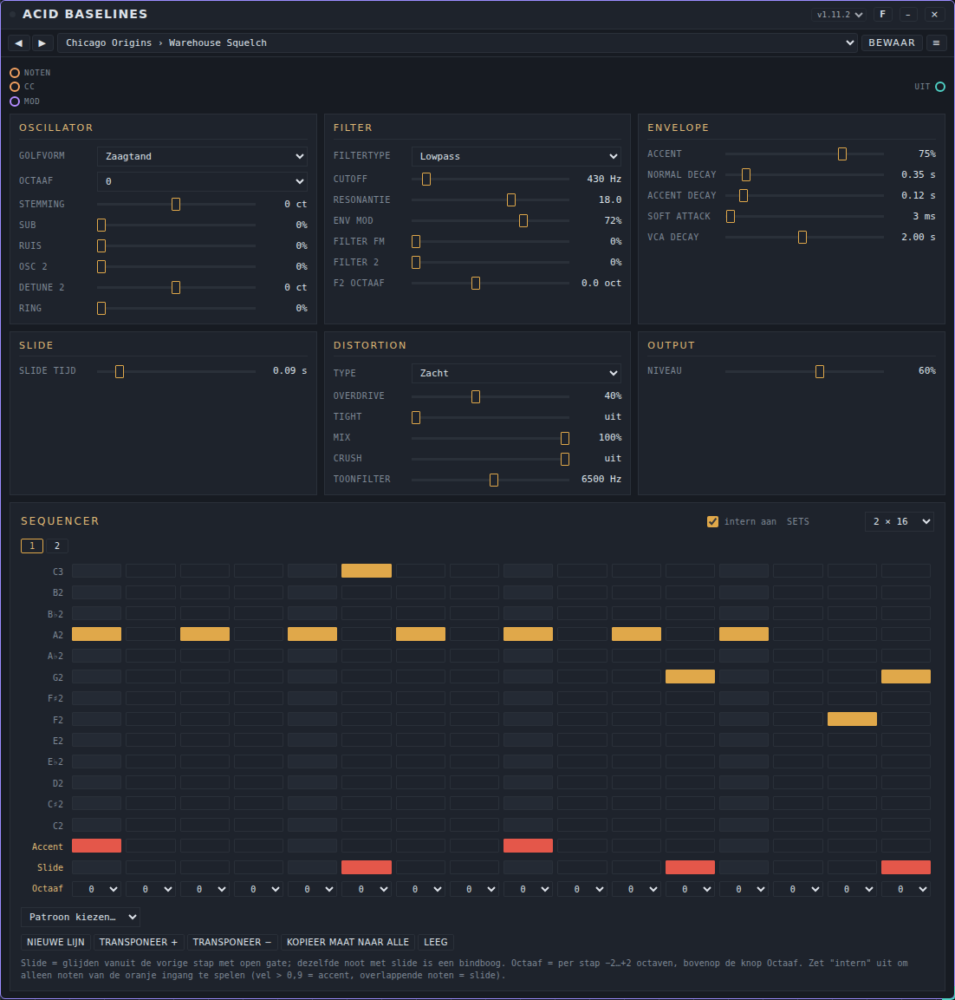

**De regelaars.** Dubbelklik op een schuif om terug te gaan naar de beginwaarde. Klik op het getal om een waarde te typen. De zes secties volgen de weg die het geluid door het apparaat aflegt.

- **Oscillator:** **Golfvorm** (Zaagtand of Blok), **Octaaf** (−1, 0, +1), **Stemming** (−100 tot +100 ct), **Sub** (een blokgolf een octaaf lager), **Ruis**, **Osc 2** (tweede oscillator, dezelfde golfvorm), **Detune 2** (−100 tot +100 ct) en **Ring** (ringmodulatie van de twee oscillatoren).
- **Filter:** **Filtertype** (Lowpass, Bandpass of Highpass), **Cutoff** (80 tot 5000 Hz), **Resonantie** (0,5 tot 28), **Env mod** (hoever elke noot het filter opent), **Filter FM**, **Filter 2** (niveau van een tweede bandpassfilter in parallel) en **F2 octaaf** (verschuift Filter 2 van −2 tot +3 octaven).
- **Envelope:** **Accent** (hoeveel harder een stap met accent klinkt en hoeveel meer hij het filter opent), **Normal decay** (0,03 tot 3 s), **Accent decay** (0,03 tot 1 s), **Soft attack** (1 tot 300 ms) en **VCA decay** (0,1 tot 4 s).
- **Slide:** **Slide tijd**, de glijtijd op stappen met slide (0,02 tot 0,6 s).
- **Distortion:** **Type** (Zacht, Hard, Fold of Asym: vier vormen), **Overdrive**, **Tight** (filtert lage frequenties weg vóór de vervorming, uit tot 600 Hz), **Mix** (vervormd tegenover schoon), **Crush** (bitdiepte na de vervorming, 2 tot 16 bits, uit = 16) en **Toonfilter** (een lowpass na de vervorming, 500 tot 12000 Hz).
- **Output:** **Niveau**.

Alles vanaf **Sub** (Sub, Ruis, Osc 2, Detune 2, Ring, Filtertype, Filter 2, F2 octaaf, Type, Tight, Mix, Crush) staat bij het begin uit of neutraal, dus oudere tunes klinken zoals vroeger.

De sequencer onder de regelaars:

- **Raster.** Klik op een vakje om een noot op die stap te zetten; klik nog een keer om hem weg te halen. De rijen lopen van C2 tot C3, één rij per halve toon. Een set heeft 16 stappen.
- **Rij Accent.** Een stap met accent klinkt harder en opent het filter meer (zie **Accent**).
- **Rij Slide.** Een stap met slide glijdt vanaf de noot van de vorige stap. Dezelfde noot met slide is een bindboog: de noot blijft doorklinken.
- **Rij Octaaf.** Elke stap heeft een eigen keuze, +2 tot −2 octaven, bovenop de regelaar **Octaaf**.
- **SETS.** De lijst kiest 1, 2, 4, 8 of 16 sets van 16 stappen. De genummerde knoppen boven het raster kiezen welke set je bewerkt. De set die speelt is gemarkeerd.
- **intern aan.** Staat het aan, dan speelt de sequencer mee met de klok. Zet het uit om alleen noten te spelen die op de poort **Noten** binnenkomen.
- **Patroon kiezen…** zet een van 16 patronen in de set die je bewerkt: 01 Rolling, 02 Squelch, 03 Pump, 04 Climb, 05 Stab, 06 Bounce, 07 Hypno, 08 Chase, 09 Walk, 10 Drop, 11 Wobble, 12 Slide run, 13 Offbeat, 14 Octave jump, 15 Minor run, 16 Closing.
- **NIEUWE LIJN** vult de set met een willekeurige lijn. **TRANSPONEER +** en **TRANSPONEER −** zetten alle noten van de set twee halve tonen omhoog of omlaag (een noot voorbij het raster komt aan de andere kant weer in beeld). **KOPIEER MAAT NAAR ALLE** kopieert de set die je bewerkt naar alle 16 sets. **LEEG** maakt de set leeg.

**Poorten.**

| Poort | Soort | Gebruik |
|---|---|---|
| **Noten** | noten in (oranje) | Noten van **Keys / MIDI** of een andere sequencer. Een noot met velocity boven 0,9 telt als accent. Overlappende noten glijden (slide). |
| **CC** | noten in (oranje) | Control changes met een waarde van 0 tot 1 voor `cutoff`, `res`, `env`, `drive` en `level`. Andere id's worden genegeerd. |
| **Mod** | modulatie in (paars) | Een modulator kan 14 regelaars bewegen: **Stemming**, **Cutoff**, **Resonantie**, **Env mod**, **Normal decay**, **Accent**, **Accent decay**, **Soft attack**, **Slide tijd**, **Filter FM**, **Overdrive**, **Toonfilter**, **VCA decay** en **Niveau**. |
| **Uit** | audio uit (groenblauw) | Sluit aan op **Speakers** of een **Mixer**-kanaal. |

**Voorbeeld.**

1. Plaats **Acid Baselines** en **Speakers**. Verbind **Uit** met **In** op Speakers.
2. Druk op **Start**. De beginlijn speelt meteen.
3. Zet **SETS** op **1 × 16** en kies dan **Patroon kiezen… › 02 · Squelch**.
4. Zet **Resonantie** op ongeveer 20, **Env mod** op 80% en draai **Cutoff** langzaam omlaag terwijl het speelt.
5. Zet **Distortion › Type** op **Fold** en verhoog **Overdrive** tot je het goed vindt. Gebruik **Tight** om de laagste noten helder te houden.
6. Wil je hem vanaf een toetsenbord spelen: zet **intern aan** uit, plaats **Keys / MIDI** en verbind de noten met **Noten**.

**Tunes.** Pack **Acid Baselines Classics**: 49 tunes in negen mappen (Chicago Origins, Frankfurt Rolling, Minimal Acid, Squelch Anthems, Acid Techno, Acid Trance, Electro Acid, Deep Acid en AIcid), bestand [`acid-baselines-classics.patchkamer-tunes.json`](../../tunes/acid-baselines-classics.patchkamer-tunes.json). Elke tune heeft een eigen baslijn. De map **AIcid** gebruikt de nieuwste regelaars (de extra oscillatoren, filtertypen en vervormingen). Een paar namen: **Warehouse Squelch**, **Rolling Thunder**, **Hard Drive**, **Sunrise Acid**, **Neural Squelch**.

**Tips en beperkingen.**

- **Resonantie**, **Filter FM** en een cutoff die een modulator omlaag draait kunnen een filter instabiel maken. Een ingebouwde bewaker controleert dit elke 50 ms en vervangt de filters, zodat het geluid vanzelf terugkomt.
- Een noot wordt ongeveer 62% van een stap vastgehouden, tenzij de volgende stap slide heeft: dan houdt hij aan tot de volgende noot.
- De noten in het raster lopen van C2 tot C3. Gebruik **Octaaf**, de octaafrij per stap of een tune om daarbuiten te komen.

### Acid Stepper

**Waar het voor dient.** Een eenvoudiger acid-bassynth voor een snelle, directe baslijn: één oscillator en een sub, een vierpolig lowpassfilter met resonantie en een envelope, accent, slide, drive en een vast raster van 16 stappen. Vergeleken met Acid Baselines heeft hij geen sets, geen octaaf per stap, geen tweede filter en minder soorten vervorming. De interne klok van de host bepaalt tempo en swing.

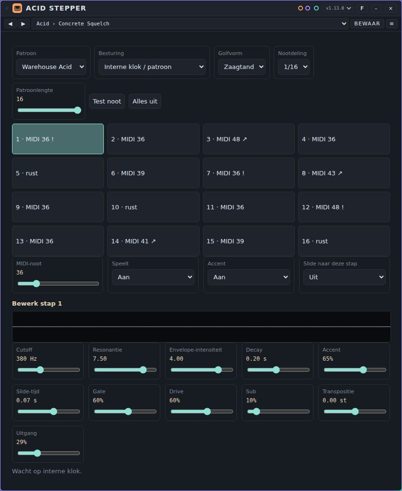

**De regelaars.**

- **Bovenste rij:** **Patroon** (zes beginlijnen: Warehouse Acid, Octave Engine, Dark Rubber, Open Skyline, Sparse Pulse, Broken Staircase), **Besturing** (**Interne klok / patroon** of **Extern keyboard / sequencer**), **Golfvorm** (Zaagtand of Puls), **Nootdeling** (1/16, 1/8 of 1/4: bij 1/8 duurt elke noot twee stappen), **Patroonlengte** (1 tot 16), **Test noot** en **Alles uit**.
- **De 16 stapknoppen.** Elke knop toont zijn nummer en noot (`1 · MIDI 36`); `!` betekent accent, `↗` betekent slide en `rust` betekent stil. Klik op een knop om hem te bewerken.
- **Bewerk stap:** **MIDI-noot** (24 tot 84; 36 = C2), **Speelt** (Aan of Uit; uit is een rust), **Accent** en **Slide naar deze stap** (de toonhoogte glijdt vanaf de vorige actieve stap en de noot blijft open).
- **Klank:** **Cutoff** (70 tot 10000 Hz), **Resonantie** (0,4 tot 9), **Envelope-intensiteit** (0 tot 5 octaven die de cutoff bij elke noot omhoog schiet), **Decay** (0,03 tot 2 s), **Accent** (0 tot 1), **Slide-tijd** (0,005 tot 0,4 s), **Gate** (hoe lang een noot klinkt als deel van de stap, 0,1 tot 1), **Drive**, **Sub**, **Transpositie** (−24 tot 24 halve tonen) en **Uitgang**.

**Poorten.**

| Poort | Soort | Gebruik |
|---|---|---|
| **Externe noten** | noten in (oranje) | Alleen in gebruik als **Besturing** op **Extern keyboard / sequencer** staat. Een velocity boven 0,9 telt als accent. In de patroonstand worden binnenkomende noten genegeerd. |
| **Mod** | modulatie in (paars) | Een modulator kan 11 regelaars bewegen: **Cutoff**, **Resonantie**, **Envelope-intensiteit**, **Decay**, **Accent**, **Slide-tijd**, **Gate**, **Drive**, **Sub**, **Transpositie** en **Uitgang**. |
| **Uit** | audio uit (groenblauw) | Sluit aan op **Speakers** of een **Mixer**-kanaal. |

**Voorbeeld.**

1. Plaats **Acid Stepper** en **Speakers** en verbind **Uit** met **In**.
2. Druk op **Start**: de lijn speelt op de klok (tot dan meldt de kaart "Wacht op interne klok.").
3. Klik op stap 5 en zet **Speelt** op **Aan**, geef dan stap 6 **Slide naar deze stap: Aan** voor een glijdende noot.
4. Verhoog **Resonantie** en **Envelope-intensiteit** en draai **Cutoff** omlaag terwijl het speelt.

**Tunes.** Pack **Acid Stepper Styles**: 65 tunes in 12 mappen (Acid, Techno, House, Deep House, Electro, Trance, Breakbeat, Hip-hop, Synthwave, Dub, Industrial, Garage), bestand [`acid-stepper-styles.patchkamer-tunes.json`](../../tunes/acid-stepper-styles.patchkamer-tunes.json). 45 van de 65 tunes brengen een eigen lijn mee; de andere houden de lijn die op de kaart staat. Een paar namen: **Concrete Squelch**, **Rubber Climb**, **Driving Rumble**, **Funky Offbeat**, **Neon Arp**.

**Tips en beperkingen.**

- Bij elke start of stop van de klok begint de lijn weer bij stap 1.
- Een rust sluit de noot ervoor. Een slide op de volgende actieve stap bindt de huidige noot eraan vast, zodat je lange glijdende frasen maakt.
- De lijst **Patroon** noemt alleen de beginlijn die je koos; een tune die alleen knoppen zet verandert de lijn niet.

### Low Bass

**Waar het voor dient.** Een mono bassynth zonder sequencer: hij speelt de noten die op zijn poort **Noten** binnenkomen (de laatste noot wint). Twee licht ontstemde oscillatoren, een sinus-sub een octaaf lager, optioneel FM, drive, een filter met envelope, glide en legato.

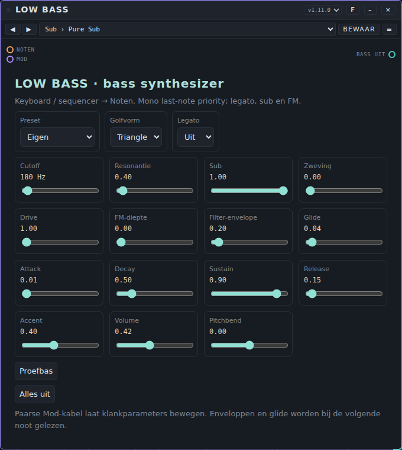

**De regelaars.**

- **Bovenste rij:** **Preset** (Analog Bass, Deep Sub, Acid Slide, Square Punch, FM Growl, Rumble Bass, Pluck Bass; kiezen laadt de knopstanden ervan; hij toont **Eigen** zodra je een knop verandert), **Golfvorm** (de golfvorm van beide oscillatoren: Sawtooth, Square of Triangle) en **Legato** (overlappende noten glijden in plaats van opnieuw aan te slaan).
- **Klank:** **Cutoff** (40 tot 10000 Hz), **Resonantie** (0,2 tot 7), **Sub**, **Zweving** (0 tot 20 cent tussen de twee oscillatoren), **Drive** (1 tot 16; het niveau wordt gecompenseerd), **FM-diepte** (hoe sterk de tweede oscillator de toonhoogte van de eerste moduleert), **Filter-envelope** (0 tot 5 octaven) en **Glide** (0,001 tot 1,5 s).
- **Envelope:** **Attack**, **Decay** (voor versterker en filter), **Sustain** en **Release**.
- **Niveau:** **Accent** (hoeveel extra volume een harde aanslag krijgt), **Volume** en **Pitchbend** (een vaste verschuiving van −12 tot 12 halve tonen).
- **Proefbas** speelt een noot, **Alles uit** stopt alles.

**Poorten.**

| Poort | Soort | Gebruik |
|---|---|---|
| **Noten** | noten in (oranje) | Noten van **Keys / MIDI** of een sequencer. |
| **Mod** | modulatie in (paars) | Een modulator kan 15 regelaars bewegen (alle knoppen op de kaart). |
| **Bass uit** | audio uit (groenblauw) | Sluit aan op **Speakers** of een **Mixer**-kanaal. |

**Voorbeeld.**

1. Plaats **Keys / MIDI**, **Low Bass** en **Speakers**. Verbind de noten van Keys met **Noten** en **Bass uit** met **In**.
2. Speel lage noten (de tunes gaan uit van ongeveer MIDI-noot 28 tot 48).
3. Kies de preset **Acid Slide** en speel twee toetsen overlappend: met **Legato** aan glijden ze.
4. Draai **FM-diepte** langzaam open voor een scherpere rand.

**Tunes.** Pack **Low Bass Styles**: 64 tunes in 13 mappen (Sub, Rolling Bass, Detuned Wide, Dub, Booming Sub, Acid, Funk, Drum & Bass, Dubstep, Garage, Trap, Synthwave, Techno & House), bestand [`low-bass-styles.patchkamer-tunes.json`](../../tunes/low-bass-styles.patchkamer-tunes.json). Een tune is alleen een klank; de noten komen van je toetsenbord of sequencer. Een paar namen: **Pure Sub**, **Rolling Saw**, **Wide Detuned Growl**, **Heavy Dub Sub**, **Squelch Mono**.

**Tips en beperkingen.**

- Legato werkt alleen zolang de vorige noot nog klinkt (overlappende of vastgehouden noten); losse noten slaan altijd opnieuw aan. De filter-envelope slaat bij elke noot opnieuw aan, ook bij legato.
- Enveloppen en glide worden gelezen als de volgende noot begint.
- Een ingebouwde bewaker vervangt de filters als ze ontsporen, zodat een modulator het apparaat niet voorgoed stil kan leggen.

### Sub Line

**Waar het voor dient.** Een monosynth voor baslijnen en leads. Hij heeft één oscillatorbank (zaagtand, puls met pulsbreedte, een sub en ruis), een filter met envelope, portamento en een LFO, plus een eigen patroon van 32 stappen en een arpeggiator. Hij speelt ook noten van een toetsenbord of een externe sequencer.

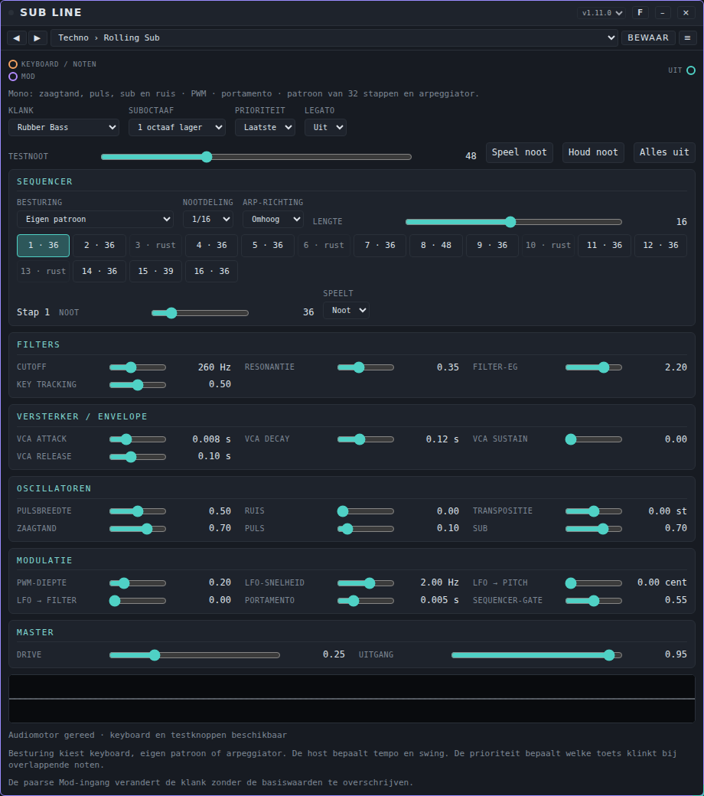

**De regelaars.**

- **Bovenste rij:** **Klank** (een lijst beginklanken, te beginnen met Rubber Bass), **Suboctaaf** (1 of 2 octaven lager), **Prioriteit** (**Laatste**, laagste of hoogste: welke toets klinkt als er meer ingedrukt zijn) en **Legato**. **Testnoot** (24 tot 96) met **Speel noot**, **Houd noot** en **Alles uit**.
- **Sequencer:** **Besturing** (**Keyboard / externe sequencer**, **Eigen patroon** of **Arpeggiator**), **Nootdeling** (1/16, 1/8, 1/4), **Arp-richting** (Omhoog of Omlaag), **Lengte** (1 tot 32 stappen). De stapknoppen tonen `1 · 36` (stap en MIDI-noot) of `rust`; klik op een knop om hem te bewerken met **Noot** en **Speelt** (Noot of Rust). **Sequencer-gate** (onder Modulatie) bepaalt hoe lang een patroon- of arpnoot klinkt als deel van de stap.
- **Filters:** **Cutoff** (30 tot 16000 Hz), **Resonantie**, **Filter-EG** (−5 tot 5 octaven) en **Key tracking**.
- **Versterker / envelope:** **VCA attack**, **VCA decay**, **VCA sustain** en **VCA release** (één envelope voor filter en versterker).
- **Oscillatoren:** **Pulsbreedte**, **Ruis**, **Transpositie**, **Zaagtand**, **Puls** en **Sub** (niveaus).
- **Modulatie:** **PWM-diepte**, **LFO-snelheid**, **LFO → pitch** (vibrato in cent), **LFO → filter**, **Portamento** en **Sequencer-gate**.
- **Master:** **Drive** en **Uitgang**. Onderaan de kaart zie je een kleine scope.

**Poorten.**

| Poort | Soort | Gebruik |
|---|---|---|
| **Keyboard / noten** | noten in (oranje) | Noten van **Keys / MIDI** of een sequencer (**Besturing** = keyboard), of de vastgehouden toetsen voor de arpeggiator. |
| **Mod** | modulatie in (paars) | Een modulator kan de knoppen bewegen; de knopwaarden blijven de basis. |
| **Uit** | audio uit (groenblauw) | Sluit aan op **Speakers** of een **Mixer**-kanaal. |

**Voorbeeld.**

1. Plaats **Sub Line** en **Speakers** en verbind **Uit** met **In**.
2. Kies de tune **Techno › Rolling Sub**, die zijn eigen patroon speelt (**Besturing** = **Eigen patroon**), en druk op **Start**.
3. Klik op een stap, verander **Noot** en zet bij een andere stap **Speelt** op **Rust**.
4. Zet **Besturing** op **Arpeggiator**, plaats **Keys / MIDI** en houd drie toetsen vast: ze klinken om de beurt, van laag naar hoog (of van hoog naar laag met **Arp-richting**).

**Tunes.** Pack **Sub Line Styles**: 68 tunes in 10 mappen (Techno, House, Deep House, Acid, Electro, Synthwave, Hip-hop, Dub, Drum & Bass, Trance), bestand [`subline-styles.patchkamer-tunes.json`](../../tunes/subline-styles.patchkamer-tunes.json). 42 tunes spelen vanaf een toetsenbord, 23 spelen hun eigen patroon en 3 zijn arpeggio's. Een paar namen: **Rolling Sub**, **Squelch Runner**, **Neon Bass**, **Boom Sub**, **Gate Arp**.

**Tips en beperkingen.**

- Het eigen patroon en de arpeggiator spelen alleen als de klok loopt (**Start**). Een tune met de stand **Keyboard / externe sequencer** speelt alleen de noten die je stuurt.
- Bij de arpeggiator houdt een **Lengte** die een veelvoud is van het aantal vastgehouden toetsen het patroon gelijkmatig: 12 past bij 1, 2, 3 en 4 toetsen, 16 bij 1, 2, 4 en 8.
- **Klank** is alleen een beginpunt: kiezen zet de regelaars één keer.

### Basic Mono

**Waar het voor dient.** De eenvoudigste monosynth: één oscillator, een sub, een resonant lowpassfilter met envelope, glide en één niveauknop. Hij heeft geen sequencer, geen arpeggiator en geen LFO; hij speelt de noten die je stuurt, één stem tegelijk (een nieuwe noot neemt de oude over). Handig voor een snelle bas, lead of pluck.

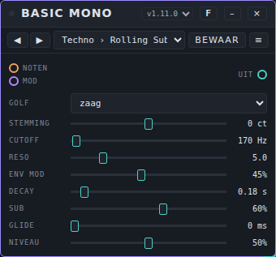

**De regelaars.** Dubbelklik op een knop om terug te gaan naar de beginwaarde.

- **Golf:** zaag, blok of driehoek.
- **Stemming:** −100 tot 100 ct (oscillator en sub samen).
- **Cutoff:** 80 tot 8000 Hz, de rustpositie van het filter.
- **Reso:** 0,5 tot 24.
- **Env mod:** hoever elke noot de cutoff omhoog schiet (0 tot 100%).
- **Decay:** 0,05 tot 2 s; hoe snel de cutoff terugzakt en hoe snel het volume naar zijn sustain-niveau zakt. Er is geen sustain-knop: de sustain staat vast op 30% van de aanslag. Een lange **Decay** bij een aangehouden noot klinkt dus bijna als een orgel; een korte geeft een korte plok.
- **Sub:** niveau van de blokgolf-sub een octaaf lager.
- **Glide:** 0 tot 300 ms (0 = uit).
- **Niveau:** 0 tot 100%.

**Poorten.**

| Poort | Soort | Gebruik |
|---|---|---|
| **Noten** | noten in (oranje) | Noten van **Keys / MIDI** of een sequencer. Overlappende noten kappen elkaar af: de nieuwste wint. |
| **Mod** | modulatie in (paars) | Een modulator kan elke regelaar bewegen behalve **Golf**. |
| **Uit** | audio uit (groenblauw) | Sluit aan op **Speakers** of een **Mixer**-kanaal. |

**Voorbeeld.**

1. Plaats **Keys / MIDI**, **Basic Mono** en **Speakers**; verbind de noten met **Noten** en **Uit** met **In**.
2. Kies de tune **Techno › Rolling Sub** en speel lage noten.
3. Verhoog **Env mod** en **Reso** en draai **Cutoff** op en neer.

**Tunes.** Pack **Basic Mono Styles**: 65 tunes in 12 mappen (Techno, House, Electro, Hip-hop, Funk, Synthwave, Dub, Pop, Chiptune, Acid, Trance, Ambient), bestand [`basic-mono-styles.patchkamer-tunes.json`](../../tunes/basic-mono-styles.patchkamer-tunes.json). Een paar namen: **Rolling Sub**, **Zap Bass**, **Slap Bass**, **Square Lead**, **Deep Drone**.

**Tips en beperkingen.**

- Houd **Niveau** onder 60%, en onder 40% als **Sub** en **Reso** allebei hoog staan. Een zachte begrenzer op de uitgang houdt de piek onder 0,99 (hij doet niets onder 0,9), dus **Niveau** 100%, **Sub** 100% en **Reso** 8 klinken samengedrukt in plaats van te klippen.
- Een pad is er niet echt mee te maken (mono, geen langzame attack); een drone met lange noten wel.
- Een ingebouwde bewaker vervangt het filter als het ontspoort.

## Monosynths voor leads en sound design

### Duofone

**Waar het voor dient.** Een synth met twee oscillatoren die twee verschillende toonhoogten tegelijk kunnen spelen (**duofoon**). De twee oscillatoren delen één filter en één versterker. Er zit ringmodulatie, hard sync, sample & hold en een eigen testtoetsenbord in. Het is geïnspireerd op klassieke duofone analoge synths. Van de toetsen die je ingedrukt houdt, hoor je alleen de laagste en de hoogste: het is geen akkoordensynth.

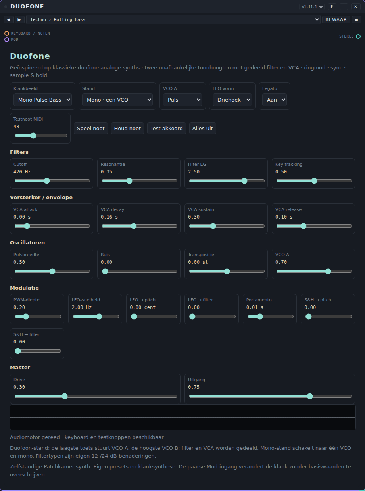

**De regelaars.** Dubbelklik op een schuif om terug te gaan naar de beginwaarde. Klik op het getal om een waarde te typen.

*Bovenste rij (keuzes)*

| Regelaar | Wat hij doet |
|---|---|
| **Klankbeeld** | Kiest een van zes beginklanken: Duo Brass, Ring Factory, Sample Hold Lab, Sync Flight, Mono Pulse Bass en Duo Atmosphere. Hij zet veel regelaars tegelijk. Daarna kun je alles aanpassen. |
| **Stand** | **Duofoon · twee VCO's** of **Mono · één VCO**. In de monostand is er één oscillator en één envelope voor filter en versterker, en een deel van de regelaars verdwijnt van de kaart. |
| **VCO A**, **VCO B** | De golfvorm van elke oscillator: Zaagtand, Puls of Driehoek. (In de monostand zie je alleen **VCO A**.) |
| **Low-pass** | De steilheid van het filter: 12 dB of 24 dB (alleen in de duofone stand). |
| **VCA envelope** | **ADSR** of **AR** (alleen in de duofone stand). |
| **LFO-vorm** | De vorm van de langzame oscillator (LFO): Zaagtand, Puls of Driehoek. |
| **Hard sync** | **Aan** of **Uit**. Staat hij aan, dan start de fase van VCO B opnieuw telkens als VCO A een cyclus afmaakt (alleen in de duofone stand). |
| **Legato** | **Aan** of **Uit**. Staat hij aan, dan start een noot die je speelt terwijl een andere toets nog ingedrukt is de envelopes niet opnieuw. |

**Testnoot.** **Testnoot MIDI** kiest een nootnummer (24 tot 96, begint op 48). **Speel noot** speelt hem één keer, **Houd noot** houdt hem vast tot je nog een keer drukt, **Test akkoord** speelt drie noten samen (de gekozen noot, een kleine terts en een kwint hoger; Duofone speelt dan de laagste en de hoogste) en **Alles uit** stopt alles.

*Filters (het filter en zijn envelope)*

| Regelaar | Wat hij doet | Bereik |
|---|---|---|
| **Cutoff** | Waar het filter gaat afsnijden | 30 tot 16000 Hz (2400) |
| **Resonantie** | Nadruk rond de cutoff | 0 tot 1 (0,25) |
| **Filter-EG** | Hoever de filter-envelope de cutoff beweegt | −5 tot 5 (2,5) |
| **Key tracking** | Hoeveel de cutoff de toonhoogte volgt | 0 tot 1 (0,5) |
| **Filter attack**, **Filter decay**, **Filter sustain**, **Filter release** | De filter-envelope | 0,001 tot 4 s, 0,01 tot 8 s, 0 tot 1, 0,01 tot 8 s |
| **High-pass** | Snijdt lage frequenties weg | 20 tot 6000 Hz (40) |

*Versterker / envelope:* **VCA attack**, **VCA decay**, **VCA sustain** en **VCA release** vormen het volume van elke noot. Attack 0,001 tot 4 s, decay 0,01 tot 8 s, sustain 0 tot 1, release 0,01 tot 8 s.

*Oscillatoren*

| Regelaar | Wat hij doet | Bereik |
|---|---|---|
| **Pulsbreedte** | Breedte van de pulsgolf | 0,05 tot 0,95 (0,5) |
| **Ruis** | Hoeveelheid ruis | 0 tot 1 |
| **Transpositie** | Zet alles hoger of lager | −24 tot 24 halve tonen |
| **VCO A**, **VCO B** | Het niveau van elke oscillator | 0 tot 1 (0,7 en 0,5) |
| **VCO B interval** | Afstand tussen VCO B en zijn noot | −24 tot 24 halve tonen |
| **VCO B fijn** | Kleine detune van VCO B | −35 tot 35 cent |
| **Ringmodulatie** | Mix van de ringmodulatie van beide oscillatoren | 0 tot 1 |

*Modulatie*

| Regelaar | Wat hij doet | Bereik |
|---|---|---|
| **PWM-diepte** | Hoeveel de pulsbreedte beweegt | 0 tot 1 |
| **LFO-snelheid** | Snelheid van de LFO | 0,05 tot 30 Hz |
| **LFO → pitch** | LFO op de toonhoogte (vibrato) | 0 tot 120 cent |
| **LFO → filter** | LFO op de cutoff | 0 tot 1 |
| **Portamento** | Glijtijd tussen noten | 0,001 tot 1 s |
| **VCO B → A FM** | VCO B moduleert de frequentie van VCO A | 0 tot 3 |
| **VCO B → filter** | VCO B moduleert de cutoff | 0 tot 1 |
| **S&H → pitch**, **S&H → filter** | Een willekeurige waarde in stapjes (sample & hold) op de toonhoogte of de cutoff | 0 tot 1 |

*Master:* **Drive** (0 tot 1) voegt vervorming toe, **Uitgang** (0 tot 1) stelt het niveau in. Onderaan de kaart zie je een kleine scope.

In de monostand zijn de regelaars voor de tweede oscillator (niveau **VCO B**, **VCO B interval**, **VCO B fijn**, **VCO B → A FM**, **VCO B → filter**, **Ringmodulatie**), de filter-envelope en **High-pass** verborgen.

**Poorten.**

| Poort | Soort | Gebruik |
|---|---|---|
| **Keyboard / noten** | noten in (oranje) | Sluit **Keys / MIDI** of een sequencer aan. In de duofone stand speelt de laagste toets die je vasthoudt VCO A en de hoogste VCO B. |
| **Mod** | modulatie in (paars) | Een modulator kan de regelaars bewegen. De knopwaarden blijven zoals je ze zette. |
| **Stereo** | audio uit (groenblauw) | Sluit aan op **Speakers** of een **Mixer**-kanaal. |

**Voorbeeld.**

1. Plaats **Keys / MIDI**, **Duofone** en **Speakers**.
2. Verbind de oranje notenuitgang van Keys met **Keyboard / noten** op Duofone, en **Stereo** met **In** op Speakers.
3. Druk op **Start**, kies de tune **Trance › Supersaw Lead** (of laat het klankbeeld staan) en speel twee toetsen tegelijk.
4. Zet **VCO B interval** op 7 halve tonen en **VCO B fijn** op 8 cent, en draai **Cutoff** op en neer terwijl je speelt.

Geen toetsenbord? Gebruik dan **Houd noot** of **Test akkoord** op de kaart.

**Tunes.** Pack **Duofone Styles**: 60 tunes in 12 mappen (Techno, House, Trance, Ambient, Drum & Bass, Dubstep, Synthwave, Funk & Disco, Hip-hop, Electro, Pop, Chiptune), vijf per map, bestand [`duofone-styles.patchkamer-tunes.json`](../../tunes/duofone-styles.patchkamer-tunes.json). Een paar namen: **Dark Stab**, **Supersaw Lead**, **Detuned Saw Bass** en **Neon Lead** (twee oscillatoren), en **Rolling Bass**, **Wobble Bass** en **Pulse Lead** (monostand). Een tune zet ook **Stand**.

**Tips en beperkingen.**

- **Klankbeeld** vervangt veel regelaars tegelijk. Kies het eerst en pas daarna aan. Als je een tune kiest, toont **Klankbeeld** de beginklank waar de tune op gebaseerd is.
- De monostand speelt één noot tegelijk. De duofone stand speelt twee toonhoogten tegelijk (de laagste en de hoogste toets die je vasthoudt).
- Ondersteunt je browser geen AudioWorklet, dan meldt de kaart dat de audiomotor niet beschikbaar is.

### Cross Mod Mono

**Waar het voor dient.** Een monosynth (één stem) rond twee oscillatoren die elkaar beïnvloeden: hard sync en kruismodulatie op audiosnelheid, waarbij oscillator B de toonhoogte van A en de cutoff van het filter beweegt. Hij heeft twee envelopes, een tweepolig lowpassfilter, een LFO, portamento, een patroon van maximaal 32 stappen en een arpeggiator. Hij speelt ook noten van een toetsenbord of een sequencer.

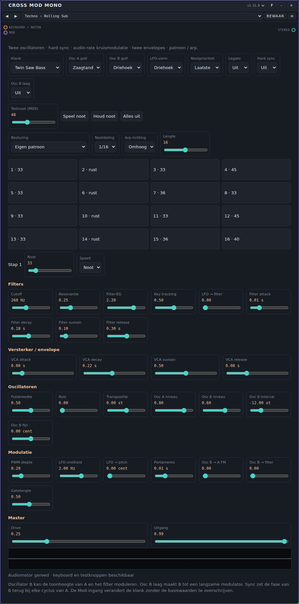

**De regelaars.**

- **Bovenste rij:** **Klank** (zes beginklanken: Twin Saw Bass, Sync Blade, Cross Mod Metal, Low B Motion, Detroit Pluck en Long Unison Lead; kiezen laat de stand, het patroon en de nootprioriteit staan), **Osc A golf**, **Osc B golf**, **LFO-vorm**, **Nootprioriteit** (Laatste, laagste, hoogste), **Legato**, **Hard sync** en **Osc B laag** (oscillator B wordt een langzame modulator met een vaste frequentie van ongeveer 0,125 tot 2 Hz, bepaald door **Osc B interval**, en volgt de noot niet meer).
- **Testnoot** (MIDI) met **Speel noot**, **Houd noot** en **Alles uit**.
- **Besturing, Nootdeling, Arp-richting, Lengte** en de stapknoppen: **Besturing** is **Keyboard / externe sequencer**, **Eigen patroon** of **Arpeggiator**; **Lengte** is 1 tot 32 stappen. Een stapknop toont zijn nummer en noot (`1 · 33`) of `rust`; **Noot** en **Speelt** bewerken de stap.
- **Filters:** **Cutoff** (30 tot 16000 Hz), **Resonantie**, **Filter-EG** (−5 tot 5 octaven), **Key tracking**, **LFO → filter** en **Filter attack**, **Filter decay**, **Filter sustain**, **Filter release**.
- **Versterker / envelope:** **VCA attack**, **VCA decay**, **VCA sustain**, **VCA release**.
- **Oscillatoren:** **Pulsbreedte** (alleen bij een pulsgolf), **Ruis**, **Transpositie**, **Osc A niveau**, **Osc B niveau**, **Osc B interval** (−24 tot 24 halve tonen) en **Osc B fijn** (−35 tot 35 cent).
- **Modulatie:** **PWM-diepte**, **LFO-snelheid**, **LFO → pitch**, **Portamento**, **Osc B → A FM** (0 tot 3), **Osc B → filter** en **Gatelengte** (hoe lang een patroon- of arpnoot klinkt als deel van de stap).
- **Master:** **Drive** en **Uitgang**.

**Poorten.**

| Poort | Soort | Gebruik |
|---|---|---|
| **Keyboard / noten** | noten in (oranje) | Noten en control changes van **Keys / MIDI** of een sequencer. |
| **Mod** | modulatie in (paars) | Een modulator kan 29 regelaars bewegen in vijf groepen (Filters, Versterker / envelope, Oscillatoren, Modulatie, Master). |
| **Stereo** | audio uit (groenblauw) | Sluit aan op **Speakers** of een **Mixer**-kanaal. |

**Voorbeeld.**

1. Plaats **Keys / MIDI**, **Cross Mod Mono** en **Speakers**; verbind de noten met **Keyboard / noten** en **Stereo** met **In**.
2. Zet **Hard sync** op **Aan**, **Osc B interval** op 12 of meer halve tonen, en draai **Cutoff** en **Filter-EG** open terwijl je een noot vasthoudt: je krijgt de sync-sweep.
3. Voor metaalachtige klanken: **Osc B → A FM** rond 0,3 tot 1,2 met **Osc B interval** op 7 of 12 halve tonen.

**Tunes.** Pack **Cross Mod Mono Styles**: 63 tunes in 12 mappen (Techno, Acid, House, Trance, Ambient, Synthwave, Electro, Drum & Bass, Dub, Hip-hop, Chiptune, Funk & Disco), bestand [`cross-mod-mono-styles.patchkamer-tunes.json`](../../tunes/cross-mod-mono-styles.patchkamer-tunes.json). 47 tunes spelen vanaf een toetsenbord, 11 spelen hun eigen patroon en 5 zijn arpeggio's. Een paar namen: **Rolling Sub**, **Squelch Line**, **Sync Screamer**, **Neon Bass**, **Metal Zap**.

**Tips en beperkingen.**

- Eigen patroon en Arpeggiator spelen alleen als de klok loopt; de arpeggiator heeft ook vastgehouden toetsen nodig. Kies een arp-**Lengte** die een veelvoud is van het aantal toetsen dat je vasthoudt (12 past bij 1 tot 4 toetsen, 16 bij 1, 2, 4 en 8).
- **Osc B → A FM** boven 1 kan de toonhoogte van A even bijna laten stilvallen.
- Hij is mono: een akkoord kan alleen als arpeggio.

### Patch Mono

**Waar het voor dient.** Een monosynth in twee opbouwen, te kiezen met **Opbouw**: één oscillator met een 12 dB lowpassfilter en één envelope voor volume en filter, of twee oscillatoren (VCO A en VCO B, met interval, fijnstemming, FM en ringmodulatie) met een highpass en twee lowpassfilters in serie (24 dB) en een eigen filter-envelope. In beide opbouwen zijn er ruis, een LFO met sample & hold, pulsbreedtemodulatie, portamento, legato, key tracking en drive. Verder een audio-ingang voor extern geluid en **vier interne patchroutes** die een bron met een doel verbinden.

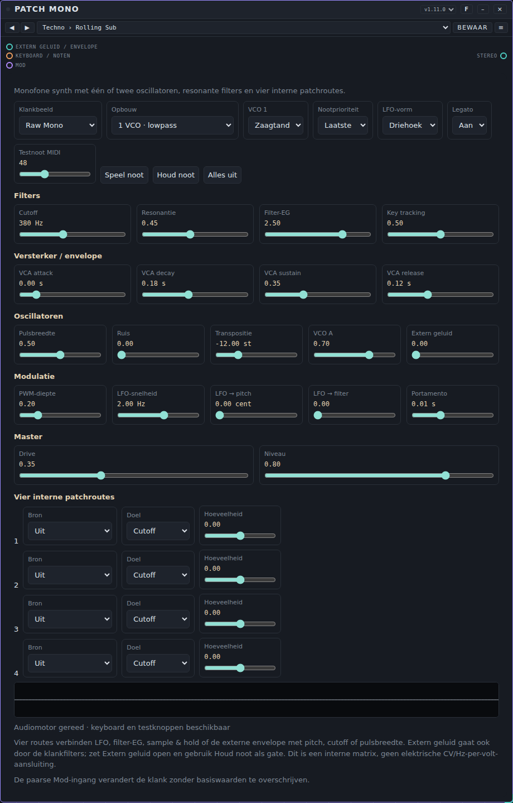

**De regelaars.** De afbeelding toont de opbouw met één oscillator.

- **Bovenste rij:** **Klankbeeld** (een lijst beginklanken, te beginnen met Raw Mono), **Opbouw** (**1 VCO · lowpass** of de opbouw met twee oscillatoren), **VCO 1** (golfvorm: Zaagtand, Puls, Driehoek of Ruis), **Nootprioriteit**, **LFO-vorm**, **Legato**. **Testnoot MIDI** met **Speel noot**, **Houd noot** en **Alles uit**.
- **Filters:** **Cutoff**, **Resonantie**, **Filter-EG** (octaven) en **Key tracking**.
- **Versterker / envelope:** **VCA attack**, **VCA decay**, **VCA sustain**, **VCA release** (in de opbouw met één oscillator sturen ze ook het filter).
- **Oscillatoren:** **Pulsbreedte**, **Ruis**, **Transpositie**, **VCO A** (niveau) en **Extern geluid** (niveau van het geluid van de audio-ingang, dat door de filters loopt; het volume volgt de noot).
- **Modulatie:** **PWM-diepte**, **LFO-snelheid**, **LFO → pitch**, **LFO → filter** en **Portamento**.
- **Master:** **Drive** en **Niveau**.
- **Vier interne patchroutes:** elke route heeft een **Bron** (uit, LFO, filter-envelope, sample & hold of de externe envelope), een **Doel** (pitch, cutoff of pulsbreedte) en een **Hoeveelheid** (−1 tot 1; pitch ±24 halve tonen, cutoff ±5 octaven bij 1).
- In de opbouw met twee oscillatoren biedt de kaart ook de tweede oscillator (niveau, interval, fijnstemming, FM op VCO A, ringmodulatie, B → filter), het highpassfilter met zijn resonantie en een aparte filter-envelope. Die regelaars hebben in de opbouw met één oscillator geen effect.

**Poorten.**

| Poort | Soort | Gebruik |
|---|---|---|
| **Extern geluid / envelope** | audio in (groenblauw) | Extern geluid dat door de filters loopt en als envelope-volger kan dienen. |
| **Keyboard / noten** | noten in (oranje) | Noten van **Keys / MIDI** of een sequencer. |
| **Mod** | modulatie in (paars) | Een modulator kan de knoppen bewegen; de knopwaarden blijven de basis. |
| **Stereo** | audio uit (groenblauw) | Sluit aan op **Speakers** of een **Mixer**-kanaal. |

**Voorbeeld.** Een wobble met een patchroute:

1. Plaats **Keys / MIDI**, **Patch Mono** en **Speakers**; verbind de noten en het geluid zoals gewoonlijk.
2. Zet bij route 1 de **Bron** op de LFO, het **Doel** op **Cutoff** en de **Hoeveelheid** op ongeveer 0,3.
3. Zet **LFO-snelheid** op 2 tot 6 Hz en houd een lage noot vast.

Extern geluid vormen: sluit een audiobron aan op **Extern geluid / envelope**, zet **Extern geluid** open en gebruik **Houd noot** als gate.

**Tunes.** Pack **Patch Mono Styles**: 79 tunes in 14 mappen (Techno, Acid, Dubstep, Drum & Bass, Hip-hop, Dub, Synthwave, Ambient, Electro, Funk & Disco, Trance, Chiptune, **Patch Routes** en **External Input**), bestand [`patch-mono-styles.patchkamer-tunes.json`](../../tunes/patch-mono-styles.patchkamer-tunes.json). 42 tunes gebruiken de opbouw met één oscillator, 37 die met twee. Een paar namen: **Rolling Sub**, **Acid Squelch**, **Wobble Bass** en **Sample and Hold Computer** (map Patch Routes), **Input Through Lowpass** en **Input Follower Bass** (map External Input).

**Tips en beperkingen.**

- De routes zijn een interne matrix, geen elektrische CV-kabels (daarvoor is er [Patchbay Synth](#patchbay-synth)).
- Mono: één noot tegelijk; **Nootprioriteit** bepaalt welke ingedrukte toets klinkt.

## Polyfone synths, pads en akkoorden

### Poly Chorus

**Waar het voor dient.** Een polyfone synth met zes stemmen en een stereo-chorus. Elke stem heeft een zaagtand, een puls (met pulsbreedtemodulatie), een sub en ruis. Handig voor akkoorden, pads en heldere bassen.

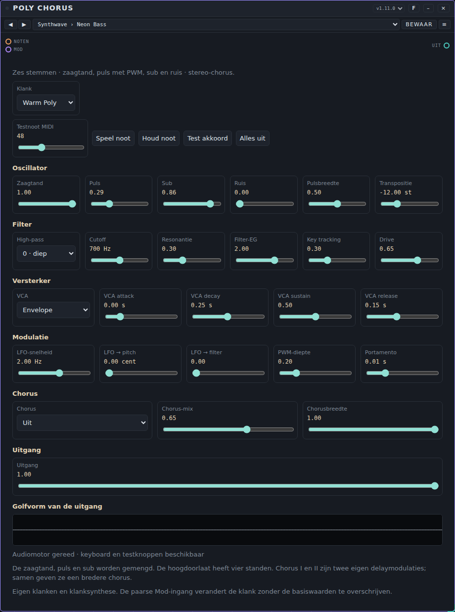

**De regelaars.**

- **Klank** (acht beginklanken: Warm Poly, Rave Chords, Silk Strings, Deep Sub, PWM Cloud, Slow Brass, Muted Pluck, Wide Organ). **Testnoot MIDI** met **Speel noot**, **Houd noot**, **Test akkoord** en **Alles uit**.
- **Oscillator:** **Zaagtand**, **Puls**, **Sub** en **Ruis** (niveaus), **Pulsbreedte** en **Transpositie** (−24 tot 24 halve tonen).
- **Filter:** **High-pass** (vier standen, `0 · diep` tot de dunste, die afsnijdt op 20, 80, 180 of 400 Hz), **Cutoff** (30 tot 16000 Hz), **Resonantie**, **Filter-EG** (−5 tot 5 octaven), **Key tracking** en **Drive**.
- **Versterker:** **VCA** (**Envelope** of **Gate**), **VCA attack**, **VCA decay**, **VCA sustain**, **VCA release**.
- **Modulatie:** **LFO-snelheid**, **LFO → pitch**, **LFO → filter**, **PWM-diepte**, **Portamento**.
- **Chorus:** **Chorus** (**Uit**, **I** (langzaam), **II** (sneller) of **I + II**), **Chorus-mix** en **Chorusbreedte**.
- **Uitgang** en een scope (**Golfvorm van de uitgang**).

**Poorten.**

| Poort | Soort | Gebruik |
|---|---|---|
| **Noten** | noten in (oranje) | Noten van **Keys / MIDI** of een sequencer. |
| **Mod** | modulatie in (paars) | Een modulator kan de knoppen bewegen (niet de keuzes). |
| **Uit** | audio uit (groenblauw, stereo) | Sluit aan op **Speakers** of een **Mixer**-kanaal. |

**Voorbeeld.** Plaats **Keys / MIDI**, **Poly Chorus** en **Speakers**. Kies de klank **Silk Strings**, zet **Chorus** op **I + II** en speel akkoorden. Verleng **VCA attack** voor een langzame zwelling.

**Tunes.** Pack **Poly Chorus Styles**: 72 tunes in 12 mappen (Synthwave, Ambient, Cinematic, Pop, Trance, House, Deep House, Funk & Disco, Soul, Electro, Lo-fi, Techno), zes per map, bestand [`poly-chorus-styles.patchkamer-tunes.json`](../../tunes/poly-chorus-styles.patchkamer-tunes.json). Een paar namen: **Neon Bass**, **Slow Tide**, **Rising Strings**, **Bright Pop Chords**, **Stab Chord**.

**Tips en beperkingen.**

- De vier envelope-knoppen sturen twee dingen tegelijk: de versterker en, via **Filter-EG**, het filter. Een lange **VCA attack** laat dus ook het filter langzaam opengaan. Staat **VCA** op **Gate**, dan krijgt de versterker een vaste snelle attack (3 ms), volle sustain en een korte release (30 ms), en bewegen de knoppen alleen het filter.
- Zes stemmen: een zevende noot neemt de oudste stem over die al loslaat. Lange releases met veel noten laten noten afbreken.

### Triple Osc Poly

**Waar het voor dient.** Een flexibele polyfone subtractieve synth. Elke stem heeft drie oscillatoren (zaagtand, blok, driehoek, sinus, FM of ruis) met unison tot zeven stemmetjes, een mixer met ringmodulatie, een shaper, twee filters (het tweede staat in het begin uit) en twee envelopes. Hij kan ook van één toets een akkoord maken.

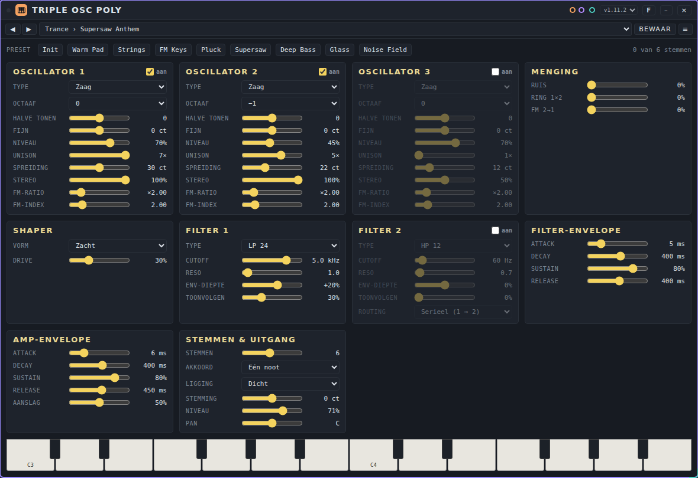

**De regelaars.**

- **Preset-knoppen** (Init, Warm Pad, Strings, FM Keys, Pluck, Supersaw, Deep Bass, Glass, Noise Field): beginklanken die de regelaars één keer zetten. De teller toont hoeveel stemmen klinken (`0 van 6 stemmen`).
- **Oscillator 1, 2 en 3** (elk met een **aan**-vakje): **Type** (Zaag, Blok, Driehoek, Sinus, FM, Ruis), **Octaaf**, **Halve tonen**, **Fijn** (cent), **Niveau**, **Unison** (1 tot 7), **Spreiding** (de detune tussen de unisonstemmetjes, in cent), **Stereo** (breedte van de unisonstemmetjes), **FM-ratio** en **FM-index** (alleen bij type FM).
- **Menging:** **Ruis**, **Ring 1×2** (ringmodulatie van oscillator 1 en 2) en **FM 2→1** (oscillator 2 moduleert de toonhoogte van oscillator 1).
- **Shaper:** **Vorm** (Uit, Zacht, Hard, Fold, Asym) en **Drive**.
- **Filter 1** en **Filter 2** (het tweede heeft een **aan**-vakje): **Type** (bijvoorbeeld **LP 24**, **HP 12**), **Cutoff**, **Reso**, **Env-diepte** en **Toonvolgen**; **Routing** (**Serieel (1 → 2)** of parallel).
- **Filter-envelope** en **Amp-envelope:** **Attack**, **Decay**, **Sustain**, **Release**; de amp-envelope heeft ook **Aanslag** (0 = elke noot even hard). Eén filter-envelope wordt door beide filters gedeeld.
- **Stemmen & uitgang:** **Stemmen** (maximum aantal noten), **Akkoord** (een losse noot of een akkoord uit één toets), **Ligging** (hoe open het akkoord ligt), **Stemming**, **Niveau** en **Pan**.

**Poorten.**

| Poort | Soort | Gebruik |
|---|---|---|
| **Noten** | noten in (oranje) | Noten van **Keys / MIDI** of een sequencer. Elke akkoordnoot telt als een stem. |
| **Mod** | modulatie in (paars) | Een modulator kan 21 regelaars bewegen (stemming, oscillatorniveaus, unison-spreiding en meer). |
| **Uit** | audio uit (groenblauw, stereo) | Sluit aan op **Speakers** of een **Mixer**-kanaal. |

**Voorbeeld.** Klik op **Supersaw** en plaats **Keys / MIDI** en **Speakers**. Zet **Cutoff** van **Filter 1** iets lager, verhoog **Env-diepte** en speel akkoorden. Zet **Filter 2** aan met **Routing** op **Serieel** voor een steilere afsnijding.

**Tunes.** Pack **Triple Osc Poly Styles**: 73 tunes in 12 mappen (Trance, House, Pop, Synthwave, Ambient, Cinematic, Future Bass, Funk, Disco, Electro, Techno, Lo-fi), bestand [`triple-osc-poly-styles.patchkamer-tunes.json`](../../tunes/triple-osc-poly-styles.patchkamer-tunes.json). Een paar namen: **Supersaw Anthem**, **Piano Stab**, **Epic Strings**, **Sub Bass**, **Warehouse Stab**.

**Tips en beperkingen.**

- Een noot die korter duurt dan de **Attack** van de versterker is niet stil: de release start vanaf het niveau dat de attack had bereikt, dus een korte noot klinkt zacht. Houd de attack voor korte noten en plucks toch kort.
- Het niveau van elke stem wordt gedeeld door de wortel van het aantal unisonstemmetjes en van het aantal akkoordnoten, dus veel unison maakt het niet in dezelfde mate luider.
- Oscillatortype **Ruis** is erg zacht; een patch met alleen ruisoscillatoren blijft zacht.

### Supersaw Swarm

**Waar het voor dient.** Een polyfone trance-supersaw. Elke noot is een zwerm van 1, 3, 5, 7 of 9 verstemde zaagtanden, met een octaaflaag, een sub, chorus, ping-pongdelay, galm, een trance-gate en een pompeffect, alles in één kaart.

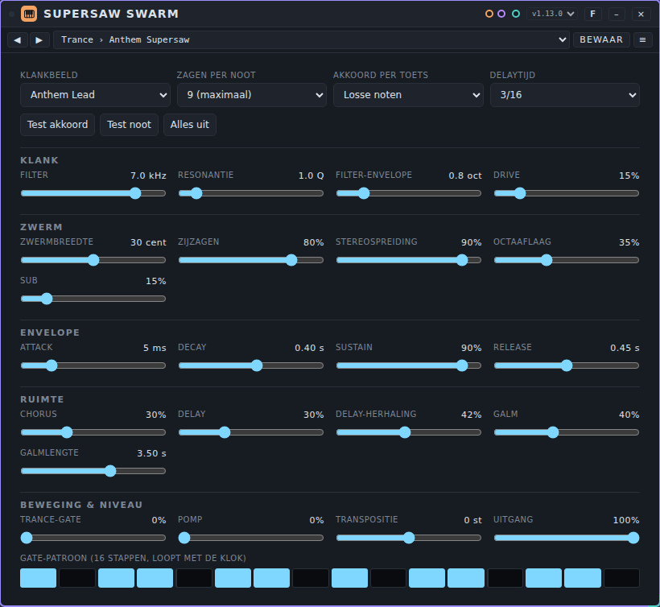

**De regelaars.**

- **Bovenste rij:** **Klankbeeld** (beginklanken, bijvoorbeeld Anthem Lead, Heaven Pad en Hall Chords), **Zagen per noot** (1, 3, 5, 7 of 9), **Akkoord per toets** (**Losse noten**, Mineur, Majeur, Sus2, Sus4, Mineur 7, Mineur add9 of Kwint + octaaf; elke toets wordt dat akkoord), **Delaytijd** (1/16, 1/8, 3/16, 1/4 of 3/8; hij volgt de klok). **Test akkoord**, **Test noot** en **Alles uit**.
- **Klank:** **Filter** (cutoff), **Resonantie**, **Filter-envelope** en **Drive**.
- **Zwerm:** **Zwermbreedte** (detune van de buitenste zagen, tot 60 cent), **Zijzagen** (zijzagen tegenover de middenzaag), **Stereospreiding**, **Octaaflaag** (twee zagen een octaaf hoger) en **Sub**.
- **Envelope:** **Attack**, **Decay**, **Sustain**, **Release**.
- **Ruimte:** **Chorus**, **Delay**, **Delay-herhaling**, **Galm** en **Galmlengte** (0,6 tot 10 s).
- **Beweging & niveau:** **Trance-gate** (diepte), **Pomp** (diepte), **Transpositie** en **Uitgang**.
- **Gate-patroon (16 stappen, loopt met de klok):** 16 vakjes, één per zestiende; een oplichtend vakje is open, een donker vakje dicht (tot de diepte van **Trance-gate**).

**Poorten.**

| Poort | Soort | Gebruik |
|---|---|---|
| **Noten** | noten in (oranje) | Noten van **Keys / MIDI** of een sequencer. |
| **Mod** | modulatie in (paars) | Een modulator kan de knoppen bewegen behalve **Galmlengte**, de keuzes en het klankbeeld. |
| **Stereo** | audio uit (groenblauw) | Sluit aan op **Speakers** of een **Mixer**-kanaal. |

**Voorbeeld.** Plaats **Keys / MIDI**, **Supersaw Swarm** en **Speakers**. Druk op **Start**, zet **Akkoord per toets** op **Mineur**, **Trance-gate** op ongeveer 70% en speel losse noten: elke toets speelt een akkoord dat door het gate-patroon wordt gehakt. Probeer **Pomp** op 50% voor een volumedip op elke tel.

**Tunes.** Pack **Supersaw Swarm Styles**: 61 tunes in 10 mappen (Trance, Hardstyle, Progressive, Big Room, Synthwave, Pop, Future Bass, Eurodance, Ambient, Cinematic), bestand [`supersaw-swarm-styles.patchkamer-tunes.json`](../../tunes/supersaw-swarm-styles.patchkamer-tunes.json). Een paar namen: **Anthem Supersaw**, **Euphoric Lead**, **Festival Lead**, **Future Chord Stack**, **Slow Bloom Pad**.

**Tips en beperkingen.**

- **Trance-gate** en **Pomp** bewegen alleen als de klok loopt (**Start**). **Pomp** laat het volume op elke tel zakken naar `1 − 0,85 × diepte` en weer terugkomen.
- Hoogstens 14 noten tegelijk; een nieuwe noot laat de oudste los. Een akkoord telt voor elke noot erin. Kies **Losse noten** als je sequencer al akkoorden stuurt.
- Wijzig je **Galmlengte**, dan wordt de galm opnieuw opgebouwd en komt de nieuwe galm na ongeveer 0,2 s.

### Chord Poly

**Waar het voor dient.** Een polyfone akkoordsynth met tot 24 stemmen. Elke noot wordt een akkoord (of blijft een losse noot). Elke noot heeft twee licht ontstemde oscillatoren en een sub, een lowpassfilter met envelope, een stereo-chorus en drive. Gemaakt voor stabs, orgelakkoorden en pads.

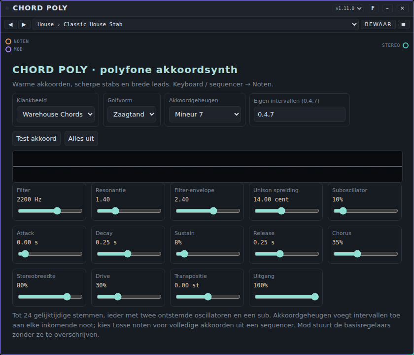

**De regelaars.**

- **Bovenste rij:** **Klankbeeld** (Warehouse Chords, Warm Horizon, Rave Stab, Glass Pulse, Soft Organ, Wide Lead, Night Pad, Electric Chimes), **Golfvorm** (Zaagtand, Blok, Driehoek of Sinus voor beide oscillatoren), **Akkoordgeheugen** (**Losse noten**, Majeur, Mineur, een sus-akkoord, Mineur 7, of een eigen akkoord dat **Eigen intervallen** gebruikt) en **Eigen intervallen** (halve tonen boven de gespeelde noot, gescheiden door komma's, bijvoorbeeld `0,4,7`; hoogstens 6). **Test akkoord** en **Alles uit**.
- **Filter:** **Filter** (cutoff, 80 tot 16000 Hz), **Resonantie** en **Filter-envelope** (0 tot 4 octaven).
- **Oscillatoren:** **Unison spreiding** (de twee oscillatoren staan zoveel cent boven en onder de noot, 0 tot 35) en **Suboscillator**.
- **Envelope:** **Attack**, **Decay**, **Sustain** en **Release**.
- **Ruimte en niveau:** **Chorus**, **Stereobreedte**, **Drive**, **Transpositie** en **Uitgang**.

**Poorten.**

| Poort | Soort | Gebruik |
|---|---|---|
| **Noten** | noten in (oranje) | Noten van **Keys / MIDI** of een sequencer. |
| **Mod** | modulatie in (paars) | Een modulator kan de knoppen bewegen. |
| **Stereo** | audio uit (groenblauw) | Sluit aan op **Speakers** of een **Mixer**-kanaal. |

**Voorbeeld.** Plaats **Keys / MIDI**, **Chord Poly** en **Speakers**. Zet **Akkoordgeheugen** op **Mineur 7** en speel één toets tegelijk: elke toets klinkt als een akkoord van vier noten. Voor een eigen akkoord kies je het eigen akkoord en typ je `0,4,7,11` bij **Eigen intervallen**.

**Tunes.** Pack **Chord Poly Styles**: 60 tunes in 10 mappen (House, Deep House, Garage, Lo-fi, Ambient, Pop, Soul, Synthwave, Cinematic, Disco & Funk), zes per map, bestand [`chord-poly-styles.patchkamer-tunes.json`](../../tunes/chord-poly-styles.patchkamer-tunes.json). Een paar namen: **Classic House Stab**, **Deep Ninth Chord**, **Velvet Chord**, **Endless Pad**, **Disco Stab**.

**Tips en beperkingen.**

- Elke akkoordnoot neemt een van de 24 stemmen in: een akkoord van vier noten laat ruimte voor zes akkoorden.
- Het volume van een akkoord wordt gedeeld door de wortel van het aantal noten, dus een akkoord klinkt niet veel harder dan een losse noot.
- Stuurt je sequencer al akkoorden, kies dan **Losse noten**.

### Bowed Ensemble

**Waar het voor dient.** Een polyfoon strijkersensemble met zestien stemmen. Elke stem heeft vier licht ontstemde oscillatoren, strijkstok- of luchtruis, een lowpassfilter met eigen envelope en een stereopositie. Alle stemmen delen een hoogdoorlaatfilter, twee klankfilters, een ensemble-chorus met drie tappen en een concertgalm van ongeveer 5,5 seconden. Gemaakt voor akkoorden, pads en lange lijnen. Het is een sectie, geen model van één snaar (daarvoor is er [Karplus String](#karplus-string)).

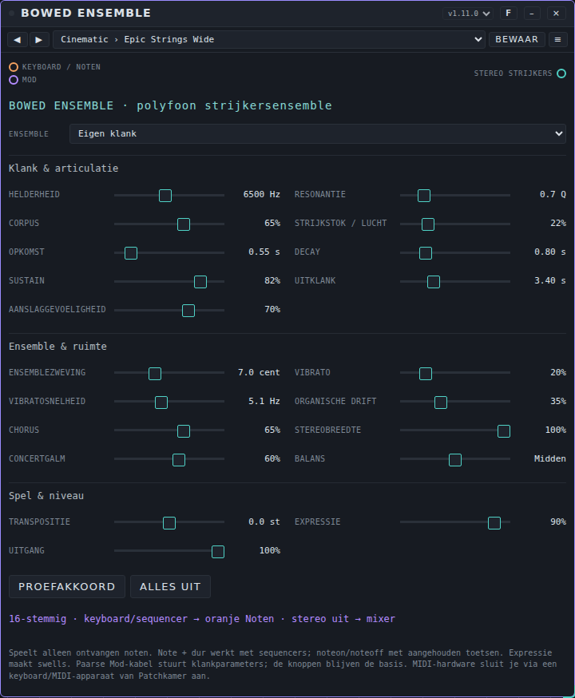

**De regelaars.**

- **Ensemble** (lijst beginklanken: Chamber Ensemble, Cinematic Strings, Velvet Strings, Vintage String Machine, Disco Strings, Slow Bloom, Spiccato, Pizzicato, Dark Cellos, Glass Strings, Wide Legato, String Lead; hij toont **Eigen klank** zodra je een knop verandert).
- **Klank & articulatie:** **Helderheid** (cutoff, 200 tot 14000 Hz), **Resonantie**, **Corpus** (voller laag-midden), **Strijkstok / lucht** (strijkstokruis onder de toon), **Opkomst** (0,005 tot 5 s), **Decay**, **Sustain**, **Uitklank** (tot 12 s) en **Aanslaggevoeligheid** (hoeveel de velocity het niveau bepaalt).
- **Ensemble & ruimte:** **Ensemblezweving** (0 tot 20 cent tussen de oscillatoren), **Vibrato** en **Vibratosnelheid** (3 tot 8 Hz), **Organische drift** (trage toonhoogteafwijking per stem), **Chorus**, **Stereobreedte**, **Concertgalm** en **Balans**.
- **Spel & niveau:** **Transpositie**, **Expressie** (een tweede volumeregelaar achter de compressor, voor swells) en **Uitgang**. **Proefakkoord** en **Alles uit**.

**Poorten.**

| Poort | Soort | Gebruik |
|---|---|---|
| **Keyboard / noten** | noten in (oranje) | Noten van **Keys / MIDI** of een sequencer. Een sequencer moet de nootlengte meesturen. |
| **Mod** | modulatie in (paars) | Een modulator kan de knoppen bewegen; de lijst **Ensemble** beweegt niet mee. |
| **Stereo strijkers** | audio uit (groenblauw, stereo) | Sluit aan op **Speakers** of een **Mixer**-kanaal. |

**Voorbeeld.** Plaats **Keys / MIDI**, **Bowed Ensemble** en **Speakers**. Kies de tune **Cinematic › Epic Strings Wide**, houd een akkoord vast en beweeg **Expressie** terwijl je speelt voor een swell. Zet **Opkomst** op ongeveer 1 s voor een langzame bloei.

**Tunes.** Pack **Bowed Ensemble Styles**: 65 tunes in 11 mappen (Cinematic, Ambient, Pop, Ballad, Trance, Synthwave, Film Score, Lo-fi, Neo-classical, Disco & Funk, Deep House), bestand [`bowed-ensemble-styles.patchkamer-tunes.json`](../../tunes/bowed-ensemble-styles.patchkamer-tunes.json). Een paar namen: **Epic Strings Wide**, **Slow Bloom**, **Tender Violins**, **Chamber Quartet**, **Funk Chops**.

**Tips en beperkingen.**

- Zestien stemmen: een zeventiende noot neemt de stem over die het eerst klaar is. Een lange **Uitklank** met veel noten laat noten afbreken.
- Een noot zonder lengte en zonder note-off klinkt door tot de transportklok stopt of er een panic komt: laat een sequencer nootlengtes sturen.
- MIDI-hardware sluit je aan via **Keys / MIDI** (zie de [basishandleiding](../USER-MANUAL_NL.md)).

## Toetsen en snaren

### Stage Keys

**Waar het voor dient.** Een polyfone toetsensynth met zeven klankmodellen, een eigen klavier en een uitgangsketen met drive en stereo-tremolo. Hij heeft geen sequencer: je speelt hem op het klavier van de kaart of vanaf een ander apparaat.

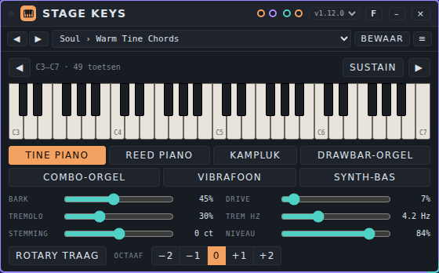

**De regelaars.**

- **Klavierstrook:** de pijlen verschuiven het klavier van 49 toetsen (C3 tot C7 op de afbeelding) en **Sustain** houdt noten vast.
- **Klankmodelknoppen:** **Tine Piano**, **Reed Piano**, **Kampluk**, **Drawbar-orgel**, **Combo-orgel**, **Vibrafoon** en **Synth-bas**.
- **Toonknop** (zijn label wisselt met het model, 0 tot 1): **Bark** bij Tine Piano (hardheid van de aanslag), een rietgrom bij Reed Piano, **Pickup** bij Kampluk, **Drawbars** bij Drawbar-orgel (0 = alleen de laagste drawbars), een mengsel van fluit naar riet bij Combo-orgel, **Mallet** bij Vibrafoon en **Filter** bij Synth-bas.
- **Drive**, **Tremolo** (diepte), **Trem Hz** (snelheid, 0,5 tot 12 Hz; de twee kanalen lopen in tegenfase), **Stemming** (−50 tot 50 cent) en **Niveau**.
- **Rotary traag / snel:** snelheid van het rotary-effect (alleen bij het Drawbar-orgel: 0,7 Hz traag, 6,6 Hz snel).
- **Octaaf** (−2 tot +2): verschuift binnenkomende noten, niet het klavier op de kaart.

**Poorten.**

| Poort | Soort | Gebruik |
|---|---|---|
| **Noten** | noten in (oranje) | Noten van **Keys / MIDI** of een sequencer. |
| **Mod** | modulatie in (paars) | Een modulator kan zes regelaars bewegen: toon, drive, tremolodiepte, tremolosnelheid, stemming en niveau. |
| **Uit** | audio uit (groenblauw) | Sluit aan op **Speakers** of een **Mixer**-kanaal. |
| **Gespeeld** | noten uit (oranje) | Stuurt door wat je op het klavier van de kaart speelt, zodat je het naar een ander apparaat kunt sturen. |

**Voorbeeld.** Plaats **Stage Keys** en **Speakers** en verbind **Uit** met **In**. Klik op **Drawbar-orgel**, speel op het klavier van de kaart, verhoog de toonknop voor meer drawbars en schakel **Rotary traag / snel** om. Verbind **Gespeeld** met een tweede synth om twee klanken tegelijk te spelen.

**Tunes.** Pack **Stage Keys Styles**: 66 tunes in 11 mappen (Soul, Funk, Jazz, Pop, Gospel, Rock, Disco, House, Lo-fi, Reggae, Ballad), zes per map, bestand [`stage-keys-styles.patchkamer-tunes.json`](../../tunes/stage-keys-styles.patchkamer-tunes.json). Samen beslaan ze alle zeven modellen (Tine Piano 12 tunes, Drawbar-orgel 12, Reed Piano 10, Synth-bas 10, Vibrafoon 8, Combo-orgel 8, Kampluk 6). Een paar namen: **Warm Tine Chords**, **Greasy Organ**, **Smoky Vibes**, **Church Drawbars**, **Skank Organ**.

**Tips en beperkingen.**

- Tot 24 stemmen; één stem per toonhoogte, dus dezelfde noot opnieuw aanslaan kapt de vorige van die toonhoogte kort af.
- De waarde van de toonknop wordt bij elke nieuwe noot gelezen, dus een wijziging werkt vanaf de volgende noot.
- Elk model heeft een vaste uitklank na het loslaten van een toets (bijvoorbeeld ongeveer 0,2 s bij Tine Piano en 0,12 s bij Synth-bas).

### Four-Operator FM

**Waar het voor dient.** Een FM-synth met vier sinus-operators en acht stemmen. Elke operator heeft een eigen frequentieverhouding, niveau, fijnafstemming en envelope. Acht algoritmes bepalen welke operators elkaar moduleren en welke je hoort (de carriers). Operator 4 heeft feedback. Handig voor klokken, glas, tines, elektrische piano's en FM-bassen.

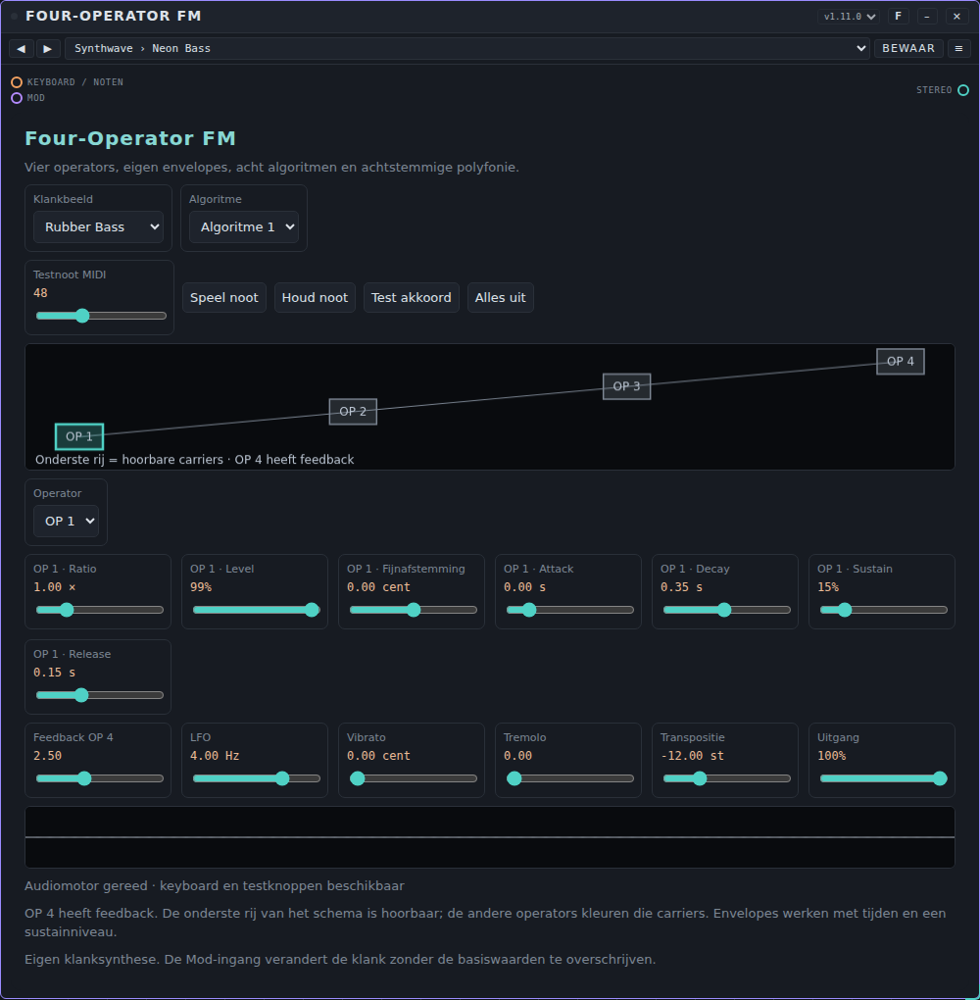

**De regelaars.**

- **Bovenste rij:** **Klankbeeld** (Rubber Bass, Digital Tines, Hollow Organ, Metal Bells, Stab Chord, Glass Marimba, Breathing Pad, Wire Pluck), **Algoritme** (1 tot 8). **Testnoot MIDI** met **Speel noot**, **Houd noot**, **Test akkoord** en **Alles uit**.
- **Het schema:** toont het gekozen algoritme. De onderste rij is wat je hoort; operators erboven kleuren die carriers. Kies met **Operator** welke je bewerkt.
- **Per operator (OP 1 tot OP 4):** **Ratio** (frequentie ten opzichte van de noot, 0,5 tot 16: hele getallen geven harmonische klanken, gebroken getallen klokken en metaal), **Level** (bij een modulator de modulatiediepte, bij een carrier het volume), **Fijnafstemming** (−12 tot 12 cent), **Attack**, **Decay**, **Sustain** en **Release**.
- **Algemeen:** **Feedback OP 4** (0 tot 7: 0 is een zuivere sinus, 2 tot 3 een zaagachtige toon, 6 tot 7 ruis), **LFO** (snelheid, 0,05 tot 20 Hz), **Vibrato** (0 tot 80 cent), **Tremolo**, **Transpositie** en **Uitgang**.

De acht algoritmes (`a → b` betekent: a moduleert b):

1. 4 → 3 → 2 → 1; je hoort 1. Eén lange keten.
2. 3 en 4 → 2 → 1; je hoort 1.
3. 4 → 3 en 2 beide → 1; je hoort 1.
4. 4 → 2 en 3 beide → 1; je hoort 1.
5. 2 → 1 en 4 → 3; je hoort 1 en 3. Twee paren.
6. 4 → 1, 4 → 2 en 4 → 3; je hoort 1, 2 en 3. Eén modulator voor drie carriers.
7. 4 → 3; je hoort 1, 2 en 3.
8. Geen modulatie; je hoort alle vier. Puur additief.

**Poorten.**

| Poort | Soort | Gebruik |
|---|---|---|
| **Keyboard / noten** | noten in (oranje) | Noten van **Keys / MIDI** of een sequencer. |
| **Mod** | modulatie in (paars) | Een modulator kan alle numerieke regelaars bewegen. |
| **Stereo** | audio uit (groenblauw) | Sluit aan op **Speakers** of een **Mixer**-kanaal. |

**Voorbeeld.** Kies **Algoritme 6** en zet **OP 4 · Ratio** op 3,5, met een lange **Decay** (1,5 tot 3 s) en **Sustain** 0 bij de carriers: klokachtige tonen. Speel losse noten vanaf **Keys / MIDI**.

**Tunes.** Pack **Four-Operator FM Styles**: 67 tunes in 11 mappen (Synthwave, Electro, Pop, Chiptune, Jazz & Soul, Ambient, Cinematic, Techno & House, Drum & Bass, Hip-hop & Lo-fi, Funk & Disco), bestand [`four-operator-fm-styles.patchkamer-tunes.json`](../../tunes/four-operator-fm-styles.patchkamer-tunes.json). Een paar namen: **Neon Bass**, **Tine Piano**, **Warm Vibes**, **Deep Impact**, **Dusty Keys**.

**Tips en beperkingen.**

- Houd de som van de carrierniveaus op ongeveer 1 of lager. Het apparaat deelt al door de wortel van het aantal carriers en heeft een begrenzer achter de uitgang; **Uitgang** rond 60 tot 80% is gebruikelijk.
- Een carrier met **Sustain** 0 en een korte **Decay** geeft een tik; **Sustain** 1 houdt de toon vast zolang de toets ingedrukt is.
- Acht stemmen: bij lange releases en snelle noten valt de oudste stem weg.

### Karplus String

**Waar het voor dient.** Een model van een geplukte of gestreken snaar met acht stemmen en een eigen klavier van twee octaven. Elke noot is een snaar: een korte ruisstoot (plukken) of doorgaande ruis (strijken) gaat in een vertragingslus met demping, stijfheid en galmtijd.

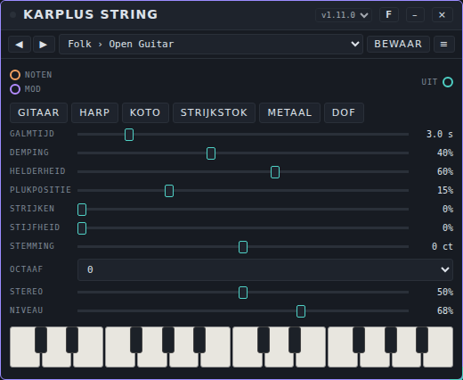

**De regelaars.**

- **Snelle instellingen:** **Gitaar**, **Harp**, **Koto**, **Strijkstok**, **Metaal** en **Dof** zetten **Galmtijd**, **Demping**, **Helderheid**, **Plukpositie**, **Strijken** en **Stijfheid** in één keer. De andere regelaars blijven staan.
- **Galmtijd:** de uitklinktijd van een vastgehouden noot, 0,1 tot 20 s.
- **Demping:** 0 = helder en lang, 1 = dof en kort.
- **Helderheid:** hoe scherp de aanslag is.
- **Plukpositie:** waar op de snaar hij wordt geplukt (0,02 tot 0,5): dicht bij 0 is scherp en nasaal, 0,5 is hol.
- **Strijken:** 0 = plukken, hoger = een doorgaand gestreken geluid; 1 is sterk.
- **Stijfheid:** hoger laat de boventonen te hoog komen (metaal, klok).
- **Stemming:** −100 tot 100 cent. **Octaaf:** −2 tot +2, voor binnenkomende noten en het klavier op de kaart. **Stereo:** elke noot krijgt een willekeurige plek; 0 = midden, 1 = breed. **Niveau.**

**Poorten.**

| Poort | Soort | Gebruik |
|---|---|---|
| **Noten** | noten in (oranje) | Noten van **Keys / MIDI** of een sequencer. |
| **Mod** | modulatie in (paars) | Een modulator kan acht regelaars bewegen: **Galmtijd**, **Demping**, **Helderheid**, **Plukpositie**, **Strijken**, **Stijfheid**, **Stemming** en **Niveau**. |
| **Uit** | audio uit (groenblauw) | Sluit aan op **Speakers** of een **Mixer**-kanaal. |

**Voorbeeld.** Plaats **Keys / MIDI**, **Karplus String** en **Speakers**. Klik op **Harp** en speel. Klik op **Strijkstok** en houd noten twee seconden of langer vast: de snaar blijft klinken zolang je hem vasthoudt.

**Tunes.** Pack **Karplus String Styles**: 60 tunes in 10 mappen (Folk, Ambient, Cinematic, Pop, World, Lo-fi, Ballad, Flamenco, Jazz, Metallic), zes per map, bestand [`karplus-string-styles.patchkamer-tunes.json`](../../tunes/karplus-string-styles.patchkamer-tunes.json). Een tune is alleen een klank; er zit geen patroon in. Een paar namen: **Open Guitar**, **Glass Strings**, **Koto Lead**, **Slow Bow Pad**, **Rust Strings**.

**Tips en beperkingen.**

- Een noot klinkt zo lang als zijn lengte en klinkt daarna hooguit 0,25 s uit, ook als **Galmtijd** groter is: **Galmtijd** bepaalt de uitklank zolang de noot wordt vastgehouden. Wil je een lange, uitklinkende snaar, houd de noot dan lang vast.
- De toonhoogte blijft zuiver boven ongeveer MIDI-noot 24 (C1).
- Acht stemmen: een negende noot neemt de stem over die het langst klinkt.
- Er is geen arpeggiator: stuur korte noten (0,1 tot 0,25 s) vanuit een sequencer voor een geplukt ritme.

## Bijzonder en modulair

### Dissonant Cluster

**Waar het voor dient.** Een polyfone synth die alleen dissonant klinkt. Elke noot wordt een cluster van 2 tot 6 stemmen in een structuur naar keuze (een smalle wolk, een chromatisch cluster, een wijde 13-toons ligging en meer). Een bewaker schuift stemmen zo nodig een paar cent op, zodat geen enkel paar tonen consonant klinkt. Voor drones, spanning, industriële klanken en effecten.

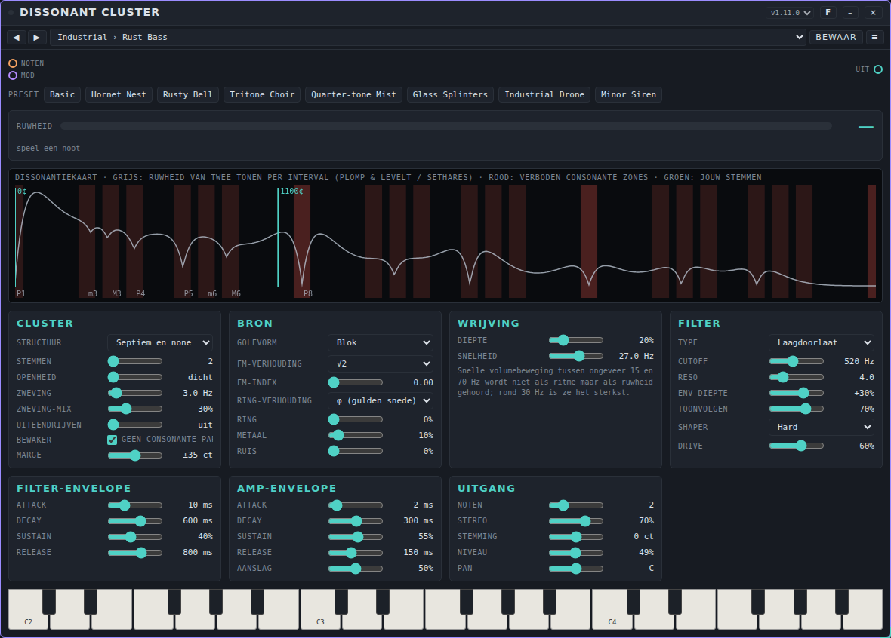

**De regelaars.**

- **Preset-knoppen** bovenaan: Basic, Hornet Nest, Rusty Bell, Tritone Choir, Quarter-tone Mist, Glass Splinters, Industrial Drone en Minor Siren (beginstanden). Eronder de meter **Ruwheid** en de dissonantiekaart (grijs: ruwheid van twee tonen per interval, rood: verboden consonante zones, gemarkeerd: jouw stemmen).
- **Cluster:** **Structuur** (wolk, chromatisch, wijd, tritonus, septiem en none, 13-toons of willekeurig), **Stemmen** (2 tot 6), **Openheid** (om-en-om een octaaf hoger: dicht tot 3), **Zweving** (Hz) en **Zweving-mix** (hoeveel van de tweede oscillator per stem meeklinkt), **Uiteendrijven** (stemmen drijven uit elkaar, in cent per seconde; uit = 0), **Bewaker** (de consonantiebewaker) en **Marge** (in cent).
- **Bron:** **Golfvorm**, **FM-verhouding** en **FM-index**, **Ring-verhouding** en **Ring**, **Metaal** (een metaalbron van zes blokgolven) en **Ruis**.
- **Wrijving:** **Diepte** en **Snelheid** (8 tot 70 Hz): een snelle volumebeweging die je hoort als ruwheid, het sterkst rond 30 Hz.
- **Filter:** **Type** (lowpass, bandpass, highpass, notch of peaking), **Cutoff**, **Reso**, **Env-diepte**, **Toonvolgen**, **Shaper** en **Drive**.
- **Filter-envelope** en **Amp-envelope:** **Attack**, **Decay**, **Sustain**, **Release**; de amp-envelope heeft ook **Aanslag**.
- **Uitgang:** **Noten** (hoeveel noten tegelijk klinken, elk een heel cluster), **Stereo**, **Stemming**, **Niveau** en **Pan**. Een klavier onderaan speelt op de kaart.

**Poorten.**

| Poort | Soort | Gebruik |
|---|---|---|
| **Noten** | noten in (oranje) | Noten van **Keys / MIDI** of een sequencer. |
| **Mod** | modulatie in (paars) | Een modulator kan 19 regelaars bewegen (zweving, uiteendrijven, FM, ring, metaal, ruis, wrijving, filter, envelopetijden en meer). |
| **Uit** | audio uit (groenblauw) | Sluit aan op **Speakers** of een **Mixer**-kanaal. |

**Voorbeeld.** Plaats **Keys / MIDI**, **Dissonant Cluster** en **Speakers**. Klik op de preset **Hornet Nest** en houd een laag akkoord vast. Zet daarna **Structuur** op **tritonus** met **Stemmen** 3, verhoog **Wrijving › Diepte** en draai **Cutoff** langzaam omlaag voor een dreigende drone.

**Tunes.** Pack **Dissonant Cluster Styles**: 60 tunes in 9 mappen (Industrial, Horror & Cinematic, Dark Ambient, Techno, Experimental, Sound Design, Noise, Dubstep, Drone), bestand [`dissonant-cluster-styles.patchkamer-tunes.json`](../../tunes/dissonant-cluster-styles.patchkamer-tunes.json). Een paar namen: **Rust Bass**, **Dread Pad**, **Abyss Drone**, **Quarter Tone Choir**, **Laser Zap**.

**Tips en beperkingen.**

- Lage noten met een dicht cluster klinken als een zwevend gonzen in plaats van als een toonhoogte; probeer voor bassen 2 of 3 stemmen, **septiem en none** of **tritonus**.
- De tritonusstructuur speelt hoogstens 5 stemmen.
- Met **Bewaker** uit wordt het cluster niet gecorrigeerd en kan het consonant klinken.
- Er is geen eigen arpeggiator; houd **Noten** laag voor snelle reeksen van buiten.

### Patchbay Synth

**Waar het voor dient.** Een halfmodulaire synth met een patchpaneel: ingangen, uitgangen en schuiven die modules koppelen. Elke ingang heeft al een ingebouwde bron (gemarkeerd met **←**); een kabel vervangt die. Drie VCO's, een ruisgenerator, een ringmodulator, een vierpolig 24 dB lowpassfilter (dat bij veel resonantie zelf kan oscilleren), een ADSR- en een AR-envelope, sample & hold met een eigen klok, een envelope-volger, een voorversterker voor extern geluid, twee inverters, een lag, een elektronische schakelaar en een klavier van C2 tot C6. Er is geen sequencer of arpeggiator.

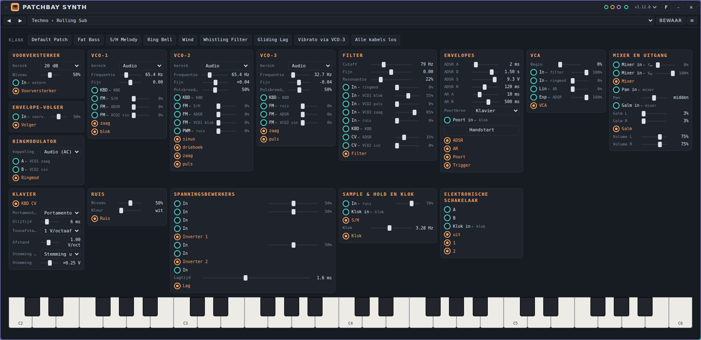

**De regelaars.**

- **Klankknoppen** bovenaan: Default Patch, Fat Bass, S/H Melody, Ring Bell, Wind, Whistling Filter, Gliding Lag, Vibrato via VCO-3 en **Alle kabels los**. Elke knop is een set kabels en knoppen om mee te beginnen.
- **Panelen** (van links naar rechts): **Voorversterker**, **Envelope-volger**, **Ringmodulator**, **Klavier**, **VCO-1**, **VCO-2**, **VCO-3** (elk met een **bereik** **Audio** of **LF**, **Frequentie**, **Fijn** en hoeveelheden voor frequentiemodulatie), **Ruis**, **Spanningsbewerkers** (twee inverters en een lag), **Filter**, **Envelopes**, **Sample & hold en klok**, **VCA**, **Elektronische schakelaar**, **Mixer en uitgang**.
- **Kabels.** Sleep van een **uitgang** (oranje stip) naar een **ingang** (groenblauwe stip). Een ingang kan één kabel hebben. Klik op een kabel om hem los te halen; sleep vanaf een bezette ingang om de kabel te verleggen. **Alle kabels los** haalt alle kabels weg.
- **Paneel Klavier:** uitgang **KBD CV**, **Portamento** (met **Glijtijd**), toonafstand (standaard **1 V/octaaf**, instelbaar) en een **Stemming**-verschuiving.

**Poorten.**

| Poort | Soort | Gebruik |
|---|---|---|
| **Voorversterker in** | audio in (groenblauw) | Extern geluid voor de voorversterker. |
| **Noten** | noten in (oranje) | Noten van **Keys / MIDI** of een sequencer (de toetsen op de kaart werken ook). |
| **Mod** | modulatie in (paars) | Een modulator kan de knoppen bewegen. |
| **Uit** | audio uit (groenblauw) | Sluit aan op **Speakers** of een **Mixer**-kanaal. |

**Voorbeeld.**

1. Plaats **Keys / MIDI**, **Patchbay Synth** en **Speakers**; verbind de noten met **Noten** en **Uit** met **In**. Klik op **Default Patch** en speel.
2. Klik op **Fat Bass** of **Ring Bell** en vergelijk welke kabels erin zitten.
3. Maak een glijdende toon: sleep een kabel van de uitgang **KBD CV** naar de **In** van de lag (de laatste **In** boven **Lagtijd**) en een tweede kabel van de uitgang **Lag** naar de ingang **KBD** van **VCO-1**. Draai **Lagtijd** naar smaak.

**Tunes.** Pack **Patchbay Synth Styles**: 89 tunes in 15 mappen (Techno, Acid, House, Synthwave, Ambient, Cinematic, Electro, Hip-hop, Dub, Funk & Disco, Trance, Chiptune, Drum & Bass, Generative, FX), bestand [`patchbay-synth-styles.patchkamer-tunes.json`](../../tunes/patchbay-synth-styles.patchkamer-tunes.json). Een tune bevat alle knoppen en de lijst met kabels. Een paar namen: **Rolling Sub**, **Squelch Bass**, **S/H Bleeps**, **Random Bells**, **Laser Zap**, **Siren**.

**Tips en beperkingen.**

- **De VCA bepaalt wat je hoort.** Zijn versterking is **Begin** plus de lineaire ingang maal zijn hoeveelheid plus de exponentiële ingang (standaard de **ADSR**). Staan alle drie op nul, dan geeft de VCA niets en is de synth stil.
- **Volume** (links en rechts) is de echte niveauregeling; de uitgang wordt hard begrensd.
- Toonhoogte en filter volgen 1 volt per octaaf. Het bereik LF koppelt het klavier los van een VCO.
- De envelopes krijgen hun gate van het klavier en de noten van de host; met **Poortbron** op **Poort in** komt de gate van de externe ingang (standaard de klok).

## Als het niet werkt

- **Geen geluid.** Controleer of er audio loopt van de synth naar **Speakers** (groenblauwe kabel), of je op **Start** hebt gedrukt en of het volume op Speakers hoog genoeg staat. Klik één keer ergens in Patchkamer: browsers houden audio tegen tot je dat doet.
- **Een ingebouwde sequencer of arpeggiator is stil.** Acid Baselines (met **intern aan**), Acid Stepper (**Besturing** = **Interne klok / patroon**), Sub Line en Cross Mod Mono (**Besturing** = **Eigen patroon** of **Arpeggiator**) spelen alleen als de klok loopt: druk op **Start**. Een arpeggiator heeft ook vastgehouden toetsen nodig.
- **Een synth reageert niet op een toetsenbord.** Sluit de oranje kabel aan op zijn notenpoort (**Noten**, **Keyboard / noten**, **Externe noten**), niet op **Mod**. Bij Acid Baselines moet **intern aan** uit voor noten van buiten, bij Acid Stepper moet **Besturing** op **Extern keyboard / sequencer** staan, en bij Sub Line en Cross Mod Mono op **Keyboard / externe sequencer**. Gebruik voor een MIDI-toetsenbord **Connect MIDI** op Keys; zie de [basishandleiding](../USER-MANUAL_NL.md#13-problemen-oplossen).
- **Noten blijven klinken.** Een noot zonder lengte blijft bij sommige synths doorklinken (Bowed Ensemble). Laat de sequencer nootlengtes sturen, of druk op **Alles uit** op de kaart.
- **De gate of pomp van Supersaw Swarm doet niets.** Ze werken alleen als de klok loopt.
- **Zacht of stil.** Controleer **Niveau** of **Uitgang** en de klankregelaars: een heel lage cutoff met een lage envelope-diepte klinkt heel zacht (Acid Baselines, Basic Mono), Patchbay Synth heeft een VCA-bron nodig (zie zijn tips) en een heel korte noot met een lange attack van de versterker klinkt bij Triple Osc Poly maar zacht.
- **Een filter ontspoort of valt stil.** Meerdere synths (bijvoorbeeld Acid Baselines, Basic Mono en Low Bass) hebben een bewaker die het filter elke 50 ms controleert en vervangt als het ontspoort, zodat het geluid vanzelf terugkomt. Gebeurt het opnieuw, zet dan **Resonantie** lager.
- **Gekraak.** Open Instellingen → Audio en kies een grotere latency, of een lagere kwaliteit.
