# Tools: user manual

*Nederlandse versie: [USER-MANUAL_NL.md](USER-MANUAL_NL.md)*

This manual covers the eleven **tools** of Patchkamer. Tools are helpers: you use them to play, keep time, record, measure, take notes or control other devices. They are not effects, and apart from the Metronome click they make no sound of their own. For the basics (starting Patchkamer, loading a library, drawing cables) see the [main manual](../USER-MANUAL_EN.md). The list of tools is in the [tools folder](../../devices/tools/README.md).

## Which tool for which goal

| I want to… | Use | It has |
|---|---|---|
| play notes with the screen keyboard, my computer keys or a MIDI keyboard | [Keys / MIDI](#keys--midi) | a **Notes / CC** event out |
| control many devices from a grid of 40 pads on a MIDI controller | [Pad Controller](#pad-controller) | a **MIDI (raw)** event in, 40 **Pad** event outs and a **Buttons** modulation out |
| find chords without music theory: key, style, chords I play, next-chord ideas, 16 pads, bass and voice leading | [Chord Buddy](#chord-buddy) | an **In** event in, **Chords** and **Bass** event outs |
| record the finished mix (or any sound) into one file | [Recorder](#recorder) | **In** and **Through** audio |
| turn a drum loop into a pattern (kick, snare, hats, toms) and copy it to a sequencer | [Drum Listener](#drum-listener) | audio **In** and **Through**, an event out **Drum trigs** |
| split a track into stems with an online service (vocals, drums, bass, the rest) and play them with the clock | [Stem Splitter](#stem-splitter) | audio **In**, an output per stem and a bundle **All stems** |
| find which synth and tune of the library sounds like a note, phrase, bass line or chord I have (a file or a recording) | [Tune Finder](#tune-finder) | audio **In** and **Through** |
| record many tracks at once, one file per track | [Multitrack](#multitrack) | a **Bundle** in |
| see the sound: spectrum, waveform, level | [Scope](#scope) | **In** and **Through** audio |
| hear a click in time with the clock, or let a drum play on the beats | [Metronome](#metronome) | a click on **Out** and trigs on **Trigs** |
| write down ideas, the key and a to-do list | [Notes](#notes) | no ports |
| connect a MIDI keyboard and the tracks of a sequencer to devices, and put their knobs on your keyboard knobs | [MIDI Hub](#midi-hub) | four **MIDI in** event ins, a **Tracks in** multi-MIDI in, and an event out per device |
| show a controller with knobs, faders and pads as a panel and send its messages on | [Control Surface](#control-surface) | a **CC out** event out |

## How you connect tools

- **Keys / MIDI** and **Pad Controller** send *events* (notes). Their orange event ports connect to the notes input of a synth, a sampler or an arpeggiator.
- **Recorder** and **Scope** are audio devices that let the sound through unchanged. Put them in the audio path, for example between the Mixer and Speakers. Recorder and Scope can also hang on the end of a cable that continues to other devices.
- **Multitrack** listens to a *bundle* (the thick green cable with many channels) and does not pass sound on. It sits next to the Mixer, not in the path.
- **Metronome** has an audio out (the click) and an event out (**Trigs**). Connect **Out** to your mixer to hear the click, and **Trigs** to a drum machine or sampler to let it play on the beats.
- **Notes** is not connected to anything.

Apart from the click of Metronome, none of these tools adds to your sound: they play, look, record or note.

---

## Keys / MIDI

**What it is for.** A keyboard that makes no sound of its own. You play with it and it sends the notes to another device: a synth, a sampler or an arpeggiator. You can play on the on-screen piano, with the keys of your computer keyboard, or with a MIDI keyboard.

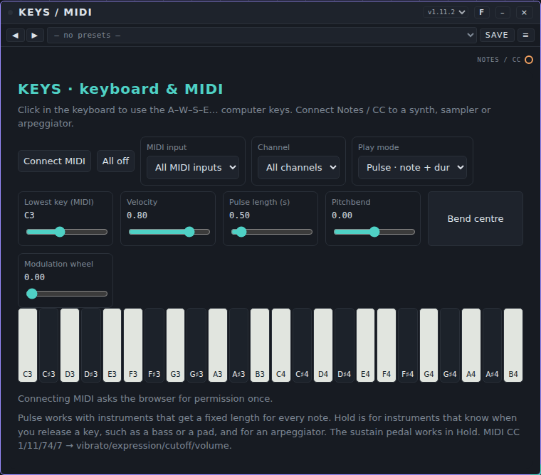

**Controls**

- **Connect MIDI** asks the browser once for permission to use MIDI. Afterwards the button reads **Reconnect MIDI**. You need a browser with Web MIDI (Chrome or Edge).
- **All off** silences every note that is still sounding.
- **MIDI input** chooses one MIDI keyboard or **All MIDI inputs**. **Channel** chooses one MIDI channel (1 to 16) or **All channels**.
- **Play mode:** **Pulse · note + dur** sends a note with a fixed length. **Hold key · noteoff** keeps the note as long as you hold the key and sends a note-off when you let go; the sustain pedal of a MIDI keyboard works in this mode. Use Hold for devices that understand held keys, and Pulse for devices that work from a note length.
- **Lowest key (MIDI)** sets the first note of the keyboard: C1 to C6, in steps of an octave (it starts at C3).
- **Velocity** (0.05 to 1, start 0.80) is how hard the notes are played, for the screen and computer keys. A MIDI keyboard sends its own velocity.
- **Pulse length (s)** (0.05 to 8 seconds, start 0.50) is the length of a note in Pulse mode.
- **Pitchbend** and **Bend centre**: the slider bends the pitch; the button puts it back in the middle. A MIDI keyboard's pitch wheel moves it as well.
- **Modulation wheel** sends the modulation (vibrato) value. A MIDI keyboard's wheel moves it as well.
- **Computer keys:** click the piano first so it has focus. The row A W S E D F T G Y H U J K O L P ; ' plays notes upward from the lowest key (A is the lowest key itself, W is the black key above it, and so on).
- From a MIDI keyboard, controllers 1, 11, 74 and 7 are passed on as vibrato, expression, cutoff and volume; the pitch wheel becomes pitchbend.

**Ports.** One event out, **Notes / CC**. It sends notes, note-offs and these controllers. No audio, no inputs.

**Example patch.** Place Keys, a synth and Speakers. Connect **Notes / CC** of Keys to the notes input of the synth, and the synth's audio out to Speakers. Press **Start**, click a piano key (or press A) and you play the synth. For a MIDI keyboard: **Connect MIDI**, allow access, pick the keyboard under **MIDI input**.

**Presets.** No preset pack for Keys is included yet. The **Presets** menu on the card works as always (see [Tunes and presets](../USER-MANUAL_EN.md#7-tunes-and-presets)): **Save** keeps your own. A preset holds the lowest key, velocity, pulse length and play mode. The MIDI channel, the MIDI input and the bend and wheel positions are not part of a preset.

**Tips and limits.** MIDI is only asked for after you click **Connect MIDI**, and no system-exclusive messages are used. If your MIDI keyboard is not found, check that the page is in Chrome or Edge and that you allowed access. Keys has no sound: with nothing connected to **Notes / CC** you hear nothing.

---

## Pad Controller

**What it is for.** A control device for a MIDI controller that has a grid of 40 pads (8 across, 5 high), a row of knobs, and keys. You link a device to a pad. Pressing **Shift** and a pad on the controller picks which device you play; the keys then play that device. The pads light up in the colour of the device's category. You choose the MIDI input and the output for the lights yourself; Pad Controller does not look at the name of the MIDI port.

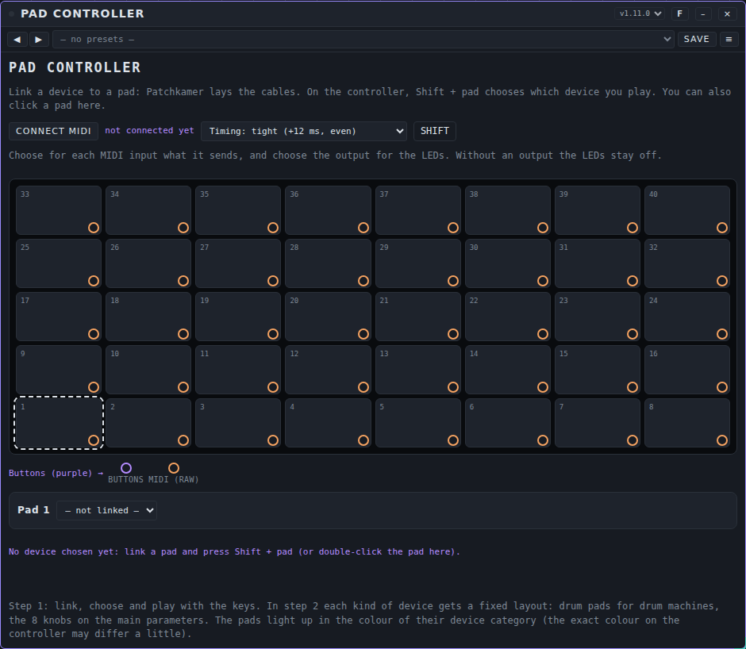

**Controls**

- **CONNECT MIDI** asks the browser for permission to use MIDI; next to it the card says how many MIDI inputs it found ("not connected yet" before that).
- **Timing:** **tight (+12 ms, even)** gives every hit the same small fixed delay, based on the time stamp of the MIDI message, so the timing stays even when the page is busy. **direct (as fast as possible)** plays at once.
- **SHIFT** imitates the Shift key of the controller with the mouse.
- **The grid** shows pads 1 to 40, pad 1 at the bottom left and the rows going up. A linked pad shows its device and lights up in the colour of the device's category; the pad you play pulses. Click a pad to select it; double-click (or Shift + pad on the controller) to play it.
- **The pad row** under the grid (for example "Pad 1") has a list **— not linked —** to choose a device. Next to it appear buttons when they apply: **Link …** (links the device you last clicked on the canvas), **Play** and **Unlink** (for a linked pad) and **Lay cable again** (when the cable has gone). Linking lays the cables for you.
- **Per MIDI input** you choose what it sends: **keys**, **pads + buttons** or **ignore**. Choose the role yourself before you press pads; otherwise the pads are played as notes. An input that sends the knob or button messages is marked as **pads + buttons** automatically.
- **LEDs to** is the MIDI output for the lights. It starts at **— none —**: the lights stay off until you choose an output.

**What the controller must send.** Pad Controller does not know controllers by name. It expects this layout; if your controller sends something else, linking will not work.

| What | Message |
|---|---|
| Pad 1 to 40 (bottom left = 1, rows going up) | note on, note number 0 to 39 |
| Shift | note 98 |
| The eight knobs | controllers 48 to 55, relative values |
| Keys | ordinary note on and note off |
| Lights (the output you choose) | note on on the pad's note number, colour as velocity |

**Ports.** **MIDI (raw)** is an event in for raw MIDI messages. **Pad 1** to **Pad 40** are 40 event outs, one per pad. **Buttons** is a purple modulation out for the knobs. There is no audio.

**Example patch.** Place Pad Controller, a synth and Speakers, and connect the synth's audio to Speakers. Click **CONNECT MIDI** and allow access. Set your pad input to **pads + buttons** (and, if you want the lights, choose the output under **LEDs to**). Open the list on pad 1, choose the synth: Patchkamer lays the cable from **Pad 1** to its notes input. Press Shift + pad 1 on the controller, then play the synth with the keys.

**Presets.** No preset pack is included. A preset holds only the **Timing**. The links, the MIDI roles, the light output and the chosen pad are not part of a preset: they belong to your patch and are saved with the workspace or song.

**Tips and limits**

- The knobs are only shown for now. They do not control parameters yet (the card says so); the fixed layout per kind of device, such as drum pads, comes later.
- The links are the cables of the patch. If a cable is removed, the pad shows "cable loose"; **Lay cable again** restores it. Pad Controller only removes its own cables.
- It was tested with simulated MIDI messages, not with a real controller. Without MIDI access you can still link and play by clicking pads on the card.
- It needs a Patchkamer that can lay cables for devices; an older one says so on the card.

---

## Chord Buddy

**What it is for.** Chord Buddy helps you find chords when you do not know music theory. Pick a key (and, if you like, a style) and it shows the chords that belong to it. Or play a chord on a MIDI keyboard and it tells you which chord you played, which keys it could belong to and which chord could come next. Chords you like go into one of 16 pads; the pads can be played, saved as a set and played back as a chord progression with a separate bass line. It gives *advice*: styles and suggestions are guidelines, not rules, and the key it finds is shown with how sure it is ("almost certain", "probably", "unclear").

**Connect it.** The **In** event port takes notes from Keys / MIDI, a Pad Controller or a sequencer. **Chords** sends the chord notes and **Bass** the bass notes, separately, so you can pick another synth for the bass. Start the Patchkamer transport to play a set: Chord Buddy follows the clock.

**The sections.**
- **1 · Key & style.** Choose the key note, the scale (major and minor, the seven modes, major and minor pentatonic, blues), and a style (optional). The chords of the key appear as buttons, coloured by function: green = tonic ("home: feels settled and finished"), blue = subdominant ("on the way"), red = dominant ("tension: wants to go home"). Click one to hear and select it. **Find key** looks at the chords you played (or the pads) and shows the top three keys with what speaks for and against. **Ready-made progressions** gives four-chord progressions for the style; **Use as set** puts one in pads 1 to 4 (you can undo).
- **2 · Listen (MIDI in).** Shows the notes you play and the recognised chord (inversions, slash chords and incomplete chords such as 1-3-7 included), with alternatives. **Listen** remembers the last four chords you played; **Use this chord** adds the shown chord (or the alternative you picked); **Clear** empties the list. The key is worked out live from those chords, and below it Chord Buddy suggests the next chord: **Safe**, **Tension** and **Colour / surprise**, each with a short explanation. **Follow the key automatically** sets the key when it is probably right.
- **3 · Pads.** Sixteen pads in a 4 × 4 grid, coloured by function. Click or touch a pad to play it, or play its MIDI note (the first pad is C2 by default; notes in that range are not listened to as a chord; switch it off or move it with **Play pads by MIDI note** and **First pad = note**). **Save to pad** puts the chosen chord in the selected pad; overwriting is allowed and reported ("Pad 3 overwritten: Am → F"); **Undo** takes back the last change; **Clear pad** empties a pad.
- **4 · Set.** Name, **Length per chord** (1 beat to 4 bars), **Repeat**, **Use voice leading**, **Bass on**, **Start** and **Stop**, **Transpose −1 / +1** (moves the whole set to another key), and **Export / Import (.json)**. A set is a preset: save and load sets with the preset bar on the card. The set is also stored in the workspace and in a song.
- **5 · Advice: bass and voicing.** Per pad the bass advice: root, fifth and octave, the slash bass of the chord, and a lead-in note to the next chord. Choose the bass pattern (held, root–fifth, walking, pulse). Choose 2 to 6 voices and Close, Open or Drop-2, then **Show proposal only** (compare, with the movement per voice) or **Apply voicing** (rewrites the pad chords). The voicings move as little as possible between chords.
- **6 · Output.** Velocity, bass velocity, length, gate, strum (0 to 60 ms), octave and MIDI channel for chords and bass. Velocity, bass velocity, length, gate and strum can be modulated.

**Presets.** The pack *Chord Buddy Starter Sets* has 30 sets in C major and A minor, three per style (pop, rock, folk, blues, jazz, classical, soul, hip-hop, house, ambient). Use **Transpose** to play them in any key.

**Tips and limits.** Chord Buddy gives suggestions, not corrections. One chord fits many keys: play a second and a third and the key becomes clearer. Eastern scales and quarter tones are not in this version. Not listened to: check by ear whether the bass and chords sit well together.

## Recorder

**What it is for.** Records what comes in, usually the whole mix, and passes it on unchanged. You use it to make an audio file of your music: WAV for the best quality, MP3 for a small file.

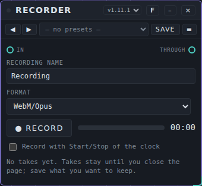

**Controls**

- **Recording name** is the start of the file name; a saved take is called `<name> take <n>`.
- **Format** (choose it before you record; it is locked while recording):
  - **WebM/Opus** (or **MP4/AAC**, depending on your browser): small files.
  - **WAV 16-bit** and **WAV 24-bit**: lossless.
  - **MP3**: small files. A **Bitrate** list appears with 128, 192, 256 or 320 kbps (start 192).
- **● Record** and **■ Stop** control the recording. A level meter and the time show what is happening.
- **Record with Start/Stop of the clock** makes the recording follow Start and Stop of the clock.
- Every take appears in a list with its length, format and size, with a button to listen (**▶**) and **Save**. Takes stay in memory until you close the page. **Save** gives you the audio file.

**Ports.** **In** is the audio in, **Through** the audio out: the sound passes unchanged.

**Example patch.** Connect the Mixer to Recorder **In**, and Recorder **Through** to Speakers. Choose **WAV 24-bit**, press **● Record**, play your music, press **■ Stop**, then **Save**.

**Presets.** No preset pack is included. A preset holds the name, the clock option, the format and the bitrate. Takes are never part of a preset.

**Tips and limits**

- A WAV or MP3 take keeps the raw sound in memory, about 23 MB per minute at 48 kHz stereo. The file is only made when you press **Save**; an MP3 takes a moment and a message shows the progress.
- MP3 works at 8 to 48 kHz and at multiples of 48, 44.1 or 32 kHz (for example 96 kHz, which Recorder brings back to 48 kHz). At another sample rate Recorder says MP3 is not possible; WAV always works. A WAV file cannot be longer than 4 GB; pick MP3 for very long recordings.
- WAV and MP3 need AudioWorklet in the browser; if it is missing, pick another format.
- Whether a recording sounds right depends on what you send in: Recorder does not change it.

**License of the MP3 encoder.** Recorder makes MP3 files with [lamejs](https://github.com/zhuker/lamejs) 1.2.1, a JavaScript version of the LAME encoder. lamejs is free software under the [LGPL-3.0](../../LICENSES/LGPL-3.0-only.txt) and sits unchanged in the Recorder file, as one separate piece of text (`LAME_SRC`, at the bottom). You can replace it with another version or your own build of lamejs. The rest of Recorder is AGPL-3.0-or-later. The Stem Splitter also uses lamejs, from the host: a separate unchanged file, `patchkamer/vendor/lame.min.js`, loaded only for a conversion to mp3 and replaceable in the same way. See [LICENSING.md](../../LICENSING.md) (in Dutch).

---

## Multitrack

**What it is for.** A recorder for up to 16 tracks at once, sample-aligned, for when you want every instrument or channel as its own file, for example to mix elsewhere. Each track is a stereo WAV.

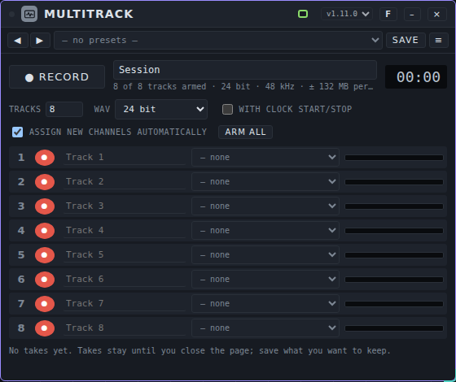

**Controls**

- **● RECORD** starts a take, **■ Stop** ends it. The text field next to it is the name of the session (the start of the file names). The timer shows the length.
- The line under it shows how many tracks are armed, the format, the sample rate and about how much memory a minute takes.
- **TRACKS** (1 to 16, start 8) sets the number of tracks. **WAV** chooses **16 bit**, **24 bit** or **32 bit float** (start 24 bit).
- **WITH CLOCK START/STOP** makes the recording follow Start and Stop of the clock.
- **ASSIGN NEW CHANNELS AUTOMATICALLY**: new bundle channels go onto free tracks, and tracks are added when needed (up to 16). **ARM ALL** arms every track.
- **Per track:** a red button (arm: record on this track or not), a name field (becomes the file name), a list for the source (a channel of the bundle, or **— none**) and a level meter.
- After a take, a list shows your takes. **Save all (.zip)** saves one stereo WAV per track in a single zip. **Per track** saves single tracks. A **×** discards a take to free memory.

**Ports.** One bundle in, **Bundle** (the thick green cable). No audio, events or modulation. Multitrack only listens; it does not pass the sound on.

**Example patch.** Connect the green bundle out (**Channels out**) of the Mixer to **Bundle** of Multitrack. Leave **ASSIGN NEW CHANNELS AUTOMATICALLY** on: the Mixer channels appear on the tracks. Press **● RECORD**, play, press **■ Stop** and then **Save all (.zip)**.

**Presets.** No preset pack is included. A preset holds the settings of the session and the tracks (the number of tracks, the format, the names and which tracks are armed). The source of each track is routing and is not part of a preset.

**Tips and limits**

- Takes stay in memory until you close the page; save what you want to keep.
- The information line shows how much memory a minute needs with the tracks that are armed. A long take of 16 tracks at 32 bit takes a lot.
- Each track file is a stereo WAV.

---

## Scope

**What it is for.** A window on the sound. The audio goes from **In** to **Through** unchanged, while the card shows what passes: a spectrum, the waveform, a spectrogram, the stereo image or the levels. You use it to check a mix, find a hum, or see whether something clips.

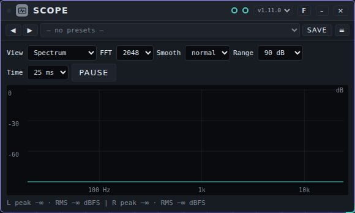

**Controls**

- **View** chooses what you see: **Spectrum**, **Waveform L/R**, **Spectrogram**, **Stereo image** or **Peak / RMS**.
- **FFT** (1024, 2048, 4096 or 8192) sets the detail of the spectrum: more detail is slower to react. **Smooth** (**off**, **light**, **normal**, **strong**) sets how calmly it moves. **Range** (60, 90 or 120 dB) sets how many dB you see.
- **Time** (5, 10, 25 or 50 ms) sets the length of the waveform you see.
- **Pause** freezes the picture; the button then reads **Resume**.
- The line below the picture gives the peak and RMS level of left and right in dBFS. When the signal goes over the limit, it says CLIP.
- In the other views you find: the spectrogram runs from new (top) to older (down); the stereo image also shows the correlation; the **Peak / RMS** view shows RMS as a bar and the sample peak as a line.

**Ports.** Audio **In** and audio **Through**. The sound passes with a gain of exactly 1, without delay.

**Example patch.** Place Scope between the Mixer and Speakers: Mixer out to **In**, **Through** to Speakers. Press **Start** and choose **Spectrum**; the picture moves with the sound.

**Presets.** No preset pack is included. A preset holds the view, FFT, smoothing, range and time. Pause is not part of a preset.

**Tips and limits.** The card draws about 30 times a second and only while you can see it. Scope does not change the sound; it only measures. If a signal contains broken values (NaN or infinity), Scope counts them as silence in its analysis.

---

## Metronome

**What it is for.** A click that keeps time with the clock of the studio: a short beep on every bar, beat, eighth or sixteenth. Use it to practise or record in time, or let the same beats play along with a drum machine or sampler. The first step of every bar is louder and higher than the other clicks.

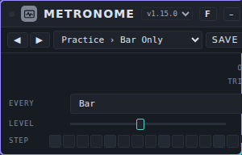

**Controls**

- **Every** chooses how often a click sounds: every **Bar**, **Beat**, **8th** or **16th**. The start is **Beat**.
- **Level** (0 to 100%, start 50%) is the volume of the click on the audio output.
- **Step** shows the 16 steps of the bar and lights the current one while the clock runs.

**Ports.** Two outputs and no inputs. **Out** is the click as audio (teal). **Trigs** (orange) sends a trigger at every click, so a drum machine or a sampler can play on the same beats. The trigger on the first step of the bar is stronger than the others. The level knob only affects **Out**, not **Trigs**.

**Example patch.** Place Metronome, a **Mixer** and **Speakers**. Connect **Out** of Metronome to an input of the Mixer and **Out** of the Mixer to **In** on Speakers. Press **Start**: you hear a click on every beat, with a higher one on the first beat of each bar. Choose **Practice › Bar Only Quiet** from the presets for a soft click once per bar. To let a drum play on the beats, also connect **Trigs** to a drum machine.

**Presets.** The pack **Metronome Basics** has 9 presets in three folders: **Practice** (Bar Only, Bar Only Quiet, Quarter Beats, Quarter Beats Quiet), **Subdivisions** (Eighth Notes, Eighth Notes Quiet, Sixteenth Ticks) and **Loud** (Quarter Beats Loud, Stage Click). The file is [`presets/metronome.patchkamer-presets.json`](../../presets/metronome.patchkamer-presets.json). Load it from a library (see the main manual) or with the **Presets** tab of the library → **Import…**. A preset holds **Every** and **Level**.

**Tips and limits.** Metronome only clicks while the clock runs (after **Start**); it follows the tempo of the studio and has no tempo of its own. A click is a short sine beep of 1000 Hz (1600 Hz on the first step of the bar). Not listened to: set **Level** by ear, for example with headphones.

---

## Notes

**What it is for.** A notepad on the floor for ideas, the key, the structure and what you still want to do. It makes no sound and has no ports; the text is saved with the workspace or song.

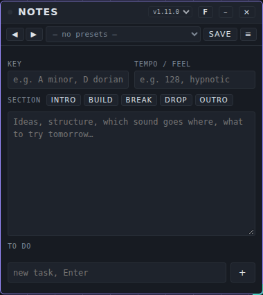

**Controls**

- **KEY** and **TEMPO / FEEL** are short fields, for example "A minor" and "128, hypnotic". Both hold up to 200 characters.
- **SECTION** has the buttons **INTRO**, **BUILD**, **BREAK**, **DROP** and **OUTRO**. Each one puts a heading with that name in the text.
- The large field is for free text (ideas, structure, what to try tomorrow).
- **TO DO:** type a task under "new task, Enter" and press **Enter** (or **+**). Tick it off when it is done and remove it with the cross.
- A line at the bottom shows when you last changed the notes.

**Ports.** None.

**Example.** Place Notes next to your patch. Fill in the key and the tempo, press **INTRO** and **DROP** to set up the structure, write what each part needs, and add a to-do for each loose end.

**Presets.** No preset pack is included. A preset holds everything on the card except the time of the last change, so you can save an empty song template with headings and tasks.

**Tips and limits.** The notes hold up to 100,000 characters and up to 200 tasks of up to 500 characters each.

---

## MIDI Hub

### What it is for

The MIDI Hub sits between your MIDI sources and the devices in your workspace. Connect a keyboard or controller (through **Keys / MIDI**) and a sequencer to it, and the hub does three things:

- It sees which devices are in the workspace and lets you add them to its **active devices**.
- For each device you choose **where the notes come from**: the keyboard (all channels or one MIDI channel), or a track of a sequencer, shown with the track name.
- It lets you put **every control on the card** of a device (sliders, knobs, lists, tick boxes and buttons) on a knob, slider, pad or key of your MIDI device. You do not have to know a MIDI number: press **Learn** and turn the knob.

You can save a mapping for each kind of device, and as a preset of the hub.

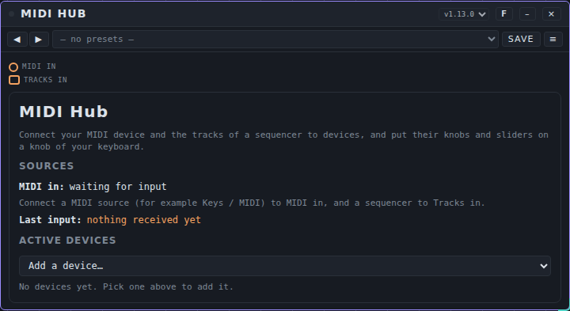

### The controls

| Control | What it does |
|---|---|
| **Sources** | Shows which of the four MIDI inputs have received something (✓), and the tracks of every sequencer that is connected with a multi-MIDI cable (with track name and channel). |
| **Last input** | The last message that came in, for example **CC 74 · ch 1 = 52%**. Turn a knob to see which number it is. |
| **Add a device…** | Adds a device of the workspace to the active devices. The hub then puts a cable from its own output to that device. |
| **×** (top of a device) | Removes the device from the hub and takes its cable away. |
| **Refresh controls** | Reads the controls on the card of the device again. Use it after you opened another tab of the device. |
| **Notes from** | One or more sources for the notes of this device: **Keyboard** (with **all channels** or one **channel**, and **any input** or one of the four MIDI inputs), or **Track: sequencer › track name (ch n)**. **+ source** adds one. |
| **Reconnect** | Lays the cable to the device again when you removed it yourself. The hub never puts it back by itself. |
| **Library** | Saved mappings for this kind of device: pick one and **Load**, or type a name and **Save as…**. **Delete** removes the picked one. |
| **+ mapping** | Adds a row and starts **Learn**. |
| **Learn** | Turn a knob, move a slider, hit a pad or press a key on your MIDI device. The first message that arrives is the source of the row (CC number, note, pitch bend or channel pressure, with its channel and the MIDI input it came in on). |
| **Control** (list) | The control on the device that this knob moves. The list shows every slider, knob, list, tick box and button of the card. |
| **min** / **max** | The part of the control's range that the knob moves, in percent. Set min 20 and max 80 to keep the control in the middle. |
| **invert** | Turns the direction round. |
| **toggle** | Only for tick boxes: every press switches. Without it the box follows the knob (on from 50%). |
| **Clear all** | Removes all mappings of this device. |

A knob on the keyboard that is mapped is not sent on to the device as a CC message, so you do not get it twice. Notes and all other messages pass through when the device has a source.

### Ports

| Port | Kind | Use |
|---|---|---|
| **MIDI in**, **MIDI in 2**, **MIDI in 3**, **MIDI in 4** | event in | Connect **Notes / CC** of **Keys / MIDI**, or another MIDI source. Use one input for each physical MIDI device (see below). |
| **Tracks in** | multi-MIDI in | Connect the **Tracks** port of a sequencer (Clip Arranger, Chord Sequencer, Pattern Tracker, Pattern Playlist). You can connect more than one sequencer. |
| **→ device** | event out | One per active device that has an event input. The hub lays these cables itself; they are normal cables that you can remove. |

The multi-MIDI cable is a double, dashed orange cable. It carries all tracks of a sequencer at once, each with its name.

### An example

1. Place **Keys / MIDI**, **MIDI Hub**, **Acid Baselines** and **Speakers**. Connect **Notes / CC** to **MIDI in** of the hub, and **Out** of Acid Baselines to Speakers.
2. In the hub, choose **Add a device…** › Acid Baselines. The keyboard now plays it.
3. Click **+ mapping**, turn a knob on your keyboard (the row says for example **CC 74 · ch 1**) and pick **Cutoff** in the list. The knob now moves the cutoff.
4. Type **My keyboard** under **Library** and click **Save as…**. The next time you can pick it and **Load** it.
5. **Two physical MIDI devices at once**, for example a keyboard and a box with knobs: place two **Keys / MIDI** devices and choose in each its own **MIDI input**. Connect the first to **MIDI in** of the hub and the second to **MIDI in 2**. A mapping you learn from a knob remembers the input (for example **CC 74 · ch 1 · MIDI in 2**), so the same CC number on the other device does not move it. Under **Notes from** you can limit the keyboard route to one input.
6. To play a track of a sequencer on the synth: connect the sequencer **Tracks** port to **Tracks in**, and in **Notes from** pick **Track: … › Bass**. Remove the **Keyboard** row if the synth must only play the track.

### Presets

The **MIDI Hub Basics** pack has 15 presets in four folders: **Sound Controllers**, **Wheels and Pedals**, **Effects** and **Utility**. A preset is applied to every device in the hub and finds the controls by their name (Cutoff, Resonance, Attack and so on). A control a device does not have is skipped and shown as *not found*. A preset only replaces the mappings; it does not change the sources or the cables. See [Presets](../presets/USER-MANUAL_EN.md).

### Tips and limits

- The names of the controls are the labels on the card, so a mapping made in one language of Patchkamer finds its controls by the same label in that language.
- If a device changes its card (for example another tab), press **Refresh controls**. A mapping whose control is gone is shown as *not found* and does nothing.
- Web MIDI works in Chrome and Edge, and only after you click **Connect MIDI** in **Keys / MIDI**. The hub itself does not open MIDI.
- The hub changes nothing when you open a workspace or connect a cable: it only reacts to what you play and press.
- A mapping made before version 1.13.1 has no input and works on all four inputs. Learn it again if two devices send the same CC number.
- The hub does not play audio.

## Control Surface

### What it is for

Control Surface is a panel for a MIDI controller that has knobs, faders, pads or buttons and no keyboard. It shows the controller on the screen and moves along with what you do on the hardware. What you do goes on as CC messages (with number and channel) to the devices you connect, usually the **MIDI Hub**, which can then map every element to a control of any device.

You build the shape of the panel from **sections**. Each section has a kind (**Knobs**, **Faders**, **Pads** or **Buttons**), a number of **Rows**, a number of elements **Per row** and a **Band**. Sections in the same band stand next to each other; bands stand below each other. That way you can recreate the shape of almost any controller, for example 3 rows of 8 knobs, a row of 8 faders and 2 rows of 8 buttons under them. The **Control Surface Layouts** pack has ready-made shapes.

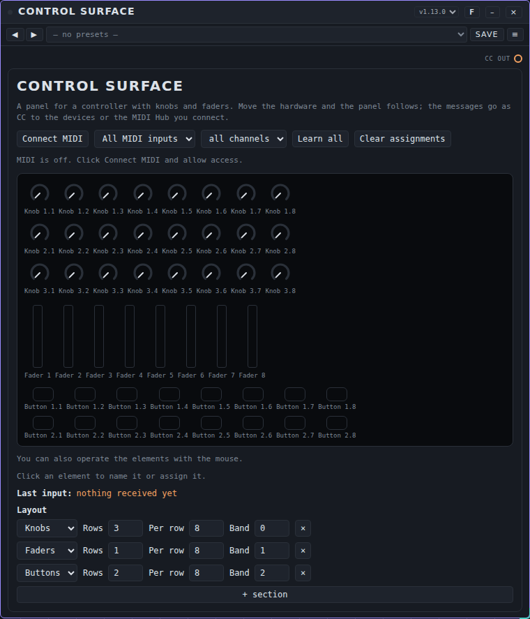

### The controls

| Control | What it does |
|---|---|
| **Connect MIDI** | Asks the browser for MIDI access (once, after your click). Without it you can still use the mouse. It never uses sysex. |
| **MIDI input** (list) | **All MIDI inputs** or one input. Use one input per physical device. |
| **Channel** | **all channels** or one MIDI channel. |
| **Learn all** | Walks through the whole panel: the first element lights up, you move the matching element on your controller, and the next one lights up. **Stop learning** ends it. |
| **Clear assignments** | Removes the assignment of every element. |
| The panel | Knobs, faders, pads and buttons. They move when the hardware moves. You can also drag a knob or fader with the mouse (pads and buttons react to a click). Click an element to select it. |
| **Element** (editor) | For the selected element: a **Name** (this name shows up in the MIDI Hub), **Learn** (assign it by moving the element on your controller), the assigned **CC** or **Note** with its channel, and **Clear**. |
| **Last input** | The last message that came in. A message that is not assigned to an element also goes on, as a plain CC. |
| **Layout** | One line per section: the kind, **Rows**, **Per row** and **Band**, and **×** to remove it. **+ section** adds one. At most 8 sections and 256 elements. |

Pads and buttons that send notes are passed on as CC with a value of 0 or 1 (0 to 100% for pads that sense how hard you hit).

### Ports

| Port | Kind | Use |
|---|---|---|
| **CC out** | event out | Connect to one of the **MIDI in** ports of the **MIDI Hub**, or directly to a device that listens to CC. |

### An example

1. Place **Control Surface**, **MIDI Hub** and a synth. Connect **CC out** to **MIDI in** of the hub, and add the synth in the hub.
2. In **Control Surface** choose **Connect MIDI** and pick your controller under **MIDI input**.
3. Pick a layout in the preset bar, for example **Strips › 8 Strips Full**, or build one under **Layout**.
4. Click **Learn all** and move the elements one by one, from the top left to the bottom right. Click **Stop learning** when you are done. Click an element to give it a name, for example **Filter**.
5. In the hub click **+ mapping**, move the knob (the row shows its name, for example **Filter · CC 21 · ch 1**) and pick the control of the synth.

If you also use a keyboard, put it on **MIDI in** of the hub through **Keys / MIDI**, and the controller on **MIDI in 2** through Control Surface.

### Presets

The **Control Surface Layouts** pack has 28 presets in five folders: **Controllers**, **Strips**, **Faders**, **Knobs** and **Pads**. The shapes in the last four only set the shape of the panel (and clear the assignments, because they belong to the old shape). The **Controllers** folder has layouts of well-known controllers together with their MIDI mapping: a preset there sets the shape and the assignments, so the elements react right away. Neither changes the input. The mappings come from public documentation and have not been tried with the hardware: if a number differs on your model or setting, correct it with **Learn** and save your own preset. The Traktor Kontrol F1 has only its shape, because its numbers are set in the manufacturer's Controller Editor. See [Presets](../presets/USER-MANUAL_EN.md).

### Tips and limits

- Web MIDI works in Chrome and Edge. Control Surface does not use sysex, so it cannot light the LEDs of your controller.
- An element keeps its assignment as long as its place in the layout stays the same. If you remove a section, the elements after it get new numbers.
- If your controller has several pages or modes, learn each mode with its own layout, or use one input and channel per mode.

## Drum Listener

**What it is for.** Listens to a drum loop and writes down what is played: kick, snare (with clap and rim), closed and open hat, toms and other percussion, each on its own lane, in time on a grid. You can then send the pattern to a drum machine, or copy it to a sequencer. It works on your own computer, nothing is sent over the internet.

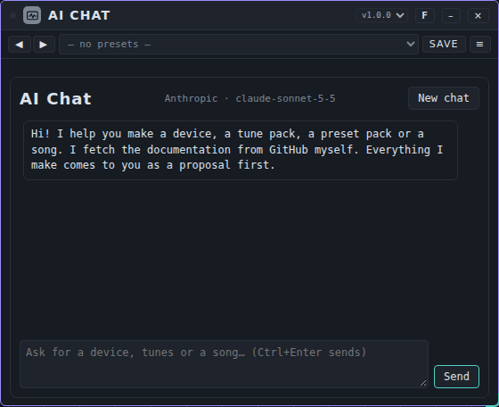

**Getting audio in**

- **Load audio file…** reads a WAV, MP3, FLAC or OGG file (up to 50 MiB; the first 90 seconds are used). A sample from the **Samples** tab of the library works too, as the device accepts audio from the library; the tempo and number of bars of that sample are then used. (Today the Samples tab only offers buttons for the Loop Slicer and the Samplebank.)
- **Record** takes a few bars or seconds from the **In** port: choose the length in **Record length**, play the sound (for example the output of **Audio Capture** connected to **In**) and press **Record**. **Through** passes the sound on unchanged, so you can still hear it.

**What you see and set**

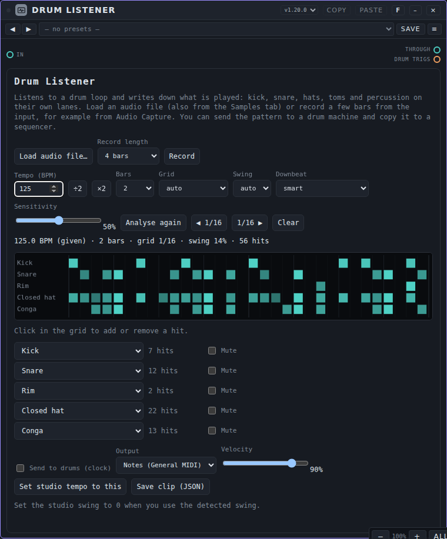

- The line above the grid says tempo (given, from the length or estimated), bars, grid, swing and the number of hits. The grid shows a lane per instrument, one column per sixteenth; a stronger hit is brighter. **Click in the grid** to add or remove a hit; every lane has an instrument list (change what a lane is called and which note it plays), a count and **Mute**.
- **Tempo (BPM)** is empty for automatic. If the tempo is half or double what you expect, use **÷2** or **×2**. **Bars**, **Grid** (1/16, 1/32, triplet 1/8, triplet 1/16), **Swing** and **Downbeat** (smart, find the downbeat, start of the sound) are automatic until you choose. **Sensitivity** sets how readily a quiet hit counts as a hit; **Analyse again** repeats the analysis with the new settings. **◀ 1/16** and **1/16 ▶** shift the whole pattern by one sixteenth if the first beat is in the wrong place.
- **Send to drums (clock)** plays the pattern on the studio clock to the **Drum trigs** port: connect it to Drum Kit, Pulse Drums or another drum machine. **Output** chooses General MIDI notes or trigs by instrument; **Velocity** scales the hits. **Set studio tempo to this** sets the tempo of the studio to the recognised tempo. The detected swing is played by Drum Listener, so keep the swing of the studio at 0.
- **Copy** in the card bar copies the pattern as a drum clip; **Paste** it into a drum track of the Pattern Tracker, the Clip Arranger or a Step Sequencer that is connected to a drum machine. **Save clip (JSON)** keeps the clip as a file.

**Presets.** A preset holds the settings (tempo, bars, grid, swing, downbeat, sensitivity, record length, output, velocity), never the pattern or the audio. No preset pack is included.

**Tips and limits**

- Made for drum loops of one to sixteen bars. It recognises kick, snare and the hats fairly well, and the rest much less: **open hat, rim, clap, toms and other percussion are often missed or mixed up**, and soft ghost notes on the snare under busy hats are often missed. The velocity is a rough indication (reasonable for the snare, weak for kick and hats).
- Other instruments in the sound (bass, chords, vocals) make the result much worse, most of all the snare and the hats. It was measured on loops from Patchkamer's own drum devices, **not on real recordings**, and not by listening.
- When the tempo is estimated, a slow loop is sometimes read at double speed: use **÷2**. For a recording, fill in the tempo if you know it.
- A recording that runs for more than a few bars is not folded into one bar: the pattern then simply has that many bars.

---

## Stem Splitter

**What it is for.** Splits a track into **stems** (vocals, drums, bass, the rest, sometimes guitar, piano and more) and plays them along with the studio clock, each stem on its own output. Useful to remix a track, process the drums separately or leave a part out. The splitting is done by an **online service**: Stem Splitter sends the track there and gets the stems back.

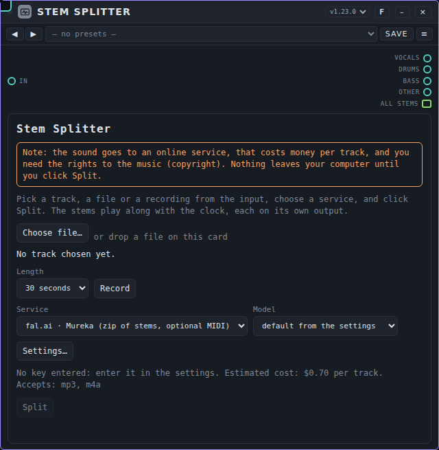

**Note, before you start**

- The sound **leaves your computer** and goes to the chosen service on the internet.
- It costs **money per track**. The card and the confirmation question show the estimated cost; prices are an indication, check them with the service. You can cancel, but the service may then already have incurred the cost.
- You must have the **rights** to the music (copyright). Only use your own recordings or music you have the rights to.
- Nothing is sent when you load a song or workspace, or choose a preset: only a click on **Split** does it. The first time per session (per service and model) Patchkamer asks for confirmation.

**Set up first.** You need an account and a **key** (API key) at the service. Enter it in **Settings**, under **Stem splitting (online service)** (the **Settings…** button on the card takes you there). Per service you find the key, the model and the price per track (the first service gives a price per model, for the second you can enter one yourself). The key is stored only in this browser and goes only to the service it belongs to; it never ends up in a song, workspace or preset. There are three services:

- **fal.ai · Mureka**: accepts mp3 or m4a (at most 10 MB) and returns a zip of stems, sometimes with MIDI. Models `audio-separation-1`, `-2` and `-3`. Tried with a real track (model 1, 07-11): vocals, drums, bass, other and **instrumental** (everything except the vocals, so it overlaps the others: it starts muted so nothing sounds double). Patchkamer leaves out the copy of your own track that the service sends along. The browser may call the service directly (no extra step needed). Other models were not tried; the number of stems can differ.
- **fal.ai · Demucs**: accepts mp3, m4a, wav, flac and ogg and returns separate stems: 4 (`htdemucs`, `htdemucs_ft`) or 6 with guitar and piano (`htdemucs_6s`). The price is not known; fill it in yourself if you want a cost estimate.
- **Own service**: another service with the same queue protocol (base address, endpoint, key and model, and a largest file size). An address with `http` is only allowed on your own computer.

**Getting audio in**

- **Choose file…**, or **drop** a file on the card.
- A sample from the **Samples** tab of the library, with the **→ Stem Splitter** button.
- **Record** takes a piece from the **In** port (for example the output of **Audio Capture**): choose the **Length** (10 seconds to 3 minutes), press **Record** and then **Stop**. The recording becomes a 16-bit WAV.

The service decides what it accepts. If it only takes mp3 or m4a (**fal.ai · Mureka**) and you have a WAV, FLAC or OGG file (or a recording), Patchkamer first converts it to mp3 on your computer; the card says so and the question before sending mentions it. The conversion keeps stereo or mono as in the source and starts at 192 kbps; if the file would not fit in 10 MB, the quality steps down (160, 128, 96, 64 kbps). A 4-minute track becomes about 6 MB and takes some ten seconds, with a percentage on the card; **Cancel** also works during the conversion. A track that is too large even at 64 kbps (about 20 minutes in stereo) is refused with a message saying how long it may be. An mp3 or m4a file that fits is sent unchanged, and a service that takes WAV gets the WAV as it is. The mp3 encoder (lamejs) is only loaded the first time a conversion is needed. Other types of file (for example AAC) are not converted: save those as mp3 first.

**Splitting.** Choose the **Service** and the **Model** (empty = the model from the settings) and click **Split**. The card shows the state: in the queue, the service is splitting, fetching, unpacking, decoding. **Cancel** aborts. If something goes wrong (no key, key refused, no balance, no connection, broken output), the card says what and what you can do. A service that does not allow calls from the browser gives the message that it could not be reached.

**The stems**

- The **number of audio outputs follows the number of stems** the service returned, named after the stem (Vocals, Drums, Bass, Other, Guitar, ...). There is also one bundle output **All stems** with all stems, for the Multitrack or the Mixer. Cables to outputs that disappear are detached by Patchkamer, which tells you.
- The stems **play with the clock**: they start and stop with the studio transport (and begin on the first beat of a bar). Each stem has a **level**, **M** (mute) and **S** (solo).
- **Tempo of the track**: leave it at 0 and the track plays at its own tempo. Enter the tempo of the track and it follows the tempo of the studio (the pitch changes with it). **Repeat** makes the track start over and over.
- **WAV** chooses 16 or 24 bit; **Save** on a stem saves that stem as WAV, **Save all stems (zip)** saves all stems in one zip file. If the service gives MIDI there is **Save MIDI (zip)**.
- **Drums → Drum Listener** hands the drum stem to the Drum Listener (the selected card, an existing one or a new one) to turn it into a pattern.
- **Clear stems** removes the result from memory; the outputs stay.

**Presets and songs.** A preset and a song keep only the settings (service, model, WAV depth, record length, repeat, tempo, and level, mute and solo per stem name), never the stems or the key. A song does remember the outputs of the last result, so cables stay in place; the stems themselves only come back when you split again.

**Tips and limits**

- Stems live in memory: a long track with 6 stems takes a few hundred MB.
- Converting a WAV to mp3 happens on your computer (sound quality: not listened to yet) and costs nothing; the maximum length for **fal.ai · Mureka** is about 20 minutes in stereo at the lowest quality (64 kbps), 6 to 7 minutes at the best (192 kbps).
- Splitting takes a few seconds to minutes, depending on the service and the queue; after 20 minutes Patchkamer gives up.
- The result is only as good as the service: traces of other stems may bleed through.

## Tune Finder

**What it is for.** Listens to a sound and finds the synth and tune of the library that comes closest: a single note, a short phrase, a bass line or a chord, from one instrument. You get a list of the nearest tunes and of the nearest instruments, and **Load** puts the chosen tune on that synth in the workspace. It works on your own computer, nothing is sent over the internet.

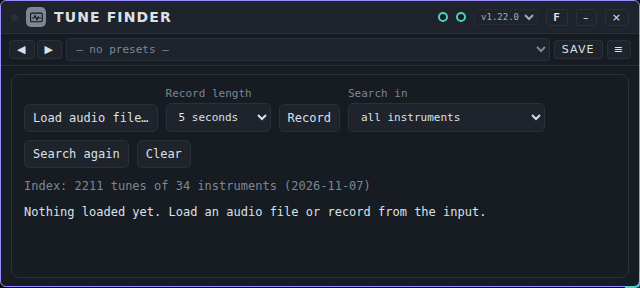

**How it works.** Every tune of every synth in the library (2211 tunes of 34 instruments) was played on four notes (C2, C3, C4 and C5) and measured: the colour of the sound, its harmonics, the attack, the way it dies away and its stereo width. Tune Finder measures your sound the same way and ranks the tunes by how little they differ. It compares timbre; it does not say that your sound *is* that instrument. Drum machines and the Loop Slicer are not included (use the **Drum Listener** for drums), and neither are a few tunes that need sound on an input (Grain Cloud, Patch Mono).

**Getting audio in**

- **Load audio file…** reads a WAV, MP3, FLAC or OGG file (up to 50 MiB; the loudest 20 seconds are analysed). A sample from the **Samples** tab works too, as the device accepts audio from the library.
- **Record** takes a few seconds from the **In** port: choose the length in **Record length**, play the sound (for example the output of **Audio Capture** connected to **In**) and press **Record**. **Through** passes the sound on unchanged.

**What you see and set**

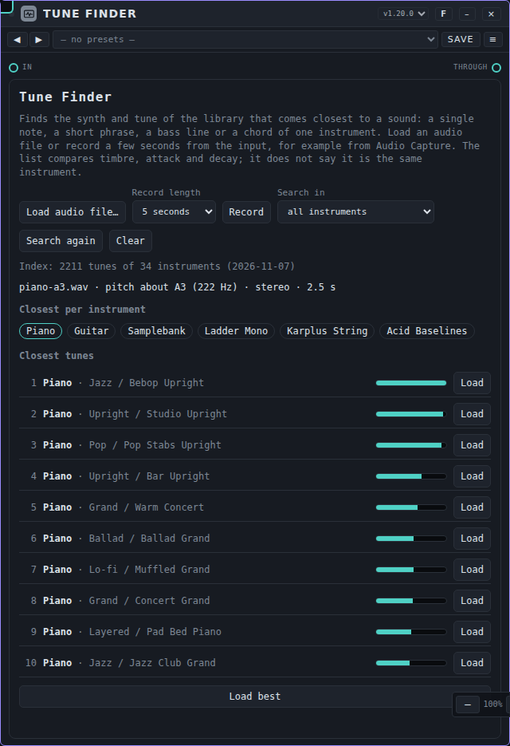

- The line under the buttons says what was heard: the pitch (when there is one clear pitch; a chord or noise has none), mono or stereo, and the length. **Closest per instrument** shows the instruments of the best tunes; a ring around a name means that instrument is in the workspace. **Closest tunes** lists the ten best tunes with a bar for how close they are. **Search in** limits the list to a group of instruments (bass and mono, keys and plucked, winds and strings and voice, poly and lead and pad, texture and drone, samples); **Search again** repeats the search.
- **Load** on a line puts that tune on that synth, if the synth is in the workspace (with two of them, the selected one); otherwise the card says which device to place first. **Load best** does the same for the first line. Or look the tune up by name in the **Tunes** tab.

**Presets.** A preset holds the settings (record length, group), never the sound or the result. No preset pack is included.

**Tips and limits**

- Works best with **one clean note or a short phrase from one instrument**, close to the microphone or straight from a cable, without much room sound. On sounds made by Patchkamer's own synths it finds the right synth first in about 86 % of single notes (right synth in the first five: 93 %), and the exact tune first in about 53 % (in the first ten: 77 %). Many tunes are close neighbours, so the tune you made a sound with is often second or third: look at the whole list.
- A phrase or a chord is harder (right synth first: about 69 % and 59 %). A recording with a little noise, a low-pass filter, less level and mono together is much harder (about 42 %), most of all because of the noise. Room sound and chorus lower it too.
- This was measured on sounds from Patchkamer's own synths, **not on real recordings** of people and instruments, and not by listening. A real piano or guitar will only be matched to the nearest synth sound; that is a hint, not an answer.
- Several instruments at once, drums or vocals in the sound make the result worthless. Split a mix first (see the **Stem Splitter**).

---

## If it does not work

- **No sound from the synth I play.** Keys and Pad Controller only send notes. Check the cable from **Notes / CC** (or **Pad N**) to the notes input of a sound-making device, and from that device to Speakers. See also [Troubleshooting](../USER-MANUAL_EN.md#13-troubleshooting).
- **Keys does not react to my MIDI keyboard.** Use Chrome or Edge, click **Connect MIDI** and allow access. Check **MIDI input** and **Channel**: choose **All MIDI inputs** and **All channels** to be sure.
- **The computer keys do nothing.** Click the piano on the card first; the keys only work when the card has focus and not while you are typing in a field.
- **Pad Controller plays notes instead of using the pads.** Choose **pads + buttons** for that MIDI input before you press the pads. For the lights, choose an output under **LEDs to**.
- **Recorder or Multitrack records silence.** Recorder needs sound on **In**. Multitrack needs a bundle on **Bundle** and a source on each armed track (**— none** records nothing). Check that **Start** has been pressed.
- **Metronome does not click.** It only clicks while the clock runs: press **Start**. Connect **Out** to a mixer or to Speakers.
- **MP3 is not possible.** Your sample rate is not supported by MP3. Choose WAV, or change the sample rate under Settings.
