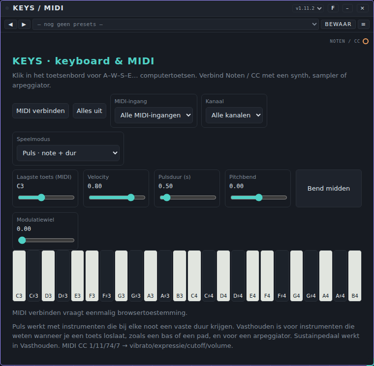
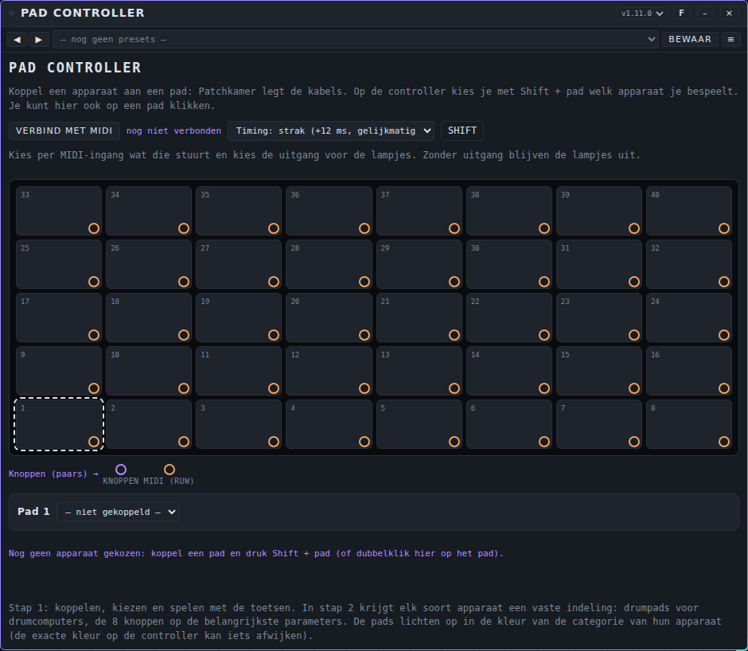
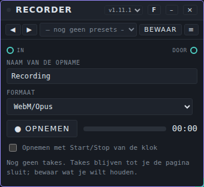
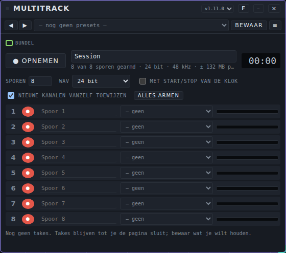
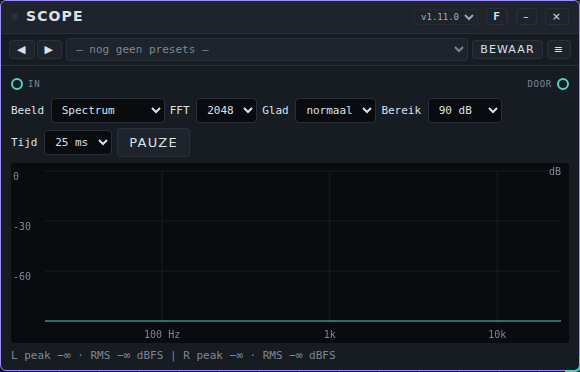
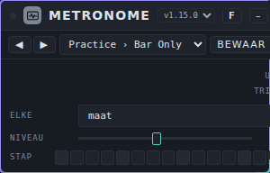
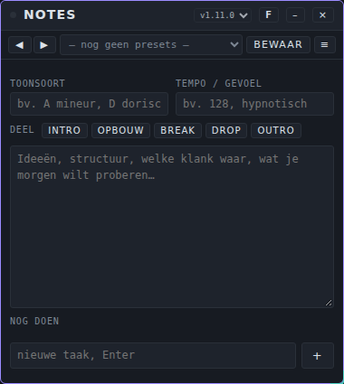
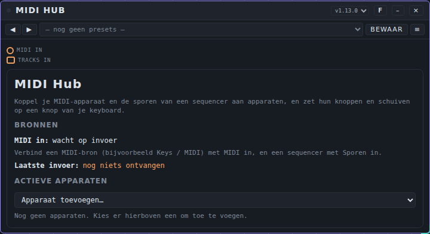

# Tools: gebruikershandleiding

*English version: [USER-MANUAL_EN.md](USER-MANUAL_EN.md)*

Deze handleiding gaat over de acht **tools** van Patchkamer. Tools zijn hulpmiddelen: je gebruikt ze om te spelen, de maat te houden, op te nemen, te meten, notities te maken of andere apparaten te besturen. Het zijn geen effecten en op de tik van Metronome na maken ze zelf geen geluid. Voor de basis (Patchkamer starten, een bibliotheek laden, kabels trekken) zie de [basishandleiding](../USER-MANUAL_NL.md). De lijst met tools staat in de [map tools](../../devices/tools/README_NL.md).

## Welke tool voor welk doel

| Ik wil… | Gebruik | Het heeft |
|---|---|---|
| noten spelen met het schermtoetsenbord, mijn computertoetsen of een MIDI-keyboard | [Keys / MIDI](#keys--midi) | een eventuitgang **Noten / CC** |
| veel apparaten bespelen vanaf een raster van 40 pads op een MIDI-controller | [Pad Controller](#pad-controller) | een eventingang **MIDI (ruw)**, 40 eventuitgangen **Pad** en een modulatie-uitgang **Knoppen** |
| de afgewerkte mix (of ander geluid) in één bestand opnemen | [Recorder](#recorder) | audio **In** en **Door** |
| veel sporen tegelijk opnemen, een bestand per spoor | [Multitrack](#multitrack) | een **Bundel**-ingang |
| het geluid zien: spectrum, golfvorm, niveau | [Scope](#scope) | audio **In** en **Door** |
| een tik horen op de klok, of een drum op de slagen laten spelen | [Metronome](#metronome) | een tik op **Uit** en trigs op **Trigs** |
| ideeën, toonsoort en een lijst met taken opschrijven | [Notes](#notes) | geen poorten |
| een MIDI-keyboard en de sporen van een sequencer koppelen aan apparaten, en hun regelaars op knoppen van je keyboard zetten | [MIDI Hub](#midi-hub) | een eventingang **MIDI in**, een multi-MIDI-ingang **Sporen in** en een eventuitgang per apparaat |

## Hoe je tools aansluit

- **Keys / MIDI** en **Pad Controller** sturen *events* (noten). Hun oranje eventpoorten sluit je aan op de noteningang van een synth, een sampler of een arpeggiator.
- **Recorder** en **Scope** zijn audioapparaten die het geluid ongewijzigd doorlaten. Zet ze in het audiopad, bijvoorbeeld tussen de Mixer en Speakers. Je kunt ze ook aan het eind van een kabel hangen die verder gaat naar andere apparaten.
- **Multitrack** luistert naar een *bundel* (de dikke groene kabel met veel kanalen) en geeft het geluid niet door. Hij hangt naast de Mixer, niet in het pad.
- **Metronome** heeft een audio-uitgang (de tik) en een eventuitgang (**Trigs**). Sluit **Uit** aan op je mixer om de tik te horen, en **Trigs** op een drumcomputer of sampler om die op de slagen te laten spelen.
- **Notes** sluit je nergens op aan.

Op de tik van Metronome na voegt geen van deze tools iets toe aan je geluid: ze spelen, kijken, nemen op of noteren.

---

## Keys / MIDI

**Waar het voor dient.** Een keyboard dat zelf geen geluid maakt. Je speelt erop en het stuurt de noten naar een ander apparaat: een synth, een sampler of een arpeggiator. Je kunt spelen op de piano op het scherm, met de toetsen van je computertoetsenbord of met een MIDI-keyboard.

**De regelaars**

- **MIDI verbinden** vraagt de browser eenmalig om toestemming voor MIDI. Daarna staat er **MIDI opnieuw verbinden**. Je hebt een browser met Web MIDI nodig (Chrome of Edge).
- **Alles uit** zet alle noten stil die nog klinken.
- **MIDI-ingang** kiest één MIDI-keyboard of **Alle MIDI-ingangen**. **Kanaal** kiest één MIDI-kanaal (1 tot 16) of **Alle kanalen**.
- **Speelmodus:** **Puls · note + dur** stuurt een noot met een vaste lengte. **Toets vasthouden · noteoff** houdt de noot aan zolang je de toets vasthoudt en stuurt een noteoff als je loslaat; het sustainpedaal van een MIDI-keyboard werkt in deze modus. Gebruik Vasthouden voor apparaten die vastgehouden toetsen begrijpen en Puls voor apparaten die op een notenduur werken.
- **Laagste toets (MIDI)** bepaalt de eerste noot van het toetsenbord: C1 tot C6, in stappen van een octaaf (start op C3).
- **Velocity** (0,05 tot 1, start 0,80) is hoe hard de noten gespeeld worden, voor de schermtoetsen en computertoetsen. Een MIDI-keyboard stuurt zijn eigen velocity.
- **Pulsduur (s)** (0,05 tot 8 seconden, start 0,50) is de lengte van een noot in de modus Puls.
- **Pitchbend** en **Bend midden**: de schuif buigt de toonhoogte; de knop zet hem terug in het midden. Het pitchwiel van een MIDI-keyboard beweegt hem ook.
- **Modulatiewiel** stuurt de modulatiewaarde (vibrato). Het wiel van een MIDI-keyboard beweegt hem ook.
- **Computertoetsen:** klik eerst op de piano zodat hij focus heeft. De rij A W S E D F T G Y H U J K O L P ; ' speelt noten omhoog vanaf de laagste toets (A is de laagste toets zelf, W de zwarte toets erboven, enzovoort).
- Vanaf een MIDI-keyboard worden controllers 1, 11, 74 en 7 doorgegeven als vibrato, expressie, cutoff en volume; het pitchwiel wordt pitchbend.

**Poorten.** Eén eventuitgang, **Noten / CC**. Hij stuurt noten, noteoffs en deze controllers. Geen audio, geen ingangen.

**Voorbeeldpatch.** Plaats Keys, een synth en Speakers. Verbind **Noten / CC** van Keys met de noteningang van de synth, en de audio-uitgang van de synth met Speakers. Druk op **Start**, klik op een pianotoets (of druk op A) en je speelt de synth. Voor een MIDI-keyboard: **MIDI verbinden**, sta toegang toe en kies het keyboard bij **MIDI-ingang**.

**Presets.** Er is nog geen presetpack voor Keys meegeleverd. Het menu **Presets** op de kaart werkt zoals altijd (zie [Tunes en presets](../USER-MANUAL_NL.md#7-tunes-en-presets)): met **Bewaar** bewaar je er zelf een. Een preset bevat de laagste toets, velocity, pulsduur en speelmodus. Het MIDI-kanaal, de MIDI-ingang en de standen van bend en wiel horen niet in een preset.

**Tips en beperkingen.** MIDI wordt pas gevraagd na een klik op **MIDI verbinden** en er worden geen sysex-berichten gebruikt. Wordt je MIDI-keyboard niet gevonden, controleer dan of de pagina in Chrome of Edge staat en of je toegang hebt toegestaan. Keys heeft geen geluid: zonder iets aan **Noten / CC** hoor je niets.

---

## Pad Controller

**Waar het voor dient.** Een besturingsapparaat voor een MIDI-controller met een raster van 40 pads (8 breed, 5 hoog), een rij knoppen en toetsen. Je koppelt een apparaat aan een pad. Met **Shift** + pad op de controller kies je welk apparaat je bespeelt; de toetsen spelen dan dat apparaat. De pads lichten op in de kleur van de categorie van het apparaat. De MIDI-ingang en de uitgang voor de lampjes kies je zelf; Pad Controller kijkt niet naar de naam van de MIDI-poort.

**De regelaars**

- **VERBIND MET MIDI** vraagt de browser om toestemming voor MIDI; ernaast staat hoeveel MIDI-ingangen er zijn gevonden ("nog niet verbonden" daarvoor).
- **Timing:** **strak (+12 ms, gelijkmatig)** geeft elke aanslag dezelfde kleine vaste vertraging, gebaseerd op de tijdstempel van het MIDI-bericht, zodat de timing gelijkmatig blijft als de pagina druk is. **direct (zo snel mogelijk)** speelt meteen.
- **SHIFT** doet de Shift-toets van de controller na met de muis.
- **Het raster** toont pad 1 tot 40, pad 1 linksonder en de rijen omhoog. Een gekoppeld pad toont zijn apparaat en licht op in de kleur van de categorie; het pad dat je bespeelt pulseert. Klik op een pad om het te kiezen; dubbelklik (of Shift + pad op de controller) om het te bespelen.
- **De padrij** onder het raster (bijvoorbeeld "Pad 1") heeft een lijst **— niet gekoppeld —** om een apparaat te kiezen. Ernaast staan knoppen als ze van toepassing zijn: **Koppel …** (koppelt het apparaat dat je op het canvas het laatst hebt aangeklikt), **Bespelen** en **Ontkoppel** (bij een gekoppeld pad) en **Kabel opnieuw leggen** (als de kabel weg is). Bij het koppelen legt Patchkamer de kabels voor je.
- **Per MIDI-ingang** kies je wat die stuurt: **toetsen**, **pads + knoppen** of **negeren**. Kies de rol zelf voordat je pads indrukt; anders worden de pads als noten gespeeld. Een ingang die de knop-berichten stuurt, wordt automatisch als **pads + knoppen** aangemerkt.
- **lampjes naar** is de MIDI-uitgang voor de lampjes. Hij start op **— geen —**: de lampjes blijven uit tot je een uitgang kiest.

**Wat de controller moet sturen.** Pad Controller kent controllers niet bij naam. Hij verwacht deze indeling; stuurt jouw controller iets anders, dan werkt het koppelen niet.

| Wat | Bericht |
|---|---|
| Pad 1 tot 40 (linksonder = 1, rijen omhoog) | noot-aan, nootnummer 0 tot 39 |
| Shift | noot 98 |
| De acht knoppen | controllers 48 tot 55, relatieve waarden |
| Toetsen | gewone noot-aan en noot-uit |
| Lampjes (de uitgang die je kiest) | noot-aan op het nootnummer van de pad, kleur als velocity |

**Poorten.** **MIDI (ruw)** is een eventingang voor ruwe MIDI-berichten. **Pad 1** tot **Pad 40** zijn 40 eventuitgangen, één per pad. **Knoppen** is een paarse modulatie-uitgang voor de knoppen. Er is geen audio.

**Voorbeeldpatch.** Plaats Pad Controller, een synth en Speakers, en verbind de audio van de synth met Speakers. Klik op **VERBIND MET MIDI** en sta toegang toe. Zet je padingang op **pads + knoppen** (en kies voor de lampjes de uitgang bij **lampjes naar**). Open de lijst bij pad 1 en kies de synth: Patchkamer legt de kabel van **Pad 1** naar zijn noteningang. Druk op de controller Shift + pad 1 en speel de synth met de toetsen.

**Presets.** Er is geen pack meegeleverd. Een preset bevat alleen de **Timing**. De koppelingen, MIDI-rollen, de lampjes-uitgang en het gekozen pad horen niet in een preset: ze horen bij je patch en worden met de werkruimte of song bewaard.

**Tips en beperkingen**

- De knoppen worden voorlopig alleen getoond. Ze sturen nog geen parameters aan (dat staat ook op de kaart); de vaste indeling per soort apparaat, zoals drumpads, komt later.
- De koppelingen zijn de kabels van de patch. Is een kabel weg, dan toont het pad "kabel los"; met **Kabel opnieuw leggen** herstel je hem. Pad Controller haalt alleen zijn eigen kabels los.
- Hij is getest met nagebootste MIDI-berichten, niet met een echte controller. Zonder MIDI-toegang kun je nog steeds koppelen en spelen door op pads op de kaart te klikken.
- Hij heeft een Patchkamer nodig die kabels voor apparaten kan leggen; een oudere meldt dat op de kaart.

---

## Recorder

**Waar het voor dient.** Neemt op wat er binnenkomt, meestal de hele mix, en geeft het ongewijzigd door. Je gebruikt hem om een audiobestand van je muziek te maken: WAV voor de beste kwaliteit, MP3 voor een klein bestand.

**De regelaars**

- **Naam van de opname** is het begin van de bestandsnaam; een bewaarde take heet `<naam> take <n>`.
- **Formaat** (kies het vóór je opneemt; het is vergrendeld tijdens het opnemen):
  - **WebM/Opus** (of **MP4/AAC**, afhankelijk van je browser): kleine bestanden.
  - **WAV 16-bit** en **WAV 24-bit**: zonder kwaliteitsverlies.
  - **MP3**: kleine bestanden. Er verschijnt een lijst **Bitrate** met 128, 192, 256 of 320 kbps (start 192).
- **● Opnemen** en **■ Stop** bedienen de opname. Een niveaumeter en de tijd laten zien wat er gebeurt.
- **Opnemen met Start/Stop van de klok** laat de opname Start en Stop van de klok volgen.
- Elke take komt in een lijst met lengte, formaat en grootte, met een knop om te beluisteren (**▶**) en **Bewaar**. Takes blijven in het geheugen tot je de pagina sluit. **Bewaar** geeft je het audiobestand.

**Poorten.** **In** is de audio-ingang, **Door** de audio-uitgang: het geluid loopt ongewijzigd door.

**Voorbeeldpatch.** Verbind de Mixer met Recorder **In**, en Recorder **Door** met Speakers. Kies **WAV 24-bit**, druk op **● Opnemen**, speel je muziek, druk op **■ Stop** en daarna op **Bewaar**.

**Presets.** Er is geen pack meegeleverd. Een preset bevat de naam, de klokoptie, het formaat en de bitrate. Takes horen nooit in een preset.

**Tips en beperkingen**

- Een WAV- of MP3-take houdt het ruwe geluid in het geheugen, ongeveer 23 MB per minuut bij 48 kHz stereo. Het bestand wordt pas gemaakt als je op **Bewaar** drukt; een MP3 kost even tijd en een melding toont de voortgang.
- MP3 werkt bij 8 tot 48 kHz en bij veelvouden van 48, 44,1 of 32 kHz (bijvoorbeeld 96 kHz, dat Recorder terugbrengt naar 48 kHz). Bij een andere sample rate meldt Recorder dat MP3 niet kan; WAV werkt altijd. Een WAV-bestand kan niet langer zijn dan 4 GB; kies MP3 voor heel lange opnames.
- WAV en MP3 hebben AudioWorklet in de browser nodig; ontbreekt die, kies dan een ander formaat.
- Of een opname goed klinkt hangt af van wat je erin stuurt: Recorder verandert niets.

**Licentie van de MP3-encoder.** Recorder maakt MP3-bestanden met [lamejs](https://github.com/zhuker/lamejs) 1.2.1, een JavaScript-versie van de LAME-encoder. lamejs is vrije software onder de [LGPL-3.0](../../LICENSES/LGPL-3.0-only.txt) en staat onveranderd in het Recorder-bestand, als één los stuk tekst (`LAME_SRC`, onderaan). Je kunt hem vervangen door een andere versie of je eigen build van lamejs. De rest van Recorder is AGPL-3.0-or-later. Zie [LICENSING.md](../../LICENSING.md).

---

## Multitrack

**Waar het voor dient.** Een recorder voor maximaal 16 sporen tegelijk, sample-gelijk, voor als je elk instrument of kanaal als eigen bestand wilt, bijvoorbeeld om elders te mixen. Elk spoor is een stereo-WAV.

**De regelaars**

- **● OPNEMEN** start een take, **■ Stop** beëindigt hem. Het tekstveld ernaast is de naam van de sessie (het begin van de bestandsnamen). De timer toont de lengte.
- De regel eronder toont hoeveel sporen gearmd zijn, het formaat, de sample rate en ongeveer hoeveel geheugen een minuut kost.
- **SPOREN** (1 tot 16, start 8) bepaalt het aantal sporen. **WAV** kiest **16 bit**, **24 bit** of **32 bit float** (start 24 bit).
- **MET START/STOP VAN DE KLOK** laat de opname Start en Stop van de klok volgen.
- **NIEUWE KANALEN VANZELF TOEWIJZEN**: nieuwe bundelkanalen komen op vrije sporen, en er komen zo nodig sporen bij (tot 16). **ALLES ARMEN** armt elk spoor.
- **Per spoor:** een rode knop (arm: wel of niet opnemen op dit spoor), een naamveld (wordt de bestandsnaam), een lijst voor de bron (een kanaal van de bundel, of **— geen**) en een niveaumeter.
- Na een take toont een lijst je takes. **Bewaar alles (.zip)** bewaart een stereo-WAV per spoor in één zip. **Per spoor** bewaart losse sporen. Met een **×** gooi je een take weg om geheugen vrij te maken.

**Poorten.** Eén bundelingang, **Bundel** (de dikke groene kabel). Geen audio, events of modulatie. Multitrack luistert alleen mee; hij geeft het geluid niet door.

**Voorbeeldpatch.** Verbind de groene bundeluitgang (**Kanalen uit**) van de Mixer met **Bundel** van Multitrack. Laat **NIEUWE KANALEN VANZELF TOEWIJZEN** aan: de Mixer-kanalen komen op de sporen. Druk op **● OPNEMEN**, speel, druk op **■ Stop** en daarna op **Bewaar alles (.zip)**.

**Presets.** Er is geen pack meegeleverd. Een preset bevat de instellingen van de sessie en de sporen (het aantal sporen, het formaat, de namen en welke sporen gearmd zijn). De bron van elk spoor is routing en hoort niet in een preset.

**Tips en beperkingen**

- Takes blijven in het geheugen tot je de pagina sluit; bewaar wat je wilt houden.
- De inforegel toont hoeveel geheugen een minuut nodig heeft met de sporen die gearmd zijn. Een lange take van 16 sporen op 32 bit kost veel.
- Elk spoorbestand is een stereo-WAV.

---

## Scope

**Waar het voor dient.** Een raam op het geluid. De audio gaat ongewijzigd van **In** naar **Door**, terwijl de kaart laat zien wat er langskomt: een spectrum, de golfvorm, een spectrogram, het stereobeeld of de niveaus. Je gebruikt hem om een mix te controleren, een brom te zoeken of te zien of iets clipt.

**De regelaars**

- **Beeld** kiest wat je ziet: **Spectrum**, **Golfvorm L/R**, **Spectrogram**, **Stereobeeld** of **Peak / RMS**.
- **FFT** (1024, 2048, 4096 of 8192) bepaalt het detail van het spectrum: meer detail reageert trager. **Glad** (**uit**, **licht**, **normaal**, **sterk**) bepaalt hoe rustig het beweegt. **Bereik** (60, 90 of 120 dB) bepaalt hoeveel dB je ziet.
- **Tijd** (5, 10, 25 of 50 ms) bepaalt de lengte van de golfvorm die je ziet.
- **Pauze** bevriest het beeld; de knop heet dan **Verder**.
- De regel onder het beeld geeft het peak- en RMS-niveau van links en rechts in dBFS. Gaat het signaal over de grens, dan staat er CLIP.
- In de andere beelden: het spectrogram loopt van nieuw (boven) naar ouder (omlaag); het stereobeeld toont ook de correlatie; het beeld **Peak / RMS** toont RMS als balk en de sample-peak als streep.

**Poorten.** Audio **In** en audio **Door**. Het geluid loopt door met een versterking van precies 1, zonder vertraging.

**Voorbeeldpatch.** Zet Scope tussen de Mixer en Speakers: Mixer naar **In**, **Door** naar Speakers. Druk op **Start** en kies **Spectrum**; het beeld beweegt met het geluid mee.

**Presets.** Er is geen pack meegeleverd. Een preset bevat het beeld, FFT, glad, bereik en tijd. Pauze hoort niet in een preset.

**Tips en beperkingen.** De kaart tekent ongeveer 30 keer per seconde en alleen terwijl je hem ziet. Scope verandert het geluid niet; hij meet alleen. Bevat een signaal kapotte waarden (NaN of oneindig), dan telt Scope die in zijn analyse als stilte.

---

## Metronome

**Waar het voor dient.** Een tik die de maat houdt met de klok van de studio: een korte piep op elke maat, tel, achtste of zestiende. Gebruik hem om in de maat te oefenen of op te nemen, of laat dezelfde slagen meespelen met een drumcomputer of sampler. De eerste stap van elke maat is luider en hoger dan de andere tikken.

**Regelaars**

- **Elke** kiest hoe vaak er een tik klinkt: elke **maat**, **tel**, **8e** of **16e**. Het begin is **tel**.
- **Niveau** (0 tot 100%, begin 50%) is het volume van de tik op de audio-uitgang.
- **Stap** toont de 16 stappen van de maat en verlicht de huidige stap zolang de klok loopt.

**Poorten.** Twee uitgangen en geen ingangen. **Uit** is de tik als audio (groenblauw). **Trigs** (oranje) stuurt bij elke tik een trig, zodat een drumcomputer of een sampler op dezelfde slagen kan spelen. De trig op de eerste stap van de maat is sterker dan de andere. De regelaar **Niveau** werkt alleen op **Uit**, niet op **Trigs**.

**Voorbeeldpatch.** Plaats Metronome, een **Mixer** en **Speakers**. Verbind **Uit** van Metronome met een ingang van de Mixer en **Uit** van de Mixer met **In** op Speakers. Druk op **Start**: je hoort een tik op elke tel, met een hogere op de eerste tel van elke maat. Kies in de presets **Practice › Bar Only Quiet** voor een zachte tik één keer per maat. Wil je een drum op de slagen laten spelen, verbind dan ook **Trigs** met een drumcomputer.

**Presets.** Het pack **Metronome Basics** heeft 9 presets in drie mappen: **Practice** (Bar Only, Bar Only Quiet, Quarter Beats, Quarter Beats Quiet), **Subdivisions** (Eighth Notes, Eighth Notes Quiet, Sixteenth Ticks) en **Loud** (Quarter Beats Loud, Stage Click). Het bestand is [`presets/metronome.patchkamer-presets.json`](../../presets/metronome.patchkamer-presets.json). Laad het vanuit een bibliotheek (zie de basishandleiding) of met het menu **Presets ▾** → **Importeren…**. Een preset bevat **Elke** en **Niveau**.

**Tips en beperkingen.** Metronome tikt alleen terwijl de klok loopt (na **Start**); hij volgt het tempo van de studio en heeft geen eigen tempo. Een tik is een korte sinuspiep van 1000 Hz (1600 Hz op de eerste stap van de maat). Niet beluisterd: stel **Niveau** op het gehoor in, bijvoorbeeld met een koptelefoon.

---

## Notes

**Waar het voor dient.** Een notitieblok op de vloer voor ideeën, de toonsoort, de structuur en wat je nog wilt doen. Het maakt geen geluid en heeft geen poorten; de tekst wordt met de werkruimte of song bewaard.

**De regelaars**

- **TOONSOORT** en **TEMPO / GEVOEL** zijn korte velden, bijvoorbeeld "A mineur" en "128, hypnotisch". Beide nemen maximaal 200 tekens.
- **DEEL** heeft de knoppen **INTRO**, **OPBOUW**, **BREAK**, **DROP** en **OUTRO**. Elke knop zet een kop met die naam in de tekst.
- Het grote veld is voor vrije tekst (ideeën, structuur, wat je morgen wilt proberen).
- **NOG DOEN:** typ een taak bij "nieuwe taak, Enter" en druk op **Enter** (of **+**). Vink hem af als hij klaar is en haal hem weg met het kruisje.
- Een regel onderaan toont wanneer je de notities voor het laatst hebt gewijzigd.

**Poorten.** Geen.

**Voorbeeld.** Plaats Notes naast je patch. Vul de toonsoort en het tempo in, druk op **INTRO** en **DROP** om de structuur neer te zetten, schrijf op wat elk deel nodig heeft en voeg bij elk los eindje een taak toe.

**Presets.** Er is geen pack meegeleverd. Een preset bevat alles op de kaart behalve het tijdstip van de laatste wijziging, zodat je een lege songsjabloon met koppen en taken kunt bewaren.

**Tips en beperkingen.** De notities nemen maximaal 100.000 tekens en maximaal 200 taken van elk maximaal 500 tekens.

---

## MIDI Hub

### Waar het voor dient

De MIDI Hub staat tussen je MIDI-bronnen en de apparaten in je werkruimte. Verbind een keyboard of controller (via **Keys / MIDI**) en een sequencer ermee, en de hub doet drie dingen:

- Hij ziet welke apparaten er in de werkruimte staan en laat je ze toevoegen aan zijn **actieve apparaten**.
- Per apparaat kies je **waar de noten vandaan komen**: het keyboard (alle kanalen of één MIDI-kanaal), of een spoor van een sequencer, met de spoornaam erbij.
- Je kunt **elke regelaar op de kaart** van een apparaat (schuiven, draaiknoppen, lijsten, vinkjes en knoppen) koppelen aan een knop, schuif, pad of toets van je MIDI-apparaat. Je hoeft geen MIDI-nummer te kennen: druk op **Leer** en draai aan de knop.

Je kunt een koppeling bewaren per soort apparaat, en als preset van de hub.

### De regelaars

| Regelaar | Wat hij doet |
|---|---|
| **Bronnen** | Toont of er MIDI-invoer binnenkomt, en de sporen van elke sequencer die met een multi-MIDI-kabel is verbonden (met spoornaam en kanaal). |
| **Laatste invoer** | Het laatste bericht dat binnenkwam, bijvoorbeeld **CC 74 · ch 1 = 52%**. Draai aan een knop om te zien welk nummer hij heeft. |
| **Apparaat toevoegen…** | Voegt een apparaat uit de werkruimte toe aan de actieve apparaten. De hub legt dan een kabel van zijn eigen uitgang naar dat apparaat. |
| **×** (bovenaan een apparaat) | Haalt het apparaat uit de hub en haalt zijn kabel weg. |
| **Ververs regelaars** | Leest de regelaars op de kaart van het apparaat opnieuw. Gebruik het nadat je een ander tabblad van het apparaat hebt geopend. |
| **Noten van** | Een of meer bronnen voor de noten van dit apparaat: **Keyboard** (met **alle kanalen** of één **kanaal**), of **Spoor: sequencer › spoornaam (ch n)**. **+ bron** voegt er een toe. |
| **Opnieuw verbinden** | Legt de kabel naar het apparaat opnieuw als je hem zelf hebt losgehaald. De hub legt hem nooit uit zichzelf terug. |
| **Bibliotheek** | Bewaarde koppelingen voor dit soort apparaat: kies er een en **Laad**, of typ een naam en **Bewaar als…**. **Wis** verwijdert de gekozen. |
| **+ koppeling** | Voegt een rij toe en start **Leer**. |
| **Leer** | Draai aan een knop, beweeg een schuif, sla een pad of druk een toets op je MIDI-apparaat. Het eerste bericht dat binnenkomt is de bron van de rij (CC-nummer, noot, pitch bend of kanaaldruk, met zijn kanaal). |
| **Regelaar** (lijst) | De regelaar op het apparaat die deze knop beweegt. De lijst toont elke schuif, knop, lijst, vinkje en knop van de kaart. |
| **min** / **max** | Het deel van het bereik van de regelaar dat de knop beweegt, in procenten. Zet min op 20 en max op 80 om de regelaar in het midden te houden. |
| **omkeren** | Draait de richting om. |
| **wissel** | Alleen voor vinkjes: elke druk schakelt om. Zonder dit volgt het vinkje de knop (aan vanaf 50%). |
| **Alles wissen** | Haalt alle koppelingen van dit apparaat weg. |

Een gekoppelde knop van het keyboard wordt niet ook nog als CC-bericht naar het apparaat gestuurd, zodat je het niet dubbel krijgt. Noten en alle andere berichten gaan door als het apparaat een bron heeft.

### Poorten

| Poort | Soort | Gebruik |
|---|---|---|
| **MIDI in** | event in | Verbind **Notes / CC** van **Keys / MIDI**, of een andere MIDI-bron. |
| **Sporen in** | multi-MIDI in | Verbind de poort **Sporen** van een sequencer (Clip Arranger, Chord Sequencer, Pattern Tracker, Pattern Playlist). Je kunt meer dan één sequencer verbinden. |
| **→ apparaat** | event uit | Eén per actief apparaat met een eventingang. De hub legt deze kabels zelf; het zijn gewone kabels die je kunt weghalen. |

De multi-MIDI-kabel is een dubbele, gestreepte oranje kabel. Hij draagt alle sporen van een sequencer tegelijk, elk met zijn naam.

### Een voorbeeld

1. Plaats **Keys / MIDI**, **MIDI Hub**, **Acid Baselines** en **Speakers**. Verbind **Notes / CC** met **MIDI in** van de hub, en **Uit** van Acid Baselines met Speakers.
2. Kies in de hub **Apparaat toevoegen…** › Acid Baselines. Het keyboard speelt hem nu.
3. Klik op **+ koppeling**, draai aan een knop op je keyboard (de rij zegt bijvoorbeeld **CC 74 · ch 1**) en kies **Cutoff** in de lijst. De knop beweegt nu de cutoff.
4. Typ **Mijn keyboard** bij **Bibliotheek** en klik op **Bewaar als…**. De volgende keer kies je hem en klik je op **Laad**.
5. Een spoor van een sequencer op de synth spelen: verbind de poort **Sporen** van de sequencer met **Sporen in**, en kies bij **Noten van** **Spoor: … › Bass**. Haal de rij **Keyboard** weg als de synth alleen het spoor moet spelen.

### Presets

Het pack **MIDI Hub Basics** heeft 15 presets in vier mappen: **Sound Controllers**, **Wheels and Pedals**, **Effects** en **Utility**. Een preset wordt op elk apparaat in de hub toegepast en vindt de regelaars op hun naam (Cutoff, Resonance, Attack enzovoort). Een regelaar die een apparaat niet heeft, wordt overgeslagen en staat als *niet gevonden*. Een preset vervangt alleen de koppelingen; hij verandert de bronnen en de kabels niet. Zie [Presets](../presets/USER-MANUAL_NL.md).

### Tips en beperkingen

- De namen van de regelaars zijn de labels op de kaart. Een koppeling die je in de ene taal van Patchkamer maakte, vindt dus zijn regelaars op hetzelfde label in die taal.
- Verandert een apparaat zijn kaart (bijvoorbeeld een ander tabblad), druk dan op **Ververs regelaars**. Een koppeling waarvan de regelaar weg is, staat als *niet gevonden* en doet niets.
- Web MIDI werkt in Chrome en Edge, en pas nadat je in **Keys / MIDI** op **MIDI verbinden** klikt. De hub zelf opent geen MIDI.
- De hub verandert niets als je een werkruimte opent of een kabel verbindt: hij reageert alleen op wat je speelt en indrukt.
- De hub speelt geen geluid.

## Als het niet werkt

- **Geen geluid van de synth die ik bespeel.** Keys en Pad Controller sturen alleen noten. Controleer de kabel van **Noten / CC** (of **Pad N**) naar de noteningang van een apparaat dat geluid maakt, en van dat apparaat naar Speakers. Zie ook [Problemen oplossen](../USER-MANUAL_NL.md#13-problemen-oplossen).
- **Keys reageert niet op mijn MIDI-keyboard.** Gebruik Chrome of Edge, klik op **MIDI verbinden** en sta toegang toe. Controleer **MIDI-ingang** en **Kanaal**: kies **Alle MIDI-ingangen** en **Alle kanalen** om zeker te zijn.
- **De computertoetsen doen niets.** Klik eerst op de piano op de kaart; de toetsen werken alleen als de kaart focus heeft en niet terwijl je in een veld typt.
- **Pad Controller speelt noten in plaats van de pads te gebruiken.** Kies **pads + knoppen** voor die MIDI-ingang voordat je pads indrukt. Kies voor de lampjes een uitgang bij **lampjes naar**.
- **Recorder of Multitrack neemt stilte op.** Recorder heeft geluid op **In** nodig. Multitrack heeft een bundel op **Bundel** nodig en een bron op elk gearmd spoor (**— geen** neemt niets op). Controleer of je op **Start** hebt gedrukt.
- **Metronome tikt niet.** Hij tikt alleen terwijl de klok loopt: druk op **Start**. Sluit **Uit** aan op een mixer of op Speakers.
- **MP3 kan niet.** Je sample rate wordt door MP3 niet ondersteund. Kies WAV, of verander de sample rate onder Instellingen.
