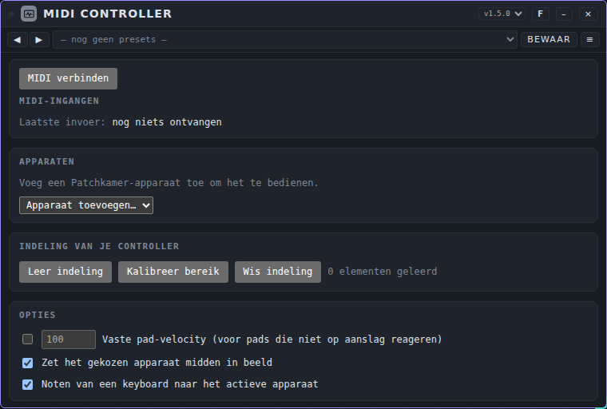
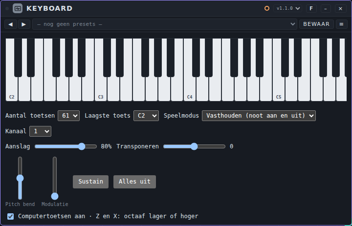
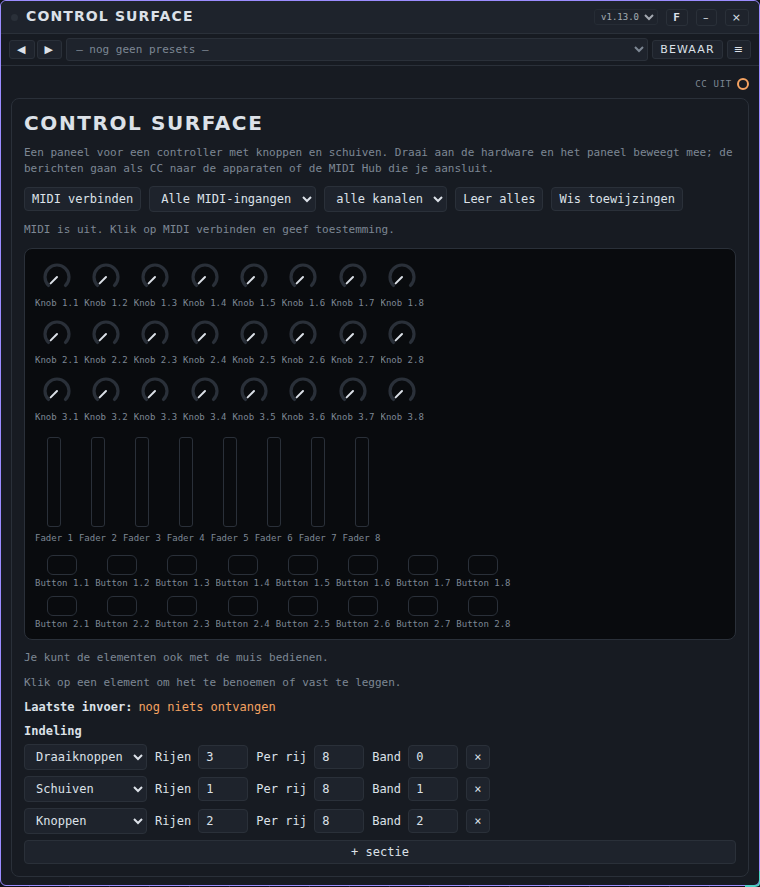
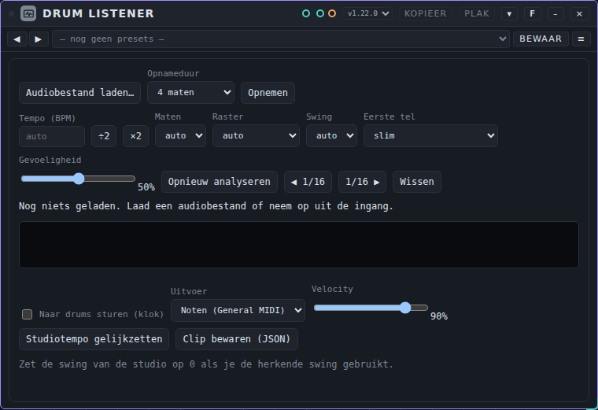
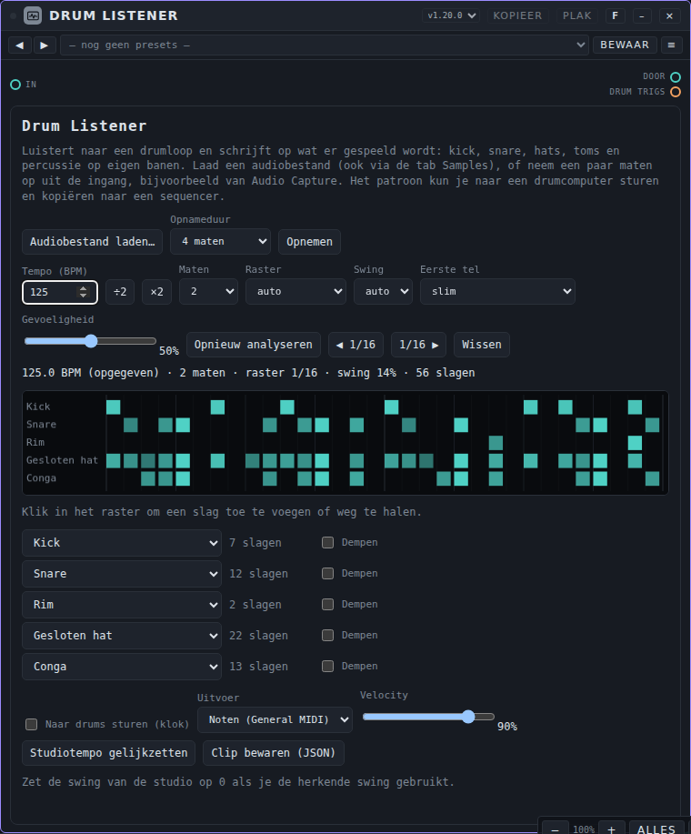
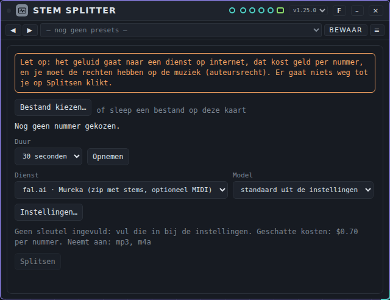
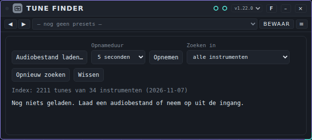
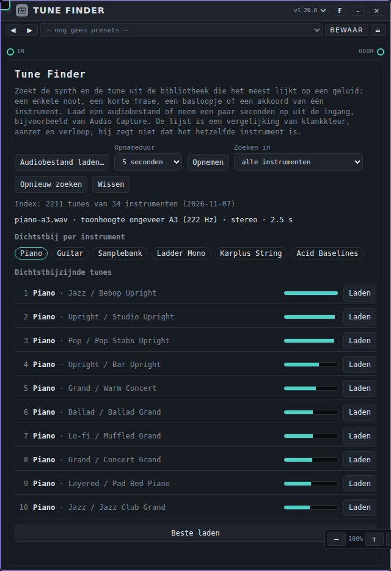
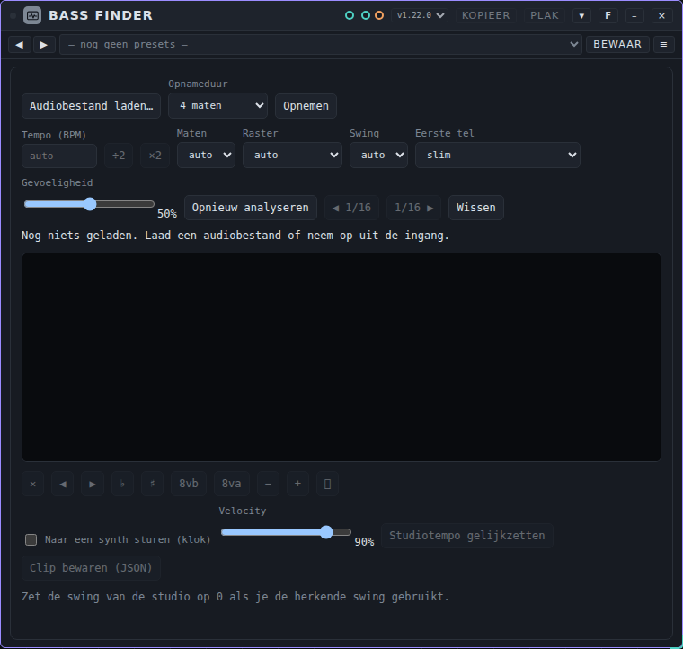
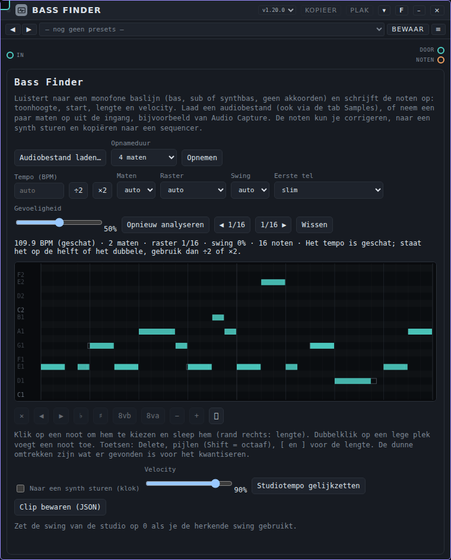

# Tools: gebruikershandleiding

*English version: [USER-MANUAL_EN.md](USER-MANUAL_EN.md)*

Deze handleiding gaat over de veertien **tools** van Patchkamer. Tools zijn hulpmiddelen: je gebruikt ze om te spelen, de maat te houden, op te nemen, te meten, notities te maken of andere apparaten te besturen. Het zijn geen effecten en op de tik van Metronome na maken ze zelf geen geluid. Voor de basis (Patchkamer starten, een bibliotheek laden, kabels trekken) zie de [basishandleiding](../USER-MANUAL_NL.md). De lijst met tools staat in de [map tools](../../devices/tools/README_NL.md).

## Welke tool voor welk doel

| Ik wil… | Gebruik | Het heeft |
|---|---|---|
| mijn MIDI-controllers en -keyboards tegelijk gebruiken, met een knop schakelen tussen apparaten en snel koppelen | [MIDI Controller](#midi-controller) | de eventuitgangen naar de apparaten die je toevoegt |
| noten spelen met een klavier op het scherm, met instelbaar aantal toetsen | [Keyboard](#keyboard) | een eventuitgang **Noten** |
| noten spelen met het schermtoetsenbord, mijn computertoetsen of een MIDI-keyboard | [Keys / MIDI](#keys--midi) | een eventuitgang **Noten / CC** |
| veel apparaten bespelen vanaf een raster van 40 pads op een MIDI-controller | [Pad Controller](#pad-controller) | een eventingang **MIDI (ruw)**, 40 eventuitgangen **Pad** en een modulatie-uitgang **Knoppen** |
| akkoorden vinden zonder muziektheorie: toonsoort, stijl, akkoorden die ik speel, ideeën voor het volgende akkoord, 16 pads, bas en stemvoering | [Chord Buddy](#chord-buddy) | een eventingang **In**, eventuitgangen **Akkoorden** en **Bas** |
| de afgewerkte mix (of ander geluid) in één bestand opnemen | [Recorder](#recorder) | audio **In** en **Door** |
| een drumloop omzetten in een patroon (kick, snare, hats, toms) en dat naar een sequencer kopiëren | [Drum Listener](#drum-listener) | audio **In** en **Door**, een eventuitgang **Drum trigs** |
| een nummer door een dienst op internet in stems splitsen (zang, drums, bas, rest) en die met de klok laten spelen | [Stem Splitter](#stem-splitter) | audio **In**, een uitgang per stem en een bundel **Alle stems** |
| uitzoeken welke synth en tune uit de bibliotheek lijkt op een noot, frase, basloopje of akkoord dat ik heb (een bestand of een opname) | [Tune Finder](#tune-finder) | audio **In** en **Door** |
| de noten van een monofone baslijn opschrijven (een bestand of een opname) en kopiëren naar een sequencer | [Bass Finder](#bass-finder) | audio **In** en **Door**, een event uit **Noten** |
| veel sporen tegelijk opnemen, een bestand per spoor | [Multitrack](#multitrack) | een **Bundel**-ingang |
| het geluid zien: spectrum, golfvorm, niveau | [Scope](#scope) | audio **In** en **Door** |
| een tik horen op de klok, of een drum op de slagen laten spelen | [Metronome](#metronome) | een tik op **Uit** en trigs op **Trigs** |
| ideeën, toonsoort en een lijst met taken opschrijven | [Notes](#notes) | geen poorten |
| een MIDI-keyboard en de sporen van een sequencer koppelen aan apparaten, en hun regelaars op knoppen van je keyboard zetten | [MIDI Hub](#midi-hub) | een eventingang **MIDI in**, een multi-MIDI-ingang **Sporen in** en een eventuitgang per apparaat |
| een controller met knoppen, schuiven en pads als paneel tonen en zijn berichten doorsturen | [Control Surface](#control-surface) | een eventuitgang **CC uit** |

## Hoe je tools aansluit

- **Keys / MIDI** en **Pad Controller** sturen *events* (noten). Hun oranje eventpoorten sluit je aan op de noteningang van een synth, een sampler of een arpeggiator.
- **Recorder** en **Scope** zijn audioapparaten die het geluid ongewijzigd doorlaten. Zet ze in het audiopad, bijvoorbeeld tussen de Mixer en Speakers. Je kunt ze ook aan het eind van een kabel hangen die verder gaat naar andere apparaten.
- **Multitrack** luistert naar een *bundel* (de dikke groene kabel met veel kanalen) en geeft het geluid niet door. Hij hangt naast de Mixer, niet in het pad.
- **Metronome** heeft een audio-uitgang (de tik) en een eventuitgang (**Trigs**). Sluit **Uit** aan op je mixer om de tik te horen, en **Trigs** op een drumcomputer of sampler om die op de slagen te laten spelen.
- **Notes** sluit je nergens op aan.

Op de tik van Metronome na voegt geen van deze tools iets toe aan je geluid: ze spelen, kijken, nemen op of noteren.

---

## MIDI Controller

**Waarvoor.** Eén apparaat voor al je MIDI-controllers en -keyboards. Je sluit ze aan, kiest welk Patchkamer-apparaat je wilt bedienen en draait aan je knoppen. Met een knop op de controller schakel je naar een ander apparaat; dezelfde draaiknoppen werken dan voor dat apparaat. Het vervangt de MIDI Hub, de Control Surface, de Pad Controller en Keys / MIDI.

**Aansluiten.** Klik op **MIDI verbinden** en geef de browser toestemming. Alle aangesloten MIDI-apparaten staan onder **MIDI-ingangen** en werken tegelijk; het lampje licht op als er iets binnenkomt. Een apparaat dat je later aansluit, verschijnt vanzelf.

**Apparaten kiezen.** Kies bij **Apparaten** met *Apparaat toevoegen…* de Patchkamer-apparaten die je wilt bedienen (bijvoorbeeld Acid Baselines en de Mixer). Het apparaat dat actief is, heeft een rand en het label *actief*; klik op een apparaat om het actief te maken.

**Schakelen met een knop.** Klik bij een apparaat op **Leer knop** en druk op een knop van je controller. Vanaf nu kiest die knop dat apparaat. Staat **Zet het gekozen apparaat midden in beeld** aan, dan schuift het canvas zodat het apparaat midden in je scherm staat (het apparaat zelf en de zoom blijven). Zet dat vinkje uit als je dat niet wilt.

**Snel koppelen.** Je hoeft niet elke knop los te koppelen:
1. **Leer indeling** (eenmalig per controller): raak elke knop, schuif en pad één keer aan en klik op **Klaar**.
2. Na het leren toont het apparaat je indeling als rijen (bijvoorbeeld 3 rijen van 8 draaiknoppen, 1 rij van 8 schuiven en een rij knoppen). Klopt een rij niet, kies dan per rij **draaiknoppen**, **schuiven**, **knoppen** of **pads**. Kies een actief apparaat en klik op **Voorstel**: heeft het apparaat kanaalstroken (zoals de Mixer), dan hoort kolom 1 van je controller bij strook 1, en zo verder; de schuiven gaan op de fader van elke strook en de draaiknoppen per rij op pan, send, EQ enzovoort. Bij een ander apparaat krijgen de schuiven de niveauregelaars en de draaiknoppen de rest in de volgorde van het apparaat. Knoppen gaan op vinkjes en knoppen (bijvoorbeeld mute en solo); pads blijven noten spelen.
3. Liever een slimmer voorstel? Klik op **AI-voorstel** (zichtbaar zodra je bij Instellingen een AI-aanbieder, sleutel en model hebt ingesteld). Je bevestigt de vraag één keer per apparaat; er gaan alleen de namen en bereiken van de regelaars en je indeling naar de aanbieder, geen geluid, en het kan geld kosten. De AI kiest welke regelaars het handigst onder je handen liggen; Patchkamer controleert elk voorstel en je haalt het met **AI ongedaan** in één klik weg.
4. Stuurt een schuif of draaiknop maar een deel van het bereik (bijvoorbeeld alleen de eerste millimeters, waarden 0 tot 40), klik dan op **Kalibreer bereik** en beweeg elk element één keer helemaal van laag naar hoog. Patchkamer schaalt dat bereik daarna naar de hele slag; het bereik staat bij de rij (met × om het te wissen).
5. **Pads.** Een pad dat geen koppeling heeft speelt een noot op het actieve apparaat (een pad dat een nootbericht stuurt, speelt zijn eigen noot). Stuurt je controller zijn pads als CC (dat doen sommige), zet dan de rij in de indeling op **pads**: het eerste pad speelt dan noot C2 (36), het volgende C#2 enzovoort, passend bij de standaard drumindeling. Reageren je pads niet op aanslag, kies dan bij de opties **Vaste pad-velocity**. Bij **Laatste invoer** staat waar elk bericht heen gaat, bijvoorbeeld "noot C#2 naar Drum Kit", "koppeling Pan" of "geen ingang voor noten".
6. Of klik op **Snel koppelen** en draai de knoppen na elkaar: elke knop krijgt de volgende regelaar.
7. Pas daarna aan wat je anders wilt: kies een andere regelaar, **Leer** (een andere knop), **omkeren**, of het bereik (min en max).

**Noten.** Met **Noten van een keyboard naar het actieve apparaat** aan gaan de noten van een MIDI-keyboard (ook pitch bend, aanslagdruk en pedaal) naar het actieve apparaat, via de kabel die het apparaat zelf legt. Een knop die een koppeling of schakelknop is, stuurt geen noot.

**Bewaren en laden.** Alle koppelingen, schakelknoppen en de indeling bewaar je als **preset** van de MIDI Controller (de balk bovenin de kaart). Een preset hoort bij een soort apparaat, niet bij een kaart: de koppeling voor Acid Baselines geldt voor elke Acid Baselines in elke werkruimte.

**Niet mogelijk.** Lampjes van de controller aansturen (dat vraagt sysex, en dat gebruikt Patchkamer niet).

## Keyboard

**Waarvoor.** Een klavier voor andere apparaten, zonder eigen geluid. Je stelt in hoeveel toetsen het heeft (25, 37, 49, 61, 76 of 88). Verbind de uitgang **Noten** met een synth, sampler of arpeggiator. Een fysiek MIDI-keyboard sluit je aan op de [MIDI Controller](#midi-controller); het Keyboard hoeft zelf geen MIDI te kennen.

**Bedienen.** Klik of tik op de toetsen (lager op de toets is harder), of gebruik de computertoetsen: **A W S E D F T G Y H U J K O L P** zijn de toetsen vanaf de C van het gekozen octaaf, en **Z** en **X** schuiven het octaaf omlaag of omhoog. In een invoerveld doen de toetsen hun gewone werk.

**Instellingen.**
- **Aantal toetsen** en **Laagste toets** bepalen het bereik.
- **Speelmodus:** *Vasthouden* (de noot klinkt zolang je de toets vasthoudt) of *Puls* (een noot met een vaste **Lengte**).
- **Aanslag**, **Transponeren** (± 2 octaven) en **Kanaal** (MIDI-kanaal 1 tot 16).
- **Pitch bend** (veert terug naar het midden) en **Modulatie**.
- **Sustain** houdt losgelaten noten vast tot je het weer uitzet; **Alles uit** laat alles los.

De instellingen bewaar je als **preset**.

## Keys / MIDI

> **Teruggetrokken.** Dit apparaat is vervangen door de [MIDI Controller](#midi-controller) en het [Keyboard](#keyboard). Het staat standaard niet meer in de bibliotheek (zet **Teruggetrokken apparaten tonen** aan, boven de lijst) maar laadt nog in oude werkruimtes en songs.

**Waar het voor dient.** Een keyboard dat zelf geen geluid maakt. Je speelt erop en het stuurt de noten naar een ander apparaat: een synth, een sampler of een arpeggiator. Je kunt spelen op de piano op het scherm, met de toetsen van je computertoetsenbord of met een MIDI-keyboard.

**De regelaars**

- **MIDI verbinden** vraagt de browser eenmalig om toestemming voor MIDI. Daarna staat er **MIDI opnieuw verbinden**. Je hebt een browser met Web MIDI nodig (Chrome of Edge).
- **Alles uit** zet alle noten stil die nog klinken.
- **MIDI-ingang** kiest één MIDI-keyboard of **Alle MIDI-ingangen**. **Kanaal** kiest één MIDI-kanaal (1 tot 16) of **Alle kanalen**.
- **Speelmodus:** **Puls · note + dur** stuurt een noot met een vaste lengte. **Toets vasthouden · noteoff** houdt de noot aan zolang je de toets vasthoudt en stuurt een noteoff als je loslaat; het sustainpedaal van een MIDI-keyboard werkt in deze modus. Gebruik Vasthouden voor apparaten die vastgehouden toetsen begrijpen en Puls voor apparaten die op een notenduur werken.
- **Laagste toets (MIDI)** bepaalt de eerste noot van het toetsenbord: C1 tot C6, in stappen van een octaaf (start op C3).
- **Velocity** (0,05 tot 1, start 0,80) is hoe hard de noten gespeeld worden, voor de schermtoetsen en computertoetsen. Een MIDI-keyboard stuurt zijn eigen velocity.
- **Pulsduur (s)** (0,05 tot 8 seconden, start 0,50) is de lengte van een noot in de modus Puls.
- **Pitchbend** en **Bend midden**: de schuif buigt de toonhoogte; de knop zet hem terug in het midden. Het pitchwiel van een MIDI-keyboard beweegt hem ook.
- **Modulatiewiel** stuurt de modulatiewaarde (vibrato). Het wiel van een MIDI-keyboard beweegt hem ook.
- **Computertoetsen:** klik eerst op de piano zodat hij focus heeft. De rij A W S E D F T G Y H U J K O L P ; ' speelt noten omhoog vanaf de laagste toets (A is de laagste toets zelf, W de zwarte toets erboven, enzovoort).
- Vanaf een MIDI-keyboard worden controllers 1, 11, 74 en 7 doorgegeven als vibrato, expressie, cutoff en volume; het pitchwiel wordt pitchbend.

**Poorten.** Eén eventuitgang, **Noten / CC**. Hij stuurt noten, noteoffs en deze controllers. Geen audio, geen ingangen.

**Voorbeeldpatch.** Plaats Keys, een synth en Speakers. Verbind **Noten / CC** van Keys met de noteningang van de synth, en de audio-uitgang van de synth met Speakers. Druk op **Start**, klik op een pianotoets (of druk op A) en je speelt de synth. Voor een MIDI-keyboard: **MIDI verbinden**, sta toegang toe en kies het keyboard bij **MIDI-ingang**.

**Presets.** Er is nog geen presetpack voor Keys meegeleverd. Het menu **Presets** op de kaart werkt zoals altijd (zie [Tunes en presets](../USER-MANUAL_NL.md#7-tunes-en-presets)): met **Bewaar** bewaar je er zelf een. Een preset bevat de laagste toets, velocity, pulsduur en speelmodus. Het MIDI-kanaal, de MIDI-ingang en de standen van bend en wiel horen niet in een preset.

**Tips en beperkingen.** MIDI wordt pas gevraagd na een klik op **MIDI verbinden** en er worden geen sysex-berichten gebruikt. Wordt je MIDI-keyboard niet gevonden, controleer dan of de pagina in Chrome of Edge staat en of je toegang hebt toegestaan. Keys heeft geen geluid: zonder iets aan **Noten / CC** hoor je niets.

---

## Pad Controller

> **Teruggetrokken.** Dit apparaat is vervangen door de [MIDI Controller](#midi-controller) en het [Keyboard](#keyboard). Het staat standaard niet meer in de bibliotheek (zet **Teruggetrokken apparaten tonen** aan, boven de lijst) maar laadt nog in oude werkruimtes en songs.

**Waar het voor dient.** Een besturingsapparaat voor een MIDI-controller met een raster van 40 pads (8 breed, 5 hoog), een rij knoppen en toetsen. Je koppelt een apparaat aan een pad. Met **Shift** + pad op de controller kies je welk apparaat je bespeelt; de toetsen spelen dan dat apparaat. De pads lichten op in de kleur van de categorie van het apparaat. De MIDI-ingang en de uitgang voor de lampjes kies je zelf; Pad Controller kijkt niet naar de naam van de MIDI-poort.

**De regelaars**

- **VERBIND MET MIDI** vraagt de browser om toestemming voor MIDI; ernaast staat hoeveel MIDI-ingangen er zijn gevonden ("nog niet verbonden" daarvoor).
- **Timing:** **strak (+12 ms, gelijkmatig)** geeft elke aanslag dezelfde kleine vaste vertraging, gebaseerd op de tijdstempel van het MIDI-bericht, zodat de timing gelijkmatig blijft als de pagina druk is. **direct (zo snel mogelijk)** speelt meteen.
- **SHIFT** doet de Shift-toets van de controller na met de muis.
- **Het raster** toont pad 1 tot 40, pad 1 linksonder en de rijen omhoog. Een gekoppeld pad toont zijn apparaat en licht op in de kleur van de categorie; het pad dat je bespeelt pulseert. Klik op een pad om het te kiezen; dubbelklik (of Shift + pad op de controller) om het te bespelen.
- **De padrij** onder het raster (bijvoorbeeld "Pad 1") heeft een lijst **— niet gekoppeld —** om een apparaat te kiezen. Ernaast staan knoppen als ze van toepassing zijn: **Koppel …** (koppelt het apparaat dat je op het canvas het laatst hebt aangeklikt), **Bespelen** en **Ontkoppel** (bij een gekoppeld pad) en **Kabel opnieuw leggen** (als de kabel weg is). Bij het koppelen legt Patchkamer de kabels voor je.
- **Per MIDI-ingang** kies je wat die stuurt: **toetsen**, **pads + knoppen** of **negeren**. Kies de rol zelf voordat je pads indrukt; anders worden de pads als noten gespeeld. Een ingang die de knop-berichten stuurt, wordt automatisch als **pads + knoppen** aangemerkt.
- **lampjes naar** is de MIDI-uitgang voor de lampjes. Hij start op **— geen —**: de lampjes blijven uit tot je een uitgang kiest.

**Wat de controller moet sturen.** Pad Controller kent controllers niet bij naam. Hij verwacht deze indeling; stuurt jouw controller iets anders, dan werkt het koppelen niet.

| Wat | Bericht |
|---|---|
| Pad 1 tot 40 (linksonder = 1, rijen omhoog) | noot-aan, nootnummer 0 tot 39 |
| Shift | noot 98 |
| De acht knoppen | controllers 48 tot 55, relatieve waarden |
| Toetsen | gewone noot-aan en noot-uit |
| Lampjes (de uitgang die je kiest) | noot-aan op het nootnummer van de pad, kleur als velocity |

**Poorten.** **MIDI (ruw)** is een eventingang voor ruwe MIDI-berichten. **Pad 1** tot **Pad 40** zijn 40 eventuitgangen, één per pad. **Knoppen** is een paarse modulatie-uitgang voor de knoppen. Er is geen audio.

**Voorbeeldpatch.** Plaats Pad Controller, een synth en Speakers, en verbind de audio van de synth met Speakers. Klik op **VERBIND MET MIDI** en sta toegang toe. Zet je padingang op **pads + knoppen** (en kies voor de lampjes de uitgang bij **lampjes naar**). Open de lijst bij pad 1 en kies de synth: Patchkamer legt de kabel van **Pad 1** naar zijn noteningang. Druk op de controller Shift + pad 1 en speel de synth met de toetsen.

**Presets.** Er is geen pack meegeleverd. Een preset bevat alleen de **Timing**. De koppelingen, MIDI-rollen, de lampjes-uitgang en het gekozen pad horen niet in een preset: ze horen bij je patch en worden met de werkruimte of song bewaard.

**Tips en beperkingen**

- De knoppen worden voorlopig alleen getoond. Ze sturen nog geen parameters aan (dat staat ook op de kaart); de vaste indeling per soort apparaat, zoals drumpads, komt later.
- De koppelingen zijn de kabels van de patch. Is een kabel weg, dan toont het pad "kabel los"; met **Kabel opnieuw leggen** herstel je hem. Pad Controller haalt alleen zijn eigen kabels los.
- Hij is getest met nagebootste MIDI-berichten, niet met een echte controller. Zonder MIDI-toegang kun je nog steeds koppelen en spelen door op pads op de kaart te klikken.
- Hij heeft een Patchkamer nodig die kabels voor apparaten kan leggen; een oudere meldt dat op de kaart.

---

## Chord Buddy

**Waar het voor dient.** Chord Buddy helpt je akkoorden te vinden als je geen muziektheorie kent. Kies een toonsoort (en, als je wilt, een stijl) en je ziet de akkoorden die erbij horen. Of speel een akkoord op een MIDI-keyboard: dan hoor je welk akkoord het was, bij welke toonsoorten het kan horen en welk akkoord erna kan komen. Akkoorden die je mooi vindt, gaan in een van de 16 pads; de pads kun je bespelen, bewaren als set en afspelen als akkoordenreeks met een aparte basbaan. Het geeft *advies*: stijlen en suggesties zijn richtlijnen, geen regels, en bij de gevonden toonsoort staat hoe zeker die is ("bijna zeker", "waarschijnlijk", "onduidelijk").

**Verbinden.** De eventingang **In** neemt noten van Keys / MIDI, een Pad Controller of een sequencer. **Akkoorden** stuurt de akkoordnoten en **Bas** de basnoten, apart, zodat je voor de bas een andere synth kunt kiezen. Start de transport van Patchkamer om een set af te spelen: Chord Buddy volgt de klok.

**De onderdelen.**
- **1 · Toonsoort & stijl.** Kies de grondtoon, de schaal (majeur en mineur, de zeven modi, pentatoon majeur en mineur, blues) en een stijl (niet verplicht). De akkoorden van de toonsoort staan als knoppen, gekleurd naar functie: groen = tonica ("thuis: voelt rustig en af"), blauw = subdominant ("onderweg"), rood = dominant ("spanning: wil naar thuis"). Klik erop om het te horen en te kiezen. **Zoek toonsoort** kijkt naar de akkoorden die je speelde (of de pads) en toont de beste drie toonsoorten met wat voor en tegen spreekt. **Kant-en-klare progressies** geeft progressies van vier akkoorden voor de stijl; **Gebruik als set** zet er een in pad 1 tot 4 (ongedaan maken kan).
- **2 · Luisteren (MIDI in).** Toont de noten die je speelt en het herkende akkoord (ook omkeringen, slash-akkoorden en onvolledige akkoorden zoals 1-3-7), met alternatieven. **Luisteren** onthoudt de laatste vier akkoorden die je speelde; **Dit akkoord gebruiken** voegt het getoonde akkoord toe (of het alternatief dat je koos); **Wis** maakt de lijst leeg. Uit die akkoorden wordt live de toonsoort bepaald, en eronder stelt Chord Buddy het volgende akkoord voor: **Veilig**, **Spanning** en **Kleur / verrassing**, elk met een korte uitleg. **Toonsoort automatisch volgen** zet de toonsoort als die waarschijnlijk klopt.
- **3 · Pads.** Zestien pads in een raster van 4 × 4, gekleurd naar functie. Klik of raak een pad aan om het te spelen, of speel zijn MIDI-noot (het eerste pad is standaard C2; noten in dat bereik worden niet als akkoord beluisterd; zet het uit of verschuif het met **Pads spelen via MIDI-noot** en **Eerste pad = noot**). **Bewaar in pad** zet het gekozen akkoord in het gekozen pad; overschrijven mag en wordt gemeld ("Pad 3 overschreven: Am → F"); **Ongedaan maken** neemt de laatste wijziging terug; **Pad leegmaken** maakt een pad leeg.
- **4 · Set.** Naam, **Duur per akkoord** (1 slag tot 4 maten), **Herhalen**, **Stemvoering gebruiken**, **Bas aan**, **Start** en **Stop**, **Transponeer −1 / +1** (zet de hele set in een andere toonsoort) en **Exporteren / Importeren (.json)**. Een set is een preset: bewaar en laad sets met de presetbalk op de kaart. De set zit ook in de werkruimte en in een song.
- **5 · Advies: bas en stemvoering.** Per pad het basadvies: grondtoon, kwint en octaaf, de slash-bas van het akkoord en een aanloopnoot naar het volgende akkoord. Kies de basfiguur (liggend, grondtoon–kwint, walking, pulserend). Kies 2 tot 6 stemmen en Dicht, Open of Drop-2, daarna **Alleen voorstel tonen** (vergelijken, met de beweging per stem) of **Pas stemvoering toe** (herschrijft de padakkoorden). De voicings bewegen zo weinig mogelijk tussen akkoorden.
- **6 · Uitgang.** Velocity, velocity van de bas, lengte, gate, strum (0 tot 60 ms), octaaf en MIDI-kanaal voor akkoorden en bas. Velocity, velocity van de bas, lengte, gate en strum kunnen worden gemoduleerd.

**Presets.** Het pack *Chord Buddy Starter Sets* heeft 30 sets in C majeur en a mineur, drie per stijl (pop, rock, folk, blues, jazz, klassiek, soul, hip-hop, house, ambient). Met **Transponeer** speel je ze in elke toonsoort.

**Tips en grenzen.** Chord Buddy geeft suggesties, geen correcties. Eén akkoord past in veel toonsoorten: speel een tweede en derde akkoord en de toonsoort wordt duidelijker. Oosterse schalen en kwarttonen zitten niet in deze versie. Niet beluisterd: controleer op gehoor of bas en akkoorden goed bij elkaar passen.

## Recorder

**Waar het voor dient.** Neemt op wat er binnenkomt, meestal de hele mix, en geeft het ongewijzigd door. Je gebruikt hem om een audiobestand van je muziek te maken: WAV voor de beste kwaliteit, MP3 voor een klein bestand.

**De regelaars**

- **Naam van de opname** is het begin van de bestandsnaam; een bewaarde take heet `<naam> take <n>`.
- **Formaat** (kies het vóór je opneemt; het is vergrendeld tijdens het opnemen):
  - **WebM/Opus** (of **MP4/AAC**, afhankelijk van je browser): kleine bestanden.
  - **WAV 16-bit** en **WAV 24-bit**: zonder kwaliteitsverlies.
  - **MP3**: kleine bestanden. Er verschijnt een lijst **Bitrate** met 128, 192, 256 of 320 kbps (start 192).
- **● Opnemen** en **■ Stop** bedienen de opname. Een niveaumeter en de tijd laten zien wat er gebeurt.
- **Rood lampje naast Start.** Zolang een opname loopt, staat naast de knop **Start** van de pagina een rood lampje dat langzaam knippert, met de tijd (mm:ss), waar de Recorder ook staat op het canvas. Klik op het lampje of de tijd en het hele canvas schuift zodat de Recorder midden in het scherm staat. De Recorder zelf verplaatst niet en de zoom blijft.
- **Maar één Recorder.** Er past maar één Recorder op de vloer. Plaats of plak je een tweede, dan krijg je een melding en wordt de bestaande gekozen. Een oudere werkruimte die er toch meer heeft, laadt gewoon.
- **Opnemen met Start/Stop van de klok** laat de opname Start en Stop van de klok volgen.
- Elke take komt in een lijst met lengte, formaat en grootte, met een knop om te beluisteren (**▶**) en **Bewaar**. Takes blijven in het geheugen tot je de pagina sluit. **Bewaar** geeft je het audiobestand.

**Poorten.** **In** is de audio-ingang, **Door** de audio-uitgang: het geluid loopt ongewijzigd door.

**Voorbeeldpatch.** Verbind de Mixer met Recorder **In**, en Recorder **Door** met Speakers. Kies **WAV 24-bit**, druk op **● Opnemen**, speel je muziek, druk op **■ Stop** en daarna op **Bewaar**.

**Presets.** Er is geen pack meegeleverd. Een preset bevat de naam, de klokoptie, het formaat en de bitrate. Takes horen nooit in een preset.

**Tips en beperkingen**

- Een WAV- of MP3-take houdt het ruwe geluid in het geheugen, ongeveer 23 MB per minuut bij 48 kHz stereo. Het bestand wordt pas gemaakt als je op **Bewaar** drukt; een MP3 kost even tijd en een melding toont de voortgang.
- MP3 werkt bij 8 tot 48 kHz en bij veelvouden van 48, 44,1 of 32 kHz (bijvoorbeeld 96 kHz, dat Recorder terugbrengt naar 48 kHz). Bij een andere sample rate meldt Recorder dat MP3 niet kan; WAV werkt altijd. Een WAV-bestand kan niet langer zijn dan 4 GB; kies MP3 voor heel lange opnames.
- WAV en MP3 hebben AudioWorklet in de browser nodig; ontbreekt die, kies dan een ander formaat.
- Of een opname goed klinkt hangt af van wat je erin stuurt: Recorder verandert niets.

**Licentie van de MP3-encoder.** Recorder maakt MP3-bestanden met [lamejs](https://github.com/zhuker/lamejs) 1.2.1, een JavaScript-versie van de LAME-encoder. lamejs is vrije software onder de [LGPL-3.0](../../LICENSES/LGPL-3.0-only.txt) en staat onveranderd in het Recorder-bestand, als één los stuk tekst (`LAME_SRC`, onderaan). Je kunt hem vervangen door een andere versie of je eigen build van lamejs. De rest van Recorder is AGPL-3.0-or-later. Ook de Stem Splitter gebruikt lamejs, vanuit de host: een los, onveranderd bestand `patchkamer/vendor/lame.min.js`, dat alleen voor een omzetting naar mp3 wordt geladen en op dezelfde manier te vervangen is. Zie [LICENSING.md](../../LICENSING.md).

---

## Multitrack

**Waar het voor dient.** Een recorder voor maximaal 16 sporen tegelijk, sample-gelijk, voor als je elk instrument of kanaal als eigen bestand wilt, bijvoorbeeld om elders te mixen. Elk spoor is een stereo-WAV.

**De regelaars**

- **● OPNEMEN** start een take, **■ Stop** beëindigt hem. Het tekstveld ernaast is de naam van de sessie (het begin van de bestandsnamen). De timer toont de lengte.
- De regel eronder toont hoeveel sporen gearmd zijn, het formaat, de sample rate en ongeveer hoeveel geheugen een minuut kost.
- **SPOREN** (1 tot 16, start 8) bepaalt het aantal sporen. **WAV** kiest **16 bit**, **24 bit** of **32 bit float** (start 24 bit).
- **MET START/STOP VAN DE KLOK** laat de opname Start en Stop van de klok volgen.
- **NIEUWE KANALEN VANZELF TOEWIJZEN**: nieuwe bundelkanalen komen op vrije sporen, en er komen zo nodig sporen bij (tot 16). **ALLES ARMEN** armt elk spoor.
- **Per spoor:** een rode knop (arm: wel of niet opnemen op dit spoor), een naamveld (wordt de bestandsnaam), een lijst voor de bron (een kanaal van de bundel, of **— geen**) en een niveaumeter.
- Na een take toont een lijst je takes. **Bewaar alles (.zip)** bewaart een stereo-WAV per spoor in één zip. **Per spoor** bewaart losse sporen. Met een **×** gooi je een take weg om geheugen vrij te maken.

**Poorten.** Eén bundelingang, **Bundel** (de dikke groene kabel). Geen audio, events of modulatie. Multitrack luistert alleen mee; hij geeft het geluid niet door.

**Voorbeeldpatch.** Verbind de groene bundeluitgang (**Kanalen uit**) van de Mixer met **Bundel** van Multitrack. Laat **NIEUWE KANALEN VANZELF TOEWIJZEN** aan: de Mixer-kanalen komen op de sporen. Druk op **● OPNEMEN**, speel, druk op **■ Stop** en daarna op **Bewaar alles (.zip)**.

**Presets.** Er is geen pack meegeleverd. Een preset bevat de instellingen van de sessie en de sporen (het aantal sporen, het formaat, de namen en welke sporen gearmd zijn). De bron van elk spoor is routing en hoort niet in een preset.

**Tips en beperkingen**

- Takes blijven in het geheugen tot je de pagina sluit; bewaar wat je wilt houden.
- De inforegel toont hoeveel geheugen een minuut nodig heeft met de sporen die gearmd zijn. Een lange take van 16 sporen op 32 bit kost veel.
- Elk spoorbestand is een stereo-WAV.

---

## Scope

**Waar het voor dient.** Een raam op het geluid. De audio gaat ongewijzigd van **In** naar **Door**, terwijl de kaart laat zien wat er langskomt: een spectrum, de golfvorm, een spectrogram, het stereobeeld of de niveaus. Je gebruikt hem om een mix te controleren, een brom te zoeken of te zien of iets clipt.

**De regelaars**

- **Beeld** kiest wat je ziet: **Spectrum**, **Golfvorm L/R**, **Spectrogram**, **Stereobeeld** of **Peak / RMS**.
- **FFT** (1024, 2048, 4096 of 8192) bepaalt het detail van het spectrum: meer detail reageert trager. **Glad** (**uit**, **licht**, **normaal**, **sterk**) bepaalt hoe rustig het beweegt. **Bereik** (60, 90 of 120 dB) bepaalt hoeveel dB je ziet.
- **Tijd** (5, 10, 25 of 50 ms) bepaalt de lengte van de golfvorm die je ziet.
- **Pauze** bevriest het beeld; de knop heet dan **Verder**.
- De regel onder het beeld geeft het peak- en RMS-niveau van links en rechts in dBFS. Gaat het signaal over de grens, dan staat er CLIP.
- In de andere beelden: het spectrogram loopt van nieuw (boven) naar ouder (omlaag); het stereobeeld toont ook de correlatie; het beeld **Peak / RMS** toont RMS als balk en de sample-peak als streep.

**Poorten.** Audio **In** en audio **Door**. Het geluid loopt door met een versterking van precies 1, zonder vertraging.

**Voorbeeldpatch.** Zet Scope tussen de Mixer en Speakers: Mixer naar **In**, **Door** naar Speakers. Druk op **Start** en kies **Spectrum**; het beeld beweegt met het geluid mee.

**Presets.** Er is geen pack meegeleverd. Een preset bevat het beeld, FFT, glad, bereik en tijd. Pauze hoort niet in een preset.

**Tips en beperkingen.** De kaart tekent ongeveer 30 keer per seconde en alleen terwijl je hem ziet. Scope verandert het geluid niet; hij meet alleen. Bevat een signaal kapotte waarden (NaN of oneindig), dan telt Scope die in zijn analyse als stilte.

---

## Metronome

**Waar het voor dient.** Een tik die de maat houdt met de klok van de studio: een korte piep op elke maat, tel, achtste of zestiende. Gebruik hem om in de maat te oefenen of op te nemen, of laat dezelfde slagen meespelen met een drumcomputer of sampler. De eerste stap van elke maat is luider en hoger dan de andere tikken.

**Regelaars**

- **Elke** kiest hoe vaak er een tik klinkt: elke **maat**, **tel**, **8e** of **16e**. Het begin is **tel**.
- **Niveau** (0 tot 100%, begin 50%) is het volume van de tik op de audio-uitgang.
- **Stap** toont de 16 stappen van de maat en verlicht de huidige stap zolang de klok loopt.

**Poorten.** Twee uitgangen en geen ingangen. **Uit** is de tik als audio (groenblauw). **Trigs** (oranje) stuurt bij elke tik een trig, zodat een drumcomputer of een sampler op dezelfde slagen kan spelen. De trig op de eerste stap van de maat is sterker dan de andere. De regelaar **Niveau** werkt alleen op **Uit**, niet op **Trigs**.

**Voorbeeldpatch.** Plaats Metronome, een **Mixer** en **Speakers**. Verbind **Uit** van Metronome met een ingang van de Mixer en **Uit** van de Mixer met **In** op Speakers. Druk op **Start**: je hoort een tik op elke tel, met een hogere op de eerste tel van elke maat. Kies in de presets **Practice › Bar Only Quiet** voor een zachte tik één keer per maat. Wil je een drum op de slagen laten spelen, verbind dan ook **Trigs** met een drumcomputer.

**Presets.** Het pack **Metronome Basics** heeft 9 presets in drie mappen: **Practice** (Bar Only, Bar Only Quiet, Quarter Beats, Quarter Beats Quiet), **Subdivisions** (Eighth Notes, Eighth Notes Quiet, Sixteenth Ticks) en **Loud** (Quarter Beats Loud, Stage Click). Het bestand is [`presets/metronome.patchkamer-presets.json`](../../presets/metronome.patchkamer-presets.json). Laad het vanuit een bibliotheek (zie de basishandleiding) of met de tab **Presets** van de bibliotheek → **Importeren…**. Een preset bevat **Elke** en **Niveau**.

**Tips en beperkingen.** Metronome tikt alleen terwijl de klok loopt (na **Start**); hij volgt het tempo van de studio en heeft geen eigen tempo. Een tik is een korte sinuspiep van 1000 Hz (1600 Hz op de eerste stap van de maat). Niet beluisterd: stel **Niveau** op het gehoor in, bijvoorbeeld met een koptelefoon.

---

## Notes

**Waar het voor dient.** Een notitieblok op de vloer voor ideeën, de toonsoort, de structuur en wat je nog wilt doen. Het maakt geen geluid en heeft geen poorten; de tekst wordt met de werkruimte of song bewaard.

**De regelaars**

- **TOONSOORT** en **TEMPO / GEVOEL** zijn korte velden, bijvoorbeeld "A mineur" en "128, hypnotisch". Beide nemen maximaal 200 tekens.
- **DEEL** heeft de knoppen **INTRO**, **OPBOUW**, **BREAK**, **DROP** en **OUTRO**. Elke knop zet een kop met die naam in de tekst.
- Het grote veld is voor vrije tekst (ideeën, structuur, wat je morgen wilt proberen).
- **NOG DOEN:** typ een taak bij "nieuwe taak, Enter" en druk op **Enter** (of **+**). Vink hem af als hij klaar is en haal hem weg met het kruisje.
- Een regel onderaan toont wanneer je de notities voor het laatst hebt gewijzigd.

**Poorten.** Geen.

**Voorbeeld.** Plaats Notes naast je patch. Vul de toonsoort en het tempo in, druk op **INTRO** en **DROP** om de structuur neer te zetten, schrijf op wat elk deel nodig heeft en voeg bij elk los eindje een taak toe.

**Presets.** Er is geen pack meegeleverd. Een preset bevat alles op de kaart behalve het tijdstip van de laatste wijziging, zodat je een lege songsjabloon met koppen en taken kunt bewaren.

**Tips en beperkingen.** De notities nemen maximaal 100.000 tekens en maximaal 200 taken van elk maximaal 500 tekens.

---

## MIDI Hub

> **Teruggetrokken.** Dit apparaat is vervangen door de [MIDI Controller](#midi-controller) en het [Keyboard](#keyboard). Het staat standaard niet meer in de bibliotheek (zet **Teruggetrokken apparaten tonen** aan, boven de lijst) maar laadt nog in oude werkruimtes en songs.

### Waar het voor dient

De MIDI Hub staat tussen je MIDI-bronnen en de apparaten in je werkruimte. Verbind een keyboard of controller (via **Keys / MIDI**) en een sequencer ermee, en de hub doet drie dingen:

- Hij ziet welke apparaten er in de werkruimte staan en laat je ze toevoegen aan zijn **actieve apparaten**.
- Per apparaat kies je **waar de noten vandaan komen**: het keyboard (alle kanalen of één MIDI-kanaal), of een spoor van een sequencer, met de spoornaam erbij.
- Je kunt **elke regelaar op de kaart** van een apparaat (schuiven, draaiknoppen, lijsten, vinkjes en knoppen) koppelen aan een knop, schuif, pad of toets van je MIDI-apparaat. Je hoeft geen MIDI-nummer te kennen: druk op **Leer** en draai aan de knop.

Je kunt een koppeling bewaren per soort apparaat, en als preset van de hub.

### De regelaars

| Regelaar | Wat hij doet |
|---|---|
| **Bronnen** | Toont op welke van de vier MIDI-ingangen iets is binnengekomen (✓), en de sporen van elke sequencer die met een multi-MIDI-kabel is verbonden (met spoornaam en kanaal). |
| **Laatste invoer** | Het laatste bericht dat binnenkwam, bijvoorbeeld **CC 74 · ch 1 = 52%**. Draai aan een knop om te zien welk nummer hij heeft. |
| **Apparaat toevoegen…** | Voegt een apparaat uit de werkruimte toe aan de actieve apparaten. De hub legt dan een kabel van zijn eigen uitgang naar dat apparaat. |
| **×** (bovenaan een apparaat) | Haalt het apparaat uit de hub en haalt zijn kabel weg. |
| **Ververs regelaars** | Leest de regelaars op de kaart van het apparaat opnieuw. Gebruik het nadat je een ander tabblad van het apparaat hebt geopend. |
| **Noten van** | Een of meer bronnen voor de noten van dit apparaat: **Keyboard** (met **alle kanalen** of één **kanaal**, en **alle ingangen** of één van de vier MIDI-ingangen), of **Spoor: sequencer › spoornaam (ch n)**. **+ bron** voegt er een toe. |
| **Opnieuw verbinden** | Legt de kabel naar het apparaat opnieuw als je hem zelf hebt losgehaald. De hub legt hem nooit uit zichzelf terug. |
| **Bibliotheek** | Bewaarde koppelingen voor dit soort apparaat: kies er een en **Laad**, of typ een naam en **Bewaar als…**. **Wis** verwijdert de gekozen. |
| **+ koppeling** | Voegt een rij toe en start **Leer**. |
| **Leer** | Draai aan een knop, beweeg een schuif, sla een pad of druk een toets op je MIDI-apparaat. Het eerste bericht dat binnenkomt is de bron van de rij (CC-nummer, noot, pitch bend of kanaaldruk, met zijn kanaal en de MIDI-ingang waarop hij binnenkwam). |
| **Regelaar** (lijst) | De regelaar op het apparaat die deze knop beweegt. De lijst toont elke schuif, knop, lijst, vinkje en knop van de kaart. |
| **min** / **max** | Het deel van het bereik van de regelaar dat de knop beweegt, in procenten. Zet min op 20 en max op 80 om de regelaar in het midden te houden. |
| **omkeren** | Draait de richting om. |
| **wissel** | Alleen voor vinkjes: elke druk schakelt om. Zonder dit volgt het vinkje de knop (aan vanaf 50%). |
| **Alles wissen** | Haalt alle koppelingen van dit apparaat weg. |

Een gekoppelde knop van het keyboard wordt niet ook nog als CC-bericht naar het apparaat gestuurd, zodat je het niet dubbel krijgt. Noten en alle andere berichten gaan door als het apparaat een bron heeft.

### Poorten

| Poort | Soort | Gebruik |
|---|---|---|
| **MIDI in**, **MIDI in 2**, **MIDI in 3**, **MIDI in 4** | event in | Verbind **Notes / CC** van **Keys / MIDI**, of een andere MIDI-bron. Gebruik één ingang per fysiek MIDI-apparaat (zie hieronder). |
| **Sporen in** | multi-MIDI in | Verbind de poort **Sporen** van een sequencer (Clip Arranger, Chord Sequencer, Pattern Tracker, Pattern Playlist). Je kunt meer dan één sequencer verbinden. |
| **→ apparaat** | event uit | Eén per actief apparaat met een eventingang. De hub legt deze kabels zelf; het zijn gewone kabels die je kunt weghalen. |

De multi-MIDI-kabel is een dubbele, gestreepte oranje kabel. Hij draagt alle sporen van een sequencer tegelijk, elk met zijn naam.

### Een voorbeeld

1. Plaats **Keys / MIDI**, **MIDI Hub**, **Acid Baselines** en **Speakers**. Verbind **Notes / CC** met **MIDI in** van de hub, en **Uit** van Acid Baselines met Speakers.
2. Kies in de hub **Apparaat toevoegen…** › Acid Baselines. Het keyboard speelt hem nu.
3. Klik op **+ koppeling**, draai aan een knop op je keyboard (de rij zegt bijvoorbeeld **CC 74 · ch 1**) en kies **Cutoff** in de lijst. De knop beweegt nu de cutoff.
4. Typ **Mijn keyboard** bij **Bibliotheek** en klik op **Bewaar als…**. De volgende keer kies je hem en klik je op **Laad**.
5. **Twee fysieke MIDI-apparaten tegelijk**, bijvoorbeeld een keyboard en een kastje met knoppen: plaats twee **Keys / MIDI**-apparaten en kies in elk zijn eigen **MIDI-ingang**. Verbind de eerste met **MIDI in** van de hub en de tweede met **MIDI in 2**. Een koppeling die je leert onthoudt de ingang (bijvoorbeeld **CC 74 · ch 1 · MIDI in 2**), dus hetzelfde CC-nummer op het andere apparaat beweegt hem niet. Bij **Noten van** kun je de keyboardroute tot één ingang beperken.
6. Een spoor van een sequencer op de synth spelen: verbind de poort **Sporen** van de sequencer met **Sporen in**, en kies bij **Noten van** **Spoor: … › Bass**. Haal de rij **Keyboard** weg als de synth alleen het spoor moet spelen.

### Presets

Het pack **MIDI Hub Basics** heeft 15 presets in vier mappen: **Sound Controllers**, **Wheels and Pedals**, **Effects** en **Utility**. Een preset wordt op elk apparaat in de hub toegepast en vindt de regelaars op hun naam (Cutoff, Resonance, Attack enzovoort). Een regelaar die een apparaat niet heeft, wordt overgeslagen en staat als *niet gevonden*. Een preset vervangt alleen de koppelingen; hij verandert de bronnen en de kabels niet. Zie [Presets](../presets/USER-MANUAL_NL.md).

### Tips en beperkingen

- De namen van de regelaars zijn de labels op de kaart. Een koppeling die je in de ene taal van Patchkamer maakte, vindt dus zijn regelaars op hetzelfde label in die taal.
- Verandert een apparaat zijn kaart (bijvoorbeeld een ander tabblad), druk dan op **Ververs regelaars**. Een koppeling waarvan de regelaar weg is, staat als *niet gevonden* en doet niets.
- Web MIDI werkt in Chrome en Edge, en pas nadat je in **Keys / MIDI** op **MIDI verbinden** klikt. De hub zelf opent geen MIDI.
- De hub verandert niets als je een werkruimte opent of een kabel verbindt: hij reageert alleen op wat je speelt en indrukt.
- Een koppeling van vóór versie 1.13.1 heeft geen ingang en werkt op alle vier de ingangen. Leer hem opnieuw als twee apparaten hetzelfde CC-nummer sturen.
- De hub speelt geen geluid.

## Control Surface

> **Teruggetrokken.** Dit apparaat is vervangen door de [MIDI Controller](#midi-controller) en het [Keyboard](#keyboard). Het staat standaard niet meer in de bibliotheek (zet **Teruggetrokken apparaten tonen** aan, boven de lijst) maar laadt nog in oude werkruimtes en songs.

### Waar het voor dient

Control Surface is een paneel voor een MIDI-controller met knoppen, schuiven, pads of drukknoppen en zonder klavier. Het toont de controller op het scherm en beweegt mee met wat je op de hardware doet. Wat je doet gaat door als CC-berichten (met nummer en kanaal) naar de apparaten die je aansluit, meestal de **MIDI Hub**, die daarna elk element kan koppelen aan een regelaar van elk apparaat.

De vorm van het paneel bouw je uit **secties**. Elke sectie heeft een soort (**Draaiknoppen**, **Schuiven**, **Pads** of **Knoppen**), een aantal **Rijen**, een aantal elementen **Per rij** en een **Band**. Secties in dezelfde band staan naast elkaar; banden staan onder elkaar. Zo kun je de vorm van bijna elke controller nabouwen, bijvoorbeeld 3 rijen van 8 draaiknoppen, een rij van 8 schuiven en 2 rijen van 8 knoppen eronder. Het pack **Control Surface Layouts** heeft kant-en-klare vormen.

### De regelaars

| Regelaar | Wat hij doet |
|---|---|
| **MIDI verbinden** | Vraagt de browser om MIDI-toegang (eenmalig, na jouw klik). Zonder kun je nog steeds de muis gebruiken. Er wordt nooit sysex gebruikt. |
| **MIDI-ingang** (lijst) | **Alle MIDI-ingangen** of één ingang. Gebruik één ingang per fysiek apparaat. |
| **Kanaal** | **alle kanalen** of één MIDI-kanaal. |
| **Leer alles** | Loopt het hele paneel langs: het eerste element licht op, je beweegt het bijbehorende element op je controller, en het volgende licht op. **Stop leren** beëindigt het. |
| **Wis toewijzingen** | Haalt de toewijzing van elk element weg. |
| Het paneel | Draaiknoppen, schuiven, pads en knoppen. Ze bewegen mee met de hardware. Je kunt ook met de muis aan een knop of schuif slepen (pads en knoppen reageren op een klik). Klik op een element om het te selecteren. |
| **Element** (editor) | Voor het geselecteerde element: een **Naam** (die naam zie je terug in de MIDI Hub), **Leer** (wijs het toe door het element op je controller te bewegen), het toegewezen **CC** of de **Noot** met zijn kanaal, en **Wis**. |
| **Laatste invoer** | Het laatste bericht dat binnenkwam. Een bericht dat niet aan een element is toegewezen gaat ook door, als gewone CC. |
| **Indeling** | Eén regel per sectie: de soort, **Rijen**, **Per rij** en **Band**, en **×** om hem te verwijderen. **+ sectie** voegt er een toe. Ten hoogste 8 secties en 256 elementen. |

Pads en knoppen die noten sturen, gaan door als CC met een waarde van 0 of 1 (0 tot 100% bij pads die voelen hoe hard je slaat).

### Poorten

| Poort | Soort | Gebruik |
|---|---|---|
| **CC uit** | event uit | Verbind met een van de **MIDI in**-poorten van de **MIDI Hub**, of rechtstreeks met een apparaat dat naar CC luistert. |

### Een voorbeeld

1. Plaats **Control Surface**, **MIDI Hub** en een synth. Verbind **CC uit** met **MIDI in** van de hub en voeg de synth toe in de hub.
2. Kies in **Control Surface** **MIDI verbinden** en kies je controller bij **MIDI-ingang**.
3. Kies een indeling in de presetbalk, bijvoorbeeld **Strips › 8 Strips Full**, of bouw er een onder **Indeling**.
4. Klik op **Leer alles** en beweeg de elementen een voor een, van linksboven naar rechtsonder. Klik op **Stop leren** als je klaar bent. Klik op een element om het een naam te geven, bijvoorbeeld **Filter**.
5. Klik in de hub op **+ koppeling**, beweeg de knop (de rij toont zijn naam, bijvoorbeeld **Filter · CC 21 · ch 1**) en kies de regelaar van de synth.

Gebruik je ook een klavier, zet dat dan via **Keys / MIDI** op **MIDI in** van de hub, en de controller via Control Surface op **MIDI in 2**.

### Presets

Het pack **Control Surface Layouts** heeft 28 presets in vijf mappen: **Controllers**, **Strips**, **Faders**, **Knobs** en **Pads**. De vormen in de laatste vier stellen alleen de vorm van het paneel in (en wissen de toewijzingen, omdat die bij de oude vorm horen). De map **Controllers** heeft indelingen van bekende controllers samen met hun MIDI-mapping: een preset daar zet de vorm en de toewijzingen, zodat de elementen meteen reageren. Geen van beide verandert de ingang. De mappings komen uit openbare documentatie en zijn niet met de hardware geprobeerd: verschilt een nummer op jouw model of stand, corrigeer het dan met **Leer** en bewaar een eigen preset. De Traktor Kontrol F1 heeft alleen zijn vorm, omdat de nummers in de Controller Editor van de fabrikant worden ingesteld. Zie [Presets](../presets/USER-MANUAL_NL.md).

### Tips en beperkingen

- Web MIDI werkt in Chrome en Edge. Control Surface gebruikt geen sysex en kan de ledjes van je controller dus niet laten branden.
- Een element behoudt zijn toewijzing zolang zijn plek in de indeling gelijk blijft. Verwijder je een sectie, dan krijgen de elementen erna nieuwe nummers.
- Heeft je controller meerdere pagina's of standen, leer dan elke stand met een eigen indeling, of gebruik één ingang en kanaal per stand.

## Drum Listener

**Waar het voor dient.** Luistert naar een drumloop en schrijft op wat er gespeeld wordt: kick, snare (met clap en rim), gesloten en open hat, toms en overige percussie, elk op een eigen baan, netjes op een raster. Het patroon kun je dan naar een drumcomputer sturen of naar een sequencer kopiëren. Het werkt op je eigen computer; er gaat niets over het internet.

**Geluid binnenhalen**

- **Audiobestand laden…** leest een WAV-, MP3-, FLAC- of OGG-bestand (hoogstens 50 MiB; de eerste 90 seconden worden gebruikt). Een sample uit de tab **Samples** van de bibliotheek kan ook, want het apparaat neemt audio uit de bibliotheek aan; het tempo en het aantal maten van dat sample worden dan gebruikt. (Nu biedt de tab Samples alleen knoppen voor de Loop Slicer en de Samplebank.)
- **Opnemen** neemt een paar maten of seconden op uit de poort **In**: kies de duur bij **Opnameduur**, laat het geluid spelen (bijvoorbeeld de uitgang van **Audio Capture** aangesloten op **In**) en druk op **Opnemen**. **Door** geeft het geluid ongewijzigd door, zodat je het nog hoort.

**Wat je ziet en instelt**

- De regel boven het raster zegt tempo (opgegeven, uit de lengte of geschat), maten, raster, swing en het aantal slagen. Het raster toont een baan per instrument, een kolom per zestiende; een hardere slag is helderder. **Klik in het raster** om een slag toe te voegen of weg te halen; elke baan heeft een lijst met instrumenten (wat de baan heet en welke noot ze speelt), een aantal en **Dempen**.
- **Tempo (BPM)** is leeg voor automatisch. Is het tempo de helft of het dubbele van wat je verwacht, gebruik dan **÷2** of **×2**. **Maten**, **Raster** (1/16, 1/32, triool 1/8, triool 1/16), **Swing** en **Eerste tel** (slim, zoek de eerste tel, begin van het geluid) staan op automatisch tot je kiest. **Gevoeligheid** bepaalt hoe snel een zachte slag meetelt; **Opnieuw analyseren** herhaalt de analyse met de nieuwe instellingen. **◀ 1/16** en **1/16 ▶** schuiven het hele patroon een zestiende op als de eerste tel op de verkeerde plek zit.
- **Naar drums sturen (klok)** speelt het patroon op de klok van de studio naar de poort **Drum trigs**: sluit die aan op Drum Kit, Pulse Drums of een andere drumcomputer. **Uitvoer** kiest General MIDI-noten of trigs per soort; **Velocity** schaalt de slagen. **Studiotempo gelijkzetten** zet het tempo van de studio op het herkende tempo. De herkende swing speelt Drum Listener zelf, dus laat de swing van de studio op 0 staan.
- **Kopieer patroon** in het menu achter het icoontje kopieert het patroon als drumclip; **Plak patroon** het in een drumspoor van de Pattern Tracker, de Clip Arranger of een Step Sequencer die aan een drumcomputer hangt. **Clip bewaren (JSON)** bewaart de clip als bestand.

**Presets.** Een preset bevat de instellingen (tempo, maten, raster, swing, eerste tel, gevoeligheid, opnameduur, uitvoer, velocity), nooit het patroon of het geluid. Er is geen presetpack.

**Tips en beperkingen**

- Gemaakt voor drumloops van één tot zestien maten. Kick, snare en de hats worden redelijk herkend, de rest veel minder: **open hat, rim, clap, toms en overige percussie worden vaak gemist of verward**, en zachte spookslagen van de snare onder drukke hats worden vaak gemist. De velocity is een ruwe aanwijzing (redelijk bij de snare, zwak bij kick en hats).
- Andere instrumenten in het geluid (bas, akkoorden, zang) maken het resultaat veel slechter, vooral de snare en de hats. Het is gemeten op loops uit de eigen drumapparaten van Patchkamer, **niet op echte opnames**, en niet door te luisteren.
- Bij een geschat tempo wordt een langzame loop soms op dubbele snelheid gelezen: gebruik **÷2**. Vul bij een opname het tempo in als je het weet.
- Een opname van meer dan een paar maten wordt niet tot één maat samengevouwen: het patroon heeft dan gewoon zoveel maten.

---

## Stem Splitter

**Waar het voor dient.** Splitst een nummer in **stems** (zang, drums, bas, rest, soms ook gitaar, piano en meer) en laat ze met de klok van de studio meespelen, elke stem op een eigen uitgang. Dat is handig om een nummer te remixen, de drums apart te bewerken of een stem weg te laten. Het splitsen doet een **dienst op internet**: Stem Splitter stuurt het nummer erheen en krijgt de stems terug.

**Let op, voordat je begint**

- Het geluid **verlaat je computer** en gaat naar de gekozen dienst op internet.
- Het kost **geld per nummer**. De kaart en de vraag om bevestiging tonen de geschatte kosten; de prijzen zijn een indicatie, controleer ze bij de dienst. Annuleren kan, maar de dienst kan dan al kosten hebben gemaakt.
- Je moet de **rechten** hebben op de muziek (auteursrecht). Gebruik alleen eigen opnamen of muziek waarvan je de rechten hebt.
- Er gaat niets weg bij het laden van een song of werkruimte, of door een preset: alleen een klik op **Splitsen** doet het. De eerste keer per sessie (per dienst en model) vraagt Patchkamer om bevestiging.

**Eerst instellen.** Je hebt een account en een **sleutel** (API-sleutel) bij de dienst nodig. Vul die in bij **Instellingen**, onder **Stems splitsen (dienst op internet)** (de knop **Instellingen…** op de kaart brengt je er). Per dienst staan daar de sleutel, het model en de prijs per nummer (de eerste dienst geeft een prijs per model, bij de tweede kun je er zelf een invullen). De sleutel staat alleen in deze browser en gaat alleen naar de dienst waar hij bij hoort; hij komt nooit in een song, werkruimte of preset. Er zijn drie diensten:

- **fal.ai · Mureka**: neemt mp3 of m4a aan (hoogstens 10 MB) en geeft een zip met stems terug, soms met MIDI. Modellen `audio-separation-1`, `-2` en `-3`. Geprobeerd met een echt nummer (model 1, 07-11): zang, drums, bas, rest en **instrumental** (alles behalve de zang, dus overlapt hij de andere: hij staat standaard gedempt, zodat niets dubbel klinkt). Patchkamer laat de kopie van je eigen nummer weg die de dienst meestuurt. De browser mag de dienst rechtstreeks aanroepen (geen extra stap nodig). Andere modellen zijn niet geprobeerd; het aantal stems kan verschillen.
- **fal.ai · Demucs**: neemt mp3, m4a, wav, flac en ogg aan en geeft losse stems terug: 4 (`htdemucs`, `htdemucs_ft`) of 6 met gitaar en piano (`htdemucs_6s`). De prijs is niet bekend; vul hem zelf in als je een kostenschatting wilt.
- **Eigen dienst**: een andere dienst met hetzelfde wachtrijprotocol (basisadres, eindpunt, sleutel en model, en een grootste bestandsgrootte). Een adres met `http` mag alleen op je eigen computer.

**Geluid binnenhalen**

- **Bestand kiezen…** of een bestand op de kaart **slepen**.
- Een sample uit de tab **Samples** van de bibliotheek, met de knop **→ Stem Splitter**.
- **Opnemen** neemt een stuk op uit de poort **In** (bijvoorbeeld de uitgang van **Audio Capture**): kies de **Duur** (10 seconden tot 3 minuten), druk op **Opnemen** en daarna op **Stop**. De opname wordt een 16-bit WAV.

De dienst bepaalt wat hij aanneemt. Neemt hij alleen mp3 of m4a aan (**fal.ai · Mureka**) en je hebt een WAV-, FLAC- of OGG-bestand (of een opname), dan zet Patchkamer het eerst op je computer om naar mp3; de kaart zegt dat en de vraag voor het versturen noemt het. De omzetting houdt stereo of mono zoals in de bron en begint op 192 kbps; past het bestand dan niet in 10 MB, dan zakt de kwaliteit stapsgewijs (160, 128, 96, 64 kbps). Een nummer van 4 minuten wordt ongeveer 6 MB en kost zo'n tien seconden, met een percentage op de kaart; **Annuleren** werkt ook tijdens het omzetten. Is een nummer ook bij 64 kbps te groot (ongeveer 20 minuten in stereo), dan weigert Patchkamer het met een melding hoe lang het hoogstens mag zijn. Een mp3- of m4a-bestand dat past gaat ongewijzigd door, en een dienst die WAV aanneemt krijgt de WAV zoals hij is. De mp3-encoder (lamejs) wordt pas de eerste keer geladen dat een omzetting nodig is. Andere bestandssoorten (bijvoorbeeld AAC) worden niet omgezet: sla die eerst op als mp3.

**Splitsen.** Kies de **Dienst** en het **Model** (leeg = het model uit de instellingen) en klik op **Splitsen**. De kaart toont de stand: in de wachtrij, de dienst splitst, ophalen, uitpakken, decoderen. **Annuleren** breekt af. Gaat er iets mis (geen sleutel, sleutel geweigerd, geen tegoed, geen verbinding, kapotte uitvoer), dan zegt de kaart wat en wat je kunt doen. Een dienst die aanroepen vanuit de browser niet toestaat, geeft de melding dat hij niet te bereiken is.

**De stems**

- Het **aantal audio-uitgangen volgt het aantal stems** dat de dienst gaf, met de naam van de stem (Zang, Drums, Bas, Rest, Gitaar, ...). Daarnaast is er één bundeluitgang **Alle stems** met alle stems, voor de Multitrack of de Mixer. Kabels naar uitgangen die verdwijnen, haalt Patchkamer los en meldt dat.
- De stems **spelen met de klok**: ze starten en stoppen met het transport van de studio (en beginnen op de eerste tel van een maat). Elke stem heeft een **niveau**, **M** (dempen) en **S** (solo).
- **Tempo van het nummer**: laat je dit op 0, dan speelt het nummer op zijn eigen tempo. Vul je het tempo van het nummer in, dan loopt het mee met het tempo van de studio (de toonhoogte verandert dan mee). **Herhalen** laat het nummer steeds opnieuw beginnen.
- **WAV** kiest 16 of 24 bit; **Bewaar** bij een stem bewaart die stem als WAV, **Alle stems bewaren (zip)** alle stems in één zipbestand. Geeft de dienst MIDI, dan is er **MIDI bewaren (zip)**.
- **Drums → Drum Listener** geeft de drumstem aan de Drum Listener (het geselecteerde exemplaar, een bestaand of een nieuw) om er een patroon van te maken.
- **Bas → Bass Finder** geeft de basstem op dezelfde manier aan de Bass Finder, om er de noten van uit te schrijven.
- **Stems wissen** haalt het resultaat uit het geheugen; de uitgangen blijven.

**Presets en songs.** Een preset en een song bewaren alleen de instellingen (dienst, model, WAV-diepte, opnameduur, herhalen, tempo, en niveau, dempen en solo per stemnaam), nooit de stems of de sleutel. De uitgangen van het laatste resultaat worden in een song wel onthouden, zodat kabels blijven zitten; de stems zelf komen pas terug als je opnieuw splitst.

**Tips en grenzen**

- Stems staan in het geheugen: een lang nummer met 6 stems kost een paar honderd MB.
- Het omzetten van een WAV naar mp3 gebeurt op je computer (geluidskwaliteit: nog niet beluisterd) en kost niets; de maximale lengte voor **fal.ai · Mureka** is ongeveer 20 minuten in stereo op de laagste kwaliteit (64 kbps), 6 tot 7 minuten op de beste (192 kbps).
- Het splitsen duurt enkele seconden tot minuten, afhankelijk van de dienst en de wachtrij; na 20 minuten stopt Patchkamer.
- Het resultaat is zo goed als de dienst: er kunnen sporen van andere stems doorklinken.

## Tune Finder

**Waar het voor dient.** Luistert naar een geluid en zoekt de synth en de tune uit de bibliotheek die er het dichtst bij komt: een enkele noot, een korte frase, een basloopje of een akkoord, van één instrument. Je krijgt een lijst van de dichtstbijzijnde tunes en van de dichtstbijzijnde instrumenten, en **Laden** zet de gekozen tune op die synth in de werkruimte. Het werkt op je eigen computer, er gaat niets over het internet.

**Hoe het werkt.** Elke tune van elke synth in de bibliotheek (2211 tunes van 34 instrumenten) is gespeeld op vier noten (C2, C3, C4 en C5) en opgemeten: de kleur van het geluid, de harmonischen, de aanzet, hoe het uitklinkt en de stereobreedte. Tune Finder meet jouw geluid op dezelfde manier en zet de tunes op volgorde van het kleinste verschil. Het vergelijkt klankkleur; het zegt niet dat jouw geluid dat instrument *is*. Drumcomputers en de Loop Slicer zitten er niet in (voor drums is er de **Drum Listener**), en ook een paar tunes die geluid op een ingang nodig hebben (Grain Cloud, Patch Mono) niet.

**Geluid erin krijgen**

- **Audiobestand laden…** leest een WAV-, MP3-, FLAC- of OGG-bestand (tot 50 MiB; de luidste 20 seconden worden geanalyseerd). Een sample uit de tab **Samples** werkt ook, want het apparaat neemt audio uit de bibliotheek aan.
- **Opnemen** neemt een paar seconden op uit de poort **In**: kies de lengte bij **Opnameduur**, speel het geluid (bijvoorbeeld de uitgang van **Audio Capture** op **In**) en druk op **Opnemen**. **Door** geeft het geluid ongewijzigd door.

**Wat je ziet en instelt**

- De regel onder de knoppen zegt wat er gehoord is: de toonhoogte (als er één duidelijke is; een akkoord of ruis heeft er geen), mono of stereo en de lengte. **Dichtstbij per instrument** toont de instrumenten van de beste tunes; een ring om een naam betekent dat dat instrument in de werkruimte staat. **Dichtstbijzijnde tunes** toont de tien beste tunes met een balk voor hoe dichtbij ze zijn. **Zoeken in** beperkt de lijst tot een groep instrumenten (bas en mono, toetsen en getokkeld, blazers en strijkers en stem, poly en lead en pad, textuur en drone, samples); **Opnieuw zoeken** herhaalt het zoeken.
- **Laden** op een regel zet die tune op die synth, als de synth in de werkruimte staat (bij twee exemplaren het geselecteerde); anders zegt de kaart welk apparaat je eerst moet plaatsen. **Beste laden** doet hetzelfde voor de eerste regel. Of zoek de tune op naam in de tab **Tunes**.

**Presets.** Een preset bevat de instellingen (opnameduur, groep), nooit het geluid of het resultaat. Er is geen presetpack bijgeleverd.

**Tips en grenzen**

- Werkt het best met **één schone noot of een korte frase van één instrument**, dicht bij de microfoon of rechtstreeks uit een kabel, zonder veel ruimtegeluid. Bij geluiden van Patchkamers eigen synths vindt het bij een enkele noot in ongeveer 86 % de juiste synth als eerste (de juiste synth bij de eerste vijf: 93 %), en de precieze tune in ongeveer 53 % als eerste (bij de eerste tien: 77 %). Veel tunes liggen dicht bij elkaar, dus de tune waarmee je het geluid maakte staat vaak tweede of derde: kijk naar de hele lijst.
- Een frase of een akkoord is moeilijker (juiste synth eerst: ongeveer 69 % en 59 %). Een opname met een beetje ruis, een laagdoorlaatfilter, minder niveau en mono bij elkaar is veel moeilijker (ongeveer 42 %), vooral door de ruis. Ruimtegeluid en chorus drukken het ook.
- Dit is gemeten op geluiden van Patchkamers eigen synths, **niet op echte opnames** van mensen en instrumenten, en niet door te luisteren. Een echte piano of gitaar wordt hooguit aan het dichtstbijzijnde synthgeluid gekoppeld; dat is een aanwijzing, geen antwoord.
- Meerdere instrumenten tegelijk, drums of zang in het geluid maken het resultaat waardeloos. Splits een mix eerst (zie de **Stem Splitter**).

---

## Bass Finder

**Waar het voor dient.** Luistert naar een monofone baslijn (een bas, een sub of een synthbas: één noot tegelijk, **geen akkoorden**) en schrijft de noten op: toonhoogte, start, lengte en velocity, op tijd op een raster. Je kunt de noten corrigeren op een pianorol, met de klok van de studio op een synth spelen, of als clip in een sequencer kopiëren. Het werkt op je eigen computer, er gaat niets over het internet.

**Geluid erin krijgen**

- **Audiobestand laden…** leest een WAV-, MP3-, FLAC- of OGG-bestand (tot 50 MiB; de eerste 90 seconden worden gebruikt). Een sample uit de tab **Samples** van de bibliotheek werkt ook, want het apparaat neemt audio uit de bibliotheek aan; het tempo en het aantal maten van dat sample worden dan gebruikt. (Nu heeft de tab Samples alleen knoppen voor de Loop Slicer, de Samplebank, de Drum Listener en de Stem Splitter.)
- **Opnemen** neemt een paar maten of seconden op uit de poort **In**: kies de lengte bij **Opnameduur**, speel het geluid (bijvoorbeeld de uitgang van **Audio Capture** op **In**) en druk op **Opnemen**. Bij een lengte in maten is het tempo het **Tempo (BPM)** dat je invult, anders het studiotempo, en de opname wordt een loop van dat aantal maten. **Door** geeft het geluid ongewijzigd door, dus je hoort het nog.

**Wat je ziet en instelt**

- De regel boven de pianorol zegt tempo (opgegeven, uit de lengte of geschat), maten, raster, swing, het aantal noten en, als de opname niet op A = 440 Hz gestemd is, de stemming die gecorrigeerd is. De pianorol toont de noten; een sterkere noot is helderder, en de dunne omtrekken zijn wat er gevonden is voordat de noten op het raster zijn gezet.
- **Tempo (BPM)** is leeg voor automatisch. Is het tempo de helft of het dubbele van wat je verwacht, gebruik dan **÷2** of **×2**. **Maten**, **Raster** (1/8, 1/16, triool 1/16, of **uit** voor het exacte moment), **Swing** en **Eerste tel** (slim, eerste noot op de maat, begin van het geluid) zijn automatisch tot je kiest; bij **auto** wordt het grofste raster gebruikt dat past. **Gevoeligheid** bepaalt hoe snel een zachte of onduidelijke noot als noot telt; **Opnieuw analyseren** herhaalt de analyse met de nieuwe instellingen, en **◀ 1/16** en **1/16 ▶** verschuiven het hele patroon een zestiende.
- **Corrigeren.** Klik op een noot om hem te kiezen, sleep hem om hem te verplaatsen (in stappen van het raster, en een halve toon per rij) en sleep zijn rechterrand om de lengte te veranderen. Dubbelklik op een lege plek om een noot toe te voegen. De knoppen onder de rol doen hetzelfde met een gekozen noot: wissen (✕), eerder en later (◀ ▶), een halve toon omlaag en omhoog (♭ ♯), een octaaf omlaag en omhoog (**8vb**, **8va**), korter en langer (− +), en ＋ voegt een noot toe. Met de rol in focus kun je Delete, de pijltjestoetsen (Shift voor een octaaf) en **[** en **]** voor de lengte gebruiken. Een nieuwe analyse, of een wijziging van tempo, maten, raster, swing of eerste tel, maakt de correcties ongedaan.
- **Naar een synth sturen (klok)** speelt de noten met de klok van de studio naar de poort **Noten**: verbind hem met Low Bass, Sub Line of een andere synth. **Velocity** schaalt de noten. **Studiotempo gelijkzetten** zet het tempo van de studio op het herkende tempo. De herkende swing wordt door Bass Finder zelf gespeeld, houd de swing van de studio dus op 0.
- **Kopieer patroon** in het menu achter het icoontje kopieert de noten als clip; **Plak patroon** ze in een notenspoor van de Pattern Tracker, de Clip Arranger, een Step Sequencer of een andere sequencer. **Clip bewaren (JSON)** bewaart de clip als bestand.

**Presets.** Een preset bevat de instellingen (tempo, maten, raster, swing, eerste tel, gevoeligheid, opnameduur, velocity), nooit de noten of de audio. Er is geen presetpack bijgeleverd.

**Tips en grenzen**

- Gemaakt voor **één baslijn, één noot tegelijk**, van een tot zestien maten (tot 64 voor een lang bestand). Akkoorden en meer instrumenten tegelijk geven verkeerde noten; splits eerst een mix (zie de **Stem Splitter**). Het volgt toonhoogtes van ongeveer 27 Hz (een lage B op een vijfsnarige bas is 31 Hz) tot 500 Hz.
- Op baslijnen van Patchkamers eigen synths vindt het de juiste noot (toonhoogte op de halve toon, start binnen 50 ms) met een F1 van ongeveer 0,95 voor schoon geluid en ongeveer 0,92 over tien situaties, waaronder zacht, met ruis, met laagdoorlaat, mono, staccato, legato en glide. Geluid met veel **ruimte** (galm) is veel moeilijker (ongeveer 0,80: de staart van een noot wordt soms voor een nieuwe noot gelezen), en een **chorus** kost een beetje (ongeveer 0,92). Op het raster gezet met een bekend tempo heeft ongeveer 90 % van de noten de juiste stap, toonhoogte en lengte (binnen een stap).
- De **lengte** is de lengte van het geluid, niet van de toetsaanslag: een bas met een lange release krijgt langere noten dan er gespeeld zijn (meestal 20 tot 45 ms te lang, bij een bas met een lange uitklinking 100 tot 170 ms). **Octaaf:** heeft een geluid een zwakke suboctaaf of twee oscillators op een octaaf of een kwint van elkaar, dan wordt de laagste toon die je hoort opgeschreven; verschuif het octaaf met **8va** of **8vb** als je iets anders wilt. Een heel trage aanzet (een padachtige bas) wordt te laat gehoord.
- Dit is gemeten op baslijnen van Patchkamers eigen synths, **niet op echte opnames** (een elektrische bas, een microfoon, een plaat) en niet door te luisteren. Echt spel heeft ruis, brom, grepen en glijders die niet in de meting zaten.

---

## Als het niet werkt

- **Geen geluid van de synth die ik bespeel.** Keys en Pad Controller sturen alleen noten. Controleer de kabel van **Noten / CC** (of **Pad N**) naar de noteningang van een apparaat dat geluid maakt, en van dat apparaat naar Speakers. Zie ook [Problemen oplossen](../USER-MANUAL_NL.md#13-problemen-oplossen).
- **Keys reageert niet op mijn MIDI-keyboard.** Gebruik Chrome of Edge, klik op **MIDI verbinden** en sta toegang toe. Controleer **MIDI-ingang** en **Kanaal**: kies **Alle MIDI-ingangen** en **Alle kanalen** om zeker te zijn.
- **De computertoetsen doen niets.** Klik eerst op de piano op de kaart; de toetsen werken alleen als de kaart focus heeft en niet terwijl je in een veld typt.
- **Pad Controller speelt noten in plaats van de pads te gebruiken.** Kies **pads + knoppen** voor die MIDI-ingang voordat je pads indrukt. Kies voor de lampjes een uitgang bij **lampjes naar**.
- **Recorder of Multitrack neemt stilte op.** Recorder heeft geluid op **In** nodig. Multitrack heeft een bundel op **Bundel** nodig en een bron op elk gearmd spoor (**— geen** neemt niets op). Controleer of je op **Start** hebt gedrukt.
- **Metronome tikt niet.** Hij tikt alleen terwijl de klok loopt: druk op **Start**. Sluit **Uit** aan op een mixer of op Speakers.
- **MP3 kan niet.** Je sample rate wordt door MP3 niet ondersteund. Kies WAV, of verander de sample rate onder Instellingen.
