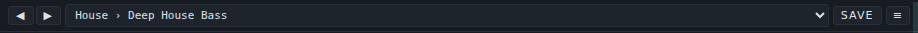
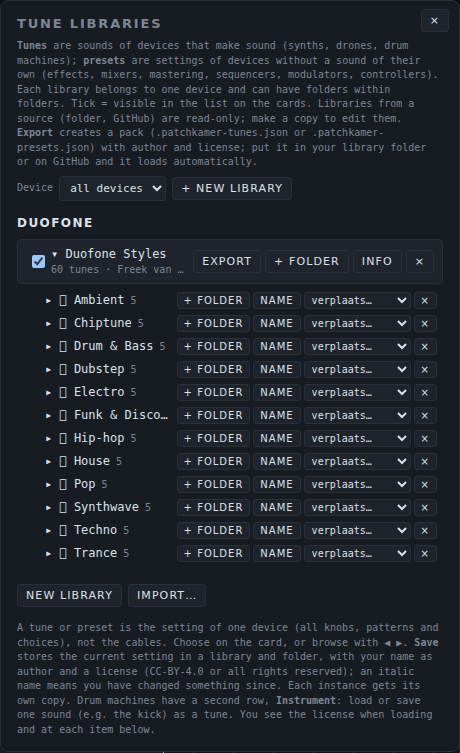

# Tunes: user manual

*Nederlandse versie: [USER-MANUAL_NL.md](USER-MANUAL_NL.md)*

A **tune** is a saved sound of one device that makes sound: a synth or a drum device. You pick a tune from a list on the device's card and all its knobs, choices and patterns move to the saved values. This page explains how to use tunes, how to import, export and share a pack, which packs come with Patchkamer, and how to make your own. Devices without a sound of their own (effects, mixers, tools) have **presets** instead: see the [presets manual](../presets/USER-MANUAL_EN.md). For the basics of Patchkamer (start, loading a library, cables), see the [main manual](../USER-MANUAL_EN.md).

## Contents

1. [What a tune is](#what-a-tune-is)
2. [Choose a tune on the card](#choose-a-tune-on-the-card)
3. [Save your own tune](#save-your-own-tune)
4. [Drum machines: the Instrument row](#drum-machines-the-instrument-row)
5. [The Tunes menu: libraries and folders](#the-tunes-menu-libraries-and-folders)
6. [Import and export a pack](#import-and-export-a-pack)
7. [Share a pack: the file and the license](#share-a-pack-the-file-and-the-license)
8. [The packs that come with Patchkamer](#the-packs-that-come-with-patchkamer)
9. [Make your own pack](#make-your-own-pack)
10. [If it does not work](#if-it-does-not-work)

## What a tune is

A tune is the **sound of one device**: all its knobs, choices and patterns. It does not contain cables. Tunes are for devices that make sound (in the contract: `instrument` devices): synths, drones and drum devices. A device without a sound of its own has presets, not tunes.

Tunes are kept per device. A tune made for Duofone only shows up on a Duofone card. Every card with that device gets its own copy of the values when you load a tune, so changing one Duofone does not change another.

## Choose a tune on the card

Every card of a sound-making device has a bar under its title with ◀ ▶ buttons, a list, **Save** and a **≡** button. Here is the bar of a Duofone with the tune **House › Deep House Bass**:



- **The list** shows the tunes of all libraries for this device, grouped by library. Each entry is written as *folder › name*. Hover over the list to see the author and license of the current tune. Until you add a library, the list reads "— no tunes —".
- **◀ ▶** step to the previous or next tune.
- **Save** stores the current setting (see below). It lights up when you have changed something since you loaded the tune.
- **≡** opens the **Tunes** panel for this device (see [The Tunes menu](#the-tunes-menu-libraries-and-folders)).
- An asterisk (*) behind the name in the list, and an *italic* name on the card, mean: you changed something since you loaded the tune. A (⧉) marks a tune that another card of the same device is using.

If you do not see the bar, switch on **Show the tune and preset bar on the cards** in **Settings**.

To try one: place Duofone, connect a Keys device to its **Keyboard / notes** input and its output to your speakers, open the list and choose a tune. Play a few notes, then step through the tunes with ▶.

## Save your own tune

1. Make the sound you want.
2. Click **Save** on the card.
3. In the window that opens, give the tune a **name**. Pick the **library** and **folder** it goes into (or choose **+ New library…** and **+ New folder…**), and fill in the **author** and the **license**: CC-BY-4.0 or all rights reserved.
4. Click **Save**.

If a tune with that name already exists in the folder, it is replaced. Other cards that use it keep their own copy. You can only save into a library that is yours: libraries that come from a source (a GitHub address or a folder on your computer) are read-only. Make a copy first with **Copy** in the Tunes panel.

Your own tunes are kept in your browser. Export a library to put it in a file (see [Import and export a pack](#import-and-export-a-pack)). **Clear browser storage…** in Settings removes them.

## Drum machines: the Instrument row

Patchkamer's host has a second feature for drum machines. A drum machine that offers separate instruments (for example a kick and a snare) gets a **second row** on its tune bar, named **Instrument**. There you choose an instrument, then **load or save one sound** (such as the kick) as a tune of its own, next to the tunes of the whole machine. In a pack file such an item has `kind: "part"` and names the instrument in `part`.

What I could check in this repository: none of the drum devices that come with it (Drum Kit, Drum Machine, Groovebox 12, Pulse Drums, Latin Percussion and Click Synth) offers separate instruments, so you will not see this row on them, and the six drum packs contain whole-machine tunes only (`kind: "set"`). The row is there for drum machines that do offer instruments.

## The Tunes menu: libraries and folders

The **Tunes ▾** menu at the top opens the **Tune libraries** panel. It lists the libraries per device. A library belongs to one device and can have folders, and folders can have folders. The panel is the same as the Presets panel; it only shows the sound-making devices.



| Control | What it does |
|---|---|
| **Device** | Filters the panel on one device. **All devices** shows everything. |
| **New library** | Makes an empty library for the chosen device. |
| **Import…** | Reads a pack from a file (see below). |
| Tick box | A ticked library is visible in the list on the cards. Untick it to hide it without deleting it. |
| Library name | Click it to open or close the library and see its folders and tunes. The line under it shows how many tunes it has, the author and the license. |
| **Export** | Writes the library to a pack file. |
| **+ folder** | Adds a folder at the top level of the library. Every folder in your own libraries has its own **+ folder**, **Name** (rename), a move list and **×**. |
| **Info** | Shows and edits the name, author, license and description of the library. |
| **Copy** | Only on read-only libraries: makes an editable copy of the library. |
| **×** | Deletes the library. The button asks you to click a second time before it deletes. |

Open a library to see its folders and tunes. Next to each tune, **Load** puts it on the selected card of that device (otherwise on the first one; if the device is not on the floor yet, it is placed). Tunes in your own libraries also have **Name** (rename), a move list and **×**. In a read-only library, a button **→ library name** copies the tune to your own library.

## Import and export a pack

A **pack** is one library in one file, `name.patchkamer-tunes.json`.

- **Import:** open **Tunes ▾**, click **Import…** and choose one or more pack files. Each pack becomes a library of your own for the device named in the file, so you can edit it. If you already have a library with the same name for that device, the new one gets a number: "Duofone Styles (2)". The tunes show on a card once that device is placed.
- **Export:** open **Tunes ▾** and click **Export** next to a library. Patchkamer saves it as *Device - Library name.patchkamer-tunes.json*.
- **Automatically:** a library that you load from GitHub or from a folder brings its pack files along: every `*.patchkamer-tunes.json` and `*.patchkamer-presets.json` in it appears in the panels on its own, as a read-only library. The address `github.com/unboxednl/patchkamer` loads the packs of this repository (see [the main manual](../USER-MANUAL_EN.md#4-load-a-library)).

## Share a pack: the file and the license

A pack is a plain JSON file. You can send it, put it on GitHub or in the library folder of a project. The short version of the format:

```json
{
  "format": "patchkamer-tunes",
  "formatVersion": 1,
  "device": "nl.patchkamer.duofone",
  "name": "Duofone Styles",
  "author": "Freek van Gool",
  "license": "CC0-1.0",
  "description": "Tunes for Duofone by music style: …",
  "tree": [
    { "folder": "Techno", "items": [
      { "name": "Rolling Bass", "kind": "set", "version": "1.0.0", "state": { "cutoff": 420, "resonance": 0.35 } }
    ] }
  ]
}
```

- `format` is `patchkamer-tunes` and `formatVersion` is `1`.
- `device` is the exact id of the device the pack is for. A tune hangs on that id; a wrong id gives a pack that belongs to no device.
- `tree` holds **folders** (`folder` with `items`) and tunes. A folder can sit in a folder. Every tune has a `name`, `kind: "set"` (the whole sound of the device) and a `state` with the device's own values. Values that the device does not know are ignored; missing values get the starting value.

The packs that come with Patchkamer are **CC0-1.0**: public domain. You may use, change and share them without naming the author. The license of a pack of your own is yours to choose when you save and export. The whole `tunes/` folder is CC0-1.0; see [LICENSING.md](../../LICENSING.md).

## The packs that come with Patchkamer

This repository has 24 packs with **1393 tunes** in total, one per device: 18 packs for synths (1186 tunes) and 6 for drum devices (207 tunes). All are licensed CC0-1.0, and the names of packs, folders and tunes are English. Most packs are sorted by music style: each folder is a style and holds a handful of tunes for it. Where the pack is made differently (for example the Acid Baselines pack with folders named after eras, or Latin Percussion with folders per rhythm), you see that in the folder names below.

### Synths (18)

| Device | Pack | Tunes | Folders | File |
|---|---|---|---|---|
| [Acid Baselines](../../devices/synths/AcidBaselines/) | Acid Baselines Classics | 49 | Chicago Origins (5), Frankfurt Rolling (5), Minimal Acid (5), Squelch Anthems (5), Acid Techno (5), Acid Trance (5), Electro Acid (5), Deep Acid (5), AIcid (9) | [`acid-baselines-classics.patchkamer-tunes.json`](../../tunes/acid-baselines-classics.patchkamer-tunes.json) |
| [Acid Stepper](../../devices/synths/AcidStepper/) | Acid Stepper Styles | 65 | Acid (7), Techno (6), House (6), Deep House (5), Electro (6), Trance (6), Breakbeat (5), Hip-hop (5), Synthwave (5), Dub (5), Industrial (5), Garage (4) | [`acid-stepper-styles.patchkamer-tunes.json`](../../tunes/acid-stepper-styles.patchkamer-tunes.json) |
| [Basic Mono](../../devices/synths/BasicMono/) | Basic Mono Styles | 65 | Techno (6), House (6), Electro (6), Hip-hop (5), Funk (6), Synthwave (6), Dub (5), Pop (5), Chiptune (6), Acid (5), Trance (5), Ambient (4) | [`basic-mono-styles.patchkamer-tunes.json`](../../tunes/basic-mono-styles.patchkamer-tunes.json) |
| [Bowed Ensemble](../../devices/synths/BowedEnsemble/) | Bowed Ensemble Styles | 65 | Cinematic (7), Ambient (6), Pop (6), Ballad (6), Trance (6), Synthwave (6), Film Score (6), Lo-fi (6), Neo-classical (6), Disco & Funk (5), Deep House (5) | [`bowed-ensemble-styles.patchkamer-tunes.json`](../../tunes/bowed-ensemble-styles.patchkamer-tunes.json) |
| [Chord Poly](../../devices/synths/ChordPoly/) | Chord Poly Styles | 60 | House (6), Deep House (6), Garage (6), Lo-fi (6), Ambient (6), Pop (6), Soul (6), Synthwave (6), Cinematic (6), Disco & Funk (6) | [`chord-poly-styles.patchkamer-tunes.json`](../../tunes/chord-poly-styles.patchkamer-tunes.json) |
| [Cross Mod Mono](../../devices/synths/CrossModMono/) | Cross Mod Mono Styles | 63 | Techno (6), Acid (5), House (6), Trance (5), Ambient (5), Synthwave (6), Electro (5), Drum & Bass (5), Dub (5), Hip-hop (4), Chiptune (6), Funk & Disco (5) | [`cross-mod-mono-styles.patchkamer-tunes.json`](../../tunes/cross-mod-mono-styles.patchkamer-tunes.json) |
| [Dissonant Cluster](../../devices/synths/DissonantCluster/) | Dissonant Cluster Styles | 60 | Industrial (8), Horror & Cinematic (8), Dark Ambient (7), Techno (6), Experimental (7), Sound Design (6), Noise (5), Dubstep (6), Drone (7) | [`dissonant-cluster-styles.patchkamer-tunes.json`](../../tunes/dissonant-cluster-styles.patchkamer-tunes.json) |
| [Duofone](../../devices/synths/Duofone/) | Duofone Styles | 60 | Techno (5), House (5), Trance (5), Ambient (5), Drum & Bass (5), Dubstep (5), Synthwave (5), Funk & Disco (5), Hip-hop (5), Electro (5), Pop (5), Chiptune (5) | [`duofone-styles.patchkamer-tunes.json`](../../tunes/duofone-styles.patchkamer-tunes.json) |
| [Four-Operator FM](../../devices/synths/FourOperatorFM/) | Four-Operator FM Styles | 67 | Synthwave (7), Electro (6), Pop (6), Chiptune (6), Jazz & Soul (6), Ambient (6), Cinematic (6), Techno & House (6), Drum & Bass (6), Hip-hop & Lo-fi (6), Funk & Disco (6) | [`four-operator-fm-styles.patchkamer-tunes.json`](../../tunes/four-operator-fm-styles.patchkamer-tunes.json) |
| [Karplus String](../../devices/synths/KarplusString/) | Karplus String Styles | 60 | Folk (6), Ambient (6), Cinematic (6), Pop (6), World (6), Lo-fi (6), Ballad (6), Flamenco (6), Jazz (6), Metallic (6) | [`karplus-string-styles.patchkamer-tunes.json`](../../tunes/karplus-string-styles.patchkamer-tunes.json) |
| [Low Bass](../../devices/synths/LowBass/) | Low Bass Styles | 64 | Sub (6), Rolling Bass (5), Detuned Wide (5), Dub (5), Booming Sub (6), Acid (5), Funk (5), Drum & Bass (5), Dubstep (5), Garage (4), Trap (4), Synthwave (4), Techno & House (5) | [`low-bass-styles.patchkamer-tunes.json`](../../tunes/low-bass-styles.patchkamer-tunes.json) |
| [Patch Mono](../../devices/synths/PatchMono/) | Patch Mono Styles | 79 | Techno (6), Acid (6), Dubstep (6), Drum & Bass (6), Hip-hop (5), Dub (5), Synthwave (6), Ambient (6), Electro (5), Funk & Disco (5), Trance (5), Chiptune (5), Patch Routes (7), External Input (6) | [`patch-mono-styles.patchkamer-tunes.json`](../../tunes/patch-mono-styles.patchkamer-tunes.json) |
| [Patchbay Synth](../../devices/synths/PatchbaySynth/) | Patchbay Synth Styles | 89 | Techno (7), Acid (6), House (6), Synthwave (6), Ambient (7), Cinematic (7), Electro (6), Hip-hop (5), Dub (5), Funk & Disco (6), Trance (5), Chiptune (5), Drum & Bass (6), Generative (7), FX (5) | [`patchbay-synth-styles.patchkamer-tunes.json`](../../tunes/patchbay-synth-styles.patchkamer-tunes.json) |
| [Poly Chorus](../../devices/synths/PolyChorus/) | Poly Chorus Styles | 72 | Synthwave (6), Ambient (6), Cinematic (6), Pop (6), Trance (6), House (6), Deep House (6), Funk & Disco (6), Soul (6), Electro (6), Lo-fi (6), Techno (6) | [`poly-chorus-styles.patchkamer-tunes.json`](../../tunes/poly-chorus-styles.patchkamer-tunes.json) |
| [Stage Keys](../../devices/synths/StageKeys/) | Stage Keys Styles | 66 | Soul (6), Funk (6), Jazz (6), Pop (6), Gospel (6), Rock (6), Disco (6), House (6), Lo-fi (6), Reggae (6), Ballad (6) | [`stage-keys-styles.patchkamer-tunes.json`](../../tunes/stage-keys-styles.patchkamer-tunes.json) |
| [Sub Line](../../devices/synths/SubLine/) | Sub Line Styles | 68 | Techno (8), House (7), Deep House (5), Acid (8), Electro (7), Synthwave (8), Hip-hop (7), Dub (6), Drum & Bass (6), Trance (6) | [`subline-styles.patchkamer-tunes.json`](../../tunes/subline-styles.patchkamer-tunes.json) |
| [Supersaw Swarm](../../devices/synths/SupersawSwarm/) | Supersaw Swarm Styles | 61 | Trance (7), Hardstyle (6), Progressive (6), Big Room (6), Synthwave (6), Pop (6), Future Bass (6), Eurodance (6), Ambient (6), Cinematic (6) | [`supersaw-swarm-styles.patchkamer-tunes.json`](../../tunes/supersaw-swarm-styles.patchkamer-tunes.json) |
| [Triple Osc Poly](../../devices/synths/TripleOscPoly/) | Triple Osc Poly Styles | 73 | Trance (7), House (6), Pop (6), Synthwave (7), Ambient (6), Cinematic (6), Future Bass (6), Funk (6), Disco (6), Electro (6), Techno (6), Lo-fi (5) | [`triple-osc-poly-styles.patchkamer-tunes.json`](../../tunes/triple-osc-poly-styles.patchkamer-tunes.json) |

### Drums (6)

| Device | Pack | Tunes | Folders | File |
|---|---|---|---|---|
| [Click Synth](../../devices/drums/ClickSynth/) | Click Synth Styles | 30 | Minimal Techno (3), Microhouse (3), Techno (3), Glitch (3), Electro (3), Breakbeat (3), Ambient (3), Industrial (3), Dub Techno (3), Acid (3) | [`click-synth-styles.patchkamer-tunes.json`](../../tunes/click-synth-styles.patchkamer-tunes.json) |
| [Drum Kit](../../devices/drums/DrumKit/) | Drum Kit Styles | 38 | Techno (5), House (3), Trance (3), Drum & Bass (3), Dubstep (3), Hip-hop (3), Funk & disco (3), Electro (3), Pop (3), Rock (3), Jazz (3), Synthwave (3) | [`drum-kit-styles.patchkamer-tunes.json`](../../tunes/drum-kit-styles.patchkamer-tunes.json) |
| [Drum Machine](../../devices/drums/DrumMachine/) | Drum Machine Styles | 36 | Techno (3), House (3), Trance (3), Drum & Bass (3), Dubstep (3), Hip-hop (3), Funk & disco (3), Electro (3), Pop (3), Rock (3), Jazz (3), Synthwave (3) | [`drum-machine-styles.patchkamer-tunes.json`](../../tunes/drum-machine-styles.patchkamer-tunes.json) |
| [Groovebox 12](../../devices/drums/Groovebox12/) | Groovebox 12 Styles | 38 | Techno (5), House (3), Trance (3), Drum & Bass (3), Dubstep (3), Hip-hop (3), Funk & disco (3), Electro (3), Pop (3), Rock (3), Jazz (3), Synthwave (3) | [`groovebox-12-styles.patchkamer-tunes.json`](../../tunes/groovebox-12-styles.patchkamer-tunes.json) |
| [Latin Percussion](../../devices/drums/LatinPercussion/) | Latin Percussion Styles | 39 | Salsa (3), Son (3), Mambo (3), Cha-Cha-Cha (3), Rumba (3), Bossa Nova (3), Samba (3), Merengue (3), Bachata (3), Cumbia (3), Reggaeton (3), Latin Jazz (3), Latin Soul (3) | [`latin-percussion-styles.patchkamer-tunes.json`](../../tunes/latin-percussion-styles.patchkamer-tunes.json) |
| [Pulse Drums](../../devices/drums/PulseDrums/) | Pulse Drums Techno | 26 | Techno (5), Minimal (3), Peak Time (3), Hard Techno (3), Dub Techno (3), Acid (3), Electro (3), Breaks (3) | [`pulse-drums-techno.patchkamer-tunes.json`](../../tunes/pulse-drums-techno.patchkamer-tunes.json) |

### What a tune holds

- **Synth tunes** set the sound of the synth: oscillators, filter, envelopes and so on. Some synths also keep a pattern or a bassline in the tune (for example the Acid Baselines pack); the device manual says which.
- **Drum tunes** are a whole machine: sounds and pattern together (see [Drum machines: the Instrument row](#drum-machines-the-instrument-row)).
- A tune never contains cables, and it does not start playing by itself. Connect the device and start the clock or play notes; see the manual of the device: [synths](../synths/USER-MANUAL_EN.md) and [drums](../drums/USER-MANUAL_EN.md).

### How to use them

Either load `github.com/unboxednl/patchkamer` as a library (the packs come with it, read-only), or download a file from the [tunes folder](../../tunes/) and use **Import…**. Packs for a device that is not on the floor yet show up as soon as you place the device.

## Make your own pack

**Without an agent.** Place the device, make a sound, click **Save** and choose **+ New library…** to start a library. Repeat for every tune, use folders to sort them, and click **Info** to fill in the author, the license and a description. Then click **Export**. The file is your pack.

**With an AI agent.** An agent can write a pack file directly. Give it:

- [`tunes/AGENTS.md`](../../tunes/AGENTS.md): the file layout, the rules for `state` and the license (always `CC0-1.0` in this repository);
- the `AGENTS.md` in the device's folder (for example `devices/synths/Duofone/AGENTS.md`): it lists the device's id, its values and their ranges.

The pack goes in `tunes/` as `name.patchkamer-tunes.json`, and the tune names are English and free of brand names. Ask the agent to use only values that the device knows and to say that it did not listen to the result. Then import the pack, step through it and listen yourself.

## If it does not work

- **The bar is not on the card.** Switch on **Show the tune and preset bar on the cards** in Settings.
- **The list says "— no tunes —".** There is no library for this device, or it is unticked in the Tunes panel. Import a pack or load a library.
- **I imported a pack but it does not show.** The pack is for another device: its `device` id has to match the card's device. The Tunes panel groups libraries per device; check there.
- **Import says "not a Patchkamer tune or preset file".** The file is not a pack, or the JSON is damaged. A pack file without a `device` is refused.
- **I cannot save into a library.** It is read-only (loaded from GitHub or a folder). Make a copy with **Copy** and save there.
- **A tune loads but there is no sound.** A tune sets the device only. It does not make cables, and it does not play notes. Check the cables and the notes or clock that drive the device (see the manual of the device).
- **The tune changed after I loaded it.** The name is in italics: you moved a knob or changed a pattern. **Save** stores your version, or choose the tune again to go back.
