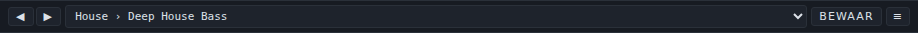
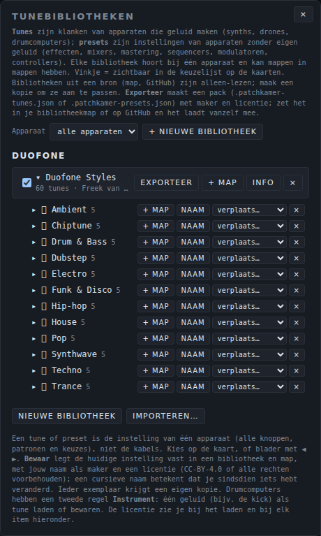

# Tunes: gebruikershandleiding

*English version: [USER-MANUAL_EN.md](USER-MANUAL_EN.md)*

Een **tune** is een bewaarde klank van één apparaat dat geluid maakt: een synth, een sampler of een drumapparaat. Je kiest een tune uit een lijst op de kaart van het apparaat en alle knoppen, keuzes en patronen springen naar de bewaarde waarden. Deze pagina legt uit hoe je tunes gebruikt, hoe je een pack importeert, exporteert en deelt, welke packs er met Patchkamer meekomen en hoe je een eigen pack maakt. Apparaten zonder eigen geluid (effecten, mixers, tools) hebben **presets**: zie de [handleiding voor presets](../presets/USER-MANUAL_NL.md). De basis van Patchkamer (opstarten, een bibliotheek laden, kabels trekken) staat in de [basishandleiding](../USER-MANUAL_NL.md).

## Inhoud

1. [Wat een tune is](#wat-een-tune-is)
2. [Een tune kiezen op de kaart](#een-tune-kiezen-op-de-kaart)
3. [Je eigen tune bewaren](#je-eigen-tune-bewaren)
4. [Drumcomputers: de regel Instrument](#drumcomputers-de-regel-instrument)
5. [Het menu Tunes: bibliotheken en mappen](#het-menu-tunes-bibliotheken-en-mappen)
6. [Een pack importeren en exporteren](#een-pack-importeren-en-exporteren)
7. [Een pack delen: het bestand en de licentie](#een-pack-delen-het-bestand-en-de-licentie)
8. [De packs die met Patchkamer meekomen](#de-packs-die-met-patchkamer-meekomen)
9. [Een eigen pack maken](#een-eigen-pack-maken)
10. [Als het niet werkt](#als-het-niet-werkt)

## Wat een tune is

Een tune is de **klank van één apparaat**: alle knoppen, keuzes en patronen. Kabels zitten er niet in. Tunes zijn voor apparaten die geluid maken (in het contract: `instrument`-apparaten): synths, drones, samplers en drumapparaten. Een apparaat zonder eigen geluid heeft presets, geen tunes.

Tunes horen bij één apparaat. Een tune die voor Duofone is gemaakt, zie je alleen op een Duofone-kaart. Elke kaart met dat apparaat krijgt bij het laden een eigen kopie van de waarden, dus als je de ene Duofone verandert, verandert de andere niet.

## Een tune kiezen op de kaart

Elke kaart van een apparaat dat geluid maakt, heeft onder de titel een balk met de knoppen ◀ ▶, een lijst, **Bewaar** en een knop **≡**. Hier de balk van een Duofone met de tune **House › Deep House Bass**:



- **De lijst** toont de tunes van alle bibliotheken voor dit apparaat, gegroepeerd per bibliotheek. Elke regel staat er als *map › naam*. Houd de muis boven de lijst om de maker en de licentie van de huidige tune te zien. Zolang je geen bibliotheek hebt, zegt de lijst "— nog geen tunes —".
- **◀ ▶** gaan naar de vorige of volgende tune.
- **Bewaar** legt de huidige instelling vast (zie hieronder). De knop licht op als je iets hebt veranderd sinds je de tune laadde.
- **≡** opent het paneel **Tunes** voor dit apparaat (zie [Het menu Tunes](#het-menu-tunes-bibliotheken-en-mappen)).
- Een sterretje (*) achter de naam in de lijst en een *cursieve* naam op de kaart betekenen: je hebt iets veranderd sinds je de tune laadde. Een (⧉) markeert een tune die een andere kaart van hetzelfde apparaat gebruikt.

Zie je de balk niet, zet dan **Tune- en presetbalk op de kaarten tonen** aan bij **Instellingen**.

Zelf proberen: plaats Duofone, sluit een Keys-apparaat aan op zijn ingang **Keyboard / noten** en de uitgang op je speakers, open de lijst en kies een tune. Speel een paar noten en blader daarna met ▶ door de tunes.

## Je eigen tune bewaren

1. Maak het geluid dat je wilt.
2. Klik op **Bewaar** op de kaart.
3. Geef in het venster dat opent de tune een **naam**. Kies de **bibliotheek** en de **map** waar hij in komt (of kies **+ Nieuwe bibliotheek…** en **+ Nieuwe map…**) en vul de **maker** en de **licentie** in: CC-BY-4.0 of alle rechten voorbehouden.
4. Klik op **Bewaar**.

Bestaat er al een tune met die naam in de map, dan wordt hij vervangen. Andere kaarten die hem gebruiken houden hun eigen kopie. Je kunt alleen bewaren in een bibliotheek die van jou is: bibliotheken uit een bron (een GitHub-adres of een map op je computer) zijn alleen-lezen. Maak eerst een kopie met **Kopie** in het paneel Tunes.

Je eigen tunes worden in je browser onthouden. Exporteer een bibliotheek om hem in een bestand te zetten (zie [Een pack importeren en exporteren](#een-pack-importeren-en-exporteren)). **Browsergeheugen wissen…** bij Instellingen haalt ze weg.

## Drumcomputers: de regel Instrument

De host van Patchkamer heeft voor drumcomputers nog iets extra's. Een drumcomputer die losse instrumenten aanbiedt (bijvoorbeeld een kick en een snare) krijgt op zijn tunebalk een **tweede regel**, **Instrument** genoemd. Daar kies je een instrument en **laad of bewaar je één geluid** (bijvoorbeeld de kick) als een tune op zich, naast de tunes van de hele machine. In een packbestand heeft zo'n item `kind: "part"` en staat het instrument in `part`.

Wat ik in deze repository kon controleren: geen van de drumapparaten die erbij zitten (Drum Kit, Drum Machine, Groovebox 12, Pulse Drums, Latin Percussion en Click Synth) biedt losse instrumenten aan, dus je ziet deze regel er niet op, en de zes drumpacks bevatten alleen tunes voor de hele machine (`kind: "set"`). De regel is er voor drumcomputers die wel instrumenten aanbieden.

## Het menu Tunes: bibliotheken en mappen

De tab **Tunes** van het bibliotheekvenster (knop **Bibliotheek** bovenaan, of **Tunes** in het ☰-menu) toont de **Tunebibliotheken**. Het toont de bibliotheken per apparaat. Een bibliotheek hoort bij één apparaat en kan mappen hebben, en mappen kunnen weer mappen hebben. Het paneel is hetzelfde als de tab Presets; het toont alleen de apparaten die geluid maken.



| Regelaar | Wat hij doet |
|---|---|
| **Apparaat** | Filtert het paneel op één apparaat. **alle apparaten** toont alles. |
| **Nieuwe bibliotheek** | Maakt een lege bibliotheek voor het gekozen apparaat. |
| **Importeren…** | Leest een pack uit een bestand (zie hieronder). |
| Vinkje | Een aangevinkte bibliotheek is zichtbaar in de lijst op de kaarten. Haal het vinkje weg om hem te verbergen zonder hem te verwijderen. |
| Naam van de bibliotheek | Klik erop om de bibliotheek open of dicht te klappen en zijn mappen en tunes te zien. De regel eronder toont het aantal tunes, de maker en de licentie. |
| **Exporteer** | Schrijft de bibliotheek naar een packbestand. |
| **+ Map** | Voegt een map toe op het hoogste niveau van de bibliotheek. In je eigen bibliotheken heeft elke map zelf **+ Map**, **Naam** (hernoemen), een verplaatslijst en **×**. |
| **Info** | Toont en wijzigt de naam, de maker, de licentie en de omschrijving van de bibliotheek. |
| **Kopie** | Alleen bij alleen-lezen bibliotheken: maakt een aanpasbare kopie van de bibliotheek. |
| **×** | Verwijdert de bibliotheek. De knop vraagt om een tweede klik voordat hij verwijdert. |

Open een bibliotheek om zijn mappen en tunes te zien. Naast elke tune zet **Laden** hem op de geselecteerde kaart van dat apparaat (anders op de eerste; staat het apparaat nog niet op de vloer, dan wordt het geplaatst). Tunes in je eigen bibliotheken hebben ook **Naam** (hernoemen), een verplaatslijst en **×**. In een alleen-lezen bibliotheek kopieert een knop **→ naam van de bibliotheek** de tune naar je eigen bibliotheek.

## Een pack importeren en exporteren

Een **pack** is één bibliotheek in één bestand, `naam.patchkamer-tunes.json`.

- **Importeren:** open de tab **Tunes** van de bibliotheek, klik op **Importeren…** en kies een of meer packbestanden. Elk pack wordt een eigen bibliotheek van jou voor het apparaat dat in het bestand staat, dus je kunt hem aanpassen. Heb je al een bibliotheek met dezelfde naam voor dat apparaat, dan krijgt de nieuwe een nummer: "Duofone Styles (2)". De tunes verschijnen op een kaart zodra dat apparaat is geplaatst.
- **Exporteren:** open de tab **Tunes** van de bibliotheek en klik op **Exporteer** naast een bibliotheek. Patchkamer bewaart hem als *Apparaat - Naam van de bibliotheek.patchkamer-tunes.json*.
- **Vanzelf:** een bibliotheek die je van GitHub of uit een map laadt, brengt zijn packbestanden mee: elk `*.patchkamer-tunes.json` en `*.patchkamer-presets.json` erin verschijnt vanzelf in de panelen, als alleen-lezen bibliotheek. Het adres `github.com/unboxednl/patchkamer` laadt de packs van deze repository (zie [de basishandleiding](../USER-MANUAL_NL.md#4-een-bibliotheek-laden)).

## Een pack delen: het bestand en de licentie

Een pack is een gewoon JSON-bestand. Je kunt het sturen, op GitHub zetten of in de bibliotheekmap van een project leggen. Het formaat in het kort:

```json
{
  "format": "patchkamer-tunes",
  "formatVersion": 1,
  "device": "nl.patchkamer.duofone",
  "name": "Duofone Styles",
  "author": "Freek van Gool",
  "license": "CC0-1.0",
  "description": "Tunes for Duofone by music style: …",
  "tree": [
    { "folder": "Techno", "items": [
      { "name": "Rolling Bass", "kind": "set", "version": "1.0.0", "state": { "cutoff": 420, "resonance": 0.35 } }
    ] }
  ]
}
```

- `format` is `patchkamer-tunes` en `formatVersion` is `1`.
- `device` is de exacte id van het apparaat waar het pack voor is. Een tune hangt aan die id; een verkeerde id geeft een pack dat bij geen enkel apparaat hoort.
- `tree` bevat **mappen** (`folder` met `items`) en tunes. Een map kan in een map zitten. Elke tune heeft een `name`, `kind: "set"` (de hele klank van het apparaat) en een `state` met de eigen waarden van het apparaat. Waarden die het apparaat niet kent, worden genegeerd; ontbrekende waarden krijgen de beginwaarde.

De packs die met Patchkamer meekomen zijn **CC0-1.0**: publiek domein. Je mag ze gebruiken, aanpassen en delen zonder de maker te noemen. De licentie van een eigen pack kies je zelf bij het bewaren en exporteren. De hele map `tunes/` is CC0-1.0; zie [LICENSING.md](../../LICENSING.md).

## De packs die met Patchkamer meekomen

Deze repository heeft 39 packs met samen **2382 tunes**, één per apparaat: 30 packs voor synths (2017 tunes), 3 voor samplers (158 tunes) en 6 voor drumapparaten (207 tunes). Alle hebben de licentie CC0-1.0, en de namen van packs, mappen en tunes zijn Engels. De bestanden hebben `formatVersion` 1. De meeste packs zijn gesorteerd op muziekstijl: elke map is een stijl en bevat een handvol tunes daarvoor. Waar een pack anders is opgebouwd (bijvoorbeeld het pack van Acid Baselines met mappen naar tijdperk, of Latin Percussion met mappen per ritme), zie je dat aan de mapnamen hieronder.

### Synths (30)

| Apparaat | Pack | Tunes | Mappen | Bestand |
|---|---|---|---|---|
| [Acid Baselines](../../devices/synths/AcidBaselines/) | Acid Baselines Classics | 49 | Chicago Origins (5), Frankfurt Rolling (5), Minimal Acid (5), Squelch Anthems (5), Acid Techno (5), Acid Trance (5), Electro Acid (5), Deep Acid (5), AIcid (9) | [`acid-baselines-classics.patchkamer-tunes.json`](../../tunes/acid-baselines-classics.patchkamer-tunes.json) |
| [Acid Stepper](../../devices/synths/AcidStepper/) | Acid Stepper Styles | 65 | Acid (7), Techno (6), House (6), Deep House (5), Electro (6), Trance (6), Breakbeat (5), Hip-hop (5), Synthwave (5), Dub (5), Industrial (5), Garage (4) | [`acid-stepper-styles.patchkamer-tunes.json`](../../tunes/acid-stepper-styles.patchkamer-tunes.json) |
| [Basic Mono](../../devices/synths/BasicMono/) | Basic Mono Styles | 65 | Techno (6), House (6), Electro (6), Hip-hop (5), Funk (6), Synthwave (6), Dub (5), Pop (5), Chiptune (6), Acid (5), Trance (5), Ambient (4) | [`basic-mono-styles.patchkamer-tunes.json`](../../tunes/basic-mono-styles.patchkamer-tunes.json) |
| [Biotope](../../devices/synths/Biotope/) | Biotope Styles | 86 | Nature (6), Weather (7), Water (6), Ambient (7), Meditation (6), Sleep (6), Cinematic (7), Sci-Fi (7), Dark Ambient (6), Lo-fi (7), Field Recording (7), Interiors (7), Rhythmic (7) | [`biotope-styles.patchkamer-tunes.json`](../../tunes/biotope-styles.patchkamer-tunes.json) |
| [Bowed Ensemble](../../devices/synths/BowedEnsemble/) | Bowed Ensemble Styles | 65 | Cinematic (7), Ambient (6), Pop (6), Ballad (6), Trance (6), Synthwave (6), Film Score (6), Lo-fi (6), Neo-classical (6), Disco & Funk (5), Deep House (5) | [`bowed-ensemble-styles.patchkamer-tunes.json`](../../tunes/bowed-ensemble-styles.patchkamer-tunes.json) |
| [Brass Section](../../devices/synths/BrassSection/) | Brass Section | 32 | Trumpet (4), Trombone (4), Horn (4), Section (5), Stabs (5), Swells (4), Funk (3), Ballad (3) | [`brass-section.patchkamer-tunes.json`](../../tunes/brass-section.patchkamer-tunes.json) |
| [Celestial Mechanics](../../devices/synths/CelestialMechanics/) | Celestial Mechanics Styles | 74 | Space (7), Cinematic (7), Sci-Fi (7), Ambient (7), Dark Ambient (7), Experimental (7), Sound Design (7), Synthwave (6), Trance (6), Horror (7), Drone (6) | [`celestial-mechanics-styles.patchkamer-tunes.json`](../../tunes/celestial-mechanics-styles.patchkamer-tunes.json) |
| [Cinematic Synth](../../devices/synths/CinematicSynth/) | Cinematic Synth Scores | 56 | Dream Heist (8), Dark Hero (8), Space Voyage (8), Desert Epic (8), Ancient Battle (8), Quiet Tension (8), Impacts and Risers (8) | [`cinematic-synth-scores.patchkamer-tunes.json`](../../tunes/cinematic-synth-scores.patchkamer-tunes.json) |
| [Chord Poly](../../devices/synths/ChordPoly/) | Chord Poly Styles | 120 | House (6), Deep House (6), Garage (6), Lo-fi (6), Ambient (6), Pop (6), Soul (6), Synthwave (6), Cinematic (6), Disco & Funk (6), Techno (6), Dub Techno (6), Trance (6), Progressive Trance (6), Big Room (6), Electro House (6), Electro (6), Future Bass (6), Hardstyle (6), Eurodance (6) | [`chord-poly-styles.patchkamer-tunes.json`](../../tunes/chord-poly-styles.patchkamer-tunes.json) |
| [Cross Mod Mono](../../devices/synths/CrossModMono/) | Cross Mod Mono Styles | 63 | Techno (6), Acid (5), House (6), Trance (5), Ambient (5), Synthwave (6), Electro (5), Drum & Bass (5), Dub (5), Hip-hop (4), Chiptune (6), Funk & Disco (5) | [`cross-mod-mono-styles.patchkamer-tunes.json`](../../tunes/cross-mod-mono-styles.patchkamer-tunes.json) |
| [Dissonant Cluster](../../devices/synths/DissonantCluster/) | Dissonant Cluster Styles | 60 | Industrial (8), Horror & Cinematic (8), Dark Ambient (7), Techno (6), Experimental (7), Sound Design (6), Noise (5), Dubstep (6), Drone (7) | [`dissonant-cluster-styles.patchkamer-tunes.json`](../../tunes/dissonant-cluster-styles.patchkamer-tunes.json) |
| [Drone Synth](../../devices/synths/DroneSynth/) | Drone Synth Styles | 66 | Drone (7), Ambient (7), Dark Ambient (7), Techno (7), Industrial (6), Cinematic (7), Meditation (6), Sci-Fi (7), Doom (6), Minimal (6) | [`drone-synth-styles.patchkamer-tunes.json`](../../tunes/drone-synth-styles.patchkamer-tunes.json) |
| [Duofone](../../devices/synths/Duofone/) | Duofone Styles | 60 | Techno (5), House (5), Trance (5), Ambient (5), Drum & Bass (5), Dubstep (5), Synthwave (5), Funk & Disco (5), Hip-hop (5), Electro (5), Pop (5), Chiptune (5) | [`duofone-styles.patchkamer-tunes.json`](../../tunes/duofone-styles.patchkamer-tunes.json) |
| [Formant Singer](../../devices/synths/FormantSinger/) | Formant Singer Styles | 66 | Choir (6), Solo Voices (6), Bass Voices (5), Whisper and Breath (5), Pads and Ambient (6), Cinematic (6), Pop Leads (6), Robot and FX (6), Chant (5), Lullaby (5), Hymn (5), Syllable Study (5) | [`formant-singer-styles.patchkamer-tunes.json`](../../tunes/formant-singer-styles.patchkamer-tunes.json) |
| [Foundry](../../devices/synths/Foundry/) | Foundry Styles | 69 | Industrial (6), Techno (6), Dark Ambient (6), Cinematic (6), Sound Design (6), Horror (6), Experimental (6), Noise (6), Drone (7), Metal Percussion (8), Electro (6) | [`foundry-styles.patchkamer-tunes.json`](../../tunes/foundry-styles.patchkamer-tunes.json) |
| [Four-Operator FM](../../devices/synths/FourOperatorFM/) | Four-Operator FM Styles | 67 | Synthwave (7), Electro (6), Pop (6), Chiptune (6), Jazz & Soul (6), Ambient (6), Cinematic (6), Techno & House (6), Drum & Bass (6), Hip-hop & Lo-fi (6), Funk & Disco (6) | [`four-operator-fm-styles.patchkamer-tunes.json`](../../tunes/four-operator-fm-styles.patchkamer-tunes.json) |
| [Grain Cloud](../../devices/synths/GrainCloud/) | Grain Cloud Styles | 61 | Ambient (7), Dark Ambient (6), Cinematic (6), Meditation (5), Sci-Fi (6), Experimental (6), Glitch/IDM (7), Lo-fi (5), Drone (6), Sound Design (7) | [`grain-cloud-styles.patchkamer-tunes.json`](../../tunes/grain-cloud-styles.patchkamer-tunes.json) |
| [Ladder Mono](../../devices/synths/LadderMono/) | Ladder Mono Classics | 58 | Bass (12), Lead (12), Brass and Strings (6), Plucks and Keys (8), Sequences (8), Effects (8), Percussion (4) | [`ladder-mono-classics.patchkamer-tunes.json`](../../tunes/ladder-mono-classics.patchkamer-tunes.json) |
| [Karplus String](../../devices/synths/KarplusString/) | Karplus String Styles | 60 | Folk (6), Ambient (6), Cinematic (6), Pop (6), World (6), Lo-fi (6), Ballad (6), Flamenco (6), Jazz (6), Metallic (6) | [`karplus-string-styles.patchkamer-tunes.json`](../../tunes/karplus-string-styles.patchkamer-tunes.json) |
| [Layered Landscape](../../devices/synths/LayeredLandscape/) | Layered Landscape Styles | 71 | Ambient (9), Dark Ambient (6), Cinematic (7), Meditation (6), Sci-Fi (6), Nature (6), Space (6), Drone (7), Lo-fi (6), Minimal (6), Industrial (6) | [`layered-landscape-styles.patchkamer-tunes.json`](../../tunes/layered-landscape-styles.patchkamer-tunes.json) |
| [Low Bass](../../devices/synths/LowBass/) | Low Bass Styles | 64 | Sub (6), Rolling Bass (5), Detuned Wide (5), Dub (5), Booming Sub (6), Acid (5), Funk (5), Drum & Bass (5), Dubstep (5), Garage (4), Trap (4), Synthwave (4), Techno & House (5) | [`low-bass-styles.patchkamer-tunes.json`](../../tunes/low-bass-styles.patchkamer-tunes.json) |
| [Mist](../../devices/synths/Mist/) | Mist Styles | 62 | Ambient (7), Dark Ambient (6), Cinematic (6), Meditation (6), Sci-Fi (6), Experimental (5), Lo-fi (5), Drone (6), Sound Design (5), New Age (5), Chillout (5) | [`mist-styles.patchkamer-tunes.json`](../../tunes/mist-styles.patchkamer-tunes.json) |
| [Paradox](../../devices/synths/Paradox/) | Paradox Styles | 70 | Drone (7), Ambient (7), Dark Ambient (7), Cinematic (7), Sci-Fi (7), Glitch (7), Industrial (7), Experimental (7), Sound Design (7), Noise (7) | [`paradox-styles.patchkamer-tunes.json`](../../tunes/paradox-styles.patchkamer-tunes.json) |
| [Patch Mono](../../devices/synths/PatchMono/) | Patch Mono Styles | 79 | Techno (6), Acid (6), Dubstep (6), Drum & Bass (6), Hip-hop (5), Dub (5), Synthwave (6), Ambient (6), Electro (5), Funk & Disco (5), Trance (5), Chiptune (5), Patch Routes (7), External Input (6) | [`patch-mono-styles.patchkamer-tunes.json`](../../tunes/patch-mono-styles.patchkamer-tunes.json) |
| [Patchbay Synth](../../devices/synths/PatchbaySynth/) | Patchbay Synth Styles | 89 | Techno (7), Acid (6), House (6), Synthwave (6), Ambient (7), Cinematic (7), Electro (6), Hip-hop (5), Dub (5), Funk & Disco (6), Trance (5), Chiptune (5), Drum & Bass (6), Generative (7), FX (5) | [`patchbay-synth-styles.patchkamer-tunes.json`](../../tunes/patchbay-synth-styles.patchkamer-tunes.json) |
| [Poly Chorus](../../devices/synths/PolyChorus/) | Poly Chorus Styles | 72 | Synthwave (6), Ambient (6), Cinematic (6), Pop (6), Trance (6), House (6), Deep House (6), Funk & Disco (6), Soul (6), Electro (6), Lo-fi (6), Techno (6) | [`poly-chorus-styles.patchkamer-tunes.json`](../../tunes/poly-chorus-styles.patchkamer-tunes.json) |
| [Stage Keys](../../devices/synths/StageKeys/) | Stage Keys Styles | 66 | Soul (6), Funk (6), Jazz (6), Pop (6), Gospel (6), Rock (6), Disco (6), House (6), Lo-fi (6), Reggae (6), Ballad (6) | [`stage-keys-styles.patchkamer-tunes.json`](../../tunes/stage-keys-styles.patchkamer-tunes.json) |
| [Sub Line](../../devices/synths/SubLine/) | Sub Line Styles | 68 | Techno (8), House (7), Deep House (5), Acid (8), Electro (7), Synthwave (8), Hip-hop (7), Dub (6), Drum & Bass (6), Trance (6) | [`subline-styles.patchkamer-tunes.json`](../../tunes/subline-styles.patchkamer-tunes.json) |
| [Supersaw Swarm](../../devices/synths/SupersawSwarm/) | Supersaw Swarm Styles | 61 | Trance (7), Hardstyle (6), Progressive (6), Big Room (6), Synthwave (6), Pop (6), Future Bass (6), Eurodance (6), Ambient (6), Cinematic (6) | [`supersaw-swarm-styles.patchkamer-tunes.json`](../../tunes/supersaw-swarm-styles.patchkamer-tunes.json) |
| [Triple Osc Poly](../../devices/synths/TripleOscPoly/) | Triple Osc Poly Styles | 73 | Trance (7), House (6), Pop (6), Synthwave (7), Ambient (6), Cinematic (6), Future Bass (6), Funk (6), Disco (6), Electro (6), Techno (6), Lo-fi (5) | [`triple-osc-poly-styles.patchkamer-tunes.json`](../../tunes/triple-osc-poly-styles.patchkamer-tunes.json) |

### Samplers (3)

| Apparaat | Pack | Tunes | Mappen | Bestand |
|---|---|---|---|---|
| [Loop Slicer](../../devices/samplers/LoopSlicer/) | Loop Slicer Styles | 69 | House (6), Techno (6), Breakbeat (6), Drum and Bass (5), Hip-hop (6), Trap (5), Funk (5), Dub (5), Cinematic (5), Glitch (6), Pitched Hits (6), Own Loop (8) | [`loop-slicer-styles.patchkamer-tunes.json`](../../tunes/loop-slicer-styles.patchkamer-tunes.json) |
| [Loop Slicer](../../devices/samplers/LoopSlicer/) | Loop Slicer Break Chops | 10 | – | [`loop-slicer-break-chops.patchkamer-tunes.json`](../../tunes/loop-slicer-break-chops.patchkamer-tunes.json) |
| [Samplebank](../../devices/samplers/Samplebank/) | Samplebank Styles | 79 | Techno (7), House (7), Trance (5), Ambient (5), Synthwave (5), Hip-hop (4), Lo-fi (5), Trap (4), Drum & Bass (5), Dubstep (4), Electro (5), Pop (4), Chiptune (5), Funk & Disco (6), Dub (4), Cinematic (4) | [`samplebank-styles.patchkamer-tunes.json`](../../tunes/samplebank-styles.patchkamer-tunes.json) |

Een Samplebank-tune brengt zijn eigen kleine gegenereerde geluiden mee. Acht Loop Slicer-tunes (map Own Loop) gebruiken de loop die je hebt geladen en blijven daar zonder stil.

### Drums (6)

| Apparaat | Pack | Tunes | Mappen | Bestand |
|---|---|---|---|---|
| [Click Synth](../../devices/drums/ClickSynth/) | Click Synth Styles | 30 | Minimal Techno (3), Microhouse (3), Techno (3), Glitch (3), Electro (3), Breakbeat (3), Ambient (3), Industrial (3), Dub Techno (3), Acid (3) | [`click-synth-styles.patchkamer-tunes.json`](../../tunes/click-synth-styles.patchkamer-tunes.json) |
| [Drum Kit](../../devices/drums/DrumKit/) | Drum Kit Styles | 38 | Techno (5), House (3), Trance (3), Drum & Bass (3), Dubstep (3), Hip-hop (3), Funk & disco (3), Electro (3), Pop (3), Rock (3), Jazz (3), Synthwave (3) | [`drum-kit-styles.patchkamer-tunes.json`](../../tunes/drum-kit-styles.patchkamer-tunes.json) |
| [Drum Machine](../../devices/drums/DrumMachine/) | Drum Machine Styles | 36 | Techno (3), House (3), Trance (3), Drum & Bass (3), Dubstep (3), Hip-hop (3), Funk & disco (3), Electro (3), Pop (3), Rock (3), Jazz (3), Synthwave (3) | [`drum-machine-styles.patchkamer-tunes.json`](../../tunes/drum-machine-styles.patchkamer-tunes.json) |
| [Groovebox 12](../../devices/drums/Groovebox12/) | Groovebox 12 Styles | 38 | Techno (5), House (3), Trance (3), Drum & Bass (3), Dubstep (3), Hip-hop (3), Funk & disco (3), Electro (3), Pop (3), Rock (3), Jazz (3), Synthwave (3) | [`groovebox-12-styles.patchkamer-tunes.json`](../../tunes/groovebox-12-styles.patchkamer-tunes.json) |
| [Latin Percussion](../../devices/drums/LatinPercussion/) | Latin Percussion Styles | 39 | Salsa (3), Son (3), Mambo (3), Cha-Cha-Cha (3), Rumba (3), Bossa Nova (3), Samba (3), Merengue (3), Bachata (3), Cumbia (3), Reggaeton (3), Latin Jazz (3), Latin Soul (3) | [`latin-percussion-styles.patchkamer-tunes.json`](../../tunes/latin-percussion-styles.patchkamer-tunes.json) |
| [Pulse Drums](../../devices/drums/PulseDrums/) | Pulse Drums Techno | 26 | Techno (5), Minimal (3), Peak Time (3), Hard Techno (3), Dub Techno (3), Acid (3), Electro (3), Breaks (3) | [`pulse-drums-techno.patchkamer-tunes.json`](../../tunes/pulse-drums-techno.patchkamer-tunes.json) |

### Wat een tune bevat

- **Tunes voor synths** stellen de klank van de synth in: oscillatoren, filter, enveloppen enzovoort. Sommige synths bewaren ook een patroon of een baslijn in de tune (bijvoorbeeld het pack van Acid Baselines); de handleiding van het apparaat zegt welke.
- **Tunes voor samplers** stellen in hoe een sampler knipt en speelt. Een Samplebank-tune bevat ook zijn eigen kleine gegenereerde geluiden en vervangt dus de banken die je had. Een Loop Slicer-tune bevat nooit de audio van je loop: hij stelt alleen in hoe de loop geknipt en gespeeld wordt (de tunes in de map Own Loop laten de loop die je hebt geladen staan; de andere tunes zetten de ingebouwde demo-loop aan). Zie de [handleiding voor samplers](../samplers/USER-MANUAL_NL.md).
- **Tunes voor drums** zijn een hele machine: klanken en patroon samen (zie [Drumcomputers: de regel Instrument](#drumcomputers-de-regel-instrument)).
- Een tune bevat nooit kabels en begint niet uit zichzelf te spelen. Sluit het apparaat aan en start de klok of speel noten; zie de handleiding van het apparaat: [synths](../synths/USER-MANUAL_NL.md), [samplers](../samplers/USER-MANUAL_NL.md) en [drums](../drums/USER-MANUAL_NL.md).

### Zo gebruik je ze

Laad `github.com/unboxednl/patchkamer` als bibliotheek (de packs komen mee, alleen-lezen), of download een bestand uit de [map tunes](../../tunes/) en gebruik **Importeren…**. Een pack voor een apparaat dat nog niet op de vloer staat, verschijnt zodra je het apparaat plaatst.

## Een eigen pack maken

**Zonder agent.** Plaats het apparaat, maak een geluid, klik op **Bewaar** en kies **+ Nieuwe bibliotheek…** om een bibliotheek te beginnen. Herhaal dat voor elke tune, sorteer ze in mappen en klik op **Info** om de maker, de licentie en een omschrijving in te vullen. Klik dan op **Exporteer**. Het bestand is je pack.

**Met een AI-agent.** Een agent kan een packbestand rechtstreeks schrijven. Geef hem:

- [`tunes/AGENTS.md`](../../tunes/AGENTS.md): de indeling van het bestand, de regels voor `state` en de licentie (in deze repository altijd `CC0-1.0`);
- de `AGENTS.md` in de map van het apparaat (bijvoorbeeld `devices/synths/Duofone/AGENTS.md`): daar staan de id van het apparaat, zijn waarden en hun bereiken.

Het pack komt in `tunes/` als `naam.patchkamer-tunes.json`, en de namen van de tunes zijn Engels en zonder merknamen. Vraag de agent alleen waarden te gebruiken die het apparaat kent en erbij te zeggen dat hij het resultaat niet heeft beluisterd. Importeer het pack daarna, blader erdoor en luister zelf.

## Als het niet werkt

- **De balk staat niet op de kaart.** Zet **Tune- en presetbalk op de kaarten tonen** aan bij Instellingen.
- **De lijst zegt "— nog geen tunes —".** Er is geen bibliotheek voor dit apparaat, of hij staat uitgevinkt in het paneel Tunes. Importeer een pack of laad een bibliotheek.
- **Ik heb een pack geïmporteerd maar zie het niet.** Het pack is voor een ander apparaat: zijn `device`-id moet bij het apparaat van de kaart passen. Het paneel Tunes groepeert de bibliotheken per apparaat; kijk daar.
- **Importeren meldt "geen Patchkamer-tune- of presetbestand".** Het bestand is geen pack, of de JSON is beschadigd. Een packbestand zonder `device` wordt geweigerd.
- **Ik kan niet bewaren in een bibliotheek.** Hij is alleen-lezen (geladen van GitHub of uit een map). Maak een kopie met **Kopie** en bewaar daar.
- **Een tune laadt maar ik hoor niets.** Een tune stelt alleen het apparaat in. Hij trekt geen kabels en speelt geen noten. Controleer de kabels en de noten of de klok die het apparaat aansturen (zie de handleiding van het apparaat).
- **De tune is veranderd nadat ik hem laadde.** De naam staat cursief: je hebt een knop verplaatst of een patroon veranderd. **Bewaar** legt jouw versie vast, of kies de tune opnieuw om terug te gaan.
